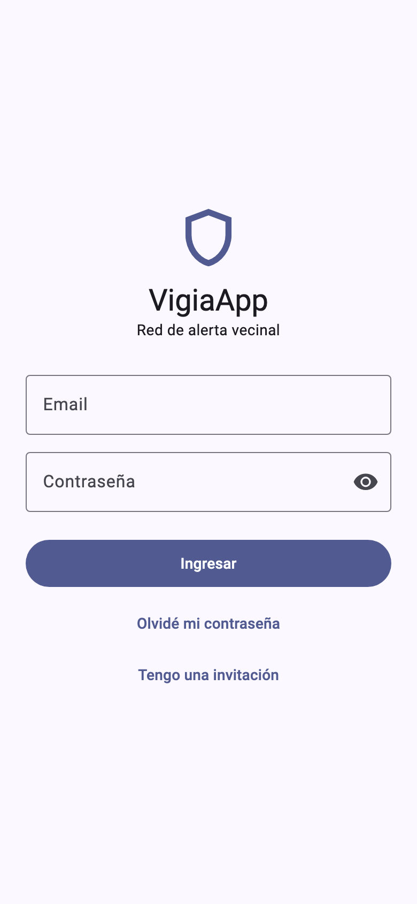

# VigiaApp desde cero

Wiki para **rehacer VigiaApp paso a paso**, desde no saber nada de Dart hasta tener la app completa: una red de alerta vecinal con login, chat del barrio con fotos, noticias, rondines nocturnos, botón SOS con mapa en vivo y panel para el comité.

Está hecha con [MkDocs](https://www.mkdocs.org/) + [Material for MkDocs](https://squidfunk.github.io/mkdocs-material/). El contenido son archivos Markdown en [`docs/`](docs/).

<p align="center">
  
</p>

## Contenido

| Parte | Qué cubre |
|---|---|
| [1. Preparación](docs/1-preparacion/index.md) | Instalar Flutter, crear el proyecto, correrlo y leer errores |
| [2. Dart](docs/2-dart/index.md) | El lenguaje: tipos, null safety, clases, colecciones, `Future`, `Stream` |
| [3. Flutter](docs/3-flutter/index.md) | Widgets, layout, formularios, navegación, estado y plugins |
| [4. Arquitectura](docs/4-arquitectura/index.md) | MVVM, capas, inyección de dependencias, manejo de errores |
| [5. Construcción](docs/5-construccion/index.md) | 16 capítulos, archivo por archivo, hasta la app completa |
| [6. Pruebas y entrega](docs/6-pruebas-y-entrega/index.md) | API real, tests, APK de Android y trabajo en equipo con Git |
| [7. Referencia](docs/7-referencia/index.md) | Glosario, chuletas, contrato de la API, errores frecuentes, ejercicios |

Si es tu primera vez, empezá por [Cómo usar esta wiki](docs/como-usar.md).

> **Ojo:** los archivos se pueden leer directo en GitHub, pero varias cosas (notas numeradas en el código, pestañas, recuadros, diagramas) solo se ven bien en la versión renderizada. Lo recomendable es levantarla localmente como se explica abajo.

## Verla en tu compu

Necesitás **Python 3.9 o más nuevo**.

```bash
git clone https://github.com/juanmahumeniuk/VigiaApp-wiki.git
cd VigiaApp-wiki

python3 -m venv .venv
source .venv/bin/activate        # En Windows: .venv\Scripts\activate
pip install -r requirements.txt

mkdocs serve
```

Abrí <http://127.0.0.1:8000>. Mientras `mkdocs serve` esté corriendo, cada cambio que guardes en `docs/` se recarga solo en el navegador.

Para generar la versión estática (queda en `site/`, que está ignorada por Git):

```bash
mkdocs build --strict
```

## Estructura del repo

```text
.
├── docs/                 # Todo el contenido de la wiki
│   ├── index.md          # Portada
│   ├── como-usar.md
│   ├── 1-preparacion/ … 7-referencia/
│   ├── assets/
│   │   ├── capturas/     # Screenshots de la app
│   │   ├── diagramas/
│   │   └── archivos/     # Archivos descargables (p. ej. fake_vigia_api.dart)
│   └── stylesheets/extra.css
├── mkdocs.yml            # Configuración del sitio y menú de navegación
└── requirements.txt      # Dependencias de Python (mkdocs-material)
```

## Cómo colaborar

¿Encontraste un error, algo que no se entiende o querés agregar un capítulo? Mirá [CONTRIBUTING.md](CONTRIBUTING.md).
