# Qué vamos a construir

!!! abstract "Objetivo"
    Tener en la cabeza la app entera **antes** de empezar: qué hace, quién la usa, qué pantallas tiene y cómo habla con el servidor. Cuando en la Parte 5 escribas un archivo, vas a saber para qué pantalla es.

## La idea en una frase

**VigiaApp es una red de alerta vecinal**: un botón SOS que avisa a los vecinos al mismo tiempo, con la ubicación en vivo en un mapa, más un chat del barrio con fotos, rondines nocturnos y noticias del comité.

## Quién la usa

Cada persona que entra a la app es un **vecino** de una **manzana**, y tiene uno de tres **roles**:

| Rol | Qué puede hacer además de lo básico |
|---|---|
| **Vecino** | Lo básico: ver la actividad, publicar, chatear, mandar un SOS, responder alertas. |
| **Vigía** | Hace **rondines**: recorridas nocturnas por el barrio en turnos asignados. |
| **Comité** | Administra: da de alta vecinos, les cambia el rol, arma los turnos de rondín, publica noticias y puede borrar cualquier publicación. |

!!! info "No hay registro abierto"
    Nadie se crea una cuenta solo. **El comité da de alta** al vecino y el servidor le manda un correo con un enlace. Ese enlace abre la app en la pantalla **Elegir contraseña**. Así se evita que cualquiera entre a la red del barrio.

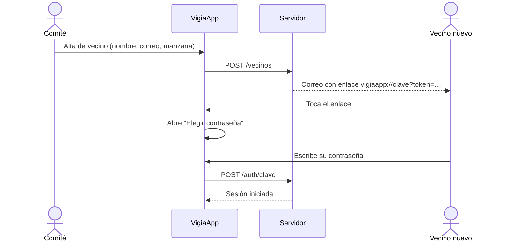

## Las pantallas

### Entrar

<div class="capturas" markdown>
<figure markdown>
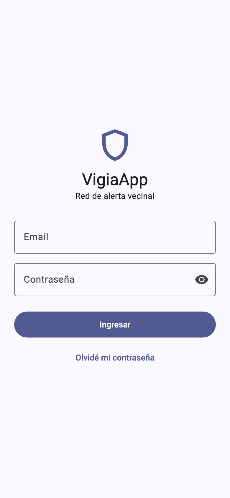{ .captura }
<figcaption>Login</figcaption>
</figure>
<figure markdown>
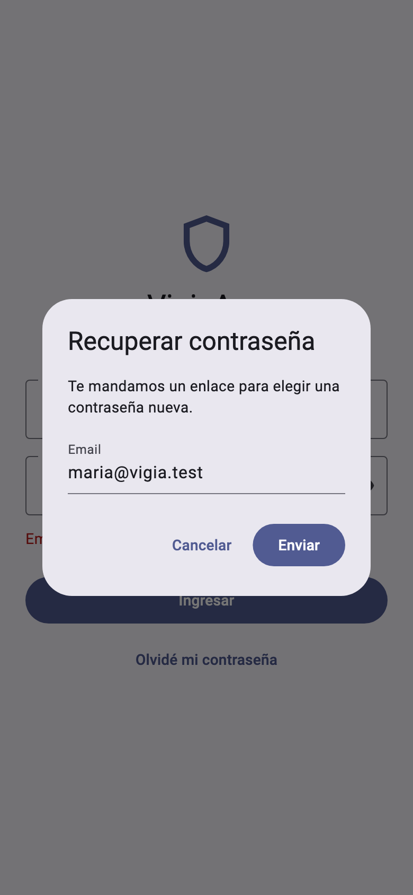{ .captura }
<figcaption>Recuperar contraseña</figcaption>
</figure>
<figure markdown>
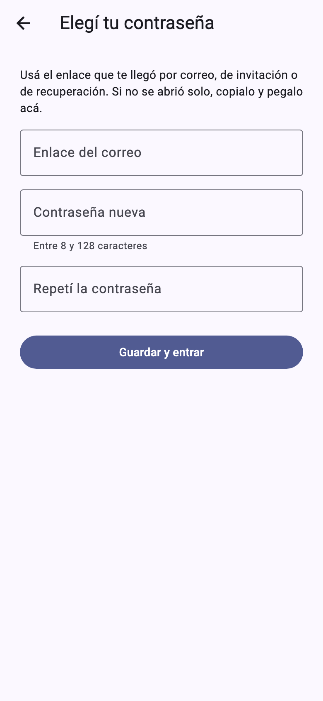{ .captura }
<figcaption>Elegir contraseña (desde el correo)</figcaption>
</figure>
</div>

### El día a día

<div class="capturas" markdown>
<figure markdown>
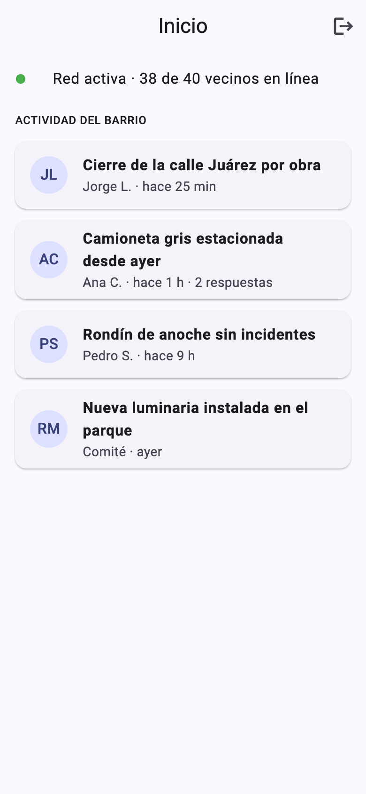{ .captura }
<figcaption>Inicio: la actividad del barrio</figcaption>
</figure>
<figure markdown>
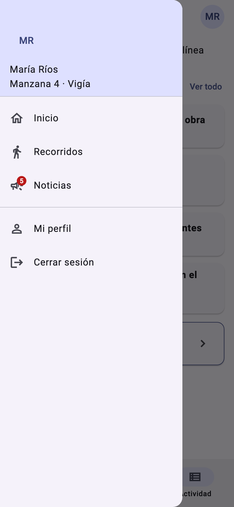{ .captura }
<figcaption>Menú lateral</figcaption>
</figure>
<figure markdown>
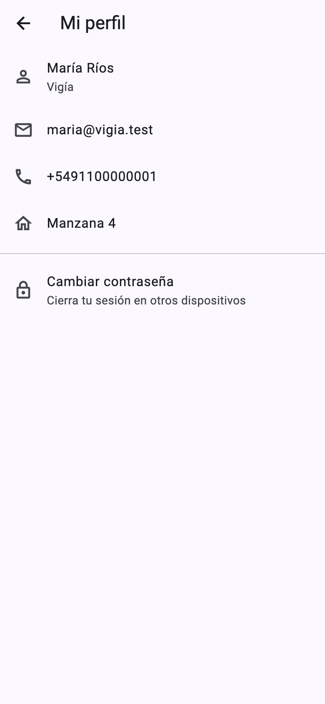{ .captura }
<figcaption>Perfil</figcaption>
</figure>
<figure markdown>
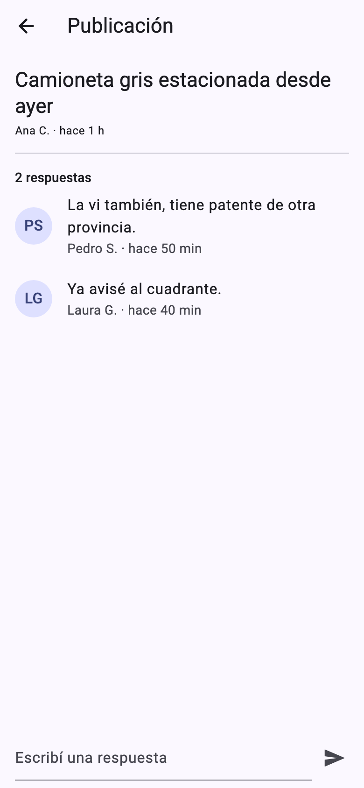{ .captura }
<figcaption>Una publicación con foto</figcaption>
</figure>
<figure markdown>
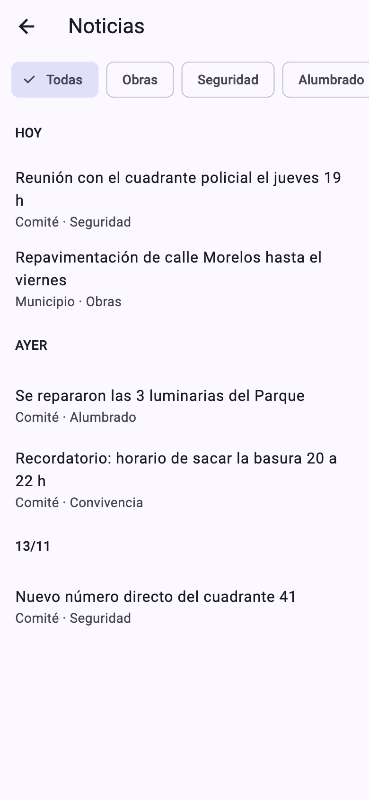{ .captura }
<figcaption>Noticias del comité</figcaption>
</figure>
<figure markdown>
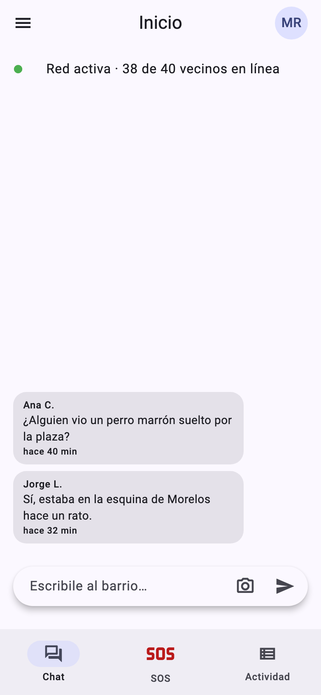{ .captura }
<figcaption>Chat del barrio</figcaption>
</figure>
<figure markdown>
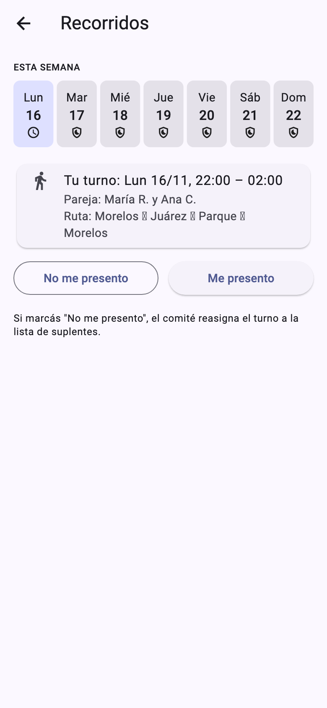{ .captura }
<figcaption>Rondines: recorridos</figcaption>
</figure>
</div>

### La emergencia

<div class="capturas" markdown>
<figure markdown>
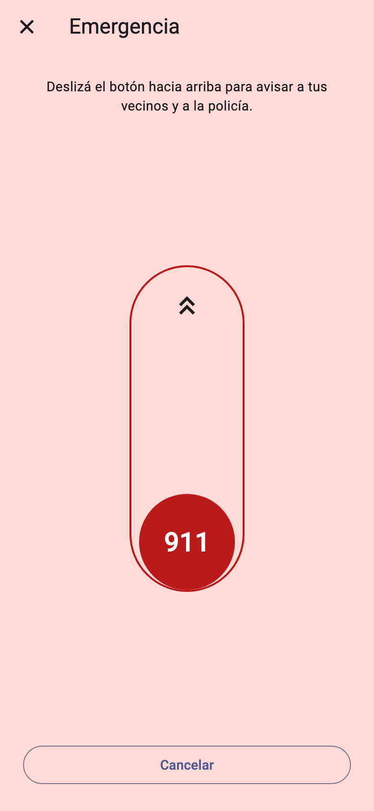{ .captura }
<figcaption>Confirmar el SOS</figcaption>
</figure>
<figure markdown>
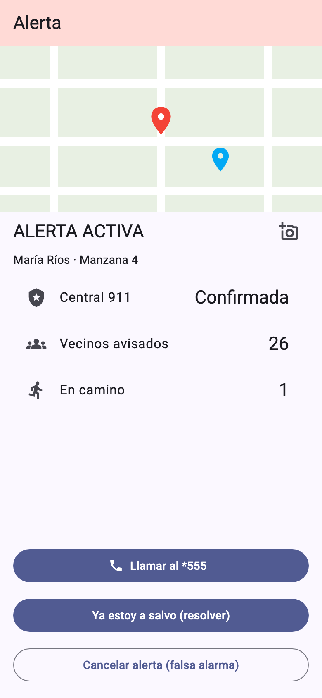{ .captura }
<figcaption>Mi alerta, con mapa</figcaption>
</figure>
<figure markdown>
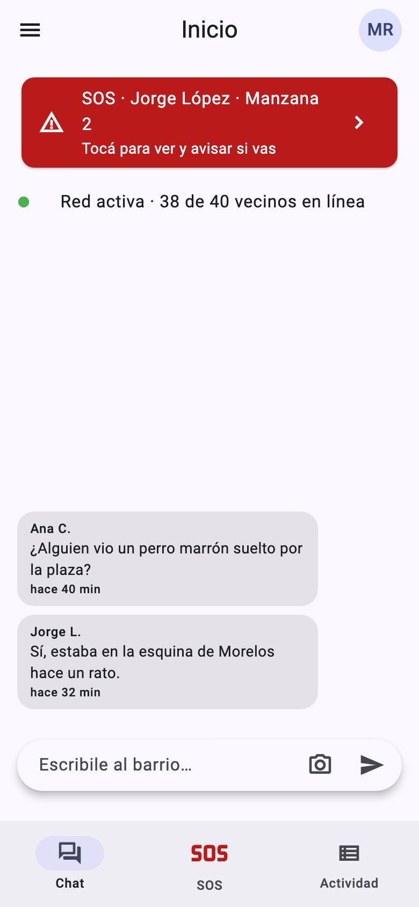{ .captura }
<figcaption>Aviso de alerta de un vecino</figcaption>
</figure>
<figure markdown>
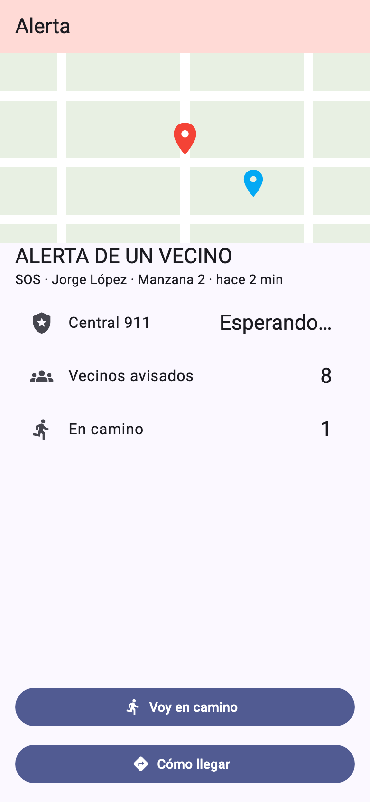{ .captura }
<figcaption>La alerta de otro vecino</figcaption>
</figure>
</div>

### El comité

<div class="capturas" markdown>
<figure markdown>
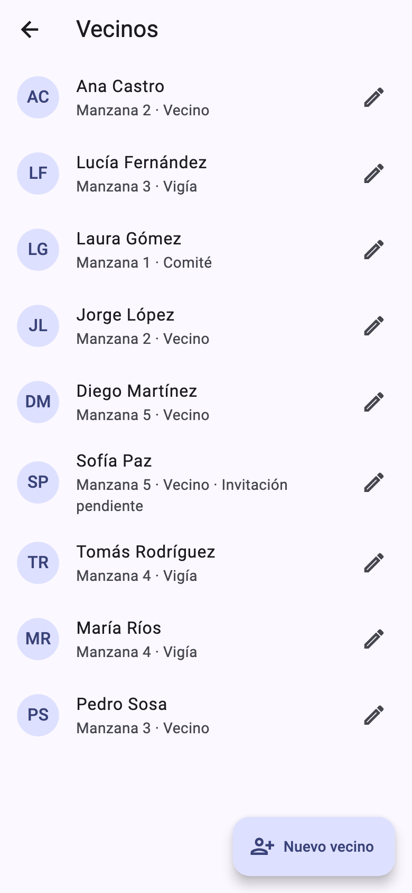{ .captura }
<figcaption>Lista de vecinos</figcaption>
</figure>
<figure markdown>
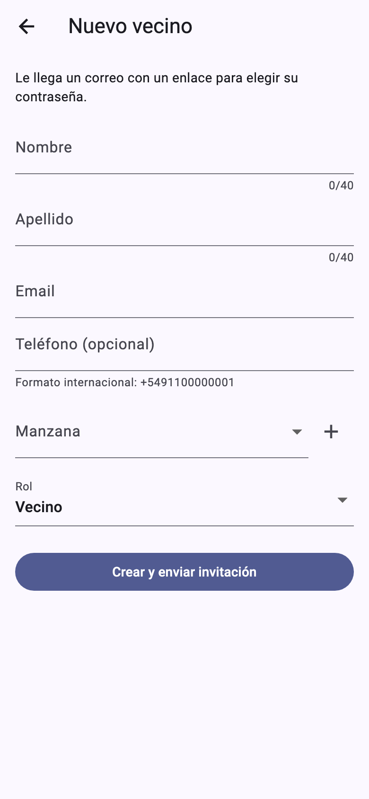{ .captura }
<figcaption>Alta de vecino</figcaption>
</figure>
<figure markdown>
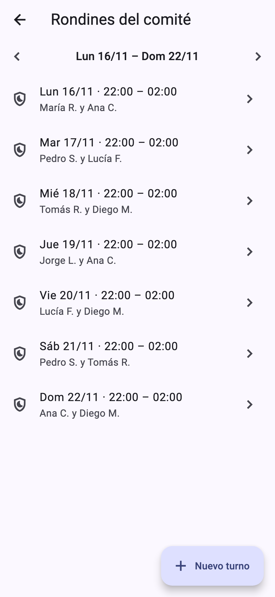{ .captura }
<figcaption>Turnos de rondín</figcaption>
</figure>
</div>

## Cómo se navega

Este es el mapa de pantallas completo. Las flechas son "desde acá se abre esto".

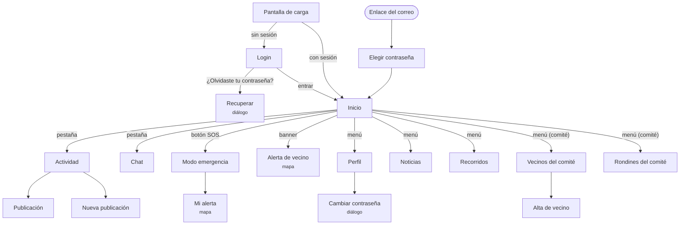

## La app y el servidor

La app **no guarda los datos del barrio**: los pide a un servidor (la **API**, *Application Programming Interface*: un programa en internet que responde pedidos). El servidor de VigiaApp se llama **vigia_api**, está hecho en Node.js con una base MySQL, y vive en otro repositorio. Nosotros solo hacemos la app.

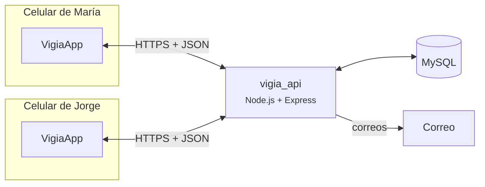

La app y el servidor se hablan con **HTTP** y se mandan los datos en **JSON** (un formato de texto para datos). Por ejemplo, para entrar:

=== "Lo que manda la app"

    ```http
    POST /api/v1/auth/login
    Content-Type: application/json

    {"email": "maria@vigia.test", "password": "vigia1234"}
    ```

=== "Lo que responde el servidor"

    ```json
    {
      "token": "3f9a1c0e7b52d4…",
      "expira_en": "2026-12-01T03:00:00Z",
      "vecino": {"id": 1, "nombre": "María Ríos", "manzana": "Manzana 4", "rol": "vigia"}
    }
    ```

Todos los pedidos que la app puede hacer están en el [Contrato de la API](../7-referencia/contrato-api.md).

### El servidor de mentira

Para aprender (y para los tests) **no vamos a depender del servidor real** hasta la Parte 6. En el capítulo 4 escribimos un `FakeVigiaApi`: una clase que responde lo mismo que el servidor, pero con datos guardados en memoria. Tiene los mismos vecinos de ejemplo que la base de pruebas del servidor, todos con la contraseña `vigia1234`:

| Correo | Rol |
|---|---|
| `maria@vigia.test` | Vigía |
| `laura@vigia.test` | Comité |
| `jorge@vigia.test` | Vecino |

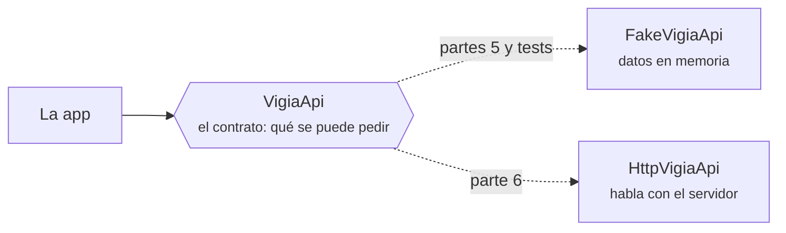

La app no sabe con cuál de los dos habla: solo conoce el **contrato**. Cambiar de uno al otro es una línea de configuración. Esta idea (depender de una interfaz y no de una implementación) es central y la vemos en [La dirección de las dependencias](../4-arquitectura/3-direccion-de-dependencias.md).

## Qué NO vamos a hacer

Para que la wiki se enfoque en entender, dejamos afuera algunas cosas de la app original (están en [Diferencias con la app real](../7-referencia/diferencias.md)):

- **Estilos propios**: ni fuentes, ni colores a medida, ni animaciones. Todo es Material con un color base. La app se ve más sencilla, pero el código es el mismo en lo importante.
- **El servidor**: lo usamos, no lo construimos.
- **Publicar en la tienda**: llegamos hasta el APK instalable.

## Las tecnologías

| Pieza | Qué es | Dónde se ve |
|---|---|---|
| **Dart** | El lenguaje de programación. | [Parte 2](../2-dart/index.md) |
| **Flutter** | El *framework* (conjunto de herramientas) para hacer la interfaz. | [Parte 3](../3-flutter/index.md) |
| **Material 3** | El sistema de diseño de Google: botones, barras, tarjetas. Viene con Flutter. | [Widgets de Material](../3-flutter/4-material.md) |
| **MVVM** | La forma de organizar el código en capas. | [Parte 4](../4-arquitectura/index.md) |
| **Paquetes** | Código de otros que sumamos: HTTP, GPS, mapas, cámara, almacenamiento seguro, enlaces. | [Plugins y plataformas](../3-flutter/8-plugins-y-plataformas.md) |

## Lo que aprendiste

- [x] VigiaApp tiene tres roles (vecino, vigía, comité) y se entra por invitación.
- [x] Tiene unas 20 pantallas en cuatro grupos: entrar, día a día, emergencia y comité.
- [x] Habla con un servidor por HTTP y JSON, pero hasta la Parte 6 usamos uno de mentira.
- [x] No vamos a hacer estilos: solo Material.

[Siguiente: Instalar las herramientas :material-arrow-right:](2-instalacion.md){ .md-button .md-button--primary }
