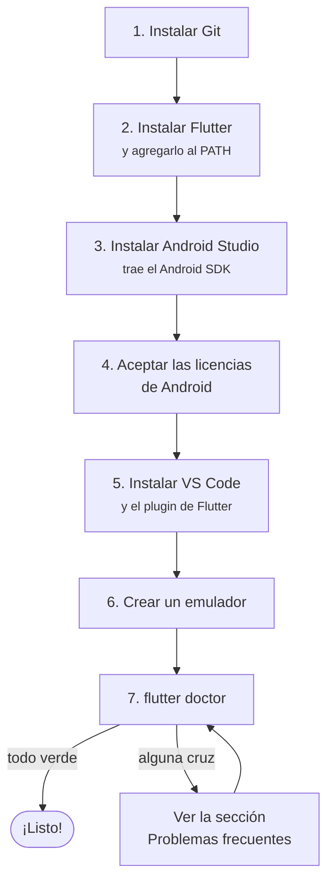
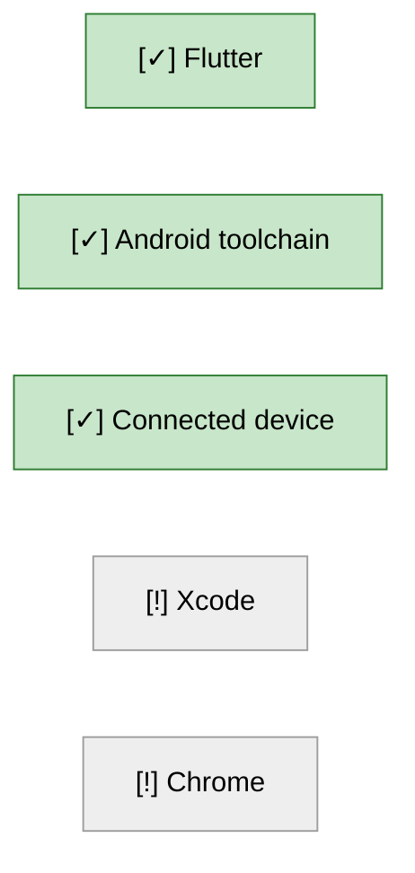

# Instalar las herramientas

!!! abstract "Objetivo"
    Dejar la compu lista para hacer apps de Flutter: el SDK de Flutter, el SDK de Android, un editor y un emulador. Al final, `flutter doctor` tiene que mostrar tildes verdes en **Flutter**, **Android toolchain** y **Connected device**.

!!! info "La versión que usa la wiki"
    Todo el código se probó con **Flutter 3.44** y **Dart 3.12**. Con una versión más nueva debería andar igual; con una más vieja, algunas cosas no compilan (la wiki usa novedades de Dart 3.12, como los [parámetros privados con nombre](../2-dart/5-clases.md#parametros-privados-con-nombre)).

## El plan



## Paso 1: Git

Git guarda la historia de tu código y lo usa Flutter para actualizarse. Probá si ya lo tenés:

```bash
git --version
```

Si dice algo como `git version 2.47.0`, seguí. Si no:

=== "macOS"

    Instalá las herramientas de línea de comandos de Apple (traen Git):

    ```bash
    xcode-select --install
    ```

=== "Windows"

    Bajá el instalador de [git-scm.com](https://git-scm.com/download/win) y seguí las opciones por defecto.

=== "Linux"

    ```bash
    sudo apt install git        # Debian / Ubuntu
    sudo dnf install git        # Fedora
    ```

## Paso 2: Flutter

Flutter es una carpeta con todo adentro (incluido Dart). Hay que **bajarla**, **dejarla en un lugar fijo** y **avisarle a la terminal dónde está** (agregarla al `PATH`).

!!! question "¿Qué es el PATH?"
    Cuando escribís un comando como `flutter`, la terminal lo busca en una lista de carpetas. Esa lista se llama `PATH`. Si la carpeta `flutter/bin` no está en la lista, la terminal contesta `command not found`.

=== "macOS"

    1. Bajá el SDK desde [docs.flutter.dev/get-started/install/macos](https://docs.flutter.dev/get-started/install/macos) (elegí *Android* como destino).
    2. Descomprimilo en una carpeta tuya, por ejemplo `~/development/flutter`.
    3. Agregalo al PATH. Abrí (o creá) el archivo `~/.zshrc` y sumá al final:

        ```bash
        export PATH="$HOME/development/flutter/bin:$PATH"
        ```

    4. Cerrá y abrí la terminal (o corré `source ~/.zshrc`).

=== "Windows"

    1. Bajá el SDK desde [docs.flutter.dev/get-started/install/windows](https://docs.flutter.dev/get-started/install/windows).
    2. Descomprimilo en `C:\src\flutter` (**no** en `C:\Program Files`, que necesita permisos de administrador).
    3. Buscá "variables de entorno" en el menú Inicio → *Editar las variables de entorno de esta cuenta* → seleccioná `Path` → *Editar* → *Nuevo* → `C:\src\flutter\bin`.
    4. Cerrá y abrí PowerShell.

=== "Linux"

    1. Bajá el SDK desde [docs.flutter.dev/get-started/install/linux](https://docs.flutter.dev/get-started/install/linux).
    2. Descomprimilo en `~/development/flutter`.
    3. Sumá al final de `~/.bashrc`:

        ```bash
        export PATH="$HOME/development/flutter/bin:$PATH"
        ```

    4. Instalá las bibliotecas que pide el almacenamiento seguro (lo usamos desde el capítulo 5):

        ```bash
        sudo apt install libsecret-1-dev      # Debian / Ubuntu
        sudo dnf install libsecret-devel      # Fedora
        ```

Comprobalo:

```bash
flutter --version
```

```text
Flutter 3.44.9 • channel stable • https://github.com/flutter/flutter.git
Framework • revision 6b182d2c75 • 2026-08-05
Engine • …
Tools • Dart 3.12.2 • DevTools 2.50.0
```

La línea importante es **`Dart 3.12`** (o más).

## Paso 3: Android Studio

Aunque escribas en VS Code, necesitás Android Studio porque **trae el Android SDK** (el compilador de Android) y el **administrador de emuladores**.

1. Bajalo de [developer.android.com/studio](https://developer.android.com/studio) e instalalo con las opciones por defecto.
2. La primera vez que lo abras, el asistente baja el **Android SDK**, las **Platform Tools** y una imagen de emulador. Dejalo terminar (son varios GB).
3. En *More Actions → SDK Manager → SDK Tools*, tildá **Android SDK Command-line Tools** y aplicá.
4. En *Plugins*, instalá **Flutter** (instala también Dart). Te sirve si después querés usar Android Studio como editor.

## Paso 4: las licencias de Android

Google pide aceptar las licencias del SDK una vez:

```bash
flutter doctor --android-licenses
```

Contestá `y` a todo.

## Paso 5: VS Code

1. Bajalo de [code.visualstudio.com](https://code.visualstudio.com).
2. En la barra izquierda, *Extensions* (++ctrl+shift+x++ o ++cmd+shift+x++), buscá **Flutter** (de Dart Code) e instalala. Trae también la extensión de **Dart**.

Lo que ganás con la extensión:

| Función | Cómo |
|---|---|
| Correr la app | ++f5++ o *Run → Start Debugging* |
| Hot reload | Guardar el archivo (++ctrl+s++ / ++cmd+s++) |
| Ver errores mientras escribís | Subrayados rojos y amarillos, y la pestaña *Problems* |
| Autocompletar | Escribí y aparecen sugerencias; ++ctrl+space++ las fuerza |
| Ir a la definición | ++ctrl++ / ++cmd++ + clic sobre un nombre |
| Formatear | ++shift+alt+f++ (o activar *Format on Save*) |
| Arreglos rápidos | El foco amarillo :material-lightbulb-outline: o ++ctrl+period++ / ++cmd+period++ |

!!! tip "Activá *Format on Save*"
    En la configuración (++ctrl+comma++ / ++cmd+comma++) buscá **Format On Save** y tildalo. Así cada vez que guardás, el código queda con la sangría y los espacios de Dart, y no tenés que pensar en eso.

## Paso 6: un emulador

Un **emulador** es un celular Android que corre dentro de la compu.

1. En Android Studio: *More Actions → Virtual Device Manager → Create Device*.
2. Elegí un teléfono (por ejemplo **Pixel 8**).
3. Elegí una imagen del sistema con **Google Play** o **Google APIs** (las necesitamos para Google Maps en el capítulo 14). Bajá la que tenga el número de API más alto.
4. Terminá y tocá :material-play: para arrancarlo.

Desde la terminal también podés:

```bash
flutter emulators                    # lista los emuladores creados
flutter emulators --launch Pixel_8   # arranca uno
flutter devices                      # lista lo que hay conectado
```

??? example "Usar tu celular en vez del emulador"
    1. En el celular: *Ajustes → Acerca del teléfono* y tocá 7 veces **Número de compilación**. Se activan las **Opciones de desarrollador**.
    2. En *Opciones de desarrollador*, activá **Depuración USB**.
    3. Conectalo por cable y aceptá el aviso "¿Permitir depuración USB?".
    4. `flutter devices` lo tiene que mostrar.

    Ventaja: va más rápido y podés probar el GPS de verdad. Desventaja: necesitás el cable.

## Paso 7: `flutter doctor`

`flutter doctor` revisa todo y te dice qué falta:

```bash
flutter doctor
```

```text
Doctor summary (to see all details, run flutter doctor -v):
[✓] Flutter (Channel stable, 3.44.9, on macOS 16.1, locale es-AR)
[✓] Android toolchain - develop for Android devices (Android SDK version 36.0.0)
[!] Xcode - develop for iOS and macOS
    ✗ Xcode installation is incomplete
[✓] Chrome - develop for the web
[✓] Android Studio (version 2026.1)
[✓] VS Code (version 1.104.0)
[✓] Connected device (2 available)
[✓] Network resources

! Doctor found issues in 1 category.
```

Lo que **tiene** que estar en verde para esta wiki:



- **Xcode** solo hace falta para compilar para iPhone (y solo existe en Mac). La wiki apunta a Android: podés ignorarlo.
- **Chrome** es para Flutter web: tampoco lo usamos.

## Problemas frecuentes

??? failure "`flutter: command not found` (o *no se reconoce como comando*)"
    La carpeta `flutter/bin` no está en el PATH, o no reabriste la terminal. Revisá el Paso 2 y abrí una terminal nueva. Para ver el PATH actual: `echo $PATH` (macOS/Linux) o `$env:Path` (PowerShell).

??? failure "`Android sdkmanager not found` / `cmdline-tools component is missing`"
    Falta instalar **Android SDK Command-line Tools** (Paso 3, punto 3).

??? failure "`Android license status unknown`"
    Corré `flutter doctor --android-licenses` y aceptá todo.

??? failure "`No devices available` / `Connected device: No devices`"
    No hay un emulador abierto. Abrilo desde el Device Manager o con `flutter emulators --launch <nombre>`.

??? failure "El emulador va muy lento o no arranca"
    - Comprobá que la virtualización esté activada en la BIOS (Windows/Linux: Intel VT-x o AMD-V).
    - Usá una imagen **x86_64** en PC y **arm64** en Mac con chip Apple.
    - Cerrá otros programas pesados: el emulador usa varios GB de RAM.

??? failure "Linux: `libsecret-1 not found` al compilar"
    Faltan las bibliotecas del Paso 2, punto 4.

## Lo que aprendiste

- [x] Flutter es una carpeta que hay que poner en el **PATH**; trae Dart adentro.
- [x] Android Studio da el **Android SDK** y los **emuladores**, aunque escribas en VS Code.
- [x] `flutter doctor` dice qué falta; para esta wiki alcanza con Flutter, Android toolchain y un dispositivo.

[Siguiente: Crear el proyecto :material-arrow-right:](3-crear-el-proyecto.md){ .md-button .md-button--primary }
