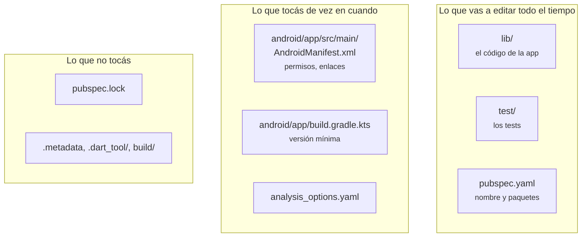
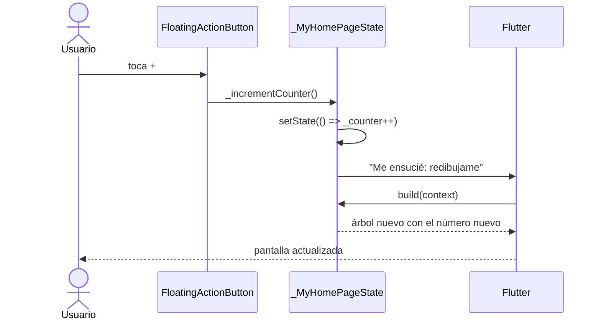

# Crear el proyecto

!!! abstract "Objetivo"
    Crear el proyecto `vigia_app`, recorrer **qué generó Flutter y para qué sirve cada archivo**, y entender el contador de ejemplo antes de borrarlo en el capítulo 1.

## El comando

Abrí una terminal en la carpeta donde quieras guardar el proyecto y corré:

```bash
flutter create --org com.ejemplo --platforms android,ios vigia_app
```

Vamos parte por parte:

| Parte | Qué hace |
|---|---|
| `flutter create` | Crea un proyecto nuevo de Flutter. |
| `--org com.ejemplo` | El "dominio al revés" de quien hace la app. Con esto, el identificador de la app queda `com.ejemplo.vigia_app`. En la tienda no puede haber dos apps con el mismo identificador. |
| `--platforms android,ios` | Genera solo las carpetas para Android e iOS. Sin esto, también crea `web/`, `linux/`, `macos/` y `windows/`. |
| `vigia_app` | El nombre del proyecto (y de la carpeta). Solo minúsculas, números y guiones bajos. |

La salida termina así:

```text
Wrote 75 files.

All done!
...
In order to run your application, type:

  $ cd vigia_app
  $ flutter run

Your application code is in vigia_app/lib/main.dart.
```

!!! tip "Desde VS Code"
    También se puede: ++ctrl+shift+p++ (o ++cmd+shift+p++) → **Flutter: New Project** → *Application*. Pero el comando de la terminal deja elegir `--org` y `--platforms`, así que preferimos ese.

Entrá a la carpeta y abrila en el editor:

```bash
cd vigia_app
code .
```

## Qué generó

```text
vigia_app/
├── android/                 ← proyecto nativo de Android (casi no se toca)
│   ├── app/
│   │   ├── build.gradle.kts ← identificador, versión mínima de Android
│   │   └── src/main/
│   │       └── AndroidManifest.xml ← permisos, nombre, enlaces
│   └── ...
├── ios/                     ← proyecto nativo de iOS (casi no se toca)
├── lib/                     ← ★ TU CÓDIGO DART VA ACÁ
│   └── main.dart            ← el punto de entrada
├── test/                    ← los tests
│   └── widget_test.dart
├── analysis_options.yaml    ← reglas del analizador
├── pubspec.yaml             ← ★ la ficha del proyecto
├── pubspec.lock             ← versiones exactas de los paquetes (lo genera solo)
├── .gitignore               ← qué no se sube a Git
├── .metadata                ← datos internos de Flutter
└── README.md
```



### `lib/`: tu código

Es **la** carpeta. Todo el Dart de la app vive acá. Flutter arranca por `lib/main.dart`. A lo largo de la Parte 5 la vamos a llenar con unas 90 carpetas y archivos organizados por capas (lo explicamos en [Estructura de carpetas](../4-arquitectura/4-estructura-de-carpetas.md)).

### `pubspec.yaml`: la ficha

Dice cómo se llama el proyecto, qué versión de Dart necesita y **de qué paquetes depende**. Está en formato **YAML**: texto con sangría, donde la sangría importa (como en Python).

```yaml title="pubspec.yaml (generado, sin comentarios)"
name: vigia_app
description: "A new Flutter project."
publish_to: 'none'
version: 1.0.0+1

environment:
  sdk: ^3.12.2

dependencies:
  flutter:
    sdk: flutter
  cupertino_icons: ^1.0.8

dev_dependencies:
  flutter_test:
    sdk: flutter
  flutter_lints: ^6.0.0

flutter:
  uses-material-design: true
```

- `dependencies`: paquetes que usa **la app**.
- `dev_dependencies`: paquetes que se usan **solo para desarrollar** (tests, analizador). No van dentro de la app instalada.
- `cupertino_icons` son íconos estilo iPhone. No los vamos a usar, así que en el capítulo 1 los sacamos.

Cada línea de esta ficha se explica en detalle en el [capítulo 1](../5-construccion/01-esqueleto.md#paso-3-el-pubspecyaml) y en [Librerías y paquetes](../2-dart/10-librerias-y-paquetes.md).

!!! warning "YAML y la sangría"
    Se usan **espacios**, nunca tabs, y la cantidad importa: `flutter:` debajo de `dependencies:` va con dos espacios. Si corrés la sangría, el error es algo como `Error on line 12, column 3: Expected a key while parsing a block mapping`.

### `pubspec.lock`: las versiones exactas

En el `pubspec.yaml` ponés **rangos** (`^1.6.0` = "1.6.0 o más, pero menos de 2.0.0"). Cuando corrés `flutter pub get`, Flutter elige una versión exacta de cada paquete y la anota en `pubspec.lock`. No se edita a mano. En una app conviene subirlo a Git, así todo el equipo usa exactamente las mismas versiones.

### `analysis_options.yaml`: las reglas

```yaml title="analysis_options.yaml (sin comentarios)"
include: package:flutter_lints/flutter.yaml

linter:
  rules:
```

Activa las reglas recomendadas de Flutter. Son las que generan los subrayados amarillos del editor ("usá `const` acá", "este import no se usa"…). Las dejamos como están.

### `test/`: los tests

Viene con un test del contador. En el capítulo 1 lo borramos porque borramos el contador, y desde el capítulo 2 escribimos los nuestros.

### `android/`: el proyecto nativo

Flutter dibuja la interfaz, pero la app que se instala en Android es una app Android "normal" que contiene a Flutter adentro. La carpeta `android/` es ese envoltorio. Vamos a tocar solo dos archivos:

=== "AndroidManifest.xml"

    `android/app/src/main/AndroidManifest.xml` es la "declaración" de la app ante Android: su nombre, sus **permisos** (internet, GPS, cámara) y qué **enlaces** sabe abrir. Lo editamos en los capítulos [7](../5-construccion/07-dependencias-y-rutas.md) (enlaces `vigiaapp://`) y [14](../5-construccion/14-sos-y-alerta.md) (permisos de ubicación y la clave de Google Maps).

    ```xml
    <manifest xmlns:android="http://schemas.android.com/apk/res/android">
        <application
            android:label="vigia_app"
            android:name="${applicationName}"
            android:icon="@mipmap/ic_launcher">
            <activity
                android:name=".MainActivity"
                ...
    ```

=== "build.gradle.kts"

    `android/app/build.gradle.kts` dice cómo compilar: el identificador (`applicationId = "com.ejemplo.vigia_app"`), la versión mínima de Android que soporta (`minSdk`), etc. Está en Kotlin, pero solo vamos a cambiar algún número.

### Lo que aparece solo

Después de correr la app por primera vez aparecen carpetas que **no** se suben a Git (ya están en el `.gitignore`):

- `.dart_tool/`: datos internos de Dart (paquetes resueltos, caché).
- `build/`: lo compilado. Puede pesar cientos de MB. Si algo anda raro, `flutter clean` la borra y se rearma.

## El contador de ejemplo

`lib/main.dart` trae una app de ejemplo: un contador que suma uno cada vez que tocás el botón **+**. La vamos a borrar, pero antes vale la pena leerla, porque tiene casi todos los conceptos básicos de Flutter. Esta es una versión sin los comentarios en inglés:

```dart title="lib/main.dart (generado, resumido)" linenums="1"
import 'package:flutter/material.dart';  // (1)!

void main() {  // (2)!
  runApp(const MyApp());
}

class MyApp extends StatelessWidget {  // (3)!
  const MyApp({super.key});

  @override
  Widget build(BuildContext context) {
    return MaterialApp(  // (4)!
      title: 'Flutter Demo',
      theme: ThemeData(
        colorScheme: .fromSeed(seedColor: Colors.deepPurple),  // (5)!
      ),
      home: const MyHomePage(title: 'Flutter Demo Home Page'),
    );
  }
}

class MyHomePage extends StatefulWidget {  // (6)!
  const MyHomePage({super.key, required this.title});

  final String title;

  @override
  State<MyHomePage> createState() => _MyHomePageState();
}

class _MyHomePageState extends State<MyHomePage> {  // (7)!
  int _counter = 0;  // (8)!

  void _incrementCounter() {
    setState(() {  // (9)!
      _counter++;
    });
  }

  @override
  Widget build(BuildContext context) {
    return Scaffold(  // (10)!
      appBar: AppBar(
        backgroundColor: Theme.of(context).colorScheme.inversePrimary,
        title: Text(widget.title),  // (11)!
      ),
      body: Center(
        child: Column(
          mainAxisAlignment: .center,
          children: [
            const Text('You have pushed the button this many times:'),
            Text(
              '$_counter',
              style: Theme.of(context).textTheme.headlineMedium,
            ),
          ],
        ),
      ),
      floatingActionButton: FloatingActionButton(
        onPressed: _incrementCounter,  // (12)!
        tooltip: 'Increment',
        child: const Icon(Icons.add),
      ),
    );
  }
}
```

1. Trae todos los widgets de Material. Sin esta línea, `MaterialApp`, `Scaffold`, `Text`… no existen. Ver [Librerías y paquetes](../2-dart/10-librerias-y-paquetes.md).
2. Donde arranca el programa.
3. Un widget **sin estado**: siempre se dibuja igual.
4. La app: tema, título y primera pantalla (`home`).
5. Arma la paleta de colores a partir de uno. El `.fromSeed` con punto adelante es una forma corta de escribir `ColorScheme.fromSeed` (Dart la entiende porque sabe que `colorScheme` espera un `ColorScheme`). En la wiki usamos `colorSchemeSeed: Colors.indigo`, que hace lo mismo.
6. Un widget **con estado**: tiene datos que cambian (el número). Se divide en dos clases: el widget y su `State`.
7. El `State`: guarda los datos y dibuja. El `_` adelante del nombre lo hace [privado](../2-dart/5-clases.md#privado-con-guion-bajo).
8. El dato que cambia.
9. `setState` cambia el dato **y le avisa a Flutter que redibuje**. Si hicieras `_counter++` sin `setState`, el número cambiaría pero la pantalla no.
10. El andamio de la pantalla: barra, cuerpo y botón flotante.
11. Desde el `State`, el widget se lee con `widget.`.
12. Cuando se toca el botón, se llama a `_incrementCounter`.

El ciclo, en un diagrama:



No te preocupes si hay cosas que no entendés: `StatelessWidget`, `StatefulWidget`, `setState` y `build` los vemos con calma en la [Parte 3](../3-flutter/index.md). Lo que importa ahora es la idea: **la pantalla es una función de los datos**. Cambian los datos → se vuelve a llamar a `build` → la pantalla se actualiza.

## Correrlo una vez

Con un emulador abierto:

```bash
flutter run
```

La primera vez tarda (compila todo lo de Android, uno o dos minutos). Después tenés que ver el contador. Tocá **+** un par de veces.

En la [página siguiente](4-correr-y-depurar.md) vemos todo lo que se puede hacer mientras la app corre.

## Subirlo a Git (opcional pero recomendado)

`flutter create` no inicia un repositorio. Hacelo vos, así podés volver atrás si rompés algo:

```bash
git init
git add .
git commit -m "Proyecto creado con flutter create"
```

Después de cada capítulo de la Parte 5, hacé un commit (`git commit -am "Capítulo 6: login"`). Si un capítulo se complica, `git diff` te muestra qué cambiaste y `git restore .` te devuelve al último commit. Más en [Trabajo en equipo con Git](../6-pruebas-y-entrega/8-trabajo-en-equipo.md).

## Lo que aprendiste

- [x] `flutter create --org … --platforms … nombre` crea el proyecto.
- [x] Tu código va en `lib/`, los tests en `test/`, y la ficha es `pubspec.yaml`.
- [x] `android/` es un envoltorio nativo: solo tocamos el `AndroidManifest.xml` y algún número de Gradle.
- [x] El contador muestra la idea central: **la pantalla es una función de los datos** y `setState` pide redibujar.

[Siguiente: Correr, recargar y leer errores :material-arrow-right:](4-correr-y-depurar.md){ .md-button .md-button--primary }
