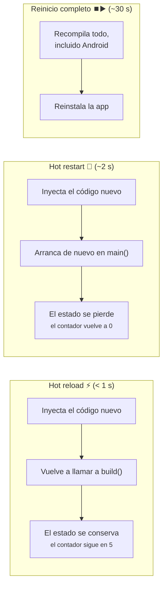
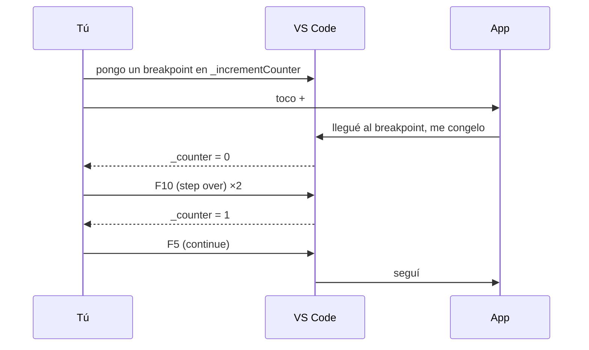
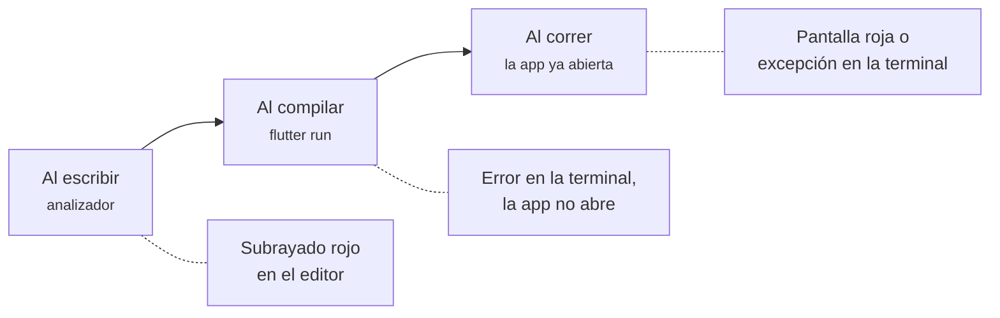
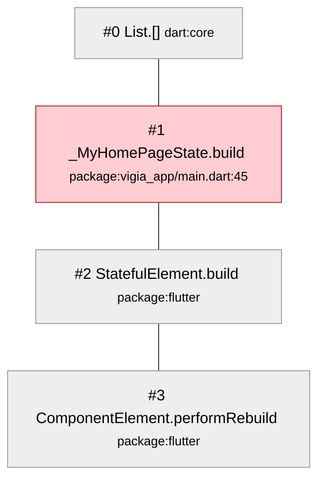

# Correr, recargar y leer errores

!!! abstract "Objetivo"
    Manejarte con soltura mientras la app corre: **hot reload**, **hot restart**, el **depurador**, `print`, el **analizador** y, sobre todo, **leer un error** y saber dónde mirar. Vas a pasar más tiempo acá que en cualquier otro lado.

## Correr la app

=== "Terminal"

    ```bash
    flutter run
    ```

    Si hay más de un dispositivo, te pregunta cuál. Para elegirlo directo:

    ```bash
    flutter devices                 # muestra los IDs
    flutter run -d emulator-5554    # corre en ese
    ```

=== "VS Code"

    1. Abajo a la derecha, en la barra de estado, elegí el dispositivo.
    2. ++f5++ (o *Run → Start Debugging*).

    Aparece una barra flotante con los controles: :material-pause: pausa, :material-lightning-bolt: hot reload, :material-restart: hot restart, :material-stop: parar.

Mientras corre, en la terminal tenés estas teclas:

| Tecla | Qué hace |
|---|---|
| ++r++ | **Hot reload**: aplica los cambios sin perder el estado. |
| ++shift+r++ | **Hot restart**: reinicia la app desde `main()`, pierde el estado. |
| ++q++ | Termina la app. |
| ++h++ | Muestra todas las teclas. |
| ++d++ | Se desconecta, pero deja la app abierta en el dispositivo. |

## Hot reload, hot restart y reinicio completo

Es la función estrella de Flutter: cambiás el código, guardás, y **en menos de un segundo** lo ves en el emulador, sin perder dónde estabas.



**¿Cuándo alcanza cada uno?**

| Cambiaste… | Usá |
|---|---|
| Un texto, un color, un widget dentro de `build` | Hot reload |
| Un método que se llama al tocar un botón | Hot reload |
| El valor inicial de un campo (`int _counter = 0` → `= 10`) | Hot restart (el valor viejo ya está guardado) |
| Algo en `main()` o en `initState()` | Hot restart (ya se ejecutaron) |
| Una clase de `StatelessWidget` a `StatefulWidget` | Hot restart |
| Un `enum` o un `const` global | Hot restart |
| El `pubspec.yaml` (agregaste un paquete) | Reinicio completo |
| Algo en `android/` (el manifest, Gradle) | Reinicio completo |

!!! tip "Regla práctica"
    Si guardaste y no ves el cambio, probá **hot restart**. Si tampoco, **pará y volvé a correr**. Si tampoco, `flutter clean` y correr de nuevo.

Probalo con el contador: tocá **+** cinco veces, cambiá `'You have pushed the button this many times:'` por `'Tocaste el botón:'` y guardá. El texto cambia y el número **sigue en 5**. Ahora apretá ++shift+r++: el número vuelve a 0.

## Mirar qué pasa: `print` y `debugPrint`

La forma más simple de saber qué hace el código es imprimir:

```dart
void _incrementCounter() {
  print('antes: $_counter');
  setState(() {
    _counter++;
  });
  print('después: $_counter');
}
```

Lo que imprimas aparece en la terminal (o en la pestaña *Debug Console* de VS Code):

```text
I/flutter ( 4321): antes: 0
I/flutter ( 4321): después: 1
```

!!! warning "El analizador se queja de `print`"
    Vas a ver un subrayado: `Don't invoke 'print' in production code`. Es un aviso para que no te olvides los `print` en la versión final. Para depurar está bien; borralos al terminar. Si necesitás uno permanente, usá `debugPrint`, que en la versión de producción no imprime nada.

## El depurador

`print` sirve, pero el **depurador** es mucho más potente: **para la app en una línea** y te deja mirar el valor de todas las variables en ese momento.

1. En VS Code, hacé clic a la izquierda del número de línea: aparece un punto rojo :material-circle:{ style="color: red" } (un **breakpoint**, punto de parada).
2. Corré con ++f5++ (en modo debug).
3. Cuando el programa llega a esa línea, se congela y VS Code te muestra:
    - **Variables**: el valor de cada variable visible.
    - **Call stack**: qué función llamó a cuál para llegar hasta acá.
    - **Watch**: expresiones que querés vigilar.

Con la app pausada:

| Botón | Tecla | Qué hace |
|---|---|---|
| :material-play: Continue | ++f5++ | Sigue hasta el próximo breakpoint. |
| :material-debug-step-over: Step over | ++f10++ | Ejecuta esta línea y para en la siguiente. |
| :material-debug-step-into: Step into | ++f11++ | Si la línea llama a una función, entra en ella. |
| :material-debug-step-out: Step out | ++shift+f11++ | Termina la función actual y para al volver. |



!!! tip "Breakpoints condicionales"
    Clic derecho sobre el punto rojo → *Edit Breakpoint* → escribí una condición como `_counter == 3`. Solo para cuando se cumple. Muy útil en listas largas.

## Flutter DevTools

**DevTools** es un panel con herramientas para mirar la app por dentro. Se abre desde la terminal (la URL aparece al correr) o en VS Code con ++ctrl+shift+p++ → **Flutter: Open DevTools**.

Las pestañas que más vas a usar:

- **Widget Inspector**: el árbol de widgets de la pantalla. Activá *Select Widget Mode* y tocá algo en el emulador: te muestra qué widget es y dónde está en el código. Ideal para entender por qué algo quedó mal ubicado.
- **Logging**: todo lo impreso, con hora.
- **Network**: los pedidos HTTP que hace la app (lo usamos en la Parte 6 con el servidor real).
- **Performance**: cuánto tarda cada cuadro. Solo tiene sentido con `flutter run --profile`.

## El analizador: errores antes de correr

El **analizador** lee tu código mientras escribís y marca problemas sin necesidad de correr nada. Los subrayados del editor son suyos. Para ver todo junto:

```bash
flutter analyze
```

```text
Analyzing vigia_app...

  error • The argument type 'int' can't be assigned to the parameter type 'String' • lib/main.dart:12:22 • argument_type_not_assignable
warning • The value of the local variable 'x' isn't used • lib/main.dart:8:9 • unused_local_variable
   info • Use 'const' with the constructor to improve performance • lib/main.dart:15:14 • prefer_const_constructors

3 issues found.
```

Cada línea dice: **gravedad · mensaje · archivo:línea:columna · nombre de la regla**.

| Gravedad | Qué significa | ¿Compila? |
|---|---|---|
| `error` | El código está mal: un tipo que no coincide, algo que no existe. | :material-close: No |
| `warning` | Probablemente es un error: una variable que no usás, un `null` sospechoso. | :material-check: Sí |
| `info` | Una sugerencia de estilo (`const`, orden de imports). | :material-check: Sí |

!!! success "La meta de la wiki"
    Al final de **cada** capítulo de la Parte 5, `flutter analyze` dice `No issues found!`. Acostumbrate a correrlo seguido.

??? tip "Arreglos automáticos"
    Muchas sugerencias se arreglan solas: poné el cursor sobre el subrayado y apretá ++ctrl+period++ (++cmd+period++ en Mac). Para arreglar todo el proyecto de una:

    ```bash
    dart fix --apply
    ```

## Leer un error

Hay tres momentos en los que algo puede fallar, y cada uno se ve distinto:



### Errores de compilación

Si hay un `error` del analizador, `flutter run` no llega a abrir la app:

```text
lib/main.dart:12:22: Error: The argument type 'int' can't be assigned to the parameter type 'String'.
        title: Text(42),
                    ^
```

Lo que importa: **el archivo y la línea** (`lib/main.dart:12:22`) y **el mensaje**. El `^` apunta a la columna exacta. En VS Code podés hacer ++ctrl++ / ++cmd++ + clic sobre la ruta para ir ahí.

### Errores en ejecución: la pantalla roja

Si algo falla mientras la app corre (por ejemplo, acceder a un elemento que no existe en una lista), en modo debug Flutter muestra una **pantalla roja** con el error, y en la terminal aparece algo así:

```text
══╡ EXCEPTION CAUGHT BY WIDGETS LIBRARY ╞═══════════════════════════════
The following RangeError was thrown building MyHomePage(dirty, state: _MyHomePageState#1a2b3):
RangeError (index): Invalid value: Valid value range is empty: 0

The relevant error-causing widget was:
  MyHomePage MyHomePage:file:///…/lib/main.dart:20:13

When the exception was thrown, this was the stack:
#0      List.[] (dart:core-patch/growable_array.dart:264:36)
#1      _MyHomePageState.build (package:vigia_app/main.dart:45:28)
#2      StatefulElement.build (package:flutter/src/widgets/framework.dart:5823:27)
#3      ComponentElement.performRebuild (package:flutter/src/widgets/framework.dart:5711:15)
…
════════════════════════════════════════════════════════════════════════
```

Cómo leerlo, de arriba hacia abajo:

1. **Qué tipo de error**: `RangeError`. Te dice la familia del problema.
2. **El mensaje**: `Valid value range is empty: 0`. Pediste el elemento 0 de una lista vacía.
3. **El widget culpable**: `MyHomePage … main.dart:20:13`.
4. **La pila (*stack trace*)**: la lista de funciones que estaban corriendo, de la más reciente (#0) a la más vieja. **Buscá la primera línea que diga `package:vigia_app/`**: ese es tu código. Acá es la #1: `main.dart:45:28`. Las de `dart:core` o `package:flutter/` son de adentro de Dart y Flutter; casi nunca el problema está ahí.



!!! tip "La primera línea tuya"
    En el 90 % de los casos, el error está en la **primera línea de la pila que es de tu paquete**. Empezá siempre por ahí.

### Las rayas amarillas y negras

Si ves una franja con rayas amarillas y negras al costado de un widget, es un **overflow**: algo no entra en el espacio disponible. La terminal dice:

```text
A RenderFlex overflowed by 42 pixels on the right.
```

No rompe la app, pero hay que arreglarlo. Es tan común que tiene su propia sección: [El error más famoso](../3-flutter/3-layout.md#el-error-mas-famoso).

### Los errores de los tests

`flutter test` corre los tests y, si alguno falla, muestra qué esperaba y qué obtuvo:

```text
00:02 +7 -1: test/utils_test.dart: tiempoRelativo: hace minutos [E]
  Expected: 'hace 5 min'
    Actual: 'hace 5 minutos'
     Which: is different.
           Expected: hace 5 min
             Actual: hace 5 minutos
                             ^
            Differ at offset 10
```

`+7 -1` significa 7 pasaron y 1 falló. Los tests los vemos a fondo en la [Parte 6](../6-pruebas-y-entrega/index.md).

## Los comandos que más vas a usar

| Comando | Para qué |
|---|---|
| `flutter run` | Correr la app en modo debug. |
| `flutter pub get` | Bajar los paquetes del `pubspec.yaml`. |
| `flutter analyze` | Revisar el código sin correrlo. |
| `flutter test` | Correr todos los tests. |
| `flutter test test/utils_test.dart` | Correr un archivo de tests. |
| `dart format .` | Formatear todo el código. |
| `dart fix --apply` | Aplicar los arreglos automáticos. |
| `flutter clean` | Borrar lo compilado (cuando algo anda raro). |
| `flutter doctor` | Revisar la instalación. |
| `flutter devices` | Ver qué dispositivos hay. |

## Errores comunes

??? failure "Guardé y no cambió nada"
    - ¿El cambio está en `main()` o `initState()`? Hace falta **hot restart** (++shift+r++).
    - ¿Agregaste un paquete? Hace falta **parar y volver a correr**.
    - ¿Corriste con `flutter run` y guardaste en el editor? La terminal no se entera del guardado: apretá ++r++. (Con ++f5++ desde VS Code sí recarga al guardar.)

??? failure "`Gradle task assembleDebug failed with exit code 1`"
    Un error del lado de Android. Subí en la salida hasta la primera línea con `error:` o `What went wrong:`. Si no hay pistas claras: `flutter clean`, `flutter pub get` y volver a correr.

??? failure "`Error: Could not resolve the package 'x' in 'package:x/x.dart'`"
    El paquete no está en el `pubspec.yaml` o no corriste `flutter pub get`.

??? failure "La app se queda en pantalla blanca"
    Mirá la terminal: casi siempre hay una excepción en `main()` antes de que se dibuje nada.

## Lo que aprendiste

- [x] **Hot reload** (++r++) conserva el estado; **hot restart** (++shift+r++) arranca de cero; cambios en paquetes o en `android/` necesitan correr de nuevo.
- [x] El **depurador** para la app en un breakpoint y te deja ver las variables.
- [x] `flutter analyze` encuentra errores sin correr nada: `error` no compila, `warning` e `info` sí.
- [x] En un error, buscá **el archivo y la línea**; en una pila, **la primera línea de `package:vigia_app/`**.

!!! success "Terminaste la Parte 1"
    Ya tenés todo instalado y sabés moverte. Ahora toca aprender el lenguaje.

[Siguiente: Parte 2, Dart :material-arrow-right:](../2-dart/index.md){ .md-button .md-button--primary }
