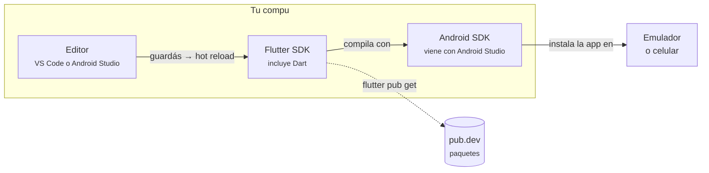

# 1. Preparación

Antes de escribir una línea de Dart hay que tener **el terreno listo**: saber qué vamos a construir, instalar las herramientas, crear el proyecto y aprender a correrlo y a leer sus errores.

!!! abstract "Al terminar esta parte vas a tener"
    - Flutter instalado y `flutter doctor` sin cruces rojas en lo que importa.
    - Un emulador de Android (o tu celular) donde correr la app.
    - El proyecto `vigia_app` creado, abriendo en el emulador.
    - Las manos en el *hot reload*, el depurador y los mensajes de error.

## Las páginas

| Página | Qué vas a hacer | Tiempo aproximado |
|---|---|---|
| [Qué vamos a construir](1-que-vamos-a-construir.md) | Conocer la app, sus pantallas y sus usuarios. | 15 min |
| [Instalar las herramientas](2-instalacion.md) | Flutter, Android Studio, VS Code, un emulador. | 1–2 h (descargas) |
| [Crear el proyecto](3-crear-el-proyecto.md) | `flutter create` y recorrer qué generó. | 20 min |
| [Correr, recargar y leer errores](4-correr-y-depurar.md) | `flutter run`, hot reload, depurador, `flutter analyze`. | 40 min |

## Las herramientas, de un vistazo

- **Flutter SDK**: el kit de Flutter. Trae el comando `flutter` y también Dart (no se instala aparte).
- **Android SDK**: lo necesario para compilar apps de Android. Se instala con Android Studio.
- **Editor**: donde escribís. Cualquiera de los dos sirve; la wiki muestra VS Code.
- **Emulador**: un celular Android simulado en la compu. También podés usar tu celular por cable.

[Empezar: Qué vamos a construir :material-arrow-right:](1-que-vamos-a-construir.md){ .md-button .md-button--primary }
