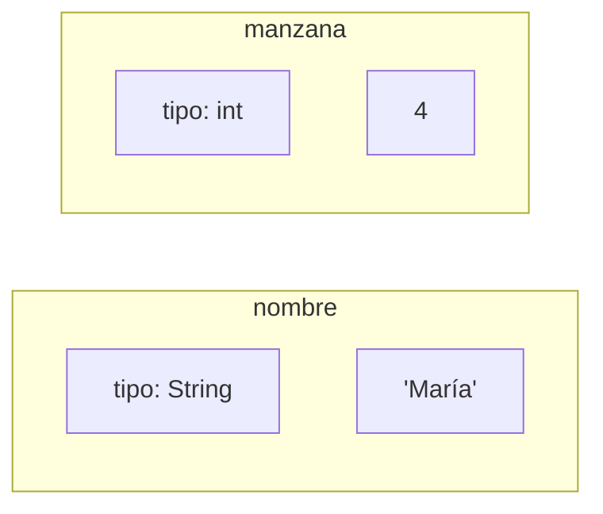
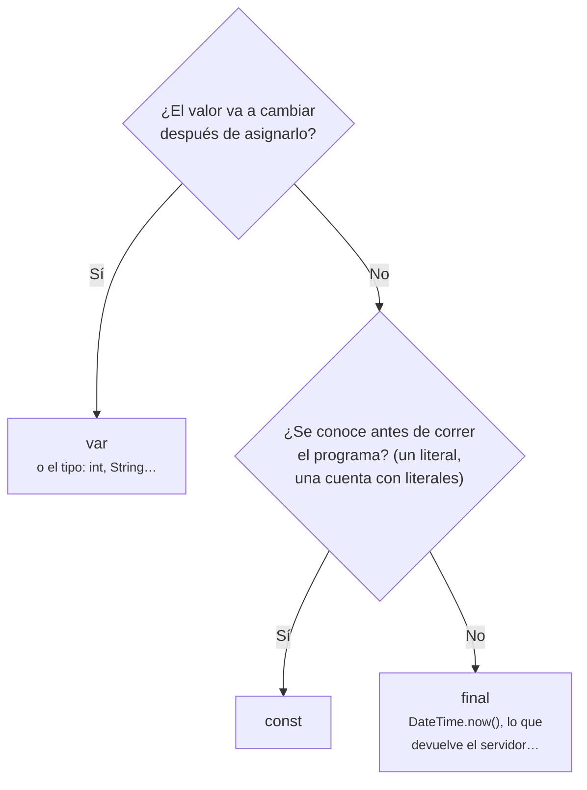
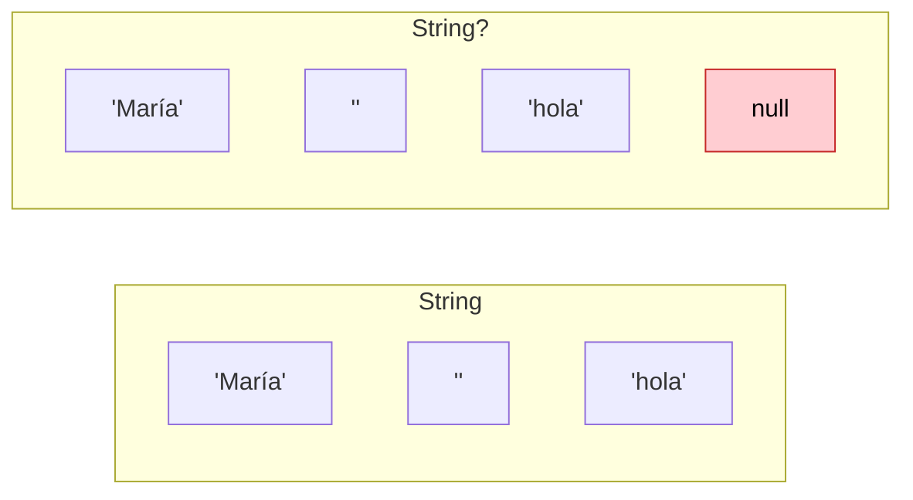
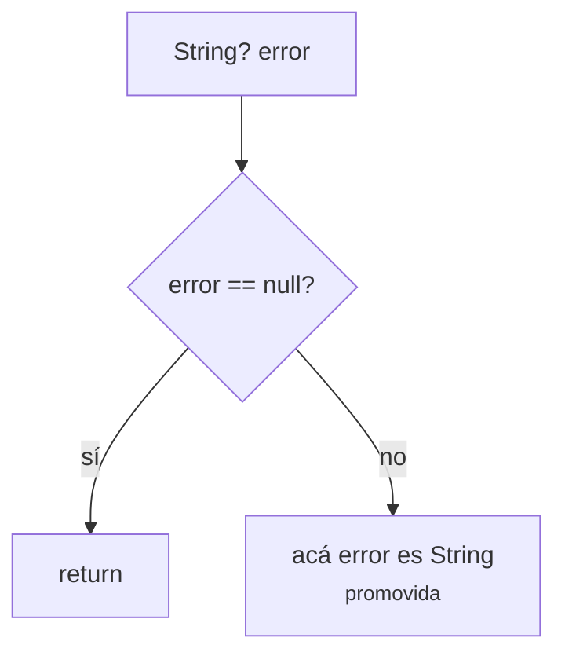
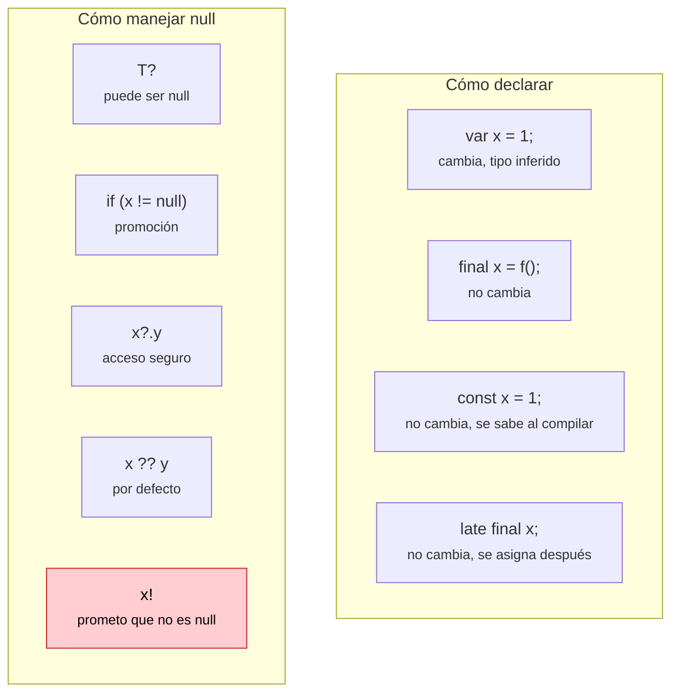

# Variables, tipos y null safety

!!! abstract "Objetivo"
    Saber guardar datos en variables, conocer los tipos básicos de Dart, elegir entre `var`, `final` y `const`, y entender **null safety**: el sistema que hace que Dart te avise *antes de correr* si algo puede estar vacío.

## Una variable es una caja con nombre

Una **variable** guarda un valor para usarlo después. Tiene un **nombre**, un **tipo** (qué clase de cosas puede guardar) y un **valor**.

```dart
String nombre = 'María';
int manzana = 4;
```



Leelo así: "una variable de tipo `String` llamada `nombre`, que vale `'María'`". El `;` termina la instrucción (en Dart es obligatorio).

Se puede cambiar el valor más tarde, pero **no el tipo**:

```dart
manzana = 5;        // bien: sigue siendo un int
manzana = 'cinco';  // ERROR: A value of type 'String' can't be assigned to a variable of type 'int'.
```

Esa es la idea de un lenguaje **con tipos estáticos**: el tipo se decide al escribir el código y el compilador lo controla. Muchos errores que en otros lenguajes aparecen con la app andando, en Dart aparecen subrayados en el editor.

## Los tipos básicos

| Tipo | Qué guarda | Ejemplos |
|---|---|---|
| `int` | Números enteros. | `0`, `4`, `-34`, `1000000` |
| `double` | Números con decimales. | `3.14`, `-34.6037`, `1.0` |
| `num` | Cualquiera de los dos. | `4`, `4.5` |
| `String` | Texto. | `'María'`, `"Hola"`, `''` |
| `bool` | Verdadero o falso. | `true`, `false` |
| `DateTime` | Una fecha y hora. | `DateTime.now()`, `DateTime(2026, 11, 16)` |
| `Duration` | Un lapso de tiempo. | `Duration(seconds: 15)`, `Duration(minutes: 2)` |
| `List<T>` | Una lista ordenada de `T`. | `[1, 2, 3]`, `['a', 'b']` |
| `Map<K, V>` | Pares clave → valor. | `{'id': 1, 'nombre': 'Ana'}` |
| `dynamic` | Cualquier cosa, sin control. | (lo vemos más abajo) |

```dart title="tipos.dart"
void main() {
  int vecinos = 9;
  double latitud = -34.6037;
  String barrio = 'Villa Esperanza';
  bool hayAlerta = false;
  DateTime ahora = DateTime.now();
  Duration cadaCuanto = Duration(seconds: 15);

  print(vecinos);
  print(latitud);
  print(barrio);
  print(hayAlerta);
  print(ahora.year >= 2026);
  print(cadaCuanto.inMilliseconds);
}
```

```text title="Salida"
9
-34.6037
Villa Esperanza
false
true
15000
```

!!! info "Todo es un objeto"
    En Dart, **todo** valor es un objeto, incluso `4` o `true`. Por eso tienen métodos: `4.isEven`, `'hola'.toUpperCase()`, `-34.6.abs()`. No hay "tipos primitivos" como en Java.

## `var`: que Dart adivine el tipo

Escribir el tipo cada vez es largo. Con `var`, Dart lo **infiere** (lo deduce) del valor inicial:

```dart
var nombre = 'María';   // Dart sabe que es String
var manzana = 4;        // Dart sabe que es int
manzana = 5;            // bien
manzana = 'cinco';      // ERROR igual: el tipo ya quedó fijo en int
```

`var` **no** es "sin tipo": el tipo existe, solo que no lo escribís. Pasá el mouse por encima de la variable en VS Code y te lo muestra.

## `final` y `const` {#final-y-const}

La mayoría de las variables, una vez que tienen un valor, **no cambian más**. Para esas, Dart tiene dos palabras:

```dart
final ahora = DateTime.now();  // se calcula al correr, y después no cambia
const intervalo = 15;          // se conoce al compilar, y nunca cambia
```



| | `var` | `final` | `const` |
|---|---|---|---|
| ¿Se puede reasignar? | Sí | No | No |
| ¿Cuándo se conoce el valor? | Al correr | Al correr | **Al compilar** |
| Ejemplo | `var intentos = 0;` | `final hoy = DateTime.now();` | `const clave = 'vigia1234';` |

```dart
final hoy = DateTime.now();
hoy = DateTime(2020);       // ERROR: The final variable 'hoy' can only be set once.

const pi = 3.14159;
const doble = pi * 2;       // bien: se puede calcular al compilar
const ahora = DateTime.now(); // ERROR: Const variables must be initialized with a constant value.
```

!!! tip "Usá `final` por defecto"
    En VigiaApp casi todas las variables locales son `final`. Si después necesitás cambiarla, el editor te avisa y la pasás a `var`. Así, cuando ves un `var`, sabés que **esa** variable cambia, y prestás atención.

### `const` en los widgets

En Flutter vas a ver `const` por todos lados:

```dart
const Text('Hola, barrio')
const SizedBox(height: 16)
```

Un objeto `const` se crea **una sola vez al compilar** y se reutiliza. Flutter sabe que no cambia, así que no lo vuelve a construir cuando redibuja. Es una optimización gratis: el analizador te sugiere `const` cada vez que se puede (la regla `prefer_const_constructors`).

### El `config.dart` de la app

En el [capítulo 1](../5-construccion/01-esqueleto.md) usamos `const` para la configuración:

```dart
const apiUrl = String.fromEnvironment('API_URL', defaultValue: 'fake');
```

`String.fromEnvironment` lee un valor que se pasa **al compilar** con `--dart-define`. Como se resuelve al compilar, puede ser `const`.

## Null safety

### El problema

`null` significa "no hay valor". En muchos lenguajes cualquier variable puede ser `null`, y si usás una que lo es, el programa explota:

```text
NullPointerException      (Java)
TypeError: Cannot read properties of null   (JavaScript)
```

Su inventor lo llamó "el error del millón de dólares". Dart lo resuelve con **null safety**: **ninguna variable puede ser `null`, salvo que lo digas explícitamente**.

### `?`: "puede estar vacío"

```dart
String nombre = 'María';
nombre = null;           // ERROR: A value of type 'Null' can't be assigned to 'String'.

String? telefono = null; // bien: el ? dice "puede ser null"
telefono = '+54 11 1234';
```



`String?` es un tipo **más amplio** que `String`: tiene todos los textos **y además** `null`.

En VigiaApp, por ejemplo, el teléfono de un vecino es opcional:

```dart
final String? telefono;  // del modelo Perfil: puede no haberlo cargado
```

### No podés usar un `?` como si no lo fuera

```dart
String? telefono = obtenerTelefono();
print(telefono.length);  // ERROR: The property 'length' can't be unconditionally
                         // accessed because the receiver can be 'null'.
```

Dart te frena **antes de correr**: "esto puede ser null, ¿qué hago si lo es?". Tenés que decidir. Hay cuatro formas:

=== "1. Preguntar con if"

    ```dart
    if (telefono != null) {
      print(telefono.length);  // acá Dart sabe que no es null
    }
    ```

    Es lo más claro. Adentro del `if`, Dart **promueve** el tipo de `String?` a `String` (ver [promoción](#promocion)).

=== "2. ?. (acceso seguro)"

    ```dart
    print(telefono?.length);  // si telefono es null, da null en vez de fallar
    ```

    `a?.b` significa "si `a` no es null, dame `a.b`; si es null, dame null". El resultado es `int?`.

=== "3. ?? (valor por defecto)"

    ```dart
    print(telefono ?? 'Sin teléfono');
    ```

    `a ?? b` significa "`a`, o `b` si `a` es null". El resultado ya no es nullable.

=== "4. ! (te juro que no es null)"

    ```dart
    print(telefono!.length);
    ```

    `!` le dice a Dart "confiá en mí, no es null". Si te equivocaste, la app **explota** al correr:

    ```text
    Null check operator used on a null value
    ```

    Usalo solo cuando **sabés** algo que el compilador no puede saber.

!!! warning "Cuidado con `!`"
    Cada `!` es una promesa. En VigiaApp aparece poquísimo, y siempre con un comentario que explica por qué es seguro. Por ejemplo, el Inicio solo existe si hay sesión, así que `_sesion.vecino!` nunca falla ahí ([capítulo 8](../5-construccion/08-inicio.md)).

### Combinarlos

```dart title="null_safety.dart"
class Vecino {
  Vecino(this.nombre, this.telefono);
  final String nombre;
  final String? telefono;
}

void main() {
  final ana = Vecino('Ana', '+54 11 5555');
  final jorge = Vecino('Jorge', null);

  for (final v in [ana, jorge]) {
    // ?. y ?? juntos: el largo del teléfono, o 0 si no hay
    final largo = v.telefono?.length ?? 0;
    print('${v.nombre}: ${v.telefono ?? 'sin teléfono'} ($largo caracteres)');
  }

  String? apodo;
  apodo ??= 'Vecino'; // ??= asigna solo si era null
  print(apodo);
}
```

```text title="Salida"
Ana: +54 11 5555 (11 caracteres)
Jorge: sin teléfono (0 caracteres)
Vecino
```

## Promoción de tipos {#promocion}

Cuando Dart puede **demostrar** que una variable nullable no es null, la trata como no nullable. Eso se llama **promoción**:

```dart
String? error = validar();
if (error == null) return;
print(error.length);  // bien: si llegó acá, error no es null
```



### La trampa: los campos no se promueven

La promoción funciona con **variables locales** y con campos **privados y `final`**, pero no con campos públicos ni getters. Esto confunde mucho al principio:

```dart
class Pantalla {
  String? error;   // campo público y no final

  void mostrar() {
    if (error != null) {
      print(error.length);  // ERROR (ver abajo)
    }
  }
}
```

El mensaje completo del analizador lo explica:

```text
The property 'length' can't be unconditionally accessed because the receiver can be 'null'.
  - 'error' refers to a public property so it couldn't be promoted.
```

¿Por qué? Porque entre el `if` y el `print`, **otro código podría cambiar** `error` (otra clase, un getter que calcula algo distinto cada vez). Dart no lo puede garantizar.

La solución, que vas a ver en VigiaApp todo el tiempo: **copiar a una variable local**.

```dart
void mostrar() {
  final error = this.error;  // copia local
  if (error != null) {
    print(error.length);  // bien: la local sí se promueve
  }
}
```

O, más corto, con un **patrón** (lo vemos en [Enums, records y patrones](7-enums-records-patrones.md#if-case)):

```dart
if (error case final e?) {
  print(e.length);
}
```

Leelo: "si `error` encaja con el patrón *no null*, guardalo en `e`".

## `late`: "lo voy a inicializar después"

A veces una variable no nullable no puede recibir su valor en el momento de declararla, pero **seguro** lo va a tener antes de usarse. Para eso está `late`:

```dart
class _InicioScreenState extends State<InicioScreen> {
  late final AppLifecycleListener _cicloDeVida;  // se crea en initState

  @override
  void initState() {
    super.initState();
    _cicloDeVida = AppLifecycleListener(onResume: _viewModel.reanudar);
  }
}
```

(Es una versión resumida de la pantalla de Inicio del [capítulo 8](../5-construccion/08-inicio.md): el "escuchador" de cuándo la app pasa a segundo plano se crea en `initState`, no al declarar el campo.)

`late final` también sirve para **inicialización perezosa**: el valor se calcula la primera vez que se usa. En `main.dart` de VigiaApp:

```dart
late final _sesion = SesionRepository(widget.api)..iniciar();
```

`widget` no existe todavía cuando se crea el objeto, pero sí la primera vez que alguien lee `_sesion`. Con `late`, la cuenta se hace recién ahí.

!!! warning "Si te equivocás con `late`"
    Si leés una variable `late` antes de asignarla, la app explota con `LateInitializationError: Field '_pestanas' has not been initialized.` Es el mismo riesgo que `!`: usalo cuando estás seguro.

## `dynamic` y `Object?`

`dynamic` apaga el control de tipos: cualquier cosa vale y cualquier método se puede llamar. El compilador no te avisa nada; los errores aparecen al correr.

```dart
dynamic dato = 'hola';
dato = 42;            // bien
print(dato.length);   // compila… y explota al correr: int no tiene length
```

¿Para qué existe? Para cosas que **de verdad** pueden ser cualquier cosa, como el JSON que manda el servidor. En VigiaApp aparece en `Map<String, dynamic>` (un JSON) y se convierte enseguida a tipos concretos con `as`:

```dart
final id = json['id'] as int;          // "confiá en mí, es un int"
final nombre = json['nombre'] as String;
final telefono = json['telefono'] as String?;
```

`as` es un **cast**: "tratá este valor como de tal tipo". Si no lo es, explota (`type 'String' is not a subtype of type 'int'`). Por eso la conversión se hace **en un solo lugar** (los `fromJson` de los modelos, [capítulo 3](../5-construccion/03-dominio.md)) y con tests.

`Object?` es parecido pero **seguro**: acepta cualquier cosa, pero no te deja llamar métodos sin antes preguntar el tipo con `is`:

```dart
Object? dato = 'hola';
if (dato is String) {
  print(dato.length);  // promovido a String
}
```

## Resumen visual



## Ejercicios

??? question "1. ¿Qué tipo tiene cada variable?"
    ```dart
    var a = 3;
    var b = 3.0;
    var c = '3';
    final d = DateTime.now();
    var e = [1, 2];
    ```

    ??? success "Respuesta"
        `a`: `int`. `b`: `double`. `c`: `String`. `d`: `DateTime`. `e`: `List<int>`.

??? question "2. ¿Cuáles compilan?"
    ```dart
    String a = null;
    String? b = null;
    int c = b?.length;
    int d = b?.length ?? 0;
    const e = DateTime.now();
    ```

    ??? success "Respuesta"
        Solo `b` y `d`. `a` no puede ser null; `c` es `int?` y no entra en `int`; `e` no se conoce al compilar.

??? question "3. Arreglá este código sin usar `!`"
    ```dart
    class Formulario {
      String? error;
      void mostrar() {
        if (error != null) print(error.toUpperCase());
      }
    }
    ```

    ??? success "Respuesta"
        ```dart
        void mostrar() {
          final error = this.error;
          if (error != null) print(error.toUpperCase());
        }
        ```

## Lo que aprendiste

- [x] Toda variable tiene un **tipo** que no cambia; `var` lo infiere.
- [x] **`final`** para lo que no cambia, **`const`** si además se conoce al compilar.
- [x] Con **null safety**, solo los tipos con `?` aceptan `null`, y Dart te obliga a manejarlo: `if`, `?.`, `??` o `!`.
- [x] La **promoción** funciona con variables locales: copiá el campo a una local.
- [x] **`late`** promete inicializar después; **`dynamic`** apaga los controles (solo para JSON, y convertido enseguida con `as`).

[Siguiente: Operadores y textos :material-arrow-right:](2-operadores-y-strings.md){ .md-button .md-button--primary }
