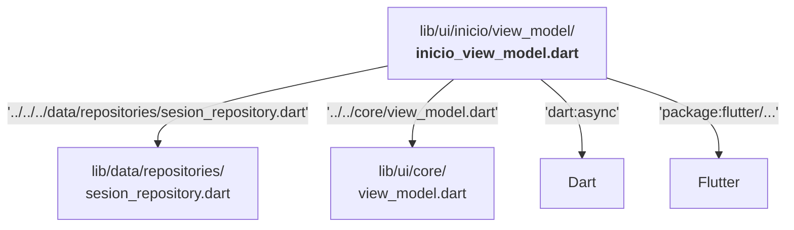
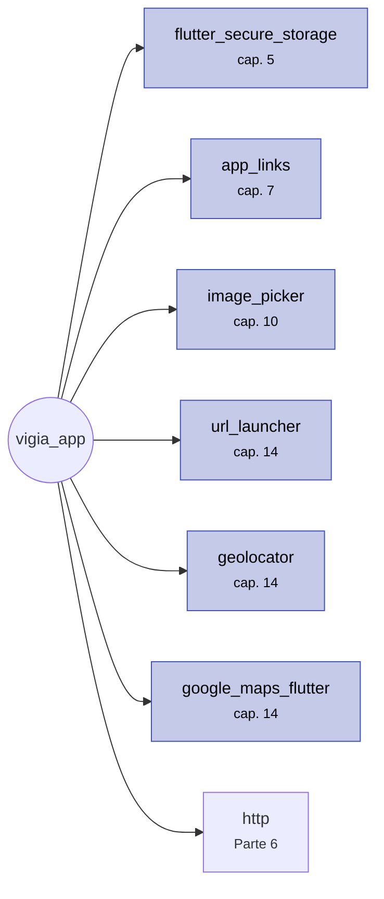

# Librerías y paquetes

!!! abstract "Objetivo"
    Entender las líneas del principio de cada archivo (`import`), cómo se organiza el código en **librerías**, qué es un **paquete**, cómo se agrega uno desde **pub.dev**, qué significan los números de versión del `pubspec.yaml` y qué paquetes usa VigiaApp y para qué.

## Cada archivo es una librería

En Dart, **cada archivo `.dart` es una librería**. Lo que declarás en un archivo (clases, funciones, variables) no se ve desde otro **hasta que lo importás**.

```dart title="lib/utils/fechas.dart"
String haceCuanto(DateTime fecha, {DateTime? ahora}) { … }
String _dosCifras(int numero) => …;  // privado: no se ve afuera
```

```dart title="lib/ui/chat/widgets/burbuja_mensaje.dart"
import '../../../utils/fechas.dart';  // ahora haceCuanto existe acá

Text(haceCuanto(mensaje.creadoEn))
// _dosCifras(3)  ← ERROR: es privada de fechas.dart
```

Recordá que [privado es por archivo](5-clases.md#privado-con-guion-bajo): justamente porque cada archivo es una librería.

## Tres tipos de `import`

```dart
import 'dart:async';                                   // (1)!
import 'package:flutter/material.dart';                // (2)!
import '../../../data/repositories/sesion_repository.dart';  // (3)!
```

1. **`dart:`**: librerías que vienen con Dart. No hay que instalar nada.
2. **`package:`**: un paquete declarado en el `pubspec.yaml` (o el propio proyecto: `package:vigia_app/...`).
3. **Relativo**: otro archivo del proyecto, con la ruta desde el archivo actual. `..` sube una carpeta.



Cómo contar los `..` del primer import:

| Paso | Carpeta |
|---|---|
| Empiezo en | `lib/ui/inicio/view_model/` |
| `..` | `lib/ui/inicio/` |
| `../..` | `lib/ui/` |
| `../../..` | `lib/` |
| `data/repositories/sesion_repository.dart` | `lib/data/repositories/sesion_repository.dart` :material-check: |

!!! tip "Dejá que el editor escriba los imports"
    Escribí el nombre de una clase que no está importada (`SesionRepository`) y apretá ++ctrl+period++ (++cmd+period++): VS Code ofrece **Import library…** con la ruta correcta. Casi nunca hace falta escribir un `import` a mano.

### Relativo o `package:`

Dentro de `lib/` se pueden usar las dos formas para los archivos propios:

```dart
import '../../../utils/fechas.dart';           // relativo
import 'package:vigia_app/utils/fechas.dart';   // absoluto
```

**VigiaApp usa relativos dentro de `lib/`** (como recomienda el equipo de Dart) y **`package:vigia_app/...` en los tests** (los tests están fuera de `lib/`, así que no les queda otra).

!!! warning "No mezcles las dos formas para el mismo archivo"
    Si un archivo se importa como relativo en un lado y como `package:` en otro, en algunos casos Dart los trata como **dos librerías distintas**, y aparecen errores rarísimos del tipo `The argument type 'Sesion' can't be assigned to the parameter type 'Sesion'`. Elegí una forma y sostenela.

### El orden de los imports

Por convención (y el analizador lo sugiere con `directives_ordering`): primero `dart:`, después `package:`, después los relativos; cada grupo en orden alfabético y separado por una línea en blanco. Todos los archivos de la wiki siguen ese orden.

## `show`, `hide` y `as`

```dart
import 'dart:math' show max, min;          // solo trae max y min
import 'package:http/http.dart' as http;   // todo, pero con prefijo
import 'dart:async' hide Timer;            // todo menos Timer
```

`as` es el más útil: evita choques de nombres y deja claro de dónde viene cada cosa. `HttpVigiaApi` lo usa ([Parte 6](../6-pruebas-y-entrega/2-api-real.md)), porque el paquete `http` tiene funciones con nombres muy genéricos (`get`, `post`):

```dart
import 'package:http/http.dart' as http;

final respuesta = await http.get(uri);   // se lee: "el get de http"
```

## `export`: reexportar

Un archivo puede **reexportar** algo de otro, para que quien lo importe lo reciba también:

```dart title="lib/data/services/api/vigia_api.dart (fragmento)"
export '../errores.dart' show ApiException;
```

Quien importa `vigia_api.dart` recibe también `ApiException`, sin tener que importar `errores.dart`. Tiene sentido: todo el que habla con la API necesita conocer sus errores.

## Paquetes

Un **paquete** es una carpeta de código Dart con su propio `pubspec.yaml`, pensada para que otros la usen. Tu proyecto es un paquete (se llama `vigia_app`). Los paquetes de otros se bajan de **[pub.dev](https://pub.dev)**, el repositorio oficial.

### Paquete vs. plugin

- Un **paquete** es solo Dart: funciona igual en cualquier plataforma. Ejemplo: `http`.
- Un **plugin** es un paquete que además tiene código **nativo** (Kotlin para Android, Swift para iOS), porque necesita algo del sistema: la cámara, el GPS, el llavero seguro. Ejemplos: `geolocator`, `image_picker`.

Los plugins a veces piden configuración extra en `android/` (permisos, claves). Los vemos en [Plugins y plataformas](../3-flutter/8-plugins-y-plataformas.md).

### Agregar un paquete

=== "Con el comando (recomendado)"

    ```bash
    flutter pub add http
    ```

    Busca la última versión compatible, la agrega al `pubspec.yaml` y la baja.

=== "A mano"

    Agregá la línea en `dependencies:` del `pubspec.yaml`:

    ```yaml
    dependencies:
      flutter:
        sdk: flutter
      http: ^1.6.0
    ```

    Y corré `flutter pub get`.

Para dependencias de desarrollo (tests, herramientas): `flutter pub add --dev nombre`.

### Qué significa `^1.6.0`

Los paquetes usan **versionado semántico**: `MAYOR.MENOR.PARCHE`.

| Sube… | Significa | ¿Rompe tu código? |
|---|---|---|
| PARCHE (`1.6.0` → `1.6.1`) | Arreglos | No |
| MENOR (`1.6.0` → `1.7.0`) | Cosas nuevas | No |
| MAYOR (`1.6.0` → `2.0.0`) | Cambios incompatibles | Puede |

El `^` (*caret*) significa "**esta versión o cualquiera más nueva que no cambie el MAYOR**":

```text
^1.6.0  →  >= 1.6.0  y  < 2.0.0
```

Así recibís arreglos sin riesgo de que se rompa nada. La versión exacta que se eligió queda anotada en `pubspec.lock` ([Crear el proyecto](../1-preparacion/3-crear-el-proyecto.md#pubspeclock-las-versiones-exactas)).

### Comandos de `pub`

| Comando | Qué hace |
|---|---|
| `flutter pub get` | Baja lo que dice el `pubspec.yaml` (respetando el `.lock`). |
| `flutter pub add x` | Agrega el paquete `x`. |
| `flutter pub remove x` | Lo saca. |
| `flutter pub upgrade` | Sube todo a lo más nuevo que permiten los rangos. |
| `flutter pub outdated` | Muestra qué paquetes tienen versiones nuevas. |
| `flutter pub deps` | Muestra el árbol de dependencias (quién depende de quién). |

### Cómo elegir un paquete en pub.dev

Cada paquete en pub.dev tiene:

- **Likes** y **descargas**: popularidad.
- **Pub points** (sobre 160): calidad (documentación, que pase el analizador, que soporte las plataformas).
- **Publisher** verificado: por ejemplo `flutter.dev` o `dart.dev` para los oficiales.
- **Platforms**: en qué plataformas anda (Android, iOS, web…).

!!! tip "Regla práctica"
    Antes de sumar un paquete, preguntate si lo podés hacer con lo que ya hay. VigiaApp, por ejemplo, **no** usa paquetes de manejo de estado (como `provider` o `riverpod`): alcanza con `ChangeNotifier`, `ListenableBuilder` e `InheritedWidget`, que vienen con Flutter. Cada paquete es código ajeno que hay que mantener actualizado.

## Los paquetes de VigiaApp



| Paquete | Para qué | Tipo | Dónde se usa |
|---|---|---|---|
| `flutter_secure_storage` | Guardar el token de sesión cifrado (Keystore en Android). | Plugin | `AlmacenToken`, [cap. 5](../5-construccion/05-sesion.md) |
| `app_links` | Recibir los enlaces `vigiaapp://` del correo. | Plugin | `main.dart`, [cap. 7](../5-construccion/07-dependencias-y-rutas.md) |
| `image_picker` | Sacar una foto o elegirla de la galería. | Plugin | `SelectorFotos`, [cap. 10](../5-construccion/10-publicaciones-y-fotos.md) |
| `url_launcher` | Llamar por teléfono, abrir Google Maps. | Plugin | `LanzadorExterno`, [cap. 14](../5-construccion/14-sos-y-alerta.md) |
| `geolocator` | La posición del GPS. | Plugin | `UbicacionService`, [cap. 14](../5-construccion/14-sos-y-alerta.md) |
| `google_maps_flutter` | El mapa de la alerta. | Plugin | `MapaAlerta`, [cap. 14](../5-construccion/14-sos-y-alerta.md) |
| `http` | Hablar con el servidor real. | Paquete | `HttpVigiaApi`, [Parte 6](../6-pruebas-y-entrega/2-api-real.md) |
| `flutter_lints` *(dev)* | Las reglas del analizador. | Paquete | `analysis_options.yaml` |
| `google_maps_flutter_platform_interface` *(dev)* | Reemplazar el mapa por uno de mentira en los tests. | Paquete | `test/ayudantes.dart`, [Parte 6](../6-pruebas-y-entrega/4-tests-de-widgets.md) |

!!! info "Cada paquete, envuelto en una clase nuestra"
    Fijate la columna "Dónde se usa": cada paquete externo aparece en **un solo archivo** de `data/services/`, que lo envuelve. El resto de la app usa la clase nuestra (`UbicacionService`, no `Geolocator`). Si mañana cambiamos de paquete, se toca un archivo. Esta idea se explica en [La dirección de las dependencias](../4-arquitectura/3-direccion-de-dependencias.md).

## Ejercicios

??? question "1. Escribí el import"
    Estás en `lib/ui/perfil/widgets/perfil_screen.dart` y necesitás `lib/ui/core/widgets/avisos.dart`. ¿Cómo es el import relativo?

    ??? success "Respuesta"
        `import '../../core/widgets/avisos.dart';` — subís de `widgets/` a `perfil/` (`..`), de `perfil/` a `ui/` (`../..`), y bajás a `core/widgets/avisos.dart`.

??? question "2. ¿Qué versiones acepta?"
    `geolocator: ^14.1.2`. ¿Acepta 14.1.1? ¿14.9.0? ¿15.0.0?

    ??? success "Respuesta"
        14.1.1 no (es menor). 14.9.0 sí. 15.0.0 no (cambia el mayor).

## Lo que aprendiste

- [x] Cada archivo es una **librería**; lo privado (`_`) no sale del archivo.
- [x] `import` de `dart:`, de `package:` o **relativo**; `show`, `hide`, `as` y `export`.
- [x] Un **paquete** es código reutilizable de pub.dev; un **plugin** además tiene código nativo.
- [x] `^1.6.0` acepta arreglos y novedades, pero no cambios incompatibles.
- [x] VigiaApp usa 7 paquetes, cada uno envuelto en una clase propia.

!!! success "Terminaste la Parte 2"
    Ya sabés leer Dart. Ahora vamos a usarlo para hacer interfaces.

[Siguiente: Parte 3, Flutter :material-arrow-right:](../3-flutter/index.md){ .md-button .md-button--primary }
