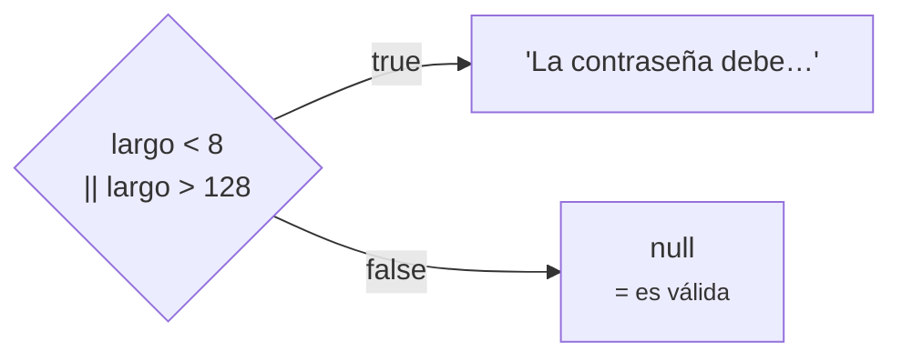
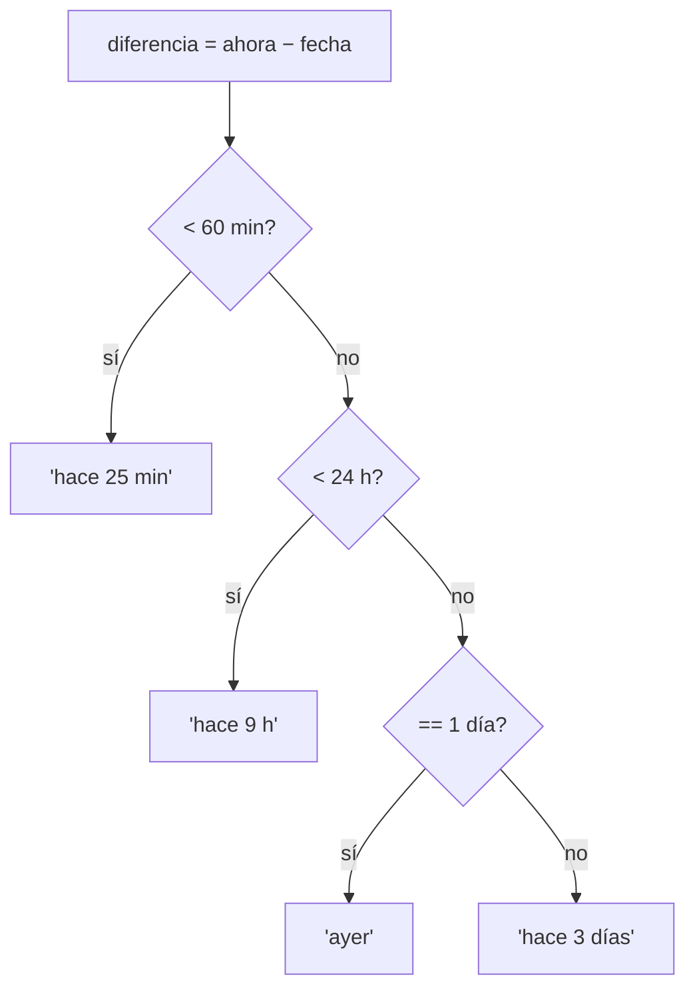

# Operadores y textos

!!! abstract "Objetivo"
    Hacer cuentas, comparar, combinar condiciones, decidir con `if` y el operador ternario, repetir con `for` y `while`, y manejar textos: interpolación, métodos de `String` y expresiones regulares. Al final vas a entender línea por línea `fechas.dart` y `validadores.dart` de VigiaApp.

## Aritmética

| Operador | Qué hace | Ejemplo | Resultado |
|---|---|---|---|
| `+` | Suma | `7 + 2` | `9` |
| `-` | Resta | `7 - 2` | `5` |
| `*` | Multiplicación | `7 * 2` | `14` |
| `/` | División (siempre `double`) | `7 / 2` | `3.5` |
| `~/` | División entera | `7 ~/ 2` | `3` |
| `%` | Resto | `7 % 2` | `1` |
| `-x` | Negativo | `-7` | `-7` |

!!! warning "`/` siempre da `double`"
    `6 / 2` es `3.0`, no `3`. Si querés un `int`, usá `~/`: `6 ~/ 2` es `3`. Es un error clásico al calcular páginas o índices.

### Incrementar

```dart
var intentos = 0;
intentos = intentos + 1;
intentos += 1;    // lo mismo, más corto
intentos++;       // lo mismo, todavía más corto
intentos -= 2;    // resta 2
```

## Comparar

Las comparaciones dan un `bool`:

| Operador | Significa |
|---|---|
| `==` | igual |
| `!=` | distinto |
| `<` `<=` | menor, menor o igual |
| `>` `>=` | mayor, mayor o igual |

```dart
print(3 == 3);         // true
print('a' == 'a');     // true: los String se comparan por contenido
print(5 >= 8);         // false
```

## Lógica: y, o, no

| Operador | Significa | `true` cuando… |
|---|---|---|
| `a && b` | y | los dos son `true` |
| `a \|\| b` | o | alguno es `true` |
| `!a` | no | `a` es `false` |

```dart title="validar_clave.dart"
void main() {
  final largo = 5;
  final esInvalida = largo < 8 || largo > 128;
  print(esInvalida); // true

  final esComite = true;
  final esAutor = false;
  print(esComite || esAutor); // true: alguno de los dos puede borrar
}
```

Esta es, casi igual, la regla del modelo `VecinoSesion` para saber si alguien puede borrar una publicación ([capítulo 3](../5-construccion/03-dominio.md)):

```dart
bool puedeBorrar({required int? autorId}) => esComite || autorId == id;
```

!!! tip "Cortocircuito"
    `&&` y `||` **no evalúan** la segunda parte si la primera ya decide. En `esComite || autorId == id`, si `esComite` es `true`, ni mira `autorId`. Sirve para cosas como `lista.isNotEmpty && lista.first == 'x'`: si está vacía, no llega a pedir `first` (que fallaría).

## Decidir

### `if` / `else`

```dart
if (diferencia.inMinutes < 60) {
  print('hace ${diferencia.inMinutes} min');
} else if (diferencia.inHours < 24) {
  print('hace ${diferencia.inHours} h');
} else {
  print('hace mucho');
}
```

Si el cuerpo es una sola línea, las llaves se pueden omitir (en VigiaApp lo hacemos con `return`):

```dart
if (email.isEmpty) return 'Ingresá tu email';
```

### El operador ternario `? :`

Un `if` que **devuelve un valor**, en una línea:

```dart
condición ? valorSiTrue : valorSiFalse
```

```dart
final texto = hayRed ? 'Conectado' : 'Sin conexión';
```

En `validadores.dart`:

```dart
return largo < 8 || largo > 128
    ? 'La contraseña debe tener entre 8 y 128 caracteres'
    : null;
```



!!! info "Y el `switch`"
    Para decidir entre muchos casos, Dart tiene un `switch` muy potente que también devuelve valores. Lo dejamos para [Enums, records y patrones](7-enums-records-patrones.md#switch-como-expresion), porque brilla con esos tipos.

## Repetir

=== "for con contador"

    ```dart
    for (var i = 1; i <= 5; i++) {
      print('Manzana $i');
    }
    ```

    Tres partes: **desde** (`var i = 1`), **mientras** (`i <= 5`), **paso** (`i++`).

=== "for-in"

    ```dart
    final vecinos = ['María', 'Jorge', 'Laura'];
    for (final vecino in vecinos) {
      print(vecino);
    }
    ```

    Recorre cada elemento. Es el más usado: no hay índices que equivocar.

=== "while"

    ```dart
    var intentos = 0;
    while (intentos < 3) {
      print('Intento $intentos');
      intentos++;
    }
    ```

    Repite **mientras** la condición sea `true`. Cuidado: si nunca se vuelve `false`, el programa se cuelga.

Dentro de un bucle, `break` sale del bucle y `continue` salta a la próxima vuelta.

## Textos (`String`)

### Comillas

```dart
final a = 'comillas simples';    // lo que usa Flutter por convención
final b = "comillas dobles";     // también vale
final c = 'Dijo "hola"';          // dobles dentro de simples, sin problema
final d = 'It\'s';                // \' para meter una simple dentro de simples
final e = '''
Varias
líneas''';                         // triples: texto de varias líneas
final f = r'^[^\s@]+@';           // r = "raw": las \ no se interpretan
```

### Interpolación: meter valores en el texto

La forma de armar textos en Dart. Con `$nombre` metés una variable y con `${expresión}` cualquier cuenta:

```dart title="interpolacion.dart"
void main() {
  final nombre = 'María';
  final manzana = 4;
  final minutos = 25;

  print('Hola, $nombre');                         // una variable
  print('Manzana $manzana · Vigía');              // al lado de texto
  print('hace ${minutos} min');                   // con llaves también vale
  print('En una hora: ${minutos + 60} min');      // una cuenta
  print('${nombre.toUpperCase()} (${nombre.length} letras)'); // métodos
}
```

```text title="Salida"
Hola, María
Manzana 4 · Vigía
hace 25 min
En una hora: 85 min
MARÍA (5 letras)
```

!!! tip "No concatenes con `+`"
    `'Hola, ' + nombre + '!'` funciona, pero el analizador te sugiere `'Hola, $nombre!'`. Es más corto y más claro. Las llaves solo hacen falta si hay algo más que un nombre: `${vecino.nombre}`, `${a + b}`.

### Textos largos en varias líneas de código

Dos textos seguidos se pegan solos. Sirve para cortar líneas largas sin `+`:

```dart
String fechaApi(DateTime fecha) =>
    '${fecha.year.toString().padLeft(4, '0')}-'
    '${_dosCifras(fecha.month)}-${_dosCifras(fecha.day)}';
```

### Los métodos que más se usan

| Método | Qué hace | Ejemplo → resultado |
|---|---|---|
| `length` | Cantidad de caracteres. | `'Ana'.length` → `3` |
| `isEmpty` / `isNotEmpty` | ¿Está vacío? | `''.isEmpty` → `true` |
| `trim()` | Saca espacios de los bordes. | `'  hola '.trim()` → `'hola'` |
| `toUpperCase()` / `toLowerCase()` | Mayúsculas / minúsculas. | `'mr'.toUpperCase()` → `'MR'` |
| `contains(x)` | ¿Contiene x? | `'maria@vigia'.contains('@')` → `true` |
| `startsWith(x)` | ¿Empieza con x? | `'fake-3'.startsWith('fake-')` → `true` |
| `replaceFirst(a, b)` | Reemplaza la primera a por b. | `'fake-3'.replaceFirst('fake-', '')` → `'3'` |
| `split(x)` | Corta en una lista. | `'María Ríos'.split(' ')` → `['María', 'Ríos']` |
| `padLeft(n, c)` | Rellena a la izquierda hasta n. | `'7'.padLeft(2, '0')` → `'07'` |
| `substring(a, b)` | Un pedazo. | `'Manzana'.substring(0, 3)` → `'Man'` |
| `texto[i]` | El caracter en la posición i. | `'María'[0]` → `'M'` |

Convertir entre números y textos:

```dart
int.parse('42');          // 42 (explota si no es un número)
int.tryParse('hola');     // null (no explota)
double.parse('-34.6');    // -34.6
42.toString();            // '42'
3.14159.toStringAsFixed(2); // '3.14'
```

!!! tip "`tryParse` para lo que viene de afuera"
    Si el texto lo escribió una persona o vino del servidor, usá `tryParse` y manejá el `null`. `parse` explota con `FormatException` si el texto no es un número.

### Expresiones regulares

Una **expresión regular** (*RegExp*) es un patrón para buscar o validar textos. VigiaApp usa dos:

```dart
final _formatoEmail = RegExp(r'^[^\s@]+@[^\s@]+\.[^\s@]+$');
final _formatoToken = RegExp(r'^[0-9a-fA-F]{64}$');
```

Cómo se lee la del email:

| Pedazo | Significa |
|---|---|
| `^` | Empieza acá (no puede haber nada antes). |
| `[^\s@]+` | Uno o más caracteres que **no** sean espacio ni `@`. |
| `@` | Una arroba. |
| `[^\s@]+` | Uno o más caracteres que no sean espacio ni `@`. |
| `\.` | Un punto (con `\` porque `.` solo significa "cualquier caracter"). |
| `[^\s@]+` | Uno o más que no sean espacio ni `@`. |
| `$` | Termina acá. |

O sea: `algo@algo.algo`. No es perfecta (ninguna lo es para emails), pero evita los errores de tipeo más comunes. El servidor vuelve a validar.

```dart
_formatoEmail.hasMatch('maria@vigia.test'); // true
_formatoEmail.hasMatch('maria@vigia');      // false: falta el .algo
_formatoEmail.hasMatch('ma ria@vigia.test');// false: tiene un espacio
```

## Todo junto: `validadores.dart`

Ya podés leer el archivo entero del [capítulo 2](../5-construccion/02-utilidades.md). Por ejemplo:

```dart
String? validarEmail(String? valor) {
  final email = (valor ?? '').trim();  // (1)!
  if (email.isEmpty) return 'Ingresá tu email';  // (2)!
  if (!_formatoEmail.hasMatch(email)) return 'El email no es válido';  // (3)!
  return null;  // (4)!
}
```

1. Si `valor` es null, usa `''`; después saca los espacios de los bordes. `??` lo viste en [null safety](1-variables-y-tipos.md#null-safety).
2. Vacío → mensaje.
3. `!` adelante de una condición es **no**: "si **no** encaja con el formato…".
4. `null` significa "no hay error". Es la convención de los formularios de Flutter ([Formularios](../3-flutter/5-formularios.md)).

Y de `fechas.dart`:

```dart
String haceCuanto(DateTime fecha, {DateTime? ahora}) {
  final diferencia = (ahora ?? DateTime.now()).difference(fecha);  // (1)!
  if (diferencia.inMinutes < 60) return 'hace ${diferencia.inMinutes} min';
  if (diferencia.inHours < 24) return 'hace ${diferencia.inHours} h';
  if (diferencia.inDays == 1) return 'ayer';
  return 'hace ${diferencia.inDays} días';
}
```

1. `difference` resta dos fechas y da un `Duration`. `inMinutes`, `inHours` e `inDays` lo expresan en esas unidades (redondeando para abajo).



## Ejercicios

??? question "1. ¿Qué imprime?"
    ```dart
    print(7 / 2);
    print(7 ~/ 2);
    print(7 % 2);
    print('5'.padLeft(3, '0'));
    print('a,b,,c'.split(','));
    ```

    ??? success "Respuesta"
        `3.5`, `3`, `1`, `005`, `[a, b, , c]` (el tercer elemento es un texto vacío).

??? question "2. Escribí `iniciales(String nombre)`"
    Que para `'María Ríos'` devuelva `'MR'`. Pista: `split`, `[0]`, `toUpperCase`.

    ??? success "Una respuesta"
        ```dart
        String iniciales(String nombre) {
          final partes = nombre.split(' ');
          var resultado = '';
          for (final parte in partes) {
            if (parte.isNotEmpty) resultado += parte[0].toUpperCase();
            if (resultado.length == 2) break;
          }
          return resultado;
        }
        ```

        En [Colecciones](4-colecciones.md#encadenar-operaciones) vas a ver cómo se escribe en una sola línea, como en VigiaApp.

## Lo que aprendiste

- [x] `/` da `double`, `~/` da `int`, `%` da el resto.
- [x] `&&`, `||` y `!` combinan condiciones, y cortan apenas saben el resultado.
- [x] `cond ? a : b` es un `if` que devuelve un valor.
- [x] `for-in` recorre una lista sin índices.
- [x] La **interpolación** (`'$x'`, `'${x.y}'`) arma textos; `trim`, `split`, `padLeft`… los transforman.
- [x] Una `RegExp` valida formatos; `tryParse` convierte sin explotar.

[Siguiente: Funciones :material-arrow-right:](3-funciones.md){ .md-button .md-button--primary }
