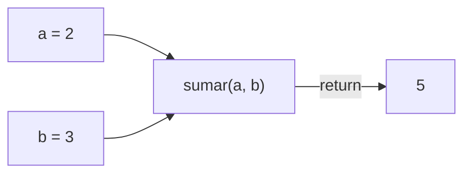
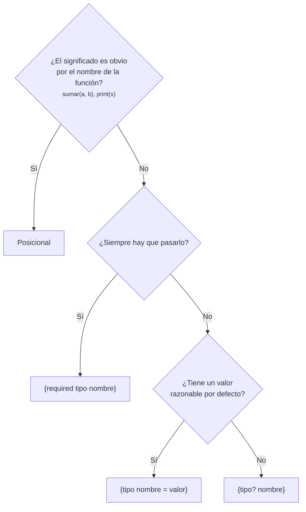
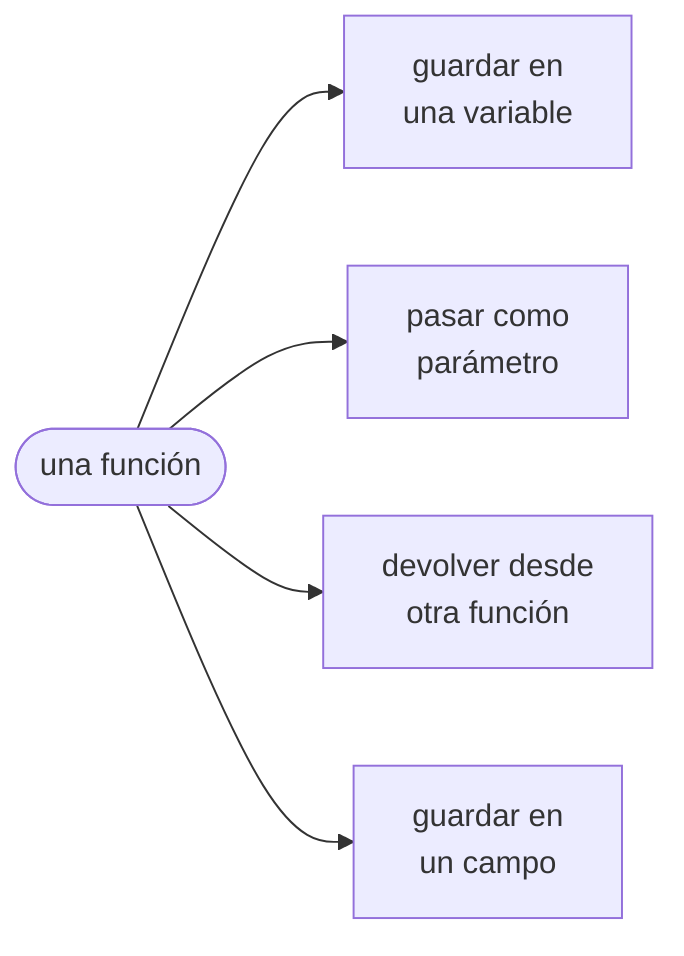
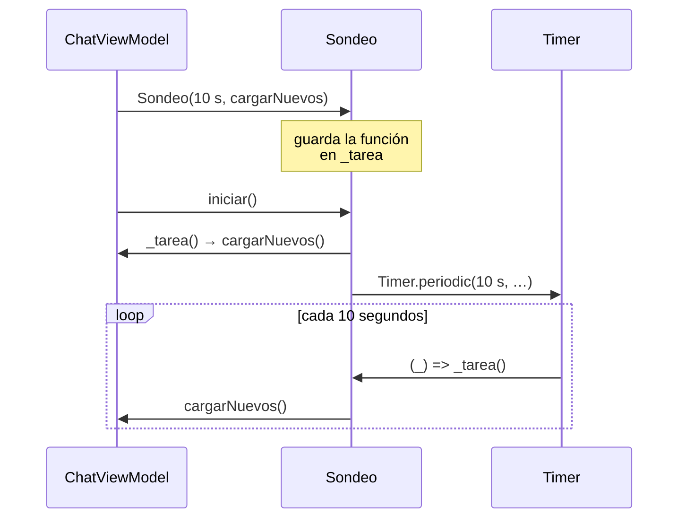

# Funciones

!!! abstract "Objetivo"
    Escribir funciones con parámetros posicionales y **con nombre**, usar la **flecha** `=>`, y entender que en Dart **las funciones son valores**: se guardan en variables, se pasan como parámetros y se devuelven. Esta última idea es la base de todos los botones de Flutter (`onPressed: …`).

## Qué es una función

Una **función** es un bloque de código con nombre, que recibe datos (**parámetros**), hace algo y opcionalmente **devuelve** un resultado.

```dart
int sumar(int a, int b) {
  return a + b;
}
```



Las partes:

```text
int        sumar   (int a, int b)   { return a + b; }
└┬┘        └─┬─┘   └─────┬──────┘   └──────┬───────┘
tipo que   nombre   parámetros         cuerpo
devuelve
```

Se **llama** (se usa) con el nombre y los valores entre paréntesis:

```dart
final total = sumar(2, 3);  // 5
```

### `void`: no devuelve nada

```dart
void saludar(String nombre) {
  print('Hola, $nombre');
}
```

### La flecha `=>`

Si el cuerpo es **una sola expresión**, se puede escribir con flecha. `=> x` significa `{ return x; }`:

```dart
int sumar(int a, int b) => a + b;

String diaCorto(DateTime fecha) =>
    '${diaDeLaSemana(fecha)} ${fecha.day}/${fecha.month}';
```

!!! warning "Flecha = una expresión"
    `=>` lleva **una** expresión, no instrucciones. `=> if (x) ...` no compila (pero `=> x ? a : b` sí). Si necesitás varias líneas, usá llaves y `return`.

## Parámetros

Dart tiene tres clases de parámetros. Elegir bien hace que el código que **llama** a la función se lea solo.

### 1. Posicionales (obligatorios)

Se pasan **en orden**:

```dart
void mover(int desde, int hasta) { ... }

mover(3, 7);  // ¿cuál era desde y cuál hasta? Hay que ir a mirar.
```

### 2. Posicionales opcionales `[ ]`

Entre corchetes, al final. Si no se pasan, valen `null` o el valor por defecto:

```dart
String saludo(String nombre, [String saludo = 'Hola']) => '$saludo, $nombre';

saludo('Ana');            // 'Hola, Ana'
saludo('Ana', 'Chau');    // 'Chau, Ana'
```

En VigiaApp casi no se usan: preferimos los parámetros con nombre.

### 3. Con nombre `{ }` {#parametros-con-nombre}

Entre llaves. Al llamar, **se escribe el nombre**:

```dart
String haceCuanto(DateTime fecha, {DateTime? ahora}) { ... }

haceCuanto(publicacion.fecha);                     // ahora = null → usa el reloj
haceCuanto(publicacion.fecha, ahora: mediodia);    // para los tests
```

Por defecto son **opcionales**: si no se pasan, valen `null` (por eso `DateTime?`) o el valor por defecto que pongas:

```dart
void cargar({bool mostrarCarga = true}) { ... }

cargar();                       // mostrarCarga = true
cargar(mostrarCarga: false);    // así se lee qué significa el false
```

Con `required`, son **obligatorios**:

```dart
bool puedeBorrar({required int? autorId}) => esComite || autorId == id;

vecino.puedeBorrar(autorId: publicacion.autorId);   // bien
vecino.puedeBorrar();                               // ERROR: The named parameter 'autorId' is required
```

!!! tip "¿Por qué tantos parámetros con nombre?"
    Compará:

    ```dart
    Sondeo(Duration(seconds: 15), cargar, true, false);
    ```

    con

    ```dart
    Text('Hola', textAlign: TextAlign.center, maxLines: 2);
    ```

    El primero obliga a ir a mirar qué es cada `true`. El segundo se lee solo. **Todos** los widgets de Flutter usan parámetros con nombre por esto, y en VigiaApp hacemos lo mismo.



### Mezclarlos

Primero van los posicionales y después los con nombre:

```dart
Future<Resultado<T>> ejecutar<T>(
  Future<T> Function() accion, {   // posicional
  bool marcarOcupado = true,        // con nombre, con valor por defecto
}) async { ... }
```

## Funciones como valores {#funciones-como-valores}

Esta es la idea más importante de la página. En Dart, una función es **un valor más**, como un número o un texto. Se puede:



### Guardar una función en una variable

```dart title="funciones_valor.dart"
int doble(int x) => x * 2;

void main() {
  final operacion = doble;     // sin paréntesis: la función, no su resultado
  print(operacion(5));         // 10

  int Function(int) otra = (x) => x + 1;  // una función anónima
  print(otra(5));              // 6
}
```

!!! warning "Con o sin paréntesis"
    - `doble` es **la función** (el valor).
    - `doble(5)` es **llamarla** (el resultado, `10`).

    Este detalle es fuente de muchos errores en Flutter: `onPressed: guardar` le pasa la función al botón para que la llame cuando lo toquen; `onPressed: guardar()` la **llama ya**, al dibujar, y le pasa el resultado (que no es una función).

### El tipo de una función

Se escribe `TipoQueDevuelve Function(TiposDeLosParámetros)`:

| Tipo | Qué función acepta |
|---|---|
| `void Function()` | Sin parámetros, no devuelve nada. Flutter le dice `VoidCallback`. |
| `void Function(String)` | Recibe un `String`, no devuelve nada. Flutter: `ValueChanged<String>`. |
| `int Function(int, int)` | Recibe dos `int`, devuelve un `int`. |
| `Future<void> Function()` | Sin parámetros, devuelve un `Future` (es asíncrona, ver [Future](8-asincronia-future.md)). |
| `String? Function(String?)` | La de los validadores de formularios. |

### Funciones anónimas

Una función **sin nombre**, escrita en el lugar donde se usa:

```dart
(int x) { return x * 2; }   // con llaves
(int x) => x * 2;           // con flecha
(x) => x * 2;               // sin tipo: Dart lo infiere del contexto
() => print('tocaron');     // sin parámetros
(_) => cargar();            // un parámetro que no usamos: se llama _
```

Se usan todo el tiempo para pasarle comportamiento a otra función:

```dart
ElevatedButton(
  onPressed: () => Navigator.pop(context),  // "cuando lo toquen, hacé esto"
  child: const Text('Cancelar'),
)
```

### Pasar una función como parámetro

Así funciona `Sondeo`, del [capítulo 2](../5-construccion/02-utilidades.md): recibe **qué hacer** y lo repite cada tanto.

```dart
class Sondeo {
  Sondeo(this.intervalo, this._tarea);

  final Duration intervalo;
  final Future<void> Function() _tarea;  // (1)!
  Timer? _timer;

  void iniciar() {
    detener();
    _tarea();  // (2)!
    _timer = Timer.periodic(intervalo, (_) => _tarea());  // (3)!
  }

  void detener() {
    _timer?.cancel();
    _timer = null;
  }
}
```

1. Un campo que guarda **una función**: "algo que, cuando lo llamo, devuelve un `Future<void>`".
2. La llama una vez ya.
3. Le pasa a `Timer.periodic` **otra** función anónima, que recibe el timer (lo ignoramos con `_`) y llama a la tarea.

Y quien lo usa le pasa **su** función:

```dart
late final _sondeo = Sondeo(const Duration(seconds: 10), cargarNuevos);
//                                                        └─ sin paréntesis
```



### *Tear-offs*: pasar un método sin envolverlo

Si ya tenés una función o un método con la forma justa, no hace falta envolverlo en `() => …`:

```dart
// Las dos líneas hacen lo mismo:
AppLifecycleListener(onPause: () => _viewModel.pausar());
AppLifecycleListener(onPause: _viewModel.pausar);  // más corto
```

A `_viewModel.pausar` (sin paréntesis) se le dice *tear-off*: "arrancar" el método del objeto para pasarlo. El analizador te sugiere esta forma (`unnecessary_lambdas`).

### Clausuras (*closures*)

Una función anónima **recuerda** las variables del lugar donde se creó, aunque se ejecute después:

```dart title="clausura.dart"
void Function() contador() {
  var veces = 0;
  return () {
    veces++;
    print('Llamada $veces');
  };
}

void main() {
  final contar = contador();
  contar(); // Llamada 1
  contar(); // Llamada 2
  contar(); // Llamada 3
}
```

`veces` vive mientras viva la función que la usa. Esto es lo que permite, en Flutter, escribir `onPressed: () => borrar(publicacion.id)` adentro de una lista: cada botón recuerda **su** `publicacion`.

### `typedef`: un nombre para un tipo de función

Si un tipo de función se repite, se le puede poner nombre:

```dart
typedef CargarFoto = Future<Uint8List> Function(int fotoId);

class FotoVigia extends StatefulWidget {
  const FotoVigia({required this.fotoId, required this.cargar, ...});
  final CargarFoto cargar;  // se lee mejor que el tipo largo
}
```

Es de VigiaApp ([capítulo 10](../5-construccion/10-publicaciones-y-fotos.md)): el widget que muestra una foto recibe **cómo** cargarla, sin saber de dónde viene.

## Funciones genéricas

A veces una función sirve igual para cualquier tipo. Se usa una **variable de tipo**, por convención `T`:

```dart
T primero<T>(List<T> lista) => lista[0];

primero<int>([1, 2, 3]);      // 1, de tipo int
primero(['a', 'b']);          // 'a', de tipo String (T se infiere)
```

El método `ejecutar` del `ViewModel` base ([capítulo 6](../5-construccion/06-login.md)) es genérico: corre una acción que devuelve un `T` y devuelve un `Resultado<T>`.

```dart
Future<Resultado<T>> ejecutar<T>(Future<T> Function() accion, ...)
```

Si `accion` devuelve un `Future<Sesion>`, `ejecutar` devuelve un `Future<Resultado<Sesion>>`. Lo vemos más en [Clases](5-clases.md#genericos).

## Funciones de primer nivel vs. métodos

- Una función **de primer nivel** (*top-level*) está suelta en el archivo, fuera de toda clase: `main`, `validarEmail`, `haceCuanto`. Se usa con el nombre directo.
- Un **método** está adentro de una clase y se usa sobre un objeto: `sondeo.iniciar()`, `'hola'.toUpperCase()`.

En VigiaApp, las utilidades sin estado (fechas, validadores) son funciones de primer nivel: no hace falta inventar una clase `Validadores` para agruparlas.

## Ejercicios

??? question "1. ¿Qué imprime?"
    ```dart
    void main() {
      final fs = <int Function(int)>[(x) => x + 1, (x) => x * 10];
      var v = 2;
      for (final f in fs) {
        v = f(v);
      }
      print(v);
    }
    ```

    ??? success "Respuesta"
        `30`: primero `2 + 1 = 3`, después `3 * 10 = 30`.

??? question "2. Arreglá el botón"
    Este botón borra apenas se dibuja la pantalla, sin que nadie lo toque. ¿Por qué?
    ```dart
    TextButton(onPressed: borrar(), child: const Text('Borrar'))
    ```

    ??? success "Respuesta"
        `borrar()` **llama** a la función al construir el widget. Tiene que ser `onPressed: borrar` (si no recibe parámetros) o `onPressed: () => borrar(id)`.

??? question "3. Escribí `repetir`"
    Una función `repetir(int veces, void Function(int) accion)` que llame a `accion` con 0, 1, …, `veces - 1`. Usala para imprimir "Manzana 1" a "Manzana 5".

    ??? success "Una respuesta"
        ```dart
        void repetir(int veces, void Function(int) accion) {
          for (var i = 0; i < veces; i++) {
            accion(i);
          }
        }

        void main() {
          repetir(5, (i) => print('Manzana ${i + 1}'));
        }
        ```

## Lo que aprendiste

- [x] `=> expr` es `{ return expr; }`.
- [x] Parámetros **posicionales**, **opcionales** `[ ]` y **con nombre** `{ }`; `required` los hace obligatorios.
- [x] Las funciones son **valores**: se guardan, se pasan y se devuelven. `f` es la función; `f()` es llamarla.
- [x] Las **anónimas** (`() => …`) y los **tear-offs** (`objeto.metodo`) son la forma de decirle a un botón "qué hacer".
- [x] Las **clausuras** recuerdan las variables de donde se crearon.

[Siguiente: Colecciones :material-arrow-right:](4-colecciones.md){ .md-button .md-button--primary }
