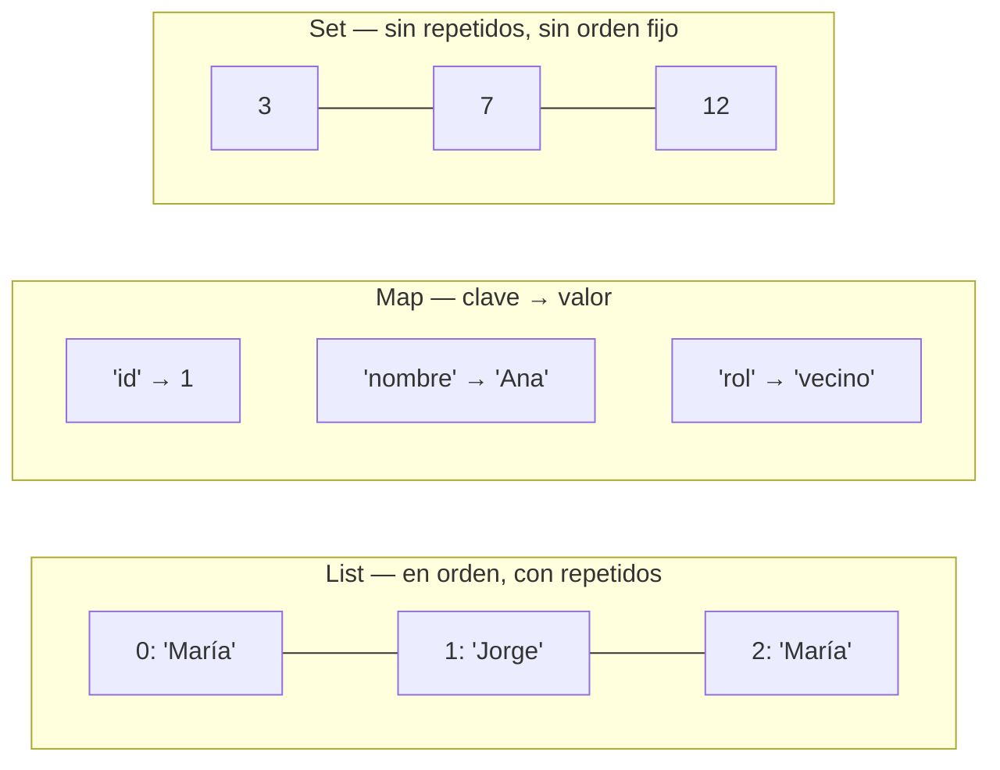
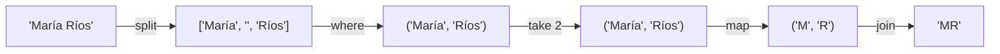
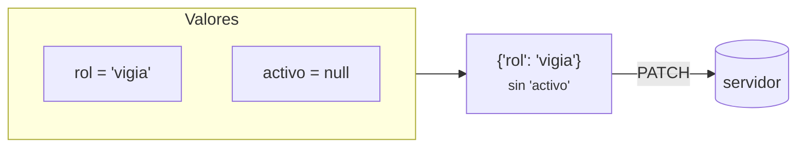

# Colecciones

!!! abstract "Objetivo"
    Manejar las tres colecciones de Dart (**List**, **Map** y **Set**), recorrerlas, **transformarlas encadenando operaciones** y construirlas con `if`, `for`, `...` y **elementos opcionales** adentro. El JSON que manda el servidor es una mezcla de listas y mapas, así que esto se usa en todos lados.

## Las tres colecciones



| | `List<T>` | `Map<K, V>` | `Set<T>` |
|---|---|---|---|
| Literal | `[1, 2, 3]` | `{'a': 1, 'b': 2}` | `{1, 2, 3}` |
| Vacía | `<int>[]` | `<String, int>{}` | `<int>{}` |
| Acceso | por posición: `lista[0]` | por clave: `mapa['a']` | `conjunto.contains(3)` |
| ¿Repetidos? | Sí | Claves no | No |
| En VigiaApp | Mensajes, publicaciones, vecinos. | Cada objeto JSON. | Los vecinos elegidos para un rondín. |

## List

```dart title="listas.dart"
void main() {
  final vecinos = ['María', 'Jorge', 'Laura'];

  print(vecinos[0]);          // María (las posiciones empiezan en 0)
  print(vecinos.length);      // 3
  print(vecinos.first);       // María
  print(vecinos.last);        // Laura
  print(vecinos.isEmpty);     // false
  print(vecinos.contains('Jorge')); // true
  print(vecinos.indexOf('Laura'));  // 2

  vecinos.add('Ana');               // al final
  vecinos.insert(0, 'Tomás');       // en una posición
  vecinos.remove('Jorge');          // por valor
  vecinos.removeAt(0);              // por posición
  print(vecinos);                   // [María, Laura, Ana]

  vecinos.addAll(['Diego', 'Sofía']);
  vecinos.sort();                   // orden alfabético
  print(vecinos);                   // [Ana, Diego, Laura, María, Sofía]
}
```

!!! warning "`final` no congela la lista"
    `final vecinos = [...]` impide **reasignar** la variable (`vecinos = otraLista`), pero **no** impide cambiar su contenido (`vecinos.add(...)`). Para una lista que no se pueda tocar, ver [listas de solo lectura](#listas-de-solo-lectura).

!!! danger "Fuera de rango"
    `vecinos[10]` con 3 elementos explota con `RangeError (index): Invalid value: Not in inclusive range 0..2: 10`. Lo mismo `first` o `last` con una lista vacía (`Bad state: No element`). Si puede estar vacía, usá `firstOrNull`, que devuelve `null`.

### Ordenar con un criterio

`sort()` sin argumentos ordena números y textos. Para objetos, se le pasa **una función que compara dos elementos** (ver [funciones como valores](3-funciones.md#funciones-como-valores)): tiene que devolver un número negativo si `a` va antes, positivo si va después, y 0 si da igual.

```dart
mensajes.sort((a, b) => a.fecha.compareTo(b.fecha));   // más viejos primero
mensajes.sort((a, b) => b.fecha.compareTo(a.fecha));   // más nuevos primero
```

`compareTo` hace esa cuenta por vos para números, textos y fechas.

## Map

Un `Map` asocia **claves** con **valores**. Es exactamente la forma de un objeto JSON:

```json
{"id": 1, "nombre": "Ana", "telefono": null}
```

```dart
final Map<String, dynamic> json = {'id': 1, 'nombre': 'Ana', 'telefono': null};
```

`Map<String, dynamic>`: claves `String`, valores de cualquier tipo. Lo vas a ver en todos los `fromJson`.

```dart title="mapas.dart"
void main() {
  final roles = {'vecino': 'Vecino', 'vigia': 'Vigía', 'comite': 'Comité'};

  print(roles['vigia']);           // Vigía
  print(roles['policia']);         // null: la clave no existe
  print(roles['policia'] ?? '?');  // ?
  print(roles.containsKey('comite')); // true
  print(roles.keys);               // (vecino, vigia, comite)
  print(roles.values);             // (Vecino, Vigía, Comité)

  roles['admin'] = 'Admin';        // agrega (o reemplaza)
  roles.remove('admin');           // saca

  for (final entrada in roles.entries) {
    print('${entrada.key} → ${entrada.value}');
  }
}
```

!!! info "Leer un mapa siempre puede dar `null`"
    `roles['vigia']` es de tipo `String?`, no `String`, porque la clave podría no estar. Por eso en VigiaApp se escribe `roles[rol] ?? rol`: "el nombre lindo, o el rol tal cual si no está en el mapa".

### Convertir un JSON en datos

El servidor manda texto; `jsonDecode` (de `dart:convert`) lo convierte en mapas y listas:

```dart title="json.dart"
import 'dart:convert';

void main() {
  const texto = '{"id": 7, "nombre": "Jorge", "manzanas": [1, 2]}';
  final json = jsonDecode(texto) as Map<String, dynamic>;

  final id = json['id'] as int;
  final nombre = json['nombre'] as String;
  final manzanas = (json['manzanas'] as List).cast<int>();

  print('$id $nombre $manzanas'); // 7 Jorge [1, 2]
  print(jsonEncode({'email': 'ana@vigia.test'})); // {"email":"ana@vigia.test"}
}
```

En la app, esto está encapsulado en los `fromJson` ([capítulo 3](../5-construccion/03-dominio.md)) y en `HttpVigiaApi` ([Parte 6](../6-pruebas-y-entrega/2-api-real.md)).

## Set

Un conjunto: no tiene repetidos y responde rápido a "¿está?".

```dart
final elegidos = <int>{3, 7};
elegidos.add(7);           // ya estaba: no cambia
elegidos.add(12);
print(elegidos);           // {3, 7, 12}
print(elegidos.contains(3)); // true
elegidos.remove(3);
```

En el [capítulo 16](../5-construccion/16-comite.md), el diálogo para elegir los vecinos de un rondín guarda los tildados en un `Set<int>` con sus IDs: tildar es `add`, destildar es `remove`, y "¿está tildado?" es `contains`.

## Recorrer

```dart
for (final vecino in vecinos) {
  print(vecino);
}

// Con la posición:
for (final (i, vecino) in vecinos.indexed) {
  print('$i: $vecino');
}

// Con forEach y una función:
vecinos.forEach(print);
```

`.indexed` da pares `(posición, elemento)`; el `(i, vecino)` los separa con un [patrón](7-enums-records-patrones.md#patrones). VigiaApp lo usa en el servidor de mentira para numerar los vecinos de ejemplo.

## Transformar

Las colecciones tienen métodos que **no modifican** la original sino que **producen una nueva**. Son de las cosas más útiles del lenguaje.

| Método | Qué hace | Ejemplo | Resultado |
|---|---|---|---|
| `map(f)` | Transforma cada elemento. | `[1, 2, 3].map((x) => x * 2)` | `(2, 4, 6)` |
| `where(f)` | Se queda con los que cumplen. | `[1, 2, 3].where((x) => x > 1)` | `(2, 3)` |
| `firstWhere(f)` | El primero que cumple (explota si ninguno). | `[1, 2, 3].firstWhere((x) => x > 1)` | `2` |
| `any(f)` | ¿Alguno cumple? | `[1, 2].any((x) => x > 1)` | `true` |
| `every(f)` | ¿Todos cumplen? | `[1, 2].every((x) => x > 1)` | `false` |
| `take(n)` | Los primeros n. | `[1, 2, 3].take(2)` | `(1, 2)` |
| `skip(n)` | Sin los primeros n. | `[1, 2, 3].skip(1)` | `(2, 3)` |
| `join(sep)` | Une en un texto. | `['a', 'b'].join('-')` | `'a-b'` |
| `toList()` | Convierte a `List`. | `(1, 2).toList()` | `[1, 2]` |
| `toSet()` | Convierte a `Set`. | `[1, 1, 2].toSet()` | `{1, 2}` |
| `fold(ini, f)` | Acumula. | `[1, 2, 3].fold(0, (a, x) => a + x)` | `6` |

!!! info "¿Por qué `(2, 4, 6)` con paréntesis?"
    `map`, `where`, `take` y `skip` devuelven un **`Iterable`**, no una `List`: una secuencia "perezosa" que se calcula recién cuando la recorrés. Se imprime con paréntesis. Si necesitás una lista (para guardarla, para usar `[i]`), agregá `.toList()`.

### Encadenar operaciones {#encadenar-operaciones}

Como cada método devuelve otra colección, se pueden **encadenar**. Es la forma de escribir `iniciales` en VigiaApp ([capítulo 3](../5-construccion/03-dominio.md)):

```dart
String get iniciales => nombre
    .split(' ')                              // (1)!
    .where((parte) => parte.isNotEmpty)      // (2)!
    .take(2)                                 // (3)!
    .map((parte) => parte[0].toUpperCase())  // (4)!
    .join();                                 // (5)!
```

1. `'María  Ríos'` → `['María', '', 'Ríos']` (dos espacios dejan un texto vacío en el medio).
2. Saca los vacíos → `('María', 'Ríos')`.
3. Se queda con los dos primeros (por si hay segundo nombre).
4. De cada uno, la primera letra en mayúscula → `('M', 'R')`.
5. Las une sin separador → `'MR'`.



Compará con la versión con `for` del [ejercicio de la página anterior](2-operadores-y-strings.md#ejercicios): hace lo mismo, pero se lee como una receta, paso a paso.

!!! tip "Una operación por línea"
    Al encadenar, poné cada operación en su línea, empezando con el punto. El formateador de Dart lo hace solo si la cadena es larga.

## Construir colecciones

Dart deja poner **lógica adentro** de un literal de lista, mapa o conjunto. En Flutter se usa todo el tiempo para armar la lista de hijos de un widget.

### *Collection if* y *collection for* {#collection-if-y-collection-for}

```dart title="collection_if_for.dart"
void main() {
  final esComite = true;
  final manzanas = [1, 2, 3];

  final opciones = [
    'Inicio',
    'Perfil',
    if (esComite) 'Vecinos',                    // solo si es comité
    if (esComite) 'Rondines' else 'Recorridos', // uno u otro
    for (final m in manzanas) 'Manzana $m',     // uno por cada manzana
  ];

  print(opciones);
}
```

```text title="Salida"
[Inicio, Perfil, Vecinos, Rondines, Manzana 1, Manzana 2, Manzana 3]
```

En Flutter, el menú lateral de VigiaApp hace exactamente esto: los ítems del comité se agregan con `if`.

```dart
children: [
  // … Perfil, Recorridos, Noticias …
  if (onComiteVecinos != null && onComiteRondines != null) ...[
    const Divider(),
    const Padding(
      padding: EdgeInsets.fromLTRB(16, 8, 16, 4),
      child: Text('COMITÉ'),
    ),
    _Opcion(texto: 'Vecinos', onTap: onComiteVecinos, ...),
    _Opcion(texto: 'Rondines del comité', onTap: onComiteRondines, ...),
  ],
]
```

(El `...[ ]` agrega varios elementos de una vez: lo vemos enseguida, en [spread](#spread).)

Y los modelos arman listas desde el JSON con un `for` adentro:

```dart
enCaminoUbicaciones: [
  for (final u in json['en_camino_ubicaciones'] as List? ?? const [])
    UbicacionVecino.fromJson(u as Map<String, dynamic>),
],
```

### *Spread*: `...` {#spread}

`...` "desparrama" una colección adentro de otra:

```dart
final base = ['Inicio', 'Perfil'];
final todo = [...base, 'Salir'];     // [Inicio, Perfil, Salir]
```

Combinado con `if`, agrega **varios** elementos de una vez:

```dart
children: [
  if (!esMio) Text(mensaje.autor),
  if (mensaje.fotoId case final fotoId?) ...[
    const SizedBox(height: 4),
    FotoVigia(fotoId: fotoId, cargar: cargarFoto, alto: 180),
  ],
]
```

### Elementos opcionales {#elementos-opcionales}

Una novedad de Dart 3.8: un `?` **adelante** de un elemento hace que **solo se agregue si no es `null`**.

```dart title="elementos_opcionales.dart"
void main() {
  String? manzana;               // null
  String? telefono = '+54 11 5555';

  final datos = ['Ana', ?manzana, ?telefono];
  print(datos);                  // [Ana, +54 11 5555]: la manzana no está

  int? rol;
  final cambios = {'nombre': 'Ana', 'rol': ?rol};
  print(cambios);                // {nombre: Ana}: la clave 'rol' no se agregó
}
```

Sin esta sintaxis habría que escribir `if (manzana != null) manzana`. En VigiaApp se usa sobre todo en **mapas** para mandarle al servidor solo los campos que cambiaron:

```dart
// ComiteRepository (capítulo 16): editar un vecino
_api.editarVecino(id, {'rol': ?rol, 'activo': ?activo});

// HttpVigiaApi (Parte 6): mandar un mensaje con texto, foto o las dos cosas
await _post('/mensajes', {'texto': ?texto, 'foto_id': ?fotoId});
```



## Listas de solo lectura

Un ViewModel guarda sus listas y se las muestra a la vista. Pero no quiere que la vista las **modifique** por atrás (eso rompería la regla de que el estado lo cambia solo el ViewModel). Dart tiene `UnmodifiableListView`, que **envuelve** una lista y falla si alguien intenta cambiarla:

```dart
import 'dart:collection';

final _mensajes = <String>['Hola'];
List<String> get mensajes => UnmodifiableListView(_mensajes);

// En otro lado:
viewModel.mensajes.add('Chau');
// Unsupported operation: Cannot add to an unmodifiable list
```

En VigiaApp está como extensión, `lista.soloLectura` ([Herencia y abstracción](6-herencia-y-abstraccion.md#extensiones)).

Las listas **`const`** también son inmodificables, y además se crean una sola vez:

```dart
const diasSemana = ['Lun', 'Mar', 'Mié', 'Jue', 'Vie', 'Sáb', 'Dom'];
```

## Ejercicios

??? question "1. ¿Qué imprime?"
    ```dart
    final xs = [5, 3, 8, 1];
    print(xs.where((x) => x > 2).map((x) => x * 10).toList());
    print(xs.fold(0, (a, x) => a + x));
    print([for (final x in xs) if (x.isOdd) x]);
    ```

    ??? success "Respuesta"
        `[50, 30, 80]`, `17` y `[5, 3, 1]`.

??? question "2. Agrupar mensajes por autor"
    Dada `final autores = ['Ana', 'Jorge', 'Ana', 'Laura', 'Ana'];`, armá un `Map<String, int>` con cuántos mensajes tiene cada uno.

    ??? success "Una respuesta"
        ```dart
        final cuenta = <String, int>{};
        for (final a in autores) {
          cuenta[a] = (cuenta[a] ?? 0) + 1;
        }
        print(cuenta); // {Ana: 3, Jorge: 1, Laura: 1}
        ```

??? question "3. Con elementos opcionales"
    Escribí una función que reciba `String? texto` e `int? fotoId` y arme el mapa para mandar un mensaje, sin claves con `null`.

    ??? success "Respuesta"
        ```dart
        Map<String, Object> cuerpo(String? texto, int? fotoId) =>
            {'texto': ?texto, 'foto_id': ?fotoId};
        ```

        Es lo que hace `HttpVigiaApi.enviarMensaje` en la Parte 6.

## Lo que aprendiste

- [x] `List` (orden), `Map` (clave → valor, como el JSON) y `Set` (sin repetidos).
- [x] `map`, `where`, `take`, `join`… transforman sin modificar, y se **encadenan**.
- [x] Adentro de un literal valen `if`, `for`, `...` y **`?elemento`**.
- [x] `UnmodifiableListView` y `const` dan listas que no se pueden tocar.

[Siguiente: Clases :material-arrow-right:](5-clases.md){ .md-button .md-button--primary }
