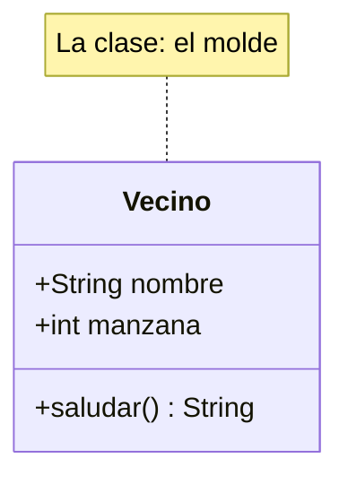
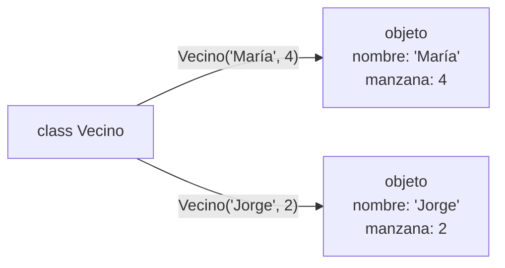
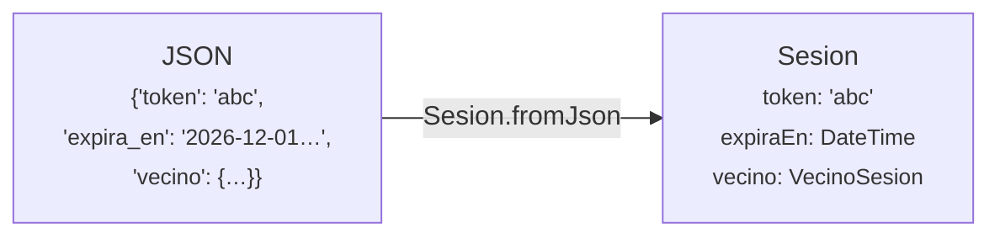
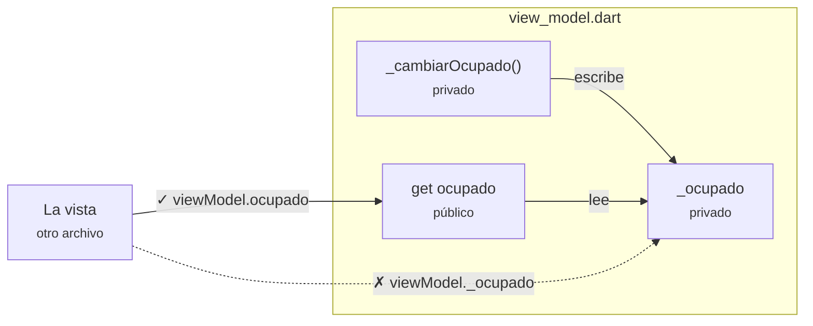
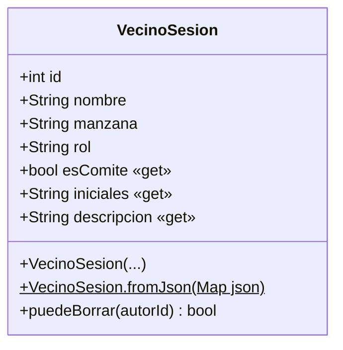

# Clases

!!! abstract "Objetivo"
    Escribir clases: campos, constructores (normales, con nombre, `const`, `factory`), getters, métodos, privacidad con `_`, miembros `static`, la cascada `..` y clases genéricas. Es la página más importante de la Parte 2: **todo** en VigiaApp es una clase, desde un vecino hasta una pantalla.

## Clase y objeto

Una **clase** es un **molde**: describe qué datos tiene una cosa y qué sabe hacer. Un **objeto** (o **instancia**) es una cosa concreta hecha con ese molde.





```dart title="clase.dart"
class Vecino {
  Vecino(this.nombre, this.manzana);  // (1)!

  final String nombre;  // (2)!
  final int manzana;

  String saludar() => 'Hola, soy $nombre de la manzana $manzana';  // (3)!
}

void main() {
  final maria = Vecino('María', 4);  // (4)!
  final jorge = Vecino('Jorge', 2);

  print(maria.nombre);     // (5)!
  print(jorge.saludar());
}
```

1. El **constructor**: cómo se crea un objeto. `this.nombre` significa "el primer argumento va al campo `nombre`".
2. Los **campos** (o propiedades): los datos de cada objeto. `final`: una vez creado, no cambian.
3. Un **método**: una función que pertenece a la clase y puede usar sus campos.
4. Crear un objeto: el nombre de la clase y los argumentos. (En Dart no hace falta `new`.)
5. Con el punto se accede a los campos y métodos del objeto.

```text title="Salida"
María
Hola, soy Jorge de la manzana 2
```

!!! info "El orden dentro de la clase"
    Por convención (y así está en toda la app): primero los **constructores**, después los **campos**, después los **getters** y al final los **métodos**.

## Constructores

### El constructor corto con `this.`

```dart
class Coordenadas {
  const Coordenadas(this.lat, this.lng);

  final double lat;
  final double lng;
}
```

Es lo mismo que esta versión larga, pero sin repetir:

```dart
class Coordenadas {
  Coordenadas(double lat, double lng) : lat = lat, lng = lng;
  final double lat;
  final double lng;
}
```

### Con parámetros con nombre

Como en las funciones ([parámetros con nombre](3-funciones.md#parametros-con-nombre)), los constructores con muchos datos usan `{ }` y `required`:

```dart
class Sesion {
  Sesion({required this.token, required this.expiraEn, required this.vecino});

  final String token;
  final DateTime expiraEn;
  final VecinoSesion vecino;
}

final sesion = Sesion(
  token: 'abc',
  expiraEn: DateTime(2026, 12, 1),
  vecino: maria,
);
```

### Constructores `const`

Si **todos** los campos son `final`, el constructor puede ser `const`. Así se pueden crear objetos constantes, que se arman una sola vez al compilar (ver [`final` y `const`](1-variables-y-tipos.md#final-y-const)):

```dart
const centro = Coordenadas(-34.6037, -58.3816);
```

**Todos los widgets** tienen constructor `const`. Por eso escribís `const Text('Hola')`.

### Constructores con nombre

Una clase puede tener **varios** constructores, cada uno con su nombre:

```dart
class Duracion {
  Duracion(this.segundos);
  Duracion.minutos(int m) : segundos = m * 60;  // (1)!
  Duracion.horas(int h) : segundos = h * 3600;

  final int segundos;
}

Duracion(90);            // 90 segundos
Duracion.minutos(2);     // 120 segundos
Duracion.horas(1);       // 3600 segundos
```

1. `: segundos = m * 60` es la **lista de inicialización**: asigna campos antes de que el objeto exista. Se usa cuando el valor del campo se calcula.

Flutter tiene montones: `EdgeInsets.all(16)`, `EdgeInsets.symmetric(horizontal: 8)`, `DateTime.now()`, `Duration(seconds: 15)`…

### Constructores `factory` {#constructores-factory}

Un constructor común **siempre** crea un objeto nuevo de **esa** clase, y solo puede asignar campos. Un constructor **`factory`** es una función que **devuelve** un objeto: puede hacer cálculos antes, elegir qué crear, o devolver uno que ya existía.

El uso estrella en VigiaApp: **construir un modelo desde el JSON del servidor**.

```dart title="lib/domain/models/sesion.dart (fragmento)"
class Sesion {
  Sesion({required this.token, required this.expiraEn, required this.vecino});

  factory Sesion.fromJson(Map<String, dynamic> json) {  // (1)!
    return Sesion(  // (2)!
      token: json['token'] as String,
      expiraEn: DateTime.parse(json['expira_en'] as String),  // (3)!
      vecino: VecinoSesion.fromJson(json['vecino'] as Map<String, dynamic>),  // (4)!
    );
  }

  final String token;
  final DateTime expiraEn;
  final VecinoSesion vecino;
}
```

1. Un `factory` con nombre: `Sesion.fromJson(...)`. Recibe el mapa que vino del servidor.
2. Adentro, llama al constructor normal y **devuelve** el objeto.
3. Antes de construir, convierte: el JSON trae la fecha como texto, el modelo la quiere como `DateTime`.
4. Los objetos anidados se construyen con **su** `fromJson`.



!!! question "¿Por qué no un método estático?"
    Podría ser `static Sesion desdeJson(...)` y funcionaría igual. Se usa `factory` por convención: se lee como un constructor (`Sesion.fromJson(json)`), y todo el ecosistema de Dart lo escribe así.

## Getters y setters

Un **getter** se usa como un campo, pero se **calcula** cada vez que se lee:

```dart
class VecinoSesion {
  // …
  final String rol;

  bool get esComite => rol == 'comite';  // (1)!

  String get descripcion => '$manzana · ${roles[rol] ?? rol}';
}

if (vecino.esComite) { … }  // (2)!
```

1. `get` + nombre + `=>` + cálculo. No lleva paréntesis.
2. Se usa **sin paréntesis**, como un campo.

Un **setter** es lo contrario: se usa como asignar un campo, pero corre código:

```dart
set temperatura(double c) {
  if (c < -273) throw ArgumentError('Imposible');
  _celsius = c;
}

termometro.temperatura = 25;  // llama al setter
```

En VigiaApp casi no hay setters: el estado se cambia con métodos que dicen qué hacen (`cambiarFiltro`, `marcarLeido`).

## Privado con guion bajo {#privado-con-guion-bajo}

En Dart no hay `private` ni `public`. **Un nombre que empieza con `_` es privado**: solo se ve desde **el mismo archivo**.

```dart title="lib/ui/core/view_model.dart (resumido)"
abstract class ViewModel extends ChangeNotifier {
  bool _ocupado = false;  // (1)!

  bool get ocupado => _ocupado;  // (2)!

  void _cambiarOcupado(bool ocupado) {  // (3)!
    _ocupado = ocupado;
    notifyListeners();
  }
}
```

1. Un campo privado: desde otro archivo, `viewModel._ocupado` no existe.
2. Un getter público que **solo deja leer**. Desde afuera se puede preguntar `viewModel.ocupado`, pero no cambiarlo: `viewModel.ocupado = true` no compila (no hay setter).
3. Un método privado: solo lo usa la clase.



Este patrón (**campo privado + getter público**) es **el** patrón de los ViewModels: la vista puede leer el estado, pero solo el ViewModel lo cambia. Lo vemos en la [Parte 4](../4-arquitectura/6-viewmodel-base.md).

!!! warning "Privado es por archivo, no por clase"
    Dos clases en el mismo archivo **sí** ven los `_` de la otra. Por eso un `StatefulWidget` y su `State` (que van en el mismo archivo) se pueden hablar libremente.

### Parámetros privados con nombre {#parametros-privados-con-nombre}

Hasta Dart 3.11, los parámetros con nombre **no** podían empezar con `_`. Si querías que un ViewModel recibiera sus repositorios por nombre y los guardara en campos privados, tenías que escribir:

```dart
// Antes de Dart 3.12
class InicioViewModel {
  InicioViewModel({
    required SesionRepository sesion,
    required PublicacionesRepository publicaciones,
  }) : _sesion = sesion,
       _publicaciones = publicaciones;

  final SesionRepository _sesion;
  final PublicacionesRepository _publicaciones;
}
```

Desde **Dart 3.12** se puede usar `this._campo` con nombre: **adentro** queda privado, y **desde afuera** se pasa **sin** el guion bajo.

```dart title="lib/ui/inicio/view_model/inicio_view_model.dart (fragmento)"
class InicioViewModel extends ViewModel {
  InicioViewModel({
    required this._sesion,          // desde afuera: sesion:
    required this._publicaciones,   // desde afuera: publicaciones:
    required this._alertas,
    required this._lanzador,
    required this.rondin,           // público
    required this.chat,
  });

  final SesionRepository _sesion;
  final PublicacionesRepository _publicaciones;
  // …
}

// Al crearlo (en main.dart):
InicioViewModel(
  sesion: _sesion,                  // sin guion bajo
  publicaciones: _publicaciones,
  alertas: _alertas,
  // …
);
```

!!! info "Si tu Dart es más viejo"
    Vas a ver `Private named parameters are not supported` o algo parecido. Actualizá Flutter (`flutter upgrade`) o usá la forma de la lista de inicialización de arriba.

## Miembros `static`

Un miembro `static` es **de la clase**, no de cada objeto. Se usa con el nombre de la clase:

```dart
class FakeVigiaApi {
  static const clave = 'vigia1234';  // la misma para todos los vecinos de ejemplo
}

print(FakeVigiaApi.clave);
```

En VigiaApp, la clase `Rutas` ([capítulo 7](../5-construccion/07-dependencias-y-rutas.md)) tiene solo métodos `static`: es una forma de agrupar funciones relacionadas.

```dart
abstract final class Rutas {
  static Future<void> perfil(BuildContext context) { … }
  static Future<void> noticias(BuildContext context) { … }
}

Rutas.perfil(context);
```

(`abstract final class` impide crear objetos `Rutas()` y heredar de ella: es solo un "espacio de nombres". Lo explicamos en la [página siguiente](6-herencia-y-abstraccion.md).)

## La cascada `..`

`..` llama a un método sobre un objeto y **devuelve el objeto** (no lo que devuelve el método). Sirve para hacer varias cosas seguidas sobre lo mismo:

```dart
final lista = <int>[]
  ..add(3)
  ..add(1)
  ..sort();
print(lista); // [1, 3]
```

Sin cascada sería:

```dart
final lista = <int>[];
lista.add(3);
lista.add(1);
lista.sort();
```

En el `main.dart` de VigiaApp:

```dart
late final _sesion = SesionRepository(widget.api)..iniciar();
```

Crea el repositorio, llama a `iniciar()` y guarda **el repositorio** (no lo que devuelve `iniciar`).

## `toString`, `==` y `hashCode`

Al imprimir un objeto, Dart llama a su `toString()`. Por defecto muestra `Instance of 'Vecino'`, que no ayuda. Se puede **sobrescribir**:

```dart
class Vecino {
  Vecino(this.nombre);
  final String nombre;

  @override
  String toString() => 'Vecino($nombre)';
}

print(Vecino('Ana'));  // Vecino(Ana)
```

`@override` avisa que estás reemplazando un método que ya existía (lo vemos en [Herencia](6-herencia-y-abstraccion.md)).

Por defecto, `==` compara **identidad**: dos objetos son iguales solo si son **el mismo** objeto, aunque tengan los mismos datos.

```dart
Coordenadas(1, 2) == Coordenadas(1, 2);  // false: son dos objetos distintos
```

Se puede sobrescribir `==` (y entonces también `hashCode`) para comparar por contenido. En VigiaApp no hizo falta: los modelos se comparan por `id` cuando hace falta (`a.id == b.id`).

## Genéricos {#genericos}

Una clase **genérica** tiene un tipo como parámetro. Ya las usaste: `List<String>` es "una lista **de** `String`".

```dart
class Caja<T> {
  Caja(this.valor);
  final T valor;
}

final c1 = Caja<int>(42);       // T = int
final c2 = Caja('hola');        // T = String, inferido
int n = c1.valor;               // el compilador sabe que es int
```

En VigiaApp, `Resultado<T>` ([capítulo 2](../5-construccion/02-utilidades.md)) es genérica: `Ok<Sesion>` trae una `Sesion`, `Ok<List<Mensaje>>` trae una lista de mensajes. Así, al sacar el valor, el compilador sabe de qué tipo es sin casts.

```dart
final class Ok<T> extends Resultado<T> {
  const Ok(this.valor);
  final T valor;
}
```

## Todo junto: un modelo de VigiaApp

```dart title="vecino_sesion.dart"
const roles = {'vecino': 'Vecino', 'vigia': 'Vigía', 'comite': 'Comité'};

class VecinoSesion {
  VecinoSesion({
    required this.id,
    required this.nombre,
    required this.manzana,
    required this.rol,
  });

  factory VecinoSesion.fromJson(Map<String, dynamic> json) {
    return VecinoSesion(
      id: json['id'] as int,
      nombre: json['nombre'] as String,
      manzana: json['manzana'] as String,
      rol: json['rol'] as String,
    );
  }

  final int id;
  final String nombre;
  final String manzana;
  final String rol;

  bool get esComite => rol == 'comite';

  String get iniciales => nombre
      .split(' ')
      .where((parte) => parte.isNotEmpty)
      .take(2)
      .map((parte) => parte[0].toUpperCase())
      .join();

  String get descripcion => '$manzana · ${roles[rol] ?? rol}';

  bool puedeBorrar({required int? autorId}) => esComite || autorId == id;
}

void main() {
  final maria = VecinoSesion.fromJson({
    'id': 1,
    'nombre': 'María Ríos',
    'manzana': 'Manzana 4',
    'rol': 'vigia',
  });

  print(maria.iniciales);                  // MR
  print(maria.descripcion);                // Manzana 4 · Vigía
  print(maria.esComite);                   // false
  print(maria.puedeBorrar(autorId: 1));    // true: es la autora
  print(maria.puedeBorrar(autorId: 3));    // false
}
```



## Ejercicios

??? question "1. Escribí la clase `Noticia`"
    Con `id` (int), `titulo` (String), `cuerpo` (String?) y `fecha` (DateTime), un constructor con nombre y `required` (salvo `cuerpo`), un `factory fromJson` (la fecha viene como texto ISO en `'creado_en'`) y un getter `tieneCuerpo`.

    ??? success "Una respuesta"
        ```dart
        class Noticia {
          Noticia({required this.id, required this.titulo, this.cuerpo, required this.fecha});

          factory Noticia.fromJson(Map<String, dynamic> json) => Noticia(
                id: json['id'] as int,
                titulo: json['titulo'] as String,
                cuerpo: json['cuerpo'] as String?,
                fecha: DateTime.parse(json['creado_en'] as String),
              );

          final int id;
          final String titulo;
          final String? cuerpo;
          final DateTime fecha;

          bool get tieneCuerpo => (cuerpo ?? '').isNotEmpty;
        }
        ```

??? question "2. Campo privado + getter"
    Escribí una clase `Contador` con un `int _valor` privado, un getter `valor` y un método `sumar()`. ¿Qué pasa si desde otro archivo hacés `contador.valor = 5`?

    ??? success "Respuesta"
        No compila: `There isn't a setter named 'valor' in class 'Contador'`. Esa es justamente la idea.

## Lo que aprendiste

- [x] Una **clase** es un molde con **campos**, **constructores**, **getters** y **métodos**.
- [x] Constructores: corto (`this.x`), con nombre (`Clase.algo()`), `const` y **`factory`** (para `fromJson`).
- [x] **`_`** hace algo privado **al archivo**; campo privado + getter público = solo lectura.
- [x] Desde Dart 3.12, `{required this._campo}` se pasa desde afuera como `campo:`.
- [x] `static` es de la clase; `..` encadena llamadas sobre el mismo objeto; `<T>` hace clases genéricas.

[Siguiente: Herencia y clases abstractas :material-arrow-right:](6-herencia-y-abstraccion.md){ .md-button .md-button--primary }
