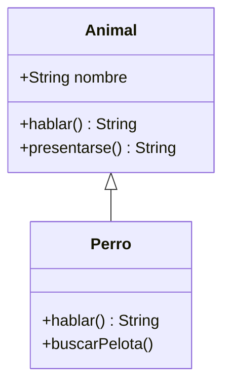
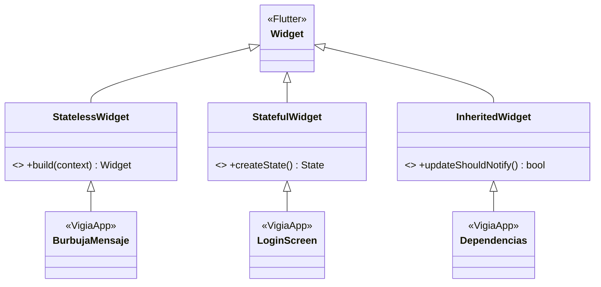
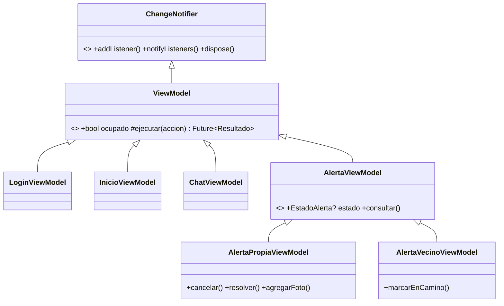
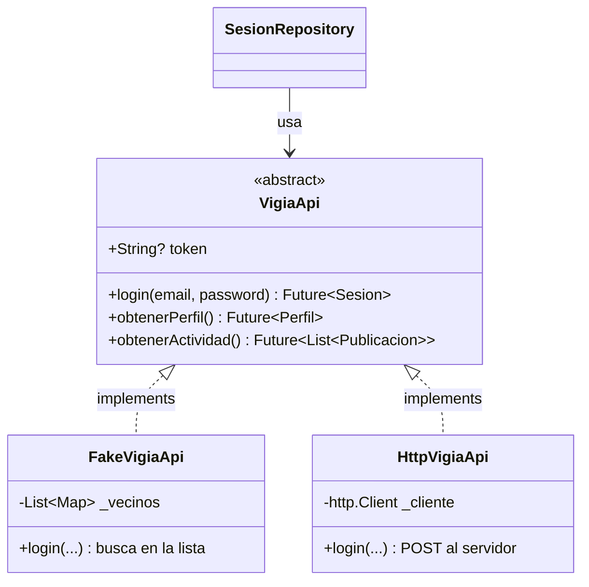
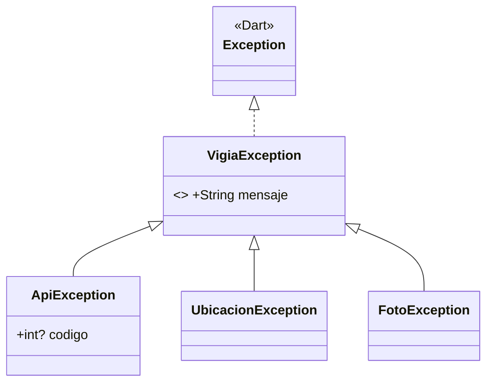

# Herencia y clases abstractas

!!! abstract "Objetivo"
    Entender cómo una clase **hereda** de otra (`extends`), cómo **promete** cumplir un contrato (`implements`), qué es una **clase abstracta**, qué hacen `super` y `@override`, los modificadores de clase (`final`, `sealed`…), las **extensiones** y las **excepciones**. Con esto vas a entender la columna vertebral de VigiaApp: `VigiaApi` y sus dos implementaciones, y el `ViewModel` base del que heredan todas las pantallas.

## Herencia: `extends`

Una clase puede **heredar** de otra: recibe todos sus campos y métodos, y puede agregar o cambiar algunos.

```dart title="herencia.dart"
class Animal {
  Animal(this.nombre);
  final String nombre;

  String hablar() => '...';
  String presentarse() => 'Soy $nombre y digo ${hablar()}';
}

class Perro extends Animal {  // (1)!
  Perro(super.nombre);  // (2)!

  @override  // (3)!
  String hablar() => 'guau';

  void buscarPelota() => print('$nombre corre');  // (4)!
}

void main() {
  final firulais = Perro('Firulais');
  print(firulais.presentarse());  // (5)!
  firulais.buscarPelota();
}
```

1. `Perro` **es un** `Animal`: hereda `nombre`, `hablar` y `presentarse`.
2. `super.nombre` le pasa el parámetro al constructor de la clase padre (`Animal(this.nombre)`).
3. `@override` avisa: "este método **reemplaza** al que heredé". Si escribís mal el nombre, el analizador te avisa que no hay nada que reemplazar.
4. Un método nuevo, que solo tienen los perros.
5. `presentarse` es de `Animal`, pero llama a `hablar()`, que ahora es la versión del perro.

```text title="Salida"
Soy Firulais y digo guau
Firulais corre
```



La flecha con triángulo se lee "hereda de". El punto clave: **donde se espera un `Animal`, se puede usar un `Perro`**. Eso se llama **polimorfismo**.

```dart
Animal a = Perro('Firulais');   // bien: un Perro es un Animal
print(a.hablar());              // guau: se usa la versión del objeto real
a.buscarPelota();               // ERROR: para Dart, 'a' es un Animal
```

### `super`: usar la versión del padre

Adentro de un método sobrescrito, `super.metodo()` llama a la versión del padre. Es obligatorio en algunos métodos de Flutter:

```dart
@override
void initState() {
  super.initState();  // primero, lo que hace State por su cuenta
  _viewModel.iniciar();
}

@override
void dispose() {
  _viewModel.dispose();
  super.dispose();    // al final, lo que hace State por su cuenta
}
```

!!! warning "El orden de `super` en `initState` y `dispose`"
    `super.initState()` va **primero** (antes de usar nada) y `super.dispose()` va **último** (después de limpiar lo tuyo). El analizador te avisa si te lo olvidás (`must_call_super`).

### Todo widget hereda

Cada widget que escribas va a ser una clase que hereda de una de Flutter:



## Clases abstractas

Una clase **abstracta** no se puede instanciar: existe para que otras hereden de ella. Puede tener métodos **sin cuerpo** (abstractos), que las hijas **tienen** que escribir.

```dart title="abstracta.dart"
abstract class Figura {
  double area();  // (1)!

  String describir() => 'Tengo un área de ${area().toStringAsFixed(1)}';  // (2)!
}

class Rectangulo extends Figura {
  Rectangulo(this.ancho, this.alto);
  final double ancho, alto;

  @override
  double area() => ancho * alto;
}

class Circulo extends Figura {
  Circulo(this.radio);
  final double radio;

  @override
  double area() => 3.14159 * radio * radio;
}

void main() {
  final figuras = <Figura>[Rectangulo(2, 3), Circulo(1)];
  for (final f in figuras) {
    print(f.describir());
  }
  // Figura();  ← ERROR: Abstract classes can't be instantiated.
}
```

1. Un método **abstracto**: sin cuerpo, con `;`. "Toda figura tiene que saber calcular su área, pero no sé cómo."
2. Un método **concreto** que usa al abstracto. Funciona para cualquier figura.

```text title="Salida"
Tengo un área de 6.0
Tengo un área de 3.1
```

### El `ViewModel` base de VigiaApp

Todos los ViewModels de la app heredan de una clase abstracta, `ViewModel` ([capítulo 6](../5-construccion/06-login.md)). Ahí está escrito **una sola vez** lo que todos necesitan: el estado `ocupado`, el método `ejecutar` que convierte errores en mensajes, y la protección para no avisar después de cerrar la pantalla.



`AlertaViewModel` es otra abstracta en el medio: las dos pantallas de alerta (la propia y la de un vecino) comparten la consulta periódica y el mapa, y cada hija agrega sus botones ([capítulo 14](../5-construccion/14-sos-y-alerta.md)).

!!! info "`@protected`"
    En `ViewModel`, el método `ejecutar` está marcado con `@protected`: "solo lo usan las hijas, no la vista". Si una pantalla intenta llamar `viewModel.ejecutar(...)`, el analizador avisa. Es una anotación de Flutter (`package:flutter/foundation.dart`).

## Interfaces: `implements`

`extends` hereda **todo** (campos, métodos con su código). A veces solo querés decir "**cumplo el contrato**" de otra clase, sin heredar su código. Para eso está `implements`:

```dart
class FakeVigiaApi implements VigiaApi { … }
class HttpVigiaApi implements VigiaApi { … }
```

Con `implements`, la clase se compromete a escribir **todos** los métodos de `VigiaApi`, cada una a su manera. Si falta uno, no compila:

```text
Missing concrete implementation of 'VigiaApi.login'.
```

En Dart **toda clase es también una interfaz**: cualquier clase se puede `implements`. No hay una palabra `interface` aparte (bueno, sí la hay como modificador: lo vemos abajo).

### `VigiaApi`: el contrato de la app

Es **la** pieza de la arquitectura. `VigiaApi` es una clase abstracta que **solo lista** lo que se le puede pedir al servidor, sin decir cómo:

```dart title="lib/data/services/api/vigia_api.dart (fragmento)"
abstract class VigiaApi {
  abstract String? token;  // (1)!

  /// POST /auth/login
  Future<Sesion> login(String email, String password);  // (2)!

  /// GET /yo
  Future<Perfil> obtenerPerfil();

  /// GET /publicaciones?tipo=actividad
  Future<List<Publicacion>> obtenerActividad();

  // … unos 40 métodos más
}
```

1. Un campo **abstracto**: cada implementación decide cómo guardarlo.
2. Métodos sin cuerpo: la firma (nombre, parámetros, tipo de retorno) es el contrato.

Y hay dos clases que lo cumplen:



La flecha punteada es `implements`. Lo importante es la última flecha: `SesionRepository` **solo conoce `VigiaApi`**. No sabe si del otro lado hay datos en memoria o un servidor. Por eso podemos hacer toda la Parte 5 con el falso y cambiar al real en la Parte 6 tocando una línea. Esta idea tiene nombre y página propia: [La dirección de las dependencias](../4-arquitectura/3-direccion-de-dependencias.md).

### `extends` vs. `implements`

| | `extends` | `implements` |
|---|---|---|
| Hereda el código | Sí | No: tenés que escribir todo |
| Cuántas | Una sola clase | Todas las que quieras |
| Para qué | Reutilizar código ("es un") | Cumplir un contrato ("se comporta como") |
| En VigiaApp | `LoginViewModel extends ViewModel` | `FakeVigiaApi implements VigiaApi` |

## Mixins: `with`

Un **mixin** es un paquete de métodos y campos que se "mezcla" en una clase, sin herencia. Se usa con `with`:

```dart
class _MiPantallaState extends State<MiPantalla>
    with SingleTickerProviderStateMixin {
  // ahora este State sabe dar "ticks" para animaciones
}
```

En VigiaApp no escribimos mixins propios, pero Flutter los usa para cosas como animaciones. Si ves `with`, pensá "le suma estas capacidades".

## Modificadores de clase

Dart 3 agregó palabras para controlar **qué se puede hacer** con una clase desde otros archivos:

| Modificador | ¿Se puede crear (`Clase()`)? | ¿Se puede heredar (`extends`)? | ¿Se puede implementar? | En VigiaApp |
|---|---|---|---|---|
| (ninguno) | Sí | Sí | Sí | Casi todas |
| `abstract` | No | Sí | Sí | `VigiaApi`, `ViewModel` |
| `final` | Sí | Solo en el mismo archivo | Solo en el mismo archivo | `Ok`, `Fallo` |
| `sealed` | No | Solo en el mismo archivo | Solo en el mismo archivo | `Resultado`, `VigiaException` |
| `abstract final` | No | No (afuera) | No (afuera) | `Rutas` |
| `base` / `interface` | — | — | — | No se usan |

El más interesante es **`sealed`** (sellada): como nadie de afuera puede agregar hijas, el compilador **conoce la lista completa** de subclases. Eso permite que un `switch` te avise si te olvidaste un caso. Lo vemos con todo detalle en [clases selladas](7-enums-records-patrones.md#clases-selladas).

## Extensiones {#extensiones}

Una **extensión** le agrega métodos o getters a una clase **que no es tuya** (como `List` o `String`), sin heredar ni tocar su código.

```dart title="extension.dart"
extension Gritar on String {
  String get gritado => '${toUpperCase()}!';
}

void main() {
  print('hola'.gritado); // HOLA!
}
```

En VigiaApp hay una sola, en `view_model.dart` ([capítulo 6](../5-construccion/06-login.md)):

```dart
extension SoloLectura<T> on List<T> {  // (1)!
  List<T> get soloLectura => UnmodifiableListView(this);  // (2)!
}
```

1. "A **toda** `List<T>`, sea del tipo que sea, agregale…"
2. …un getter `soloLectura` que la envuelve en una vista que no se puede modificar. `this` es la lista sobre la que se llamó.

Y los ViewModels la usan así:

```dart
final _mensajes = <Mensaje>[];
List<Mensaje> get mensajes => _mensajes.soloLectura;
```

Sin la extensión habría que escribir `UnmodifiableListView(_mensajes)` en cada ViewModel, e importar `dart:collection` en todos.

## Excepciones

Cuando algo sale mal, el código **lanza** (`throw`) una **excepción**. Si nadie la **atrapa** (`catch`), la app muestra el error (pantalla roja en debug).

```dart title="excepciones.dart"
int dividir(int a, int b) {
  if (b == 0) throw ArgumentError('No se puede dividir por cero');
  return a ~/ b;
}

void main() {
  try {  // (1)!
    print(dividir(10, 2));
    print(dividir(1, 0));
    print('esto no se imprime');
  } on ArgumentError catch (e) {  // (2)!
    print('Error: ${e.message}');
  } finally {  // (3)!
    print('Fin');
  }
}
```

1. `try`: "intentá esto". Si algo adentro lanza, se salta el resto del bloque.
2. `on Tipo catch (e)`: si lo que se lanzó es de ese tipo, se atrapa y queda en `e`.
3. `finally`: se ejecuta **siempre**, haya error o no. Ideal para limpiar.

```text title="Salida"
5
Error: No se puede dividir por cero
Fin
```

### La jerarquía de errores de VigiaApp

En vez de que cada pantalla sepa de errores de HTTP, de GPS y de cámara, la app tiene **una familia** de excepciones, todas con un mensaje listo para mostrar ([capítulo 4](../5-construccion/04-contrato-api.md)):

```dart title="lib/data/services/errores.dart"
sealed class VigiaException implements Exception {
  const VigiaException(this.mensaje);
  final String mensaje;
}

class ApiException extends VigiaException {
  const ApiException(super.mensaje, {this.codigo});
  final int? codigo;
}

class UbicacionException extends VigiaException {
  const UbicacionException(super.mensaje);
}

class FotoException extends VigiaException {
  const FotoException(super.mensaje);
}
```



Gracias a la herencia, el ViewModel base atrapa **todas** con un solo `on VigiaException`:

```dart
try {
  return Ok(await accion());
} on VigiaException catch (e) {
  return Fallo(e.mensaje);  // sea de la API, del GPS o de la cámara
}
```

El recorrido completo de un error, desde el servidor hasta el SnackBar, está en [Los errores, de punta a punta](../4-arquitectura/7-errores.md).

!!! info "`Exception` vs. `Error`"
    En Dart, las **`Exception`** son problemas esperables que se atrapan (sin red, contraseña incorrecta). Los **`Error`** (`ArgumentError`, `RangeError`, `StateError`…) indican un **bug** en el código: no se atrapan, se arreglan.

### `rethrow`

Adentro de un `catch`, `rethrow` vuelve a lanzar la misma excepción. Sirve para hacer algo (limpiar, anotar) y dejar que siga subiendo:

```dart title="lib/ui/alerta/view_model/alerta_vecino_view_model.dart (fragmento)"
try {
  await pedido();
} on ApiException catch (e) {
  if (e.codigo == 409) await consultar();  // la alerta cambió: la vuelvo a pedir
  rethrow;                                 // y el error sigue hasta ejecutar()
}
```

Es de la pantalla de alerta de un vecino ([capítulo 15](../5-construccion/15-alertas-de-vecinos.md)): si el servidor responde 409 (la alerta ya terminó), refresca la pantalla **y además** deja que el error llegue al vecino como mensaje.

## Ejercicios

??? question "1. Un contrato chico"
    Escribí una clase abstracta `Almacen` con `Future<String?> leer()` y `Future<void> guardar(String valor)`. Hacé una implementación `AlmacenEnMemoria` que lo guarde en un campo.

    ??? success "Una respuesta"
        ```dart
        abstract class Almacen {
          Future<String?> leer();
          Future<void> guardar(String valor);
        }

        class AlmacenEnMemoria implements Almacen {
          String? _valor;

          @override
          Future<String?> leer() async => _valor;

          @override
          Future<void> guardar(String valor) async => _valor = valor;
        }
        ```

        Es la misma idea que `VigiaApi` con `FakeVigiaApi`: un contrato y una implementación en memoria para probar sin depender de nada externo. (El `AlmacenToken` del [capítulo 5](../5-construccion/05-sesion.md) resuelve lo mismo de otra forma: recibe el `FlutterSecureStorage` en el constructor, y si falla, sigue sin token.)

??? question "2. ¿Compila?"
    ```dart
    sealed class Forma {}
    class Cuadrado extends Forma {}
    final f = Forma();
    ```

    ??? success "Respuesta"
        No: una clase `sealed` es implícitamente abstracta y no se puede instanciar.

## Lo que aprendiste

- [x] `extends` hereda código; `@override` reemplaza un método; `super` llama a la versión del padre.
- [x] Una clase **abstracta** no se instancia y puede tener métodos sin cuerpo.
- [x] `implements` promete cumplir un contrato: así `FakeVigiaApi` y `HttpVigiaApi` cumplen `VigiaApi`.
- [x] `sealed`, `final` y `abstract final` controlan qué se puede hacer con una clase.
- [x] Las **extensiones** agregan métodos a clases ajenas.
- [x] `throw`, `try`/`on`/`catch`/`finally`; una **jerarquía** de excepciones deja atrapar todas con un solo tipo.

[Siguiente: Enums, records y patrones :material-arrow-right:](7-enums-records-patrones.md){ .md-button .md-button--primary }
