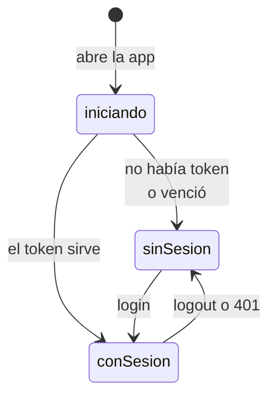
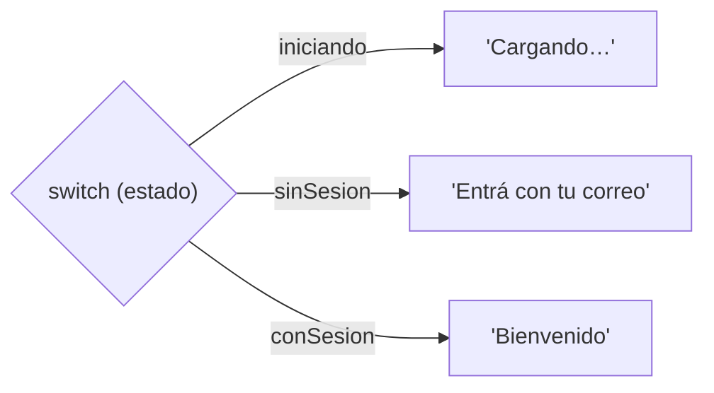
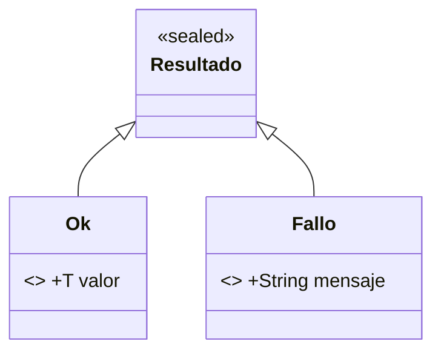
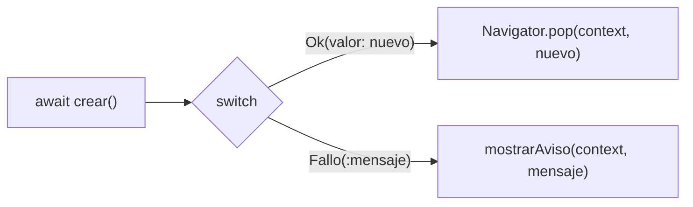
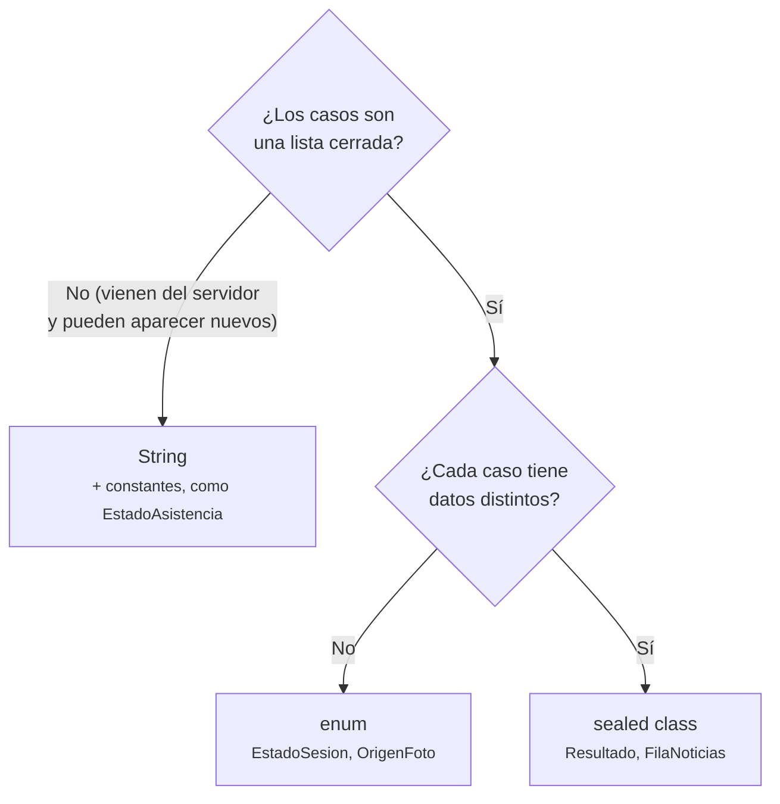

# Enums, records y patrones

!!! abstract "Objetivo"
    Conocer las herramientas de Dart 3 que hacen el código **más seguro y más corto**: los **enums** (una lista cerrada de valores), los **records** (varios valores juntos sin escribir una clase), los **patrones** (preguntar la forma de un dato y sacarle las partes), el **`switch` como expresión** y las **clases selladas**. Juntas, hacen que el compilador te avise cuando te olvidás un caso.

## Enums {#enums}

Un **enum** (enumeración) es un tipo con una **lista fija** de valores posibles.

```dart
enum EstadoSesion { iniciando, sinSesion, conSesion }
```

Es de VigiaApp ([capítulo 5](../5-construccion/05-sesion.md)): la sesión está **siempre** en uno de esos tres estados, nunca en otro.



```dart title="enums.dart"
enum EstadoSesion { iniciando, sinSesion, conSesion }

void main() {
  var estado = EstadoSesion.iniciando;  // (1)!
  print(estado);              // (2)!
  print(estado.name);         // (3)!
  print(estado == EstadoSesion.iniciando);  // true

  estado = EstadoSesion.conSesion;
  print(EstadoSesion.values); // (4)!
  print(estado.index);        // (5)!
}
```

1. Los valores se escriben `Tipo.valor`.
2. `EstadoSesion.iniciando`.
3. `iniciando`: el nombre como texto.
4. La lista de todos: `[EstadoSesion.iniciando, EstadoSesion.sinSesion, EstadoSesion.conSesion]`.
5. `2`: la posición en la lista.

### ¿Por qué no usar un texto o un número?

Podrías guardar el estado como `String estado = 'sin_sesion'`. Pero:

| Con `String` | Con `enum` |
|---|---|
| `estado = 'sinsesion'` compila (y es un bug: falta el guion). | `EstadoSesion.sinsesion` no compila. |
| El editor no te sugiere los valores posibles. | Escribís `EstadoSesion.` y aparecen los tres. |
| Un `switch` no sabe si cubriste todos los casos. | El compilador te avisa si falta uno. |

### Puntos de atajo (*dot shorthands*)

Cuando Dart ya sabe qué tipo se espera, desde Dart 3.10 se puede omitir el nombre del enum:

```dart
void abrir(OrigenFoto origen) { ... }

abrir(OrigenFoto.camara);  // completo
abrir(.camara);            // atajo: Dart sabe que es un OrigenFoto
```

Lo viste en el contador de `flutter create` (`mainAxisAlignment: .center`). En la wiki escribimos el nombre completo porque se lee mejor cuando estás aprendiendo.

### Enums con datos

Los enums pueden tener campos, constructor y métodos (*enhanced enums*):

```dart title="enum_con_datos.dart"
enum Rol {
  vecino('Vecino'),
  vigia('Vigía'),
  comite('Comité');

  const Rol(this.nombre);
  final String nombre;

  bool get administra => this == Rol.comite;
}

void main() {
  print(Rol.vigia.nombre);       // Vigía
  print(Rol.comite.administra);  // true
}
```

!!! info "En VigiaApp, el rol es un texto"
    En la app real el rol quedó como `String` (`'vecino'`, `'vigia'`, `'comite'`) con un mapa `roles` para el nombre lindo, porque así viene del servidor y se guarda en la base. Un enum como el de arriba sería una mejora razonable: es uno de los [ejercicios](../7-referencia/ejercicios.md).

## Records {#records}

Un **record** junta **varios valores en uno**, sin tener que escribir una clase. Se escriben entre paréntesis:

```dart
final punto = (-34.6, -58.4);                   // posicional
final foto = (bytes: datos, mime: 'image/jpeg'); // con nombre
```

Se lee por posición (`$1`, `$2`) o por nombre:

```dart title="records.dart"
(int, String) buscar() => (7, 'Jorge');  // (1)!

({double lat, double lng}) centro() => (lat: -34.6, lng: -58.4);  // (2)!

void main() {
  final r = buscar();
  print(r.$1);  // 7
  print(r.$2);  // Jorge

  final c = centro();
  print('${c.lat}, ${c.lng}');  // -34.6, -58.4
}
```

1. Una función que devuelve **dos** valores. El tipo del record es `(int, String)`.
2. Con nombres: el tipo es `({double lat, double lng})` (las llaves adentro indican campos con nombre).

### El record de VigiaApp

El servicio que elige fotos devuelve **los bytes y el tipo** de la imagen ([capítulo 10](../5-construccion/10-publicaciones-y-fotos.md)). En vez de crear una clase para dos campos, usa un record con un `typedef`:

```dart title="lib/data/services/selector_fotos.dart (fragmento)"
typedef FotoElegida = ({Uint8List bytes, String mime});

Future<FotoElegida?> elegir(OrigenFoto origen) async {
  // … abre la cámara o la galería …
  if (archivo == null) return null;
  return (
    bytes: await archivo.readAsBytes(),
    mime: archivo.mimeType ?? 'image/jpeg',
  );
}
```

!!! question "¿Record o clase?"
    **Record** cuando son pocos valores, sin comportamiento, que viajan juntos un rato (el resultado de una función). **Clase** cuando el dato tiene identidad, métodos, o se usa en muchos lados (un `Vecino`, una `Publicacion`).

Dos records son iguales si tienen los mismos valores (a diferencia de las clases, ver [`==`](5-clases.md#tostring-y-hashcode)):

```dart
print((1, 'a') == (1, 'a'));  // true
```

## Patrones {#patrones}

Un **patrón** describe **la forma** de un dato. Sirve para dos cosas a la vez: **preguntar** si un valor tiene esa forma, y **sacarle las partes** (desestructurar).

### Desestructurar

```dart
final (id, nombre) = buscar();      // saca las dos partes de un record
print('$id $nombre');               // 7 Jorge

final (:lat, :lng) = centro();      // :lat = "un campo lat a una variable lat"
print(lat);

for (final (i, vecino) in ['Ana', 'Jorge'].indexed) {
  print('$i: $vecino');             // 0: Ana / 1: Jorge
}
```

### Los patrones más usados

| Patrón | Encaja si… | Ejemplo |
|---|---|---|
| Constante | es igual a ese valor | `0`, `'activa'`, `EstadoSesion.iniciando` |
| Comodín `_` | siempre | `_` |
| Variable | siempre, y lo guarda | `final x` |
| Tipo | es de ese tipo | `int n`, `String texto` |
| No-null `?` | no es null, y lo guarda sin `?` | `final e?` |
| Objeto | es de esa clase, y saca campos | `Fallo(:final mensaje)` |
| Record | es un record con esa forma | `(final a, final b)` |
| Lista | es una lista con esa forma | `[final primero, ...]` |
| Relacional | cumple la comparación | `> 0`, `<= 100` |
| O | encaja con alguno | `'a' \|\| 'b'` |

El patrón de **objeto** es el que más vas a ver en VigiaApp:

```dart
Fallo(:final mensaje)
```

Se lee: "¿es un `Fallo`? Si sí, sacale el campo `mensaje` a una variable `mensaje`". `:final mensaje` es la forma corta de `mensaje: final mensaje` (cuando la variable se llama igual que el campo). Si querés otro nombre: `Ok(valor: final nuevo)`.

### `if case` {#if-case}

Un `if` que pregunta **con un patrón**:

```dart
if (valor case patrón) {
  // encajó: las variables del patrón existen acá
}
```

Los dos usos estrella en VigiaApp:

=== "Sacar el mensaje de un Fallo"

    ```dart title="lib/ui/core/widgets/avisos.dart (fragmento)"
    bool avisarSiFallo(BuildContext context, Resultado<Object?> resultado) {
      if (resultado case Fallo(:final mensaje)) {
        if (context.mounted) mostrarAviso(context, mensaje);
        return false;
      }
      return true;
    }
    ```

    "Si el resultado es un `Fallo`, mostrá su mensaje y devolvé `false`. Si es un `Ok`, devolvé `true`."

=== "Usar un campo que puede ser null"

    ```dart title="lib/ui/chat/widgets/burbuja_mensaje.dart (fragmento)"
    if (mensaje.texto case final texto?) Text(texto),
    ```

    "Si `mensaje.texto` no es null, guardalo en `texto` (ya como `String`, sin `?`) y mostralo." Resuelve el [problema de los campos que no se promueven](1-variables-y-tipos.md#la-trampa-los-campos-no-se-promueven) en una línea.

Con `when` se agrega una condición extra:

```dart
if (respuesta case ApiException(:final codigo) when codigo == 409) {
  print('Conflicto');
}
```

## `switch` como instrucción y como expresión {#switch-como-expresion}

### Como instrucción

El `switch` clásico elige qué código **ejecutar**:

```dart
switch (resultado) {
  case Ok(:final valor):
    _vecinos = valor;
  case Fallo(:final mensaje):
    _error = mensaje;
}
```

En Dart 3 no hace falta `break`: cada `case` termina solo.

### Como expresión

Un `switch` también puede **devolver un valor**, como el ternario pero para muchos casos. Se escribe con `=>` en cada caso y comas:

```dart
final texto = switch (estado) {
  EstadoSesion.iniciando => 'Cargando…',
  EstadoSesion.sinSesion => 'Entrá con tu correo',
  EstadoSesion.conSesion => 'Bienvenido',
};
```



Es **el** corazón de `main.dart` en VigiaApp: según el estado de la sesión, muestra una pantalla u otra.

```dart title="lib/main.dart (fragmento)"
home: ListenableBuilder(
  listenable: _sesion,
  builder: (context, _) => switch (_sesion.estado) {
    EstadoSesion.iniciando => const PantallaCarga(),
    EstadoSesion.sinSesion => LoginScreen(viewModel: LoginViewModel(_sesion)),
    EstadoSesion.conSesion => InicioScreen(viewModel: _crearInicio()),
  },
),
```

Otros usos en la app, con valores y con el comodín `_` ("cualquier otro"):

```dart title="lib/ui/inicio/widgets/barra_inferior.dart (fragmento)"
onDestinationSelected: (indice) => switch (indice) {
  0 => onChat(),
  1 => onSos(),
  _ => onActividad(),
},
```

### Exhaustividad: el compilador cuenta los casos

Si el `switch` es sobre un enum (o una clase sellada) y **te olvidás un caso**, no compila:

```dart
final texto = switch (estado) {
  EstadoSesion.iniciando => 'Cargando…',
  EstadoSesion.sinSesion => 'Entrá con tu correo',
};
// ERROR: The type 'EstadoSesion' is not exhaustively matched by the switch cases
//        since it doesn't match 'EstadoSesion.conSesion'.
```

Esto es oro: si mañana agregás `EstadoSesion.bloqueado`, el compilador te lleva de la mano a **cada** lugar que hay que actualizar.

## Clases selladas {#clases-selladas}

Un enum sirve cuando los casos son **valores fijos**. Pero ¿y si cada caso tiene **datos distintos**? Por ejemplo, el resultado de una acción:

- si salió bien, trae **un valor**;
- si salió mal, trae **un mensaje**.

Para eso están las **clases selladas** (`sealed`): una clase base cuyas hijas están **todas en el mismo archivo**. El compilador conoce la lista completa, y por eso puede controlar la exhaustividad, igual que con un enum.

```dart title="lib/utils/resultado.dart"
sealed class Resultado<T> {
  const Resultado();
}

final class Ok<T> extends Resultado<T> {
  const Ok(this.valor);
  final T valor;
}

final class Fallo<T> extends Resultado<T> {
  const Fallo(this.mensaje);
  final String mensaje;
}
```



Y se usa con `switch` y patrones de objeto. Así cierra una pantalla si salió bien o muestra el error si no ([capítulo 16](../5-construccion/16-comite.md)):

```dart title="lib/ui/comite/widgets/alta_vecino_screen.dart (fragmento)"
final resultado = await _viewModel.crear(nombre: _nombre.text, ...);
if (!mounted) return;
switch (resultado) {
  case Ok(valor: final nuevo):
    Navigator.pop(context, nuevo);
  case Fallo(:final mensaje):
    mostrarAviso(context, mensaje);
}
```



### Listas con distintos tipos de filas

Otro uso: la pantalla de Noticias muestra una lista que **mezcla** encabezados de día ("HOY", "AYER") con noticias ([capítulo 11](../5-construccion/11-noticias.md)). Cada fila es una subclase de una clase sellada:

```dart title="lib/ui/noticias/view_model/filas_noticias.dart (resumido)"
sealed class FilaNoticias { const FilaNoticias(); }

final class FilaEncabezado extends FilaNoticias {
  const FilaEncabezado(this.texto);
  final String texto;
}

final class FilaNoticia extends FilaNoticias {
  const FilaNoticia(this.noticia);
  final Noticia noticia;
}
```

Y la vista elige cómo dibujar cada una con un `switch` expresión:

```dart
itemBuilder: (context, index) => switch (filas[index]) {
  FilaEncabezado(:final texto) => ListTile(title: Text(texto)),
  FilaNoticia(:final noticia) => ListTile(title: Text(noticia.titulo), ...),
},
```

### Enum, sellada o texto: cuál elegir



!!! info "¿Por qué `EstadoAsistencia` no es un enum?"
    En VigiaApp, el estado de asistencia a un rondín (`'pendiente'`, `'confirmado'`, `'ausente'`) viene del servidor como texto, y quedó como constantes en una `abstract final class`. Si el servidor algún día agrega un estado nuevo, la app no explota al leerlo: cae en el `_` del `switch`.

## Ejercicios

??? question "1. ¿Qué imprime?"
    ```dart
    String describir(Object o) => switch (o) {
      int n when n < 0 => 'negativo',
      int() => 'entero',
      String s => 'texto de ${s.length}',
      _ => 'otra cosa',
    };

    void main() {
      print(describir(-3));
      print(describir(8));
      print(describir('hola'));
      print(describir(2.5));
    }
    ```

    ??? success "Respuesta"
        `negativo`, `entero`, `texto de 4`, `otra cosa`. Los casos se prueban **en orden**: `-3` encaja con el primero y no sigue.

??? question "2. Agregá un caso a `Resultado`"
    Si agregás `final class Cancelado<T> extends Resultado<T> {}` en `resultado.dart`, ¿qué pasa con los `switch` de la app?

    ??? success "Respuesta"
        Dejan de compilar los que no tienen `_` ni contemplan `Cancelado`: el compilador te marca exactamente cada lugar a revisar. Los `if case Fallo(...)` siguen compilando (no son exhaustivos).

??? question "3. Desestructurá"
    Dada `final alerta = (id: 3, lat: -34.6, lng: -58.4);`, imprimí `"Alerta 3 en -34.6, -58.4"` usando un patrón para sacar los tres campos.

    ??? success "Respuesta"
        ```dart
        final (:id, :lat, :lng) = alerta;
        print('Alerta $id en $lat, $lng');
        ```

## Lo que aprendiste

- [x] Un **enum** es una lista cerrada de valores; mejor que textos sueltos.
- [x] Un **record** junta valores sin escribir una clase: `(a, b)` o `(x: a, y: b)`.
- [x] Un **patrón** pregunta la forma y saca las partes: `Fallo(:final mensaje)`, `final x?`, `(a, b)`.
- [x] **`if case`** para un solo patrón; **`switch`** (instrucción o expresión) para varios.
- [x] Con enums y **clases selladas**, el compilador avisa si falta un caso.

[Siguiente: Asincronía I, Future :material-arrow-right:](8-asincronia-future.md){ .md-button .md-button--primary }
