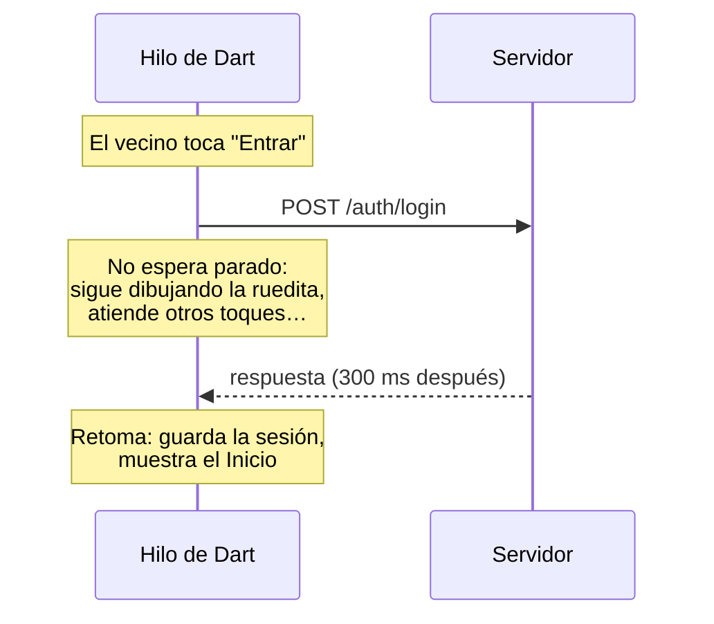
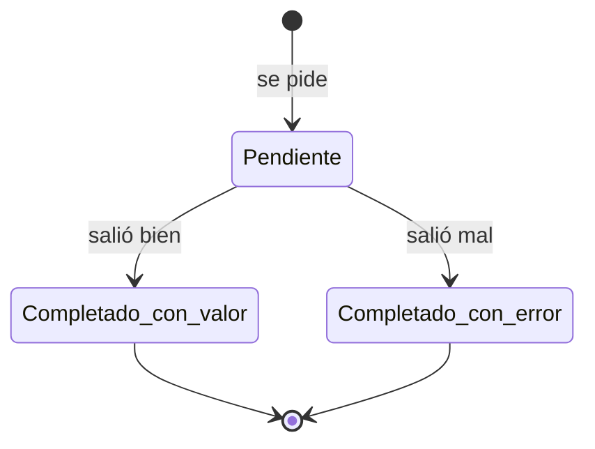
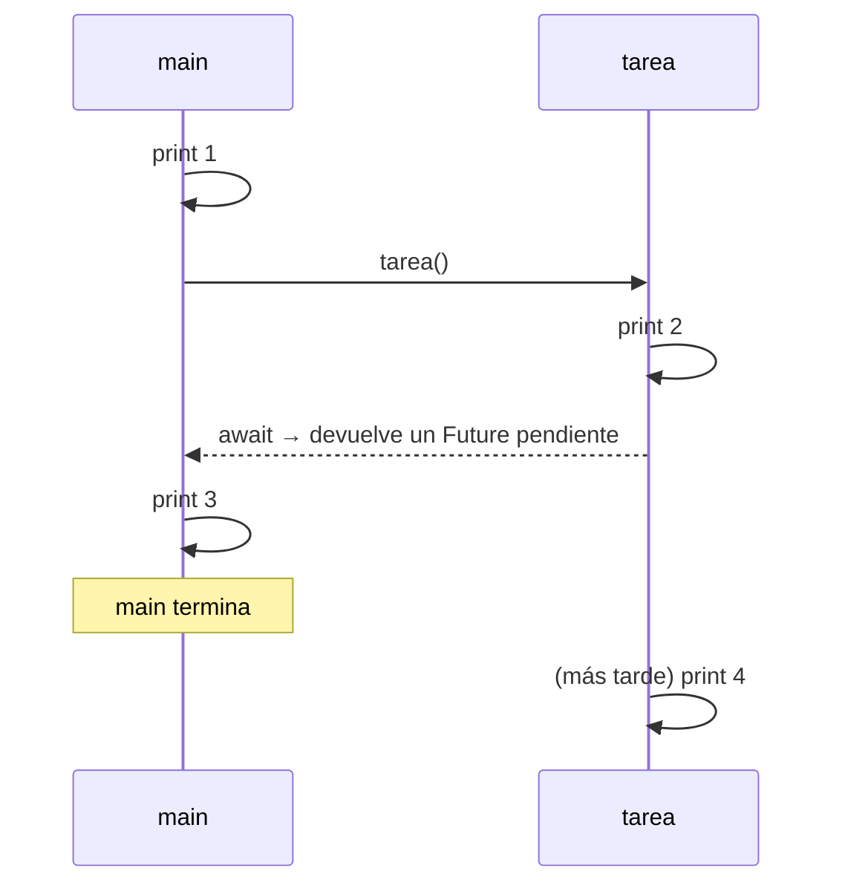
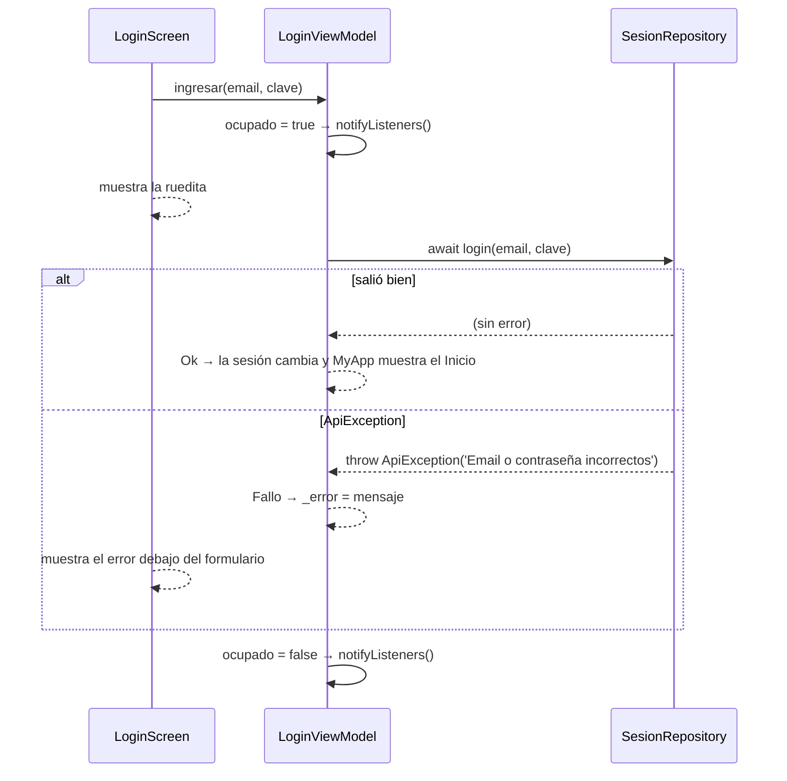

# Asincronía I: `Future`

!!! abstract "Objetivo"
    Entender por qué una app **no puede quedarse esperando** al servidor, qué es un **`Future`**, cómo se usan **`async`** y **`await`**, cómo se manejan los errores de algo que todavía no pasó, y cómo esperar **varias cosas a la vez**. Cada pedido de VigiaApp al servidor (login, mensajes, alertas) es un `Future`.

## El problema: esperar sin congelar

Pedirle algo al servidor tarda: 100 milisegundos con buena señal, varios segundos con mala. Si la app se quedara **parada** esperando, durante ese tiempo no podría dibujar, ni responder a toques, ni mover una animación. La pantalla se congelaría.

Dart corre tu código en **un solo hilo** (una sola línea de ejecución). Para no congelarse, usa un truco: cuando algo va a tardar, **lo deja pedido y sigue con otra cosa**. Cuando la respuesta llega, retoma.



## `Future`: una promesa de valor

Un **`Future<T>`** es un valor de tipo `T` **que todavía no está**, pero va a estar. Es como el ticket que te dan en un local de comida: no es la comida, pero cuando esté lista te llaman.

Un `Future` está en uno de tres estados:



Muchas funciones devuelven un `Future`:

```dart
Future<Sesion> login(String email, String password);   // una Sesion, después
Future<List<Mensaje>> obtenerMensajes();                // una lista, después
Future<void> logout();                                  // nada, pero "avisa cuando termina"
```

`Future<void>` es un `Future` que no trae ningún valor útil: solo sirve para saber **cuándo terminó** (y si falló).

## `async` y `await`

Para **esperar** un `Future` sin congelar nada, se usa `await` adentro de una función marcada como `async`:

```dart title="async_await.dart"
Future<String> buscarNombre() async {  // (1)!
  await Future.delayed(const Duration(seconds: 1));  // (2)!
  return 'María';  // (3)!
}

Future<void> main() async {
  print('Buscando…');
  final nombre = await buscarNombre();  // (4)!
  print('Encontré a $nombre');
}
```

1. `async` marca la función como asíncrona. Una función `async` **siempre devuelve un `Future`**: aunque adentro hagas `return 'María'`, desde afuera es un `Future<String>`.
2. `Future.delayed` es un `Future` que se completa después de un tiempo. Simula una espera (así simula el servidor el `FakeVigiaApi`).
3. Se devuelve un `String` normal; Dart lo envuelve en el `Future`.
4. `await` **pausa esta función** hasta que el `Future` se complete, y te da el valor ya desenvuelto (`String`, no `Future<String>`).

```text title="Salida"
Buscando…
Encontré a María        ← un segundo después
```

!!! info "`await` pausa la función, no la app"
    Mientras `main` está "dormida" en el `await`, el resto de la app sigue andando: Flutter dibuja, procesa toques, corre animaciones. Cuando el `Future` se completa, la función retoma en la línea siguiente.

### Qué pasa si no ponés `await`

```dart
final nombre = buscarNombre();
print(nombre);  // Instance of 'Future<String>'
```

Sin `await`, tenés el **ticket**, no la comida. Es un error muy común al empezar. El analizador ayuda: si intentás usar `nombre` como `String`, no compila.

### El orden de ejecución

Este ejemplo muestra que el código **después** de un `Future` sin `await` corre **antes** de que el `Future` termine:

```dart title="orden.dart"
Future<void> tarea() async {
  print('2. empieza la tarea');
  await Future.delayed(Duration.zero);
  print('4. termina la tarea');
}

void main() {
  print('1. antes');
  tarea();             // sin await: se larga y seguimos
  print('3. después');
}
```

```text title="Salida"
1. antes
2. empieza la tarea
3. después
4. termina la tarea
```



La parte de `tarea` **antes** del primer `await` corre enseguida. Lo que viene después del `await` queda para más tarde.

## Errores en un `Future`

Si algo falla mientras se espera (no hay red, contraseña incorrecta), el `Future` se completa **con un error**. Con `await`, ese error se **lanza** en la línea del `await`, y se atrapa con el `try`/`catch` de siempre ([Excepciones](6-herencia-y-abstraccion.md#excepciones)):

```dart title="errores_async.dart"
Future<String> login(String clave) async {
  await Future.delayed(const Duration(milliseconds: 300));
  if (clave != 'vigia1234') throw Exception('Contraseña incorrecta');
  return 'token-123';
}

Future<void> main() async {
  try {
    final token = await login('1234');
    print('Entré con $token');
  } on Exception catch (e) {
    print('No pude entrar: $e');
  } finally {
    print('Listo');
  }
}
```

```text title="Salida"
No pude entrar: Exception: Contraseña incorrecta
Listo
```

### `ejecutar`: el `try` de todos los ViewModels

En VigiaApp no hay un `try`/`catch` en cada botón. El `ViewModel` base ([capítulo 6](../5-construccion/06-login.md)) lo escribe **una vez**:

```dart title="lib/ui/core/view_model.dart (fragmento)"
@protected
Future<Resultado<T>> ejecutar<T>(
  Future<T> Function() accion, {  // (1)!
  bool marcarOcupado = true,
}) async {
  if (marcarOcupado) _cambiarOcupado(true);  // (2)!
  try {
    return Ok(await accion());  // (3)!
  } on VigiaException catch (e) {
    return Fallo(e.mensaje);  // (4)!
  } finally {
    if (marcarOcupado) _cambiarOcupado(false);  // (5)!
  }
}
```

1. Recibe **una función que devuelve un `Future`** (ver [funciones como valores](3-funciones.md#funciones-como-valores)): la acción a correr.
2. Antes de esperar, se marca "ocupado" (la vista muestra la ruedita y deshabilita el botón).
3. Espera la acción. Si salió bien, envuelve el valor en un `Ok`.
4. Si falló con un error conocido, devuelve un `Fallo` con el mensaje para mostrar. **No lanza**: el error se convierte en un valor.
5. Pase lo que pase, al final se desmarca "ocupado".

Y cada ViewModel lo usa en pocas líneas. El del Login:

```dart title="lib/ui/login/view_model/login_view_model.dart (fragmento)"
Future<void> ingresar(String email, String clave) async {
  _error = null;
  final resultado = await ejecutar(() => _sesion.login(email, clave));
  if (resultado case Fallo(:final mensaje)) {
    _error = mensaje;
    notifyListeners();
  }
}
```



## Esperar varias cosas a la vez

Si tenés que hacer tres pedidos **independientes**, hacerlos uno detrás del otro suma los tiempos:

```dart
final barrio = await obtenerEstadoBarrio();     // 180 ms
final actividad = await obtenerActividad();     // 190 ms
final noticias = await obtenerNoticias();       // 180 ms
// total: ~550 ms
```

Con **`Future.wait`**, se largan los tres a la vez y se espera a que terminen todos:

```dart title="lib/ui/inicio/view_model/inicio_view_model.dart (fragmento)"
// Los tres pedidos salen a la vez (Future.wait): unos 180 ms en total
// en vez de unos 550 ms uno detrás del otro.
final barrio = _publicaciones.obtenerEstadoBarrio();  // (1)!
final actividad = _publicaciones.obtenerActividad();
final noticias = _publicaciones.obtenerNoticias();
await Future.wait([barrio, actividad, noticias]);  // (2)!
_barrio = await barrio;  // (3)!
_actividad = await actividad;
_cantidadNoticias = (await noticias).length;
```

1. **Sin** `await`: cada línea larga el pedido y guarda el ticket. Los tres están en camino al mismo tiempo.
2. Espera a que los tres terminen. Si alguno falla, `Future.wait` falla con ese error.
3. Ya terminaron: el `await` de cada uno es instantáneo y da el valor con su tipo.

```mermaid
gantt
    title Uno detrás del otro vs. a la vez
    dateFormat x
    axisFormat %L ms
    section Uno detrás del otro
    barrio      :0, 180
    actividad   :180, 370
    noticias    :370, 550
    section Future.wait
    barrio      :0, 180
    actividad   :0, 190
    noticias    :0, 180
```



## Largar sin esperar

A veces querés **largar** algo y no esperarlo (por ejemplo, la primera consulta de un [`Sondeo`](3-funciones.md#pasar-una-funcion-como-parametro): `iniciar()` llama a la tarea y sigue de largo). Simplemente no ponés `await`:

```dart
_sondeo.iniciar();  // larga la primera consulta y sigue, sin esperarla
```

Si tu proyecto tiene la regla `unawaited_futures` (no viene por defecto), el analizador te pide que lo hagas explícito con `unawaited(...)` de `dart:async`, para dejar claro que no es un olvido.

!!! warning "Un `Future` sin esperar puede fallar en silencio"
    Si un `Future` que nadie espera termina con error, el error no lo atrapa ningún `try`. En debug aparece en la consola como `Unhandled Exception`. Si lo largás sin esperar, asegurate de que no pueda fallar, o atrapá el error adentro.

## `then`: la forma vieja

Antes de `async`/`await` se encadenaban funciones con `then`:

```dart
login(email, clave).then((sesion) {
  print('Entré');
}).catchError((e) {
  print('Error: $e');
});
```

Hace lo mismo, pero con muchas operaciones seguidas se vuelve un lío de paréntesis. En VigiaApp no se usa: **siempre `async`/`await`**. Igual conviene reconocerlo, porque aparece en ejemplos de internet.

## `Future` y Flutter: el `context` después de un `await`

Una regla que vas a ver en cada pantalla de la Parte 5. Después de un `await`, **la pantalla puede haberse cerrado** (el vecino tocó "atrás" mientras se esperaba al servidor). Si en ese caso usás el `context` (para mostrar un SnackBar, para navegar), la app falla.

```dart title="lib/ui/comite/widgets/alta_vecino_screen.dart (fragmento)"
final resultado = await _viewModel.crear(nombre: _nombre.text, ...);
if (!mounted) return;  // (1)!
switch (resultado) {
  case Ok(valor: final nuevo):
    Navigator.pop(context, nuevo);
  case Fallo(:final mensaje):
    mostrarAviso(context, mensaje);
}
```

1. `mounted` es `true` si el widget sigue en pantalla. Si no, no hay nada que hacer. En funciones que reciben un `context` se usa `context.mounted`.

El analizador te lo recuerda con la regla `use_build_context_synchronously`. Lo vemos en [Stateless y Stateful](../3-flutter/2-stateless-y-stateful.md#ciclo-de-vida).

## Ejercicios

??? question "1. ¿Qué imprime y en qué orden?"
    ```dart
    Future<void> main() async {
      print('A');
      final f = Future.delayed(const Duration(milliseconds: 100), () => 'B');
      print('C');
      print(await f);
      print('D');
    }
    ```

    ??? success "Respuesta"
        `A`, `C`, `B`, `D`. El `Future` se crea en la segunda línea pero no se espera hasta la cuarta.

??? question "2. Medí la diferencia"
    Escribí una función `Future<int> tardar(int ms)` que espere `ms` milisegundos y devuelva `ms`. Medí con `Stopwatch` cuánto tarda esperar `tardar(300)`, `tardar(200)` y `tardar(100)` uno detrás del otro, y cuánto con `Future.wait`.

    ??? success "Una respuesta"
        ```dart
        Future<int> tardar(int ms) =>
            Future.delayed(Duration(milliseconds: ms), () => ms);

        Future<void> main() async {
          final reloj = Stopwatch()..start();
          await tardar(300);
          await tardar(200);
          await tardar(100);
          print('En serie: ${reloj.elapsedMilliseconds} ms');  // ~600

          reloj.reset();
          await Future.wait([tardar(300), tardar(200), tardar(100)]);
          print('A la vez: ${reloj.elapsedMilliseconds} ms');  // ~300
        }
        ```

## Lo que aprendiste

- [x] Dart tiene **un solo hilo**: lo que tarda se deja pedido y se retoma después.
- [x] Un **`Future<T>`** es un `T` que va a llegar (o un error).
- [x] **`async`** marca la función; **`await`** espera sin congelar y desenvuelve el valor.
- [x] Los errores se atrapan con `try`/`catch` alrededor del `await`; `ejecutar` los convierte en `Resultado`.
- [x] **`Future.wait`** espera varios a la vez.
- [x] Después de un `await` en una pantalla, revisá **`mounted`** antes de usar el `context`.

[Siguiente: Asincronía II, Stream y Timer :material-arrow-right:](9-streams-y-timers.md){ .md-button .md-button--primary }
