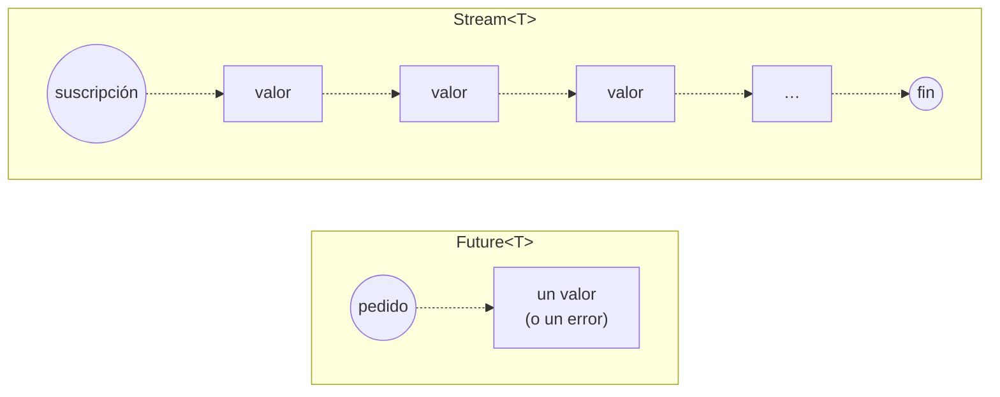
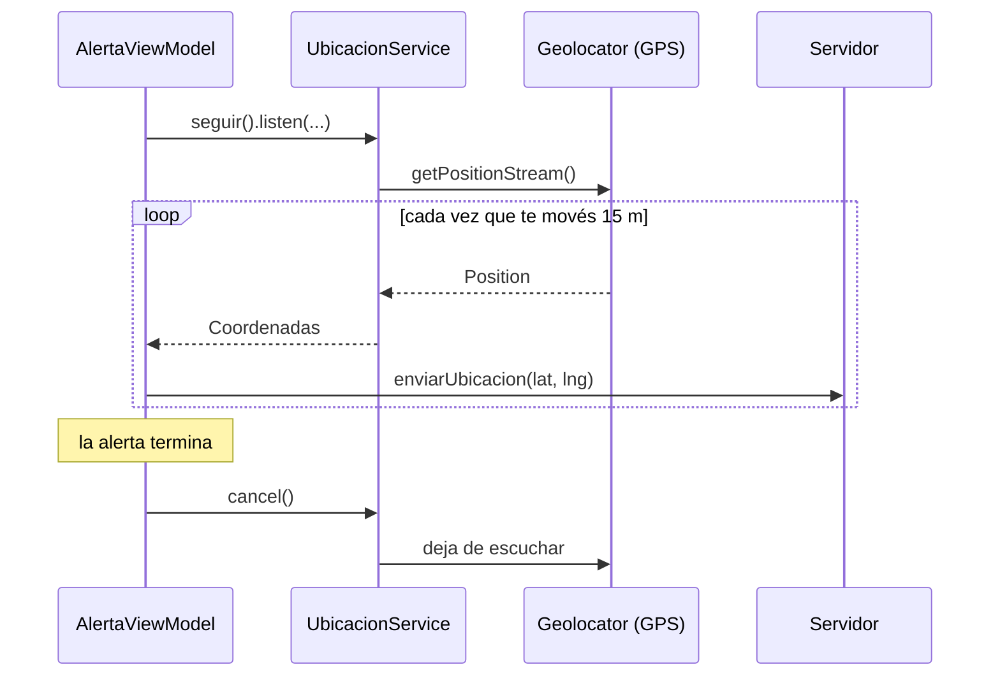
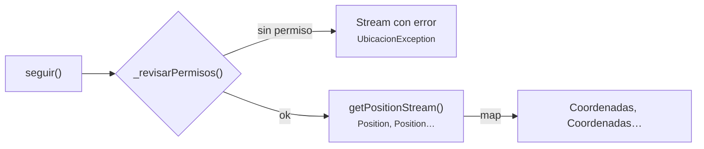
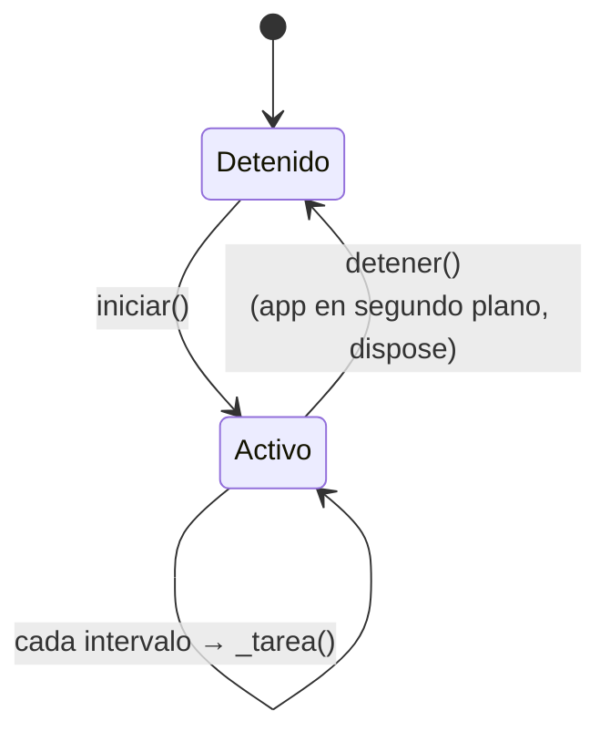

# Asincronía II: `Stream` y `Timer`

!!! abstract "Objetivo"
    Pasar de **un** valor que llega después (`Future`) a **muchos** valores que llegan con el tiempo (`Stream`): suscribirse, cancelar, transformar y crear streams con `async*` y `yield`. Y usar **`Timer`** para hacer algo dentro de un rato o cada tanto. En VigiaApp, el GPS es un `Stream`, los enlaces del correo son un `Stream`, y el chat se actualiza con un `Timer`.

## `Future` vs. `Stream`



| | `Future<T>` | `Stream<T>` |
|---|---|---|
| Cuántos valores | Uno | Cero, uno o muchos |
| Cómo se espera | `await` | `listen` o `await for` |
| Analogía | Un pedido de comida | Una suscripción a un diario |
| En VigiaApp | Un pedido al servidor | La posición del GPS, los enlaces que abren la app |

## Escuchar un `Stream`: `listen`

Para recibir los valores de un `Stream`, te **suscribís** con `listen` y le pasás una función que se va a llamar con cada valor:

```dart title="listen.dart"
import 'dart:async';

void main() {
  final cuentaRegresiva = Stream.periodic(  // (1)!
    const Duration(milliseconds: 500),
    (i) => 3 - i,
  ).take(4);  // (2)!

  final suscripcion = cuentaRegresiva.listen(  // (3)!
    (n) => print(n == 0 ? '¡Ya!' : '$n…'),  // (4)!
    onError: (e) => print('Error: $e'),  // (5)!
    onDone: () => print('Terminó'),  // (6)!
  );
}
```

1. Un `Stream` que emite un valor cada medio segundo (0, 1, 2…), transformado con `3 - i`.
2. `take(4)`: solo los cuatro primeros, y después termina.
3. `listen` devuelve una **suscripción** (`StreamSubscription`): el "contrato" con el diario.
4. Se llama con **cada** valor.
5. Se llama si el `Stream` emite un error.
6. Se llama cuando el `Stream` termina.

```text title="Salida (un renglón cada medio segundo)"
3…
2…
1…
¡Ya!
Terminó
```

### Cancelar: no dejar suscripciones colgando

Muchos streams **no terminan nunca** solos: el GPS sigue mandando posiciones mientras la app esté abierta. Si te suscribís y te olvidás, la función se sigue llamando aunque la pantalla ya no exista. Es una **pérdida de memoria** y una fuente de errores raros.

```dart
final suscripcion = stream.listen(...);
// …
suscripcion.cancel();  // "no me manden más"
```

!!! danger "La regla"
    **Todo lo que abrís, lo cerrás.** Toda `listen` tiene su `cancel`, todo `Timer` tiene su `cancel`, todo `ChangeNotifier` que creás tiene su `dispose`. En VigiaApp, se hace en el `dispose()` del ViewModel o del `State`.

### El GPS en la alerta de VigiaApp

Cuando hay una alerta activa, el ViewModel se suscribe al GPS y manda cada posición al servidor ([capítulo 14](../5-construccion/14-sos-y-alerta.md)):

```dart title="lib/ui/alerta/view_model/alerta_view_model.dart (fragmento)"
StreamSubscription<Coordenadas>? _envioUbicacion;  // (1)!

void compartirUbicacion() {
  if (_envioUbicacion != null) return;  // (2)!
  _envioUbicacion = ubicacion.seguir().listen(  // (3)!
    _enviarUbicacion,
    onError: _sinUbicacion,  // (4)!
  );
}

void dejarDeCompartir() {
  _envioUbicacion?.cancel();  // (5)!
  _envioUbicacion = null;
}
```

1. La suscripción se guarda en un campo para poder cancelarla después. `null` = no se está compartiendo.
2. Si ya estaba compartiendo, no se suscribe de nuevo.
3. Por cada posición nueva, llama a `_enviarUbicacion` (un *tear-off*, ver [Funciones](3-funciones.md#tear-offs-pasar-un-metodo-sin-envolverlo)).
4. Si el GPS está apagado o no hay permiso, el `Stream` emite un error y se muestra un aviso.
5. Al terminar la alerta (o al cerrar la pantalla), se cancela.



### Los enlaces del correo

Otro `Stream` de la app: los enlaces `vigiaapp://clave?token=…` que abren la app ([capítulo 7](../5-construccion/07-dependencias-y-rutas.md)). El paquete `app_links` los entrega como un `Stream<Uri>`, porque pueden llegar en cualquier momento mientras la app está abierta:

```dart title="lib/main.dart (fragmento)"
StreamSubscription<Uri>? _enlaces;

@override
void initState() {
  super.initState();
  _enlaces = widget.enlaces?.listen(_abrirEnlace);
}

@override
void dispose() {
  _enlaces?.cancel();
  // …
  super.dispose();
}
```

## `await for`: recorrer un `Stream` como una lista

Adentro de una función `async`, se puede recorrer un `Stream` con un `for`, esperando cada valor:

```dart title="await_for.dart"
Future<void> main() async {
  final numeros = Stream.fromIterable([1, 2, 3]);
  await for (final n in numeros) {
    print('Llegó $n');
  }
  print('Fin');
}
```

```text title="Salida"
Llegó 1
Llegó 2
Llegó 3
Fin
```

El `for` termina cuando termina el `Stream`. Si el `Stream` no termina nunca (como el GPS), el `for` tampoco: por eso en la app se usa `listen`, que se puede cancelar desde afuera.

## Transformar un `Stream`

Los streams tienen los mismos métodos que las listas ([Colecciones](4-colecciones.md#transformar)), pero aplicados a valores que van llegando:

```dart
gps.map((posicion) => Coordenadas(posicion.latitude, posicion.longitude))
gps.where((p) => p.accuracy < 50)        // solo las precisas
gps.take(1)                              // solo la primera
gps.distinct()                           // sin repetir el valor anterior
```

## Crear un `Stream`: `async*` y `yield` {#async-y-yield}

Así como `async` hace una función que devuelve un `Future`, **`async*`** (con asterisco) hace una función que devuelve un **`Stream`**. Adentro, en vez de `return`, se usa **`yield`** para **emitir** cada valor:

```dart title="generador.dart"
Stream<int> contar(int hasta) async* {  // (1)!
  for (var i = 1; i <= hasta; i++) {
    await Future.delayed(const Duration(milliseconds: 300));
    yield i;  // (2)!
  }
}  // (3)!

Future<void> main() async {
  await for (final n in contar(3)) {
    print(n);
  }
}
```

1. `async*`: la función devuelve un `Stream<int>`.
2. `yield i` emite `i` y **sigue** (no termina la función como `return`).
3. Cuando la función termina, el `Stream` termina.

**`yield*`** (con asterisco) emite **todos** los valores de otro `Stream`, uno por uno. Así está escrito el servicio de ubicación de VigiaApp:

```dart title="lib/data/services/ubicacion_service.dart (fragmento)"
Stream<Coordenadas> seguir() async* {
  await _revisarPermisos();  // (1)!
  yield* Geolocator.getPositionStream(  // (2)!
    locationSettings: const LocationSettings(
      accuracy: LocationAccuracy.high,
      distanceFilter: 15,
    ),
  ).map((posicion) => Coordenadas(posicion.latitude, posicion.longitude));  // (3)!
}
```

1. Primero se asegura de que el GPS esté prendido y haya permiso. Si no, **lanza** una `UbicacionException`: como estamos en un `async*`, el error **sale por el `Stream`** y le llega al `onError` de quien escucha.
2. Después, pasa todos los valores del GPS…
3. …convertidos de `Position` (un tipo del paquete `geolocator`) a `Coordenadas` (nuestro). Así el resto de la app no sabe que existe `geolocator`.



!!! info "Un `Stream` de `async*` arranca recién al escucharlo"
    Llamar a `seguir()` **no** hace nada todavía: no revisa permisos ni prende el GPS. Todo empieza cuando alguien hace `listen`. Y si cancela, la función se detiene en el próximo `yield`.

## `Timer`: más tarde, o cada tanto

Un **`Timer`** (de `dart:async`) ejecuta una función después de un tiempo:

```dart title="timers.dart"
import 'dart:async';

void main() {
  Timer(const Duration(seconds: 1), () => print('Pasó un segundo'));  // (1)!

  var vueltas = 0;
  Timer.periodic(const Duration(milliseconds: 400), (timer) {  // (2)!
    vueltas++;
    print('Vuelta $vueltas');
    if (vueltas == 3) timer.cancel();  // (3)!
  });
}
```

1. Una vez, dentro de un segundo.
2. **Cada** 400 ms, para siempre…
3. …hasta que se cancela. La función recibe el propio timer, para poder cancelarlo desde adentro.

```text title="Salida"
Vuelta 1
Vuelta 2
Pasó un segundo
Vuelta 3
```

### El sondeo de VigiaApp

El servidor de VigiaApp está en un *hosting* compartido que no permite conexiones abiertas en tiempo real (WebSockets). Entonces la app **pregunta cada tanto** si hay novedades. A esto se le dice **sondeo** (*polling*). La clase `Sondeo` ([capítulo 2](../5-construccion/02-utilidades.md)) envuelve un `Timer.periodic`:

```dart title="lib/utils/sondeo.dart"
class Sondeo {
  Sondeo(this.intervalo, this._tarea);

  final Duration intervalo;
  final Future<void> Function() _tarea;
  Timer? _timer;

  bool get activo => _timer != null;

  void iniciar() {
    detener();
    _tarea();
    _timer = Timer.periodic(intervalo, (_) => _tarea());
  }

  void detener() {
    _timer?.cancel();
    _timer = null;
  }
}
```

Cada pantalla que necesita novedades tiene el suyo, con un intervalo según cuán urgente es:

| Dónde | Cada cuánto | Qué consulta |
|---|---|---|
| Chat ([cap. 12](../5-construccion/12-chat.md)) | 10 s | Mensajes nuevos |
| Alerta abierta ([cap. 14](../5-construccion/14-sos-y-alerta.md)) | 2 s | Estado de la alerta y ubicaciones |
| Inicio ([cap. 15](../5-construccion/15-alertas-de-vecinos.md)) | 10 s | Alertas de vecinos |

Y los ViewModels lo **detienen** cuando la app pasa a segundo plano (para no gastar batería ni datos) y en su `dispose`.



## `Stream` vs. `ChangeNotifier`

En la [Parte 3](../3-flutter/7-estado-compartido.md#changenotifier) vas a conocer `ChangeNotifier`, que también "avisa cuando algo cambia". ¿Cuándo cada uno?

| | `Stream` | `ChangeNotifier` |
|---|---|---|
| Qué avisa | **Cada valor** nuevo (posición 1, posición 2…) | **"Cambié"**: el que escucha lee el estado actual |
| Si te suscribís tarde | Te perdiste los valores anteriores | Leés el estado actual y listo |
| En VigiaApp | Lo que viene de afuera: GPS, enlaces | El estado de las pantallas (ViewModels, sesión) |

La app usa streams **en el borde** (lo que dan los paquetes) y `ChangeNotifier` **adentro** (el estado propio).

## Ejercicios

??? question "1. Un reloj"
    Escribí `Stream<String> reloj()` con `async*` que emita la hora (`DateTime.now()`) cada segundo, para siempre. Escuchalo con `listen` y cancelalo a los 3 segundos con un `Timer`.

    ??? success "Una respuesta"
        ```dart
        import 'dart:async';

        Stream<String> reloj() async* {
          while (true) {
            yield DateTime.now().toIso8601String();
            await Future.delayed(const Duration(seconds: 1));
          }
        }

        void main() {
          final s = reloj().listen(print);
          Timer(const Duration(seconds: 3), s.cancel);
        }
        ```

        Fijate el `Timer(..., s.cancel)`: un *tear-off* del método `cancel`.

??? question "2. ¿Qué falta?"
    ```dart
    class _MapaState extends State<Mapa> {
      late final StreamSubscription<Coordenadas> _gps;

      @override
      void initState() {
        super.initState();
        _gps = widget.ubicacion.seguir().listen(_mover);
      }
    }
    ```

    ??? success "Respuesta"
        El `dispose` que cancela:
        ```dart
        @override
        void dispose() {
          _gps.cancel();
          super.dispose();
        }
        ```

## Lo que aprendiste

- [x] Un **`Stream`** entrega muchos valores con el tiempo; se escucha con **`listen`** (o `await for`).
- [x] Toda suscripción se **cancela**; todo `Timer` se **cancela**.
- [x] **`async*`** crea un `Stream`; **`yield`** emite un valor; **`yield*`** emite todos los de otro.
- [x] **`Timer`** para "dentro de un rato" y **`Timer.periodic`** para "cada tanto"; `Sondeo` lo envuelve.
- [x] Streams para lo que viene **de afuera**; `ChangeNotifier` para el estado **propio**.

[Siguiente: Librerías y paquetes :material-arrow-right:](10-librerias-y-paquetes.md){ .md-button .md-button--primary }
