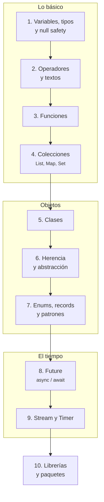

# 2. Dart

**Dart** es el lenguaje en el que se escribe Flutter. Lo hace Google, se parece a Java, a JavaScript y a C#, y está pensado para hacer interfaces: compila rápido mientras desarrollás (para el *hot reload*) y a código de máquina cuando entregás (para que la app vuele).

!!! abstract "Al terminar esta parte vas a poder"
    - Leer **cualquier** archivo de VigiaApp y saber qué es cada cosa (aunque no sepas todavía por qué está ahí).
    - Escribir clases con constructores, getters y métodos.
    - Entender `?`, `!`, `??`, `late`, `final`, `const`.
    - Usar `Future`, `async`/`await`, `Stream` y `Timer`.
    - Reconocer las novedades de Dart 3: `sealed`, records, patrones, `switch` como expresión.

## Cómo practicar

Cada página tiene ejemplos con `void main()`. Son programas completos: copiá y corré.

=== "DartPad (sin instalar nada)"

    Entrá a [dartpad.dev](https://dartpad.dev), pegá el ejemplo y tocá **Run**. La salida aparece a la derecha.

=== "En tu compu"

    Creá un archivo `prueba.dart` en cualquier carpeta y corré:

    ```bash
    dart run prueba.dart
    ```

    (Viene con Flutter, no hay que instalar nada más.)

!!! tip "Escribilos, no los copies"
    Copiar es más rápido, pero escribir te obliga a mirar cada símbolo. Los errores que vas a cometer al tipear son exactamente los que después vas a saber reconocer.

## Las páginas



| Página | En una línea | Dónde aparece en VigiaApp |
|---|---|---|
| [1. Variables, tipos y null safety](1-variables-y-tipos.md) | Guardar datos y evitar el error del millón de dólares. | En todos lados. |
| [2. Operadores y textos](2-operadores-y-strings.md) | Hacer cuentas, comparar y armar textos. | `fechas.dart`, `validadores.dart`. |
| [3. Funciones](3-funciones.md) | Agrupar código, parámetros con nombre, funciones como valores. | Los callbacks de los botones, `Sondeo`. |
| [4. Colecciones](4-colecciones.md) | Listas, mapas y conjuntos; recorrerlos y transformarlos. | El JSON, las listas de mensajes. |
| [5. Clases](5-clases.md) | Moldes para crear objetos con datos y comportamiento. | Los modelos, los ViewModels. |
| [6. Herencia y abstracción](6-herencia-y-abstraccion.md) | Clases que heredan, interfaces, `@override`, extensiones. | `VigiaApi`, `ViewModel`, los widgets. |
| [7. Enums, records y patrones](7-enums-records-patrones.md) | Valores fijos, grupos de valores y `switch` poderoso. | `EstadoSesion`, `Resultado`. |
| [8. Asincronía I: Future](8-asincronia-future.md) | Esperar sin congelar la app. | Cada pedido al servidor. |
| [9. Asincronía II: Stream y Timer](9-streams-y-timers.md) | Valores que llegan con el tiempo. | El GPS, el chat, los enlaces. |
| [10. Librerías y paquetes](10-librerias-y-paquetes.md) | `import`, `pubspec.yaml`, pub.dev. | El principio de cada archivo. |

## Un primer programa

Para que veas la pinta del lenguaje antes de empezar:

```dart title="hola.dart"
// Todo programa de Dart empieza en main.
void main() {
  final vecinos = ['María', 'Jorge', 'Laura'];

  for (final vecino in vecinos) {
    print('Hola, $vecino');
  }

  print('Somos ${vecinos.length} vecinos.');
}
```

```text title="Salida"
Hola, María
Hola, Jorge
Hola, Laura
Somos 3 vecinos.
```

Si se parece a otro lenguaje que conocés, genial: vas a ir rápido. Si es tu primer lenguaje, no te preocupes: cada página explica todo desde cero.

[Empezar: Variables, tipos y null safety :material-arrow-right:](1-variables-y-tipos.md){ .md-button .md-button--primary }
