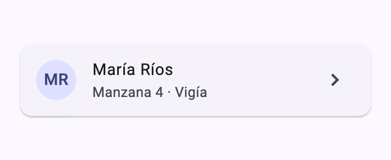
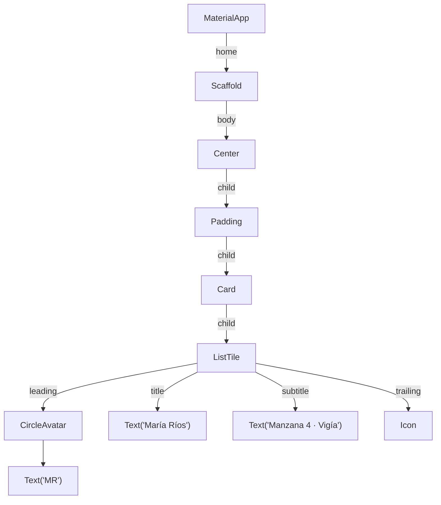
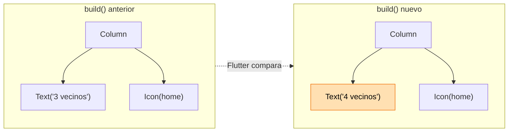
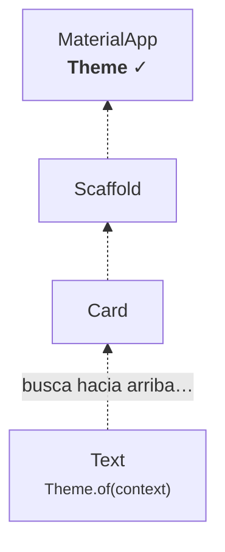

# Todo es un widget

!!! abstract "Objetivo"
    Entender qué es un **widget**, cómo se **anidan** para formar un **árbol**, qué hace el método **`build`**, qué es el **`BuildContext`** y por qué en Flutter se arma todo **componiendo** piezas chicas.

## Un widget es una descripción

Un **widget** es un objeto que **describe** un pedazo de interfaz: "un texto que dice Hola", "un botón", "un espacio de 16 puntos", "una columna con estas cosas adentro". No es el dibujo en sí: es la **receta**.

En Flutter, **todo** es un widget:

| Lo que ves | El widget |
|---|---|
| Un texto | `Text('Hola')` |
| Un ícono | `Icon(Icons.home)` |
| Un botón | `FilledButton(...)` |
| Un margen | `Padding(...)` |
| Centrar algo | `Center(...)` |
| Poner cosas una debajo de otra | `Column(...)` |
| La pantalla entera | `Scaffold(...)` |
| La app entera | `MaterialApp(...)` |

Hasta cosas que en otros sistemas son "propiedades" (márgenes, alineación, que algo se pueda tocar) en Flutter son widgets que **envuelven** a otros.

## Los widgets se anidan

Un widget puede tener **hijos**: otros widgets adentro. Así se arma un **árbol**:

<figure markdown="span">
  { .captura .ancha }
  <figcaption>Una tarjeta de vecino.</figcaption>
</figure>

```dart title="tarjeta.dart" linenums="1"
import 'package:flutter/material.dart';

void main() {
  runApp(
    MaterialApp(
      theme: ThemeData(colorSchemeSeed: Colors.indigo),
      home: const Scaffold(
        body: Center(
          child: Padding(
            padding: EdgeInsets.all(16),
            child: Card(
              child: ListTile(
                leading: CircleAvatar(child: Text('MR')),
                title: Text('María Ríos'),
                subtitle: Text('Manzana 4 · Vigía'),
                trailing: Icon(Icons.chevron_right),
              ),
            ),
          ),
        ),
      ),
    ),
  );
}
```



Fijate cómo cada widget recibe a sus hijos por **parámetros con nombre**:

- `child:` cuando tiene **un** hijo (`Center`, `Padding`, `Card`).
- `children:` cuando tiene **varios** (`Column`, `Row`, `ListView`).
- Nombres específicos cuando cada hijo tiene un rol (`Scaffold` tiene `appBar:`, `body:`, `floatingActionButton:`; `ListTile` tiene `leading:`, `title:`, `subtitle:`, `trailing:`).

!!! tip "Las comas al final"
    Poné una coma después del último parámetro (`trailing: Icon(...),`). Así el formateador (`dart format` o guardar en VS Code) acomoda el árbol con una sangría por nivel y se lee como el diagrama. Sin la coma, lo junta todo en una línea.

!!! tip "Ver el árbol en VS Code"
    Con el cursor en un widget, ++ctrl+shift+r++ (o el foco :material-lightbulb-outline:) ofrece **Wrap with Padding**, **Wrap with Center**, **Wrap with Column**, **Remove this widget**… Ahorra mucho tipeo y evita errores de paréntesis.

## Composición: piezas chicas

En Flutter no hay un widget "TarjetaDeVecino" con 40 opciones. Hay piezas chicas (`Card`, `ListTile`, `CircleAvatar`, `Text`) que **se combinan**. Y cuando una combinación se repite, **hacés tu propio widget**:

```dart title="tarjeta_vecino.dart" linenums="1"
class TarjetaVecino extends StatelessWidget {  // (1)!
  const TarjetaVecino({  // (2)!
    required this.nombre,
    required this.descripcion,
    this.onTap,
    super.key,
  });

  final String nombre;  // (3)!
  final String descripcion;
  final VoidCallback? onTap;

  @override
  Widget build(BuildContext context) {  // (4)!
    final iniciales = nombre.split(' ').map((p) => p[0]).take(2).join();
    return Card(
      child: ListTile(
        leading: CircleAvatar(child: Text(iniciales)),
        title: Text(nombre),
        subtitle: Text(descripcion),
        trailing: const Icon(Icons.chevron_right),
        onTap: onTap,
      ),
    );
  }
}

// Y se usa como cualquier otro:
// TarjetaVecino(nombre: 'María Ríos', descripcion: 'Manzana 4 · Vigía')
```

1. Un widget propio es una **clase** que hereda de `StatelessWidget` (o `StatefulWidget`, en la [página siguiente](2-stateless-y-stateful.md)).
2. El constructor recibe los datos que necesita. `super.key` lo explicamos en [keys](7-estado-compartido.md#keys); por ahora, ponelo siempre.
3. Los datos se guardan en campos `final`: un widget **no cambia** una vez creado.
4. `build` devuelve el árbol que lo forma.

En VigiaApp hay unos 60 widgets propios, desde pantallas enteras (`LoginScreen`) hasta piezas chicas (`BurbujaMensaje`, `EstadoRed`, `TarjetaRondin`).

!!! question "¿Cuándo hacer un widget propio?"
    - Cuando un pedazo se **repite** (las burbujas del chat).
    - Cuando un `build` se hace **muy largo** (más de una pantalla de código): partirlo en widgets con nombre lo hace legible.
    - Cuando un pedazo tiene **sentido propio** (la barra inferior del Inicio, el banner de alerta).

    En VigiaApp, los widgets que solo usa una pantalla van en el mismo archivo con `_` adelante (`_TarjetaPublicacion`); los que usan varias van en su propio archivo.

## `build`: describir, no hacer

`build` es el método que Flutter llama para pedirle a un widget su descripción. Reglas:

1. **Tiene que ser rápido**: Flutter puede llamarlo 60 o 120 veces por segundo durante una animación.
2. **No tiene que tener efectos**: nada de pedirle cosas al servidor, ni de cambiar variables, ni de navegar. Solo **describir** con los datos que hay.
3. **Puede llamarse en cualquier momento**: no asumas que se llama una sola vez.

```dart
@override
Widget build(BuildContext context) {
  _api.cargarMensajes();  // ✗ MAL: se pediría cada vez que se redibuja
  return Text('Hola');
}
```

Las cargas van en `initState` o, en VigiaApp, en el ViewModel ([Parte 4](../4-arquitectura/2-mvvm-y-capas.md)).

## Widgets inmutables, redibujos baratos

Todos los campos de un widget son `final`. Un widget **no cambia nunca**: si algo tiene que verse distinto, se crea **un widget nuevo** con los datos nuevos.

Esto suena caro, pero no lo es: un widget es un objeto chiquito (unos pocos campos). Lo caro (calcular tamaños, pintar) lo hace Flutter **solo para lo que cambió**, comparando el árbol nuevo con el anterior.



Solo se vuelve a pintar el texto. Y si un widget es **`const`**, Flutter sabe sin comparar que no cambió: por eso el analizador insiste con `const` ([`final` y `const`](../2-dart/1-variables-y-tipos.md#const-en-los-widgets)).

## `BuildContext`: dónde estoy en el árbol

`build` recibe un parámetro: `BuildContext context`. Es **la posición de este widget en el árbol**. Sirve para **buscar hacia arriba** cosas que pusieron los widgets padres:

```dart
Theme.of(context)              // el tema que puso MaterialApp
Navigator.of(context)          // el navegador de pantallas
ScaffoldMessenger.of(context)  // el que muestra los SnackBars
MediaQuery.sizeOf(context)     // el tamaño de la pantalla
Dependencias.of(context)       // (VigiaApp) los repositorios de la app
```



El patrón `Algo.of(context)` se repite en todo Flutter: "dame el `Algo` más cercano hacia arriba de donde estoy". Cómo funciona por dentro (un `InheritedWidget`) lo vemos en [Estado compartido](7-estado-compartido.md#inheritedwidget).

!!! warning "El `context` correcto"
    El `context` es **de un widget en particular**. Si en el `build` de un widget creás un `Scaffold` y en el mismo `build` usás `ScaffoldMessenger.of(context)`, ese `context` está **arriba** del `Scaffold`, no adentro. Casi siempre anda igual (el `ScaffoldMessenger` lo pone `MaterialApp`), pero con `Scaffold.of(context)` falla. La solución es un `Builder` o un widget aparte, que da un `context` más abajo.

## El tema

`MaterialApp` recibe un `theme`, que define colores y tipografías para toda la app:

```dart
MaterialApp(
  theme: ThemeData(colorSchemeSeed: Colors.indigo),
  ...
)
```

Con un solo color "semilla", Material 3 genera una paleta completa (fondos, botones, bordes, textos). VigiaApp en la wiki **no toca más estilos que este**.

Para usar los colores y textos del tema en un widget:

```dart
final colores = Theme.of(context).colorScheme;
final textos = Theme.of(context).textTheme;

Text('Alerta', style: textos.titleLarge?.copyWith(color: colores.error))
```

| `colorScheme.` | Para qué |
|---|---|
| `primary` / `onPrimary` | El color principal y el texto que va encima. |
| `secondaryContainer` | Fondos suaves (chips seleccionados, tarjetas destacadas). |
| `error` / `onError` | Errores, la alerta SOS. |
| `surface` / `onSurface` | El fondo de las pantallas y su texto. |
| `outline` | Bordes y separadores. |

| `textTheme.` | Para qué |
|---|---|
| `headlineSmall` | Títulos grandes. |
| `titleMedium` | Títulos de tarjetas. |
| `bodyMedium` | Texto normal (el que usa `Text` por defecto). |
| `labelSmall` | Textos chicos (la hora de un mensaje). |

## Lo que aprendiste

- [x] Un **widget** es una descripción inmutable de un pedazo de interfaz; **todo** es un widget.
- [x] Los widgets se **anidan** con `child`, `children` o parámetros con nombre, y forman un **árbol**.
- [x] Se **componen** piezas chicas; cuando algo se repite, se hace un widget propio.
- [x] **`build`** describe, rápido y sin efectos; puede llamarse muchas veces.
- [x] **`BuildContext`** es la posición en el árbol; `Algo.of(context)` busca hacia arriba.

[Siguiente: Stateless y Stateful :material-arrow-right:](2-stateless-y-stateful.md){ .md-button .md-button--primary }
