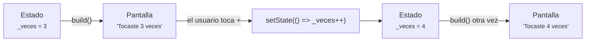
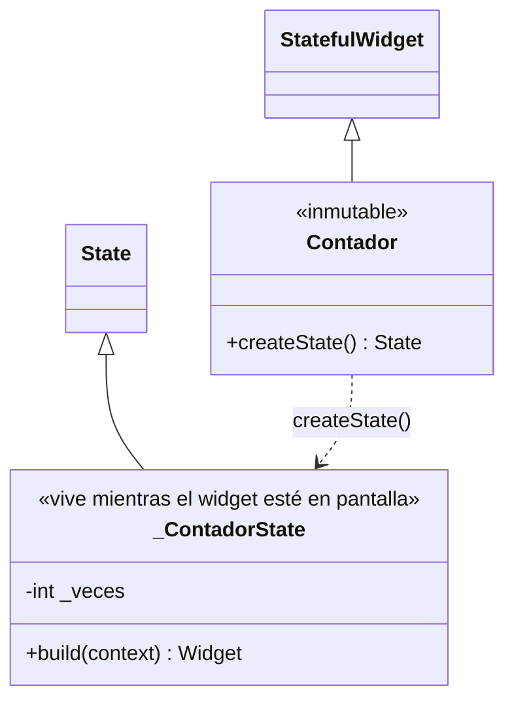
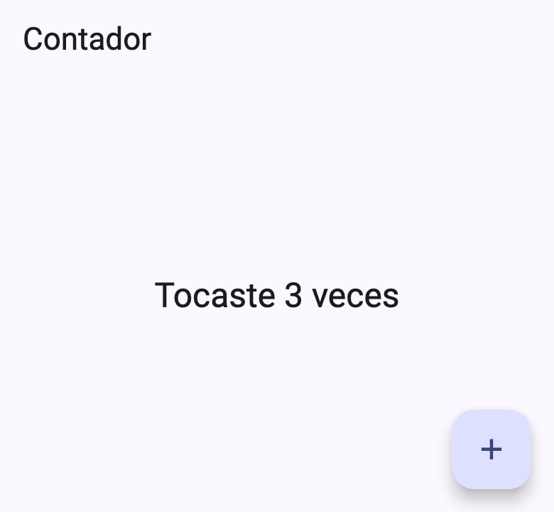
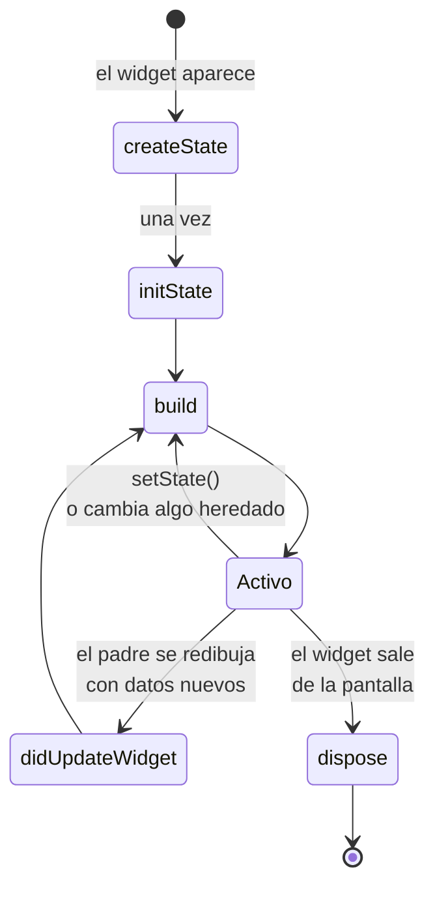
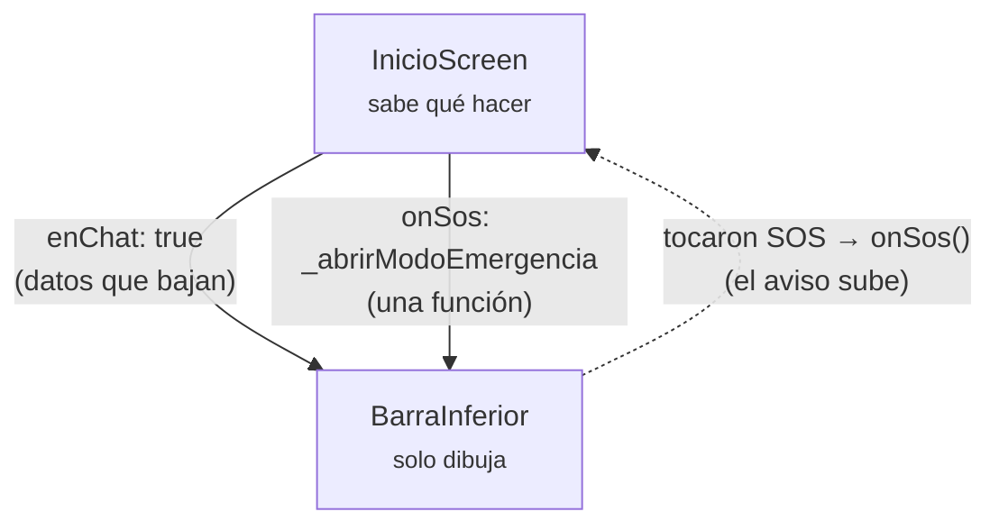
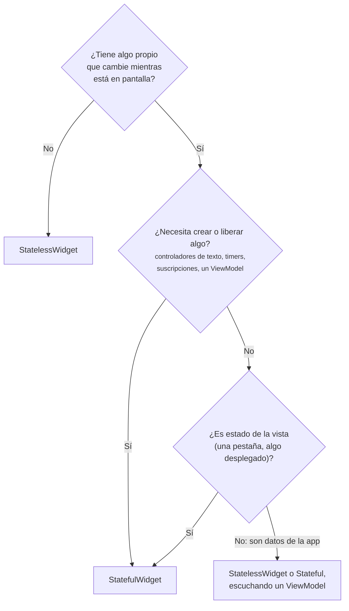

# Stateless y Stateful

!!! abstract "Objetivo"
    Distinguir los widgets **sin estado** (`StatelessWidget`) de los **con estado** (`StatefulWidget`), usar **`setState`** para que la pantalla cambie, conocer el **ciclo de vida** de un `State` (`initState`, `dispose`…) y **avisarle al padre** con callbacks. Es lo que hace que una pantalla "esté viva".

## Estado: lo que cambia

El **estado** es cualquier dato que puede cambiar mientras la pantalla está abierta y que afecta cómo se ve: el número de un contador, el texto que se escribió, si un panel está abierto, la lista de mensajes que llegó del servidor.



## `StatelessWidget`: sin estado

Un widget **sin estado** se dibuja **solo con lo que recibe** en el constructor. Si recibe lo mismo, se ve igual. No tiene nada propio que cambie.

```dart title="lib/ui/inicio/widgets/barra_inferior.dart (resumido)"
class BarraInferior extends StatelessWidget {
  const BarraInferior({
    required this.enChat,
    required this.onChat,
    required this.onActividad,
    required this.onSos,
    super.key,
  });

  final bool enChat;
  final VoidCallback onChat;
  final VoidCallback onActividad;
  final VoidCallback onSos;

  @override
  Widget build(BuildContext context) {
    return NavigationBar(
      selectedIndex: enChat ? 0 : 2,
      // …
    );
  }
}
```

La barra de abajo del Inicio no decide **qué** pestaña está activa: se lo dicen (`enChat`). Y no sabe **qué hacer** cuando la tocan: se lo dicen también (`onChat`, `onSos`…). Es una pieza "tonta" y por eso **reutilizable y fácil de probar**.

## `StatefulWidget`: con estado

Un widget **con estado** se divide en **dos clases**:



1. **El widget** (`Contador`): inmutable, como todos. Solo sabe crear su `State`.
2. **El `State`** (`_ContadorState`): un objeto que **vive** mientras el widget esté en pantalla. Ahí se guarda lo que cambia, y ahí está el `build`.

¿Por qué dos? Porque los widgets se crean y se tiran constantemente (cada vez que el padre se redibuja). Si el estado viviera en el widget, se perdería. El `State` **sobrevive** a los redibujos.

<figure markdown="span">
  { .captura .ancha }
  <figcaption>El contador, después de tocar tres veces el +.</figcaption>
</figure>

```dart title="contador.dart" linenums="1"
import 'package:flutter/material.dart';

void main() => runApp(
  MaterialApp(
    theme: ThemeData(colorSchemeSeed: Colors.indigo),
    home: const Contador(),
  ),
);

class Contador extends StatefulWidget {  // (1)!
  const Contador({super.key});

  @override
  State<Contador> createState() => _ContadorState();  // (2)!
}

class _ContadorState extends State<Contador> {  // (3)!
  int _veces = 0;  // (4)!

  @override
  Widget build(BuildContext context) {
    return Scaffold(
      appBar: AppBar(title: const Text('Contador')),
      body: Center(
        child: Text(
          'Tocaste $_veces veces',
          style: Theme.of(context).textTheme.headlineSmall,
        ),
      ),
      floatingActionButton: FloatingActionButton(
        onPressed: () => setState(() => _veces++),  // (5)!
        child: const Icon(Icons.add),
      ),
    );
  }
}
```

1. El widget: hereda de `StatefulWidget`.
2. Lo único que hace: crear su `State`. Flutter lo llama **una vez**, cuando el widget aparece.
3. El `State`: privado (`_`), en el mismo archivo. `State<Contador>` dice "soy el estado de un `Contador`".
4. El estado propiamente dicho.
5. **`setState`**: cambia el dato **y** avisa a Flutter que este widget tiene que redibujarse.

### `setState`

```dart
setState(() {
  _veces++;
});
```

`setState` recibe una función, la ejecuta (ahí cambiás los datos) y **marca el widget como "sucio"**. En el próximo cuadro (en menos de 16 ms), Flutter llama a su `build` de nuevo.

!!! danger "Cambiar sin `setState` no redibuja"
    ```dart
    onPressed: () => _veces++,   // el número cambia… pero la pantalla no
    ```
    El dato cambia, pero Flutter no se entera. La pantalla se actualiza recién cuando otra cosa provoque un redibujo, y parece un bug aleatorio.

!!! tip "Lo mínimo adentro de `setState`"
    Adentro de `setState` va solo el cambio de los datos. Nada de pedidos al servidor ni `await`: `setState` no puede ser `async`. Si tenés que esperar algo, esperalo **antes** y llamá a `setState` con el resultado.

### `widget.`: leer lo que recibió el widget

Desde el `State`, los campos del widget se leen con `widget.`:

```dart
class Saludo extends StatefulWidget {
  const Saludo({required this.nombre, super.key});
  final String nombre;
  @override
  State<Saludo> createState() => _SaludoState();
}

class _SaludoState extends State<Saludo> {
  @override
  Widget build(BuildContext context) => Text('Hola, ${widget.nombre}');
}
```

## El ciclo de vida {#ciclo-de-vida}

Un `State` pasa por etapas, y Flutter llama a un método en cada una. Los que vas a usar:



| Método | Cuándo | Para qué |
|---|---|---|
| `initState()` | Una vez, al crear el `State`. | Arrancar cosas: cargar datos, crear controladores, suscribirse. |
| `build()` | Muchas veces. | Describir la pantalla. |
| `didUpdateWidget(viejo)` | Cuando el padre se redibuja con un widget nuevo del mismo tipo. | Reaccionar si cambiaron los datos recibidos. Poco usado. |
| `dispose()` | Una vez, cuando sale de la pantalla para siempre. | **Liberar**: cancelar timers y suscripciones, descartar controladores y ViewModels. |

Y la propiedad **`mounted`**: `true` mientras el `State` está en pantalla, `false` después de `dispose`.

### El patrón de las pantallas de VigiaApp

Todas las pantallas de la app tienen esta forma ([capítulo 9](../5-construccion/09-menu-y-perfil.md)):

```dart title="lib/ui/perfil/widgets/perfil_screen.dart (fragmento)"
class PerfilScreen extends StatefulWidget {
  const PerfilScreen({required this.viewModel, super.key});  // (1)!

  final PerfilViewModel viewModel;

  @override
  State<PerfilScreen> createState() => _PerfilScreenState();
}

class _PerfilScreenState extends State<PerfilScreen> {
  late final PerfilViewModel _viewModel = widget.viewModel;  // (2)!

  @override
  void initState() {
    super.initState();
    _viewModel.cargar();  // (3)!
  }

  @override
  void dispose() {
    _viewModel.dispose();  // (4)!
    super.dispose();
  }

  @override
  Widget build(BuildContext context) {
    return Scaffold(
      appBar: AppBar(title: const Text('Mi perfil')),
      body: ListenableBuilder(  // (5)!
        listenable: _viewModel,
        builder: (context, _) { … },
      ),
    );
  }
}
```

1. La pantalla **recibe** su ViewModel (el objeto con el estado y la lógica). No lo crea ella.
2. Se lo guarda **una sola vez** (`late final`): si el padre se redibuja y le pasa otro, la pantalla sigue con el primero.
3. En `initState`, arranca la carga.
4. En `dispose`, descarta el ViewModel (que cancela sus timers, etc.).
5. En vez de `setState`, escucha al ViewModel: cuando este avisa que cambió, se redibuja esa parte. Lo vemos en [Estado compartido](7-estado-compartido.md#changenotifier).

¿Por qué es `StatefulWidget` si el estado está en el ViewModel? Por el **ciclo de vida**: necesita `initState` para arrancar y `dispose` para limpiar.

### `mounted` después de un `await`

Si el `State` hace algo asíncrono, al volver **puede ya no estar en pantalla** (el vecino se fue). Usar el `context` en ese caso es un error. Por eso:

```dart
Future<void> _cambiarClave() async {
  final cambio = await showDialog<bool>(...);  // se espera
  if (cambio == true && mounted) {             // ¿sigo en pantalla?
    mostrarAviso(context, 'Contraseña actualizada');
  }
}
```

Ya lo viste en [Asincronía I](../2-dart/8-asincronia-future.md#future-y-flutter-el-context-despues-de-un-await). El analizador lo controla con `use_build_context_synchronously`.

## Avisarle al padre: callbacks {#avisarle-al-padre-callbacks}

Los datos en Flutter **bajan** por el árbol (del padre a los hijos, por el constructor). ¿Cómo hace un hijo para **avisar** algo hacia arriba? El padre le pasa **una función** (un *callback*), y el hijo la llama.



```dart
// El padre (InicioScreen, capítulo 12):
BarraInferior(
  enChat: _viewModel.verChat,
  onChat: () => _viewModel.mostrarChat(true),
  onActividad: () => _viewModel.mostrarChat(false),
  onSos: _abrirModoEmergencia,
)

// El hijo, cuando lo tocan:
onDestinationSelected: (indice) => switch (indice) {
  0 => onChat(),
  1 => onSos(),
  _ => onActividad(),
},
```

Los tipos de callbacks más comunes (todos son [funciones como valores](../2-dart/3-funciones.md#funciones-como-valores)):

| Tipo | Es | Ejemplo |
|---|---|---|
| `VoidCallback` | `void Function()` | `onPressed`, `onTap` |
| `ValueChanged<T>` | `void Function(T)` | `onChanged` de un campo de texto o un switch |
| `VoidCallback?` | Opcional | Si es `null`, el botón se ve **deshabilitado** |

!!! tip "Callbacks opcionales para mostrar u ocultar"
    En VigiaApp, el menú lateral recibe `onComiteVecinos` como **opcional**. Si el vecino no es del comité, el Inicio pasa `null`, y el menú no muestra esa sección ([capítulo 16](../5-construccion/16-comite.md)). Un mismo widget sirve para los dos casos.

Esto se llama **elevar el estado** (*lifting state up*): el estado vive en el padre más bajo que lo necesita, y los hijos lo reciben y avisan cambios. Cuando muchos widgets lejanos necesitan el mismo estado, pasar callbacks por diez niveles se vuelve incómodo; ahí entra el [estado compartido](7-estado-compartido.md).

## ¿Stateless o Stateful?



Regla práctica: **empezá con `StatelessWidget`**. Si necesitás `setState`, `initState` o `dispose`, pasalo a `StatefulWidget` (VS Code lo hace solo: foco :material-lightbulb-outline: → *Convert to StatefulWidget*).

## Ejercicios

??? question "1. Un interruptor"
    Hacé un `StatefulWidget` con un `Switch` y un texto que diga "Notificaciones: sí/no".

    ??? success "Una respuesta"
        ```dart
        class Notificaciones extends StatefulWidget {
          const Notificaciones({super.key});
          @override
          State<Notificaciones> createState() => _NotificacionesState();
        }

        class _NotificacionesState extends State<Notificaciones> {
          bool _activas = true;

          @override
          Widget build(BuildContext context) {
            return SwitchListTile(
              title: Text('Notificaciones: ${_activas ? 'sí' : 'no'}'),
              value: _activas,
              onChanged: (valor) => setState(() => _activas = valor),
            );
          }
        }
        ```

??? question "2. ¿Qué falta?"
    ```dart
    class _RelojState extends State<Reloj> {
      late final Timer _timer;
      DateTime _ahora = DateTime.now();

      @override
      void initState() {
        super.initState();
        _timer = Timer.periodic(const Duration(seconds: 1),
            (_) => setState(() => _ahora = DateTime.now()));
      }

      @override
      Widget build(BuildContext context) => Text('$_ahora');
    }
    ```

    ??? success "Respuesta"
        El `dispose` que cancela el timer. Sin él, cuando el widget sale de la pantalla el timer sigue llamando a `setState` sobre un `State` descartado, y aparece `setState() called after dispose()`.
        ```dart
        @override
        void dispose() {
          _timer.cancel();
          super.dispose();
        }
        ```

## Lo que aprendiste

- [x] **`StatelessWidget`**: se dibuja solo con lo que recibe.
- [x] **`StatefulWidget`** + **`State`**: el `State` sobrevive a los redibujos y guarda lo que cambia.
- [x] **`setState`** cambia datos **y** pide redibujar.
- [x] **Ciclo de vida**: `initState` para arrancar, `dispose` para liberar, `mounted` después de un `await`.
- [x] Los datos bajan por el constructor; los avisos suben con **callbacks**.

[Siguiente: Layout :material-arrow-right:](3-layout.md){ .md-button .md-button--primary }
