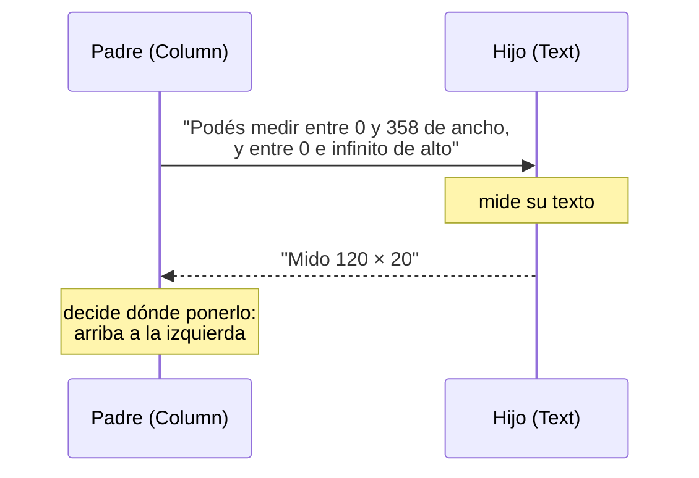
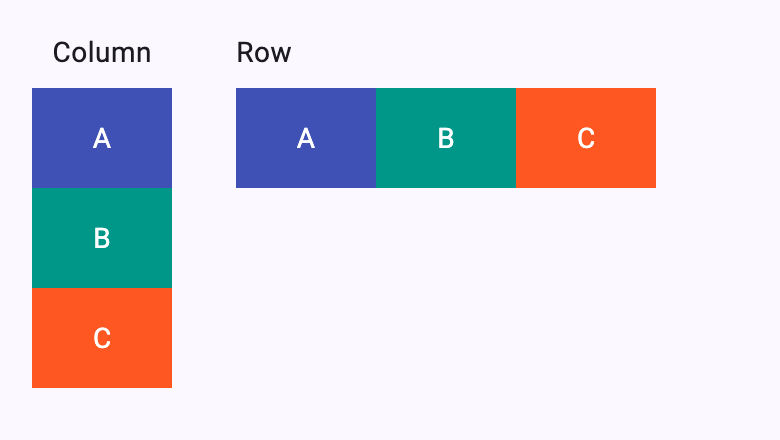
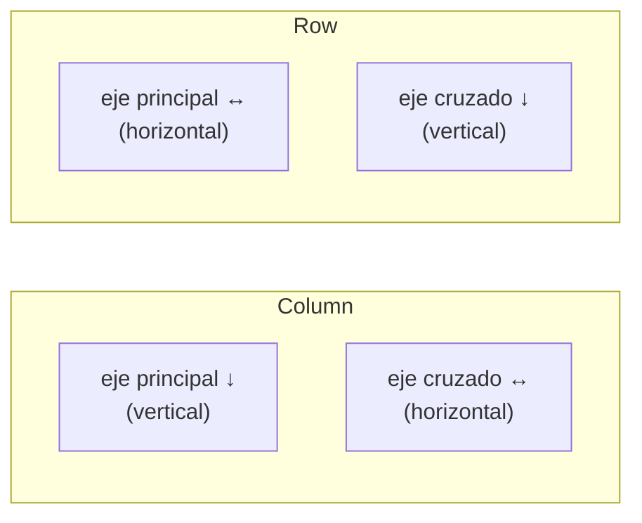
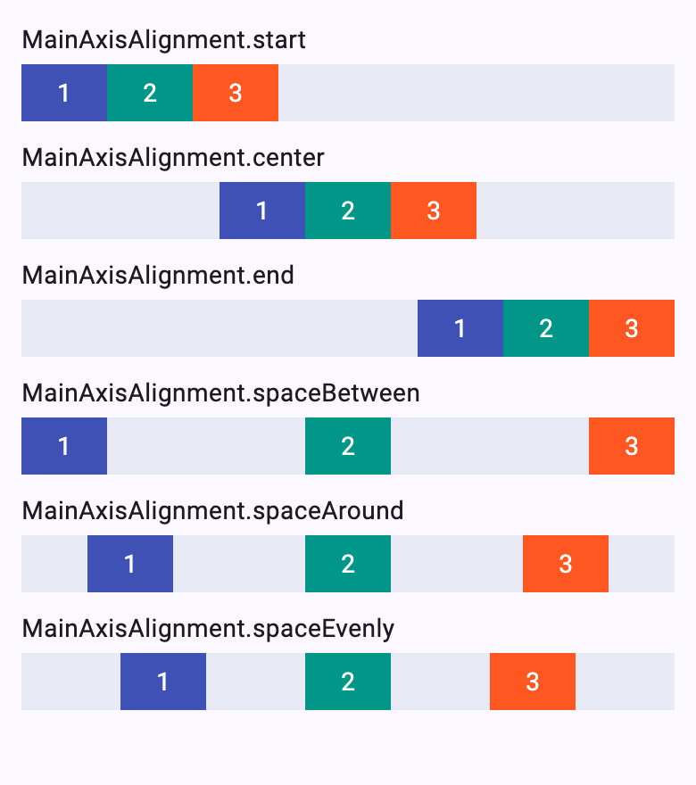
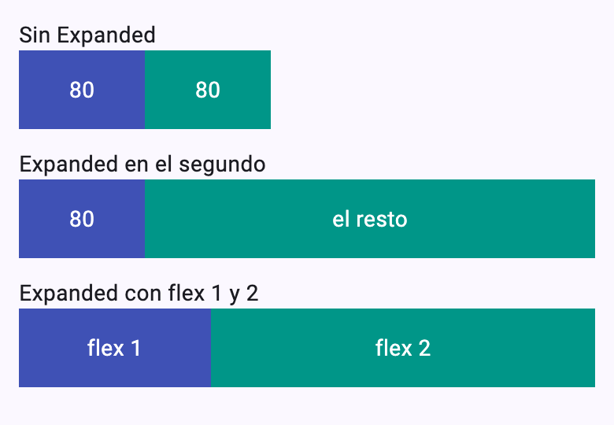
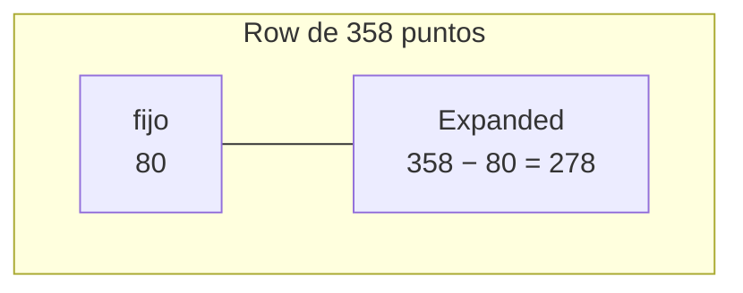
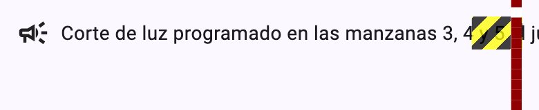
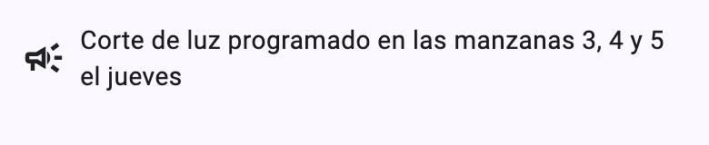
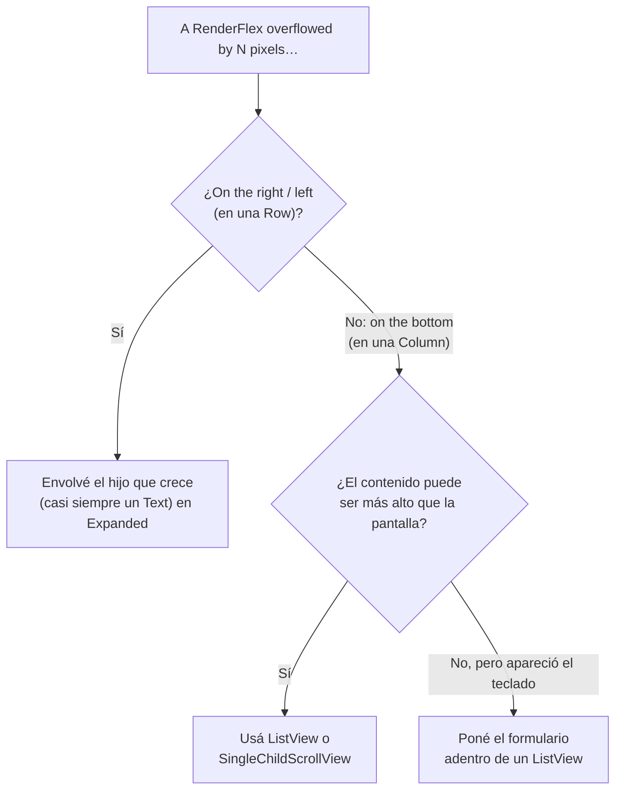
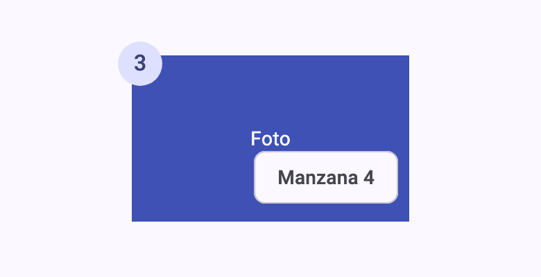

# Layout

!!! abstract "Objetivo"
    Ubicar cosas en la pantalla: una al lado de la otra (`Row`), una debajo de la otra (`Column`), repartiendo el espacio (`Expanded`), encimadas (`Stack`), con márgenes (`Padding`, `SizedBox`) y en listas que se desplazan (`ListView`). Y entender **la regla de oro del layout**, que explica el error más famoso de Flutter: el *overflow*.

## La regla de oro

> **Las restricciones bajan. Los tamaños suben. El padre decide la posición.**

Así calcula Flutter dónde va cada cosa:



1. El padre le dice al hijo **cuánto puede medir** (un mínimo y un máximo de ancho y alto: las **restricciones**).
2. El hijo elige **su tamaño** dentro de esos límites y se lo dice al padre.
3. El padre lo **ubica**.

Consecuencias que confunden al principio:

- Un widget **no puede elegir su posición**: lo ubica el padre.
- Un widget **no puede medir más** de lo que el padre permite. Si el contenido no entra… *overflow*.
- `Container(width: 100)` adentro de algo que le **obliga** a ocupar todo el ancho, ocupa todo el ancho. El `width` es un deseo, no una orden.

## `Column` y `Row`

<figure markdown="span">
  { .captura .ancha }
</figure>

```dart
Column(
  children: [
    caja('A'),
    caja('B'),
    caja('C'),
  ],
)

Row(
  children: [
    caja('A'),
    caja('B'),
    caja('C'),
  ],
)
```

- **`Column`**: los hijos uno **debajo** del otro.
- **`Row`**: los hijos uno **al lado** del otro.

Los dos tienen un **eje principal** (la dirección en que ponen los hijos) y un **eje cruzado** (el perpendicular):



### `mainAxisAlignment`: cómo repartir sobre el eje principal

<figure markdown="span">
  { .captura .ancha }
</figure>

```dart
Row(
  mainAxisAlignment: MainAxisAlignment.spaceBetween,
  children: [...],
)
```

| Valor | Qué hace |
|---|---|
| `start` (por defecto) | Todo al principio. |
| `center` | Todo al centro. |
| `end` | Todo al final. |
| `spaceBetween` | El espacio sobrante **entre** los hijos (nada en los bordes). |
| `spaceAround` | Cada hijo con la misma cantidad de espacio a cada lado (en los bordes queda la mitad). |
| `spaceEvenly` | El mismo espacio en todos los huecos, bordes incluidos. |

### `crossAxisAlignment`: cómo alinear sobre el eje cruzado

| Valor | En una `Column` | En una `Row` |
|---|---|---|
| `center` (por defecto) | Centrados horizontalmente | Centrados verticalmente |
| `start` | A la izquierda | Arriba |
| `end` | A la derecha | Abajo |
| `stretch` | Ocupan todo el ancho | Ocupan todo el alto |

!!! tip "`CrossAxisAlignment.start` en las columnas de texto"
    Por defecto una `Column` centra a sus hijos. Para textos (título, subtítulo, fecha) casi siempre querés `crossAxisAlignment: CrossAxisAlignment.start`, para que queden alineados a la izquierda. Lo vas a ver en muchas pantallas de VigiaApp.

### `mainAxisSize`: ¿ocupar todo o lo justo?

Por defecto, una `Column` ocupa **todo el alto** disponible (y una `Row`, todo el ancho). Con `mainAxisSize: MainAxisSize.min` ocupa **lo justo** para sus hijos. Es lo que querés adentro de un diálogo o una hoja de abajo.

### `spacing`: espacio entre hijos

```dart
Column(
  spacing: 8,  // 8 puntos entre cada hijo
  children: [...],
)
```

Antes había que meter un `SizedBox(height: 8)` entre cada par de hijos. Desde Flutter 3.27, `Column` y `Row` tienen `spacing`.

## Espacios y márgenes

=== "Padding"

    Agrega espacio **alrededor** de su hijo:

    ```dart
    Padding(
      padding: const EdgeInsets.all(16),
      child: Text('Con margen'),
    )
    ```

    | `EdgeInsets.` | Qué espacio |
    |---|---|
    | `all(16)` | 16 en los cuatro lados. |
    | `symmetric(horizontal: 16, vertical: 8)` | 16 a izquierda y derecha, 8 arriba y abajo. |
    | `only(top: 8, left: 16)` | Solo en esos lados. |
    | `fromLTRB(16, 8, 16, 4)` | Izquierda, arriba, derecha, abajo. |

=== "SizedBox"

    Una caja de tamaño fijo. Vacía, sirve de **separador**:

    ```dart
    const SizedBox(height: 16)  // espacio vertical
    const SizedBox(width: 8)    // espacio horizontal
    ```

    Con un hijo, le **fija** el tamaño:

    ```dart
    SizedBox(width: double.infinity, child: FilledButton(...))  // botón a todo el ancho
    ```

=== "Center y Align"

    `Center` centra a su hijo en todo el espacio disponible. `Align` lo pone donde digas:

    ```dart
    Align(alignment: Alignment.bottomRight, child: Text('abajo a la derecha'))
    ```

=== "Container"

    Un "todo en uno": tamaño, margen, relleno, color, bordes. Útil para cajas con fondo:

    ```dart
    Container(
      width: 70,
      height: 50,
      color: Colors.indigo,
      alignment: Alignment.center,
      child: const Text('A', style: TextStyle(color: Colors.white)),
    )
    ```

    Si solo necesitás margen, usá `Padding`; si solo tamaño, `SizedBox`. Son más livianos y dicen mejor qué querés.

## `Expanded`: repartir el espacio {#expanded}

`Expanded` le dice a un hijo de una `Row` o `Column`: **"ocupá todo el espacio que sobra"**.

<figure markdown="span">
  { .captura .ancha }
</figure>

```dart
// Sin Expanded: cada uno mide lo suyo
Row(children: [caja(80), caja(80)])

// El segundo ocupa todo lo que sobra
Row(children: [
  caja(80),
  Expanded(child: caja('el resto')),
])

// Reparten en proporción: 1/3 y 2/3
Row(children: [
  Expanded(child: caja('flex 1')),
  Expanded(flex: 2, child: caja('flex 2')),
])
```



Cómo reparte una `Row`: primero mide a los hijos **sin** `Expanded`; el espacio que queda se reparte entre los `Expanded` según su `flex` (1 por defecto).

En VigiaApp, el caso más común es un ícono + un texto que puede ser largo:

```dart
Row(
  children: [
    const Icon(Icons.campaign_outlined),
    const SizedBox(width: 8),
    Expanded(child: Text(noticia.titulo)),  // el texto se acomoda al espacio
  ],
)
```

`Flexible` es parecido a `Expanded`, pero deja que el hijo mida **menos** que el espacio sobrante si no lo necesita.

## El error más famoso {#el-error-mas-famoso}

Probá esto:

```dart
Row(
  children: [
    Icon(Icons.campaign_outlined),
    SizedBox(width: 8),
    Text('Corte de luz programado en las manzanas 3, 4 y 5 el jueves'),
  ],
)
```

<figure markdown="span">
  { .captura .ancha }
  <figcaption>El overflow: las rayas amarillas y negras marcan por dónde se sale.</figcaption>
</figure>

```text
A RenderFlex overflowed by 73 pixels on the right.
```

(El número depende del texto y del ancho de la pantalla.)

**Por qué pasa**, con la regla de oro: una `Row` le dice a cada hijo "medí **lo que quieras** de ancho" (sin máximo, porque una fila puede ser muy larga). El `Text` mide su texto en una sola línea… y es más ancho que la pantalla. La `Row` no lo puede achicar y se sale.

**El arreglo**: envolver el texto en `Expanded`. Ahora la `Row` le dice "medí **como máximo** lo que sobra", y el `Text` corta en varias líneas.

<figure markdown="span">
  { .captura .ancha }
  <figcaption>Con <code>Expanded</code>, el texto se acomoda.</figcaption>
</figure>

```dart hl_lines="5"
Row(
  children: [
    Icon(Icons.campaign_outlined),
    SizedBox(width: 8),
    Expanded(child: Text('Corte de luz programado en las manzanas 3, 4 y 5 el jueves')),
  ],
)
```



!!! info "Las rayas solo se ven en debug"
    En la app compilada para la tienda no aparecen las rayas: el contenido simplemente queda cortado. Igual hay que arreglarlo.

### Otros textos largos

Si no querés que el texto ocupe varias líneas, se puede cortar con puntos suspensivos:

```dart
Text(
  publicacion.titulo,
  maxLines: 1,
  overflow: TextOverflow.ellipsis,  // "Corte de luz programado en las…"
)
```

(También necesita un ancho máximo: un `Expanded` alrededor si está en una `Row`.)

## `Stack`: encimar {#stack}

`Stack` pone a sus hijos **uno encima del otro**, como hojas apiladas. El primero queda abajo. Con **`Positioned`** se ubica un hijo respecto de los bordes del `Stack`.

<figure markdown="span">
  { .captura .ancha }
</figure>

```dart
Stack(
  clipBehavior: Clip.none,  // (1)!
  children: [
    caja('Foto', ancho: 200, alto: 120),  // (2)!
    const Positioned(  // (3)!
      right: 8,
      bottom: 8,
      child: Chip(label: Text('Manzana 4')),
    ),
    const Positioned(
      top: -10,
      left: -10,
      child: CircleAvatar(radius: 16, child: Text('3')),
    ),
  ],
)
```

1. Por defecto, lo que se sale del `Stack` se corta. `Clip.none` deja que se vea (para el circulito).
2. El primer hijo: el de abajo. Define el tamaño del `Stack`.
3. `Positioned` ubica a su hijo a 8 puntos del borde derecho y 8 del de abajo.

En VigiaApp hay dos `Stack` importantes:

- En el **chat** ([capítulo 12](../5-construccion/12-chat.md)), la lista de mensajes ocupa todo (`Positioned.fill`) y la barra para escribir **flota encima**, abajo, con `Positioned(left: 16, right: 16, bottom: 16, …)`.
- En el **modo emergencia** ([capítulo 14](../5-construccion/14-sos-y-alerta.md)), el botón SOS se desliza hacia arriba por un "riel": su `Positioned(bottom: …)` cambia mientras el dedo lo arrastra.

## Listas que se desplazan

Una `Column` no se desplaza: si los hijos no entran, *overflow*. Para listas largas:

=== "ListView"

    Una columna **que se desplaza**:

    ```dart
    ListView(
      padding: const EdgeInsets.all(16),
      children: [
        ListTile(title: Text('Perfil')),
        ListTile(title: Text('Noticias')),
        // …
      ],
    )
    ```

    Construye **todos** los hijos de una. Bien para pocas cosas (un formulario, un menú).

=== "ListView.builder"

    Construye los hijos **a medida que aparecen** en pantalla. Para listas largas o que vienen del servidor:

    ```dart
    ListView.builder(
      itemCount: mensajes.length,
      itemBuilder: (context, index) => BurbujaMensaje(mensaje: mensajes[index]),
    )
    ```

    Si hay 500 mensajes y entran 10 en pantalla, construye unos 10 (más un margen). Al desplazar, construye los nuevos y descarta los que salen. Es lo que usa el chat de VigiaApp.

=== "ListView.separated"

    Como `builder`, con un separador entre cada par:

    ```dart
    ListView.separated(
      itemCount: vecinos.length,
      itemBuilder: (context, i) => ListTile(title: Text(vecinos[i].nombre)),
      separatorBuilder: (context, i) => const Divider(height: 1),
    )
    ```

=== "SingleChildScrollView"

    Hace desplazable **un** hijo (por ejemplo una `Column`). Útil cuando el contenido casi siempre entra, pero no con el teclado abierto o en pantallas chicas.

    ```dart
    SingleChildScrollView(
      padding: const EdgeInsets.all(16),
      child: Column(children: [...]),
    )
    ```

!!! warning "Una lista adentro de una `Column`"
    ```dart
    Column(children: [Text('Título'), ListView(...)])
    ```
    falla con `Vertical viewport was given unbounded height`. La `Column` le dice a la lista "medí lo que quieras de alto", y una lista quiere ser **infinita**. Solución: `Expanded(child: ListView(...))`, para que la lista ocupe lo que sobra.

### `RefreshIndicator`: tirar para actualizar

Envuelve una lista y, al tirar hacia abajo, llama a una función que devuelve un `Future`. Mientras no termina, muestra la ruedita:

```dart
RefreshIndicator(
  onRefresh: _viewModel.cargar,
  child: ListView(...),
)
```

En VigiaApp lo usa la lista de vecinos del comité ([capítulo 16](../5-construccion/16-comite.md)).

## Medidas en Flutter

Los números (16, 8, 200…) son **puntos lógicos**, no pixeles. Un celular con densidad 3 muestra 1 punto con 3×3 pixeles. Así, 16 puntos se ven del mismo tamaño físico en cualquier pantalla. El tamaño de la pantalla en puntos:

```dart
final ancho = MediaQuery.sizeOf(context).width;  // por ejemplo 390
```

## Lo que aprendiste

- [x] **Restricciones bajan, tamaños suben, el padre ubica.**
- [x] `Column` y `Row` con `mainAxisAlignment`, `crossAxisAlignment`, `mainAxisSize` y `spacing`.
- [x] `Padding`, `SizedBox`, `Center`, `Align`, `Container`.
- [x] **`Expanded`** reparte lo que sobra; es el arreglo del **overflow** en una `Row`.
- [x] **`Stack`** + **`Positioned`** para encimar.
- [x] `ListView.builder` para listas largas; nunca una lista sin límite adentro de una `Column`.

[Siguiente: Widgets de Material :material-arrow-right:](4-material.md){ .md-button .md-button--primary }
