# Widgets de Material

!!! abstract "Objetivo"
    Conocer los widgets de **Material 3** que usa VigiaApp: la estructura de una pantalla (`Scaffold`, `AppBar`, `Drawer`, `NavigationBar`), botones, listas (`ListTile`, `Card`), chips, `SegmentedButton`, y los avisos que aparecen encima (SnackBar, diálogos, hojas de abajo). Para cada uno: cómo se ve, cómo se escribe y dónde está en la app.

**Material** es el sistema de diseño de Google. Flutter trae todos sus componentes listos en `package:flutter/material.dart`. Con `MaterialApp` y un color semilla, todo sale con un estilo coherente sin escribir una línea de estilos.

## La estructura de una pantalla: `Scaffold`

<figure markdown="span">
  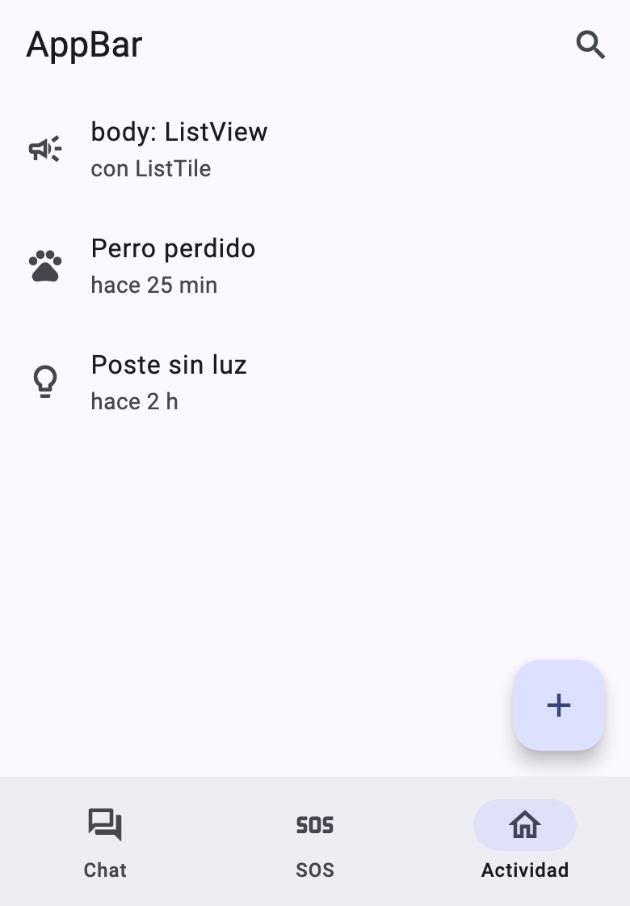{ .captura .ancha }
</figure>

`Scaffold` ("andamio") es el esqueleto de una pantalla Material. Tiene lugares fijos para cada pieza:

```dart
Scaffold(
  appBar: AppBar(  // (1)!
    title: const Text('AppBar'),
    actions: [IconButton(onPressed: () {}, icon: const Icon(Icons.search))],
  ),
  drawer: const MenuLateral(...),  // (2)!
  body: ListView(...),  // (3)!
  floatingActionButton: FloatingActionButton(  // (4)!
    onPressed: () {},
    child: const Icon(Icons.add),
  ),
  bottomNavigationBar: NavigationBar(...),  // (5)!
)
```

1. La barra de arriba: título y acciones a la derecha. Si hay `drawer`, agrega sola el botón ☰; si la pantalla se abrió encima de otra, agrega sola la flecha ← para volver.
2. El menú lateral, que se abre con ☰ o deslizando desde el borde.
3. El contenido. Ocupa todo lo que queda.
4. El botón flotante, abajo a la derecha.
5. La barra de navegación de abajo.

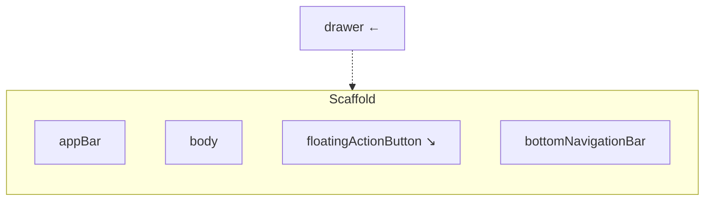

### `AppBar`

```dart
AppBar(
  title: const Text('Mi perfil'),
  actions: [
    IconButton(
      tooltip: 'Cerrar sesión',
      onPressed: _salir,
      icon: const Icon(Icons.logout),
    ),
  ],
)
```

### `Drawer`: el menú lateral

<figure markdown="span">
  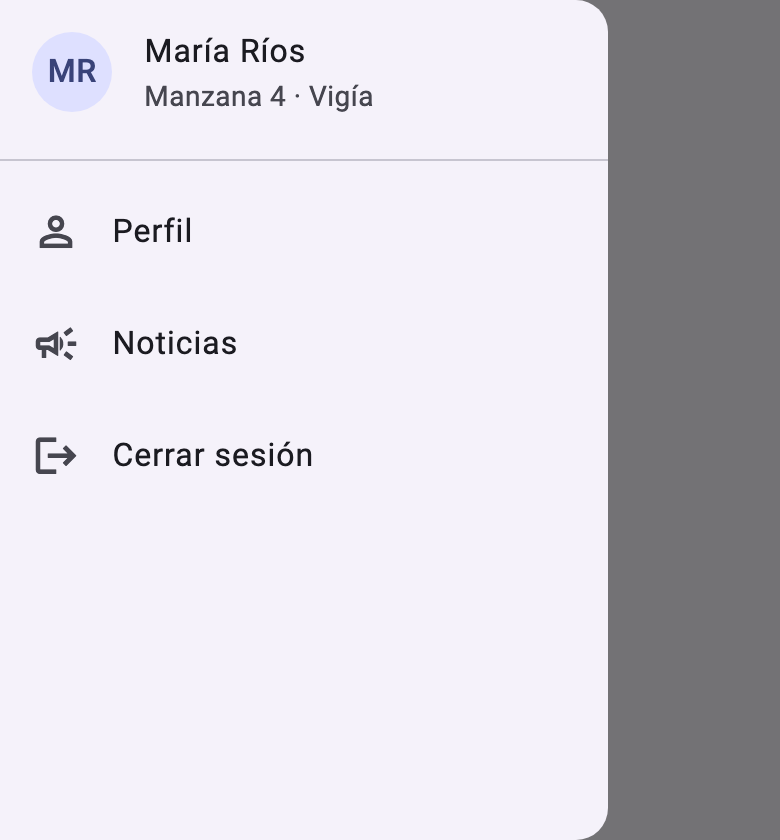{ .captura .ancha }
</figure>

```dart
Drawer(
  child: SafeArea(
    child: Column(
      children: [
        ListTile(
          leading: CircleAvatar(child: Text(vecino.iniciales)),
          title: Text(vecino.nombre),
          subtitle: Text(vecino.descripcion),
        ),
        const Divider(),
        ListTile(
          leading: const Icon(Icons.person_outline),
          title: const Text('Perfil'),
          onTap: onPerfil,
        ),
        // …
      ],
    ),
  ),
)
```

`SafeArea` corre el contenido para que no quede debajo de la barra de estado del celular (la hora, la batería) ni de la "isla" de la cámara.

En VigiaApp es `MenuLateral` ([capítulo 9](../5-construccion/09-menu-y-perfil.md)).

### `NavigationBar` {#navigationbar}

La barra de abajo con destinos. Se le dice cuál está seleccionado y qué hacer al tocar:

```dart
NavigationBar(
  selectedIndex: enChat ? 0 : 2,
  onDestinationSelected: (indice) => switch (indice) {
    0 => onChat(),
    1 => onSos(),
    _ => onActividad(),
  },
  destinations: const [
    NavigationDestination(icon: Icon(Icons.forum_outlined), label: 'Chat'),
    NavigationDestination(icon: Icon(Icons.sos), label: 'SOS'),
    NavigationDestination(icon: Icon(Icons.home_outlined), label: 'Actividad'),
  ],
)
```

`NavigationBar` **no cambia sola** de pestaña: avisa qué tocaron y el padre decide (es un widget sin estado propio, como vimos en [callbacks](2-stateless-y-stateful.md#avisarle-al-padre-callbacks)). En VigiaApp es `BarraInferior` ([capítulo 12](../5-construccion/12-chat.md)), y el SOS del medio no es una pestaña: abre el modo emergencia.

## Botones

<figure markdown="span">
  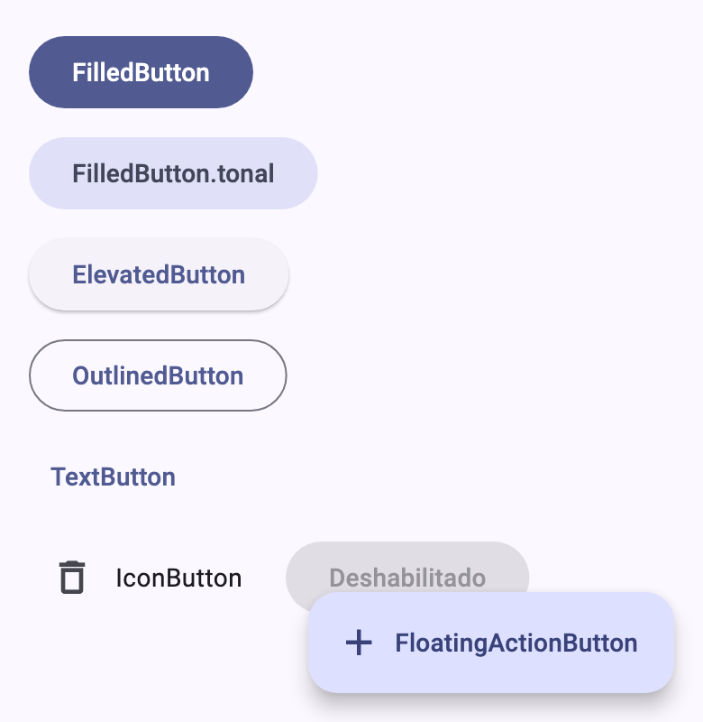{ .captura .ancha }
</figure>

| Botón | Para qué | En VigiaApp |
|---|---|---|
| `FilledButton` | La acción **principal** de la pantalla. Uno solo por pantalla. | "Ingresar", "Publicar", "Guardar" |
| `FilledButton.tonal` | Una acción importante pero secundaria. | |
| `ElevatedButton` | Con sombra; hoy se usa poco. | Recorridos |
| `OutlinedButton` | Acción secundaria al lado de una principal. | "Cancelar alerta", "Agregar foto" |
| `TextButton` | Acciones de poco peso, en diálogos. | "Cancelar", "Reintentar" |
| `IconButton` | Solo un ícono. Ponele `tooltip`. | Enviar mensaje, borrar |
| `FloatingActionButton` | La acción principal de una lista. | "+" en Vecinos, Noticias |

Todos reciben `onPressed` (qué hacer) y `child` (qué mostrar):

```dart
FilledButton(
  onPressed: ocupado ? null : _ingresar,  // (1)!
  child: const Text('Ingresar'),
)

FilledButton.icon(  // (2)!
  onPressed: _publicar,
  icon: const Icon(Icons.send),
  label: const Text('Publicar'),
)
```

1. **Si `onPressed` es `null`, el botón se ve deshabilitado** y no responde. Así se evita el doble toque mientras se espera al servidor: `ocupado` viene del ViewModel ([Parte 4](../4-arquitectura/6-viewmodel-base.md)).
2. La variante `.icon` agrega un ícono a la izquierda del texto.

## Listas: `ListTile` y `Card`

`ListTile` es **la** fila estándar de Material: un ícono o avatar a la izquierda, título, subtítulo y algo a la derecha.

```dart
ListTile(
  leading: const Icon(Icons.email_outlined),  // izquierda
  title: Text(perfil.email),                  // línea principal
  subtitle: const Text('Email'),              // línea secundaria
  trailing: const Icon(Icons.chevron_right),  // derecha
  onTap: () { … },                            // tocable (con efecto de onda)
)
```

Variantes que trae Flutter: `SwitchListTile` (con un interruptor), `CheckboxListTile` (con una casilla), `RadioListTile`. VigiaApp usa `SwitchListTile` para activar o desactivar un vecino y `CheckboxListTile` para elegir vecinos de un rondín ([capítulo 16](../5-construccion/16-comite.md)).

`Card` es una superficie con bordes redondeados y un fondo levemente distinto. Agrupa contenido relacionado:

```dart
Card(
  child: Padding(
    padding: const EdgeInsets.all(16),
    child: Column(crossAxisAlignment: CrossAxisAlignment.start, children: [...]),
  ),
)
```

En VigiaApp: las publicaciones de la actividad, la tarjeta del rondín, el banner de alerta.

### Otros que vas a ver

| Widget | Qué es |
|---|---|
| `CircleAvatar` | Un círculo con iniciales o una foto. |
| `Icon(Icons.x)` | Un ícono de Material. Hay más de 2000: buscá en [fonts.google.com/icons](https://fonts.google.com/icons). Las variantes `_outlined` son de línea. |
| `Divider` | Una línea separadora. |
| `Badge` | Un circulito con un número sobre otro widget (la cantidad de noticias, en el menú). |
| `Dismissible` | Deslizar una fila para borrarla (las publicaciones propias). |
| `CircularProgressIndicator` | La ruedita de "cargando". |

## Chips {#chips}

<figure markdown="span">
  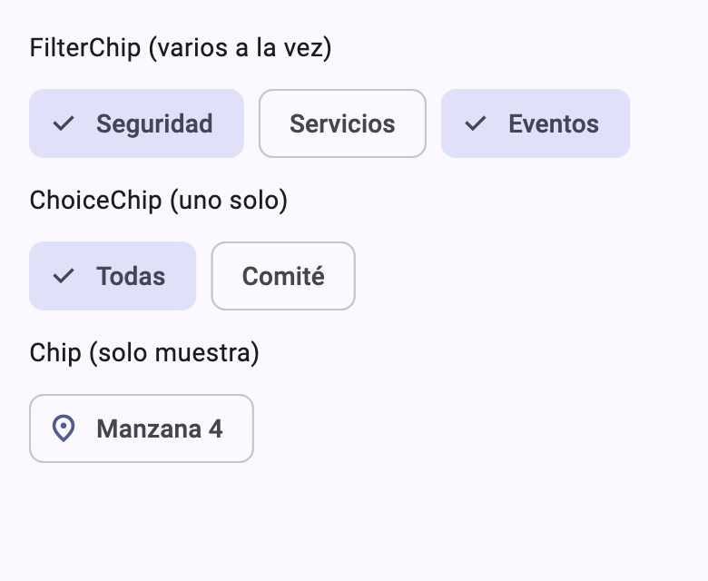{ .captura .ancha }
</figure>

Los **chips** son botones chiquitos, con forma de píldora:

| Chip | Para qué |
|---|---|
| `FilterChip` | Filtros: se pueden tildar y destildar. |
| `ChoiceChip` | Elegir **uno** de varios. |
| `Chip` | Solo mostrar una etiqueta. |
| `ActionChip` | Una acción chiquita. |

```dart
FilterChip(
  label: const Text('Seguridad'),
  selected: viewModel.etiqueta == 'seguridad',
  onSelected: (_) => viewModel.filtrar('seguridad'),
)
```

En VigiaApp, la pantalla de Noticias ([capítulo 11](../5-construccion/11-noticias.md)) tiene una fila de `FilterChip` para filtrar por etiqueta, dentro de un `ListView` horizontal (`scrollDirection: Axis.horizontal`) por si no entran.

## `SegmentedButton` {#segmentedbutton}

<figure markdown="span">
  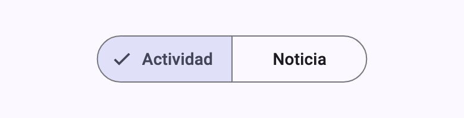{ .captura .ancha }
</figure>

Elegir **una opción** entre pocas (2 a 5), todas a la vista:

```dart title="lib/ui/publicacion/widgets/nueva_publicacion_screen.dart (fragmento)"
SegmentedButton<String>(
  segments: const [
    ButtonSegment(value: TipoPublicacion.actividad, label: Text('Actividad')),
    ButtonSegment(value: TipoPublicacion.noticia, label: Text('Noticia')),
  ],
  selected: {_viewModel.tipo},  // (1)!
  onSelectionChanged: (valor) => _viewModel.elegirTipo(valor.first),  // (2)!
)
```

1. `selected` es un **`Set`**, porque `SegmentedButton` también permite elegir varias (con `multiSelectionEnabled: true`). Para una sola, un `Set` de un elemento.
2. Devuelve el `Set` nuevo; con `.first` sacamos el único elegido.

Lo usa la pantalla de nueva publicación ([capítulo 10](../5-construccion/10-publicaciones-y-fotos.md)): un vecino del comité elige si publica actividad o una noticia.

## Avisos que aparecen encima

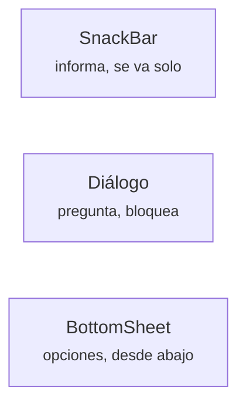

### SnackBar {#snackbar}

<figure markdown="span">
  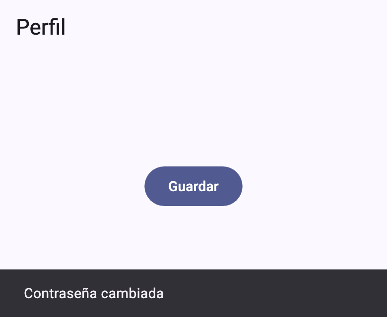{ .captura .ancha }
</figure>

Un mensaje corto abajo, que **se va solo** a los pocos segundos. Para confirmar algo o informar un error que no bloquea.

```dart title="lib/ui/core/widgets/avisos.dart (fragmento)"
void mostrarAviso(BuildContext context, String texto) {
  ScaffoldMessenger.of(context).showSnackBar(SnackBar(content: Text(texto)));
}
```

`ScaffoldMessenger` es quien administra los SnackBars de la app (lo pone `MaterialApp`). Se busca con [`.of(context)`](1-todo-es-un-widget.md#buildcontext-donde-estoy-en-el-arbol). Ventaja: el SnackBar **sobrevive** si cambiás de pantalla (por ejemplo, "Publicación borrada" se sigue viendo después de volver al Inicio).

### Diálogos

<figure markdown="span">
  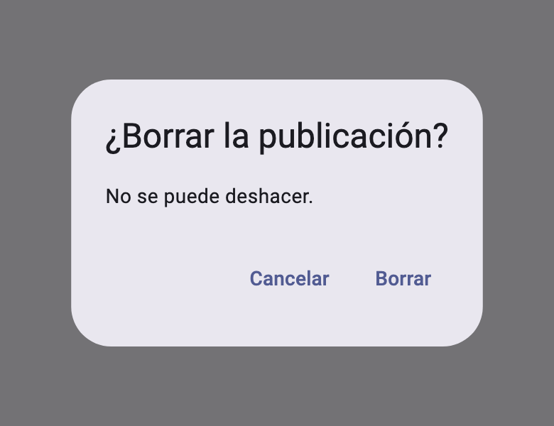{ .captura .ancha }
</figure>

Un **diálogo** aparece en el medio y **bloquea** la pantalla hasta que se responde. Para preguntar algo o pedir un dato corto.

```dart title="lib/ui/core/widgets/avisos.dart (resumido)"
Future<bool> confirmar(
  BuildContext context, {
  required String titulo,
  required String mensaje,
  String confirmar = 'Borrar',
  String cancelar = 'Cancelar',
}) async {
  final respuesta = await showDialog<bool>(  // (1)!
    context: context,
    builder: (context) => AlertDialog(  // (2)!
      title: Text(titulo),
      content: Text(mensaje),
      actions: [
        TextButton(
          onPressed: () => Navigator.pop(context, false),  // (3)!
          child: Text(cancelar),
        ),
        FilledButton(
          onPressed: () => Navigator.pop(context, true),
          child: Text(confirmar),
        ),
      ],
    ),
  );
  return respuesta == true;  // (4)!
}
```

1. `showDialog<bool>` muestra el diálogo y devuelve un `Future<bool?>`: lo que el diálogo **devuelva al cerrarse**.
2. `AlertDialog`: título, contenido y botones abajo.
3. Cerrar el diálogo **con un valor**. Un diálogo es una "pantalla" más en la pila de navegación, por eso se cierra con `Navigator.pop` ([Navegación](6-navegacion.md)).
4. Si se cierra tocando afuera, devuelve `null`. Con `== true`, tanto `false` como `null` cuentan como "no".

Y se usa así:

```dart
if (await confirmar(context, titulo: '¿Borrar la publicación?', mensaje: 'No se puede deshacer.')) {
  await _viewModel.borrar();
}
```

!!! tip "Un diálogo con estado propio"
    Si el diálogo tiene un formulario (cambiar la contraseña), hacelo un `StatefulWidget` aparte (`CambiarClaveDialog`, [capítulo 9](../5-construccion/09-menu-y-perfil.md)) que devuelva un `AlertDialog` en su `build`.

### BottomSheet {#bottomsheet}

<figure markdown="span">
  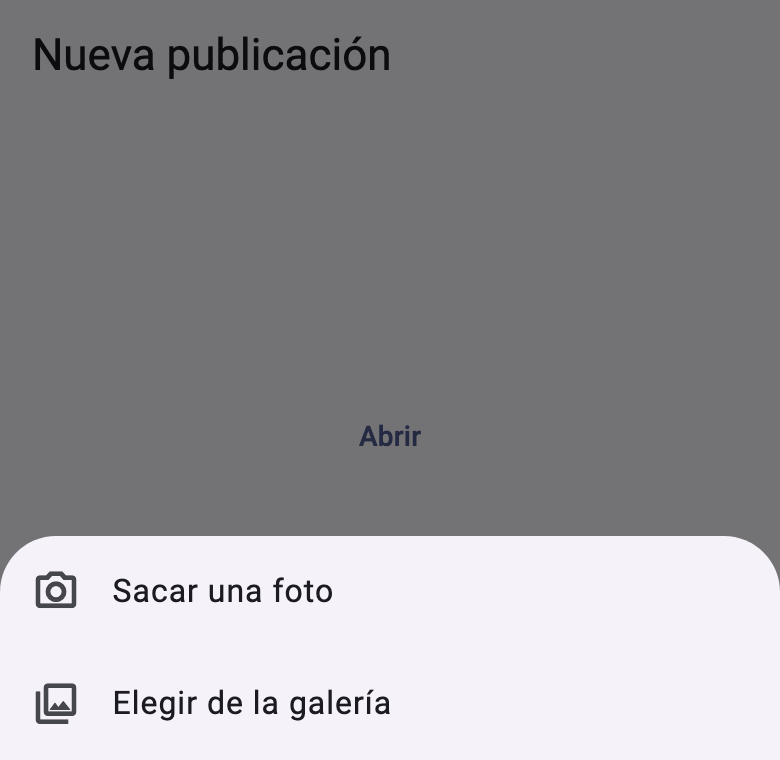{ .captura .ancha }
</figure>

Una **hoja** que sube desde abajo. Para elegir entre opciones o mostrar un panel de edición sin cambiar de pantalla.

```dart title="lib/ui/core/widgets/elegir_origen_foto.dart (resumido)"
Future<OrigenFoto?> elegirOrigenFoto(BuildContext context) {
  return showModalBottomSheet<OrigenFoto>(
    context: context,
    builder: (context) => SafeArea(
      child: Column(
        mainAxisSize: MainAxisSize.min,  // (1)!
        children: [
          ListTile(
            leading: const Icon(Icons.photo_camera_outlined),
            title: const Text('Sacar una foto'),
            onTap: () => Navigator.pop(context, OrigenFoto.camara),
          ),
          ListTile(
            leading: const Icon(Icons.photo_library_outlined),
            title: const Text('Elegir de la galería'),
            onTap: () => Navigator.pop(context, OrigenFoto.galeria),
          ),
        ],
      ),
    ),
  );
}
```

1. `MainAxisSize.min`: la hoja mide lo justo, no toda la pantalla ([Layout](3-layout.md#mainaxissize-ocupar-todo-o-lo-justo)).

Igual que `showDialog`, devuelve un `Future` con lo que se pasó a `Navigator.pop`. En VigiaApp: elegir el origen de una foto ([cap. 10](../5-construccion/10-publicaciones-y-fotos.md)), editar un vecino y asignar vecinos a un turno ([cap. 16](../5-construccion/16-comite.md)).

Con `isScrollControlled: true` la hoja puede ocupar casi toda la pantalla (necesario si tiene un formulario y aparece el teclado).

### Elegir una fecha

```dart
final fecha = await showDatePicker(
  context: context,
  firstDate: DateTime.now(),
  lastDate: DateTime.now().add(const Duration(days: 60)),
);
if (fecha != null) { … }
```

Muestra un calendario de Material. Lo usa el diálogo de nuevo turno de rondín ([cap. 16](../5-construccion/16-comite.md)).

## Estados de carga

<figure markdown="span">
  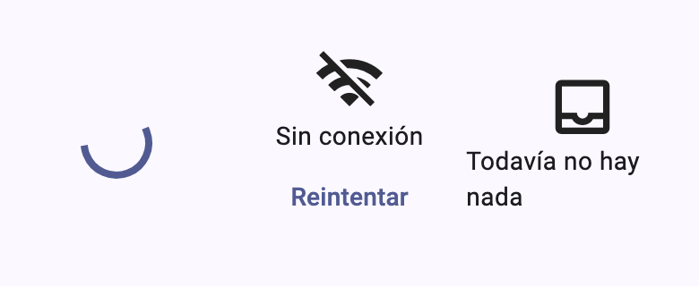{ .captura .ancha }
</figure>

Toda pantalla que trae datos tiene, además del contenido, tres estados: **cargando**, **error** y **vacío**. En VigiaApp están en `estados_carga.dart` ([capítulo 6](../5-construccion/06-login.md)) para no repetirlos: `Cargando()`, `ErrorConReintento(...)`, `TextoError(...)`.

```dart
if (_viewModel.fallo) {
  return ErrorConReintento(mensaje: 'No se pudo cargar tu perfil', onReintentar: _viewModel.cargar);
}
if (perfil == null) return const Cargando();
return ListView(...);
```

## Ejercicio

??? question "Una pantalla completa"
    Armá una pantalla con `AppBar` "Vecinos", un `ListView` con tres `ListTile` (avatar con iniciales, nombre y manzana), un `FloatingActionButton` "+" que muestre un SnackBar "Próximamente", y que al tocar una fila pregunte con un diálogo "¿Llamar a …?".

    ??? success "Una respuesta"
        ```dart
        class Vecinos extends StatelessWidget {
          const Vecinos({super.key});

          static const _vecinos = [('María Ríos', 4), ('Jorge López', 2), ('Laura Gómez', 1)];

          @override
          Widget build(BuildContext context) {
            return Scaffold(
              appBar: AppBar(title: const Text('Vecinos')),
              body: ListView(
                children: [
                  for (final (nombre, manzana) in _vecinos)
                    ListTile(
                      leading: CircleAvatar(child: Text(nombre[0])),
                      title: Text(nombre),
                      subtitle: Text('Manzana $manzana'),
                      onTap: () => showDialog<void>(
                        context: context,
                        builder: (context) => AlertDialog(
                          title: Text('¿Llamar a $nombre?'),
                          actions: [
                            TextButton(
                              onPressed: () => Navigator.pop(context),
                              child: const Text('Cerrar'),
                            ),
                          ],
                        ),
                      ),
                    ),
                ],
              ),
              floatingActionButton: FloatingActionButton(
                onPressed: () => ScaffoldMessenger.of(context)
                    .showSnackBar(const SnackBar(content: Text('Próximamente'))),
                child: const Icon(Icons.add),
              ),
            );
          }
        }
        ```

## Lo que aprendiste

- [x] **`Scaffold`** con `appBar`, `drawer`, `body`, `floatingActionButton` y `bottomNavigationBar`.
- [x] Botones: **`FilledButton`** para lo principal; `onPressed: null` lo deshabilita.
- [x] **`ListTile`** y **`Card`** para listas; chips y `SegmentedButton` para elegir.
- [x] **SnackBar** informa; **diálogo** pregunta; **BottomSheet** ofrece opciones. Los dos últimos devuelven un valor con `Navigator.pop(context, valor)`.

[Siguiente: Formularios :material-arrow-right:](5-formularios.md){ .md-button .md-button--primary }
