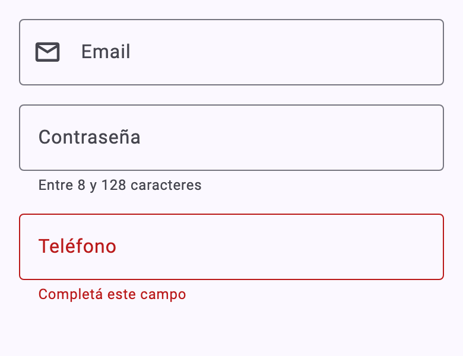
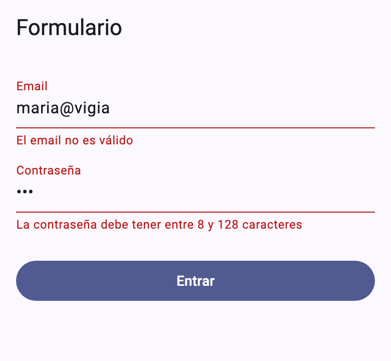
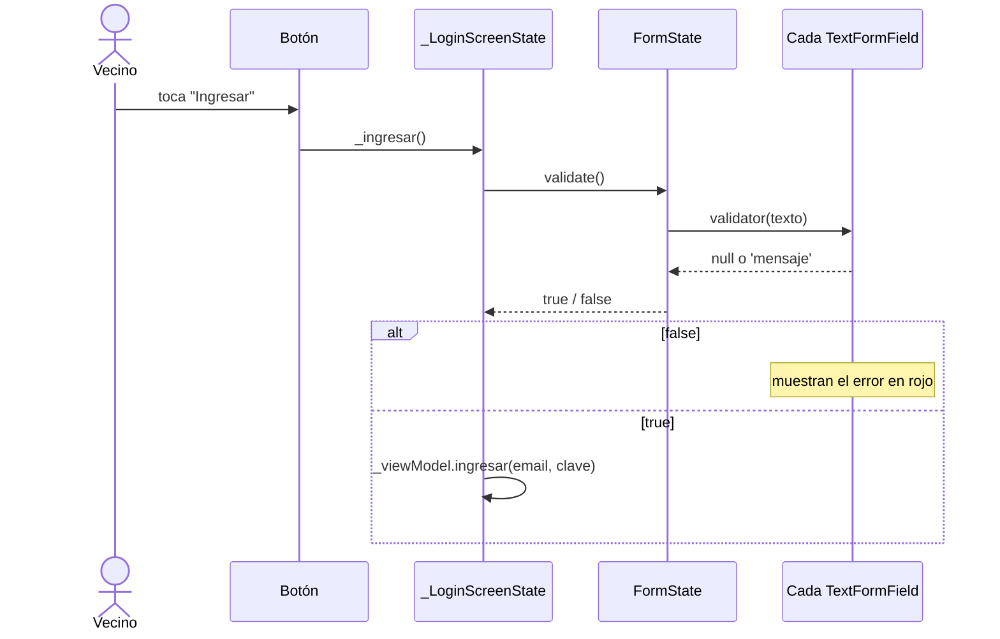
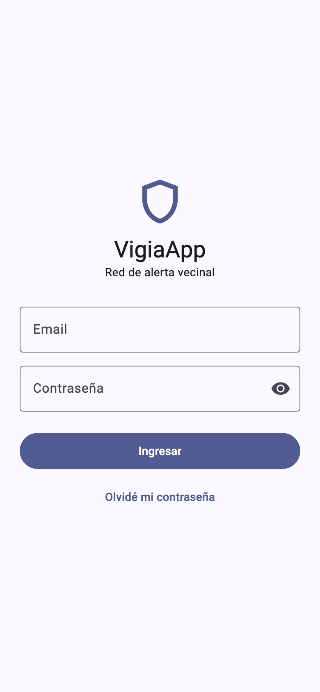
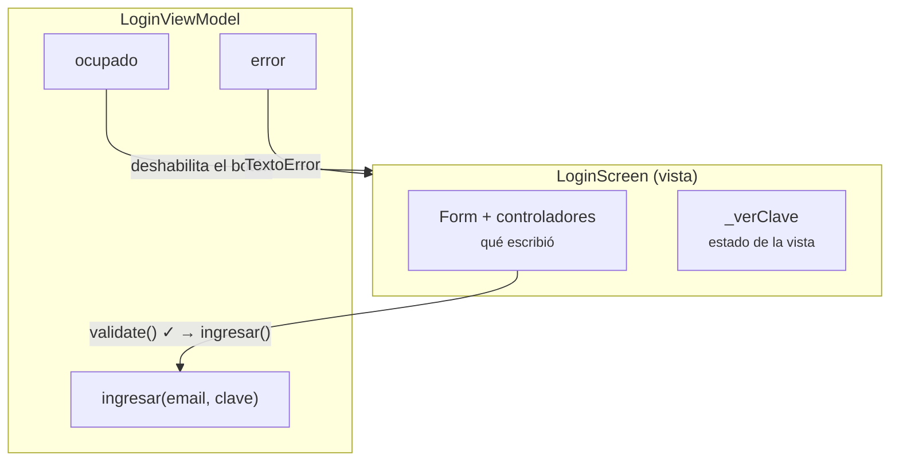

# Formularios

!!! abstract "Objetivo"
    Pedirle datos al vecino: campos de texto (`TextField`, `TextFormField`), **controladores** para leer y escribir lo que hay adentro, el widget **`Form`** para validar todo junto, **validadores**, y los detalles que hacen un formulario cómodo en el celular (teclado, autocompletar, mostrar la contraseña). Al final vas a entender la pantalla de Login completa.

## Un campo de texto

<figure markdown="span">
  { .captura .ancha }
</figure>

```dart
const TextField(
  decoration: InputDecoration(
    labelText: 'Email',                  // el título, que sube al escribir
    prefixIcon: Icon(Icons.mail_outline),// un ícono adentro, a la izquierda
    helperText: 'El que te registró el comité', // ayuda debajo
    errorText: null,                     // si no es null, se pone rojo
    border: OutlineInputBorder(),        // el borde de caja
  ),
)
```

Todo lo visual va en `InputDecoration`. Las opciones más usadas:

| Parámetro | Qué hace |
|---|---|
| `labelText` | El nombre del campo. Sube cuando tiene foco o texto. |
| `hintText` | Un ejemplo gris, solo cuando está vacío. |
| `helperText` | Una ayuda debajo. |
| `errorText` | Un error debajo, en rojo (reemplaza al helper). |
| `prefixIcon` / `suffixIcon` | Íconos a la izquierda / derecha. `suffixIcon` puede ser un botón. |
| `border` | `OutlineInputBorder()` (caja) o, por defecto, una línea abajo. |

## Leer lo que se escribió: `TextEditingController`

Un **controlador** es un objeto que **tiene** el texto del campo. Con él se lee, se escribe y se escucha.

```dart
class _LoginScreenState extends State<LoginScreen> {
  final _email = TextEditingController();  // (1)!

  @override
  void dispose() {
    _email.dispose();  // (2)!
    super.dispose();
  }

  void _ingresar() {
    print(_email.text);  // (3)!
  }

  @override
  Widget build(BuildContext context) {
    return TextField(controller: _email);  // (4)!
  }
}
```

1. Se crea **una vez**, como campo del `State` (no adentro de `build`: ahí se crearía uno nuevo en cada redibujo y se perdería el texto).
2. Se **descarta** en `dispose`. Es otro "todo lo que abrís, lo cerrás".
3. `.text` es lo que hay escrito ahora.
4. Se conecta al campo.

Otras cosas que se hacen con el controlador:

```dart
_email.text = 'maria@vigia.test';  // escribir (por ejemplo, un valor inicial)
_email.clear();                    // vaciar (después de mandar un mensaje)
```

!!! question "¿Controlador u `onChanged`?"
    `TextField(onChanged: (texto) => …)` avisa en cada tecla. Sirve si querés reaccionar mientras se escribe (habilitar un botón cuando hay texto). El controlador sirve para **leer al final** y para **escribir** desde el código. En VigiaApp se usan controladores en casi todos los formularios.

## Validar: `Form` y `TextFormField`

Para validar varios campos juntos se usa:

- **`Form`**: un widget que agrupa campos.
- **`TextFormField`**: un `TextField` que sabe validarse.
- Un **`GlobalKey<FormState>`**: una "llave" para hablarle al `Form` desde el código.

<figure markdown="span">
  { .captura .ancha }
  <figcaption>Después de tocar el botón con datos inválidos.</figcaption>
</figure>

```dart linenums="1"
class _FormularioState extends State<Formulario> {
  final _form = GlobalKey<FormState>();  // (1)!
  final _email = TextEditingController();

  void _enviar() {
    if (!_form.currentState!.validate()) return;  // (2)!
    print('Todo bien: ${_email.text}');
  }

  @override
  Widget build(BuildContext context) {
    return Form(
      key: _form,  // (3)!
      child: Column(
        children: [
          TextFormField(
            controller: _email,
            decoration: const InputDecoration(labelText: 'Email'),
            validator: validarEmail,  // (4)!
          ),
          FilledButton(onPressed: _enviar, child: const Text('Entrar')),
        ],
      ),
    );
  }
}
```

1. La llave del formulario.
2. `validate()` corre el validador de **cada** campo del `Form`, muestra los errores y devuelve `true` si todos pasaron. Si alguno falla, no seguimos.
3. Se le pone la llave al `Form`.
4. El validador: una función que recibe el texto y devuelve **`null` si está bien**, o **el mensaje de error** si no.

### Los validadores

Un validador es una función `String? Function(String?)` ([funciones como valores](../2-dart/3-funciones.md#el-tipo-de-una-funcion)). VigiaApp los tiene juntos en `lib/utils/validadores.dart` ([capítulo 2](../5-construccion/02-utilidades.md)):

```dart
String? validarEmail(String? valor) {
  final email = (valor ?? '').trim();
  if (email.isEmpty) return 'Ingresá tu email';
  if (!_formatoEmail.hasMatch(email)) return 'El email no es válido';
  return null;
}

String? validarRequerido(String? valor) =>
    (valor ?? '').trim().isEmpty ? 'Completá este campo' : null;
```

Como son funciones sueltas, se pasan sin paréntesis (`validator: validarEmail`) y se prueban fácil, sin pantallas:

```dart
test('email sin punto', () {
  expect(validarEmail('maria@vigia'), 'El email no es válido');
});
```

Para una regla única de un campo, una función anónima alcanza:

```dart
validator: (valor) => (valor ?? '').isEmpty ? 'Ingresá tu contraseña' : null,
```



!!! info "Validar en la app no reemplaza al servidor"
    La validación del formulario es **para la comodidad** del vecino: le avisa al toque si se olvidó la arroba. Pero el servidor **vuelve a validar todo**, porque alguien podría mandarle pedidos sin usar la app. Por eso el comentario de `validadores.dart` dice "esto solo evita viajes inútiles".

### ¿Cuándo se valida?

Por defecto, solo cuando llamás a `validate()`. Con `autovalidateMode` se puede cambiar:

| `autovalidateMode:` | Cuándo valida |
|---|---|
| `disabled` (por defecto) | Solo con `validate()`. |
| `onUserInteraction` | Después de que el usuario tocó el campo, en cada cambio. |
| `onUnfocus` | Cuando el campo pierde el foco. |
| `always` | Siempre (muestra errores antes de escribir: molesta). |

## Detalles que importan en el celular

### El teclado

```dart
TextFormField(
  keyboardType: TextInputType.emailAddress,  // (1)!
  textInputAction: TextInputAction.next,      // (2)!
  autofillHints: const [AutofillHints.email], // (3)!
)
```

1. Qué teclado mostrar: con `@` a mano para emails, numérico para teléfonos (`TextInputType.phone`), multilínea para textos largos (`TextInputType.multiline`).
2. Qué dice la tecla Enter: **Siguiente** (pasa al próximo campo) o **Listo** (`TextInputAction.done`).
3. Le dice al sistema qué es, para que ofrezca **autocompletar** (el email guardado, la contraseña del gestor de contraseñas). Los campos tienen que estar dentro de un `AutofillGroup`.

### Mostrar u ocultar la contraseña

```dart
bool _verClave = false;  // estado de la vista

TextFormField(
  controller: _password,
  obscureText: !_verClave,  // puntitos en vez de letras
  decoration: InputDecoration(
    labelText: 'Contraseña',
    suffixIcon: IconButton(
      icon: Icon(_verClave ? Icons.visibility_off : Icons.visibility),
      tooltip: _verClave ? 'Ocultar' : 'Mostrar',
      onPressed: () => setState(() => _verClave = !_verClave),
    ),
  ),
)
```

!!! question "¿Por qué `_verClave` está en el `State` y no en el ViewModel?"
    Porque es **estado de la vista**: solo afecta cómo se ve, no le importa a nadie más, y no hay que probarlo. El comentario de la app lo dice: "estado efímero de la vista: no va al ViewModel". En la [Parte 4](../4-arquitectura/2-mvvm-y-capas.md) vemos qué va en cada lado.

### El teclado tapa el formulario

Cuando aparece el teclado, la pantalla se achica. Si el formulario es una `Column`, puede no entrar ([overflow](3-layout.md#el-error-mas-famoso)). Por eso el Login pone todo adentro de un `SingleChildScrollView`: si no entra, se desplaza.

## Todo junto: el Login de VigiaApp

<figure markdown="span">
  { .captura }
</figure>

Esta es la estructura del `build` de `LoginScreen` ([capítulo 6](../5-construccion/06-login.md)), resumida:

```dart title="lib/ui/login/widgets/login_screen.dart (resumido)"
Scaffold(
  body: SafeArea(
    child: Center(
      child: SingleChildScrollView(  // (1)!
        padding: const EdgeInsets.all(24),
        child: Form(
          key: _form,
          child: AutofillGroup(  // (2)!
            child: ListenableBuilder(  // (3)!
              listenable: _viewModel,
              builder: (context, _) {
                final ocupado = _viewModel.ocupado;
                return Column(
                  crossAxisAlignment: CrossAxisAlignment.stretch,  // (4)!
                  children: [
                    // ícono, título…
                    TextFormField(controller: _email, validator: validarEmail, ...),
                    TextFormField(controller: _password, obscureText: !_verClave, ...),
                    if (_viewModel.error case final error?) TextoError(error),  // (5)!
                    FilledButton(
                      onPressed: ocupado ? null : _ingresar,  // (6)!
                      child: ocupado
                          ? const CircularProgressIndicator(strokeWidth: 2)
                          : const Text('Ingresar'),
                    ),
                    TextButton(onPressed: ..., child: const Text('Olvidé mi contraseña')),
                    TextButton(onPressed: ..., child: const Text('Tengo una invitación')),
                  ],
                );
              },
            ),
          ),
        ),
      ),
    ),
  ),
)
```

1. Desplazable, por el teclado.
2. Para que el sistema ofrezca autocompletar email y contraseña.
3. Escucha al ViewModel: cuando cambia `ocupado` o `error`, se redibuja ([Estado compartido](7-estado-compartido.md#listenablebuilder)).
4. `stretch`: los campos y botones ocupan todo el ancho.
5. El error **del servidor** ("Email o contraseña incorrectos.") va debajo de los campos. Los errores **de formato** los muestra cada campo.
6. Deshabilitado mientras se espera; adentro, la ruedita en vez del texto.



Leelo con calma en el [capítulo 6](../5-construccion/06-login.md), con todas las notas.

## Otros controles de formulario

| Widget | Para qué | En VigiaApp |
|---|---|---|
| `DropdownButtonFormField` | Elegir de una lista desplegable. | `SelectorRol` (vecino/vigía/comité), elegir manzana |
| `SwitchListTile` | Sí/no. | Activar un vecino |
| `CheckboxListTile` | Tildar varios. | Elegir vecinos de un rondín |
| `SegmentedButton` | Una opción de pocas, a la vista. | Tipo de publicación |

```dart title="lib/ui/comite/widgets/selector_rol.dart (fragmento)"
DropdownButtonFormField<String>(
  initialValue: rol,
  decoration: const InputDecoration(labelText: 'Rol'),
  items: [
    for (final MapEntry(:key, :value) in roles.entries)  // (1)!
      DropdownMenuItem(value: key, child: Text(value)),
  ],
  onChanged: (valor) => onChanged(valor!),
)
```

1. Un *collection for* con un patrón que saca `key` y `value` de cada entrada del mapa `roles` ([patrones](../2-dart/7-enums-records-patrones.md#patrones)).

## Ejercicio

??? question "Formulario de alta"
    Hacé un formulario con nombre (requerido), email (validado) y teléfono (opcional, teclado numérico). Al tocar "Guardar", si es válido, mostrá un SnackBar con los datos.

    ??? success "Una respuesta"
        ```dart
        class _AltaState extends State<Alta> {
          final _form = GlobalKey<FormState>();
          final _nombre = TextEditingController();
          final _email = TextEditingController();
          final _telefono = TextEditingController();

          @override
          void dispose() {
            _nombre.dispose();
            _email.dispose();
            _telefono.dispose();
            super.dispose();
          }

          void _guardar() {
            if (!_form.currentState!.validate()) return;
            ScaffoldMessenger.of(context).showSnackBar(SnackBar(
              content: Text('${_nombre.text} · ${_email.text} · ${_telefono.text}'),
            ));
          }

          @override
          Widget build(BuildContext context) {
            return Form(
              key: _form,
              child: ListView(
                padding: const EdgeInsets.all(16),
                children: [
                  TextFormField(
                    controller: _nombre,
                    decoration: const InputDecoration(labelText: 'Nombre'),
                    validator: validarRequerido,
                  ),
                  TextFormField(
                    controller: _email,
                    decoration: const InputDecoration(labelText: 'Email'),
                    keyboardType: TextInputType.emailAddress,
                    validator: validarEmail,
                  ),
                  TextFormField(
                    controller: _telefono,
                    decoration: const InputDecoration(labelText: 'Teléfono (opcional)'),
                    keyboardType: TextInputType.phone,
                  ),
                  const SizedBox(height: 16),
                  FilledButton(onPressed: _guardar, child: const Text('Guardar')),
                ],
              ),
            );
          }
        }
        ```

        Es casi la `AltaVecinoScreen` del [capítulo 16](../5-construccion/16-comite.md).

## Lo que aprendiste

- [x] `TextField` / `TextFormField` con `InputDecoration` para el aspecto.
- [x] Un **`TextEditingController`** por campo: se crea en el `State` y se descarta en `dispose`.
- [x] **`Form`** + `GlobalKey<FormState>` + **`validate()`** valida todos los campos.
- [x] Un **validador** devuelve `null` (bien) o el mensaje de error.
- [x] Teclado, `textInputAction`, autocompletar y `SingleChildScrollView` hacen el formulario cómodo.

[Siguiente: Navegación :material-arrow-right:](6-navegacion.md){ .md-button .md-button--primary }
