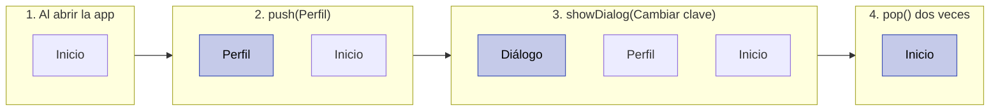
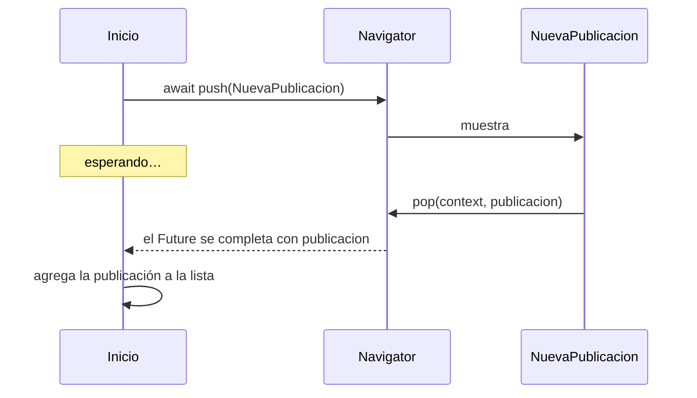
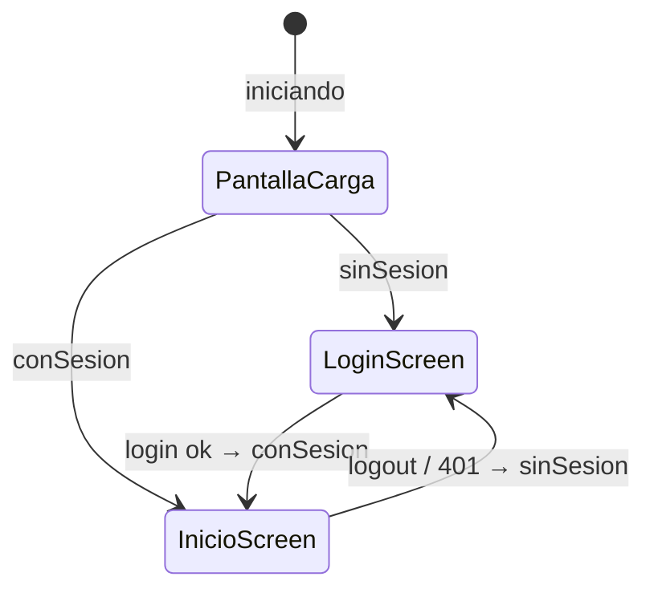
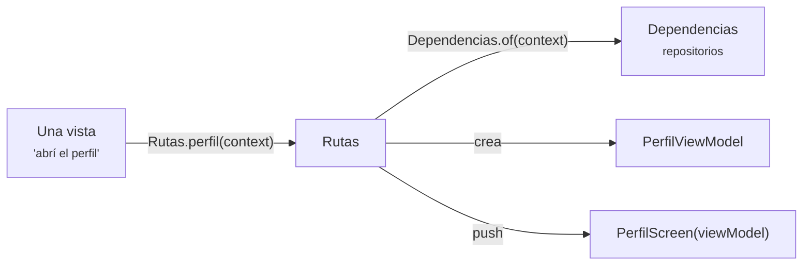

# Navegación

!!! abstract "Objetivo"
    Abrir pantallas y volver, **pasar datos** a la pantalla que se abre y **recibir un resultado** cuando se cierra, entender la **pila** del `Navigator`, y ver cómo VigiaApp junta toda la navegación en una sola clase, `Rutas`.

## La pila de pantallas

El **`Navigator`** guarda las pantallas abiertas como una **pila** de platos: la de arriba es la que se ve. Abrir una pantalla es **apilar** (`push`); volver es **desapilar** (`pop`).



Lo importante:

- La pantalla de abajo **sigue viva** (su `State` no se descarta) mientras hay otra encima.
- Los **diálogos** y las **hojas de abajo** también son "pantallas" en la pila. Por eso se cierran con `Navigator.pop`.
- La flecha ← de la `AppBar` y el botón "atrás" de Android hacen `pop`.

## Abrir y volver

```dart
// Abrir
Navigator.push(
  context,
  MaterialPageRoute(builder: (context) => const PerfilScreen()),
);

// Volver (desde adentro de PerfilScreen)
Navigator.pop(context);
```

`MaterialPageRoute` es la **ruta** estándar de Material: la pantalla nueva entra con la animación propia de cada sistema (en iOS desliza desde la derecha; en Android, la de Android). `builder` es una función que construye la pantalla.

!!! info "`Navigator.push` o `Navigator.of(context).push`"
    Son lo mismo: `Navigator.push(context, …)` es un atajo de `Navigator.of(context).push(…)`. Busca el `Navigator` más cercano hacia arriba ([BuildContext](1-todo-es-un-widget.md#buildcontext-donde-estoy-en-el-arbol)).

## Pasar datos a la pantalla nueva

Por el **constructor**, como a cualquier widget:

```dart
Navigator.push(
  context,
  MaterialPageRoute(
    builder: (context) => PublicacionScreen(publicacionId: 42),
  ),
);
```

No hay nada especial: la pantalla es un widget y recibe lo que necesite.

## Recibir un resultado

`push` devuelve un **`Future`** que se completa **cuando la pantalla se cierra**, con el valor que se le pasó a `pop`:

```dart
// Pantalla A: abre y espera
final creada = await Navigator.push<Publicacion>(
  context,
  MaterialPageRoute(builder: (context) => const NuevaPublicacionScreen()),
);
if (creada != null) {
  // el vecino publicó: actualizo la lista
}

// Pantalla B: cierra devolviendo algo
Navigator.pop(context, publicacionNueva);
```



El tipo entre `< >` (`push<Publicacion>`) dice qué devuelve. Si se cierra con la flecha ← o con "atrás", devuelve **`null`**: por eso siempre es nullable.

Es exactamente lo que hacen `showDialog` y `showModalBottomSheet` de la [página anterior](4-material.md#dialogos): son `push` de una ruta especial.

## Otras operaciones

| Operación | Qué hace | Cuándo |
|---|---|---|
| `push` | Apila una pantalla. | Lo normal. |
| `pop` | Saca la de arriba. | Volver. |
| `maybePop` | Saca la de arriba solo si hay otra debajo. | Un "volver" que no cierre la app. |
| `pushReplacement` | Reemplaza la de arriba por otra. | Después de un paso que no tiene sentido "volver" (un asistente). |
| `popUntil(condición)` | Saca pantallas hasta que se cumpla la condición. | Volver al principio. |
| `canPop()` | ¿Hay algo para sacar? | |

### `popUntil` en VigiaApp

Si la sesión se cierra (el vecino tocó "Cerrar sesión" o el token venció) mientras hay pantallas abiertas encima del Inicio, `main.dart` las cierra todas ([capítulo 7](../5-construccion/07-dependencias-y-rutas.md)):

```dart
_navegador.currentState?.popUntil((ruta) => ruta.isFirst);
```

"Sacá pantallas hasta que la de arriba sea la primera". Debajo, la raíz ya cambió sola al Login (ver abajo).

## La pantalla raíz cambia sola

En VigiaApp, **el Login y el Inicio no se navegan con `push`**. La pantalla raíz (`home` de `MaterialApp`) **depende del estado de la sesión**:

```dart title="lib/main.dart (fragmento)"
home: ListenableBuilder(
  listenable: _sesion,
  builder: (context, _) => switch (_sesion.estado) {
    EstadoSesion.iniciando => const PantallaCarga(),
    EstadoSesion.sinSesion => LoginScreen(viewModel: LoginViewModel(_sesion)),
    EstadoSesion.conSesion => InicioScreen(viewModel: _crearInicio()),
  },
),
```

Cuando el login sale bien, el Login **no** navega al Inicio: el repositorio de sesión cambia su estado y avisa, y la raíz se redibuja con el Inicio.



¿Por qué así? Porque hay **varias** formas de llegar a "con sesión" (login, elegir clave desde el correo, abrir la app con un token guardado) y de salir (logout, token vencido). Si cada una navegara a mano, sería fácil olvidarse un caso y dejar al vecino en una pantalla equivocada. Así hay **una sola** regla, en un solo lugar. Lo vemos en detalle en el [capítulo 5](../5-construccion/05-sesion.md).

## `Rutas`: toda la navegación en un lugar

En VigiaApp, las pantallas **no** escriben `Navigator.push` ni crean las pantallas que abren. Llaman a un método de la clase **`Rutas`** ([capítulo 7](../5-construccion/07-dependencias-y-rutas.md)):

```dart
// En el menú del Inicio:
onPerfil: () => Rutas.perfil(context),

// En una publicación de la lista:
onTap: () => Rutas.publicacion(context, publicacion.id),

// Esperando un resultado:
final nueva = await Rutas.nuevaPublicacion(context);
```

Y `Rutas` hace el trabajo:

```dart title="lib/routing/rutas.dart (fragmento)"
abstract final class Rutas {
  static Future<T?> _abrir<T>(BuildContext context, Widget pantalla) {  // (1)!
    return Navigator.push<T>(
      context,
      MaterialPageRoute(builder: (context) => pantalla),
    );
  }

  static Future<void> perfil(BuildContext context) {
    final viewModel = PerfilViewModel(Dependencias.of(context).sesion);  // (2)!
    return _abrir(context, PerfilScreen(viewModel: viewModel));  // (3)!
  }

  /// Devuelve la publicación creada (null si no publicó).
  static Future<Publicacion?> nuevaPublicacion(BuildContext context, {...}) {
    final d = Dependencias.of(context);
    final viewModel = NuevaPublicacionViewModel(
      publicaciones: d.publicaciones,
      fotos: d.fotos,
      vecino: d.sesion.vecino!,
      tipo: tipo,
    );
    return _abrir(context, NuevaPublicacionScreen(viewModel: viewModel));
  }
}
```

1. Un ayudante privado y genérico: el `push` con `MaterialPageRoute`, escrito una vez.
2. Arma el **ViewModel** de la pantalla, con los repositorios que saca de `Dependencias` ([Estado compartido](7-estado-compartido.md#inheritedwidget)).
3. Crea la pantalla con su ViewModel y la abre.



Ventajas:

- Las vistas **no conocen a los repositorios**: solo dicen "abrí tal cosa". Ver [Inyección de dependencias](../4-arquitectura/5-inyeccion-de-dependencias.md).
- Para saber **qué pantallas existen y qué necesitan**, se mira un solo archivo.
- Un cambio en cómo se crea una pantalla se hace en un lugar.

!!! warning "El ViewModel se crea afuera del `builder`"
    Fijate que `viewModel` se crea **antes** de `_abrir`, no adentro del `builder:` de `MaterialPageRoute`. El `builder` de una ruta **puede ejecutarse más de una vez**, y crearía otro ViewModel cada vez (perdiendo el estado). El comentario al principio de `rutas.dart` lo explica.

## Navegar desde afuera de una pantalla

A veces hay que navegar desde un lugar que **no tiene `context`** de una pantalla: por ejemplo, cuando llega un enlace del correo. Para eso se le da una **llave** al `Navigator`:

```dart title="lib/main.dart (fragmento)"
final _navegador = GlobalKey<NavigatorState>();

MaterialApp(
  navigatorKey: _navegador,
  ...
)

void _abrirEnlace(Uri enlace) {
  final contexto = _navegador.currentContext;
  if (contexto == null) return;
  Rutas.elegirClave(contexto, token: tokenDelEnlace(enlace.toString()));
}
```

Una `GlobalKey` es una llave única que permite encontrar un widget (y su `State`) desde cualquier lado. Ya la viste con `Form` ([Formularios](5-formularios.md#validar-form-y-textformfield)).

## ¿Y las rutas con nombre o `go_router`?

Flutter también permite rutas con nombre (`Navigator.pushNamed(context, '/perfil')`) y hay paquetes como **`go_router`** que manejan URLs, enlaces profundos y navegación anidada. Son útiles en apps grandes o en la web. VigiaApp no los necesita: con `push`, `pop` y una clase `Rutas` alcanza, y es más fácil de seguir cuando estás aprendiendo.

## Lo que aprendiste

- [x] El **`Navigator`** es una pila: `push` apila, `pop` desapila; los diálogos también están en la pila.
- [x] Los datos van **por el constructor**; el resultado vuelve con **`pop(context, valor)`** y se espera con `await push(...)`.
- [x] En VigiaApp, la raíz **cambia sola** según la sesión: no se navega al Login ni al Inicio.
- [x] **`Rutas`** junta la navegación: arma el ViewModel con las dependencias y abre la pantalla.
- [x] Una **`GlobalKey<NavigatorState>`** permite navegar desde afuera de las pantallas.

[Siguiente: Estado compartido :material-arrow-right:](7-estado-compartido.md){ .md-button .md-button--primary }
