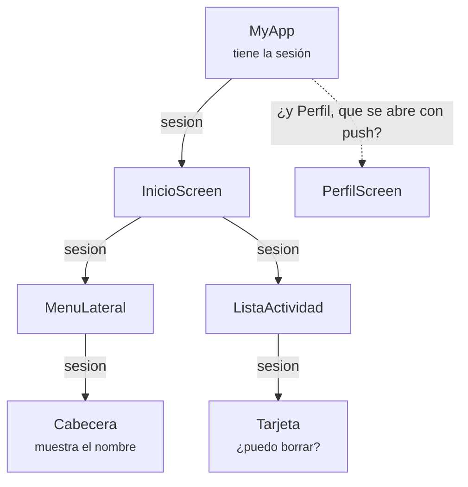
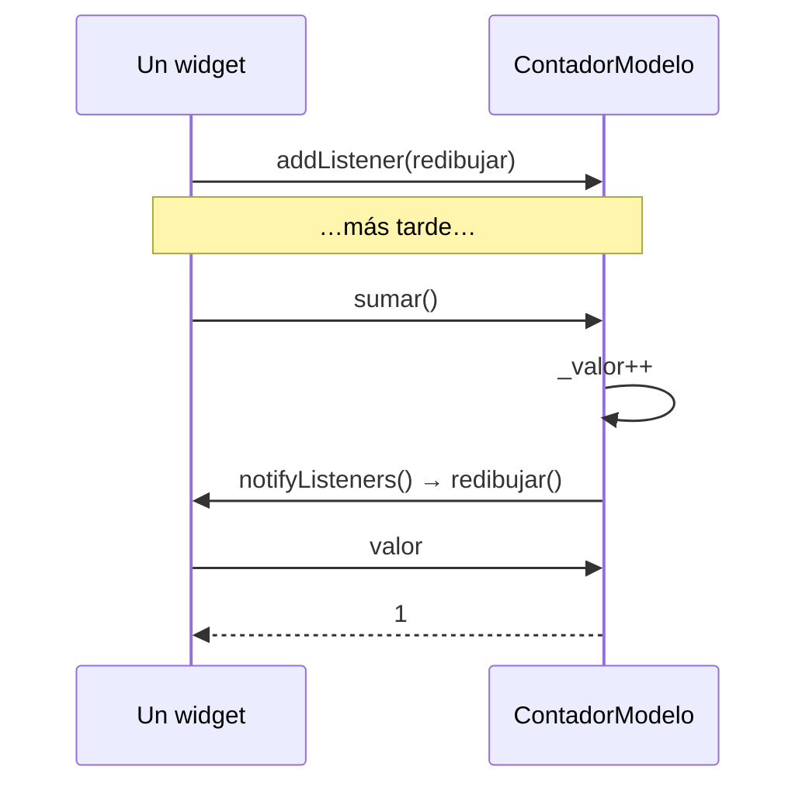
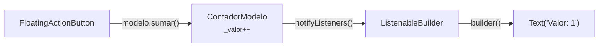
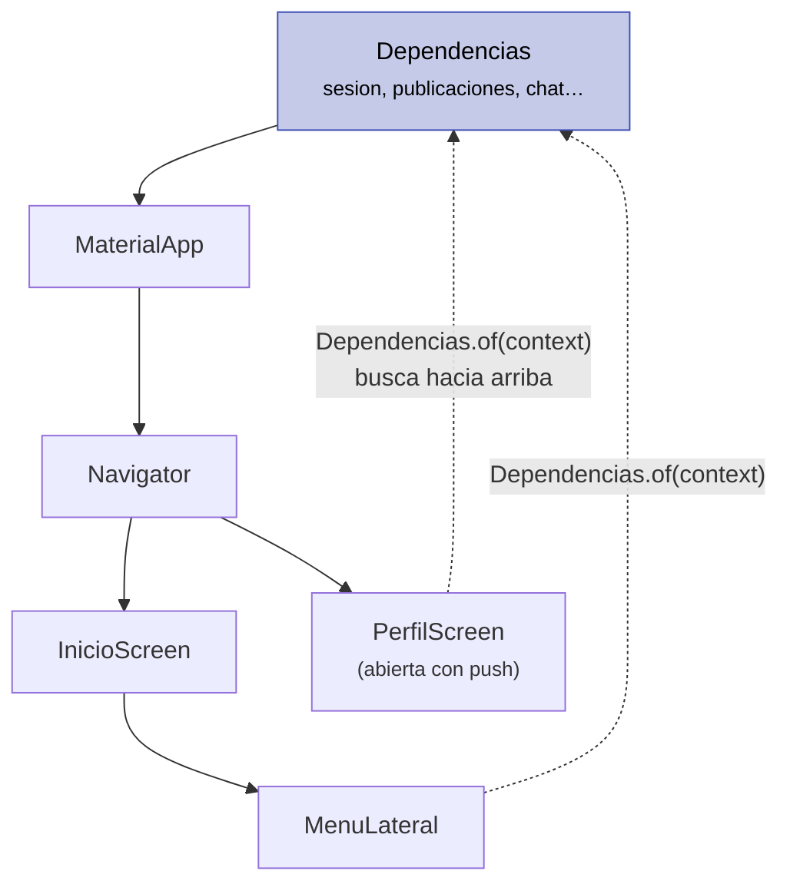
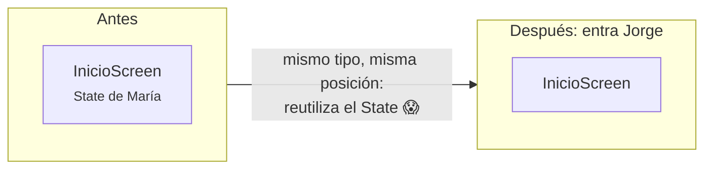
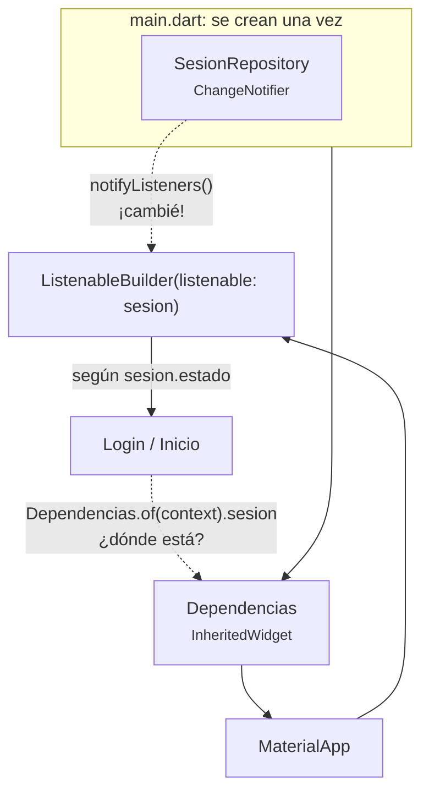

# Estado compartido

!!! abstract "Objetivo"
    Resolver el problema de **varios widgets que necesitan el mismo estado**: con **`ChangeNotifier`** (un objeto que avisa cuando cambia), **`ListenableBuilder`** (un widget que lo escucha y se redibuja) e **`InheritedWidget`** (una forma de dejar algo disponible para todo el árbol sin pasarlo de mano en mano). Y entender las **keys**. Estas tres piezas, que vienen con Flutter, son toda la "maquinaria de estado" de VigiaApp.

## El problema

Con `setState`, el estado vive **en un widget**. Si otro widget lejano lo necesita, hay que **pasarlo** por todos los del medio, y pasar callbacks de vuelta:



Problemas:

1. Los widgets del medio reciben cosas que **no usan**, solo para pasarlas.
2. Si cambia la sesión, ¿quién se entera? `setState` solo redibuja **un** widget y sus hijos.
3. La lógica (iniciar sesión, cerrarla, validar el token) queda **mezclada** con la interfaz.

La solución tiene dos partes: **sacar el estado a un objeto aparte que avise cuando cambia**, y **una forma de que cualquiera lo encuentre**.

## `ChangeNotifier`: un objeto que avisa {#changenotifier}

`ChangeNotifier` (de `package:flutter/foundation.dart`) es una clase que sabe **mantener una lista de interesados** y **avisarles**:

| Método | Qué hace |
|---|---|
| `addListener(f)` | "Avisame llamando a `f` cuando cambies." |
| `removeListener(f)` | "Ya no me avises." |
| `notifyListeners()` | Llama a todos los interesados. Lo llama la clase misma cuando cambia algo. |
| `dispose()` | Se descarta; después no se puede usar. |

Se usa **heredando**:

```dart title="contador_modelo.dart" linenums="1"
import 'package:flutter/foundation.dart';

class ContadorModelo extends ChangeNotifier {  // (1)!
  int _valor = 0;  // (2)!

  int get valor => _valor;  // (3)!

  void sumar() {  // (4)!
    _valor++;
    notifyListeners();  // (5)!
  }
}

void main() {
  final modelo = ContadorModelo();
  modelo.addListener(() => print('Cambió: ${modelo.valor}'));  // (6)!
  modelo.sumar();
  modelo.sumar();
  modelo.dispose();
}
```

1. Hereda la lista de interesados y `notifyListeners`.
2. El estado, **privado**.
3. Se puede **leer** desde afuera…
4. …pero solo se **cambia** con métodos que dicen qué hacen.
5. Después de cambiar, avisa.
6. Alguien se suscribe. (En Flutter, lo hace `ListenableBuilder` por vos.)

```text title="Salida"
Cambió: 1
Cambió: 2
```



!!! info "Esto ya lo conocés"
    Es el **patrón de campo privado + getter** de [Clases](../2-dart/5-clases.md#privado-con-guion-bajo), más un aviso. **Todos los ViewModels** de VigiaApp heredan de `ChangeNotifier` (a través del `ViewModel` base), y también `SesionRepository`. En la [Parte 4](../4-arquitectura/6-viewmodel-base.md) lo vemos en detalle.

## `ListenableBuilder`: redibujar cuando avisa {#listenablebuilder}

Para que la pantalla se actualice cuando el `ChangeNotifier` avisa, se usa **`ListenableBuilder`**: un widget que se suscribe y vuelve a llamar a su `builder` en cada aviso.

```dart title="contador_compartido.dart" linenums="1"
import 'package:flutter/material.dart';

class ContadorModelo extends ChangeNotifier {
  int _valor = 0;
  int get valor => _valor;
  void sumar() {
    _valor++;
    notifyListeners();
  }
}

void main() => runApp(MaterialApp(home: Pantalla(modelo: ContadorModelo())));

class Pantalla extends StatelessWidget {
  const Pantalla({required this.modelo, super.key});
  final ContadorModelo modelo;

  @override
  Widget build(BuildContext context) {
    return Scaffold(
      appBar: AppBar(title: const Text('Compartido')),
      body: Center(
        child: ListenableBuilder(  // (1)!
          listenable: modelo,  // (2)!
          builder: (context, child) => Text('Valor: ${modelo.valor}'),  // (3)!
        ),
      ),
      floatingActionButton: FloatingActionButton(
        onPressed: modelo.sumar,  // (4)!
        child: const Icon(Icons.add),
      ),
    );
  }
}
```

1. El widget que escucha.
2. A quién escucha. Cualquier `Listenable` (un `ChangeNotifier` lo es).
3. Se vuelve a llamar en cada `notifyListeners()`. **Solo esto** se redibuja, no toda la pantalla.
4. La vista no cambia el estado: **le pide** al modelo que lo cambie.

Fijate que `Pantalla` es **`StatelessWidget`**: no tiene `setState`. El estado vive en el modelo.



### Redibujar lo justo

`ListenableBuilder` redibuja **solo su `builder`**. Si una pantalla tiene una parte que depende del estado y otra que no, conviene que el `ListenableBuilder` envuelva **solo la parte que cambia**. En VigiaApp, la mayoría de las pantallas lo ponen en el `body` del `Scaffold`, dejando afuera la `AppBar`, que no cambia.

!!! tip "El parámetro `child`"
    `ListenableBuilder` también acepta un `child:` que se construye **una sola vez** y se le pasa al `builder`. Sirve para una parte grande que está adentro pero no depende del estado:
    ```dart
    ListenableBuilder(
      listenable: modelo,
      child: const LogoGrande(),  // no se reconstruye
      builder: (context, child) => Column(children: [child!, Text('${modelo.valor}')]),
    )
    ```

### `ValueNotifier`: para un solo valor

Si el estado es **un solo valor**, Flutter trae `ValueNotifier<T>`, que avisa solo cuando cambia su `value`:

```dart
final cantidad = ValueNotifier<int>(0);
cantidad.value++;  // avisa solo

ValueListenableBuilder<int>(
  valueListenable: cantidad,
  builder: (context, valor, _) => Text('$valor'),
)
```

VigiaApp usa `ChangeNotifier` (los ViewModels tienen varios campos), pero es bueno conocerlo.

## `InheritedWidget`: disponible para todo el árbol {#inheritedwidget}

Ya tenemos el estado afuera de los widgets. Falta que **cualquiera lo pueda encontrar** sin pasarlo de mano en mano. Para eso Flutter tiene **`InheritedWidget`**: un widget que se pone arriba en el árbol, y que cualquier descendiente puede **buscar** con `context`.

Es el mecanismo detrás de `Theme.of(context)`, `Navigator.of(context)`, `MediaQuery.of(context)`… Y VigiaApp lo usa para **las dependencias** ([capítulo 7](../5-construccion/07-dependencias-y-rutas.md)):

```dart title="lib/dependencias.dart (resumido)"
class Dependencias extends InheritedWidget {  // (1)!
  const Dependencias({
    required this.sesion,
    required this.publicaciones,
    // … chat, alertas, rondines, comite, fotos, ubicacion, lanzador, rondin
    required super.child,  // (2)!
    super.key,
  });

  final SesionRepository sesion;
  final PublicacionesRepository publicaciones;
  // …

  static Dependencias of(BuildContext context) {  // (3)!
    final dependencias = context.getInheritedWidgetOfExactType<Dependencias>();  // (4)!
    assert(dependencias != null, 'Falta Dependencias arriba en el árbol');
    return dependencias!;
  }

  @override
  bool updateShouldNotify(Dependencias oldWidget) => false;  // (5)!
}
```

1. Hereda de `InheritedWidget`.
2. Envuelve un hijo: todo lo que esté debajo puede encontrarlo.
3. El método `of`, por convención (como `Theme.of`).
4. Busca hacia arriba en el árbol el `Dependencias` más cercano. Si no hay, es un error de programación: `assert` lo avisa en debug.
5. "Si me reconstruyen con otros datos, ¿hay que avisar a los que me usan?". Acá no: los repositorios **no cambian nunca** (se crean una vez en `main.dart`).

Se pone **arriba de todo**, en `main.dart`:

```dart title="lib/main.dart (fragmento)"
return Dependencias(
  sesion: _sesion,
  publicaciones: _publicaciones,
  // …
  child: MaterialApp(...),
);
```

Y se usa **desde cualquier lado**, por ejemplo en `Rutas`:

```dart
final viewModel = PerfilViewModel(Dependencias.of(context).sesion);
```



Como `Dependencias` está **arriba** de `MaterialApp`, también está arriba de **todas** las pantallas, incluso las que se abren con `push` (que cuelgan del `Navigator`, adentro de `MaterialApp`).

### `get…` vs. `depend…`

Hay dos formas de buscar un `InheritedWidget`:

| Método | ¿Se suscribe? | Cuándo |
|---|---|---|
| `context.dependOnInheritedWidgetOfExactType<T>()` | **Sí**: si el `InheritedWidget` cambia (y `updateShouldNotify` da `true`), el widget que buscó se redibuja. | Datos que cambian (el tema, el tamaño de pantalla). |
| `context.getInheritedWidgetOfExactType<T>()` | **No**: solo lo encuentra. | Datos que no cambian, o si lo usás fuera de `build` (en un `onPressed`). |

`Dependencias` usa `get…` porque las instancias no cambian: nadie tiene que redibujarse. Por eso, además, se puede llamar desde un `onPressed` sin problemas.

!!! question "Entonces, ¿cómo se entera la pantalla de que cambió la sesión?"
    No por `Dependencias`: por el **`ChangeNotifier`**. `Dependencias` solo sirve para **encontrar** el objeto (`SesionRepository`). Después, quien quiera enterarse de cambios lo **escucha** con `ListenableBuilder`. Son dos responsabilidades distintas:

    - `InheritedWidget` → **¿dónde está?**
    - `ChangeNotifier` + `ListenableBuilder` → **¿cambió?**

## ¿Y `provider`, `riverpod`, `bloc`…?

Vas a ver muchos paquetes de "manejo de estado" en internet. Todos resuelven lo mismo que acabamos de ver, con más comodidades (y más cosas para aprender):

- **`provider`** es, básicamente, `InheritedWidget` + `ChangeNotifier` con menos código.
- **`riverpod`**, **`bloc`**, **`get_it`**… son otras formas.

VigiaApp **no usa ninguno**: con las tres piezas de Flutter alcanza, y entendiéndolas vas a entender cualquiera de esos paquetes cuando los necesites. Es también lo que recomienda la [guía de arquitectura de Flutter](https://docs.flutter.dev/app-architecture) que sigue la app.

## Keys {#keys}

Todo widget tiene un parámetro opcional **`key`** (por eso el `super.key` en los constructores). Para entenderlo hay que saber cómo Flutter **reutiliza** los `State`.

### Cómo decide Flutter si reutilizar

Cuando se redibuja, Flutter compara el árbol nuevo con el viejo, posición por posición. Si en la misma posición hay un widget **del mismo tipo** (y la misma key, si tiene), **reutiliza** el `State` anterior. Si no, tira el viejo y crea uno nuevo.



Casi siempre es lo que querés. Pero a veces no.

### Caso 1: forzar un `State` nuevo

En VigiaApp, si María cierra sesión y entra Jorge, la raíz pasa de `InicioScreen` a `LoginScreen` y de vuelta a `InicioScreen`. Pero si el cambio fuera directo (de un vecino a otro), Flutter **reutilizaría el `State` del Inicio de María** para Jorge. Para evitarlo, `main.dart` le pone una key con el id del vecino:

```dart
EstadoSesion.conSesion => InicioScreen(
  key: ValueKey(_sesion.vecino!.id),  // otro vecino → otra key → State nuevo
  viewModel: _crearInicio(),
),
```

Si la key cambia, Flutter entiende que es **otro** widget y arranca de cero.

### Caso 2: listas que cambian de orden

En una lista, si sacás un elemento del medio, sin keys Flutter reutiliza los `State` **por posición**, y el estado de un elemento puede quedar en otro. Con una key por elemento, los empareja **por identidad**:

```dart title="lib/ui/inicio/widgets/lista_actividad.dart (fragmento)"
Dismissible(
  key: ValueKey(publicacion.id),  // obligatorio: identifica qué fila se deslizó
  …
)
```

`Dismissible` (deslizar para borrar) **exige** una key, justamente por esto.

### Los tipos de key

| Key | Para qué |
|---|---|
| `ValueKey(valor)` | Identificar por un valor (un id). La más común. |
| `ObjectKey(objeto)` | Identificar por un objeto. |
| `UniqueKey()` | Una key distinta cada vez: fuerza un `State` nuevo en cada redibujo. |
| `GlobalKey<T>()` | Única en **toda** la app; permite acceder al `State` desde afuera (`_form.currentState`, `_navegador.currentState`). |

## Resumen visual



## Ejercicio

??? question "Un carrito compartido"
    Hacé un `ChangeNotifier` `Carrito` con una lista privada de productos, un getter `cantidad` y métodos `agregar`/`vaciar`. Ponelo en un `InheritedWidget` arriba de `MaterialApp`. Mostrá la cantidad en la `AppBar` de **dos** pantallas distintas (una abierta con `push`) y comprobá que se actualizan juntas.

    ??? success "Pistas"
        - El `InheritedWidget` es igual a `Dependencias`, con un solo campo `carrito`.
        - En cada `AppBar`: `ListenableBuilder(listenable: Carritos.of(context).carrito, builder: …)`.
        - Creá el `Carrito` en el `State` de la app y descartalo en su `dispose`.

## Lo que aprendiste

- [x] **`ChangeNotifier`**: estado privado + getters + `notifyListeners()` al cambiar.
- [x] **`ListenableBuilder`** se suscribe y redibuja **solo su `builder`**.
- [x] **`InheritedWidget`** deja un objeto disponible para todo el árbol; `Algo.of(context)` lo busca.
- [x] `InheritedWidget` responde **dónde está**; `ChangeNotifier` responde **si cambió**.
- [x] Las **keys** controlan cuándo Flutter reutiliza un `State`: `ValueKey(id)` para identidades, `GlobalKey` para acceder desde afuera.

[Siguiente: Plugins y plataformas :material-arrow-right:](8-plugins-y-plataformas.md){ .md-button .md-button--primary }
