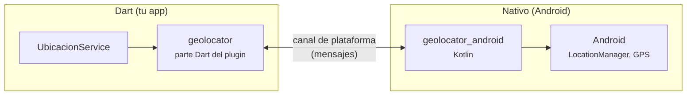
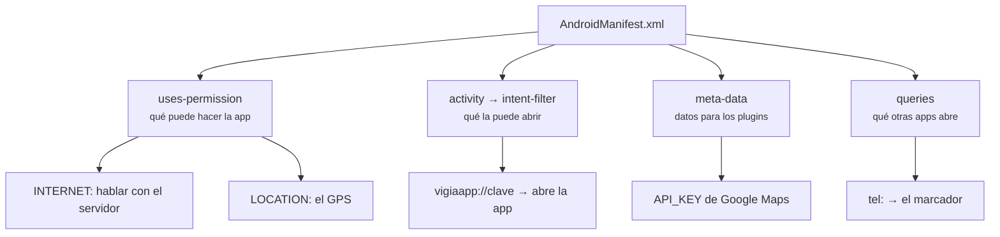
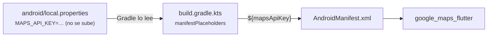
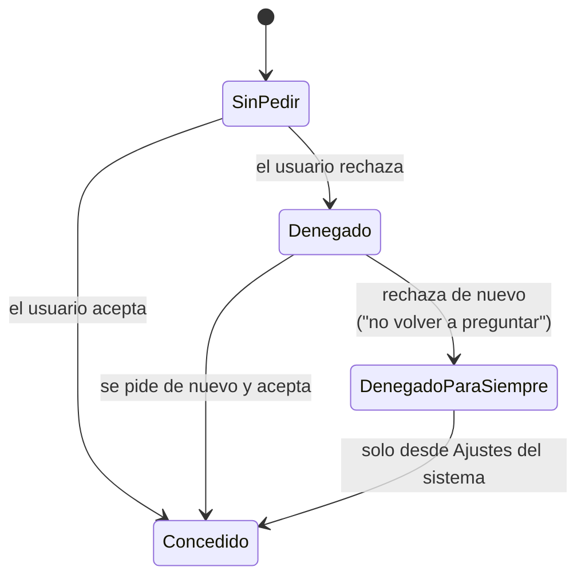
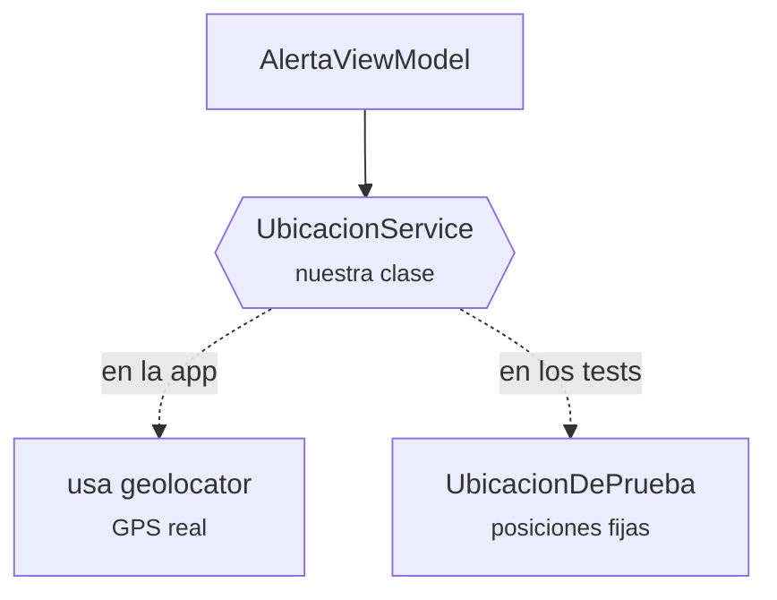

# Plugins y plataformas

!!! abstract "Objetivo"
    Entender qué pasa cuando la app necesita algo **del celular** (la cámara, el GPS, el llavero seguro, abrir otra app): cómo un **plugin** conecta Dart con el código nativo, qué hay que **configurar en Android** (permisos, `AndroidManifest.xml`, Gradle), cómo se piden **permisos** al usuario, y por qué en VigiaApp cada plugin está **envuelto** en una clase propia.

## Dos mundos

Flutter dibuja la interfaz por su cuenta, en Dart. Pero hay cosas que **solo sabe hacer el sistema operativo**: sacar una foto, leer el GPS, guardar algo cifrado, marcar un número de teléfono. Para eso, Dart tiene que **hablar con el código nativo** (Kotlin o Java en Android; Swift u Objective-C en iOS).



Un **plugin** es un paquete con las dos partes: una API en Dart para vos, y la implementación nativa para cada plataforma. Se comunican por un **canal de plataforma** (*platform channel*): Dart manda un mensaje ("dame la posición"), el lado nativo lo atiende y responde.

Vos solo ves la parte Dart:

```dart
final posicion = await Geolocator.getCurrentPosition();
```

## Los plugins de VigiaApp

| Plugin | Qué le pide al sistema | Configuración en Android | Capítulo |
|---|---|---|---|
| `flutter_secure_storage` | Guardar cifrado (Keystore). | `minSdk` 23 o más | [5](../5-construccion/05-sesion.md) |
| `app_links` | Recibir enlaces `vigiaapp://`. | `<intent-filter>` en el manifiesto | [7](../5-construccion/07-dependencias-y-rutas.md) |
| `image_picker` | Cámara y galería. | Nada (usa la app de cámara del sistema) | [10](../5-construccion/10-publicaciones-y-fotos.md) |
| `url_launcher` | Abrir el marcador y Google Maps. | `<queries>` en el manifiesto | [14](../5-construccion/14-sos-y-alerta.md) |
| `geolocator` | GPS. | Permisos de ubicación | [14](../5-construccion/14-sos-y-alerta.md) |
| `google_maps_flutter` | Mostrar un mapa. | Clave de API en el manifiesto | [14](../5-construccion/14-sos-y-alerta.md) |

## Configurar Android

Casi toda la configuración nativa está en dos archivos:

```text
android/
└── app/
    ├── build.gradle.kts             ← cómo se compila (minSdk, claves)
    └── src/main/
        └── AndroidManifest.xml      ← qué es la app (permisos, enlaces, metadatos)
```

### El manifiesto

`AndroidManifest.xml` es la **declaración** de la app ante Android. Así queda el de VigiaApp, con todo lo que agregan los capítulos (resumido):

```xml title="android/app/src/main/AndroidManifest.xml (resumido)"
<manifest xmlns:android="http://schemas.android.com/apk/res/android">

    <!-- (1) Permisos -->
    <uses-permission android:name="android.permission.INTERNET" />
    <uses-permission android:name="android.permission.ACCESS_FINE_LOCATION" />
    <uses-permission android:name="android.permission.ACCESS_COARSE_LOCATION" />

    <application android:label="vigia_app" ...>
        <activity android:name=".MainActivity" ...>

            <!-- La pantalla de inicio de la app (lo genera flutter create) -->
            <intent-filter>
                <action android:name="android.intent.action.MAIN"/>
                <category android:name="android.intent.category.LAUNCHER"/>
            </intent-filter>

            <!-- (2) Enlaces del correo: vigiaapp://clave?token=… -->
            <meta-data android:name="flutter_deeplinking_enabled" android:value="false" />
            <intent-filter>
                <action android:name="android.intent.action.VIEW" />
                <category android:name="android.intent.category.DEFAULT" />
                <category android:name="android.intent.category.BROWSABLE" />
                <data android:scheme="vigiaapp" android:host="clave" />
            </intent-filter>
        </activity>

        <!-- (3) Clave de Google Maps -->
        <meta-data
            android:name="com.google.android.geo.API_KEY"
            android:value="${mapsApiKey}" />
    </application>

    <!-- (4) Qué otras apps queremos abrir -->
    <queries>
        <intent>
            <action android:name="android.intent.action.VIEW" />
            <data android:scheme="tel" />
        </intent>
    </queries>
</manifest>
```



!!! warning "Después de tocar el manifiesto"
    Los cambios en `android/` **no** se aplican con hot reload ni hot restart. Pará la app y volvé a correr `flutter run`. Si cambiaste permisos, a veces hay que **desinstalar** la app del emulador para que Android los relea.

!!! info "En debug, internet anda sin el permiso"
    Flutter agrega el permiso `INTERNET` solo en la versión de depuración (para el hot reload). Si te olvidás de declararlo, todo anda mientras desarrollás… y la versión final no se conecta. Por eso lo declaramos explícitamente.

### Gradle: `minSdk`

Cada versión de Android tiene un número de **API** (Android 6 = 23, Android 14 = 34…). `minSdk` es la versión **más vieja** que soporta la app. Algunos plugins necesitan una mínima: `flutter_secure_storage` pide 23. Se cambia en `android/app/build.gradle.kts`:

```kotlin title="android/app/build.gradle.kts (fragmento)"
defaultConfig {
    applicationId = "com.ejemplo.vigia_app"
    minSdk = 23
    // …
}
```

### Claves que no van al repositorio

La clave de Google Maps es **privada**: si se sube a GitHub, cualquiera la puede usar (y gastar tu cuota). VigiaApp la guarda en `android/local.properties`, que `.gitignore` ya excluye, y Gradle la lee de ahí y la pasa al manifiesto como `${mapsApiKey}`. El paso a paso está en el [capítulo 14](../5-construccion/14-sos-y-alerta.md).



## Permisos en tiempo de ejecución

Declarar un permiso en el manifiesto **no alcanza** para los "peligrosos" (ubicación, cámara, micrófono): desde Android 6, la app tiene que **pedírselo al usuario** mientras corre, con el cartel "¿Permitir que VigiaApp acceda a la ubicación?".



`UbicacionService` de VigiaApp ([capítulo 14](../5-construccion/14-sos-y-alerta.md)) hace todo el recorrido antes de seguir al GPS:

```dart title="lib/data/services/ubicacion_service.dart (fragmento)"
Future<void> _revisarPermisos() async {
  try {
    if (!await Geolocator.isLocationServiceEnabled()) {  // (1)!
      throw const UbicacionException(
        'Prendé la ubicación del celular para compartir dónde estás.',
      );
    }
    var permiso = await Geolocator.checkPermission();  // (2)!
    if (permiso == LocationPermission.denied) {
      permiso = await Geolocator.requestPermission();  // (3)!
    }
    if (permiso == LocationPermission.denied ||
        permiso == LocationPermission.deniedForever) {
      throw const UbicacionException(  // (4)!
        'Sin permiso de ubicación: no se comparte dónde estás.',
      );
    }
  } on MissingPluginException {  // (5)!
    throw const UbicacionException('Este dispositivo no tiene ubicación.');
  }
}
```

1. ¿Está prendido el GPS del celular? (Es distinto del permiso.)
2. ¿Qué permiso tenemos ahora?
3. Si no lo pedimos todavía (o lo negó una vez), lo pedimos: aparece el cartel del sistema.
4. Si lo negó, se lanza un error **con un mensaje para el vecino**. La alerta igual se manda (sin ubicación en vivo).
5. Ver la sección siguiente.

## Plugins y tests: `MissingPluginException`

En los **tests** no hay celular: no hay lado nativo que conteste. Si el código llama a un plugin, falla con:

```text
MissingPluginException(No implementation found for method getPositionStream
on channel flutter.baseflow.com/geolocator_updates_android)
```

Por eso VigiaApp:

1. **Envuelve** cada plugin en una clase propia (`UbicacionService`, `AlmacenToken`, `SelectorFotos`, `LanzadorExterno`) en `data/services/`.
2. En los tests, usa **versiones de mentira** de esas clases (por ejemplo, `UbicacionDePrueba extends UbicacionService`, que devuelve posiciones fijas). Lo vemos en la [Parte 6](../6-pruebas-y-entrega/4-tests-de-widgets.md).
3. Atrapa `MissingPluginException` donde tiene sentido seguir sin el plugin, como el `on MissingPluginException` de arriba.



Esta es la misma idea que `VigiaApi` con `FakeVigiaApi`: **depender de algo nuestro, no del paquete**. Se explica a fondo en [La dirección de las dependencias](../4-arquitectura/3-direccion-de-dependencias.md).

## `url_launcher`: abrir otras apps

Algunos "plugins" no hacen algo ellos, sino que **le piden a otra app** que lo haga. `url_launcher` abre una URL con la app que corresponda:

| URL | Abre |
|---|---|
| `tel:*555` | El marcador, con el número. |
| `https://www.google.com/maps/dir/?api=1&destination=-34.6,-58.4` | Google Maps con la ruta. |
| `https://…` | El navegador. |
| `mailto:comite@…` | El correo. |

```dart
await launchUrl(Uri(scheme: 'tel', path: numeroEmergencia));
```

En VigiaApp está envuelto en `LanzadorExterno` ([capítulo 14](../5-construccion/14-sos-y-alerta.md)). El `<queries>` del manifiesto es necesario desde Android 11 para que la app pueda **preguntar** si hay una app que abra `tel:`.

## ¿Y iOS?

Lo equivalente al manifiesto en iOS es `ios/Runner/Info.plist`: ahí van los textos que se muestran al pedir permisos (`NSLocationWhenInUseUsageDescription`, `NSCameraUsageDescription`…) y los esquemas de enlaces. Los capítulos muestran ambos en pestañas. Para compilar para iPhone hace falta una Mac con Xcode.

## Lo que aprendiste

- [x] Un **plugin** = una API en Dart + código nativo, comunicados por un **canal de plataforma**.
- [x] **`AndroidManifest.xml`**: permisos, enlaces que abren la app, metadatos (claves) y `<queries>`.
- [x] **`build.gradle.kts`**: `minSdk` y lectura de claves privadas desde `local.properties`.
- [x] Los permisos peligrosos se **piden en tiempo de ejecución**, y el usuario puede negarlos.
- [x] En los tests no hay lado nativo: por eso cada plugin está **envuelto** en una clase propia que se puede reemplazar.

!!! success "Terminaste la Parte 3"
    Ya sabés hacer interfaces con Flutter. Pero si hicieras VigiaApp solo con esto, terminarías con pantallas de 1000 líneas que mezclan todo. La Parte 4 explica cómo ordenarlo.

[Siguiente: Parte 4, Arquitectura :material-arrow-right:](../4-arquitectura/index.md){ .md-button .md-button--primary }
