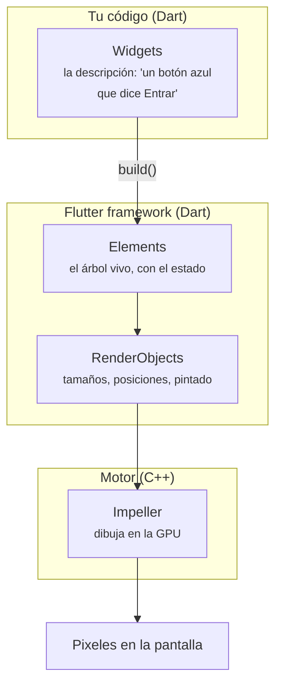
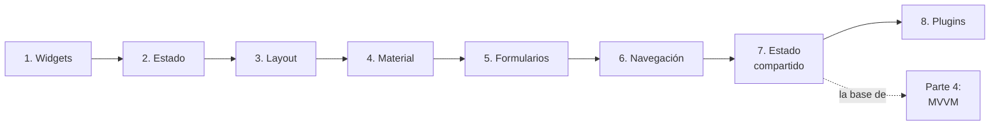

# 3. Flutter

**Flutter** es el *framework* de Google para hacer interfaces: con **un solo código en Dart** sale una app para Android, iOS, web y escritorio. No usa los botones del sistema operativo: **dibuja cada pixel** él mismo, con su propio motor gráfico. Por eso se ve igual en todos lados.

!!! abstract "Al terminar esta parte vas a poder"
    - Explicar qué es un **widget** y cómo se arma un **árbol** de widgets.
    - Elegir entre `StatelessWidget` y `StatefulWidget`, y conocer el **ciclo de vida** de un `State`.
    - Ubicar cosas en pantalla con `Row`, `Column`, `Expanded`, `Stack`… y arreglar el famoso *overflow*.
    - Usar los widgets de **Material 3**: botones, listas, diálogos, SnackBars, barras.
    - Hacer **formularios** con validación.
    - **Navegar** entre pantallas y pasar datos de ida y de vuelta.
    - Compartir estado con **`ChangeNotifier`**, **`ListenableBuilder`** e **`InheritedWidget`**.
    - Saber qué es un **plugin** y qué hay que configurar en Android.

## Cómo funciona Flutter, en un dibujo



Vos solo escribís **widgets**: descripciones livianas de cómo tiene que verse la pantalla. Flutter se encarga del resto. Cada vez que algo cambia, volvés a describir (se vuelve a llamar a `build`), y Flutter compara la descripción nueva con la anterior y actualiza **solo lo que cambió**.

!!! info "La idea central"
    **La pantalla es una función del estado**: `pantalla = build(estado)`. No le decís a un botón "cambiá tu texto"; cambiás el dato y Flutter vuelve a pedir la descripción. Esta idea (llamada **interfaz declarativa**) es lo más importante de toda esta parte.

## Las páginas

| Página | En una línea | Lo vas a usar en |
|---|---|---|
| [1. Todo es un widget](1-todo-es-un-widget.md) | Árbol de widgets, `build`, `BuildContext`. | Todo |
| [2. Stateless y Stateful](2-stateless-y-stateful.md) | Widgets sin y con estado, `setState`, ciclo de vida. | Todas las pantallas |
| [3. Layout](3-layout.md) | `Row`, `Column`, `Expanded`, `Stack`, listas, overflow. | Todas las pantallas |
| [4. Widgets de Material](4-material.md) | `Scaffold`, botones, `ListTile`, diálogos, SnackBar… | Todas las pantallas |
| [5. Formularios](5-formularios.md) | `TextFormField`, `Form`, validadores, controladores. | Login, perfil, comité |
| [6. Navegación](6-navegacion.md) | `Navigator.push`/`pop`, resultados, diálogos. | Rutas, cap. 7 |
| [7. Estado compartido](7-estado-compartido.md) | `ChangeNotifier`, `ListenableBuilder`, `InheritedWidget`, keys. | ViewModels, sesión |
| [8. Plugins y plataformas](8-plugins-y-plataformas.md) | Código nativo, permisos, `AndroidManifest.xml`. | Fotos, GPS, mapas |



## Cómo practicar

Para esta parte conviene un proyecto de práctica aparte (así no ensuciás `vigia_app`):

```bash
flutter create practica
cd practica
```

Reemplazá `lib/main.dart` por los ejemplos (todos tienen un `main()`), corré `flutter run` y jugá con el **hot reload**: cambiá un número, un color, un texto, y mirá qué pasa.

Las capturas de esta parte se sacaron corriendo exactamente el código de cada ejemplo.

[Empezar: Todo es un widget :material-arrow-right:](1-todo-es-un-widget.md){ .md-button .md-button--primary }
