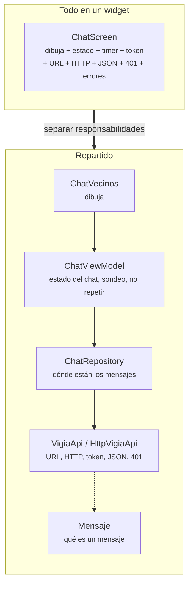
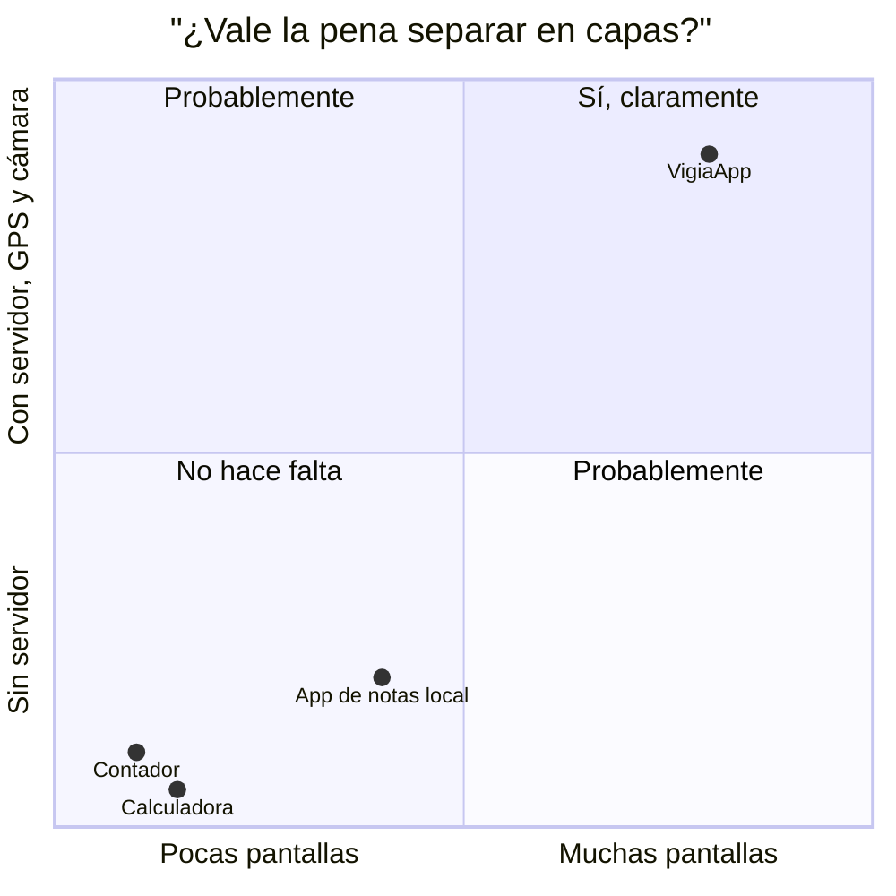

# Por qué una arquitectura

!!! abstract "Objetivo"
    Ver con un ejemplo concreto **qué problemas aparecen** cuando todo está en un widget, y cómo **separar responsabilidades** los resuelve. Al final vas a entender por qué el chat de VigiaApp, que parece una pantalla sola, está repartido en seis archivos.

## El chat, todo en un widget

Así se podría escribir el chat del barrio con lo que vimos en la Parte 3. Funciona. Leelo entero:

```dart title="chat_todo_junto.dart (lo que NO hacemos)" linenums="1"
class ChatScreen extends StatefulWidget {
  const ChatScreen({super.key});
  @override
  State<ChatScreen> createState() => _ChatScreenState();
}

class _ChatScreenState extends State<ChatScreen> {
  final _texto = TextEditingController();
  final _mensajes = <Map<String, dynamic>>[];
  Timer? _timer;
  bool _enviando = false;
  String? _error;

  @override
  void initState() {
    super.initState();
    _cargar();
    _timer = Timer.periodic(const Duration(seconds: 10), (_) => _cargar());
  }

  Future<void> _cargar() async {
    final token = await const FlutterSecureStorage().read(key: 'token');  // (1)!
    final ultimo = _mensajes.isEmpty ? null : _mensajes.last['id'];
    try {
      final r = await http.get(  // (2)!
        Uri.parse('https://hotpink-aardvark-846933.hostingersite.com/api/v1/mensajes'
            '${ultimo == null ? '' : '?despues=$ultimo'}'),
        headers: {'Authorization': 'Bearer $token'},
      );
      if (r.statusCode == 401) {  // (3)!
        Navigator.of(context).pushReplacement(
          MaterialPageRoute(builder: (_) => const LoginScreen()),
        );
        return;
      }
      final nuevos = (jsonDecode(r.body) as List).cast<Map<String, dynamic>>();
      setState(() {
        _mensajes.addAll(nuevos);
        _error = null;
      });
    } catch (e) {
      setState(() => _error = 'No se pudo cargar el chat');
    }
  }

  Future<void> _enviar() async {
    if (_texto.text.trim().isEmpty) return;
    setState(() => _enviando = true);
    // … otro http.post con el token, el JSON, el 401, el catch …  (4)!
    setState(() => _enviando = false);
  }

  @override
  void dispose() {
    _timer?.cancel();
    _texto.dispose();
    super.dispose();
  }

  @override
  Widget build(BuildContext context) {
    // … 80 líneas de lista, burbujas, barra de texto …
    // … y adentro: m['autor_id'] == ??? (¿quién soy yo?)  (5)!
  }
}
```

1. La pantalla sabe **dónde** se guarda el token y con qué paquete.
2. La pantalla sabe la **URL** del servidor, el formato de las rutas y de los encabezados.
3. La pantalla decide qué hacer cuando **vence la sesión**. (Y cada pantalla que hable con el servidor va a tener que repetirlo.)
4. Todo eso, **otra vez**, para enviar.
5. Y para saber si un mensaje es mío, necesita saber quién inició sesión… que no está acá.

## Los problemas

### 1. No se puede probar

¿Cómo probás que "si llega un mensaje repetido, no aparece dos veces"? Necesitarías:

- un servidor real andando, con datos;
- un token válido guardado en el llavero del celular (que en un test no existe: [MissingPluginException](../3-flutter/8-plugins-y-plataformas.md#plugins-y-tests-missingpluginexception));
- abrir la pantalla, esperar 10 segundos…

La lógica (no repetir mensajes) está **atada** a la interfaz, al servidor y al celular. No se puede probar sola.

### 2. Todo se repite

Leer el token, armar la URL, poner el encabezado, revisar el 401, convertir el JSON, mostrar el error… En VigiaApp hay **unas 40 llamadas** al servidor en **unas 20 pantallas**. Si cada una repite eso, son cientos de líneas iguales, y cuando algo cambia (el formato de los errores), hay que encontrarlas todas.

### 3. Cambiar algo de afuera rompe todo

- ¿Cambia la URL del servidor? Hay que buscarla en cada pantalla.
- ¿Queremos probar la app **sin servidor**, con datos de mentira? Imposible: cada pantalla llama a `http` directo.
- ¿Cambiamos `flutter_secure_storage` por otro paquete? Hay que tocar todas las pantallas que leen el token.

### 4. El estado se pierde o se duplica

La lista de mensajes vive en el `State` de la pantalla. Si el Inicio también quiere mostrar "3 mensajes nuevos", ¿de dónde lo saca? Si dos pantallas necesitan el rondín del vecino (la tarjeta del Inicio y la pantalla de Recorridos), cada una lo carga por su lado y pueden mostrar cosas distintas.

### 5. No se entiende

Un archivo que hace todo es difícil de leer: para entender cómo se ve la burbuja, tenés que saltar el código de HTTP; para entender el sondeo, tenés que saltar el de la interfaz.

## La idea: separar por responsabilidad

Cada problema sale de que **un solo lugar hace muchas cosas distintas**. La solución es repartir: **cada pieza hace una cosa**, y se pasan el trabajo.



Ahora cada problema tiene solución:

| Problema | Solución |
|---|---|
| No se puede probar | La lógica está en `ChatViewModel`, que **no sabe** de widgets ni de HTTP: se le da un repositorio con un servidor de mentira y se prueba en milisegundos. |
| Todo se repite | URL, token, JSON y 401 se escriben **una vez**, en `HttpVigiaApi`. |
| Cambiar algo rompe todo | Las pantallas dependen de `VigiaApi` (un contrato), no de `http`. Cambiar al servidor de mentira es una línea. |
| El estado se pierde | El estado vive en ViewModels y repositorios, que se pueden **compartir** entre pantallas. |
| No se entiende | Cada archivo hace una cosa y tiene un nombre que lo dice. |

## El costo

No es gratis. La arquitectura agrega **archivos** y **indirección** (para saber qué hace "Enviar" hay que seguir 4 archivos). En una app de una pantalla no vale la pena.



VigiaApp tiene unas 20 pantallas, un servidor, GPS, cámara, mapas y almacenamiento seguro, y la hace un equipo. Ahí la arquitectura se paga sola.

!!! info "Para que no sea burocracia"
    La guía de Flutter dice explícitamente que esto es una **recomendación**, no una ley. En VigiaApp hay atajos razonables: por ejemplo, el `ModoEmergenciaScreen` no tiene ViewModel (es solo una animación y devuelve `true`/`false`), y `ChatRepository` es casi un pasamanos de `VigiaApi`. Lo importante es la **dirección**: que la interfaz no sepa de HTTP.

## Lo que aprendiste

- [x] Todo en un widget = **no se puede probar**, **se repite**, **cambiar algo rompe todo**, **el estado se pierde** y **no se entiende**.
- [x] La solución es **separar responsabilidades**: cada pieza hace una cosa.
- [x] Cuesta archivos e indirección; en una app como VigiaApp vale la pena.

[Siguiente: MVVM y las capas :material-arrow-right:](2-mvvm-y-capas.md){ .md-button .md-button--primary }
