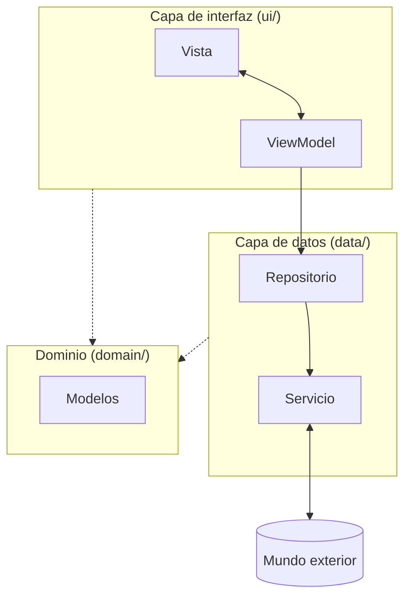
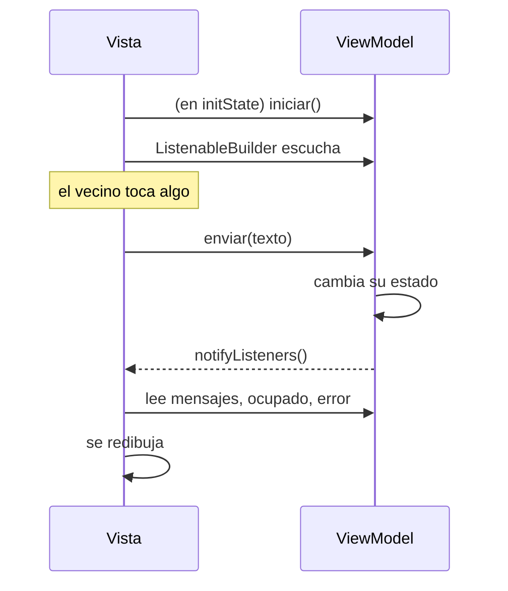
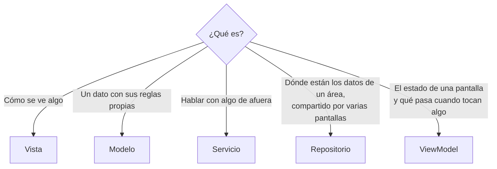

# MVVM y las capas

!!! abstract "Objetivo"
    Conocer las cinco piezas de la arquitectura de VigiaApp (**vista**, **ViewModel**, **repositorio**, **servicio** y **modelo**), qué hace cada una, qué **no** puede hacer, y cómo viajan los datos entre ellas. Al final, una tabla para decidir dónde va cada cosa nueva que escribas.

## Las capas



**MVVM** viene de *Model – View – ViewModel*. La guía de Flutter lo organiza en dos **capas** grandes:

- La **capa de interfaz**: lo que el vecino ve y toca. Tiene **vistas** y **ViewModels**.
- La **capa de datos**: de dónde salen y adónde van los datos. Tiene **repositorios** y **servicios**.

Y los **modelos**: las clases que representan los datos (un `Mensaje`, una `Sesion`), que usan las dos capas.

## La vista

**Qué es**: los widgets de una pantalla. En VigiaApp, los archivos `*_screen.dart`, `*_dialog.dart`, `*_sheet.dart` y los widgets que usan.

**Qué hace**:

- **Dibuja** el estado que le da el ViewModel.
- **Avisa** al ViewModel lo que hace el vecino ("tocaron Enviar con este texto").
- Maneja lo que es **puramente visual**: animaciones, controladores de texto, el foco, si se ve la contraseña, abrir un diálogo, navegar, mostrar un SnackBar.

**Qué no hace**:

- :material-close: Hablar con el servidor, el GPS, la cámara.
- :material-close: Decidir reglas ("¿puede borrar esta publicación?").
- :material-close: Cambiar el estado de la app directamente.

```dart title="lib/ui/chat/widgets/chat_vecinos.dart (fragmento)"
Future<void> _enviar() async {
  final resultado = await _viewModel.enviar(texto: _texto.text);  // avisa
  if (mounted && avisarSiFallo(context, resultado)) _texto.clear();  // muestra
}
```

La vista no sabe **cómo** se envía un mensaje: le pasa el texto al ViewModel, y según el resultado limpia el campo o muestra el error.

## El ViewModel

**Qué es**: una clase por pantalla (o por pedazo importante de pantalla) que hereda de `ViewModel`, que a su vez es un [`ChangeNotifier`](../3-flutter/7-estado-compartido.md#changenotifier). Archivos `*_view_model.dart`.

**Qué hace**:

- **Guarda el estado de la pantalla**: la lista de mensajes, si está cargando, el error, si está ocupado.
- **Lo expone de solo lectura**: campos privados + getters.
- Tiene los **métodos** que la vista llama: `enviar`, `cargar`, `borrar`, `filtrar`.
- **Pide los datos** a los repositorios y los **transforma** para la pantalla (ordenar, agrupar por día, filtrar).
- **Avisa** con `notifyListeners()` cuando algo cambia.
- Arranca y detiene lo que la pantalla necesita mientras está abierta (el sondeo del chat).

**Qué no hace**:

- :material-close: Importar `package:flutter/material.dart`. Un ViewModel **no conoce widgets**, ni `BuildContext`, ni `Navigator`. (Usa `package:flutter/foundation.dart` para `ChangeNotifier`, que no es interfaz.)
- :material-close: Hablar con el servidor directamente: lo hace a través de un repositorio.

```dart title="lib/ui/chat/view_model/chat_view_model.dart (fragmento)"
class ChatViewModel extends ViewModel {
  final List<Mensaje> _mensajes = [];  // estado privado
  UnmodifiableListView<Mensaje> get mensajes => UnmodifiableListView(_mensajes);  // solo lectura

  bool esMio(Mensaje mensaje) => mensaje.autorId == _vecino.id;  // lógica de presentación

  Future<Resultado<void>> enviar({String texto = '', int? fotoId}) async {
    final limpio = texto.trim();
    if (limpio.isEmpty && fotoId == null) return const Ok(null);
    final resultado = await ejecutar(
      () => _chat.enviar(texto: limpio.isEmpty ? null : limpio, fotoId: fotoId),
    );
    if (resultado case Ok(valor: final mensaje)) {
      _agregar([mensaje]);  // sin repetir
      notifyListeners();
    }
    return resultado;
  }
}
```

!!! success "Por qué un ViewModel se prueba fácil"
    Como no conoce widgets ni HTTP, en un test se crea así: `ChatViewModel(chat: ChatRepository(FakeVigiaApi()), …)`, se llama `enviar(texto: 'Hola')` y se mira `mensajes`. Sin pantallas, sin servidor, en milisegundos. Ver [Tests de ViewModels](../6-pruebas-y-entrega/3-tests-de-view-models.md).

### Cómo se conectan vista y ViewModel



Es un **flujo en un solo sentido**:

- **Hacia arriba** (vista → ViewModel): **eventos**, como llamadas a métodos.
- **Hacia abajo** (ViewModel → vista): **estado**, que la vista lee cuando se le avisa.

La vista **nunca** escribe el estado del ViewModel (no puede: es privado). Así hay un solo lugar donde cambia, y es fácil seguir qué pasó.

### Estado de la vista vs. estado de la app

No **todo** el estado va al ViewModel. Regla práctica:

| Va en el **`State` de la vista** | Va en el **ViewModel** |
|---|---|
| Solo afecta cómo se ve, a nadie le importa. | Son datos, o reglas, o hay que probarlo. |
| Si se pierde al girar la pantalla, no pasa nada. | Si se pierde, es un bug. |
| `_verClave` (mostrar la contraseña) | `ocupado`, `error` |
| `TextEditingController` | La lista de mensajes |
| La posición de desplazamiento | Qué filtro está elegido |
| Si un panel está desplegado | Si el vecino puede borrar |

El comentario en `LoginScreen` lo dice: `bool _verClave = false; // estado efímero de la vista: no va al ViewModel`.

## Repositorios {#repositorios}

**Qué es**: una clase por **área de datos** de la app: sesión, publicaciones, chat, alertas, rondines, comité, fotos. Archivos `data/repositories/*_repository.dart`.

**Qué hace**:

- Es **la fuente de verdad** de su área: si algo se guarda en memoria (la sesión actual, las fotos ya bajadas), está acá.
- Ofrece a los ViewModels operaciones **con sentido para la app** (`enviar`, `publicar`, `iniciarSesion`), escondiendo de dónde salen los datos.
- **Combina** servicios cuando hace falta: `FotosRepository` usa la cámara (`SelectorFotos`) **y** la API para "elegir y subir".
- **Guarda** en memoria lo que conviene no pedir dos veces.
- Se **comparte**: hay una sola instancia de cada uno en toda la app (la crea `main.dart`).

**Qué no hace**:

- :material-close: Conocer pantallas o ViewModels.
- :material-close: Saber detalles de HTTP (eso es del servicio).

Algunos son casi **pasamanos** (y está bien):

```dart title="lib/data/repositories/chat_repository.dart"
class ChatRepository {
  ChatRepository(this._api);
  final VigiaApi _api;

  Future<List<Mensaje>> obtenerMensajes({int? despues}) =>
      _api.obtenerMensajes(despues: despues);

  Future<Mensaje> enviar({String? texto, int? fotoId}) =>
      _api.enviarMensaje(texto: texto, fotoId: fotoId);
}
```

Otros tienen **lógica real**:

```dart title="lib/data/repositories/fotos_repository.dart (fragmento)"
/// Saca o elige la foto y la sube. Devuelve su id, o null si el vecino se arrepintió.
Future<int?> elegirYSubir(OrigenFoto origen) async {
  final foto = await _selector.elegir(origen);  // servicio 1: la cámara
  if (foto == null) return null;
  return _api.subirFoto(foto.bytes, foto.mime);  // servicio 2: la API
}

/// Los bytes de la foto (de memoria si ya se bajó).
Future<Uint8List> obtener(int fotoId) async {
  final guardada = _guardadas.remove(fotoId);
  if (guardada != null) {
    _guardadas[fotoId] = guardada;  // pasa a ser la más reciente
    return guardada;
  }
  final bytes = await _api.obtenerFoto(fotoId);
  _guardadas[fotoId] = bytes;
  if (_guardadas.length > _maxGuardadas) {
    _guardadas.remove(_guardadas.keys.first);  // descarta la más vieja
  }
  return bytes;
}
```

Y uno es además un **`ChangeNotifier`**: `SesionRepository`, porque **toda la app** necesita enterarse cuando la sesión cambia ([capítulo 5](../5-construccion/05-sesion.md)).

!!! question "¿Para qué un repositorio que solo pasa la llamada?"
    1. **Consistencia**: los ViewModels **siempre** hablan con repositorios. No hay que pensar "¿este va directo a la API o no?".
    2. **Lugar para crecer**: si mañana el chat guarda los mensajes para verlos sin conexión, se agrega en `ChatRepository` y ningún ViewModel cambia.
    3. **Tamaño**: `VigiaApi` tiene 39 métodos. El `ChatViewModel` recibe un `ChatRepository` con 2. Se ve enseguida qué usa.

## Servicios

**Qué es**: las clases que hablan con **algo de afuera**: el servidor, el GPS, la cámara, el llavero, otras apps. Archivos en `data/services/`.

| Servicio | Habla con | Envuelve |
|---|---|---|
| `VigiaApi` (+ `HttpVigiaApi`, `FakeVigiaApi`) | El servidor | `http` |
| `AlmacenToken` | El almacenamiento seguro | `flutter_secure_storage` |
| `SelectorFotos` | La cámara y la galería | `image_picker` |
| `UbicacionService` | El GPS | `geolocator` |
| `LanzadorExterno` | El marcador, Google Maps | `url_launcher` |

**Qué hace**:

- **Traduce** entre el mundo de afuera y los modelos de la app: JSON → `Mensaje`, `Position` → `Coordenadas`.
- **Convierte los errores** de afuera en **errores de la app** (`VigiaException`) con un mensaje para mostrar.
- No guarda estado (salvo lo mínimo, como el token en `VigiaApi`).

**Qué no hace**:

- :material-close: Reglas de la app ni decisiones: solo "pedí esto", "mandá esto".

## Modelos

**Qué es**: clases de **Dart puro** que representan los datos de la app. Archivos en `domain/models/`.

```dart title="lib/domain/models/mensaje.dart (fragmento)"
class Mensaje {
  Mensaje({required this.id, required this.autor, …});

  factory Mensaje.fromJson(Map<String, dynamic> json) { … }

  final int id;
  final String autor;
  final int autorId;
  final DateTime creadoEn;
  final String? texto;
  final int? fotoId;
}
```

**Qué hace**:

- Guarda los datos con **tipos** (no mapas sueltos).
- Sabe **construirse desde el JSON** (`fromJson`).
- Tiene **reglas propias** de ese dato que no dependen de nada más: `vecino.esComite`, `vecino.iniciales`, `vecino.puedeBorrar(autorId: …)`, `alerta.activa`.

**Qué no hace**:

- :material-close: Importar Flutter. Un modelo no sabe que existe una interfaz. (Por eso `Coordenadas` es nuestra y no el `LatLng` de Google Maps.)
- :material-close: Cambiar: casi todos los campos son `final`. Si algo cambia, llega un modelo nuevo.

## Resumen: qué hace cada uno

| | Vista | ViewModel | Repositorio | Servicio | Modelo |
|---|---|---|---|---|---|
| **Carpeta** | `ui/<pantalla>/widgets/` | `ui/<pantalla>/view_model/` | `data/repositories/` | `data/services/` | `domain/models/` |
| **Hereda de** | `StatelessWidget` / `StatefulWidget` | `ViewModel` | — (o `ChangeNotifier`) | — | — |
| **Cuántos** | Uno por pantalla (+ piezas) | Uno por pantalla | Uno por área | Uno por cosa externa | Uno por tipo de dato |
| **Vive** | Mientras se ve | Mientras la pantalla | Toda la app | Toda la app | Lo que se use |
| **Conoce widgets** | Sí | No | No | No | No |
| **Conoce HTTP / GPS** | No | No | No | Sí | No |
| **Se prueba con** | Test de widgets | Test unitario | Test unitario | Test con cliente falso | Test unitario |

## ¿Dónde va?

Cuando escribas algo nuevo, preguntate:



Ejemplos reales:

| Necesito… | Va en | Dónde está |
|---|---|---|
| Que la burbuja de mis mensajes vaya a la derecha | Vista (cómo se ve) + ViewModel (`esMio`) | `BurbujaMensaje`, `ChatViewModel.esMio` |
| Saber si un vecino puede borrar una publicación | Modelo (regla del dato) | `VecinoSesion.puedeBorrar` |
| "hace 25 min" | Utilidad (función pura) | `utils/fechas.dart` |
| Validar el formato del email | Utilidad (función pura) | `utils/validadores.dart` |
| No pedir dos veces la misma foto | Repositorio | `FotosRepository.obtener` |
| Que si el servidor da 401 se cierre la sesión | Servicio (lo detecta) + Repositorio (lo maneja) | `HttpVigiaApi._procesar`, `SesionRepository.cerrarLocal` |
| Agrupar las noticias por día | ViewModel (transformar para la pantalla) | `NoticiasViewModel` + `FilasNoticias` |
| Preguntar "¿Seguro?" antes de borrar | Vista | `confirmar()` en `avisos.dart` |
| Consultar el chat cada 10 s mientras se ve | ViewModel | `ChatViewModel` con `Sondeo` |
| Mostrar la contraseña | Vista (`State`) | `_verClave` en `LoginScreen` |

!!! info "¿Y `utils/`?"
    `lib/utils/` tiene funciones y clases chicas **sin dependencias** que usa cualquier capa: fechas, validadores, `Resultado`, `Sondeo`. No son una capa: son herramientas.

## Lo que aprendiste

- [x] **Vista**: dibuja y avisa. **ViewModel**: estado de la pantalla y acciones. **Repositorio**: fuente de verdad de un área. **Servicio**: habla con el exterior. **Modelo**: los datos, en Dart puro.
- [x] Flujo en un sentido: **eventos suben** (métodos), **estado baja** (`notifyListeners` + getters).
- [x] El estado puramente visual se queda en la vista.
- [x] Los ViewModels no importan `material.dart`; los modelos no importan nada de Flutter.

[Siguiente: La dirección de las dependencias :material-arrow-right:](3-direccion-de-dependencias.md){ .md-button .md-button--primary }
