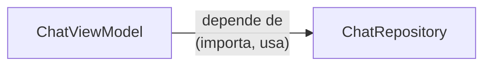
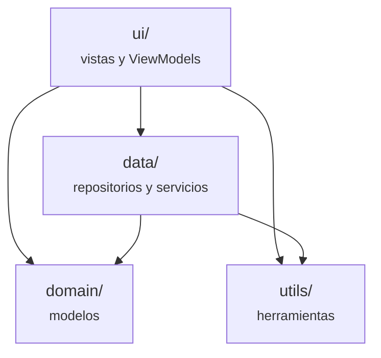
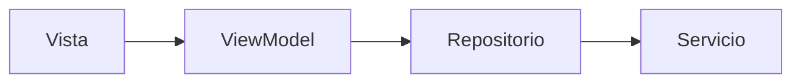
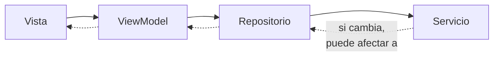
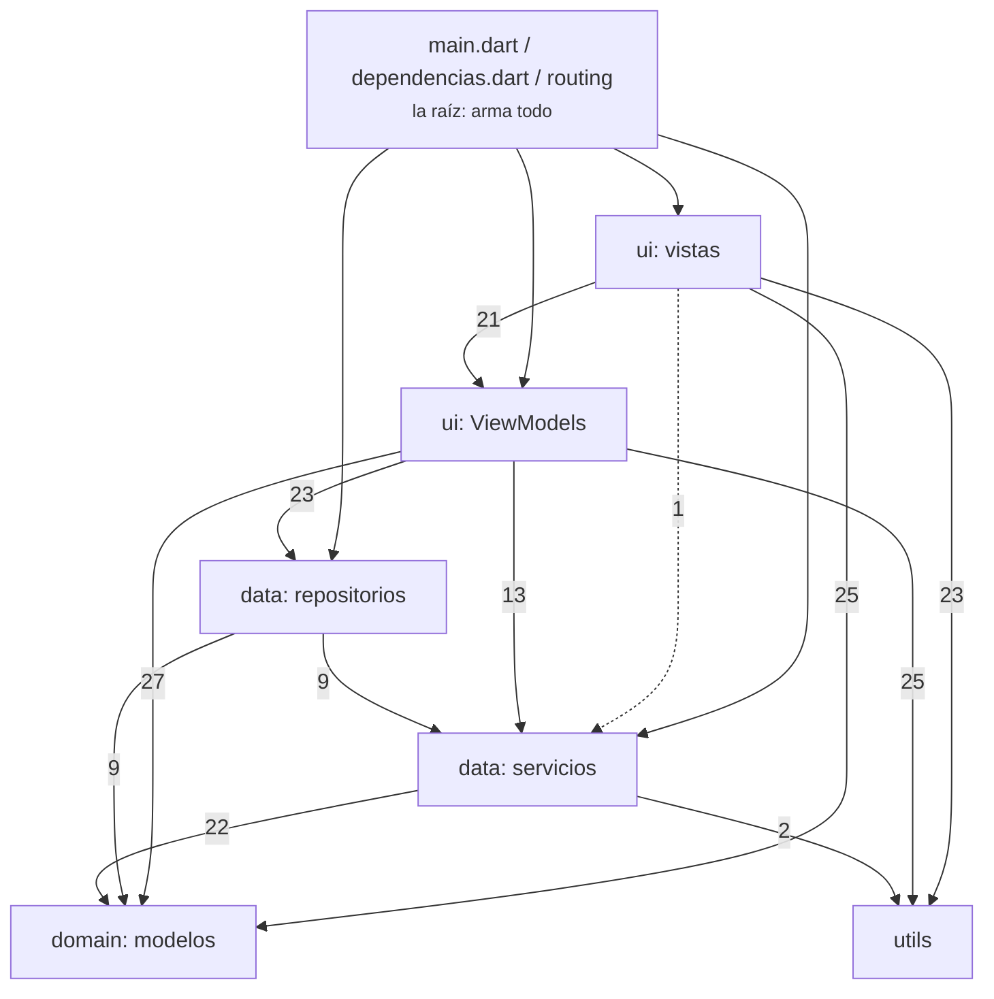
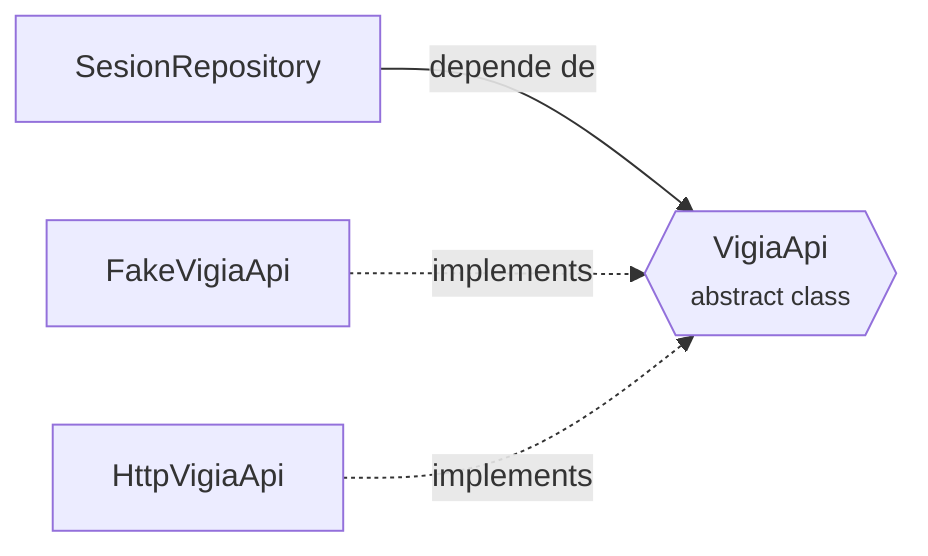
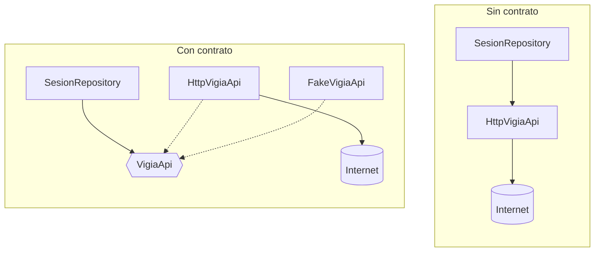
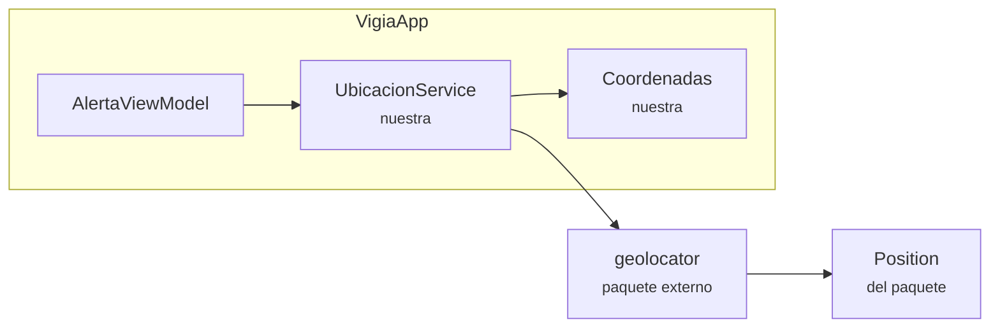

# La dirección de las dependencias

!!! abstract "Objetivo"
    Entender **la** regla que mantiene ordenada la app: **las dependencias van en un solo sentido**, de la interfaz hacia los datos y hacia el dominio, nunca al revés. Y la segunda idea más importante: **depender de un contrato, no de una implementación**. Las dos juntas explican por qué VigiaApp se puede probar sin servidor y cambiar de servidor con una línea.

## "A depende de B"

Decimos que **A depende de B** cuando A **usa** a B: lo importa, lo crea, llama a sus métodos. Si B cambia, A puede romperse.



Las dependencias son inevitables. Lo que importa es **su dirección**.

## La regla: hacia adentro, en un solo sentido



- `ui` puede depender de `data` y de `domain`.
- `data` puede depender de `domain`.
- `domain` **no depende de nadie** (ni de Flutter).
- **Nunca al revés**: un repositorio no importa un ViewModel; un modelo no importa un repositorio.

Y dentro de `ui`, la vista depende del ViewModel, no al revés:



### ¿Por qué importa?

Porque **los cambios se propagan en contra de las flechas**. Si cambia algo de lo que muchos dependen, se rompen muchos.



Con las flechas así:

- Cambiar **cómo se ve** una pantalla no puede romper nada (nadie depende de la vista).
- Cambiar el **servidor** solo afecta al servicio (si el contrato se mantiene, ni al repositorio).
- El **dominio** es lo más estable: lo usan todos, y él no depende de nada que pueda cambiar.

Si hubiera una flecha **al revés** (un repositorio que conoce una pantalla), cambiar la pantalla podría romper los datos, y no habría forma de usar el repositorio sin esa pantalla (por ejemplo, en un test).

## Las dependencias reales de VigiaApp

Este diagrama sale de **contar los `import`** de todos los archivos de `lib/` de la app terminada. El número es cuántos imports hay de una capa a la otra:



Lo importante es lo que **no** está: **ninguna flecha sube**. Ningún archivo de `data/` importa algo de `ui/`; ningún archivo de `domain/` importa nada del proyecto ni de Flutter.

!!! info "Las excepciones, explicadas"
    Hay flechas que la guía "pura" no tendría, y son decisiones conscientes:

    - **ViewModels → servicios (13)**: casi todas son para importar `errores.dart` (para atrapar `ApiException`) y el enum `OrigenFoto` de `selector_fotos.dart`. Solo dos ViewModels usan un servicio de verdad: los de alerta usan `UbicacionService` (el GPS) y `LanzadorExterno` (llamar, Google Maps). Un repositorio en el medio no agregaría nada: no hay datos que guardar.
    - **Vista → servicios (1)**: `elegir_origen_foto.dart` importa el enum `OrigenFoto`.
    - **La raíz** (`main.dart`, `dependencias.dart`, `rutas.dart`) importa de todas las capas: es su trabajo crearlas y conectarlas ([Inyección de dependencias](5-inyeccion-de-dependencias.md)).

### Cómo controlarlo vos

Un comando para verificar que ninguna flecha sube:

```bash
# ¿Algún archivo de data/ o domain/ importa algo de ui/?
grep -rn "ui/" lib/data lib/domain

# ¿Algún modelo importa Flutter?
grep -rn "package:flutter" lib/domain

# ¿Algún ViewModel importa widgets?
grep -rln "material.dart" lib/ui/*/view_model
```

Los tres tienen que dar **vacío**.

## Depender de un contrato

La regla de arriba ordena las capas. Pero todavía queda un problema: el ViewModel depende del repositorio, que depende de… **¿qué?** Si depende de `HttpVigiaApi`, todo termina dependiendo del servidor real, y para probar cualquier cosa hace falta internet.

La solución es que el repositorio dependa de un **contrato** (una clase abstracta) y no de una implementación concreta:



`SesionRepository` recibe **algo que cumple `VigiaApi`**. No sabe cuál:

```dart title="lib/data/repositories/sesion_repository.dart (fragmento)"
class SesionRepository extends ChangeNotifier {
  SesionRepository(this._api, {AlmacenToken? almacen}) : …;

  final VigiaApi _api;  // un contrato, no HttpVigiaApi
  …
}
```

Y **quien lo crea** decide cuál le da:

```dart title="lib/main.dart (fragmento)"
static VigiaApi _apiSegunConfig() =>
    apiUrl == 'fake' ? FakeVigiaApi() : HttpVigiaApi(apiUrl);
```

```dart title="test/sesion_repository_test.dart (fragmento)"
final sesion = SesionRepository(FakeVigiaApi(demora: Duration.zero));
```

Esto tiene un nombre formal: **principio de inversión de dependencias** (la "D" de SOLID). Dice: *los módulos de alto nivel (la lógica de la app) no deben depender de los de bajo nivel (HTTP); los dos deben depender de abstracciones*.



### Lo que ganamos

| | Sin contrato | Con contrato |
|---|---|---|
| Correr la app sin servidor | No | `flutter run` usa `FakeVigiaApi` |
| Tests de ViewModels | Necesitan internet y un usuario real | Corren en milisegundos, offline |
| Probar errores (sin conexión, 401) | Hay que provocarlos de verdad | `FakeVigiaApi(simularError: true)` |
| Hacer la Parte 5 antes de tener servidor | No | Sí: el servidor entra recién en la Parte 6 |
| Cambiar de servidor | Tocar todo | Una implementación nueva de `VigiaApi` |

## Envolver lo de afuera

La misma idea, aplicada a los **paquetes**. VigiaApp nunca usa un paquete externo directamente desde un ViewModel o una vista: lo **envuelve** en una clase propia en `data/services/`.



`UbicacionService.seguir()` devuelve `Stream<Coordenadas>` (nuestro tipo), no `Stream<Position>` (el del paquete). Si mañana cambiamos `geolocator` por otro paquete:

- cambia **un** archivo (`ubicacion_service.dart`);
- `Coordenadas`, los ViewModels, las vistas y los tests **no se enteran**.

Y en los tests, se reemplaza `UbicacionService` por una versión de mentira (`UbicacionDePrueba`), que no necesita GPS ([Plugins y tests](../3-flutter/8-plugins-y-plataformas.md#plugins-y-tests-missingpluginexception)).

!!! tip "La pregunta para hacerte"
    Cada vez que vayas a escribir `import 'package:algo/...'` en un ViewModel o en un modelo, preguntate: **"si mañana cambio este paquete, ¿cuántos archivos tengo que tocar?"**. Si la respuesta es "muchos", envolvelo en un servicio.

## Lo que aprendiste

- [x] Las dependencias van **en un solo sentido**: `ui → data → domain`. Ninguna flecha sube.
- [x] Los cambios se propagan **en contra** de las flechas: lo más estable (el dominio) no depende de nada.
- [x] Depender de un **contrato** (`VigiaApi`) y no de una implementación permite cambiar el servidor real por uno falso.
- [x] Cada paquete externo se **envuelve** en un servicio propio que habla con tipos propios.

[Siguiente: Estructura de carpetas :material-arrow-right:](4-estructura-de-carpetas.md){ .md-button .md-button--primary }
