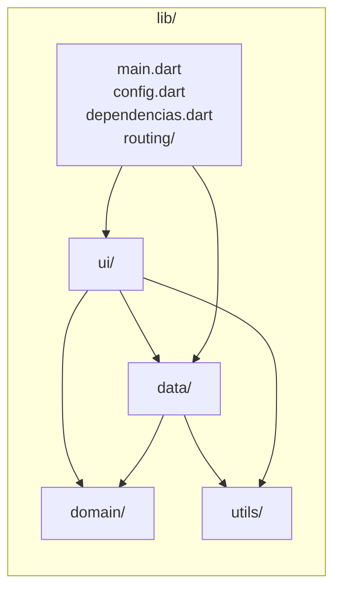
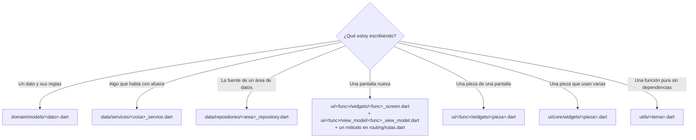

# Estructura de carpetas

!!! abstract "Objetivo"
    Tener el **mapa completo** de `lib/`: qué hay en cada carpeta, cómo se nombran los archivos, y dónde va un archivo nuevo. La estructura **refleja las capas**: con solo ver la ruta de un archivo ya sabés qué hace y qué puede importar.

## El árbol completo

Así queda `lib/` al terminar la Parte 6 (89 archivos):

```text title="lib/"
lib/
├── main.dart                  ← arranca la app y crea todo (raíz de composición)
├── config.dart                ← lo que se elige al compilar (API_URL, número de emergencia)
├── dependencias.dart          ← InheritedWidget con los repositorios
│
├── routing/
│   └── rutas.dart             ← abrir cada pantalla con su ViewModel
│
├── domain/                    ← QUÉ SON LOS DATOS (Dart puro)
│   └── models/
│       ├── alerta.dart        ← EstadoAlerta, UbicacionVecino…
│       ├── comite.dart        ← VecinoAdmin, Manzana, Asignacion…
│       ├── coordenadas.dart
│       ├── mensaje.dart
│       ├── noticia.dart
│       ├── publicacion.dart   ← Publicacion, EstadoBarrio, RespuestaPublicacion…
│       ├── rondin.dart        ← TurnoRondin, EstadoAsistencia…
│       └── sesion.dart        ← Sesion, VecinoSesion, Perfil, roles
│
├── data/                      ← DE DÓNDE SALEN LOS DATOS
│   ├── repositories/          ← una fuente de verdad por área
│   │   ├── alertas_repository.dart
│   │   ├── chat_repository.dart
│   │   ├── comite_repository.dart
│   │   ├── fotos_repository.dart
│   │   ├── publicaciones_repository.dart
│   │   ├── rondines_repository.dart
│   │   └── sesion_repository.dart
│   └── services/              ← hablan con el mundo exterior
│       ├── api/
│       │   ├── vigia_api.dart       ← el contrato (abstract)
│       │   ├── fake_vigia_api.dart  ← datos en memoria
│       │   └── http_vigia_api.dart  ← el servidor real
│       ├── almacen_token.dart       ← flutter_secure_storage
│       ├── errores.dart             ← VigiaException y sus hijas
│       ├── lanzador_externo.dart    ← url_launcher
│       ├── selector_fotos.dart      ← image_picker
│       └── ubicacion_service.dart   ← geolocator
│
├── ui/                        ← LO QUE SE VE
│   ├── core/                  ← lo compartido por todas las pantallas
│   │   ├── view_model.dart    ← la base de todos los ViewModels
│   │   └── widgets/
│   │       ├── avisos.dart          ← SnackBar, "¿Seguro?"
│   │       ├── estados_carga.dart   ← Cargando, ErrorConReintento, TextoError
│   │       ├── foto_vigia.dart      ← una foto que se baja sola
│   │       └── elegir_origen_foto.dart
│   ├── carga/widgets/         ← pantalla de "cargando…" al abrir
│   ├── login/
│   │   ├── view_model/login_view_model.dart
│   │   └── widgets/
│   │       ├── login_screen.dart
│   │       └── recuperar_clave_dialog.dart
│   ├── elegir_clave/          ← (misma forma: view_model/ + widgets/)
│   ├── inicio/                ← la pantalla principal y sus piezas
│   ├── perfil/
│   ├── publicacion/
│   ├── noticias/
│   ├── chat/
│   ├── rondines/
│   ├── emergencia/widgets/    ← solo vista (no tiene ViewModel)
│   ├── alerta/
│   └── comite/
│
└── utils/                     ← herramientas sin dependencias
    ├── fechas.dart
    ├── resultado.dart         ← Ok / Fallo
    ├── sondeo.dart            ← Timer.periodic con iniciar/detener
    └── validadores.dart
```



## `ui/`: una carpeta por pantalla (o por funcionalidad)

Dentro de `ui/`, cada **funcionalidad** tiene su carpeta, y adentro **siempre** la misma forma:

```text
ui/<funcionalidad>/
├── view_model/
│   └── <funcionalidad>_view_model.dart
└── widgets/
    ├── <funcionalidad>_screen.dart   ← la pantalla
    └── <pieza>.dart                  ← piezas que solo usa esta funcionalidad
```

Por ejemplo, el Inicio, que es la pantalla más grande:

```text
ui/inicio/
├── view_model/
│   └── inicio_view_model.dart
└── widgets/
    ├── inicio_screen.dart      ← el Scaffold, las pestañas, el menú
    ├── barra_inferior.dart     ← Chat · SOS · Actividad
    ├── banner_alerta.dart      ← "Jorge activó una alerta"
    ├── estado_red.dart         ← "Red activa · 9 vecinos"
    ├── lista_actividad.dart    ← las publicaciones
    ├── menu_lateral.dart       ← el Drawer
    └── tarjeta_rondin.dart     ← "Tu rondín de hoy"
```

!!! question "¿Por funcionalidad o por tipo?"
    Otra forma común es agrupar **por tipo**: una carpeta `screens/` con todas las pantallas, otra `view_models/` con todos los ViewModels… La guía de Flutter (y VigiaApp) agrupa la interfaz **por funcionalidad**, porque cuando trabajás en el chat, todo lo del chat está junto. La capa de datos sí se agrupa por tipo (`repositories/`, `services/`), porque los repositorios se comparten entre funcionalidades.

### `ui/core/`: lo compartido

Lo que usan **varias** funcionalidades va en `ui/core/`:

- `view_model.dart`: la clase base ([El ViewModel base](6-viewmodel-base.md)).
- `widgets/`: piezas reutilizables (`FotoVigia` la usan el chat, las publicaciones y las alertas).

Regla: un widget empieza en la carpeta de su funcionalidad. Si otra funcionalidad lo necesita, se **mueve** a `ui/core/widgets/`.

## Cómo se nombran los archivos

| Qué | Archivo | Clase |
|---|---|---|
| Pantalla | `perfil_screen.dart` | `PerfilScreen` |
| Diálogo | `cambiar_clave_dialog.dart` | `CambiarClaveDialog` |
| Hoja de abajo | `editar_vecino_sheet.dart` | `EditarVecinoSheet` |
| ViewModel | `perfil_view_model.dart` | `PerfilViewModel` |
| Repositorio | `sesion_repository.dart` | `SesionRepository` |
| Servicio | `ubicacion_service.dart` | `UbicacionService` |
| Modelo | `mensaje.dart` | `Mensaje` |
| Test | `chat_view_model_test.dart` | — |

Reglas de Dart (el analizador las controla):

- Archivos en **`snake_case`**: minúsculas y guiones bajos (`login_screen.dart`). Nunca `LoginScreen.dart`.
- Clases en **`UpperCamelCase`**: `LoginScreen`.
- Variables, funciones y campos en **`lowerCamelCase`**: `cargarNuevos`, `_verClave`.
- Constantes también en `lowerCamelCase`: `apiUrl`, `numeroEmergencia` (no `API_URL` como en otros lenguajes).

!!! info "Español e inglés"
    Los nombres propios de la app están en español (`vecino`, `publicaciones`, `ocupado`). Los sufijos que son convención de la arquitectura quedan en inglés (`Screen`, `ViewModel`, `Repository`), igual que lo que viene de Flutter (`build`, `dispose`). Así se reconoce de un vistazo qué es cada clase.

## Un archivo por cosa importante

Cada archivo tiene **una** clase pública principal (más, a veces, clases privadas que solo usa ella, o un enum chico relacionado). Si un archivo pasa de unas 300 líneas, probablemente esté haciendo demasiado: partilo en piezas.

Excepciones razonables:

- `domain/models/sesion.dart` tiene `Sesion`, `VecinoSesion` y `Perfil`: son tres caras del mismo dato.
- `utils/resultado.dart` tiene `Resultado`, `Ok` y `Fallo`: una clase sellada **tiene** que tener a sus hijas en el mismo archivo.

## `test/`

Los tests van en `test/`, con nombres que terminan en `_test.dart` (si no, `flutter test` no los encuentra):

```text
test/
├── ayudantes.dart                  ← mapas y GPS de mentira para los tests
├── utils_test.dart                 ← capítulo 2
├── modelos_test.dart               ← capítulo 3
├── fake_api_test.dart              ← capítulo 4
├── sesion_repository_test.dart     ← capítulo 5
├── login_view_model_test.dart      ← capítulo 6
├── …                               ← uno por ViewModel importante
├── view_models_test.dart           ← Parte 6
├── widget_test.dart                ← Parte 6: la app entera
├── caracterizacion_test.dart       ← Parte 6
└── api_test.dart                   ← Parte 6: el cliente HTTP
```

Están planos (sin subcarpetas) porque son pocos (17). En un proyecto más grande, conviene que `test/` **copie** la estructura de `lib/` (`test/ui/chat/chat_view_model_test.dart`).

## ¿Dónde va un archivo nuevo?



!!! example "Ejemplo: agregar una pantalla de \"Contactos útiles\""
    1. `domain/models/contacto.dart` con la clase `Contacto` y su `fromJson`.
    2. Un método en `VigiaApi` (`obtenerContactos`) y sus dos implementaciones (fake y HTTP).
    3. `data/repositories/contactos_repository.dart`.
    4. Agregarlo en `main.dart` y en `Dependencias`.
    5. `ui/contactos/view_model/contactos_view_model.dart`.
    6. `ui/contactos/widgets/contactos_screen.dart`.
    7. `Rutas.contactos(context)` en `routing/rutas.dart`.
    8. Una opción en el menú lateral que llame a `Rutas.contactos`.
    9. `test/contactos_view_model_test.dart`.

    Parece mucho, pero cada paso es chico y ya sabés exactamente dónde va. Es uno de los [ejercicios](../7-referencia/ejercicios.md).

## Lo que aprendiste

- [x] `lib/` tiene `domain/`, `data/`, `ui/` y `utils/`, más la raíz (`main.dart`, `dependencias.dart`, `routing/`).
- [x] `ui/` se organiza **por funcionalidad**, cada una con `view_model/` y `widgets/`; lo compartido va en `ui/core/`.
- [x] Archivos en `snake_case` con sufijos que dicen qué son (`_screen`, `_view_model`, `_repository`).
- [x] Hay un camino claro para agregar cualquier cosa nueva.

[Siguiente: Inyección de dependencias :material-arrow-right:](5-inyeccion-de-dependencias.md){ .md-button .md-button--primary }
