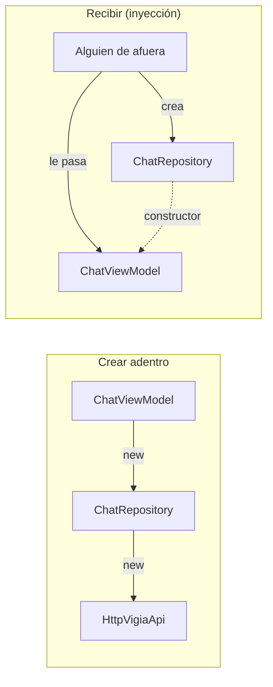
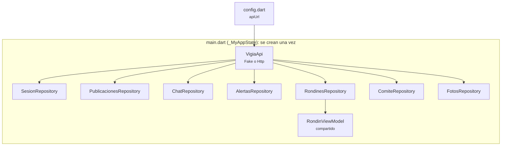
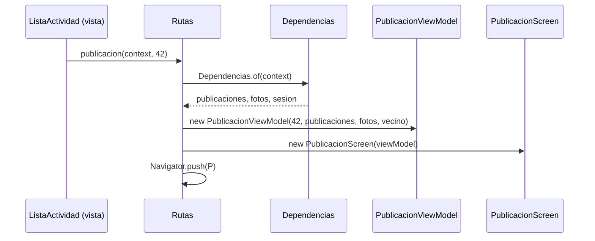

# Inyección de dependencias

!!! abstract "Objetivo"
    Entender **quién crea cada objeto** en VigiaApp y **cómo le llega** a quien lo usa. La respuesta tiene tres piezas: los objetos **reciben** lo que necesitan en el constructor (inyección), **un solo lugar** crea todo (la raíz de composición, `main.dart`), y dos ayudantes los reparten (`Dependencias` y `Rutas`).

## Crear o recibir

Un `ChatViewModel` necesita un `ChatRepository`. Hay dos formas de conseguirlo:

=== "Crearlo adentro (lo que NO hacemos)"

    ```dart
    class ChatViewModel extends ViewModel {
      final _chat = ChatRepository(HttpVigiaApi('https://…'));
    }
    ```

    Problemas:

    - El ViewModel **decide** qué API se usa: en un test, va a querer hablar con el servidor real.
    - Si dos ViewModels hacen lo mismo, hay **dos** repositorios distintos (y dos conexiones, dos memorias de fotos…).
    - Para saber de qué depende, hay que leer todo el código.

=== "Recibirlo (lo que hacemos)"

    ```dart
    class ChatViewModel extends ViewModel {
      ChatViewModel({required this._chat, required this._fotos, required this._vecino});

      final ChatRepository _chat;
      final FotosRepository _fotos;
      final VecinoSesion _vecino;
    }
    ```

    - El ViewModel **no sabe** de dónde viene el repositorio ni qué API usa.
    - Quien lo crea decide: en la app, el repositorio compartido; en un test, uno con `FakeVigiaApi`.
    - Para saber de qué depende, alcanza con mirar el constructor.

Pasarle a un objeto lo que necesita, en vez de que lo cree él, se llama **inyección de dependencias**. La forma más simple (y la única que usa VigiaApp) es **por el constructor**.



!!! info "No es un paquete ni una magia"
    "Inyección de dependencias" suena sofisticado, pero en VigiaApp es solo **pasar cosas por el constructor**. Hay paquetes que lo automatizan (`get_it`, `injectable`), pero no hacen falta.

### Valores por defecto: cómodo y reemplazable

Algunas dependencias tienen una versión "normal" que se usa casi siempre. Para no obligar a pasarla, se deja **opcional con un valor por defecto**:

```dart title="lib/data/repositories/sesion_repository.dart (fragmento)"
SesionRepository(this._api, {AlmacenToken? almacen})
    : _almacen = almacen ?? AlmacenToken();
```

```dart title="lib/data/repositories/fotos_repository.dart (fragmento)"
FotosRepository(this._api, {this._selector = const SelectorFotos()});
```

En la app se crean sin pasar nada (`FotosRepository(api)`); un test puede pasar un selector de mentira.

## La raíz de composición {#la-raiz-de-composicion}

Si nadie crea lo que usa, ¿quién crea todo? **Un solo lugar**, lo más arriba posible: `main.dart`. A ese lugar se le dice **raíz de composición** (*composition root*): donde se **compone** (se arma) el grafo de objetos de la app.

```dart title="lib/main.dart (fragmento)"
class MyApp extends StatefulWidget {
  MyApp({super.key, VigiaApi? api, this.enlaces})
    : api = api ?? _apiSegunConfig();  // (1)!

  final VigiaApi api;

  static VigiaApi _apiSegunConfig() =>
      apiUrl == 'fake' ? FakeVigiaApi() : HttpVigiaApi(apiUrl);  // (2)!
  // …
}

class _MyAppState extends State<MyApp> {
  // Una sola instancia de cada repositorio para toda la app.
  late final _sesion = SesionRepository(widget.api)..iniciar();  // (3)!
  late final _publicaciones = PublicacionesRepository(widget.api);
  late final _chat = ChatRepository(widget.api);
  late final _alertas = AlertasRepository(widget.api);
  late final _rondines = RondinesRepository(widget.api);
  late final _comite = ComiteRepository(widget.api);
  late final _fotos = FotosRepository(widget.api);

  // Compartido por la tarjeta del Inicio y la pantalla de Recorridos.
  late final _rondin = RondinViewModel(_rondines);  // (4)!

  @override
  void dispose() {  // (5)!
    _sesion.dispose();
    _rondin.dispose();
    super.dispose();
  }
  // …
}
```

1. La API se puede **inyectar** desde afuera (los tests de widgets pasan un `FakeVigiaApi` configurado). Si no, se elige según la configuración.
2. **El único lugar** de toda la app donde se decide qué API usar.
3. Los siete repositorios, **una vez cada uno**, todos con **la misma** API.
4. Un ViewModel que se comparte entre pantallas también se crea acá.
5. Quien crea, descarta.



### ¿Por qué todo en un lugar?

- **Una sola instancia** de cada repositorio: si el chat y el Inicio usan `ChatRepository`, es **el mismo**. La memoria de fotos de `FotosRepository` sirve para todas las pantallas.
- **Un solo lugar** para cambiar qué implementación se usa.
- **Un solo lugar** para ver cómo está armada la app entera.

## Repartir: `Dependencias` y `Rutas`

Los repositorios se crean en `main.dart`, pero los ViewModels se crean **cuando se abre cada pantalla**, en otro lado. ¿Cómo les llegan los repositorios?

Pasarlos de widget en widget sería el problema de [estado compartido](../3-flutter/7-estado-compartido.md#el-problema). VigiaApp usa:

1. **`Dependencias`**, un `InheritedWidget` arriba de todo con los repositorios ([capítulo 7](../5-construccion/07-dependencias-y-rutas.md)).
2. **`Rutas`**, que al abrir una pantalla busca lo que necesita en `Dependencias`, arma el ViewModel y se lo pasa.

```dart title="lib/main.dart (fragmento)"
@override
Widget build(BuildContext context) {
  return Dependencias(
    sesion: _sesion,
    publicaciones: _publicaciones,
    chat: _chat,
    alertas: _alertas,
    rondines: _rondines,
    comite: _comite,
    fotos: _fotos,
    rondin: _rondin,
    child: MaterialApp(...),
  );
}
```

```dart title="lib/routing/rutas.dart (fragmento)"
static Future<void> publicacion(BuildContext context, int publicacionId) {
  final d = Dependencias.of(context);
  final viewModel = PublicacionViewModel(
    publicacionId: publicacionId,
    publicaciones: d.publicaciones,
    fotos: d.fotos,
    vecino: d.sesion.vecino,
  );
  return _abrir(context, PublicacionScreen(viewModel: viewModel));
}
```



La vista **solo dice qué abrir**. No toca repositorios, no sabe qué necesita la pantalla nueva.

### ¿Y el Login y el Inicio?

No se abren con `Rutas`: los arma directamente `main.dart`, según el estado de la sesión ([Navegación](../3-flutter/6-navegacion.md#la-pantalla-raiz-cambia-sola)). Como `main.dart` ya tiene los repositorios a mano, no necesita `Dependencias`:

```dart title="lib/main.dart (fragmento)"
InicioViewModel _crearInicio() {
  return InicioViewModel(
    sesion: _sesion,
    publicaciones: _publicaciones,
    alertas: _alertas,
    lanzador: const LanzadorExterno(),
    rondin: _rondin,
    chat: ChatViewModel(chat: _chat, fotos: _fotos, vecino: _sesion.vecino!),
  );
}
```

## Cuánto vive cada cosa

Cada objeto tiene un **dueño**: quien lo crea, y quien lo descarta cuando ya no hace falta.

| Qué | Lo crea | Vive | Lo descarta |
|---|---|---|---|
| `VigiaApi` | `MyApp` | Toda la app | — |
| Repositorios | `_MyAppState` | Toda la app | `_MyAppState.dispose` (`SesionRepository`, que es `ChangeNotifier`) |
| `RondinViewModel` | `_MyAppState` | Toda la app (compartido) | `_MyAppState.dispose` |
| ViewModel de Login / Inicio | `main.dart` (`build`) | Mientras dure esa sesión | La pantalla, en su `dispose` |
| ViewModel de cada pantalla | `Rutas` | Mientras la pantalla esté abierta | La pantalla, en su `dispose` |
| `ChatViewModel` | `main.dart`, para el Inicio | Mientras el Inicio | `InicioViewModel.dispose` |
| ViewModel de un diálogo del comité | El ViewModel de la pantalla | Mientras el diálogo | El diálogo, en su `dispose` |

```mermaid
gantt
    title Cuánto vive cada objeto (un uso típico)
    dateFormat X
    axisFormat %s
    section Toda la app
    VigiaApi, repositorios, RondinViewModel :0, 100
    section Sesión de María
    InicioViewModel + ChatViewModel :10, 90
    section Pantallas
    PerfilViewModel :20, 35
    PublicacionViewModel :45, 60
    section Diálogo
    CambiarClave :25, 30
```



Las reglas de quién descarta qué están en [El ViewModel base](6-viewmodel-base.md#quien-crea-y-quien-descarta).

## Inyección y tests

Toda esta maquinaria paga en los tests. Como todo se recibe por el constructor, en un test se arma **exactamente** lo que se quiere probar, con piezas de mentira:

```dart
// Un ViewModel, con la API en memoria y sin esperas
final api = FakeVigiaApi(demora: Duration.zero);
final vm = ChatViewModel(
  chat: ChatRepository(api),
  fotos: FotosRepository(api),
  vecino: vecinoDePrueba,
);

// La app entera, con la API en memoria y un error simulado
await tester.pumpWidget(MyApp(api: FakeVigiaApi(simularError: true)));
```

Lo vemos en la [Parte 6](../6-pruebas-y-entrega/3-tests-de-view-models.md).

## Lo que aprendiste

- [x] **Inyección de dependencias** = recibir lo que se usa por el constructor, en vez de crearlo.
- [x] La **raíz de composición** (`main.dart`) crea todo una vez y decide qué implementación usar.
- [x] **`Dependencias`** (un `InheritedWidget`) deja los repositorios disponibles; **`Rutas`** arma cada ViewModel y abre la pantalla.
- [x] Cada objeto tiene un **dueño** que lo crea y lo descarta.
- [x] Gracias a esto, un test arma cualquier pieza con dependencias de mentira.

[Siguiente: El ViewModel base :material-arrow-right:](6-viewmodel-base.md){ .md-button .md-button--primary }
