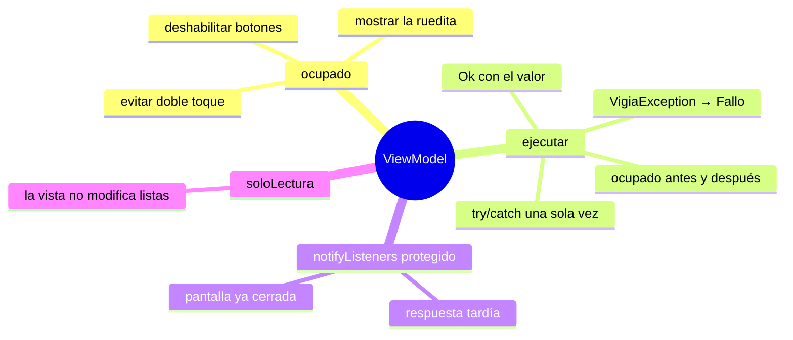
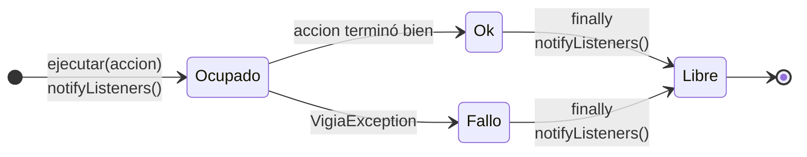
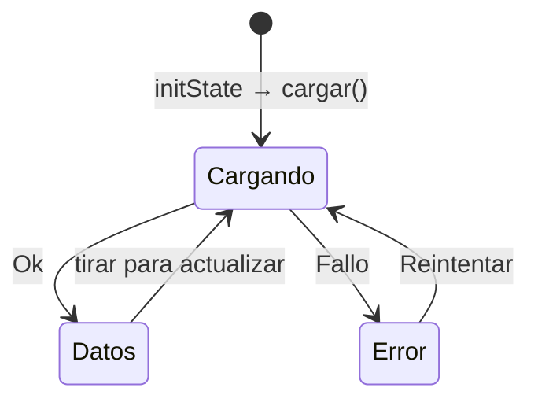
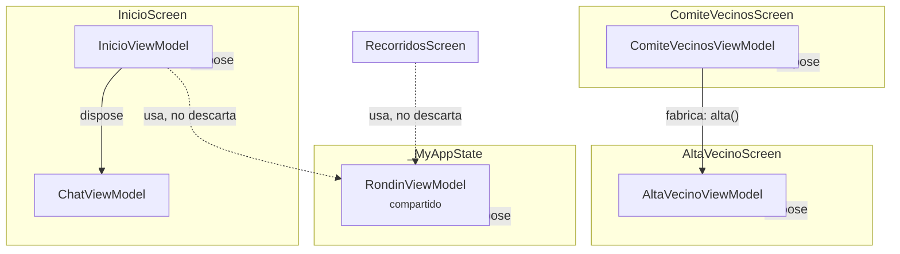

# El ViewModel base

!!! abstract "Objetivo"
    Leer **línea por línea** la clase `ViewModel` de la que heredan todos los ViewModels de la app, entender los **dos patrones** que se repiten en cada pantalla (cargar datos y ejecutar una acción), y las reglas de **quién crea y quién descarta** cada ViewModel.

## El archivo completo

Son 68 líneas, y están en `lib/ui/core/view_model.dart` ([capítulo 6](../5-construccion/06-login.md)):

```dart title="lib/ui/core/view_model.dart" linenums="1"
import 'dart:collection';

import 'package:flutter/foundation.dart';  // (1)!

import '../../data/services/errores.dart';
import '../../utils/resultado.dart';

abstract class ViewModel extends ChangeNotifier {  // (2)!
  bool _ocupado = false;
  bool _descartado = false;

  /// true mientras se espera al servidor: la vista deshabilita los botones
  /// para que no los toquen dos veces.
  bool get ocupado => _ocupado;  // (3)!

  /// Corre [accion] y convierte el error en un [Fallo] con el mensaje para
  /// mostrar. Con [marcarOcupado], pasa por "ocupado" mientras espera:
  /// notifyListeners() antes y después del await.
  @protected  // (4)!
  Future<Resultado<T>> ejecutar<T>(
    Future<T> Function() accion, {
    bool marcarOcupado = true,
  }) async {
    if (marcarOcupado) _cambiarOcupado(true);
    try {
      return Ok(await accion());
    } on VigiaException catch (e) {  // (5)!
      return Fallo(e.mensaje);
    } finally {
      if (marcarOcupado) _cambiarOcupado(false);
    }
  }

  void _cambiarOcupado(bool ocupado) {
    _ocupado = ocupado;
    notifyListeners();
  }

  // Una respuesta del servidor puede llegar con la pantalla ya cerrada: en
  // ese caso no hay a quién avisarle (es el "if (!mounted) return" de antes).
  @override
  void notifyListeners() {  // (6)!
    if (!_descartado) super.notifyListeners();
  }

  @override
  void dispose() {
    _descartado = true;
    super.dispose();
  }
}

/// Las listas que expone un ViewModel son de solo lectura: la vista no puede
/// hacer `viewModel.turnos.clear()` por atrás del ViewModel. No copia la
/// lista, solo la envuelve.
extension SoloLectura<T> on List<T> {  // (7)!
  List<T> get soloLectura => UnmodifiableListView(this);
}
```

1. `foundation`, **no** `material`: un ViewModel no conoce widgets. `foundation` trae `ChangeNotifier` y `@protected`.
2. **Abstracta**: no se crea un `ViewModel()` suelto; se hereda. Y es un `ChangeNotifier`: sabe avisar.
3. Todos los ViewModels tienen `ocupado`, de solo lectura.
4. `ejecutar` es para las **hijas**, no para la vista. Si una vista lo llama, el analizador avisa.
5. Atrapa **solo** errores de la app (`VigiaException` y sus hijas: API, GPS, cámara). Un error de programación (un `null` inesperado) **no** se atrapa: tiene que verse y arreglarse.
6. Si la pantalla se cerró mientras se esperaba al servidor, el ViewModel ya fue descartado. Avisar a un `ChangeNotifier` descartado es un error; con esto, simplemente no avisa.
7. Una [extensión](../2-dart/6-herencia-y-abstraccion.md#extensiones) para exponer listas sin que la vista las pueda modificar.

## Qué resuelve cada parte



### `ejecutar` y `Resultado`

`ejecutar` devuelve un [`Resultado`](../2-dart/7-enums-records-patrones.md#clases-selladas): `Ok(valor)` o `Fallo(mensaje)`. **Nunca lanza** un error conocido. Así la vista no necesita `try`/`catch`: hace un `switch` o usa `avisarSiFallo`.



## Los dos patrones de todo ViewModel

Casi todo lo que hace un ViewModel es una de estas dos cosas.

### Patrón 1: cargar datos para mostrar

La pantalla se abre y tiene que mostrar algo que viene del servidor. El estado tiene tres caras: **cargando**, **error** o **datos**.

```dart title="lib/ui/perfil/view_model/perfil_view_model.dart (fragmento)"
class PerfilViewModel extends ViewModel {
  PerfilViewModel(this._sesion);

  final SesionRepository _sesion;

  Perfil? _perfil;  // (1)!
  bool _fallo = false;

  Perfil? get perfil => _perfil;
  bool get fallo => _fallo;

  Future<void> cargar() async {
    _fallo = false;
    notifyListeners();  // (2)!
    final resultado = await ejecutar(  // (3)!
      _sesion.obtenerPerfil,
      marcarOcupado: false,
    );
    switch (resultado) {
      case Ok(:final valor):
        _perfil = valor;
      case Fallo():
        _fallo = true;
    }
    notifyListeners();  // (4)!
  }
}
```

1. `null` mientras no llegó: la vista muestra "cargando".
2. Avisa que empieza (por si estaba en error y tocaron "Reintentar").
3. Sin `ocupado`: para cargas se usa el propio estado (`perfil == null`), no hace falta deshabilitar botones.
4. Avisa con el resultado.

Y la vista:

```dart
builder: (context, _) {
  if (_viewModel.fallo) {
    return ErrorConReintento(mensaje: 'No se pudo cargar tu perfil', onReintentar: _viewModel.cargar);
  }
  final perfil = _viewModel.perfil;
  if (perfil == null) return const Cargando();
  return ListView(...);  // los datos
}
```



### Patrón 2: una acción del vecino

El vecino toca un botón (enviar, borrar, guardar). El ViewModel la ejecuta y **devuelve el resultado** a la vista, que decide qué mostrar **una vez** (un SnackBar, cerrar la pantalla).

```dart title="lib/ui/chat/view_model/chat_view_model.dart (fragmento)"
Future<Resultado<void>> enviar({String texto = '', int? fotoId}) async {
  final limpio = texto.trim();
  if (limpio.isEmpty && fotoId == null) return const Ok(null);
  final resultado = await ejecutar(  // ocupado = true … false
    () => _chat.enviar(texto: limpio.isEmpty ? null : limpio, fotoId: fotoId),
  );
  if (resultado case Ok(valor: final mensaje)) {
    _agregar([mensaje]);
    notifyListeners();
  }
  return resultado;  // la vista decide qué hacer
}
```

Y la vista:

```dart
Future<void> _enviar() async {
  final resultado = await _viewModel.enviar(texto: _texto.text);
  if (mounted && avisarSiFallo(context, resultado)) _texto.clear();
}
```

!!! question "¿Por qué el ViewModel no muestra el SnackBar?"
    Porque mostrar un SnackBar necesita un `BuildContext`, y el ViewModel no conoce widgets. Además, "mostrar algo una vez" no es **estado** (no tiene que volver a aparecer si la pantalla se redibuja): es un **evento**. Por eso viaja como valor de retorno (`Resultado`) y no como un campo.

| Lo que hay que mostrar | Cómo llega a la vista |
|---|---|
| Algo que **se queda** en pantalla (la lista, "cargando", un error debajo del formulario) | **Estado**: campo + getter + `notifyListeners()` |
| Algo que pasa **una vez** (SnackBar, cerrar, navegar) | **Resultado**: lo que devuelve el método |

## Plantilla de un ViewModel nuevo

```dart title="lib/ui/<funcionalidad>/view_model/<funcionalidad>_view_model.dart"
import '../../../data/repositories/algo_repository.dart';
import '../../../domain/models/algo.dart';
import '../../../utils/resultado.dart';
import '../../core/view_model.dart';

class AlgoViewModel extends ViewModel {
  AlgoViewModel({required this._algos});

  final AlgoRepository _algos;

  // Estado: privado + getter.
  final List<Algo> _lista = [];
  bool _cargando = true;
  String? _error;

  List<Algo> get lista => _lista.soloLectura;
  bool get cargando => _cargando;
  String? get error => _error;

  // Patrón 1: cargar.
  Future<void> cargar() async {
    final resultado = await ejecutar(_algos.obtenerTodos, marcarOcupado: false);
    switch (resultado) {
      case Ok(:final valor):
        _lista
          ..clear()
          ..addAll(valor);
        _error = null;
      case Fallo(:final mensaje):
        _error = mensaje;
    }
    _cargando = false;
    notifyListeners();
  }

  // Patrón 2: una acción.
  Future<Resultado<void>> borrar(int id) async {
    final resultado = await ejecutar(() => _algos.borrar(id));
    if (resultado is Ok) {
      _lista.removeWhere((a) => a.id == id);
      notifyListeners();
    }
    return resultado;
  }
}
```

## Quién crea y quién descarta {#quien-crea-y-quien-descarta}

Un ViewModel es un `ChangeNotifier`: hay que **descartarlo** (`dispose()`) cuando ya no se usa, para cortar timers y suscripciones. La pregunta es **quién**. Las reglas de VigiaApp:

!!! danger "Regla 1: quien recibe un ViewModel en el constructor de una pantalla, lo descarta"
    La pantalla lo guarda con `late final _viewModel = widget.viewModel;` y lo descarta en su `dispose()`. Aunque no lo haya creado ella (lo creó `Rutas` o `main.dart`), es su **dueña**.

!!! danger "Regla 2: un ViewModel compartido lo descarta quien lo creó"
    `RondinViewModel` lo usan la tarjeta del Inicio y la pantalla de Recorridos. **Ninguna** de las dos lo descarta: lo creó `_MyAppState` y lo descarta en su `dispose`. `Rutas.recorridos` lo pasa sin crear uno nuevo.

!!! danger "Regla 3: un ViewModel que contiene a otro, lo descarta"
    `InicioViewModel` recibe un `ChatViewModel` propio (el chat vive mientras viva el Inicio) y lo descarta en su `dispose()`. Pero **no** descarta el `RondinViewModel` que también recibe, porque es compartido (regla 2).

!!! danger "Regla 4: un ViewModel para un diálogo se pide nuevo cada vez"
    Las pantallas del comité **fabrican** el ViewModel de cada diálogo (`_viewModel.alta()`, `_viewModel.editar(vecino)`). El diálogo es su dueño y lo descarta. Si se guarda y se reusa, la segunda vez está descartado: `A ViewModel was used after being disposed`.



La flecha llena es "descarta"; la punteada, "usa sin descartar".

!!! tip "Qué descartar en el `dispose` de un ViewModel"
    Todo lo que **ese** ViewModel abrió: `Sondeo`s (`_sondeo.detener()`), suscripciones (`_suscripcion?.cancel()`), ViewModels hijos propios (`chat.dispose()`). Y al final, `super.dispose()`.

## Lo que aprendiste

- [x] `ViewModel` es un `ChangeNotifier` abstracto con **`ocupado`**, **`ejecutar`** (errores → `Resultado`), un **`notifyListeners` protegido** y **`soloLectura`**.
- [x] **Cargar**: estado con tres caras (cargando, error, datos). **Acción**: devuelve un `Resultado` que la vista muestra una vez.
- [x] Lo que se queda en pantalla es **estado**; lo que pasa una vez es **resultado**.
- [x] Quien recibe un ViewModel lo descarta; los compartidos los descarta quien los creó.

[Siguiente: Los errores, de punta a punta :material-arrow-right:](7-errores.md){ .md-button .md-button--primary }
