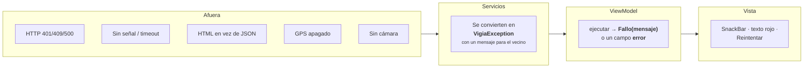
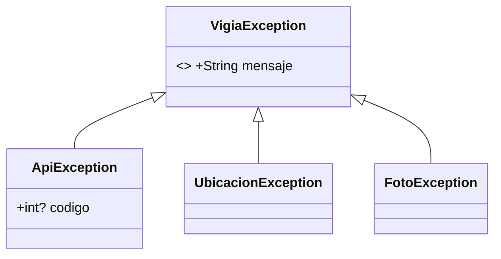
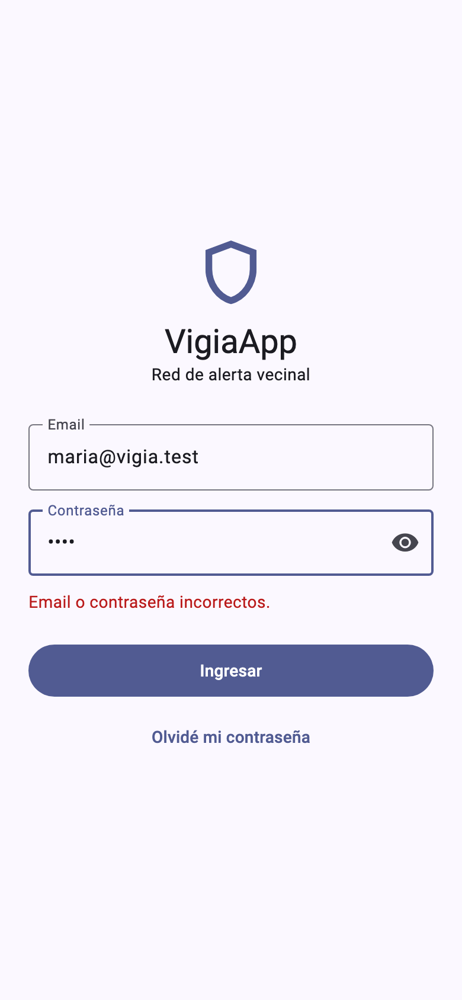
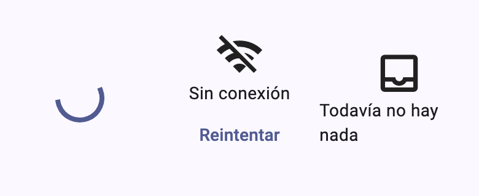
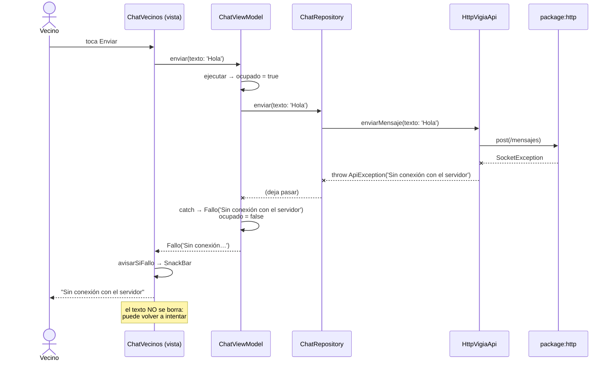
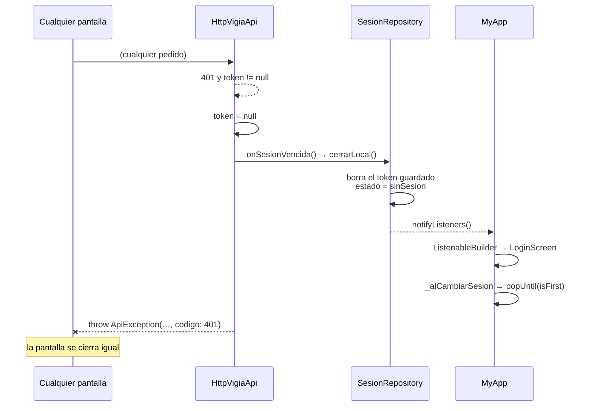

# Los errores, de punta a punta

!!! abstract "Objetivo"
    Seguir un error **desde que ocurre** (el servidor dice que no, no hay señal, el GPS está apagado) **hasta que el vecino lo ve** (un SnackBar, un texto rojo, un botón "Reintentar"). Ver qué hace cada capa con él, y el caso especial de la **sesión vencida**, que atraviesa toda la app.

## La idea: convertir pronto, mostrar tarde



1. **Convertir pronto**: apenas un error entra a la app (en el servicio), se convierte en **una** familia de errores propia (`VigiaException`), con un **mensaje en castellano** listo para mostrar.
2. **Pasar sin tocar**: los repositorios, en general, lo dejan pasar.
3. **Atrapar en un solo lugar**: el ViewModel lo atrapa (con `ejecutar`) y lo convierte en **estado** o en **resultado**.
4. **Mostrar tarde**: la vista decide **cómo** mostrarlo.

## La familia de errores

```dart title="lib/data/services/errores.dart"
sealed class VigiaException implements Exception {
  const VigiaException(this.mensaje);
  final String mensaje;
}

/// Error que devuelve la API (sin conexión, 4xx, 5xx, timeout...).
class ApiException extends VigiaException {
  const ApiException(super.mensaje, {this.codigo});
  final int? codigo; // código HTTP, si lo hubo
}

/// Por qué no se pudo seguir la ubicación (GPS apagado, sin permiso).
class UbicacionException extends VigiaException { … }

/// No se pudo abrir la cámara o la galería.
class FotoException extends VigiaException { … }
```



El `mensaje` es **para el vecino**. El `codigo` (en `ApiException`) es **para el código**: algunos lugares reaccionan distinto según sea 401, 409, etc.

## Paso 1: el servidor

El servidor de VigiaApp, cuando algo sale mal, responde con un código HTTP de error y un JSON con este formato:

```http
HTTP/1.1 409 Conflict
Content-Type: application/json

{"error": {"codigo": "conflicto", "mensaje": "La alerta ya no está activa."}}
```

Estos son todos los códigos que usa la API (de su especificación, ver [Contrato de la API](../7-referencia/contrato-api.md)):

| HTTP | `codigo` | Cuándo | Ejemplo en VigiaApp |
|---|---|---|---|
| `400` | `datos_invalidos` | Falta un campo o tiene formato incorrecto | Mensaje sin texto ni foto |
| `401` | `no_autorizado` | Token ausente, inválido o vencido, o credenciales incorrectas | Contraseña incorrecta; el token venció |
| `403` | `prohibido` | La acción es solo del comité o del autor | Un vecino común publicando una noticia |
| `404` | `no_encontrado` | El recurso no existe, o el vecino no está asignado o avisado | Una publicación que ya se borró |
| `409` | `conflicto` | El estado actual no lo permite | Responder una alerta que ya terminó; dos turnos el mismo día; un email repetido |
| `429` | `demasiados_intentos` | Más de 20 pedidos a `/auth/*` en 15 minutos | Probar contraseñas a lo loco |
| `500` | `error_interno` | Error no controlado del servidor | Se cayó la base |

Además, el *hosting* puede responder una página HTML (por ejemplo, un `503` mientras la API reinicia), que no es JSON.

Y hay errores **sin** respuesta: no hay señal, el servidor no contesta (timeout), el DNS no resuelve.

## Paso 2: el servicio convierte

Todo eso entra por **un** lugar, `HttpVigiaApi` ([Parte 6](../6-pruebas-y-entrega/2-api-real.md)), y sale como `ApiException`:

```dart title="lib/data/services/api/http_vigia_api.dart (fragmento)"
// Sin conexión, DNS o timeout también terminan en ApiException: así las
// pantallas solo tienen que atrapar un tipo de error.
Future<http.Response> _pedir(Future<http.Response> Function() pedido) async {
  try {
    return await pedido().timeout(_timeout);  // (1)!
  } on Exception {
    throw ApiException('Sin conexión con el servidor');  // (2)!
  }
}

dynamic _procesar(http.Response respuesta) {
  final ok = respuesta.statusCode >= 200 && respuesta.statusCode < 300;
  dynamic cuerpo;
  try {
    cuerpo = respuesta.body.isEmpty ? null : jsonDecode(utf8.decode(respuesta.bodyBytes));
  } on FormatException {
    // No vino JSON: p. ej. la página HTML del hosting con un 503.
    if (ok) throw ApiException('Respuesta inválida del servidor');  // (3)!
  }

  if (!ok) {
    if (respuesta.statusCode == 401 && token != null) {  // (4)!
      token = null;
      onSesionVencida?.call();
    }
    final mensaje = cuerpo is Map && cuerpo['error'] is Map
        ? cuerpo['error']['mensaje'] as String  // (5)!
        : 'Error del servidor';
    throw ApiException(mensaje, codigo: respuesta.statusCode);  // (6)!
  }
  return cuerpo;
}
```

1. Si en 10 segundos no hay respuesta, `timeout` lanza un `TimeoutException`.
2. **Cualquier** problema de red (sin señal, DNS, timeout) se convierte en el mismo error, con un mensaje claro.
3. Si respondió "bien" pero no es JSON, algo raro pasa: error.
4. El caso especial de la **sesión vencida**: lo vemos [abajo](#el-caso-especial-la-sesion-vencida).
5. El mensaje **lo escribe el servidor**, en castellano. La app lo muestra tal cual.
6. Se lanza con el código, por si alguien quiere reaccionar distinto.

`FakeVigiaApi` hace **lo mismo** (lanza `ApiException` con mensajes y códigos iguales a los del servidor), así que todo lo que sigue funciona igual con el servidor de mentira:

```dart title="lib/data/services/api/fake_vigia_api.dart (fragmentos)"
Never _error(String mensaje, int codigo) => throw ApiException(mensaje, codigo: codigo);

// En login:
_error('Email o contraseña incorrectos.', 401);

// Y para probar las pantallas sin conexión:
if (simularError) throw ApiException('Sin conexión');
```

Los otros servicios hacen lo mismo con lo suyo:

| Servicio | Error de afuera | Se convierte en |
|---|---|---|
| `UbicacionService` | GPS apagado, permiso negado, `MissingPluginException` | `UbicacionException('Prendé la ubicación…')` |
| `SelectorFotos` | `PlatformException` (sin cámara, sin permiso) | `FotoException('No se pudo abrir la cámara o la galería.')` |
| `AlmacenToken` | Cualquier `Exception` del llavero | **Nada**: sigue sin token (el vecino vuelve a entrar) |

## Paso 3: el repositorio (casi siempre) deja pasar

Los repositorios, en general, **no atrapan**: el error sigue hacia el ViewModel. Hay excepciones razonables, cuando el repositorio **sabe qué hacer**:

```dart title="lib/data/repositories/sesion_repository.dart (fragmento)"
/// "Cerrar sesión": avisa al servidor y, pase lo que pase, sale localmente.
Future<void> logout() async {
  try {
    await _api.logout();
  } on ApiException {
    // Sin conexión: el token vence solo a las 24 h.
  }
  cerrarLocal();
}
```

Si no hay señal al cerrar sesión, igual se cierra en el celular. No tiene sentido mostrarle un error al vecino.

## Paso 4: el ViewModel atrapa

Hay dos formas, según el [patrón](6-viewmodel-base.md#los-dos-patrones-de-todo-viewmodel):

=== "Acción → Resultado"

    Con `ejecutar`, el error se convierte en un `Fallo` que se **devuelve**:

    ```dart
    Future<Resultado<void>> enviar({String texto = '', int? fotoId}) async {
      final resultado = await ejecutar(() => _chat.enviar(...));
      // si falló, resultado es Fallo('Sin conexión con el servidor')
      return resultado;
    }
    ```

=== "Carga → estado"

    El error se guarda en un **campo** que la vista muestra mientras dure:

    ```dart title="lib/ui/chat/view_model/chat_view_model.dart (fragmento)"
    Future<void> cargarNuevos() async {
      try {
        final nuevos = await _chat.obtenerMensajes(despues: …);
        _agregar(nuevos);
        _error = null;
      } on ApiException {
        // Sin conexión: se reintenta en 10 s.
        _error = 'No se pudo cargar el chat';
      }
      _cargando = false;
      notifyListeners();
    }
    ```

    Acá el ViewModel **elige su propio mensaje** ("No se pudo cargar el chat") en vez del del servidor, porque tiene más contexto.

=== "Reaccionar a un código"

    Si un código pide hacer algo más, se mira `codigo`:

    ```dart title="lib/ui/alerta/view_model/alerta_vecino_view_model.dart (fragmento)"
    try {
      await pedido();
    } on ApiException catch (e) {
      if (e.codigo == 409) await consultar();  // la alerta cambió: refresco
      rethrow;                                 // y el error sigue a ejecutar()
    }
    ```

## Paso 5: la vista muestra

La vista elige **cómo** mostrar cada error:

| Situación | Cómo se muestra | Widget |
|---|---|---|
| Falló una acción (enviar, borrar) | **SnackBar**, se va solo | `avisarSiFallo(context, resultado)` |
| Falló el envío de un formulario | **Texto rojo** debajo de los campos, se queda | `TextoError(error)` |
| No se pudo cargar la pantalla | **Mensaje + Reintentar** en el lugar del contenido | `ErrorConReintento(...)` |
| Falló una actualización de fondo (el sondeo) | **Discreto**: se sigue mostrando lo que había | Un texto o nada |

<div class="capturas" markdown>
<figure markdown>
{ .captura }
<figcaption>Texto rojo: el error del servidor en el Login.</figcaption>
</figure>
<figure markdown>
{ .captura .ancha }
<figcaption>Cargando, error con reintento y vacío.</figcaption>
</figure>
</div>

## El recorrido completo

Un vecino intenta enviar un mensaje sin señal:



Fijate el detalle de la última nota: como `avisarSiFallo` devuelve `false`, la vista **no** limpia el campo. El vecino no pierde lo que escribió.

## El caso especial: la sesión vencida

Un `401` **con sesión iniciada** significa que el token ya no sirve (pasaron 24 h, se cerró desde otro lado, el comité desactivó al vecino). No alcanza con mostrar un error: **hay que volver al Login**, esté donde esté el vecino.



Las piezas:

1. **`SesionRepository`** le dice a la API, al crearse, qué hacer si la sesión vence:

    ```dart
    SesionRepository(this._api, {AlmacenToken? almacen}) : … {
      _api.onSesionVencida = cerrarLocal;
    }
    ```

2. **`HttpVigiaApi`** (y `FakeVigiaApi`) lo llaman al ver un 401 con token.
3. **`cerrarLocal`** borra todo y cambia el estado a `sinSesion`.
4. **`MyApp`** escucha la sesión: la raíz pasa a `LoginScreen` y cierra las pantallas abiertas encima ([Navegación](../3-flutter/6-navegacion.md#popuntil-en-vigiaapp)).

!!! info "¿Y un 401 sin token?"
    Un 401 **sin** sesión iniciada es "contraseña incorrecta" en el login: no hay nada que cerrar. Por eso la condición es `statusCode == 401 && token != null`.

## Errores que no se atrapan

Todo lo anterior son errores **esperables**. Los errores de **programación** (un `null` donde no debía, un índice fuera de rango, un `as int` sobre un texto) **no** son `VigiaException` y `ejecutar` **no** los atrapa. Es a propósito: tienen que **verse** (pantalla roja en debug, el test que falla) para **arreglarlos**, no esconderse detrás de un "Algo salió mal".

## Lo que aprendiste

- [x] Los errores de afuera se **convierten pronto** en `VigiaException`, con un mensaje para el vecino.
- [x] `HttpVigiaApi` junta red, timeout, HTML y códigos HTTP en **un** tipo, `ApiException(mensaje, codigo)`.
- [x] Los repositorios dejan pasar; el ViewModel **atrapa** (en `Resultado` o en un campo `error`); la vista **elige cómo mostrar**.
- [x] Un **401 con sesión** dispara `onSesionVencida` → `cerrarLocal` → la raíz vuelve al Login.
- [x] Los errores de programación no se atrapan: se arreglan.

[Siguiente: Un toque, de punta a punta :material-arrow-right:](8-un-toque-de-punta-a-punta.md){ .md-button .md-button--primary }
