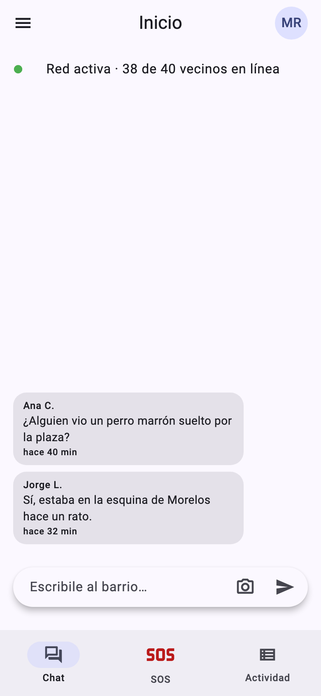
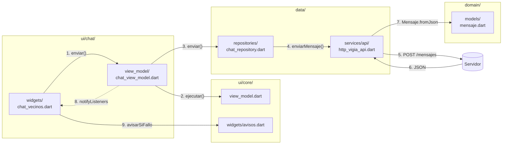
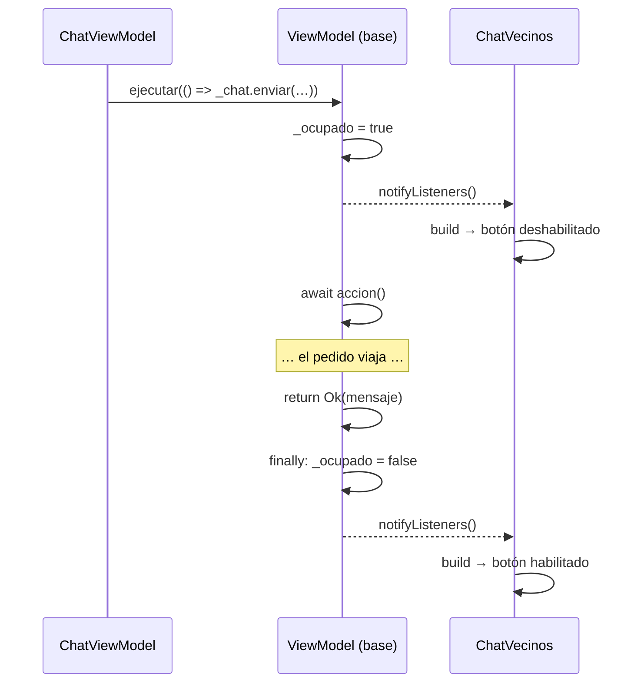
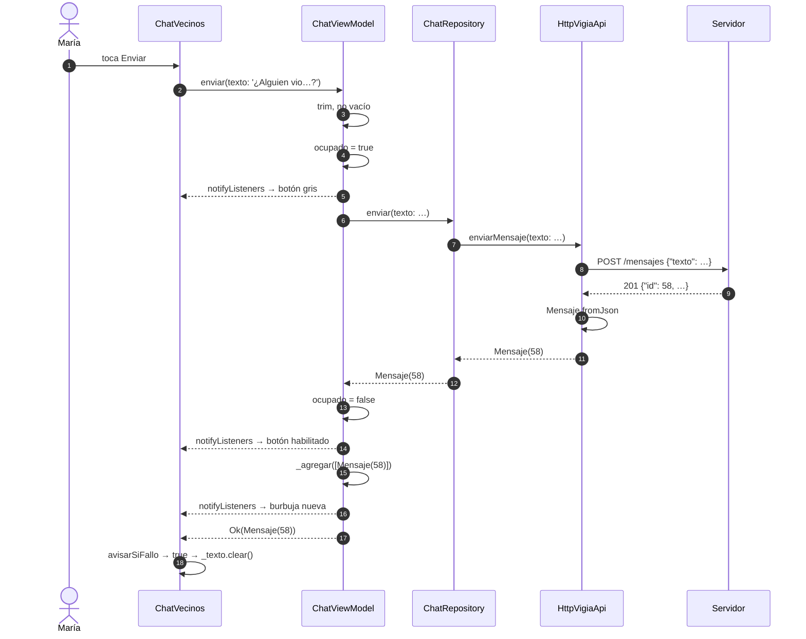

# Un toque, de punta a punta

!!! abstract "Objetivo"
    Seguir **una acción real** por **todas** las capas, archivo por archivo: María escribe "¿Alguien vio un perro marrón?" en el chat del barrio y toca **Enviar**. Vamos a ver qué código corre, en qué orden, qué viaja por la red y cómo se redibuja la pantalla. Es el resumen práctico de toda la Parte 4.

<figure markdown="span">
  { .captura }
  <figcaption>El chat del barrio (capítulo 12).</figcaption>
</figure>

## El mapa



## 1. La vista recibe el toque

```dart title="lib/ui/chat/widgets/chat_vecinos.dart (fragmentos)"
class _ChatVecinosState extends State<ChatVecinos> {
  final _texto = TextEditingController();  // (1)!
  late final ChatViewModel _viewModel = widget.viewModel;

  Future<void> _enviar() async {
    final resultado = await _viewModel.enviar(texto: _texto.text);  // (2)!
    if (mounted && avisarSiFallo(context, resultado)) _texto.clear();  // (3)!
  }

  Widget _barra() {
    final ocupado = _viewModel.ocupado;
    return …
        IconButton(
          icon: const Icon(Icons.send),
          tooltip: 'Enviar',
          onPressed: ocupado ? null : _enviar,  // (4)!
        ),
    …;
  }
}
```

1. El texto que escribió María vive en el controlador: es **estado de la vista**.
2. Le pasa el texto al ViewModel. No sabe nada más.
3. Al volver: si la pantalla sigue abierta y **no** falló, limpia el campo. Si falló, muestra el SnackBar y **deja** el texto.
4. Mientras está ocupado, el botón está deshabilitado: no se puede mandar dos veces.

## 2. El ViewModel valida y ejecuta

```dart title="lib/ui/chat/view_model/chat_view_model.dart (fragmento)"
Future<Resultado<void>> enviar({String texto = '', int? fotoId}) async {
  final limpio = texto.trim();  // (1)!
  if (limpio.isEmpty && fotoId == null) return const Ok(null);  // (2)!
  final resultado = await ejecutar(  // (3)!
    () => _chat.enviar(texto: limpio.isEmpty ? null : limpio, fotoId: fotoId),
  );
  if (resultado case Ok(valor: final mensaje)) {  // (4)!
    _agregar([mensaje]);
    notifyListeners();
  }
  return resultado;  // (5)!
}
```

1. Saca espacios de los bordes. Una **regla de presentación**: va acá, no en la vista.
2. Si no hay nada que mandar, no molesta al servidor. Devuelve `Ok` (no es un error).
3. `ejecutar` (de la [clase base](6-viewmodel-base.md)): marca **ocupado**, avisa, espera, desmarca, avisa. Y convierte errores en `Fallo`.
4. Si salió bien, agrega el mensaje **que devolvió el servidor** (con su `id` y su hora) y avisa.
5. Devuelve el resultado para que la vista decida qué mostrar.

Mientras tanto, `ejecutar` hizo esto:



## 3. El repositorio pasa el pedido

```dart title="lib/data/repositories/chat_repository.dart (fragmento)"
Future<Mensaje> enviar({String? texto, int? fotoId}) =>
    _api.enviarMensaje(texto: texto, fotoId: fotoId);
```

Un pasamanos ([¿para qué?](2-mvvm-y-capas.md#repositorios)). `_api` es **un `VigiaApi`**: en la app real, `HttpVigiaApi`; en la Parte 5 y en los tests, `FakeVigiaApi`. El repositorio no sabe cuál.

## 4. El servicio habla HTTP

```dart title="lib/data/services/api/http_vigia_api.dart (fragmentos)"
@override
Future<Mensaje> enviarMensaje({String? texto, int? fotoId}) async {
  return Mensaje.fromJson(
    await _post('/mensajes', {'texto': ?texto, 'foto_id': ?fotoId}),  // (1)!
  );
}

Future<dynamic> _post(String ruta, [Map<String, dynamic>? body]) => _enviar(
  () => _cliente.post(_uri(ruta), headers: _headers, body: _json(body)),  // (2)!
);

Map<String, String> get _headers => {
  'Content-Type': 'application/json',
  'Accept': 'application/json',
  if (token != null) 'Authorization': 'Bearer $token',  // (3)!
};
```

1. Arma el cuerpo **solo con lo que hay** ([elementos opcionales](../2-dart/4-colecciones.md#elementos-opcionales)): como María no mandó foto, no va `foto_id`.
2. `_uri` pega la ruta a la URL base; `_json` convierte el mapa a texto JSON; `_enviar` hace el pedido con timeout y procesa la respuesta ([Los errores](7-errores.md#paso-2-el-servicio-convierte)).
3. El token de la sesión, en el encabezado. Lo puso `SesionRepository` al iniciar sesión.

## 5 y 6. Por la red

Lo que viaja, de verdad:

=== "El pedido"

    ```http
    POST /api/v1/mensajes HTTP/1.1
    Host: hotpink-aardvark-846933.hostingersite.com
    Content-Type: application/json
    Accept: application/json
    Authorization: Bearer 3f9a1c0e7b…(64 caracteres hexadecimales)

    {"texto":"¿Alguien vio un perro marrón?"}
    ```

=== "La respuesta"

    ```http
    HTTP/1.1 201 Created
    Content-Type: application/json

    {
      "id": 58,
      "texto": "¿Alguien vio un perro marrón?",
      "foto_id": null,
      "autor": "María R.",
      "iniciales": "MR",
      "autor_id": 1,
      "creado_en": "2026-11-16T23:41:07.000Z"
    }
    ```

## 7. El JSON se vuelve un `Mensaje`

```dart title="lib/domain/models/mensaje.dart (fragmento)"
factory Mensaje.fromJson(Map<String, dynamic> json) {
  return Mensaje(
    id: json['id'] as int,
    texto: json['texto'] as String?,
    fotoId: json['foto_id'] as int?,
    autor: json['autor'] as String,
    iniciales: json['iniciales'] as String,
    autorId: json['autor_id'] as int,
    creadoEn: DateTime.parse(json['creado_en'] as String).toLocal(),  // (1)!
  );
}
```

1. El servidor manda la hora en UTC (la `Z` del final); `toLocal()` la pasa a la hora del celular.

Desde acá para arriba, **nadie** vuelve a ver un mapa ni un texto JSON: solo `Mensaje`, con sus tipos.

## 8. La pantalla se redibuja

Volvemos al ViewModel: `_agregar([mensaje])` y `notifyListeners()`.

```dart title="lib/ui/chat/view_model/chat_view_model.dart (fragmento)"
// Agrega solo los que todavía no tenemos: si dos pedidos se cruzan (el
// polling y el de enviar), el mismo mensaje no aparece dos veces.
void _agregar(List<Mensaje> nuevos) {
  final ultimo = _mensajes.isEmpty ? 0 : _mensajes.last.id;
  _mensajes.addAll([
    for (final mensaje in nuevos)
      if (mensaje.id > ultimo) mensaje,
  ]);
}
```

El `ListenableBuilder` de `ChatVecinos` escucha al ViewModel, así que vuelve a llamar a su `builder`, que arma la lista con el mensaje nuevo:

```dart title="lib/ui/chat/widgets/chat_vecinos.dart (fragmento)"
ListView.builder(
  reverse: true,  // los más nuevos abajo
  itemCount: mensajes.length,
  itemBuilder: (context, index) {
    final mensaje = mensajes[mensajes.length - 1 - index];
    return BurbujaMensaje(
      mensaje: mensaje,
      esMio: _viewModel.esMio(mensaje),  // a la derecha, porque es de María
      cargarFoto: _viewModel.cargarFoto,
    );
  },
)
```

## 9. La vista termina

`enviar` devolvió `Ok`. En `_enviar`, `avisarSiFallo` devuelve `true` (no falló), así que se limpia el campo. Fin.

## Todo junto, en el tiempo



## Y diez segundos después…

El `Sondeo` del chat sigue consultando cada 10 segundos:

```dart
final nuevos = await _chat.obtenerMensajes(
  despues: _mensajes.isEmpty ? null : _mensajes.last.id,  // despues=58
);
```

Pide los mensajes **después del 58**. Si Jorge respondió, llega el 59 y se agrega. Si el pedido del sondeo salió **justo antes** de que llegara la respuesta del envío y trae el 58 de nuevo, `_agregar` lo descarta (porque `58 > 58` es falso). Ese detalle es lo que el comentario "si dos pedidos se cruzan" explica.

## ¿Qué cambió en cada capa?

| Capa | Archivo | Qué hizo | ¿Sabe de…? |
|---|---|---|---|
| Vista | `chat_vecinos.dart` | Tomó el texto, llamó a `enviar`, limpió o avisó | Widgets, `context` |
| ViewModel | `chat_view_model.dart` | Validó, marcó ocupado, agregó sin repetir, avisó | El estado del chat |
| Base | `view_model.dart` | `ocupado`, `try`/`catch`, `Resultado` | Errores de la app |
| Repositorio | `chat_repository.dart` | Pasó el pedido | `VigiaApi` (un contrato) |
| Servicio | `http_vigia_api.dart` | HTTP, token, JSON, errores | La red |
| Modelo | `mensaje.dart` | Convirtió el JSON | Nada más |

!!! example "Probalo vos"
    Corré la app (con el servidor falso), poné un *breakpoint* en `ChatViewModel.enviar` y otro en `FakeVigiaApi.enviarMensaje`, mandá un mensaje y avanzá con ++f10++ / ++f11++ ([el depurador](../1-preparacion/4-correr-y-depurar.md#el-depurador)). Vas a ver exactamente este recorrido.

## Lo que aprendiste

- [x] Un toque atraviesa **vista → ViewModel → repositorio → servicio → red**, y vuelve como **modelo → ViewModel → `notifyListeners` → vista**.
- [x] Cada capa hace **una** cosa y conoce **lo mínimo**.
- [x] El estado (ocupado, la lista) baja por `notifyListeners`; el resultado (SnackBar o limpiar) vuelve como valor.

!!! success "Terminaste la Parte 4"
    Ya tenés el mapa completo. Ahora toca construir la app, archivo por archivo, sabiendo dónde va cada uno y por qué.

[Siguiente: Parte 5, Construcción :material-arrow-right:](../5-construccion/index.md){ .md-button .md-button--primary }
