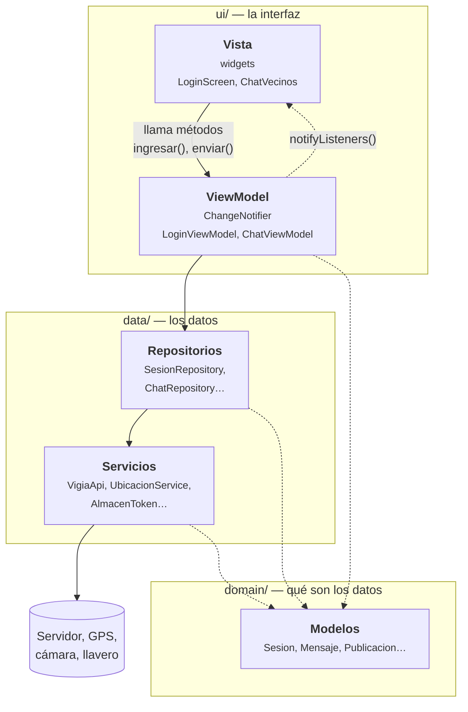

# 4. Arquitectura

Con lo de las Partes 2 y 3 ya podrías hacer VigiaApp. Pero si pusieras todo adentro de los widgets (pedidos al servidor, reglas, timers, estado), terminarías con pantallas de mil líneas, imposibles de probar, donde cambiar el servidor obliga a tocar todo. La **arquitectura** es la forma de **ordenar** el código para que eso no pase.

!!! abstract "Al terminar esta parte vas a poder"
    - Explicar **por qué** VigiaApp tiene tantos archivos para lo que hace.
    - Nombrar las **capas** (vista, ViewModel, repositorio, servicio, modelo) y decir **qué va en cada una**.
    - Aplicar la regla de la **dirección de las dependencias**: quién puede importar a quién.
    - Ubicar cualquier archivo en la **estructura de carpetas** y saber dónde va uno nuevo.
    - Entender la **inyección de dependencias** y la **raíz de composición**.
    - Leer el **`ViewModel` base** línea por línea.
    - Seguir un **error** desde el servidor hasta el SnackBar, y un **toque** desde el botón hasta el servidor y de vuelta.

## VigiaApp en una imagen

Es el patrón **MVVM** (*Model–View–ViewModel*), tal como lo propone la [guía de arquitectura oficial de Flutter](https://docs.flutter.dev/app-architecture). Sin paquetes extra: solo `ChangeNotifier`, `ListenableBuilder` e `InheritedWidget`.

## Las páginas

| Página | La pregunta que responde |
|---|---|
| [1. Por qué una arquitectura](1-por-que.md) | ¿Qué pasa si pongo todo en el widget? |
| [2. MVVM y las capas](2-mvvm-y-capas.md) | ¿Qué hace cada capa y qué va en cada una? |
| [3. La dirección de las dependencias](3-direccion-de-dependencias.md) | ¿Quién puede conocer a quién? |
| [4. Estructura de carpetas](4-estructura-de-carpetas.md) | ¿Dónde está cada cosa? ¿Dónde pongo algo nuevo? |
| [5. Inyección de dependencias](5-inyeccion-de-dependencias.md) | ¿Quién crea los objetos y cómo llegan a donde se usan? |
| [6. El ViewModel base](6-viewmodel-base.md) | ¿Qué tienen en común todos los ViewModels? |
| [7. Los errores, de punta a punta](7-errores.md) | ¿Qué pasa cuando algo falla? |
| [8. Un toque, de punta a punta](8-un-toque-de-punta-a-punta.md) | ¿Qué pasa, exactamente, cuando el vecino toca "Enviar"? |

!!! tip "Leela dos veces"
    Esta parte es más abstracta que las anteriores. Leela ahora para tener el mapa, y **volvé** a leerla después de los capítulos 6 a 8 de la Parte 5, cuando ya hayas escrito un ViewModel, un repositorio y una pantalla. La segunda vez todo encaja.

[Empezar: Por qué una arquitectura :material-arrow-right:](1-por-que.md){ .md-button .md-button--primary }
