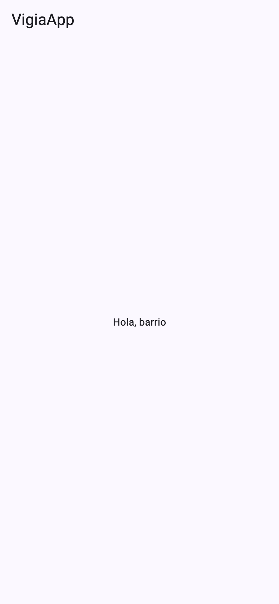
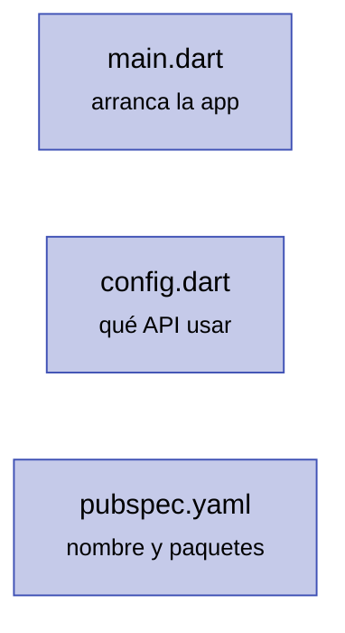
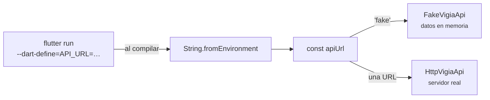
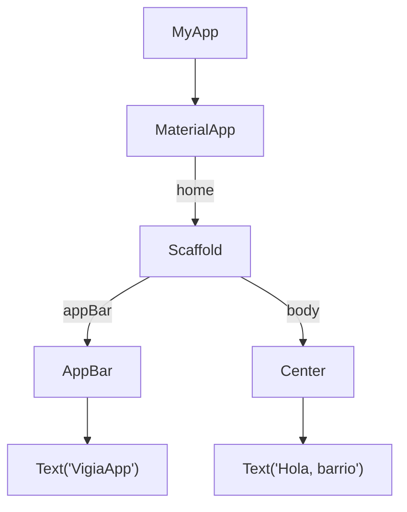

# 1. Esqueleto

!!! abstract "Objetivo"
    Crear el proyecto, dejar las dependencias en cero y tener una app que abre y muestra **"Hola, barrio"**. Es poco, pero es la base: a partir de acá, todo lo que hagas va a vivir en estos archivos.

<figure markdown="span">
  { .captura }
  <figcaption>Así se ve al final del capítulo.</figcaption>
</figure>

## Dónde estamos

Todavía no hay capas: solo el punto de entrada (`main.dart`) y la configuración (`config.dart`).



## Paso 1: crear el proyecto

Si todavía no lo hiciste, seguí [Crear el proyecto](../1-preparacion/3-crear-el-proyecto.md). El comando es:

```bash
flutter create --org com.ejemplo --platforms android,ios vigia_app
cd vigia_app
```

- `--org com.ejemplo` define el identificador de la app (`com.ejemplo.vigia_app`). En una app real va el dominio de la organización al revés.
- `--platforms android,ios` crea solo las carpetas de Android e iOS. Sin esa opción también crea `web/`, `linux/`, `macos/` y `windows/`, que no vamos a usar.

`flutter create` deja una app de ejemplo (un contador). La vamos a reemplazar entera.

## Paso 2: borrar el test de ejemplo

`flutter create` trae `test/widget_test.dart`, que prueba el contador. Como vamos a borrar el contador, ese test va a fallar. Borralo:

=== "macOS / Linux"

    ```bash
    rm test/widget_test.dart
    ```

=== "Windows (PowerShell)"

    ```powershell
    Remove-Item test\widget_test.dart
    ```

!!! info "No es que no vayamos a tener tests"
    Desde el capítulo 2, cada capítulo agrega sus tests. En la Parte 6 escribimos un `widget_test.dart` nuevo que prueba la app entera.

## Paso 3: el `pubspec.yaml`

El `pubspec.yaml` es la ficha del proyecto: cómo se llama, qué versión de Dart necesita y de qué paquetes depende (lo vemos a fondo en [Librerías y paquetes](../2-dart/10-librerias-y-paquetes.md)). Reemplazá todo el contenido por este:

<!-- archivo: pubspec.yaml cap=c01 notas="^name:|publish_to|^version|sdk: \^|^dependencies|flutter_lints|uses-material-design" -->
```yaml title="pubspec.yaml" linenums="1"
name: vigia_app  # (1)!
description: "VigiaApp: red de alerta vecinal (versión de la wiki, solo Material)."
publish_to: 'none'  # (2)!
version: 1.0.0+1  # (3)!

environment:
  sdk: ^3.12.2  # (4)!

dependencies:  # (5)!
  flutter:
    sdk: flutter

dev_dependencies:
  flutter_test:
    sdk: flutter
  flutter_lints: ^6.0.0  # (6)!

flutter:
  uses-material-design: true  # (7)!
```
<!-- /archivo -->

1. El nombre del paquete. Es el que aparece en los `import` de los tests: `import 'package:vigia_app/...'`. Solo minúsculas y guiones bajos.
2. `'none'` evita publicar la app por error en [pub.dev](https://pub.dev), el repositorio público de paquetes.
3. Versión de la app: `1.0.0` es la que ve el usuario y `+1` es el número de compilación, que tiene que subir en cada entrega a la tienda.
4. Qué versiones de Dart aceptamos. `^3.12.2` significa "3.12.2 o mayor, pero menor que 4.0.0". Las versiones nuevas del lenguaje que usamos (por ejemplo, los parámetros privados con nombre) necesitan Dart 3.12.
5. Los paquetes que usa la app. Por ahora solo Flutter. Se van a ir sumando: almacenamiento seguro, enlaces, fotos, GPS, mapas, HTTP…
6. Las reglas del analizador (los subrayados amarillos del editor). `flutter_lints` es el conjunto de reglas recomendadas por el equipo de Flutter.
7. Incluye la fuente de íconos de Material: sin esto, `Icon(Icons.menu)` mostraría un cuadradito.

Después de guardarlo, bajá los paquetes:

```bash
flutter pub get
```

!!! tip "El editor lo hace solo"
    VS Code y Android Studio corren `flutter pub get` cada vez que guardás el `pubspec.yaml`. Igual conviene saber el comando, porque a veces hay que correrlo a mano.

## Paso 4: la configuración

Creá el archivo `lib/config.dart`. Acá van los valores que se eligen **al compilar** y que no cambian mientras la app está abierta.

<!-- archivo: lib/config.dart cap=c01 notas="const apiProduccion|String.fromEnvironment\('API_URL'|NUMERO_EMERGENCIA" -->
```dart title="lib/config.dart" linenums="1"
// lib/config.dart
//
// Configuración que se elige al compilar con --dart-define.

/// API publicada en Hostinger (repo vigia_api).
const apiProduccion =  // (1)!
    'https://hotpink-aardvark-846933.hostingersite.com/api/v1';

/// URL de la API. Por defecto, 'fake': datos de prueba en memoria, sin
/// servidor. Se cambia al compilar:
///   `flutter run`                                                  → fake
///   `flutter run --dart-define=API_URL=https://…/api/v1`            → producción
///   `flutter run --dart-define=API_URL=http://10.0.2.2:3000/api/v1` → API local
const apiUrl = String.fromEnvironment('API_URL', defaultValue: 'fake');  // (2)!

/// Número que marca el botón "Llamar" de la alerta. Por seguridad, en la demo
/// y en las pruebas es *555 (no molesta a nadie); la versión real se compila
/// con `--dart-define=NUMERO_EMERGENCIA=911`. (3)
const numeroEmergencia = String.fromEnvironment(
  'NUMERO_EMERGENCIA',
  defaultValue: '*555',
);
```
<!-- /archivo -->

1. Una **constante**: un valor que se conoce antes de compilar y no cambia nunca. `const` lo explicamos en [Variables y tipos](../2-dart/1-variables-y-tipos.md#final-y-const). Es la dirección del servidor real de VigiaApp; la vamos a usar recién en la Parte 6.
2. `String.fromEnvironment` lee un valor que se pasa al compilar con `--dart-define`. Si no se pasa nada, usa el `defaultValue`. Así, sin tocar el código:
    - `flutter run` → `apiUrl` vale `'fake'` y la app usa datos de prueba en memoria;
    - `flutter run --dart-define=API_URL=https://…` → la app habla con ese servidor.
3. Lo mismo para el número que marca el botón "Llamar" de una alerta. En la demo y en los tests es `*555`, que no llama a nadie. Para la versión real se compila con `--dart-define=NUMERO_EMERGENCIA=911`.



!!! question "¿Por qué no usar directamente la URL real?"
    Porque para aprender (y para los tests) es mucho más cómodo no depender de internet ni de tener un usuario creado en el servidor. El servidor falso (`FakeVigiaApi`, capítulo 4) responde lo mismo que el real, con vecinos de ejemplo.

## Paso 5: el punto de entrada

Reemplazá todo `lib/main.dart` por esto:

<!-- archivo: lib/main.dart cap=c01 notas="void main|runApp|class MyApp extends StatelessWidget|const MyApp|Widget build|MaterialApp\(|colorSchemeSeed|home: Scaffold|appBar|body:" -->
```dart title="lib/main.dart" linenums="1"
// lib/main.dart
//
// Punto de entrada de la app. Por ahora solo muestra una pantalla vacía:
// capítulo a capítulo se va llenando.

import 'package:flutter/material.dart';

void main() {  // (1)!
  runApp(const MyApp());  // (2)!
}

class MyApp extends StatelessWidget {  // (3)!
  const MyApp({super.key});  // (4)!

  @override
  Widget build(BuildContext context) {  // (5)!
    return MaterialApp(  // (6)!
      title: 'VigiaApp',
      theme: ThemeData(colorSchemeSeed: Colors.indigo),  // (7)!
      home: Scaffold(  // (8)!
        appBar: AppBar(title: const Text('VigiaApp')),  // (9)!
        body: const Center(child: Text('Hola, barrio')),  // (10)!
      ),
    );
  }
}
```
<!-- /archivo -->

1. `main` es la función con la que arranca **todo** programa de Dart. El sistema la llama al abrir la app.
2. `runApp` le da a Flutter el widget raíz: el que ocupa toda la pantalla y contiene a todos los demás.
3. `MyApp` es un widget **sin estado** (`StatelessWidget`): no guarda nada que cambie. Lo vemos en [Stateless y Stateful](../3-flutter/2-stateless-y-stateful.md).
4. `const` en el constructor permite crear `MyApp` como constante, y `super.key` pasa la `key` (opcional) a la clase padre. Lo vas a ver en todos los widgets.
5. `build` describe **cómo se ve** el widget. Flutter lo llama cada vez que necesita dibujarlo.
6. `MaterialApp` configura la app con el estilo Material de Google: tema, navegación, idioma, título.
7. El tema: con un solo color (`indigo`), Material genera toda la paleta (fondos, botones, textos). No vamos a tocar más estilos que este.
8. `home` es la primera pantalla. Un `Scaffold` es el "andamio" de una pantalla Material: barra de arriba, cuerpo, botón flotante, menú lateral…
9. La barra de arriba, con el título.
10. El cuerpo: un texto centrado.

El árbol de widgets que acabás de escribir es este:



## Probalo

Elegí un emulador o conectá el celular y corré:

```bash
flutter run
```

Tenés que ver la barra que dice **VigiaApp** y el texto **Hola, barrio** en el centro. Cambiá el texto, guardá y fijate cómo se actualiza sin reiniciar (es el *hot reload*, ver [Correr, recargar y leer errores](../1-preparacion/4-correr-y-depurar.md)).

Revisá también que el analizador no se queje:

```bash
flutter analyze
```

```text
Analyzing vigia_app...
No issues found!
```

## Así queda el proyecto

<!-- arbol: cap=c01 -->
```text title="Así queda el proyecto"
vigia_app/
    lib/
        config.dart  ← nuevo
        main.dart  ← nuevo
    pubspec.yaml  ← nuevo
```
<!-- /arbol -->

(Además están las carpetas `android/` e `ios/`, que generó `flutter create` y no vamos a tocar casi nunca.)

## Errores comunes

??? failure "`Because vigia_app requires SDK version ^3.12.2, version solving failed.`"
    Tu Flutter trae una versión de Dart más vieja. Actualizalo con `flutter upgrade` y verificá con `flutter --version` que diga `Dart 3.12` o más.

??? failure "`Target of URI doesn't exist: 'package:flutter/material.dart'`"
    No se bajaron los paquetes. Corré `flutter pub get` en la carpeta del proyecto (la que tiene el `pubspec.yaml`).

??? failure "`No supported devices connected.`"
    No hay emulador abierto ni celular conectado. Abrí un emulador desde Android Studio (Device Manager) o corré `flutter emulators --launch <nombre>`. Ver [Instalar las herramientas](../1-preparacion/2-instalacion.md).

## Lo que aprendiste

- [x] Un proyecto Flutter se crea con `flutter create` y su ficha es el `pubspec.yaml`.
- [x] Todo arranca en `main()`, que llama a `runApp()` con el widget raíz.
- [x] Las pantallas se arman como un **árbol de widgets**: `MaterialApp` → `Scaffold` → `AppBar` + cuerpo.
- [x] Con `String.fromEnvironment` y `--dart-define` se cambia la configuración sin tocar el código.

[Siguiente: 2. Utilidades :material-arrow-right:](02-utilidades.md){ .md-button .md-button--primary }
