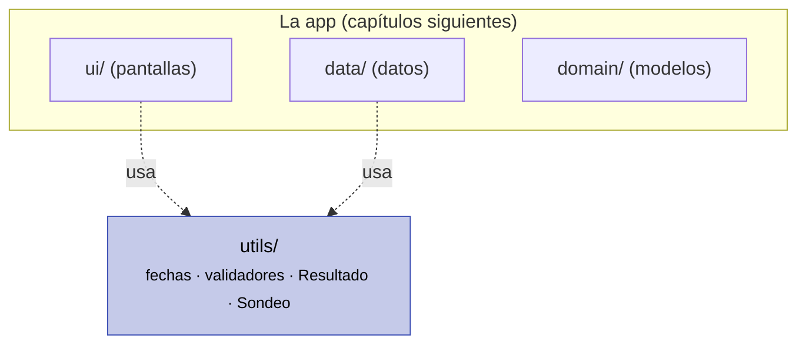
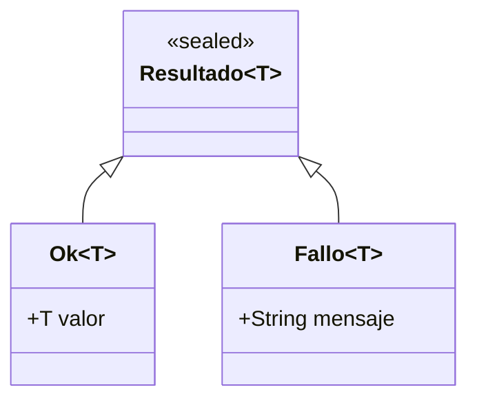
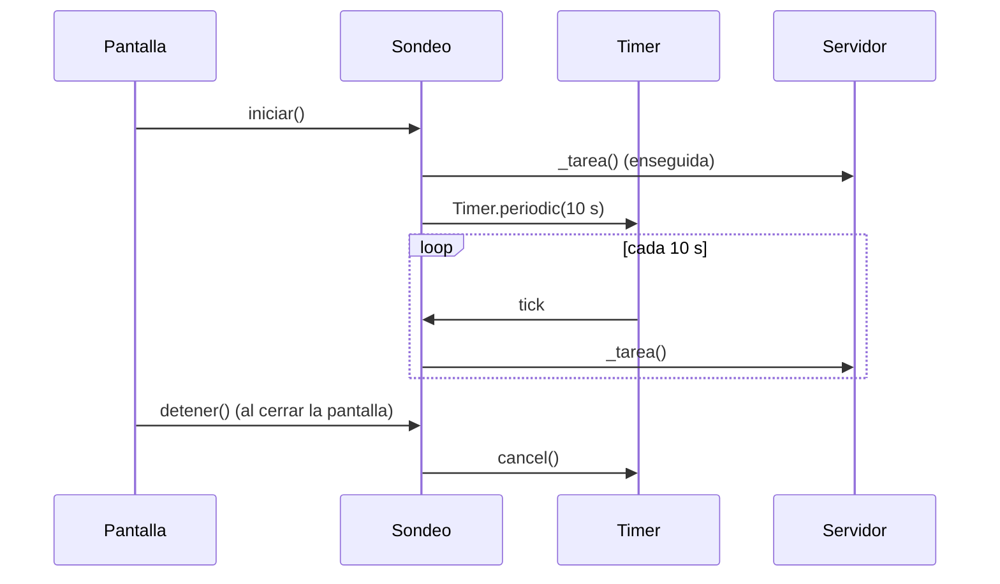

# 2. Utilidades

!!! abstract "Objetivo"
    Escribir las cuatro herramientas chicas que usa toda la app: **fechas** en texto ("hace 25 min"), **validadores** de formularios, el tipo **`Resultado`** (salió bien o falló) y **`Sondeo`** (consultar al servidor cada tantos segundos). Y escribir los **primeros tests**.

Todavía no hay nada nuevo para ver en pantalla. Este capítulo se prueba con tests, que es justamente lo que queremos aprender.

## Dónde estamos

`lib/utils/` no es una capa: es una caja de herramientas que cualquier capa puede usar. Lo que hay adentro es **Dart puro**: no importa Flutter, ni paquetes, ni nada de la app.



!!! info "¿Por qué empezar por acá?"
    Porque no dependen de nada. Las podés escribir, entender y probar solas, y después las usamos en todos lados. Es la forma más tranquila de practicar Dart antes de meterse con pantallas.

## Paso 1: `Resultado`, salió bien o falló

Cuando la pantalla le pide algo al servidor (borrar una publicación, mandar un mensaje), la respuesta puede ser buena o mala. En vez de devolver `true`/`false` y perder el motivo del error, devolvemos un **`Resultado`**, que es una de dos cosas:

- `Ok(valor)`: salió bien, y trae lo que devolvió (por ejemplo, el id de una alerta creada).
- `Fallo(mensaje)`: salió mal, y trae el texto para mostrarle al vecino.

Creá `lib/utils/resultado.dart`:

<!-- archivo: lib/utils/resultado.dart cap=c02 notas="^sealed class|final class Ok|final T valor|final class Fallo|final String mensaje" -->
```dart title="lib/utils/resultado.dart" linenums="1"
// lib/utils/resultado.dart
//
// Resultado de una acción del ViewModel que la vista tiene que mostrar una
// sola vez (un SnackBar, cerrar la pantalla). Es una clase sellada: el
// compilador obliga a contemplar los dos casos con un switch.
//
//   switch (await viewModel.borrar()) {
//     Ok() => Navigator.pop(context),
//     Fallo(:final mensaje) => mostrarAviso(context, mensaje),
//   }

sealed class Resultado<T> {  // (1)!
  const Resultado();
}

final class Ok<T> extends Resultado<T> {  // (2)!
  const Ok(this.valor);

  final T valor;  // (3)!
}

final class Fallo<T> extends Resultado<T> {  // (4)!
  const Fallo(this.mensaje);

  /// Texto para mostrarle al vecino.
  final String mensaje;  // (5)!
}
```
<!-- /archivo -->

1. `sealed` (sellada) significa que **las únicas subclases son las de este archivo**: `Ok` y `Fallo`. Gracias a eso, el compilador sabe que un `Resultado` es una de esas dos, y te avisa si en un `switch` te olvidás de una. Lo explicamos en [Enums, records y patrones](../2-dart/7-enums-records-patrones.md#clases-selladas).
2. `Ok<T>` es **genérica**: `T` es el tipo del valor. `Ok<int>` trae un `int`; `Ok<void>` no trae nada útil (se usa cuando solo importa que salió bien).
3. El valor que devolvió la acción.
4. `Fallo` también es genérica, para poder ser un `Resultado<T>` del mismo `T`, aunque no traiga valor.
5. El texto para mostrar. Ya viene listo para el vecino ("Sin conexión"), no es un error técnico.

Así se usa (lo vas a ver en todas las pantallas):

```dart
switch (await viewModel.borrar()) {
  Ok() => Navigator.pop(context),              // salió bien: cerrar
  Fallo(:final mensaje) => mostrarAviso(context, mensaje), // falló: avisar
}
```

`Fallo(:final mensaje)` es un **patrón**: pregunta "¿es un `Fallo`?" y, si lo es, saca el campo `mensaje` a una variable con el mismo nombre. Si te parece magia, leé [patrones](../2-dart/7-enums-records-patrones.md#patrones) y volvé.



## Paso 2: fechas en texto

El servidor manda fechas como `2026-11-16T11:35:00Z`. El vecino quiere leer "hace 25 min". Creá `lib/utils/fechas.dart`:

<!-- archivo: lib/utils/fechas.dart cap=c02 notas="const List<String> diasSemana|DateTime\? ahora\}\) \{|\?\? DateTime.now|inMinutes < 60|String encabezadoDelDia|weekday - 1\];|DateTime lunesDe|padLeft\(4|String _dosCifras" -->
```dart title="lib/utils/fechas.dart" linenums="1"
// lib/utils/fechas.dart
//
// Fechas en texto: lo que se muestra al vecino ("hace 25 min", "HOY") y el
// formato que espera la API ('AAAA-MM-DD'). Funciones puras: reciben [ahora]
// para poder probarlas sin depender del reloj.

const List<String> diasSemana = [  // (1)!
  'Lun',
  'Mar',
  'Mié',
  'Jue',
  'Vie',
  'Sáb',
  'Dom',
];

/// "hace 25 min", "hace 9 h", "ayer" o "hace 3 días".
String haceCuanto(DateTime fecha, {DateTime? ahora}) {  // (2)!
  final diferencia = (ahora ?? DateTime.now()).difference(fecha);  // (3)!
  if (diferencia.inMinutes < 60) return 'hace ${diferencia.inMinutes} min';  // (4)!
  if (diferencia.inHours < 24) return 'hace ${diferencia.inHours} h';
  if (diferencia.inDays == 1) return 'ayer';
  return 'hace ${diferencia.inDays} días';
}

/// "HOY", "AYER" o "dd/mm" según la fecha.
String encabezadoDelDia(DateTime fecha, {DateTime? ahora}) {  // (5)!
  final hoy = ahora ?? DateTime.now();
  final dia = DateTime(fecha.year, fecha.month, fecha.day);
  final diferencia = DateTime(hoy.year, hoy.month, hoy.day).difference(dia);
  if (diferencia.inDays == 0) return 'HOY';
  if (diferencia.inDays == 1) return 'AYER';
  return '${_dosCifras(fecha.day)}/${_dosCifras(fecha.month)}';
}

/// "Lun", "Mar"… para la fecha.
String diaDeLaSemana(DateTime fecha) => diasSemana[fecha.weekday - 1];  // (6)!

/// "Lun 3/11"
String diaCorto(DateTime fecha) =>
    '${diaDeLaSemana(fecha)} ${fecha.day}/${fecha.month}';

/// Lunes de la semana de [dia] (a la medianoche local).
DateTime lunesDe(DateTime dia) => DateTime(  // (7)!
  dia.year,
  dia.month,
  dia.day,
).subtract(Duration(days: dia.weekday - 1));

/// DateTime → 'AAAA-MM-DD' (formato de fecha de la API).
String fechaApi(DateTime fecha) =>
    '${fecha.year.toString().padLeft(4, '0')}-'  // (8)!
    '${_dosCifras(fecha.month)}-${_dosCifras(fecha.day)}';

String _dosCifras(int numero) => numero.toString().padLeft(2, '0');  // (9)!
```
<!-- /archivo -->

1. Una lista **constante** con los nombres cortos de los días. `List<String>` dice que es una lista de textos.
2. `{DateTime? ahora}` es un **parámetro con nombre opcional**. Las llaves lo hacen "con nombre" (se pasa como `ahora: ...`) y el `?` lo hace "puede ser null". Ver [Funciones](../2-dart/3-funciones.md#parametros-con-nombre).
3. `??` significa "si lo de la izquierda es null, usá lo de la derecha". Si no pasaron `ahora`, se usa la hora real. **¿Para qué?** Para los tests: si la función usara siempre `DateTime.now()`, el resultado cambiaría según cuándo corras el test.
4. `difference` da un `Duration` (una duración) y `inMinutes` la pasa a minutos enteros. Los `if` van de lo más chico a lo más grande y cortan con `return` apenas uno se cumple.
5. Para el encabezado de cada día en las noticias: "HOY", "AYER" o la fecha. Compara solo año, mes y día (a la medianoche), para que las 23:59 de ayer sean "AYER" aunque hayan pasado 2 minutos.
6. `weekday` va de 1 (lunes) a 7 (domingo), y las listas empiezan en 0: por eso el `- 1`.
7. El lunes de la semana de una fecha: le resta los días que pasaron desde el lunes. La grilla de rondines empieza los lunes.
8. `padLeft(4, '0')` rellena con ceros a la izquierda hasta 4 caracteres: `'987'` → `'0987'`. La API quiere `AAAA-MM-DD`.
9. El `_` adelante del nombre la hace **privada**: solo se puede usar dentro de este archivo. Ver [Clases](../2-dart/5-clases.md#privado-con-guion-bajo).

!!! tip "Funciones puras"
    Todas estas funciones son **puras**: el resultado depende solo de lo que reciben, no leen nada de afuera ni cambian nada. Son las más fáciles de probar y de entender. Por eso reciben `ahora` en vez de mirar el reloj.

## Paso 3: validadores de formularios

Los campos de texto de Flutter (`TextFormField`) aceptan una función `validator` que recibe lo que escribió el usuario y devuelve **el mensaje de error, o `null` si está bien**. Creá `lib/utils/validadores.dart`:

<!-- archivo: lib/utils/validadores.dart cap=c02 notas="final _formatoEmail|final _formatoToken|String\? validarEmail|\(valor \?\? ''\).trim|String\? tokenDelEnlace|queryParameters\['token'\]|String\? textoOpcional" -->
```dart title="lib/utils/validadores.dart" linenums="1"
// lib/utils/validadores.dart
//
// Validaciones de los formularios. Devuelven el mensaje de error o null si
// el valor es válido (la firma que espera TextFormField.validator). El
// servidor vuelve a validar todo: esto solo evita viajes inútiles.

final _formatoEmail = RegExp(r'^[^\s@]+@[^\s@]+\.[^\s@]+$');  // (1)!
final _formatoToken = RegExp(r'^[0-9a-fA-F]{64}$');  // (2)!

String? validarEmail(String? valor) {  // (3)!
  final email = (valor ?? '').trim();  // (4)!
  if (email.isEmpty) return 'Ingresá tu email';
  if (!_formatoEmail.hasMatch(email)) return 'El email no es válido';
  return null;
}

/// Misma regla que la API: entre 8 y 128 caracteres.
String? validarClaveNueva(String? valor) {
  final largo = (valor ?? '').length;
  return largo < 8 || largo > 128
      ? 'La contraseña debe tener entre 8 y 128 caracteres'
      : null;
}

String? validarRequerido(String? valor) =>
    (valor ?? '').trim().isEmpty ? 'Completá este campo' : null;

/// Acepta el enlace del correo (vigiaapp://clave?token=…) o solo el token:
/// devuelve el token en minúsculas, o null si no es válido.
String? tokenDelEnlace(String texto) {  // (5)!
  final limpio = texto.trim();
  final token = Uri.tryParse(limpio)?.queryParameters['token'] ?? limpio;  // (6)!
  return _formatoToken.hasMatch(token) ? token.toLowerCase() : null;
}

/// Un texto opcional del formulario: null si quedó vacío.
String? textoOpcional(String texto) {  // (7)!
  final limpio = texto.trim();
  return limpio.isEmpty ? null : limpio;
}
```
<!-- /archivo -->

1. Una **expresión regular** (`RegExp`): un patrón para reconocer textos. Esta acepta "algo sin espacios, @, algo, punto, algo". No es perfecta (ninguna lo es para emails), pero sirve para avisar de un error de tipeo. El servidor vuelve a validar igual.
2. El token del enlace del correo: exactamente 64 caracteres hexadecimales (0-9, a-f).
3. `String?` como parámetro, porque así lo pide `TextFormField.validator`: el campo puede no tener valor.
4. Si `valor` es null usa `''`, y `trim()` saca los espacios del principio y del final.
5. Cuando el comité invita a un vecino, le llega un correo con un enlace `vigiaapp://clave?token=…`. Esta función acepta el enlace entero o solo el token, y devuelve el token o `null`.
6. `Uri.tryParse` intenta interpretar el texto como dirección. `?.` pide `queryParameters` solo si no es null. Si no es un enlace con `token`, `??` usa el texto tal cual.
7. Para los campos opcionales: si el vecino dejó el campo vacío, mandamos `null` al servidor en vez de `''`.

## Paso 4: `Sondeo`, preguntar cada tanto

VigiaApp no tiene notificaciones en tiempo real: el servidor no puede "avisarle" a la app. Entonces la app **pregunta cada tanto** si hay algo nuevo. Eso se llama *polling* (en castellano, sondeo):

- el chat pregunta cada 10 segundos si hay mensajes nuevos;
- el Inicio pregunta cada 10 segundos si alguien disparó una alerta;
- la pantalla de una alerta pregunta cada 2 segundos cómo va.

Las tres hacen lo mismo con un `Timer`, y las tres tienen que acordarse de **apagarlo** al cerrar la pantalla. Juntamos eso en una clase. Creá `lib/utils/sondeo.dart`:

<!-- archivo: lib/utils/sondeo.dart cap=c02 notas="import 'dart:async'|Sondeo\(this.intervalo|Future<void> Function\(\) _tarea|Timer\? _timer|bool get activo|detener\(\);$|_tarea\(\);$|Timer.periodic|_timer\?.cancel" -->
```dart title="lib/utils/sondeo.dart" linenums="1"
// lib/utils/sondeo.dart
//
// Consulta periódica al servidor (polling). El hosting compartido no permite
// WebSockets, así que el Inicio, el chat y las alertas preguntan cada tanto
// si hay novedades. Junta en un solo lugar el Timer que antes repetía cada
// pantalla, y lo que siempre hay que acordarse: cancelarlo (apunte 12).

import 'dart:async';  // (1)!

class Sondeo {
  Sondeo(this.intervalo, this._tarea);  // (2)!

  final Duration intervalo;
  final Future<void> Function() _tarea;  // (3)!
  Timer? _timer;  // (4)!

  bool get activo => _timer != null;  // (5)!

  /// Consulta ya y después cada [intervalo]. Si ya estaba andando, reinicia.
  void iniciar() {
    detener();  // (6)!
    _tarea();  // (7)!
    _timer = Timer.periodic(intervalo, (_) => _tarea());  // (8)!
  }

  void detener() {
    _timer?.cancel();  // (9)!
    _timer = null;
  }
}
```
<!-- /archivo -->

1. `Timer` vive en la librería `dart:async`, que viene con Dart (no hay que agregarla al `pubspec.yaml`).
2. El constructor recibe cada cuánto consultar y qué hacer. `this.intervalo` guarda el primer argumento en el campo `intervalo`; `this._tarea`, en el campo privado `_tarea`.
3. El tipo de una **función** guardada en una variable: "una función sin parámetros que devuelve un `Future<void>`". En Dart las funciones son valores como cualquier otro. Ver [Funciones como valores](../2-dart/3-funciones.md#funciones-como-valores).
4. `Timer?`: puede no haber timer (antes de iniciar, o después de detener).
5. Un **getter**: se usa como un campo (`sondeo.activo`), pero se calcula cada vez.
6. Si ya estaba andando, primero lo apaga. Así nunca quedan dos timers a la vez.
7. La primera consulta es inmediata: no tiene sentido esperar 10 segundos para mostrar algo la primera vez.
8. `Timer.periodic` llama a la función cada `intervalo`, para siempre, hasta que se cancele. El `(_)` es el parámetro que manda el timer (el timer mismo), que no usamos.
9. `?.` llama a `cancel()` solo si hay timer. Después lo pone en null, así `activo` da `false`.



!!! danger "Si no lo detenés, sigue andando"
    Un `Timer.periodic` no se apaga solo cuando cerrás la pantalla. Si te olvidás de `detener()`, la app sigue consultando al servidor para siempre, gastando batería y datos, y puede romperse al intentar actualizar una pantalla que ya no existe. Lo vemos en detalle en [Stream y Timer](../2-dart/9-streams-y-timers.md).

## Paso 5: los primeros tests

Un **test** es código que usa tu código y comprueba que haga lo que tiene que hacer. Los tests van en la carpeta `test/` y sus archivos terminan en `_test.dart`. Creá `test/utils_test.dart`:

<!-- archivo: test/utils_test.dart cap=c02 notas="package:flutter_test|package:vigia_app/utils/fechas.dart|^void main|group\('fechas'|final ahora = DateTime|test\('haceCuanto'|expect\(|String describir|sondeo.iniciar\(\);|await Future<void>.delayed\(const Duration\(milliseconds: 70" -->
```dart title="test/utils_test.dart" linenums="1"
// test/utils_test.dart
//
// Pruebas de las utilidades (capítulo 2). Son funciones puras: reciben
// datos y devuelven datos, así que se prueban sin dibujar nada.

import 'package:flutter_test/flutter_test.dart';  // (1)!

import 'package:vigia_app/utils/fechas.dart';  // (2)!
import 'package:vigia_app/utils/resultado.dart';
import 'package:vigia_app/utils/sondeo.dart';
import 'package:vigia_app/utils/validadores.dart';

void main() {  // (3)!
  group('fechas', () {  // (4)!
    final ahora = DateTime(2026, 11, 16, 12, 0); // un lunes al mediodía (5)

    test('haceCuanto', () {  // (6)!
      expect(  // (7)!
        haceCuanto(DateTime(2026, 11, 16, 11, 35), ahora: ahora),
        'hace 25 min',
      );
      expect(
        haceCuanto(DateTime(2026, 11, 16, 3, 0), ahora: ahora),
        'hace 9 h',
      );
      expect(haceCuanto(DateTime(2026, 11, 15, 10, 0), ahora: ahora), 'ayer');
      expect(
        haceCuanto(DateTime(2026, 11, 13, 12, 0), ahora: ahora),
        'hace 3 días',
      );
    });

    test('encabezadoDelDia', () {
      expect(encabezadoDelDia(DateTime(2026, 11, 16, 8), ahora: ahora), 'HOY');
      expect(
        encabezadoDelDia(DateTime(2026, 11, 15, 23), ahora: ahora),
        'AYER',
      );
      expect(encabezadoDelDia(DateTime(2026, 11, 3), ahora: ahora), '03/11');
    });

    test('lunesDe y fechaApi', () {
      final jueves = DateTime(2026, 11, 19, 21, 30);
      expect(lunesDe(jueves), DateTime(2026, 11, 16));
      expect(fechaApi(jueves), '2026-11-19');
      expect(diaCorto(jueves), 'Jue 19/11');
    });
  });

  group('validadores', () {
    test('validarEmail', () {
      expect(validarEmail(''), 'Ingresá tu email');
      expect(validarEmail('maria@'), 'El email no es válido');
      expect(validarEmail(' maria@vigia.test '), isNull);
    });

    test('validarClaveNueva', () {
      expect(validarClaveNueva('corta'), isNotNull);
      expect(validarClaveNueva('vigia1234'), isNull);
    });

    test('tokenDelEnlace acepta el enlace o el token solo', () {
      final token = 'A' * 64;
      expect(tokenDelEnlace('vigiaapp://clave?token=$token'), 'a' * 64);
      expect(tokenDelEnlace(token), 'a' * 64);
      expect(tokenDelEnlace('cualquier cosa'), isNull);
    });
  });

  test('Resultado: el switch obliga a mirar los dos casos', () {
    String describir(Resultado<int> resultado) => switch (resultado) {  // (8)!
      Ok(:final valor) => 'salió bien: $valor',
      Fallo(:final mensaje) => 'falló: $mensaje',
    };
    expect(describir(const Ok(42)), 'salió bien: 42');
    expect(describir(const Fallo('Sin conexión')), 'falló: Sin conexión');
  });

  test('Sondeo consulta enseguida y después cada intervalo', () async {
    var consultas = 0;
    final sondeo = Sondeo(const Duration(milliseconds: 20), () async {
      consultas++;
    });

    sondeo.iniciar();  // (9)!
    expect(consultas, 1); // la primera es inmediata
    await Future<void>.delayed(const Duration(milliseconds: 70));  // (10)!
    sondeo.detener();
    final alDetener = consultas;
    expect(alDetener, greaterThanOrEqualTo(3));

    await Future<void>.delayed(const Duration(milliseconds: 60));
    expect(consultas, alDetener); // detenido: no consulta más
    expect(sondeo.activo, isFalse);
  });
}
```
<!-- /archivo -->

1. `flutter_test` trae `test`, `group`, `expect` y todos los comparadores (`isNull`, `greaterThan`…).
2. Los tests importan el código de la app con `package:vigia_app/...`, el nombre que pusimos en el `pubspec.yaml`.
3. Cada archivo de test tiene su `main`, como un programa.
4. `group` agrupa tests relacionados: en el resultado aparecen como "fechas haceCuanto", "fechas encabezadoDelDia"…
5. Una fecha fija, para que los tests den siempre igual. El 16/11/2026 es lunes.
6. Un test: un nombre y una función con las comprobaciones.
7. `expect(lo que obtuve, lo que esperaba)`. Si no coinciden, el test falla y te dice qué esperaba y qué obtuvo.
8. Una función **dentro** del test, solo para probar el `switch` sobre un `Resultado`.
9. Prueba real con el tiempo: inicia el sondeo…
10. …espera 70 ms (con un intervalo de 20 ms, tienen que haber pasado al menos 3 consultas) y lo detiene.

Correlos:

```bash
flutter test
```

```text
00:01 +8: All tests passed!
```

El `+8` es la cantidad de tests que pasaron. Si uno falla, vas a ver algo así:

```text
Expected: 'hace 25 min'
  Actual: 'hace 24 min'
   Which: is different.
```

!!! tip "Hacé fallar un test a propósito"
    Cambiá `'hace 25 min'` por `'hace 26 min'` en el test y corré `flutter test`. Leé el mensaje: dice qué esperaba, qué obtuvo y en qué línea. Volvé a dejarlo bien. Saber leer un test que falla es tan importante como escribirlo.

## Así queda el proyecto

<!-- arbol: cap=c02 -->
```text title="Así queda el proyecto"
vigia_app/
    lib/
        config.dart
        main.dart
        utils/
            fechas.dart  ← nuevo
            resultado.dart  ← nuevo
            sondeo.dart  ← nuevo
            validadores.dart  ← nuevo
    pubspec.yaml
    test/
        utils_test.dart  ← nuevo
```
<!-- /arbol -->

## Errores comunes

??? failure "`The method 'haceCuanto' isn't defined for the type '...'`"
    Falta el `import` del archivo donde está la función, o el nombre del archivo no coincide. En los tests es `import 'package:vigia_app/utils/fechas.dart';`.

??? failure "El test de `Sondeo` falla a veces"
    Usa tiempo real, así que en una computadora muy cargada puede llegar justo. Si te pasa seguido, subí la espera de 70 ms a 100 ms. En la Parte 6 vemos cómo probar timers sin esperar de verdad.

??? failure "`Undefined name 'Ok'` en un `switch`"
    Falta `import 'package:vigia_app/utils/resultado.dart';`.

## Lo que aprendiste

- [x] Una **clase sellada** (`sealed`) tiene una lista cerrada de subclases y el `switch` te obliga a contemplarlas todas.
- [x] Las **funciones puras** (que reciben todo lo que necesitan) son fáciles de probar. Por eso `haceCuanto` recibe `ahora`.
- [x] Un `Timer.periodic` repite una tarea hasta que se cancela, y **hay que cancelarlo**.
- [x] Los tests van en `test/`, terminan en `_test.dart` y se corren con `flutter test`.

[Siguiente: 3. Modelos del dominio :material-arrow-right:](03-dominio.md){ .md-button .md-button--primary }
