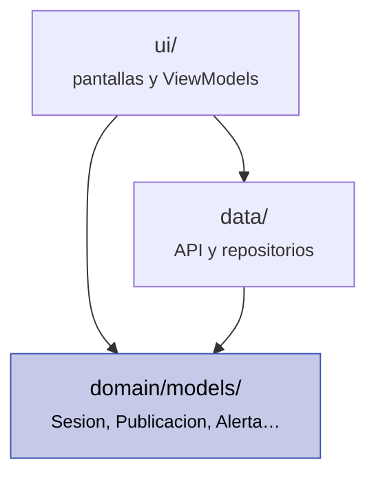
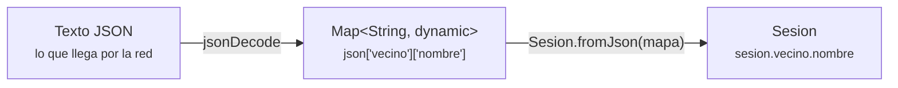
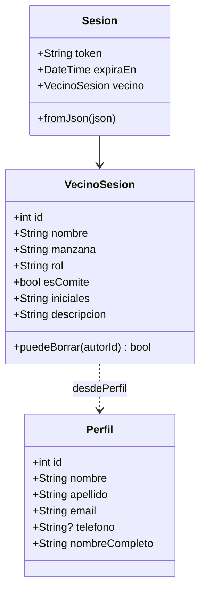
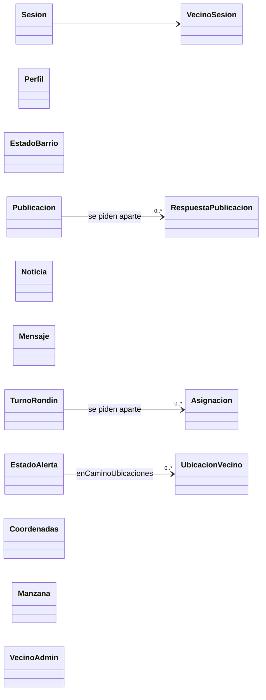

# 3. Modelos del dominio

!!! abstract "Objetivo"
    Escribir las clases que representan **los datos de la app**: la sesión del vecino, las publicaciones, las noticias, los mensajes del chat, los turnos de rondín, las alertas y los datos del comité. Cada una sabe construirse a partir del JSON que manda el servidor (`fromJson`).

## Dónde estamos

La capa de **dominio** es el corazón: describe *qué* maneja la app, sin decir *cómo* se consigue ni *cómo* se muestra. Por eso no importa nada de Flutter ni de HTTP: es Dart puro. Todas las demás capas la usan.



Si no te acordás qué es cada capa, repasá [MVVM y las capas](../4-arquitectura/2-mvvm-y-capas.md).

## Qué es un modelo y qué es `fromJson`

El servidor responde en **JSON**, un formato de texto. Por ejemplo, al iniciar sesión:

```json
{
  "token": "3f9a…",
  "expira_en": "2026-11-17T12:00:00Z",
  "vecino": { "id": 1, "nombre": "María Ríos", "manzana": "Manzana 4", "rol": "vigia" }
}
```

Dart convierte ese texto en un `Map<String, dynamic>`: un diccionario de claves de texto con valores de **cualquier tipo** (`dynamic`). Trabajar con mapas es incómodo y peligroso: si escribís `json['nombr']` (sin la e), Dart no se queja y te devuelve `null`. Un **modelo** es una clase con campos de tipo conocido, así el editor te ayuda y el compilador te avisa de los errores:



`fromJson` es un **constructor factory**: un constructor que puede hacer cálculos antes de crear el objeto (leer el mapa, convertir tipos). Lo vemos en [Clases](../2-dart/5-clases.md#constructores-factory).

!!! info "La API usa `snake_case`, Dart usa `camelCase`"
    En el JSON las claves son `expira_en`, `vecinos_avisados`. En Dart los campos son `expiraEn`, `vecinosAvisados`. El `fromJson` hace la traducción en un solo lugar.

## Paso 1: coordenadas

El más simple. Creá la carpeta `lib/domain/models/` y adentro `coordenadas.dart`:

<!-- archivo: lib/domain/models/coordenadas.dart cap=c03 notas="const Coordenadas|final double lat" -->
```dart title="lib/domain/models/coordenadas.dart" linenums="1"
// lib/domain/models/coordenadas.dart

/// Un punto en el mapa. Es nuestro: así el resto de la app no depende del
/// tipo Position del paquete geolocator.
class Coordenadas {
  const Coordenadas(this.lat, this.lng);  // (1)!

  final double lat;  // (2)!
  final double lng;
}
```
<!-- /archivo -->

1. Un constructor `const`: si los dos valores son constantes, el objeto entero puede ser constante (`const Coordenadas(-34.6, -58.38)`).
2. Campos `final`: se asignan una vez, en el constructor, y no cambian más. Casi todos los modelos son así (**inmutables**): si algo cambia, se pide un objeto nuevo al servidor.

!!! question "¿Por qué no usar el tipo del paquete de GPS?"
    El paquete `geolocator` (capítulo 14) tiene su propio tipo `Position`. Si lo usáramos en toda la app, toda la app dependería de ese paquete. Con un tipo nuestro, solo el archivo que habla con el GPS lo conoce. Es una idea que se repite en toda la arquitectura: [la dirección de las dependencias](../4-arquitectura/3-direccion-de-dependencias.md).

## Paso 2: la sesión

<!-- archivo: lib/domain/models/sesion.dart cap=c03 notas="const Map<String, String> roles|factory Sesion.fromJson|json\['token'\] as String|DateTime.parse\(json\['expira_en'\]|VecinoSesion.fromJson\(json\['vecino'\]|factory VecinoSesion.desdePerfil|bool get esComite|String get iniciales|String get descripcion|bool puedeBorrar|json\['telefono'\] as String\?" -->
```dart title="lib/domain/models/sesion.dart" linenums="1"
// lib/domain/models/sesion.dart
//
// Sesión del vecino (RF-09): quién entró y con qué rol. El estado de la
// sesión (si hay una iniciada) lo maneja SesionRepository.

/// Nombre para mostrar de cada rol (mismos valores que el ENUM de la base).
const Map<String, String> roles = {  // (1)!
  'vecino': 'Vecino',
  'vigia': 'Vigía',
  'comite': 'Comité',
};

/// Respuesta de POST /auth/login y POST /auth/clave.
class Sesion {
  Sesion({required this.token, required this.expiraEn, required this.vecino});

  factory Sesion.fromJson(Map<String, dynamic> json) {  // (2)!
    return Sesion(
      token: json['token'] as String,  // (3)!
      expiraEn: DateTime.parse(json['expira_en'] as String),  // (4)!
      vecino: VecinoSesion.fromJson(json['vecino'] as Map<String, dynamic>),  // (5)!
    );
  }

  final String token;
  final DateTime expiraEn;
  final VecinoSesion vecino;
}

/// El vecino que inició sesión.
class VecinoSesion {
  VecinoSesion({
    required this.id,
    required this.nombre,
    required this.manzana,
    required this.rol,
  });

  factory VecinoSesion.fromJson(Map<String, dynamic> json) {
    return VecinoSesion(
      id: json['id'] as int,
      nombre: json['nombre'] as String, // "María Ríos"
      manzana: json['manzana'] as String,
      rol: json['rol'] as String,
    );
  }

  factory VecinoSesion.desdePerfil(Perfil perfil) {  // (6)!
    return VecinoSesion(
      id: perfil.id,
      nombre: perfil.nombreCompleto,
      manzana: perfil.manzana,
      rol: perfil.rol,
    );
  }

  final int id;
  final String nombre;
  final String manzana;
  final String rol; // 'vecino' | 'vigia' | 'comite'

  bool get esComite => rol == 'comite';  // (7)!

  /// "María Ríos" → "MR"
  String get iniciales => nombre  // (8)!
      .split(' ')
      .where((parte) => parte.isNotEmpty)
      .take(2)
      .map((parte) => parte[0].toUpperCase())
      .join();

  /// "Manzana 4 · Vigía"
  String get descripcion => '$manzana · ${roles[rol] ?? rol}';  // (9)!

  /// El autor de una publicación o el comité pueden borrarla.
  bool puedeBorrar({required int? autorId}) => esComite || autorId == id;  // (10)!
}

/// Respuesta de GET /yo.
class Perfil {
  Perfil({
    required this.id,
    required this.nombre,
    required this.apellido,
    required this.email,
    required this.telefono,
    required this.manzanaId,
    required this.manzana,
    required this.rol,
  });

  factory Perfil.fromJson(Map<String, dynamic> json) {
    return Perfil(
      id: json['id'] as int,
      nombre: json['nombre'] as String,
      apellido: json['apellido'] as String,
      email: json['email'] as String,
      telefono: json['telefono'] as String?,  // (11)!
      manzanaId: json['manzana_id'] as int,
      manzana: json['manzana'] as String,
      rol: json['rol'] as String,
    );
  }

  final int id;
  final String nombre;
  final String apellido;
  final String email;
  final String? telefono;
  final int manzanaId;
  final String manzana;
  final String rol;

  String get nombreCompleto => '$nombre $apellido';
}
```
<!-- /archivo -->

1. Un mapa constante para mostrar los roles con tilde y mayúscula: en la base se guarda `'vigia'`, en pantalla se muestra `'Vigía'`.
2. El constructor `factory` que lee el JSON.
3. `json['token']` es `dynamic` (podría ser cualquier cosa). `as String` le dice a Dart "confiá en mí, es un texto". Si el servidor mandara un número, la app fallaría acá mismo, con un error claro, en vez de más adelante.
4. Las fechas viajan como texto en formato ISO 8601; `DateTime.parse` las convierte.
5. Un objeto **dentro** de otro: el campo `vecino` del JSON es otro mapa, y lo convierte el `fromJson` de `VecinoSesion`.
6. Otro constructor `factory` con nombre: arma un `VecinoSesion` a partir del `Perfil` completo (lo usa la sesión al abrir la app, capítulo 5).
7. Un **getter**: no es un campo guardado, se calcula cada vez. Se usa igual que un campo: `vecino.esComite`.
8. "María Ríos" → "MR". Encadena operaciones sobre la lista de palabras: separar por espacios, sacar las vacías, quedarse con 2, tomar la primera letra en mayúscula y unir. Ver [Colecciones](../2-dart/4-colecciones.md#encadenar-operaciones).
9. "Manzana 4 · Vigía". `roles[rol] ?? rol`: si el rol no está en el mapa (uno nuevo), se muestra tal cual.
10. Una regla del negocio, escrita una sola vez: el autor de una publicación o cualquiera del comité la pueden borrar. La usan el Inicio y la pantalla de una publicación.
11. `as String?` (con signo de pregunta): el teléfono puede venir `null`, porque no es obligatorio.



## Paso 3: publicaciones

Lo que se muestra en la pestaña "Actividad" del Inicio y en el detalle de una publicación.

<!-- archivo: lib/domain/models/publicacion.dart cap=c03 notas="abstract final class TipoPublicacion|static const actividad|this.respuestas = 0|\.toLocal\(\)|as int\? \?\? 0|final int\? autorId|final String\? cuerpo" -->
```dart title="lib/domain/models/publicacion.dart" linenums="1"
// lib/domain/models/publicacion.dart
//
// Lo que muestra la pestaña "Actividad" del Inicio: el estado de la red de
// vecinos, las publicaciones del barrio y sus respuestas.

/// Valores de `tipo` de una publicación: cualquier vecino publica actividad;
/// las noticias son del comité.
abstract final class TipoPublicacion {  // (1)!
  static const actividad = 'actividad';  // (2)!
  static const noticia = 'noticia';
}

/// Respuesta de GET /barrio/estado
class EstadoBarrio {
  EstadoBarrio({required this.vecinosEnLinea, required this.vecinosTotal});

  factory EstadoBarrio.fromJson(Map<String, dynamic> json) {
    return EstadoBarrio(
      vecinosEnLinea: json['vecinos_en_linea'] as int,
      vecinosTotal: json['vecinos_total'] as int,
    );
  }

  final int vecinosEnLinea;
  final int vecinosTotal;
}

/// Un ítem del feed (GET /publicaciones?tipo=actividad) o una publicación
/// completa (GET /publicaciones/{id}, que además trae el cuerpo).
class Publicacion {
  Publicacion({
    required this.id,
    required this.iniciales,
    required this.titulo,
    required this.autor,
    required this.creadoEn,
    this.respuestas = 0,  // (3)!
    this.autorId,
    this.cuerpo,
    this.fotoId,
  });

  factory Publicacion.fromJson(Map<String, dynamic> json) {
    return Publicacion(
      id: json['id'] as int,
      iniciales: json['iniciales'] as String,
      titulo: json['titulo'] as String,
      autor: json['autor'] as String,
      creadoEn: DateTime.parse(json['creado_en'] as String).toLocal(),  // (4)!
      respuestas: json['respuestas'] as int? ?? 0,  // (5)!
      autorId: json['autor_id'] as int?,
      cuerpo: json['cuerpo'] as String?,
      fotoId: json['foto_id'] as int?,
    );
  }

  final int id;
  final String iniciales;
  final String titulo;
  final String autor;
  final DateTime creadoEn;
  final int respuestas;

  /// Para saber si el vecino puede borrarla (autor o comité).
  final int? autorId;  // (6)!

  /// Solo viene en GET /publicaciones/{id}.
  final String? cuerpo;  // (7)!

  /// Foto opcional: se baja con FotosRepository.
  final int? fotoId;
}

/// Una respuesta a una publicación (GET /publicaciones/{id}/respuestas).
class RespuestaPublicacion {
  RespuestaPublicacion({
    required this.id,
    required this.texto,
    required this.autor,
    required this.iniciales,
    required this.autorId,
    required this.creadoEn,
  });

  factory RespuestaPublicacion.fromJson(Map<String, dynamic> json) {
    return RespuestaPublicacion(
      id: json['id'] as int,
      texto: json['texto'] as String,
      autor: json['autor'] as String,
      iniciales: json['iniciales'] as String,
      autorId: json['autor_id'] as int,
      creadoEn: DateTime.parse(json['creado_en'] as String).toLocal(),
    );
  }

  final int id;
  final String texto;
  final String autor; // "María R."
  final String iniciales;
  final int autorId;
  final DateTime creadoEn;
}
```
<!-- /archivo -->

1. `abstract final class` con solo constantes `static`: es una forma de agrupar valores con nombre. No se pueden crear objetos `TipoPublicacion`; se usa `TipoPublicacion.actividad`. Así nadie escribe mal `'actividad'`.
2. `static const`: pertenece a la clase, no a cada objeto.
3. Un **valor por defecto**: si no se pasa `respuestas`, vale 0.
4. Las fechas llegan en UTC (la hora de Greenwich); `toLocal()` las pasa a la hora del celular. Si no, "hace 25 min" diría "hace 3 h 25 min".
5. `as int? ?? 0`: si `respuestas` no vino en el JSON (es `null`), usa 0.
6. Opcional porque el listado del Inicio a veces no lo trae.
7. El cuerpo completo solo viene cuando se pide **una** publicación (`GET /publicaciones/{id}`), no en el listado.

## Paso 4: noticias, mensajes y rondines

Tres modelos más, con la misma forma. Copialos tal cual.

<!-- archivo: lib/domain/models/noticia.dart cap=c03 notas="const Map<String, String> etiquetas|String get nombreEtiqueta" -->
```dart title="lib/domain/models/noticia.dart" linenums="1"
// lib/domain/models/noticia.dart

/// Etiquetas del muro de noticias (mismos valores que el ENUM de la base).
const Map<String, String> etiquetas = {  // (1)!
  'obras': 'Obras',
  'seguridad': 'Seguridad',
  'alumbrado': 'Alumbrado',
  'convivencia': 'Convivencia',
};

/// Una noticia del comité (GET /publicaciones?tipo=noticia).
class Noticia {
  Noticia({
    required this.id,
    required this.titulo,
    required this.etiqueta,
    required this.autor,
    required this.creadoEn,
  });

  factory Noticia.fromJson(Map<String, dynamic> json) {
    return Noticia(
      id: json['id'] as int,
      titulo: json['titulo'] as String,
      etiqueta: json['etiqueta'] as String,
      autor: json['autor'] as String,
      creadoEn: DateTime.parse(json['creado_en'] as String).toLocal(),
    );
  }

  final int id;
  final String titulo;
  final String etiqueta; // 'obras' | 'seguridad' | 'alumbrado' | 'convivencia'
  final String autor;
  final DateTime creadoEn;

  /// "Obras" (o la etiqueta tal cual, si es una nueva).
  String get nombreEtiqueta => etiquetas[etiqueta] ?? etiqueta;  // (2)!
}
```
<!-- /archivo -->

1. Las etiquetas válidas, con su nombre para mostrar. Las usan el filtro de noticias y el formulario para publicar una.
2. Si el servidor agrega una etiqueta nueva que la app no conoce, se muestra tal cual en vez de fallar.

<!-- archivo: lib/domain/models/mensaje.dart cap=c03 notas="final String\? texto" -->
```dart title="lib/domain/models/mensaje.dart" linenums="1"
// lib/domain/models/mensaje.dart

/// Un mensaje del chat del barrio (GET /mensajes).
class Mensaje {
  Mensaje({
    required this.id,
    required this.autor,
    required this.iniciales,
    required this.autorId,
    required this.creadoEn,
    this.texto,
    this.fotoId,
  });

  factory Mensaje.fromJson(Map<String, dynamic> json) {
    return Mensaje(
      id: json['id'] as int,
      texto: json['texto'] as String?,
      fotoId: json['foto_id'] as int?,
      autor: json['autor'] as String,
      iniciales: json['iniciales'] as String,
      autorId: json['autor_id'] as int,
      creadoEn: DateTime.parse(json['creado_en'] as String).toLocal(),
    );
  }

  final int id;
  final String autor; // "María R."
  final String iniciales;
  final int autorId;
  final DateTime creadoEn;

  // Un mensaje trae texto, foto o las dos.
  final String? texto;  // (1)!
  final int? fotoId;
}
```
<!-- /archivo -->

1. Un mensaje del chat trae texto, foto o las dos cosas: por eso los dos son opcionales.

<!-- archivo: lib/domain/models/rondin.dart cap=c03 notas="abstract final class EstadoAsistencia|DateTime.parse\(json\['fecha'\]|List<String>.from|final String\? miEstado|bool get esMio" -->
```dart title="lib/domain/models/rondin.dart" linenums="1"
// lib/domain/models/rondin.dart

/// Estado de mi asistencia a un turno.
abstract final class EstadoAsistencia {  // (1)!
  static const pendiente = 'pendiente';
  static const confirmado = 'confirmado';
  static const ausente = 'ausente';
}

/// Un turno de rondín de la semana (GET /rondines/semana): recorrido
/// nocturno de 22:00 a 02:00.
class TurnoRondin {
  TurnoRondin({
    required this.id,
    required this.fecha,
    required this.horaInicio,
    required this.horaFin,
    required this.ruta,
    required this.pareja,
    this.miEstado,
  });

  factory TurnoRondin.fromJson(Map<String, dynamic> json) {
    return TurnoRondin(
      id: json['id'] as int,
      fecha: DateTime.parse(json['fecha'] as String),  // (2)!
      horaInicio: json['hora_inicio'] as String,
      horaFin: json['hora_fin'] as String,
      ruta: json['ruta'] as String,
      pareja: List<String>.from(json['pareja'] as List),  // (3)!
      miEstado: json['mi_estado'] as String?,
    );
  }

  final int id;
  final DateTime fecha;
  final String horaInicio; // "22:00"
  final String horaFin; // "02:00"
  final String ruta;
  final List<String> pareja;

  /// null si el turno no es mío; si no, un valor de [EstadoAsistencia].
  final String? miEstado;  // (4)!

  bool get esMio => miEstado != null;  // (5)!

  /// "22:00 – 02:00"
  String get horario => '$horaInicio – $horaFin';
}
```
<!-- /archivo -->

1. Los tres estados posibles de mi asistencia a un turno, como constantes con nombre (mismo truco que `TipoPublicacion`).
2. La fecha viene como `'2026-11-16'` (sin hora). No se pasa a hora local porque no tiene hora.
3. `json['pareja']` es una lista de `dynamic`. `List<String>.from` crea una lista de textos con esos elementos (y falla si alguno no es texto).
4. `null` significa "este turno no es mío". Si es mío, dice si confirmé, si avisé que no voy o si todavía no respondí.
5. Getter que se lee como una pregunta: `if (turno.esMio)`.

## Paso 5: alertas

El modelo más grande, porque una alerta SOS tiene mucha información: quién la disparó, dónde está, cuántos vecinos van en camino y dónde están ellos.

<!-- archivo: lib/domain/models/alerta.dart cap=c03 notas="final vecino = json\['vecino'\] as Map<String, dynamic>\?|vecino\?\['id'\]|\(json\['lat'\] as num\?\)\?.toDouble|enCaminoUbicaciones: \[|for \(final u in json|final String estado;|bool get activa|bool get tieneUbicacion" -->
```dart title="lib/domain/models/alerta.dart" linenums="1"
// lib/domain/models/alerta.dart
//
// Estado de una alerta SOS (GET /alertas/{id} y GET /alertas). La pantalla
// de Alerta Activa lo consulta cada 2 segundos para mostrar la triple
// confirmación; el Inicio consulta la lista cada 10 s para enterarse de las
// alertas de otros vecinos.

class EstadoAlerta {
  EstadoAlerta({
    required this.id,
    required this.estado,
    required this.central911Confirmada,
    required this.vecinosAvisados,
    required this.enCamino,
    this.miRespuesta,
    this.creadaEn,
    this.vecinoId,
    this.vecinoNombre,
    this.manzana,
    this.lat,
    this.lng,
    this.ubicacionEn,
    this.enCaminoUbicaciones = const [],
    this.fotoId,
  });

  factory EstadoAlerta.fromJson(Map<String, dynamic> json) {
    // Los campos después de en_camino son de la API v1.1: opcionales, así el
    // JSON de 5 campos de la v1.0 sigue funcionando.
    final vecino = json['vecino'] as Map<String, dynamic>?;  // (1)!
    return EstadoAlerta(
      id: json['id'] as int,
      estado: json['estado'] as String,
      central911Confirmada: json['central_911_confirmada'] as bool,
      vecinosAvisados: json['vecinos_avisados'] as int,
      enCamino: json['en_camino'] as int,
      miRespuesta: json['mi_respuesta'] as String?,
      creadaEn: json['creada_en'] == null
          ? null
          : DateTime.parse(json['creada_en'] as String).toLocal(),
      vecinoId: vecino?['id'] as int?,  // (2)!
      vecinoNombre: vecino?['nombre'] as String?,
      manzana: vecino?['manzana'] as String?,
      lat: (json['lat'] as num?)?.toDouble(),  // (3)!
      lng: (json['lng'] as num?)?.toDouble(),
      ubicacionEn: json['ubicacion_en'] == null
          ? null
          : DateTime.parse(json['ubicacion_en'] as String).toLocal(),
      // Solo viene en GET /alertas/{id}, no en el listado del Inicio.
      enCaminoUbicaciones: [  // (4)!
        for (final u in json['en_camino_ubicaciones'] as List? ?? const [])  // (5)!
          UbicacionVecino.fromJson(u as Map<String, dynamic>),
      ],
      fotoId: json['foto_id'] as int?,
    );
  }

  final int id;
  final String estado; // 'activa' | 'cancelada' | 'resuelta' (6)
  final bool central911Confirmada;
  final int vecinosAvisados;
  final int enCamino;

  /// 'notificado' | 'en_camino' si me avisaron; null si la disparé yo.
  final String? miRespuesta;
  final DateTime? creadaEn;

  /// Quien disparó la alerta.
  final int? vecinoId;
  final String? vecinoNombre;
  final String? manzana;

  /// Última ubicación de quien disparó la alerta (null = todavía no llegó).
  final double? lat;
  final double? lng;
  final DateTime? ubicacionEn;

  /// Vecinos en camino que comparten su ubicación (para el mapa).
  final List<UbicacionVecino> enCaminoUbicaciones;

  /// Foto que agregó quien disparó la alerta (null = sin foto).
  final int? fotoId;

  bool get activa => estado == 'activa';  // (7)!
  bool get cancelada => estado == 'cancelada';
  bool get voyEnCamino => miRespuesta == 'en_camino';
  bool get tieneUbicacion => lat != null && lng != null;  // (8)!
}

/// Un vecino en camino en el mapa de la alerta (en_camino_ubicaciones).
class UbicacionVecino {
  UbicacionVecino({
    required this.vecinoId,
    required this.nombre,
    required this.lat,
    required this.lng,
  });

  factory UbicacionVecino.fromJson(Map<String, dynamic> json) {
    return UbicacionVecino(
      vecinoId: json['vecino_id'] as int,
      nombre: json['nombre'] as String,
      lat: (json['lat'] as num).toDouble(),
      lng: (json['lng'] as num).toDouble(),
    );
  }

  final int vecinoId;
  final String nombre;
  final double lat;
  final double lng;
}
```
<!-- /archivo -->

1. El vecino que disparó la alerta viene anidado, y puede faltar (en la versión 1.0 de la API no venía). Por eso `Map<String, dynamic>?`.
2. `vecino?['id']`: si `vecino` es null, todo da null sin fallar.
3. Las coordenadas pueden llegar como entero (`-34`) o con decimales (`-34.6`). `num` acepta los dos, y `toDouble()` lo pasa a `double`. Con `as double` directo, un entero haría fallar la app.
4. Una lista armada con un **for dentro de la lista** (*collection for*): por cada elemento del JSON agrega un `UbicacionVecino`. Ver [Colecciones](../2-dart/4-colecciones.md#collection-if-y-collection-for).
5. `as List? ?? const []`: si no vino la lista, usa una vacía. Así el `for` no falla.
6. El estado es un texto: `'activa'`, `'cancelada'` o `'resuelta'`.
7. Getters que traducen el texto a preguntas claras: `alerta.activa`, `alerta.cancelada`, `alerta.voyEnCamino`.
8. `tieneUbicacion` evita repetir `lat != null && lng != null` en cada pantalla.

## Paso 6: el comité

Los datos que solo ve el comité: manzanas, vecinos con su estado de invitación y los vecinos asignados a cada turno.

<!-- archivo: lib/domain/models/comite.dart cap=c03 notas="class Manzana|class VecinoAdmin|final bool invitacionPendiente|final bool\? invitacionEnviada|class Asignacion" -->
```dart title="lib/domain/models/comite.dart" linenums="1"
// lib/domain/models/comite.dart
//
// Datos del panel del comité (RF-13, RF-14): manzanas, vecinos con su estado
// de invitación y las asignaciones de cada turno de rondín.

/// GET /manzanas
class Manzana {  // (1)!
  Manzana({required this.id, required this.nombre});

  factory Manzana.fromJson(Map<String, dynamic> json) {
    return Manzana(id: json['id'] as int, nombre: json['nombre'] as String);
  }

  final int id;
  final String nombre;
}

/// GET /vecinos, POST /vecinos, PATCH /vecinos/{id}
class VecinoAdmin {  // (2)!
  VecinoAdmin({
    required this.id,
    required this.nombre,
    required this.apellido,
    required this.email,
    required this.telefono,
    required this.manzanaId,
    required this.manzana,
    required this.rol,
    required this.activo,
    required this.invitacionPendiente,
    this.ultimoAcceso,
    this.invitacionEnviada,
  });

  factory VecinoAdmin.fromJson(Map<String, dynamic> json) {
    return VecinoAdmin(
      id: json['id'] as int,
      nombre: json['nombre'] as String,
      apellido: json['apellido'] as String,
      email: json['email'] as String,
      telefono: json['telefono'] as String?,
      manzanaId: json['manzana_id'] as int,
      manzana: json['manzana'] as String,
      rol: json['rol'] as String,
      activo: json['activo'] as bool,
      invitacionPendiente: json['invitacion_pendiente'] as bool,
      ultimoAcceso: json['ultimo_acceso'] == null
          ? null
          : DateTime.parse(json['ultimo_acceso'] as String).toLocal(),
      invitacionEnviada: json['invitacion_enviada'] as bool?,
    );
  }

  final int id;
  final String nombre;
  final String apellido;
  final String email;
  final String? telefono;
  final int manzanaId;
  final String manzana;
  final String rol; // 'vecino' | 'vigia' | 'comite'
  final bool activo;

  /// true = todavía no eligió contraseña con el enlace del correo.
  final bool invitacionPendiente;  // (3)!
  final DateTime? ultimoAcceso;

  /// Solo en la respuesta del alta: false si el correo no salió.
  final bool? invitacionEnviada;  // (4)!

  String get nombreCompleto => '$nombre $apellido';
}

/// GET /rondines/{id}/asignaciones
class Asignacion {  // (5)!
  Asignacion({
    required this.vecinoId,
    required this.nombre,
    required this.estado,
    this.respondidoEn,
  });

  factory Asignacion.fromJson(Map<String, dynamic> json) {
    return Asignacion(
      vecinoId: json['vecino_id'] as int,
      nombre: json['nombre'] as String,
      estado: json['estado'] as String,
      respondidoEn: json['respondido_en'] == null
          ? null
          : DateTime.parse(json['respondido_en'] as String).toLocal(),
    );
  }

  final int vecinoId;
  final String nombre; // "María Ríos"
  final String estado; // 'pendiente' | 'confirmado' | 'ausente'
  final DateTime? respondidoEn;
}
```
<!-- /archivo -->

1. `GET /manzanas`: las manzanas del barrio, para elegir en el alta de un vecino.
2. Un vecino visto por el comité: tiene más datos que `VecinoSesion` (email, teléfono, si está activo, cuándo entró por última vez).
3. `true` mientras el vecino no usó el enlace del correo para elegir su contraseña.
4. Solo viene en la respuesta del alta: `false` si el servidor no pudo mandar el correo de invitación (entonces el comité tiene que reenviarla).
5. Un vecino asignado a un turno, con su respuesta (`pendiente`, `confirmado` o `ausente`).

## Todos los modelos juntos



| Archivo | Clases | Para qué pantalla |
|---|---|---|
| `sesion.dart` | `Sesion`, `VecinoSesion`, `Perfil` | Login, Inicio, Perfil |
| `publicacion.dart` | `EstadoBarrio`, `Publicacion`, `RespuestaPublicacion` | Inicio, Publicación |
| `noticia.dart` | `Noticia` | Noticias |
| `mensaje.dart` | `Mensaje` | Chat |
| `rondin.dart` | `TurnoRondin` | Recorridos, Inicio |
| `alerta.dart` | `EstadoAlerta`, `UbicacionVecino` | Alerta, Inicio |
| `comite.dart` | `Manzana`, `VecinoAdmin`, `Asignacion` | Comité |
| `coordenadas.dart` | `Coordenadas` | Alerta (GPS) |

## Paso 7: probar que leen bien el JSON

Creá `test/modelos_test.dart`:

<!-- archivo: test/modelos_test.dart cap=c03 notas="final sesion = Sesion.fromJson|expect\(sesion.vecino.iniciales|test\('puedeBorrar|'creado_en': '2026-11-16T10:00:00Z',|expect\(publicacion.respuestas, 0\)" -->
```dart title="test/modelos_test.dart" linenums="1"
// test/modelos_test.dart
//
// Pruebas de los modelos (capítulo 3): que cada fromJson lea bien el JSON
// tal como lo manda la API, y que los getters calculen lo que prometen.

import 'package:flutter_test/flutter_test.dart';

import 'package:vigia_app/domain/models/alerta.dart';
import 'package:vigia_app/domain/models/publicacion.dart';
import 'package:vigia_app/domain/models/rondin.dart';
import 'package:vigia_app/domain/models/sesion.dart';

void main() {
  test('Sesion.fromJson lee el token y el vecino', () {
    final sesion = Sesion.fromJson({  // (1)!
      'token': 'abc',
      'expira_en': '2026-11-17T12:00:00Z',
      'vecino': {
        'id': 1,
        'nombre': 'María Ríos',
        'manzana': 'Manzana 4',
        'rol': 'vigia',
      },
    });
    expect(sesion.token, 'abc');
    expect(sesion.vecino.iniciales, 'MR');  // (2)!
    expect(sesion.vecino.descripcion, 'Manzana 4 · Vigía');
    expect(sesion.vecino.esComite, isFalse);
  });

  test('puedeBorrar: el autor o el comité', () {  // (3)!
    final maria = VecinoSesion(
      id: 1,
      nombre: 'María Ríos',
      manzana: 'Manzana 4',
      rol: 'vigia',
    );
    final laura = VecinoSesion(
      id: 5,
      nombre: 'Laura Gómez',
      manzana: 'Manzana 1',
      rol: 'comite',
    );
    expect(maria.puedeBorrar(autorId: 1), isTrue);
    expect(maria.puedeBorrar(autorId: 4), isFalse);
    expect(laura.puedeBorrar(autorId: 4), isTrue);
  });

  test('Publicacion.fromJson: los campos opcionales pueden faltar', () {
    final publicacion = Publicacion.fromJson({
      'id': 7,
      'iniciales': 'AC',
      'titulo': 'Perro suelto en la plaza',
      'autor': 'Ana C.',
      'creado_en': '2026-11-16T10:00:00Z',  // (4)!
    });
    expect(publicacion.respuestas, 0); // valor por defecto (5)
    expect(publicacion.cuerpo, isNull);
    expect(publicacion.fotoId, isNull);
  });

  test('EstadoAlerta.fromJson con el vecino y la ubicación', () {
    final alerta = EstadoAlerta.fromJson({
      'id': 3,
      'estado': 'activa',
      'central_911_confirmada': false,
      'vecinos_avisados': 12,
      'en_camino': 2,
      'vecino': {'id': 3, 'nombre': 'Jorge López', 'manzana': 'Manzana 2'},
      'lat': -34.6,
      'lng': -58.38,
    });
    expect(alerta.activa, isTrue);
    expect(alerta.vecinoNombre, 'Jorge López');
    expect(alerta.tieneUbicacion, isTrue);
    expect(alerta.enCaminoUbicaciones, isEmpty);
  });

  test('TurnoRondin: horario y si es mío', () {
    final turno = TurnoRondin.fromJson({
      'id': 1,
      'fecha': '2026-11-16',
      'hora_inicio': '22:00',
      'hora_fin': '02:00',
      'ruta': 'Plaza y calle Juárez',
      'pareja': ['María Ríos', 'Tomás Rodríguez'],
      'mi_estado': 'pendiente',
    });
    expect(turno.horario, '22:00 – 02:00');
    expect(turno.esMio, isTrue);
    expect(turno.pareja, hasLength(2));
  });
}
```
<!-- /archivo -->

1. Le pasamos un mapa escrito a mano, igual al JSON que manda el servidor.
2. Además de los campos, probamos los getters calculados.
3. La regla de quién puede borrar, con un vecino común y una del comité.
4. Un JSON sin `respuestas`, sin `cuerpo` y sin `foto_id`…
5. …y comprobamos que se usen los valores por defecto en vez de fallar.

```bash
flutter test
```

```text
00:01 +13: All tests passed!
```

Son 13: los 8 del capítulo anterior más estos 5.

## Así queda el proyecto

<!-- arbol: cap=c03 -->
```text title="Así queda el proyecto"
vigia_app/
    lib/
        config.dart
        domain/
            models/
                alerta.dart  ← nuevo
                comite.dart  ← nuevo
                coordenadas.dart  ← nuevo
                mensaje.dart  ← nuevo
                noticia.dart  ← nuevo
                publicacion.dart  ← nuevo
                rondin.dart  ← nuevo
                sesion.dart  ← nuevo
        main.dart
        utils/
            fechas.dart
            resultado.dart
            sondeo.dart
            validadores.dart
    pubspec.yaml
    test/
        modelos_test.dart  ← nuevo
        utils_test.dart
```
<!-- /arbol -->

## Errores comunes

??? failure "`type 'int' is not a subtype of type 'double' in type cast`"
    Usaste `as double` para un número que puede venir sin decimales. Usá `(json['x'] as num).toDouble()`.

??? failure "`type 'Null' is not a subtype of type 'String' in type cast`"
    El JSON no trae esa clave (o trae `null`) y la estás leyendo con `as String`. Si de verdad puede faltar, el campo tiene que ser `String?` y leerse con `as String?`. Si no debería faltar, el problema está en el servidor o en el JSON de tu test.

??? failure "Las horas aparecen corridas 3 horas"
    Falta el `.toLocal()` después de `DateTime.parse(...)`.

## Lo que aprendiste

- [x] Un **modelo** es una clase con campos tipados que reemplaza al `Map<String, dynamic>` del JSON.
- [x] `fromJson` es un **constructor factory** que lee el mapa y convierte cada valor con `as`.
- [x] Con `?` se marca lo que puede faltar, y con `??` se le da un valor por defecto.
- [x] Los **getters** (`esComite`, `iniciales`, `activa`) ponen las reglas del negocio en un solo lugar.
- [x] El dominio es **Dart puro**: no conoce Flutter, ni HTTP, ni paquetes.

[Siguiente: 4. El contrato de la API :material-arrow-right:](04-contrato-api.md){ .md-button .md-button--primary }
