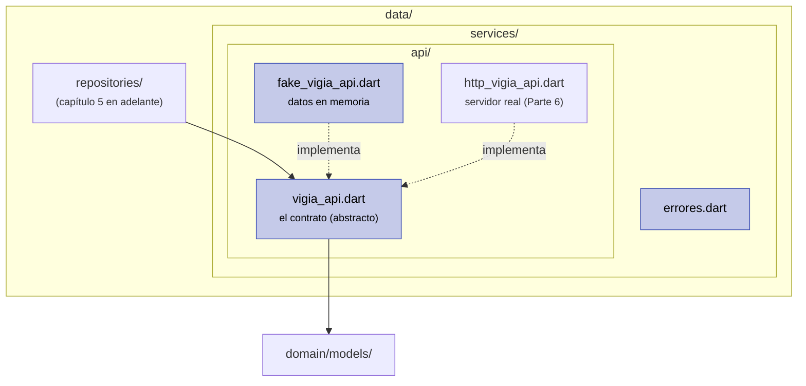
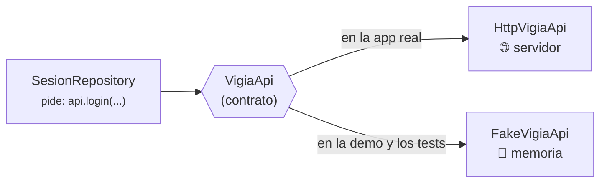
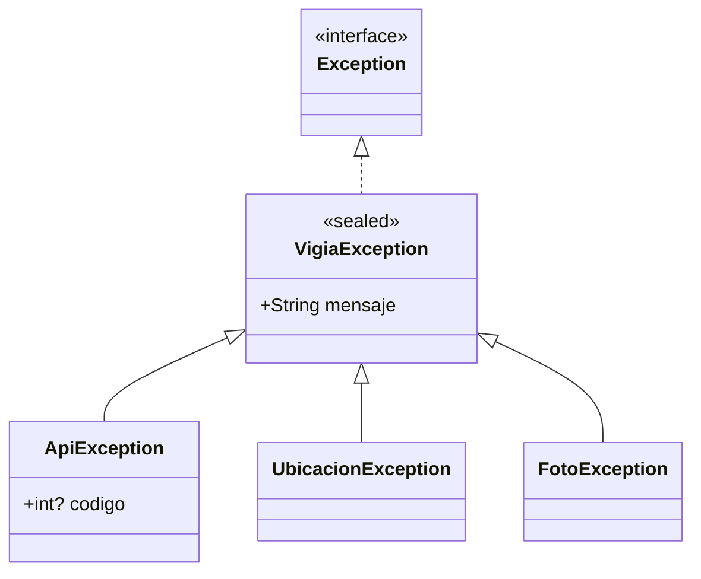

# 4. El contrato de la API

!!! abstract "Objetivo"
    Definir **qué le podemos pedir al servidor** (el contrato `VigiaApi`), los **errores** que puede devolver, y agregar un **servidor falso** (`FakeVigiaApi`) que responde lo mismo que el real pero con datos en memoria. Con eso, toda la app se puede construir y probar sin internet.

## Dónde estamos

Empezamos la capa de **datos** por abajo de todo: los **servicios**, que son los que hablan con el mundo exterior. El primero es el servicio de la API.



## La idea: programar contra un contrato

Un **contrato** dice *qué* se puede hacer, sin decir *cómo*. En Dart se escribe como una **clase abstracta**: una clase con métodos sin cuerpo, que no se puede instanciar.

```dart
abstract class VigiaApi {
  Future<Sesion> login(String email, String password); // sin cuerpo: solo la firma
}
```

Después puede haber varias clases que lo **implementan** (cumplen el contrato), cada una a su manera:

- `HttpVigiaApi` hace pedidos HTTP de verdad al servidor (lo escribimos en la Parte 6);
- `FakeVigiaApi` busca en listas que tiene en memoria.

Y el resto de la app **solo conoce el contrato**. No sabe, ni le importa, cuál de las dos tiene del otro lado:



**¿Qué ganamos?**

- **Avanzar sin servidor.** Podés hacer toda la app con el falso y conectar el real al final.
- **Tests rápidos y repetibles.** Un test con el falso tarda milisegundos y da siempre lo mismo.
- **Cambiar el servidor sin tocar la app.** Si mañana la API cambia de tecnología, solo se reescribe `HttpVigiaApi`.

Esto es [inyección de dependencias](../4-arquitectura/5-inyeccion-de-dependencias.md) y [la dirección de las dependencias](../4-arquitectura/3-direccion-de-dependencias.md): lo vemos en la Parte 4 con más calma.

## Paso 1: los errores

Antes del contrato, los errores que puede devolver. Creá `lib/data/services/errores.dart`:

<!-- archivo: lib/data/services/errores.dart cap=c04 notas="sealed class VigiaException implements Exception|final String mensaje;|String toString|class ApiException extends VigiaException|super.mensaje, \{this.codigo|class UbicacionException|class FotoException" -->
```dart title="lib/data/services/errores.dart" linenums="1"
// lib/data/services/errores.dart
//
// Errores que pueden salir de la capa de datos. Todos traen un mensaje listo
// para mostrar, así los ViewModels atrapan un solo tipo (VigiaException) y
// no tienen que conocer los detalles de cada servicio.

sealed class VigiaException implements Exception {  // (1)!
  const VigiaException(this.mensaje);

  final String mensaje;  // (2)!

  @override
  String toString() => '$runtimeType: $mensaje';  // (3)!
}

/// Error que devuelve la API (sin conexión, 4xx, 5xx, timeout...).
class ApiException extends VigiaException {  // (4)!
  const ApiException(super.mensaje, {this.codigo});  // (5)!

  final int? codigo; // código HTTP, si lo hubo

  @override
  String toString() => 'ApiException($codigo): $mensaje';
}

/// Por qué no se pudo seguir la ubicación (GPS apagado, sin permiso).
class UbicacionException extends VigiaException {  // (6)!
  const UbicacionException(super.mensaje);
}

/// No se pudo abrir la cámara o la galería.
class FotoException extends VigiaException {  // (7)!
  const FotoException(super.mensaje);
}
```
<!-- /archivo -->

1. Una clase **sellada** que *implementa* `Exception` (la interfaz que marca "esto es un error que se puede atrapar"). Es la madre de todos nuestros errores.
2. Todos traen un mensaje **listo para mostrar** al vecino, en castellano.
3. `toString` define cómo se ve el error al imprimirlo (en la consola, en un test que falla). `$runtimeType` es el nombre de la clase real: `UbicacionException: …`.
4. El error de la API: sin conexión, servidor caído, contraseña incorrecta, sin permiso…
5. `super.mensaje` pasa el mensaje al constructor de la clase madre. `{this.codigo}` es un parámetro opcional con nombre: el código HTTP (401, 404, 500…), si lo hubo. Sin conexión no hay código.
6. Cuando no se puede usar el GPS (capítulo 14).
7. Cuando no se puede abrir la cámara o la galería (capítulo 10).



!!! tip "¿Por qué una madre común?"
    Los ViewModels (capítulo 6) atrapan **un solo tipo**: `on VigiaException catch (e)`. No necesitan saber si el error vino de la red, del GPS o de la cámara: todos traen `mensaje` para mostrar. Lo vemos en [Los errores, de punta a punta](../4-arquitectura/7-errores.md).

## Paso 2: el contrato

Creá `lib/data/services/api/vigia_api.dart`. Es largo, pero muy repetitivo: **cada método corresponde a un endpoint** del servidor, y el comentario de arriba dice cuál.

<!-- archivo: lib/data/services/api/vigia_api.dart cap=c04 notas="^export|^abstract class VigiaApi|abstract String\? token|abstract void Function\(\)\? onSesionVencida|Future<Sesion> login|Future<void> recuperarClave|Future<List<Noticia>> obtenerNoticias\(\{String\? etiqueta\}\)|Future<Publicacion> publicar\(\{|Future<int> crearAlerta|Future<int> subirFoto\(Uint8List|Future<List<Mensaje>> obtenerMensajes\(\{int\? despues\}\)|Map<String, dynamic> cambios" -->
```dart title="lib/data/services/api/vigia_api.dart" linenums="1"
// lib/data/services/api/vigia_api.dart
//
// Contrato de la API de VigiaApp. Cada método corresponde a un endpoint de
// docs/especificacion_api_db.md.
//
// Es una clase abstracta (apunte 20): los repositorios solo conocen esta
// clase, no saben si del otro lado hay un servidor real (HttpVigiaApi) o
// datos de prueba en memoria (FakeVigiaApi). Los errores llegan siempre como
// ApiException.

import 'dart:typed_data';

import '../../../domain/models/alerta.dart';
import '../../../domain/models/comite.dart';
import '../../../domain/models/mensaje.dart';
import '../../../domain/models/noticia.dart';
import '../../../domain/models/publicacion.dart';
import '../../../domain/models/rondin.dart';
import '../../../domain/models/sesion.dart';

export '../errores.dart' show ApiException;  // (1)!

abstract class VigiaApi {  // (2)!
  /// Token de sesión (24 h) que devuelven [login] y [elegirClave].
  /// null = sin sesión: solo funcionan las rutas de /auth.
  abstract String? token;  // (3)!

  /// Se llama cuando el servidor responde 401 con una sesión iniciada
  /// (venció, se cerró desde otro lado o el vecino fue desactivado).
  abstract void Function()? onSesionVencida;  // (4)!

  // ---- Sesión (RF-09) ----

  /// POST /auth/login
  Future<Sesion> login(String email, String password);  // (5)!

  /// POST /auth/clave: activar la invitación o restablecer la contraseña
  /// con el token del enlace que llegó por correo.
  Future<Sesion> elegirClave(String tokenEnlace, String password);

  /// POST /auth/recuperar (responde bien exista o no el email)
  Future<void> recuperarClave(String email);  // (6)!

  /// POST /auth/logout
  Future<void> logout();

  /// GET /yo
  Future<Perfil> obtenerPerfil();

  /// POST /yo/clave
  Future<void> cambiarClave(String actual, String nueva);

  // ---- Inicio, noticias, rondines y alertas ----

  /// GET /barrio/estado
  Future<EstadoBarrio> obtenerEstadoBarrio();

  /// GET /publicaciones?tipo=actividad
  Future<List<Publicacion>> obtenerActividad();

  /// GET /publicaciones?tipo=noticia[&etiqueta=...]
  Future<List<Noticia>> obtenerNoticias({String? etiqueta});  // (7)!

  /// POST /publicaciones. Cualquier vecino publica 'actividad'; 'noticia'
  /// (con etiqueta obligatoria) y [firma] son solo del comité.
  Future<Publicacion> publicar({  // (8)!
    required String tipo,
    required String titulo,
    String? cuerpo,
    String? etiqueta,
    String? firma,
    int? fotoId,
  });

  /// GET /publicaciones/{id} (con el cuerpo)
  Future<Publicacion> obtenerPublicacion(int id);

  /// DELETE /publicaciones/{id} (el autor o el comité)
  Future<void> borrarPublicacion(int id);

  /// GET /publicaciones/{id}/respuestas
  Future<List<RespuestaPublicacion>> obtenerRespuestas(int publicacionId);

  /// POST /publicaciones/{id}/respuestas
  Future<RespuestaPublicacion> responder(int publicacionId, String texto);

  /// GET /rondines/semana[?desde=AAAA-MM-DD]. Sin [desde]: la semana actual.
  Future<List<TurnoRondin>> obtenerSemanaRondin({DateTime? desde});

  /// POST /rondines/{id}/asistencia
  Future<TurnoRondin> responderAsistencia(int turnoId, bool presente);

  /// POST /alertas — devuelve el id de la alerta creada.
  Future<int> crearAlerta({double? lat, double? lng});  // (9)!

  /// GET /alertas/{id}
  Future<EstadoAlerta> obtenerAlerta(int alertaId);

  /// POST /alertas/{id}/cancelar
  Future<void> cancelarAlerta(int alertaId);

  /// GET /alertas?estado=activa: el Inicio la consulta para enterarse de un SOS.
  Future<List<EstadoAlerta>> obtenerAlertas({String estado = 'activa'});

  /// POST /alertas/{id}/en-camino: "voy en camino" (o "ya no voy").
  Future<EstadoAlerta> marcarEnCamino(int alertaId, {bool enCamino = true});

  /// POST /alertas/{id}/resolver: la emergencia terminó (quien la disparó o el comité).
  Future<void> resolverAlerta(int alertaId);

  /// POST /alertas/{id}/confirmar-911: la central tomó el aviso (comité).
  Future<EstadoAlerta> confirmar911(int alertaId);

  /// POST /alertas/{id}/ubicacion: la ubicación en vivo de quien disparó la
  /// alerta o de un vecino en camino (los demás → 403).
  Future<void> enviarUbicacion(int alertaId, double lat, double lng);

  /// POST /alertas/{id}/foto: solo quien la disparó, con la alerta activa.
  Future<EstadoAlerta> adjuntarFotoAlerta(int alertaId, int fotoId);

  // ---- Fotos (publicaciones, chat y alertas) ----

  /// POST /fotos con los bytes de la imagen. Devuelve el id para mandarlo
  /// después como fotoId.
  Future<int> subirFoto(Uint8List bytes, String mime);  // (10)!

  /// GET /fotos/{id}: los bytes de la imagen.
  Future<Uint8List> obtenerFoto(int fotoId);

  // ---- Chat del barrio (Inicio) ----

  /// GET /mensajes[?despues=id]. Sin [despues]: los últimos 50. Con
  /// [despues]: solo los que llegaron después de ese id (para el polling).
  Future<List<Mensaje>> obtenerMensajes({int? despues});  // (11)!

  /// POST /mensajes: texto, foto o las dos.
  Future<Mensaje> enviarMensaje({String? texto, int? fotoId});

  // ---- Comité (RF-13, RF-14). Si no es del comité: ApiException 403 ----

  /// GET /manzanas (cualquier vecino)
  Future<List<Manzana>> obtenerManzanas();

  /// POST /manzanas
  Future<Manzana> crearManzana(String nombre);

  /// GET /vecinos
  Future<List<VecinoAdmin>> obtenerVecinos();

  /// POST /vecinos: alta y envío de la invitación por correo.
  Future<VecinoAdmin> crearVecino({
    required String nombre,
    required String apellido,
    required String email,
    String? telefono,
    required int manzanaId,
    String rol = 'vecino',
  });

  /// PATCH /vecinos/{id}. [cambios] usa las claves de la API
  /// (nombre, apellido, telefono, manzana_id, rol, activo).
  Future<VecinoAdmin> editarVecino(int id, Map<String, dynamic> cambios);  // (12)!

  /// POST /vecinos/{id}/invitacion
  Future<void> reenviarInvitacion(int vecinoId);

  /// POST /rondines
  Future<TurnoRondin> crearTurno({
    required DateTime fecha,
    required String ruta,
    String? horaInicio,
    String? horaFin,
    List<int> vecinoIds = const [],
  });

  /// GET /rondines/{id}/asignaciones
  Future<List<Asignacion>> obtenerAsignaciones(int turnoId);

  /// PUT /rondines/{id}/asignaciones
  Future<List<Asignacion>> reasignarTurno(int turnoId, List<int> vecinoIds);

  /// DELETE /rondines/{id}
  Future<void> borrarTurno(int turnoId);
}
```
<!-- /archivo -->

1. `export` hace que quien importe `vigia_api.dart` también reciba `ApiException`, sin importar `errores.dart`. Es cómodo: si usás la API, vas a necesitar su error.
2. `abstract`: no se puede hacer `VigiaApi()`. Solo sirve como contrato.
3. Un **campo abstracto**: cada implementación tiene que tener un `token` (el de la sesión). `null` = no hay sesión.
4. Un campo que guarda una **función** (o null). La sesión pone ahí qué hacer cuando el servidor responde 401 ("tu sesión venció"): cerrar la sesión. Es un *callback*.
5. Cada método devuelve un `Future`: la respuesta **va a llegar más adelante**, porque la red tarda. Lo explicamos en [Asincronía I: Future](../2-dart/8-asincronia-future.md).
6. `Future<void>`: no devuelve nada útil, solo importa si terminó bien o con error.
7. Parámetro opcional con nombre: `obtenerNoticias()` trae todas y `obtenerNoticias(etiqueta: 'obras')` filtra.
8. Muchos parámetros con nombre, algunos `required` (obligatorios). Cuando una función tiene muchos parámetros, los nombres evitan confundir el orden.
9. Devuelve el **id** de la alerta creada.
10. `Uint8List` es una lista de bytes: el contenido crudo de una imagen.
11. Para el chat: con `despues` pide solo los mensajes nuevos (posteriores a ese id). Así cada consulta trae poco.
12. `PATCH` manda solo los campos que cambian, por eso es un mapa y no parámetros fijos.

!!! info "39 métodos, 6 áreas"
    | Área | Métodos | Capítulo que la usa |
    |---|---|---|
    | Sesión | `login`, `elegirClave`, `recuperarClave`, `logout`, `obtenerPerfil`, `cambiarClave` | 5, 6, 7, 9 |
    | Barrio y publicaciones | `obtenerEstadoBarrio`, `obtenerActividad`, `obtenerNoticias`, `publicar`, `obtenerPublicacion`, `borrarPublicacion`, `obtenerRespuestas`, `responder` | 8, 10, 11 |
    | Rondines | `obtenerSemanaRondin`, `responderAsistencia` | 13 |
    | Alertas | `crearAlerta`, `obtenerAlerta`, `cancelarAlerta`, `obtenerAlertas`, `marcarEnCamino`, `resolverAlerta`, `confirmar911`, `enviarUbicacion`, `adjuntarFotoAlerta` | 14, 15 |
    | Fotos y chat | `subirFoto`, `obtenerFoto`, `obtenerMensajes`, `enviarMensaje` | 10, 12 |
    | Comité | `obtenerManzanas`, `crearManzana`, `obtenerVecinos`, `crearVecino`, `editarVecino`, `reenviarInvitacion`, `crearTurno`, `obtenerAsignaciones`, `reasignarTurno`, `borrarTurno` | 16 |

    El detalle de cada endpoint (URL, JSON de ida y de vuelta, errores) está en [Contrato de la API](../7-referencia/contrato-api.md).

## Paso 3: el servidor falso

`FakeVigiaApi` implementa los 39 métodos guardando todo en listas y mapas en memoria. Tiene los mismos vecinos de ejemplo que la base de datos de prueba del servidor real, y se porta igual: misma contraseña para todos, mismos errores, mismos códigos.

Son casi mil líneas de datos de ejemplo y reglas, sin conceptos nuevos. **No hace falta tipearlo**: bajalo y ponelo en `lib/data/services/api/fake_vigia_api.dart`.

[:material-download: Bajar fake_vigia_api.dart](../assets/archivos/fake_vigia_api.dart){ .md-button download="fake_vigia_api.dart" }

<!-- archivo: lib/data/services/api/fake_vigia_api.dart cap=c04 plegado="Ver fake_vigia_api.dart completo (982 líneas)" -->
??? example "Ver fake_vigia_api.dart completo (982 líneas)"

    ```dart title="lib/data/services/api/fake_vigia_api.dart" linenums="1"
    // lib/data/services/api/fake_vigia_api.dart
    //
    // Implementación de VigiaApi con datos en memoria: se usa cuando la app se
    // compila sin --dart-define=API_URL (demo sin servidor) y en los tests.
    //
    // Los datos se guardan como Map, igual que el JSON que va a devolver la API
    // real, y se convierten con los mismos fromJson. Así, cuando cambiemos a
    // HttpVigiaApi, los modelos ya están probados con el formato correcto.

    import 'dart:math';
    import 'dart:typed_data';

    import '../../../domain/models/alerta.dart';
    import '../../../domain/models/comite.dart';
    import '../../../domain/models/mensaje.dart';
    import '../../../domain/models/noticia.dart';
    import '../../../domain/models/publicacion.dart';
    import '../../../domain/models/rondin.dart';
    import '../../../domain/models/sesion.dart';
    import '../../../utils/fechas.dart';
    import 'vigia_api.dart';

    class FakeVigiaApi implements VigiaApi {
      FakeVigiaApi({
        this.demora = const Duration(milliseconds: 400),
        this.simularError = false,
        bool conAlertaVecino = false,
      }) {
        _armarDatos();
        if (conAlertaVecino) _alertaDeJorge();
      }

      /// Cuánto "tarda" el servidor en responder.
      final Duration demora;

      /// Cambiala a true para probar el estado de error de las pantallas.
      bool simularError;

      @override
      String? token;

      @override
      void Function()? onSesionVencida;

      /// Contraseña de todos los vecinos de ejemplo (igual que el seed de la API).
      static const clave = 'vigia1234';

      // Los mismos vecinos que `npm run db:seed` en vigia_api.
      final List<Map<String, dynamic>> _vecinos = [];
      final List<Map<String, dynamic>> _manzanas = [
        for (var i = 1; i <= 5; i++) {'id': i, 'nombre': 'Manzana $i'},
      ];
      final Map<int, String> _claves = {};

      final List<Map<String, dynamic>> _publicaciones = [];
      final List<Map<String, dynamic>> _turnos = [];
      final Map<int, Map<String, dynamic>> _alertas = {};
      final Map<int, List<Map<String, dynamic>>> _respuestas = {};
      final List<Map<String, dynamic>> _mensajes = [];
      final Map<int, Uint8List> _fotos = {};

      // Simula la espera de la red y, si corresponde, un error de conexión.
      Future<void> _esperar() async {
        await Future.delayed(demora);
        if (simularError) throw ApiException('Sin conexión');
      }

      Never _error(String mensaje, int codigo) =>
          throw ApiException(mensaje, codigo: codigo);

      /// El vecino de la sesión: el token del fake es `fake-<id>`.
      Map<String, dynamic> get _yo {
        final id = int.tryParse(token?.replaceFirst('fake-', '') ?? '');
        for (final v in _vecinos) {
          if (v['id'] == id) return v;
        }
        token = null;
        onSesionVencida?.call();
        _error('Sesión vencida. Volvé a iniciar sesión.', 401);
      }

      Sesion _abrirSesion(Map<String, dynamic> vecino) {
        token = 'fake-${vecino['id']}';
        return Sesion.fromJson({
          'token': token,
          'expira_en': DateTime.now()
              .add(const Duration(hours: 24))
              .toUtc()
              .toIso8601String(),
          'vecino': {
            'id': vecino['id'],
            'nombre': '${vecino['nombre']} ${vecino['apellido']}',
            'manzana': vecino['manzana'],
            'rol': vecino['rol'],
          },
        });
      }

      // ---- Sesión ----

      @override
      Future<Sesion> login(String email, String password) async {
        await _esperar();
        for (final v in _vecinos) {
          if (v['email'] == email.trim().toLowerCase() &&
              _claves[v['id']] == password) {
            return _abrirSesion(v);
          }
        }
        _error('Email o contraseña incorrectos.', 401);
      }

      /// Cualquier token de 64 hex vale como la invitación de Sofía Paz (la
      /// vecina del seed con la invitación pendiente).
      @override
      Future<Sesion> elegirClave(String tokenEnlace, String password) async {
        await _esperar();
        if (!RegExp(r'^[0-9a-f]{64}$').hasMatch(tokenEnlace)) {
          _error('El enlace no es válido.', 400);
        }
        if (password.length < 8) {
          _error('password debe tener entre 8 y 128 caracteres.', 400);
        }
        final sofia = _vecinos.firstWhere((v) => v['id'] == 9);
        _claves[9] = password;
        sofia['invitacion_pendiente'] = false;
        return _abrirSesion(sofia);
      }

      @override
      Future<void> recuperarClave(String email) => _esperar();

      @override
      Future<void> logout() async {
        await _esperar();
        token = null;
      }

      @override
      Future<Perfil> obtenerPerfil() async {
        await _esperar();
        return Perfil.fromJson(_yo);
      }

      @override
      Future<void> cambiarClave(String actual, String nueva) async {
        await _esperar();
        final id = _yo['id'] as int;
        if (_claves[id] != actual) {
          _error('La contraseña actual no es correcta.', 400);
        }
        if (nueva.length < 8) {
          _error('nueva debe tener entre 8 y 128 caracteres.', 400);
        }
        _claves[id] = nueva;
      }

      // ---- Inicio, noticias, rondines y alertas ----

      @override
      Future<EstadoBarrio> obtenerEstadoBarrio() async {
        await _esperar();
        return EstadoBarrio.fromJson({'vecinos_en_linea': 38, 'vecinos_total': 40});
      }

      @override
      Future<List<Publicacion>> obtenerActividad() async {
        await _esperar();
        return [
          for (final p in _publicaciones)
            if (p['tipo'] == 'actividad') Publicacion.fromJson(p),
        ];
      }

      @override
      Future<List<Noticia>> obtenerNoticias({String? etiqueta}) async {
        await _esperar();
        return [
          for (final p in _publicaciones)
            if (p['tipo'] == 'noticia' &&
                (etiqueta == null || p['etiqueta'] == etiqueta))
              Noticia.fromJson(p),
        ];
      }

      Map<String, dynamic> _publicacion(int id) {
        for (final p in _publicaciones) {
          if (p['id'] == id) return p;
        }
        _error('La publicación no existe.', 404);
      }

      @override
      Future<Publicacion> publicar({
        required String tipo,
        required String titulo,
        String? cuerpo,
        String? etiqueta,
        String? firma,
        int? fotoId,
      }) async {
        await _esperar();
        final yo = _yo;
        if ((tipo == 'noticia' || firma != null) && yo['rol'] != 'comite') {
          _error(
            'Solo el comité publica noticias o firma en nombre de otros.',
            403,
          );
        }
        if (tipo == 'noticia' && etiqueta == null) {
          _error('Las noticias llevan etiqueta.', 400);
        }
        if (tipo == 'actividad' && etiqueta != null) {
          _error('Las actividades no llevan etiqueta.', 400);
        }
        final nombre = yo['nombre'] as String;
        final apellido = yo['apellido'] as String;
        final publicacion = {
          'id': _publicaciones.fold<int>(0, (m, p) => max(m, p['id'] as int)) + 1,
          'tipo': tipo,
          'titulo': titulo.trim(),
          'cuerpo': cuerpo,
          'etiqueta': etiqueta,
          'foto_id': fotoId,
          'autor': firma ?? '$nombre ${apellido[0]}.',
          'iniciales': '${nombre[0]}${apellido[0]}',
          'autor_id': yo['id'],
          'creado_en': DateTime.now().toUtc().toIso8601String(),
          'respuestas': 0,
        };
        _publicaciones.insert(0, publicacion); // la más nueva primero
        return Publicacion.fromJson(publicacion);
      }

      @override
      Future<Publicacion> obtenerPublicacion(int id) async {
        await _esperar();
        return Publicacion.fromJson(_publicacion(id));
      }

      @override
      Future<void> borrarPublicacion(int id) async {
        await _esperar();
        final publicacion = _publicacion(id);
        if (publicacion['autor_id'] != _yo['id'] && _yo['rol'] != 'comite') {
          _error('Solo el autor o el comité pueden borrarla.', 403);
        }
        _publicaciones.remove(publicacion);
        _respuestas.remove(id);
      }

      @override
      Future<List<RespuestaPublicacion>> obtenerRespuestas(
        int publicacionId,
      ) async {
        await _esperar();
        _publicacion(publicacionId);
        return [
          for (final r in _respuestas[publicacionId] ?? const [])
            RespuestaPublicacion.fromJson(r),
        ];
      }

      @override
      Future<RespuestaPublicacion> responder(
        int publicacionId,
        String texto,
      ) async {
        await _esperar();
        final publicacion = _publicacion(publicacionId);
        final yo = _yo;
        final nombre = yo['nombre'] as String;
        final apellido = yo['apellido'] as String;
        final lista = _respuestas.putIfAbsent(publicacionId, () => []);
        final respuesta = {
          'id': lista.length + 1,
          'texto': texto.trim(),
          'autor': '$nombre ${apellido[0]}.',
          'iniciales': '${nombre[0]}${apellido[0]}',
          'autor_id': yo['id'],
          'creado_en': DateTime.now().toUtc().toIso8601String(),
        };
        lista.add(respuesta);
        publicacion['respuestas'] = lista.length;
        return RespuestaPublicacion.fromJson(respuesta);
      }

      @override
      Future<List<Mensaje>> obtenerMensajes({int? despues}) async {
        await _esperar();
        _yo;
        final lista = [
          for (final m in _mensajes)
            if (despues == null || (m['id'] as int) > despues) m,
        ];
        return [
          for (final m in lista.skip(max(0, lista.length - 50)))
            Mensaje.fromJson(m),
        ];
      }

      @override
      Future<Mensaje> enviarMensaje({String? texto, int? fotoId}) async {
        await _esperar();
        final yo = _yo;
        if ((texto == null || texto.trim().isEmpty) && fotoId == null) {
          _error('El mensaje necesita texto o una foto.', 400);
        }
        final nombre = yo['nombre'] as String;
        final apellido = yo['apellido'] as String;
        final mensaje = {
          'id': _mensajes.length + 1,
          'texto': texto?.trim(),
          'foto_id': fotoId,
          'autor': '$nombre ${apellido[0]}.',
          'iniciales': '${nombre[0]}${apellido[0]}',
          'autor_id': yo['id'],
          'creado_en': DateTime.now().toUtc().toIso8601String(),
        };
        _mensajes.add(mensaje);
        return Mensaje.fromJson(mensaje);
      }

      Map<String, dynamic> _vecino(int id) => _vecinos.firstWhere(
        (v) => v['id'] == id,
        orElse: () => _error('Alguno de los vecinos no existe.', 400),
      );

      // Un turno guardado → el JSON de GET /rondines/semana, visto por "yo".
      TurnoRondin _turnoJson(Map<String, dynamic> turno) {
        final yo = _yo['id'];
        final asignados = turno['asignados'] as List<Map<String, dynamic>>;
        return TurnoRondin.fromJson({
          ...turno,
          'pareja': [
            for (final a in asignados)
              '${_vecino(a['vecino_id'])['nombre']} '
                  '${(_vecino(a['vecino_id'])['apellido'] as String)[0]}.',
          ],
          'mi_estado': asignados
              .where((a) => a['vecino_id'] == yo)
              .map((a) => a['estado'])
              .firstOrNull,
        });
      }

      Map<String, dynamic> _turno(int id) => _turnos.firstWhere(
        (t) => t['id'] == id,
        orElse: () => _error('El turno no existe.', 404),
      );

      void _soloComite() {
        if (_yo['rol'] != 'comite') _error('Solo el comité puede hacer esto.', 403);
      }

      @override
      Future<List<TurnoRondin>> obtenerSemanaRondin({DateTime? desde}) async {
        await _esperar();
        final inicio = fechaApi(desde ?? lunesDe(DateTime.now()));
        final fin = fechaApi(DateTime.parse(inicio).add(const Duration(days: 6)));
        final semana = [
          for (final t in _turnos)
            if ((t['fecha'] as String).compareTo(inicio) >= 0 &&
                (t['fecha'] as String).compareTo(fin) <= 0)
              t,
        ]..sort((a, b) => (a['fecha'] as String).compareTo(b['fecha'] as String));
        return [for (final t in semana) _turnoJson(t)];
      }

      @override
      Future<TurnoRondin> responderAsistencia(int turnoId, bool presente) async {
        await _esperar();
        final turno = _turno(turnoId);
        final asignados = turno['asignados'] as List<Map<String, dynamic>>;
        final mia = asignados.firstWhere(
          (a) => a['vecino_id'] == _yo['id'],
          orElse: () => _error('No estás asignado a ese turno.', 404),
        );
        mia['estado'] = presente ? 'confirmado' : 'ausente';
        mia['respondido_en'] = DateTime.now().toUtc().toIso8601String();
        return _turnoJson(turno);
      }

      // ---- Comité ----

      @override
      Future<List<Manzana>> obtenerManzanas() async {
        await _esperar();
        return [for (final m in _manzanas) Manzana.fromJson(m)];
      }

      @override
      Future<Manzana> crearManzana(String nombre) async {
        await _esperar();
        _soloComite();
        final manzana = {'id': _manzanas.length + 1, 'nombre': nombre.trim()};
        _manzanas.add(manzana);
        return Manzana.fromJson(manzana);
      }

      @override
      Future<List<VecinoAdmin>> obtenerVecinos() async {
        await _esperar();
        _soloComite();
        final lista = [..._vecinos]
          ..sort((a, b) => (a['apellido'] as String).compareTo(b['apellido']));
        return [for (final v in lista) VecinoAdmin.fromJson(v)];
      }

      @override
      Future<VecinoAdmin> crearVecino({
        required String nombre,
        required String apellido,
        required String email,
        String? telefono,
        required int manzanaId,
        String rol = 'vecino',
      }) async {
        await _esperar();
        _soloComite();
        final mail = email.trim().toLowerCase();
        if (_vecinos.any((v) => v['email'] == mail)) {
          _error('Ya hay un vecino con ese email o teléfono.', 409);
        }
        final manzana = _manzanas.firstWhere(
          (m) => m['id'] == manzanaId,
          orElse: () => _error('La manzana no existe.', 400),
        );
        final vecino = {
          'id': _vecinos.fold<int>(0, (m, v) => max(m, v['id'] as int)) + 1,
          'nombre': nombre.trim(),
          'apellido': apellido.trim(),
          'email': mail,
          'telefono': telefono,
          'manzana_id': manzanaId,
          'manzana': manzana['nombre'],
          'rol': rol,
          'activo': true,
          'invitacion_pendiente': true,
        };
        _vecinos.add(vecino);
        return VecinoAdmin.fromJson({...vecino, 'invitacion_enviada': true});
      }

      @override
      Future<VecinoAdmin> editarVecino(int id, Map<String, dynamic> cambios) async {
        await _esperar();
        _soloComite();
        if (id == _yo['id'] &&
            (cambios.containsKey('rol') || cambios.containsKey('activo'))) {
          _error('No podés cambiar tu propio rol ni desactivarte.', 409);
        }
        final vecino = _vecinos.firstWhere(
          (v) => v['id'] == id,
          orElse: () => _error('El vecino no existe.', 404),
        );
        vecino.addAll(cambios);
        if (cambios.containsKey('manzana_id')) {
          vecino['manzana'] = _manzanas.firstWhere(
            (m) => m['id'] == cambios['manzana_id'],
          )['nombre'];
        }
        return VecinoAdmin.fromJson(vecino);
      }

      @override
      Future<void> reenviarInvitacion(int vecinoId) async {
        await _esperar();
        _soloComite();
        final vecino = _vecinos.firstWhere(
          (v) => v['id'] == vecinoId,
          orElse: () => _error('El vecino no existe.', 404),
        );
        if (vecino['invitacion_pendiente'] != true) {
          _error(
            'El vecino ya activó su cuenta; puede usar "olvidé mi contraseña".',
            409,
          );
        }
      }

      @override
      Future<TurnoRondin> crearTurno({
        required DateTime fecha,
        required String ruta,
        String? horaInicio,
        String? horaFin,
        List<int> vecinoIds = const [],
      }) async {
        await _esperar();
        _soloComite();
        if (_turnos.any((t) => t['fecha'] == fechaApi(fecha))) {
          _error('Ya hay un turno en esa fecha.', 409);
        }
        vecinoIds.forEach(_vecino); // 400 si alguno no existe
        final turno = {
          'id': _turnos.fold<int>(0, (m, t) => max(m, t['id'] as int)) + 1,
          'fecha': fechaApi(fecha),
          'hora_inicio': horaInicio ?? '22:00',
          'hora_fin': horaFin ?? '02:00',
          'ruta': ruta.trim(),
          'asignados': <Map<String, dynamic>>[
            for (final id in vecinoIds.toSet())
              {'vecino_id': id, 'estado': 'pendiente', 'respondido_en': null},
          ],
        };
        _turnos.add(turno);
        return _turnoJson(turno);
      }

      List<Asignacion> _asignaciones(Map<String, dynamic> turno) => [
        for (final a in turno['asignados'] as List<Map<String, dynamic>>)
          Asignacion.fromJson({
            ...a,
            'nombre':
                '${_vecino(a['vecino_id'])['nombre']} '
                '${_vecino(a['vecino_id'])['apellido']}',
          }),
      ];

      @override
      Future<List<Asignacion>> obtenerAsignaciones(int turnoId) async {
        await _esperar();
        _soloComite();
        return _asignaciones(_turno(turnoId));
      }

      @override
      Future<List<Asignacion>> reasignarTurno(
        int turnoId,
        List<int> vecinoIds,
      ) async {
        await _esperar();
        _soloComite();
        final turno = _turno(turnoId);
        vecinoIds.forEach(_vecino);
        final antes = turno['asignados'] as List<Map<String, dynamic>>;
        // Quien sigue asignado conserva su respuesta; los nuevos, pendientes.
        turno['asignados'] = <Map<String, dynamic>>[
          for (final id in vecinoIds.toSet())
            antes.firstWhere(
              (a) => a['vecino_id'] == id,
              orElse: () => {
                'vecino_id': id,
                'estado': 'pendiente',
                'respondido_en': null,
              },
            ),
        ];
        return _asignaciones(turno);
      }

      @override
      Future<void> borrarTurno(int turnoId) async {
        await _esperar();
        _soloComite();
        _turnos.remove(_turno(turnoId));
      }

      @override
      Future<int> crearAlerta({double? lat, double? lng}) async {
        await _esperar();
        final yo = _yo;
        // Como la API: si ya tengo una alerta activa, devuelve esa.
        for (final a in _alertas.values) {
          if (a['estado'] == 'activa' && a['vecino']['id'] == yo['id']) {
            return a['id'] as int;
          }
        }
        final id = _alertas.length + 1;
        _alertas[id] = {
          'id': id,
          'estado': 'activa',
          'central_911_confirmada': false,
          'vecinos_avisados': 0,
          'en_camino': 0,
          'mi_respuesta': null, // la disparé yo: no me avisan a mí
          'lat': lat,
          'lng': lng,
          'creada_en': DateTime.now().toUtc().toIso8601String(),
          'vecino': _resumenVecino(yo),
        };
        return id;
      }

      Map<String, dynamic> _resumenVecino(Map<String, dynamic> v) => {
        'id': v['id'],
        'nombre': '${v['nombre']} ${v['apellido']}',
        'manzana': v['manzana'],
      };

      Map<String, dynamic> _alerta(int alertaId) =>
          _alertas[alertaId] ?? _error('La alerta no existe.', 404);

      @override
      Future<EstadoAlerta> obtenerAlerta(int alertaId) async {
        await _esperar();
        final alerta = _alerta(alertaId);
        // En las alertas propias, cada consulta "avanza" el despacho: la central
        // confirma y los vecinos en línea (38) van recibiendo el aviso de a tandas.
        if (alerta['estado'] == 'activa' && alerta['mi_respuesta'] == null) {
          final avisados = alerta['vecinos_avisados'] as int;
          final enCamino = alerta['en_camino'] as int;
          alerta['central_911_confirmada'] = true;
          alerta['vecinos_avisados'] = min(avisados + 13, 38);
          if (avisados > 0) alerta['en_camino'] = min(enCamino + 1, 4);
        }
        return EstadoAlerta.fromJson(alerta);
      }

      @override
      Future<List<EstadoAlerta>> obtenerAlertas({String estado = 'activa'}) async {
        await _esperar();
        return [
          for (final a in _alertas.values.toList().reversed)
            if (a['estado'] == estado) EstadoAlerta.fromJson(a),
        ];
      }

      // Como la API: la víctima actualiza la de la alerta; un vecino en camino,
      // la suya (en la lista que dibuja el mapa).
      @override
      Future<void> enviarUbicacion(int alertaId, double lat, double lng) async {
        await _esperar();
        final alerta = _alerta(alertaId);
        final yo = _yo;
        if (alerta['estado'] != 'activa') {
          _error('La alerta ya no está activa.', 409);
        }
        final ahora = DateTime.now().toUtc().toIso8601String();
        if (alerta['vecino']['id'] == yo['id']) {
          alerta['lat'] = lat;
          alerta['lng'] = lng;
          alerta['ubicacion_en'] = ahora;
          return;
        }
        if (alerta['mi_respuesta'] != 'en_camino') {
          _error(
            'Solo comparten ubicación quien disparó la alerta y los vecinos '
            'que van en camino.',
            403,
          );
        }
        _sacarUbicacion(alerta, yo['id'] as int);
        _ubicaciones(alerta).add({
          'vecino_id': yo['id'],
          'nombre': '${yo['nombre']} ${yo['apellido']}',
          'lat': lat,
          'lng': lng,
          'actualizado_en': ahora,
        });
      }

      List<Map<String, dynamic>> _ubicaciones(Map<String, dynamic> alerta) =>
          (alerta['en_camino_ubicaciones'] ??= <Map<String, dynamic>>[])
              as List<Map<String, dynamic>>;

      void _sacarUbicacion(Map<String, dynamic> alerta, int vecinoId) =>
          _ubicaciones(alerta).removeWhere((u) => u['vecino_id'] == vecinoId);

      @override
      Future<EstadoAlerta> adjuntarFotoAlerta(int alertaId, int fotoId) async {
        await _esperar();
        final alerta = _alerta(alertaId);
        if (alerta['vecino']['id'] != _yo['id']) {
          _error('Solo quien disparó la alerta puede agregarle una foto.', 403);
        }
        if (alerta['estado'] != 'activa') {
          _error('La alerta ya no está activa.', 409);
        }
        alerta['foto_id'] = fotoId;
        return EstadoAlerta.fromJson(alerta);
      }

      @override
      Future<int> subirFoto(Uint8List bytes, String mime) async {
        await _esperar();
        _yo;
        if (bytes.isEmpty) _error('La foto tiene que ser JPEG, PNG o WEBP.', 400);
        final id = _fotos.length + 1;
        _fotos[id] = bytes;
        return id;
      }

      @override
      Future<Uint8List> obtenerFoto(int fotoId) async {
        await _esperar();
        return _fotos[fotoId] ?? _error('La foto no existe.', 404);
      }

      // Cierra una alerta activa (cancelar o resolver); si ya estaba cerrada, 409.
      void _cerrar(Map<String, dynamic> alerta, String estado) {
        if (alerta['estado'] != 'activa') {
          _error('La alerta ya no está activa.', 409);
        }
        alerta['estado'] = estado;
        _ubicaciones(alerta).clear(); // privacidad: igual que la API
      }

      @override
      Future<void> cancelarAlerta(int alertaId) async {
        await _esperar();
        final alerta = _alerta(alertaId);
        if (alerta['vecino']['id'] != _yo['id']) {
          _error('La alerta no existe.', 404);
        }
        _cerrar(alerta, 'cancelada');
      }

      @override
      Future<void> resolverAlerta(int alertaId) async {
        await _esperar();
        final alerta = _alerta(alertaId);
        if (alerta['vecino']['id'] != _yo['id'] && _yo['rol'] != 'comite') {
          _error(
            'Solo quien disparó la alerta o el comité pueden resolverla.',
            403,
          );
        }
        _cerrar(alerta, 'resuelta');
      }

      @override
      Future<EstadoAlerta> marcarEnCamino(
        int alertaId, {
        bool enCamino = true,
      }) async {
        await _esperar();
        final alerta = _alerta(alertaId);
        final antes = alerta['mi_respuesta'];
        if (antes == null) _error('No fuiste avisado de esta alerta.', 404);
        if (alerta['estado'] != 'activa') {
          _error('La alerta ya no está activa.', 409);
        }
        final ahora = enCamino ? 'en_camino' : 'notificado';
        if (!enCamino) _sacarUbicacion(alerta, _yo['id'] as int);
        if (antes != ahora) {
          alerta['mi_respuesta'] = ahora;
          alerta['en_camino'] = (alerta['en_camino'] as int) + (enCamino ? 1 : -1);
        }
        return EstadoAlerta.fromJson(alerta);
      }

      @override
      Future<EstadoAlerta> confirmar911(int alertaId) async {
        await _esperar();
        if (_yo['rol'] != 'comite') {
          _error('Solo el comité puede hacer esto.', 403);
        }
        final alerta = _alerta(alertaId);
        if (alerta['estado'] != 'activa') {
          _error('La alerta ya no está activa.', 409);
        }
        alerta['central_911_confirmada'] = true;
        return EstadoAlerta.fromJson(alerta);
      }

      /// Una alerta activa de Jorge López, para ver el banner del Inicio sin
      /// servidor: `FakeVigiaApi(conAlertaVecino: true)`.
      void _alertaDeJorge() {
        final jorge = _vecinos.firstWhere((v) => v['id'] == 3);
        _alertas[1] = {
          'id': 1,
          'estado': 'activa',
          'central_911_confirmada': false,
          'vecinos_avisados': 8,
          'en_camino': 1,
          'mi_respuesta': 'notificado',
          // Una esquina del barrio de ejemplo, y Ana que ya va en camino.
          'lat': -34.6037,
          'lng': -58.3816,
          'ubicacion_en': DateTime.now().toUtc().toIso8601String(),
          'en_camino_ubicaciones': <Map<String, dynamic>>[
            {
              'vecino_id': 4,
              'nombre': 'Ana Castro',
              'lat': -34.6049,
              'lng': -58.3834,
              'actualizado_en': DateTime.now().toUtc().toIso8601String(),
            },
          ],
          'creada_en': DateTime.now()
              .subtract(const Duration(minutes: 2))
              .toUtc()
              .toIso8601String(),
          'vecino': _resumenVecino(jorge),
        };
      }

      // ---- Datos de ejemplo (los mismos del prototipo Diseño.html) ----

      void _armarDatos() {
        const personas = [
          ['María', 'Ríos', 'maria', 4, 'vigia'],
          ['Tomás', 'Rodríguez', 'tomas', 4, 'vigia'],
          ['Jorge', 'López', 'jorge', 2, 'vecino'],
          ['Ana', 'Castro', 'ana', 2, 'vecino'],
          ['Laura', 'Gómez', 'laura', 1, 'comite'],
          ['Pedro', 'Sosa', 'pedro', 3, 'vecino'],
          ['Lucía', 'Fernández', 'lucia', 3, 'vigia'],
          ['Diego', 'Martínez', 'diego', 5, 'vecino'],
          ['Sofía', 'Paz', 'sofia', 5, 'vecino'], // invitación pendiente
        ];
        for (final (i, p) in personas.indexed) {
          final id = i + 1;
          _vecinos.add({
            'id': id,
            'nombre': p[0],
            'apellido': p[1],
            'email': '${p[2]}@vigia.test',
            'telefono': '+54911000000${id.toString().padLeft(2, '0')}',
            'manzana_id': p[3],
            'manzana': 'Manzana ${p[3]}',
            'rol': p[4],
            'activo': true,
            'invitacion_pendiente': id == 9,
          });
          if (id != 9) _claves[id] = clave;
        }

        final ahora = DateTime.now();
        String hace(Duration d) => ahora.subtract(d).toUtc().toIso8601String();

        _mensajes.addAll([
          {
            'id': 1,
            'texto': '¿Alguien vio un perro marrón suelto por la plaza?',
            'autor': 'Ana C.',
            'iniciales': 'AC',
            'autor_id': 4,
            'creado_en': hace(const Duration(minutes: 40)),
          },
          {
            'id': 2,
            'texto': 'Sí, estaba en la esquina de Morelos hace un rato.',
            'autor': 'Jorge L.',
            'iniciales': 'JL',
            'autor_id': 3,
            'creado_en': hace(const Duration(minutes: 32)),
          },
        ]);

        _publicaciones.addAll([
          {
            'id': 1,
            'tipo': 'actividad',
            'titulo': 'Cierre de la calle Juárez por obra',
            'autor': 'Jorge L.',
            'iniciales': 'JL',
            'creado_en': hace(const Duration(minutes: 25)),
            'respuestas': 0,
          },
          {
            'id': 2,
            'tipo': 'actividad',
            'titulo': 'Camioneta gris estacionada desde ayer',
            'autor': 'Ana C.',
            'iniciales': 'AC',
            'creado_en': hace(const Duration(hours: 1)),
            'respuestas': 2,
          },
          {
            'id': 3,
            'tipo': 'actividad',
            'titulo': 'Rondín de anoche sin incidentes',
            'autor': 'Pedro S.',
            'iniciales': 'PS',
            'creado_en': hace(const Duration(hours: 9)),
            'respuestas': 0,
          },
          {
            'id': 4,
            'tipo': 'actividad',
            'titulo': 'Nueva luminaria instalada en el parque',
            'autor': 'Comité',
            'iniciales': 'RM',
            'creado_en': hace(const Duration(hours: 30)),
            'respuestas': 0,
          },
          {
            'id': 5,
            'tipo': 'noticia',
            'etiqueta': 'seguridad',
            'titulo': 'Reunión con el cuadrante policial el jueves 19 h',
            'autor': 'Comité',
            'creado_en': hace(const Duration(hours: 2)),
          },
          {
            'id': 6,
            'tipo': 'noticia',
            'etiqueta': 'obras',
            'titulo': 'Repavimentación de calle Morelos hasta el viernes',
            'autor': 'Municipio',
            'creado_en': hace(const Duration(hours: 5)),
          },
          {
            'id': 7,
            'tipo': 'noticia',
            'etiqueta': 'alumbrado',
            'titulo': 'Se repararon las 3 luminarias del Parque',
            'autor': 'Comité',
            'creado_en': hace(const Duration(hours: 26)),
          },
          {
            'id': 8,
            'tipo': 'noticia',
            'etiqueta': 'convivencia',
            'titulo': 'Recordatorio: horario de sacar la basura 20 a 22 h',
            'autor': 'Comité',
            'creado_en': hace(const Duration(hours: 28)),
          },
          {
            'id': 9,
            'tipo': 'noticia',
            'etiqueta': 'seguridad',
            'titulo': 'Nuevo número directo del cuadrante 41',
            'autor': 'Comité',
            'creado_en': hace(const Duration(days: 3)),
          },
        ]);

        // Autor de cada publicación de ejemplo (id del vecino) y las respuestas
        // de la camioneta gris.
        const autores = {
          'Jorge L.': 3,
          'Ana C.': 4,
          'Pedro S.': 6,
          'Comité': 5,
          'Municipio': 5,
        };
        for (final p in _publicaciones) {
          p['autor_id'] = autores[p['autor']];
          p['respuestas'] ??= 0;
        }
        _respuestas[2] = [
          {
            'id': 1,
            'texto': 'La vi también, tiene patente de otra provincia.',
            'autor': 'Pedro S.',
            'iniciales': 'PS',
            'autor_id': 6,
            'creado_en': hace(const Duration(minutes: 50)),
          },
          {
            'id': 2,
            'texto': 'Ya avisé al cuadrante.',
            'autor': 'Laura G.',
            'iniciales': 'LG',
            'autor_id': 5,
            'creado_en': hace(const Duration(minutes: 40)),
          },
        ];

        // Los 7 turnos de esta semana (lunes a domingo), de a dos vecinos
        // (ids). El de hoy es de María, así la demo siempre tiene "mi turno".
        const parejas = [
          [3, 4],
          [6, 7],
          [2, 8],
          [3, 4],
          [7, 8],
          [6, 2],
          [4, 8],
        ];
        final lunes = lunesDe(ahora);
        for (var i = 0; i < 7; i++) {
          final esHoy = i == ahora.weekday - 1;
          final pareja = esHoy ? [1, parejas[i][1]] : parejas[i];
          _turnos.add({
            'id': 100 + i,
            'fecha': fechaApi(lunes.add(Duration(days: i))),
            'hora_inicio': '22:00',
            'hora_fin': '02:00',
            'ruta': 'Morelos → Juárez → Parque → Morelos',
            'asignados': <Map<String, dynamic>>[
              for (final id in pareja)
                {'vecino_id': id, 'estado': 'pendiente', 'respondido_en': null},
            ],
          });
        }
      }
    }
    ```
<!-- /archivo -->

Lo que sí conviene entender son las piezas clave.

### Cómo "implementa" el contrato

<!-- archivo: lib/data/services/api/fake_vigia_api.dart cap=c04 desde="^class FakeVigiaApi" hasta="final Map<int, Uint8List> _fotos" notas="implements VigiaApi|this.demora = const|_armarDatos\(\);|bool simularError|@override|static const clave|final List<Map<String, dynamic>> _vecinos" -->
```dart title="lib/data/services/api/fake_vigia_api.dart (fragmento)" linenums="23"
class FakeVigiaApi implements VigiaApi {  // (1)!
  FakeVigiaApi({
    this.demora = const Duration(milliseconds: 400),  // (2)!
    this.simularError = false,
    bool conAlertaVecino = false,
  }) {
    _armarDatos();  // (3)!
    if (conAlertaVecino) _alertaDeJorge();
  }

  /// Cuánto "tarda" el servidor en responder.
  final Duration demora;

  /// Cambiala a true para probar el estado de error de las pantallas.
  bool simularError;  // (4)!

  @override  // (5)!
  String? token;

  @override
  void Function()? onSesionVencida;

  /// Contraseña de todos los vecinos de ejemplo (igual que el seed de la API).
  static const clave = 'vigia1234';  // (6)!

  // Los mismos vecinos que `npm run db:seed` en vigia_api.
  final List<Map<String, dynamic>> _vecinos = [];  // (7)!
  final List<Map<String, dynamic>> _manzanas = [
    for (var i = 1; i <= 5; i++) {'id': i, 'nombre': 'Manzana $i'},
  ];
  final Map<int, String> _claves = {};

  final List<Map<String, dynamic>> _publicaciones = [];
  final List<Map<String, dynamic>> _turnos = [];
  final Map<int, Map<String, dynamic>> _alertas = {};
  final Map<int, List<Map<String, dynamic>>> _respuestas = {};
  final List<Map<String, dynamic>> _mensajes = [];
  final Map<int, Uint8List> _fotos = {};
```
<!-- /archivo -->

1. `implements VigiaApi`: promete tener **todos** los métodos y campos del contrato. Si falta uno, no compila.
2. Cuánto "tarda" en responder. Por defecto 400 ms, para que en la demo se vea el "cargando". En los tests se pasa `Duration.zero`.
3. El constructor llena las listas con los datos de ejemplo.
4. Si lo ponés en `true`, todos los pedidos fallan como si no hubiera conexión. Sirve para probar las pantallas de error.
5. `@override` marca que este campo o método **viene del contrato**. No es obligatorio, pero si lo ponés y te equivocás de nombre, el analizador te avisa.
6. La contraseña de todos los vecinos de ejemplo: **`vigia1234`**.
7. Los datos se guardan como mapas, **igual que el JSON** que manda el servidor real. Así, al devolverlos, pasan por los mismos `fromJson` que en la app real, y si un `fromJson` está mal, se nota con el falso.

### Simular la red y los errores

<!-- archivo: lib/data/services/api/fake_vigia_api.dart cap=c04 desde="// Simula la espera de la red" hasta="_error\('Sesión vencida" notas="await Future.delayed\(demora\)|if \(simularError\)|Never _error|Map<String, dynamic> get _yo|onSesionVencida\?.call\(\)" -->
```dart title="lib/data/services/api/fake_vigia_api.dart (fragmento)" linenums="62"
  // Simula la espera de la red y, si corresponde, un error de conexión.
  Future<void> _esperar() async {
    await Future.delayed(demora);  // (1)!
    if (simularError) throw ApiException('Sin conexión');  // (2)!
  }

  Never _error(String mensaje, int codigo) =>  // (3)!
      throw ApiException(mensaje, codigo: codigo);

  /// El vecino de la sesión: el token del fake es `fake-<id>`.
  Map<String, dynamic> get _yo {  // (4)!
    final id = int.tryParse(token?.replaceFirst('fake-', '') ?? '');
    for (final v in _vecinos) {
      if (v['id'] == id) return v;
    }
    token = null;
    onSesionVencida?.call();  // (5)!
    _error('Sesión vencida. Volvé a iniciar sesión.', 401);
```
<!-- /archivo -->

1. `Future.delayed` espera un rato sin trabar la app (la pantalla sigue respondiendo).
2. Con `simularError`, todo falla con el mismo error que tira la API real sin conexión.
3. `Never` es el tipo de una función que **nunca termina normalmente**: siempre lanza un error. El analizador lo entiende y sabe que después de `_error(...)` no se sigue.
4. El vecino de la sesión. En el falso, el token es `fake-<id>`: `fake-1` es María, `fake-5` es Laura (comité).
5. Si el token no corresponde a nadie, avisa que la sesión venció, igual que el servidor con un 401.

### Un método cualquiera

<!-- archivo: lib/data/services/api/fake_vigia_api.dart cap=c04 desde="Future<Sesion> login\(String email" hasta="_error\('Email o contraseña" notas="await _esperar\(\);|email.trim\(\).toLowerCase\(\)|return _abrirSesion|_error\('Email" -->
```dart title="lib/data/services/api/fake_vigia_api.dart (fragmento)" linenums="102"
  Future<Sesion> login(String email, String password) async {
    await _esperar();  // (1)!
    for (final v in _vecinos) {
      if (v['email'] == email.trim().toLowerCase() &&  // (2)!
          _claves[v['id']] == password) {
        return _abrirSesion(v);  // (3)!
      }
    }
    _error('Email o contraseña incorrectos.', 401);  // (4)!
```
<!-- /archivo -->

1. Primero "viaja por la red".
2. Busca el vecino con ese email y esa contraseña.
3. Si lo encuentra, arma la respuesta de sesión (con el token `fake-<id>`).
4. Si no, el mismo error y el mismo código (401) que el servidor real.

### Los vecinos de ejemplo

| Email | Nombre | Rol | Para probar |
|---|---|---|---|
| `maria@vigia.test` | María Ríos | vigía | El uso normal. Tiene turno de rondín hoy. |
| `laura@vigia.test` | Laura Gómez | comité | El panel del comité y las acciones de comité. |
| `jorge@vigia.test` | Jorge López | vecino | Es quien dispara la alerta de ejemplo (`conAlertaVecino: true`). |
| `ana@vigia.test`, `tomas@…`, `pedro@…`, `lucia@…`, `diego@…` | Otros vecinos | vecino / vigía | Autores de publicaciones y mensajes. |
| `sofia@vigia.test` | Sofía Paz | vecino | Tiene la invitación pendiente: no tiene contraseña todavía. |

La contraseña de todos es **`vigia1234`**.

## Paso 4: probar el servidor falso

Creá `test/fake_api_test.dart`:

<!-- archivo: test/fake_api_test.dart cap=c04 notas="late FakeVigiaApi api|setUp\(|throwsA\(isA<ApiException>\(\).having|await expectLater|expect\(avisos, 1\)" -->
```dart title="test/fake_api_test.dart" linenums="1"
// test/fake_api_test.dart
//
// Pruebas del servidor falso (capítulo 4). Si el FakeVigiaApi se porta como
// la API real, todo lo que construyamos encima se puede probar sin red.

import 'package:flutter_test/flutter_test.dart';

import 'package:vigia_app/data/services/api/fake_vigia_api.dart';
import 'package:vigia_app/data/services/api/vigia_api.dart';

void main() {
  late FakeVigiaApi api;  // (1)!

  setUp(() => api = FakeVigiaApi(demora: Duration.zero));  // (2)!

  test('login con la clave de ejemplo abre la sesión', () async {
    final sesion = await api.login('maria@vigia.test', FakeVigiaApi.clave);
    expect(sesion.vecino.nombre, 'María Ríos');
    expect(api.token, 'fake-1');
  });

  test('una clave incorrecta es un ApiException 401', () async {
    expect(
      () => api.login('maria@vigia.test', 'otra'),
      throwsA(isA<ApiException>().having((e) => e.codigo, 'codigo', 401)),  // (3)!
    );
  });

  test('sin sesión, pedir el perfil avisa que venció', () async {
    var avisos = 0;
    api.onSesionVencida = () => avisos++;
    await expectLater(api.obtenerPerfil(), throwsA(isA<ApiException>()));  // (4)!
    expect(avisos, 1);  // (5)!
  });

  test('con sesión, trae la actividad del barrio', () async {
    await api.login('maria@vigia.test', FakeVigiaApi.clave);
    final actividad = await api.obtenerActividad();
    expect(actividad, isNotEmpty);
  });
}
```
<!-- /archivo -->

1. `late`: la variable se va a asignar más tarde (en `setUp`), antes de usarla.
2. `setUp` corre **antes de cada test**: cada uno empieza con un servidor falso nuevo, sin lo que hayan cambiado los anteriores.
3. Comprueba que se lance un error de tipo `ApiException` con `codigo` 401. `having` mira un campo del objeto.
4. Para errores en funciones asíncronas se usa `expectLater` con `await`.
5. El callback se llamó una vez: la sesión se va a enterar de que venció.

```bash
flutter test
```

```text
00:01 +17: All tests passed!
```

## Así queda el proyecto

<!-- arbol: cap=c04 -->
```text title="Así queda el proyecto"
vigia_app/
    lib/
        config.dart
        data/
            services/
                api/
                    fake_vigia_api.dart  ← nuevo
                    vigia_api.dart  ← nuevo
                errores.dart  ← nuevo
        domain/
            models/
                alerta.dart
                comite.dart
                coordenadas.dart
                mensaje.dart
                noticia.dart
                publicacion.dart
                rondin.dart
                sesion.dart
        main.dart
        utils/
            fechas.dart
            resultado.dart
            sondeo.dart
            validadores.dart
    pubspec.yaml
    test/
        fake_api_test.dart  ← nuevo
        modelos_test.dart
        utils_test.dart
```
<!-- /arbol -->

## Errores comunes

??? failure "`Missing concrete implementation of 'VigiaApi.xxx'`"
    Tu clase dice `implements VigiaApi` pero le falta un método del contrato (o tiene el nombre o los parámetros distintos). Copiá la firma exacta del contrato.

??? failure "`The getter 'demora' isn't defined` en los tests"
    El archivo del servidor falso no es el de esta wiki. Bajalo de nuevo con el botón de arriba.

??? failure "Los tests del falso no terminan nunca"
    Te olvidaste el `demora: Duration.zero` en un test que usa `testWidgets` (Parte 6): ahí el reloj no avanza solo. En los `test` comunes no pasa.

## Lo que aprendiste

- [x] Un **contrato** (clase abstracta) dice qué se puede pedir; las **implementaciones** dicen cómo.
- [x] El resto de la app **solo conoce el contrato**, así que se puede cambiar el servidor real por uno falso.
- [x] Los errores de la capa de datos son una **jerarquía sellada** con un `mensaje` listo para mostrar.
- [x] Todos los métodos devuelven `Future`, porque la respuesta llega más tarde.
- [x] Los vecinos de ejemplo: `maria@vigia.test` y `laura@vigia.test`, contraseña `vigia1234`.

[Siguiente: 5. La sesión :material-arrow-right:](05-sesion.md){ .md-button .md-button--primary }
