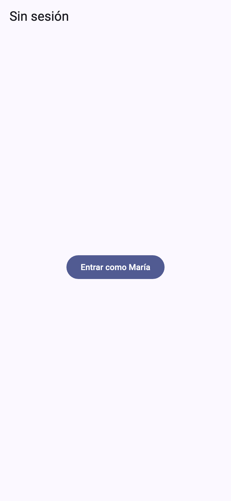
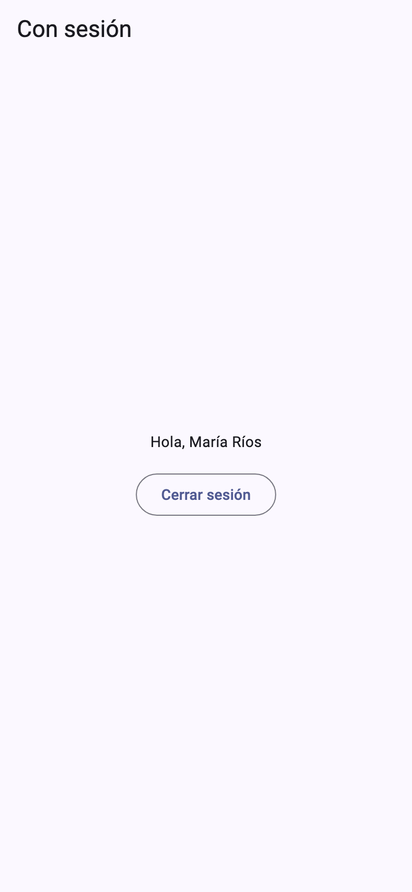
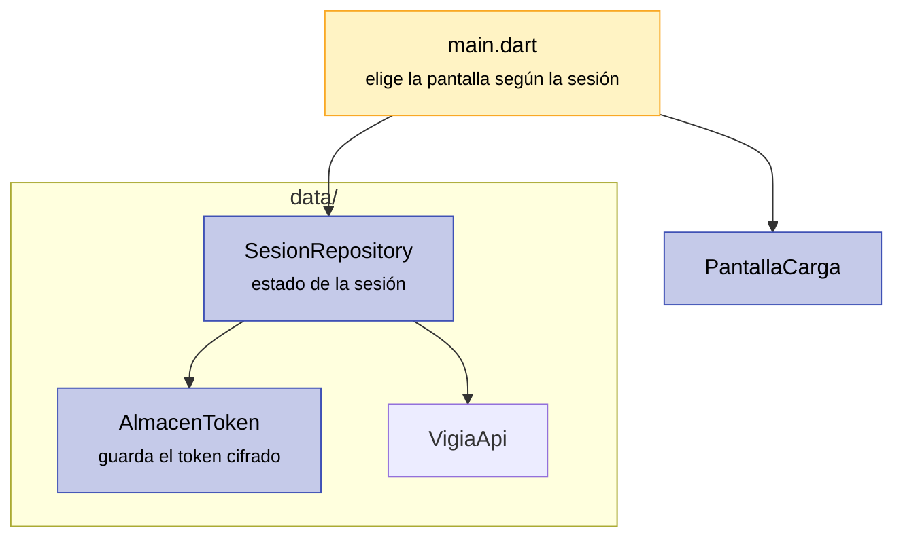
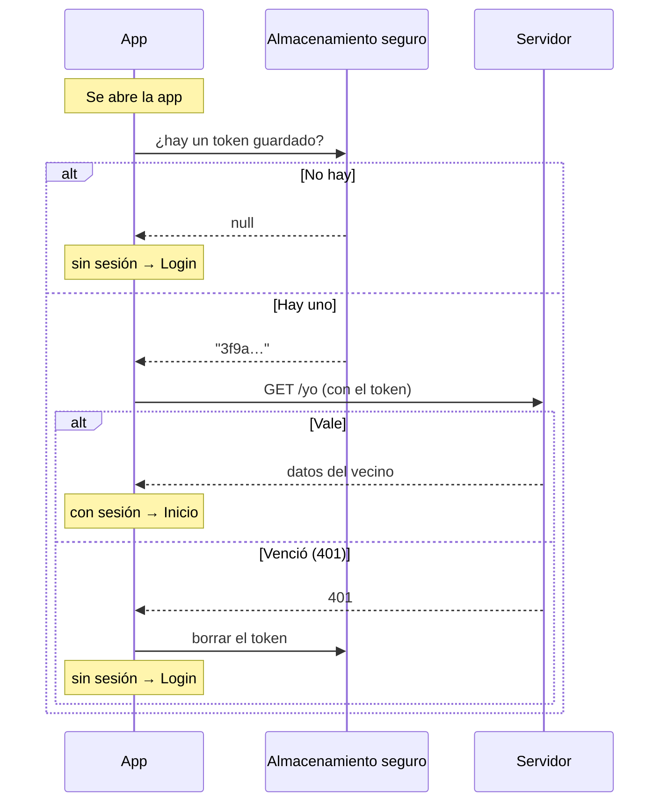
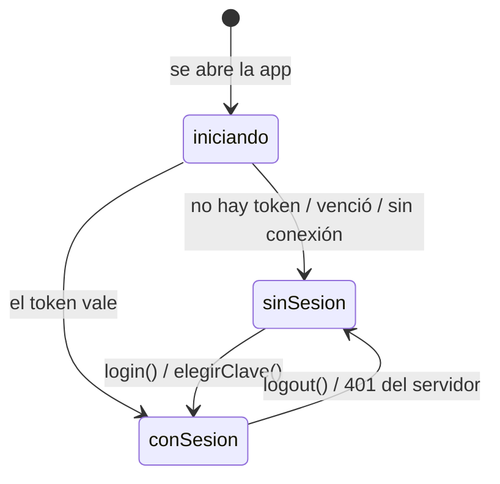
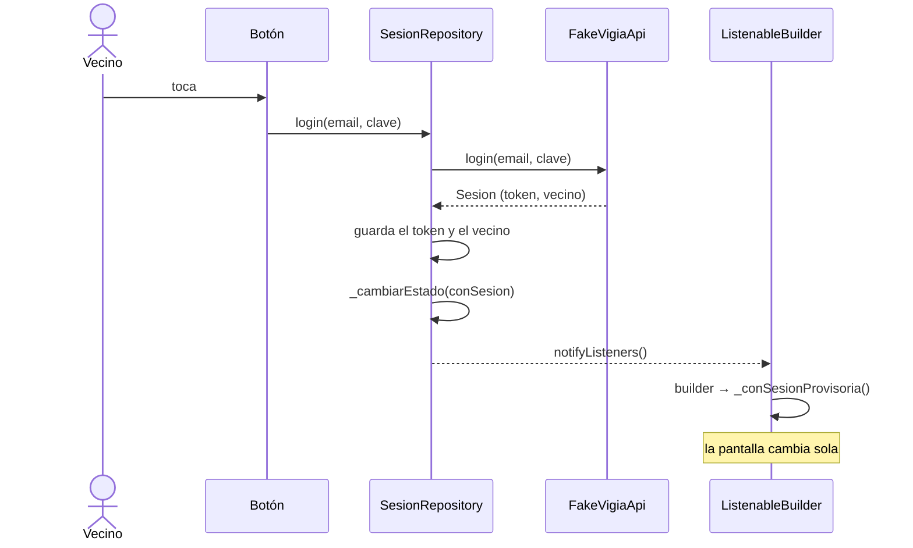

# 5. La sesión

!!! abstract "Objetivo"
    Que la app sepa **si hay alguien adentro**. Al abrirse revisa si quedó una sesión guardada; si no, muestra una pantalla para entrar; si sí, saluda al vecino. Y que la sesión **sobreviva** a cerrar la app: el token se guarda cifrado en el celular.

<div class="capturas" markdown>
<figure markdown="span">
  { .captura }
  <figcaption>Sin sesión</figcaption>
</figure>
<figure markdown="span">
  { .captura }
  <figcaption>Con sesión</figcaption>
</figure>
</div>

!!! warning "Las dos pantallas de este capítulo son provisorias"
    Son feas a propósito y llaman al repositorio directamente desde la vista, **cosa que no vamos a hacer nunca más**. Sirven para ver funcionar la sesión antes de tener el Login. En el capítulo 6 las reemplazamos y vas a ver por qué la forma "buena" es mejor.

## Dónde estamos

Agregamos un **servicio** más (guardar el token) y el primer **repositorio** (la sesión). Arriba, `main.dart` escucha a la sesión para decidir qué pantalla mostrar.



## Cómo funciona una sesión

Cuando el vecino entra con email y contraseña, el servidor devuelve un **token**: un texto largo y secreto que funciona como un pase. En cada pedido siguiente, la app manda ese token y el servidor sabe quién es. Vence a las 24 horas.

Si guardamos el token en el celular, la próxima vez que se abra la app no hace falta volver a escribir la contraseña: alcanza con preguntarle al servidor "¿este token sigue valiendo?" (`GET /yo`).



## Paso 1: el paquete de almacenamiento seguro

Guardar el token en un archivo común sería peligroso: otra app o alguien con el celular podría leerlo. El paquete `flutter_secure_storage` lo guarda **cifrado**, en el Keystore de Android o el Keychain de iOS.

Agregalo al proyecto:

```bash
flutter pub add flutter_secure_storage
```

Ese comando agrega una línea al `pubspec.yaml` y baja el paquete. Tu `pubspec.yaml` tiene que quedar así:

<!-- archivo: pubspec.yaml cap=c05 -->
```yaml title="pubspec.yaml" linenums="1" hl_lines="12"
name: vigia_app
description: "VigiaApp: red de alerta vecinal (versión de la wiki, solo Material)."
publish_to: 'none'
version: 1.0.0+1

environment:
  sdk: ^3.12.2

dependencies:
  flutter:
    sdk: flutter
  flutter_secure_storage: ^11.2.0

dev_dependencies:
  flutter_test:
    sdk: flutter
  flutter_lints: ^6.0.0

flutter:
  uses-material-design: true
```
<!-- /archivo -->

!!! info "Qué es un paquete"
    Un paquete es código que escribió otra persona y que publicó en [pub.dev](https://pub.dev) para que cualquiera lo use. Ver [Librerías y paquetes](../2-dart/10-librerias-y-paquetes.md) y [Plugins y plataformas](../3-flutter/8-plugins-y-plataformas.md): este es un *plugin*, porque además de Dart tiene código nativo de Android e iOS.

## Paso 2: `AlmacenToken`, el servicio que guarda el token

Creá `lib/data/services/almacen_token.dart`:

<!-- archivo: lib/data/services/almacen_token.dart cap=c05 notas="AlmacenToken\(\{FlutterSecureStorage\? almacen\}\)|: _almacen = almacen \?\?|static const clave|Future<String\?> leer|on Exception \{$|return null;|Future<void> guardar\(String\? token\)" -->
```dart title="lib/data/services/almacen_token.dart" linenums="1"
// lib/data/services/almacen_token.dart
//
// Guarda el token de sesión en el almacenamiento seguro (Keystore en
// Android, Keychain en iOS).
//
// El almacenamiento seguro puede fallar (Keystore de Android dañado, Linux
// sin llavero, tests). Si falla, la app sigue igual: sin token guardado, el vecino
// vuelve a entrar con su clave la próxima vez que abra la app.

import 'package:flutter_secure_storage/flutter_secure_storage.dart';

class AlmacenToken {
  AlmacenToken({FlutterSecureStorage? almacen})  // (1)!
    : _almacen = almacen ?? const FlutterSecureStorage();  // (2)!

  /// Clave con la que se guarda el token.
  static const clave = 'token';  // (3)!

  final FlutterSecureStorage _almacen;

  Future<String?> leer() async {  // (4)!
    try {
      return await _almacen.read(key: clave);
    } on Exception {  // (5)!
      return null;  // (6)!
    }
  }

  /// Guarda el token, o lo borra si es null.
  Future<void> guardar(String? token) async {  // (7)!
    try {
      if (token == null) {
        await _almacen.delete(key: clave);
      } else {
        await _almacen.write(key: clave, value: token);
      }
    } on Exception {
      // La sesión sigue en memoria hasta que se cierre la app.
    }
  }
}
```
<!-- /archivo -->

1. El constructor acepta un almacenamiento **opcional**. En la app no se pasa nada; en un test se podría pasar uno de mentira.
2. Una **lista de inicialización** (lo que va después de `:`): asigna el campo antes de que empiece el cuerpo del constructor. Si no pasaron un almacenamiento, usa el real.
3. La clave con la que se guarda. Es `static` (de la clase) y `const`.
4. `async` + `await`: espera la lectura sin trabar la app. Ver [Asincronía I](../2-dart/8-asincronia-future.md).
5. `try` / `on Exception`: si el almacenamiento falla (pasa en algunos Android con el Keystore dañado), en vez de romper la app…
6. …hace como que no había token. El vecino vuelve a entrar con su contraseña y listo.
7. Un solo método para guardar y borrar: `guardar(null)` borra.

!!! question "¿Por qué no usar `FlutterSecureStorage` directo en el repositorio?"
    Para que el repositorio no dependa del paquete. Si mañana se cambia la forma de guardar el token, se cambia solo este archivo. Y queda en un solo lugar la decisión de "si falla, seguí igual".

## Paso 3: `SesionRepository`, el estado de la sesión

Un **repositorio** es la *fuente de verdad* de un tema: todo lo que la app sabe sobre ese tema pasa por él. El de la sesión sabe si hay alguien adentro, quién es, y cómo entrar y salir.

Además, la sesión es **estado de toda la app**: cuando cambia, la app entera tiene que reaccionar (pasar del Login al Inicio). Por eso este repositorio es un `ChangeNotifier`: un objeto que **avisa** cuando cambia, y al que otros se pueden suscribir. Lo explicamos en [Estado compartido](../3-flutter/7-estado-compartido.md#changenotifier).

Creá `lib/data/repositories/sesion_repository.dart`:

<!-- archivo: lib/data/repositories/sesion_repository.dart cap=c05 notas="^enum EstadoSesion|class SesionRepository extends ChangeNotifier|_api.onSesionVencida = cerrarLocal|EstadoSesion _estado = EstadoSesion.iniciando|EstadoSesion get estado|Future<void> iniciar|return _cambiarEstado\(EstadoSesion.sinSesion\)|VecinoSesion.desdePerfil\(await|on ApiException catch \(e\)|if \(e.codigo == 401\)|Future<void> login\(|Future<void> _entrar\(Future<Sesion> Function\(\) pedido\)|Future<void> logout|void cerrarLocal|notifyListeners\(\);" -->
```dart title="lib/data/repositories/sesion_repository.dart" linenums="1"
// lib/data/repositories/sesion_repository.dart
//
// Sesión del vecino (RF-09): login con email y contraseña, alta por
// invitación del comité, recuperación de la clave y perfil.
//
// Es un ChangeNotifier porque la sesión es estado de toda la app: MyApp la
// escucha para decidir si muestra el Login o el Inicio. Avisa solo cuando
// cambia el estado; el "cargando" y los errores de cada formulario son de
// su ViewModel.

import 'package:flutter/foundation.dart';

import '../../domain/models/sesion.dart';
import '../services/almacen_token.dart';
import '../services/api/vigia_api.dart';

enum EstadoSesion { iniciando, sinSesion, conSesion }  // (1)!

class SesionRepository extends ChangeNotifier {  // (2)!
  SesionRepository(this._api, {AlmacenToken? almacen})
    : _almacen = almacen ?? AlmacenToken() {
    _api.onSesionVencida = cerrarLocal;  // (3)!
  }

  final VigiaApi _api;
  final AlmacenToken _almacen;

  EstadoSesion _estado = EstadoSesion.iniciando;  // (4)!
  VecinoSesion? _vecino;
  String? _avisoAlIniciar;

  EstadoSesion get estado => _estado;  // (5)!

  /// Quién está usando la app (null sin sesión).
  VecinoSesion? get vecino => _vecino;

  /// Por qué no se pudo validar la sesión guardada (p. ej. sin conexión).
  String? get avisoAlIniciar => _avisoAlIniciar;

  /// Al abrir la app: si hay un token guardado, lo valida con GET /yo.
  Future<void> iniciar() async {  // (6)!
    final token = await _almacen.leer();
    if (token == null) return _cambiarEstado(EstadoSesion.sinSesion);  // (7)!

    _api.token = token;
    try {
      _vecino = VecinoSesion.desdePerfil(await _api.obtenerPerfil());  // (8)!
      _cambiarEstado(EstadoSesion.conSesion);
    } on ApiException catch (e) {  // (9)!
      // 401: el token venció. Otro error (sin conexión): se conserva el
      // token guardado para el próximo intento, pero hay que volver a entrar.
      if (e.codigo == 401) {  // (10)!
        await _almacen.guardar(null);
      } else {
        _avisoAlIniciar = e.mensaje;
      }
      _api.token = null;
      _cambiarEstado(EstadoSesion.sinSesion);
    }
  }

  /// POST /auth/login. Si la clave no es correcta lanza [ApiException].
  Future<void> login(String email, String password) =>  // (11)!
      _entrar(() => _api.login(email, password));

  /// POST /auth/clave (invitación o recuperación). Deja la sesión iniciada.
  Future<void> elegirClave(String tokenEnlace, String password) =>
      _entrar(() => _api.elegirClave(tokenEnlace, password));

  Future<void> _entrar(Future<Sesion> Function() pedido) async {  // (12)!
    final sesion = await pedido();
    await _almacen.guardar(sesion.token);
    _vecino = sesion.vecino;
    _avisoAlIniciar = null;
    _cambiarEstado(EstadoSesion.conSesion);
  }

  /// POST /auth/recuperar (responde bien exista o no el email).
  Future<void> recuperarClave(String email) => _api.recuperarClave(email);

  /// "Cerrar sesión": avisa al servidor y, pase lo que pase, sale localmente.
  Future<void> logout() async {  // (13)!
    try {
      await _api.logout();
    } on ApiException {
      // Sin conexión: el token vence solo a las 24 h.
    }
    cerrarLocal();
  }

  /// Borra la sesión del dispositivo sin llamar al servidor (se usa cuando
  /// la API responde 401).
  void cerrarLocal() {  // (14)!
    _api.token = null;
    _almacen.guardar(null);
    _vecino = null;
    _cambiarEstado(EstadoSesion.sinSesion);
  }

  /// GET /yo
  Future<Perfil> obtenerPerfil() => _api.obtenerPerfil();

  /// POST /yo/clave
  Future<void> cambiarClave(String actual, String nueva) =>
      _api.cambiarClave(actual, nueva);

  void _cambiarEstado(EstadoSesion estado) {
    _estado = estado;
    notifyListeners();  // (15)!
  }
}
```
<!-- /archivo -->

1. Un **enum**: un tipo con una lista fija de valores. La sesión está en uno de tres estados, nunca en otro. Ver [Enums](../2-dart/7-enums-records-patrones.md#enums).
2. `extends ChangeNotifier`: hereda la capacidad de avisar (`notifyListeners`) y de tener suscriptores (`addListener`).
3. En el constructor le dice a la API: "si el servidor responde 401, llamá a `cerrarLocal`". Así, si el token vence en medio del uso, la app vuelve sola al Login.
4. Arranca en `iniciando`: todavía no sabemos si hay sesión.
5. El estado se **lee** desde afuera con el getter, pero solo el repositorio lo **cambia**. El campo `_estado` es privado.
6. Lo llama `main.dart` al abrir la app.
7. Sin token guardado: directo a "sin sesión". `return` corta la función ahí.
8. Con token: le pregunta al servidor quién es. Si responde bien, armamos el vecino a partir del perfil.
9. Si el servidor respondió con error…
10. …y el error es 401 (token vencido), lo borramos. Si es otro error (sin conexión), **no** lo borramos, para reintentar la próxima vez, y guardamos el motivo para mostrarlo en el Login.
11. Entrar con email y contraseña. Si la contraseña está mal, el `ApiException` **sale** de este método hacia quien lo llamó (el Login lo va a atrapar para mostrar el error).
12. `login` y `elegirClave` (capítulo 7) hacen lo mismo después de recibir la sesión: guardar el token, guardar el vecino y avisar. `_entrar` recibe **la función** que hace el pedido, así no se repite el resto.
13. Cerrar sesión: avisa al servidor (si puede) y sale localmente pase lo que pase.
14. Salir sin avisar al servidor. Es lo que se llama cuando el servidor ya dijo que la sesión no vale (401).
15. El único lugar donde se avisa. Cada vez que cambia el estado, todos los suscriptores se enteran.

El ciclo de vida de la sesión, como diagrama de estados:



## Paso 4: la pantalla de carga

Mientras se revisa el token (un instante), se muestra un indicador de progreso. Creá `lib/ui/carga/widgets/pantalla_carga.dart`:

<!-- archivo: lib/ui/carga/widgets/pantalla_carga.dart cap=c05 notas="CircularProgressIndicator" -->
```dart title="lib/ui/carga/widgets/pantalla_carga.dart" linenums="1"
// lib/ui/carga/widgets/pantalla_carga.dart

import 'package:flutter/material.dart';

/// Lo que se ve mientras se revisa si quedó una sesión guardada.
class PantallaCarga extends StatelessWidget {
  const PantallaCarga({super.key});

  @override
  Widget build(BuildContext context) {
    return const Scaffold(body: Center(child: CircularProgressIndicator()));  // (1)!
  }
}
```
<!-- /archivo -->

1. La ruedita de Material que gira. `const` porque nunca cambia.

## Paso 5: `main.dart` escucha a la sesión

Ahora `main.dart` crea la API y la sesión, y elige la pantalla según el estado. Reemplazalo entero:

<!-- archivo: lib/main.dart cap=c05 notas="runApp\(MyApp\(\)\)|class MyApp extends StatefulWidget|: api = api \?\? FakeVigiaApi\(\)|late final _sesion = SesionRepository\(widget.api\)..iniciar\(\)|_sesion.dispose\(\)|home: ListenableBuilder|listenable: _sesion|builder: \(context, _\) => switch|EstadoSesion.iniciando =>|_sesion.login\('maria@vigia.test'|onPressed: _sesion.logout" -->
```dart title="lib/main.dart" linenums="1" hl_lines="3-9 13-17 19 22-40 47-88"
// lib/main.dart
//
// Punto de entrada. Crea la API (por ahora siempre la falsa) y el
// repositorio de la sesión, y elige qué pantalla mostrar según el estado
// de la sesión.
//
// OJO: las pantallas de "sin sesión" y "con sesión" de este capítulo son
// provisorias y llaman al repositorio directo desde la vista. En el
// capítulo 6 las reemplazamos por el Login con su ViewModel.

import 'package:flutter/material.dart';

import 'data/repositories/sesion_repository.dart';
import 'data/services/api/fake_vigia_api.dart';
import 'data/services/api/vigia_api.dart';
import 'ui/carga/widgets/pantalla_carga.dart';

void main() {
  runApp(MyApp());  // (1)!
}

class MyApp extends StatefulWidget {  // (2)!
  MyApp({super.key, VigiaApi? api}) : api = api ?? FakeVigiaApi();  // (3)!

  final VigiaApi api;

  @override
  State<MyApp> createState() => _MyAppState();
}

class _MyAppState extends State<MyApp> {
  // Una sola instancia para toda la app. iniciar() revisa si quedó una
  // sesión guardada de la vez anterior.
  late final _sesion = SesionRepository(widget.api)..iniciar();  // (4)!

  @override
  void dispose() {
    _sesion.dispose();  // (5)!
    super.dispose();
  }

  @override
  Widget build(BuildContext context) {
    return MaterialApp(
      title: 'VigiaApp',
      theme: ThemeData(colorSchemeSeed: Colors.indigo),
      // Se redibuja cada vez que la sesión avisa que cambió.
      home: ListenableBuilder(  // (6)!
        listenable: _sesion,  // (7)!
        builder: (context, _) => switch (_sesion.estado) {  // (8)!
          EstadoSesion.iniciando => const PantallaCarga(),  // (9)!
          EstadoSesion.sinSesion => _sinSesionProvisoria(),
          EstadoSesion.conSesion => _conSesionProvisoria(),
        },
      ),
    );
  }

  // Provisoria: entra directo con la vecina de ejemplo.
  Widget _sinSesionProvisoria() {
    return Scaffold(
      appBar: AppBar(title: const Text('Sin sesión')),
      body: Center(
        child: FilledButton(
          onPressed: () =>
              _sesion.login('maria@vigia.test', FakeVigiaApi.clave),  // (10)!
          child: const Text('Entrar como María'),
        ),
      ),
    );
  }

  // Provisoria: saluda y deja cerrar la sesión.
  Widget _conSesionProvisoria() {
    return Scaffold(
      appBar: AppBar(title: const Text('Con sesión')),
      body: Center(
        child: Column(
          mainAxisSize: MainAxisSize.min,
          children: [
            Text('Hola, ${_sesion.vecino!.nombre}'),
            const SizedBox(height: 16),
            OutlinedButton(
              onPressed: _sesion.logout,  // (11)!
              child: const Text('Cerrar sesión'),
            ),
          ],
        ),
      ),
    );
  }
}
```
<!-- /archivo -->

1. Ya no es `const MyApp()`: ahora `MyApp` recibe la API, y la API no es constante.
2. Pasó a ser `StatefulWidget`: necesita **guardar** la sesión mientras vive la app (en su `State`). Ver [Stateless y Stateful](../3-flutter/2-stateless-y-stateful.md).
3. Si no le pasan una API, usa la falsa. Los tests van a pasar la suya.
4. `late final`: el repositorio se crea **la primera vez que se usa** (no antes), y después no cambia. `..iniciar()` (con dos puntos) es el **operador cascada**: llama a `iniciar()` sobre el objeto recién creado y el resultado de toda la expresión es el objeto, no lo que devuelve `iniciar()`.
5. Al cerrarse la app, se libera el `ChangeNotifier`. Todo lo que se crea en un `State` se libera en su `dispose`.
6. `ListenableBuilder` es el widget que **escucha** a un `ChangeNotifier`…
7. …este. Cada vez que la sesión llama a `notifyListeners()`…
8. …se vuelve a ejecutar este `builder`, que devuelve la pantalla que corresponde. Es un `switch` **como expresión**: cada caso devuelve un valor. Ver [switch](../2-dart/7-enums-records-patrones.md#switch-como-expresion).
9. Como `EstadoSesion` es un enum, si te olvidás de un caso, no compila.
10. **Provisorio:** el botón llama al repositorio directo desde la vista.
11. **Provisorio:** lo mismo para cerrar sesión.

Lo que pasa cuando tocás "Entrar como María":



!!! success "Fijate qué NO hace el botón"
    El botón no dice "ahora mostrá la otra pantalla". Solo cambia la sesión. La pantalla cambia **porque** `ListenableBuilder` escucha a la sesión. Esa idea (la vista se dibuja a partir del estado, y el estado avisa cuando cambia) es la base de toda la app.

## Probalo

```bash
flutter run
```

1. Aparece "Sin sesión". Tocá **Entrar como María**: después de un momento (los 400 ms del servidor falso) aparece "Hola, María Ríos".
2. **Cerrá la app del todo** (deslizala fuera de las recientes) y abrila de nuevo: tiene que entrar sola, porque el token quedó guardado.
3. Tocá **Cerrar sesión** y volvé a abrirla: tiene que aparecer "Sin sesión".

!!! warning "En el servidor falso la sesión no sobrevive del todo"
    El token se guarda de verdad, pero el `FakeVigiaApi` arranca de cero cada vez que se abre la app. Igual reconoce el token `fake-1`, porque sus vecinos de ejemplo son siempre los mismos.

Y los tests nuevos. Creá `test/sesion_repository_test.dart`:

<!-- archivo: test/sesion_repository_test.dart cap=c05 notas="FlutterSecureStorage.setMockInitialValues\(\{\}\)|setMockInitialValues\(\{'token': 'fake-1'\}\)|sesion.addListener\(\(\) => avisos\+\+\)|expect\(avisos, 1\)" -->
```dart title="test/sesion_repository_test.dart" linenums="1"
// test/sesion_repository_test.dart
//
// Pruebas de la sesión (capítulo 5). FlutterSecureStorage necesita la
// plataforma (Android, iOS): en los tests se reemplaza por un almacén en
// memoria con setMockInitialValues.

import 'package:flutter_secure_storage/flutter_secure_storage.dart';
import 'package:flutter_test/flutter_test.dart';

import 'package:vigia_app/data/repositories/sesion_repository.dart';
import 'package:vigia_app/data/services/api/fake_vigia_api.dart';

void main() {
  test('sin token guardado, queda sin sesión', () async {
    FlutterSecureStorage.setMockInitialValues({});  // (1)!
    final sesion = SesionRepository(FakeVigiaApi(demora: Duration.zero));
    expect(sesion.estado, EstadoSesion.iniciando);

    await sesion.iniciar();
    expect(sesion.estado, EstadoSesion.sinSesion);
  });

  test('con un token válido guardado, entra solo', () async {
    FlutterSecureStorage.setMockInitialValues({'token': 'fake-1'});  // (2)!
    final sesion = SesionRepository(FakeVigiaApi(demora: Duration.zero));

    await sesion.iniciar();
    expect(sesion.estado, EstadoSesion.conSesion);
    expect(sesion.vecino!.nombre, 'María Ríos');
  });

  test('login avisa a los que escuchan; logout vuelve a sin sesión', () async {
    FlutterSecureStorage.setMockInitialValues({});
    final sesion = SesionRepository(FakeVigiaApi(demora: Duration.zero));
    await sesion.iniciar();
    var avisos = 0;
    sesion.addListener(() => avisos++);  // (3)!

    await sesion.login('maria@vigia.test', FakeVigiaApi.clave);
    expect(sesion.estado, EstadoSesion.conSesion);
    expect(avisos, 1);  // (4)!

    await sesion.logout();
    expect(sesion.estado, EstadoSesion.sinSesion);
    expect(sesion.vecino, isNull);
  });
}
```
<!-- /archivo -->

1. En los tests no hay Android ni iOS, así que el almacenamiento seguro real no funciona. `setMockInitialValues` lo reemplaza por un mapa en memoria, que arranca vacío…
2. …o con un token ya guardado, como si la vecina hubiera entrado ayer.
3. Nos suscribimos al repositorio con una función que cuenta los avisos.
4. `login` avisó una sola vez.

```bash
flutter test
```

```text
00:02 +20: All tests passed!
```

## Así queda el proyecto

<!-- arbol: cap=c05 -->
```text title="Así queda el proyecto"
vigia_app/
    lib/
        config.dart
        data/
            repositories/
                sesion_repository.dart  ← nuevo
            services/
                almacen_token.dart  ← nuevo
                api/
                    fake_vigia_api.dart
                    vigia_api.dart
                errores.dart
        domain/
            models/
                alerta.dart
                comite.dart
                coordenadas.dart
                mensaje.dart
                noticia.dart
                publicacion.dart
                rondin.dart
                sesion.dart
        main.dart  ← cambia
        ui/
            carga/
                widgets/
                    pantalla_carga.dart  ← nuevo
        utils/
            fechas.dart
            resultado.dart
            sondeo.dart
            validadores.dart
    pubspec.yaml  ← cambia
    test/
        fake_api_test.dart
        modelos_test.dart
        sesion_repository_test.dart  ← nuevo
        utils_test.dart
```
<!-- /arbol -->

## Errores comunes

??? failure "`MissingPluginException(No implementation found for method read on channel plugins.it_nomads.com/flutter_secure_storage)`"
    Agregaste el paquete con la app corriendo. Los plugins nativos necesitan **reiniciar del todo**: pará la app (`q` en la terminal) y volvé a correr `flutter run`. El *hot reload* no alcanza.

    En los tests, este error significa que falta `FlutterSecureStorage.setMockInitialValues({})`.

??? failure "`uses-sdk:minSdkVersion 21 cannot be smaller than version 23 declared in library [flutter_secure_storage]`"
    El paquete necesita una versión de Android más nueva que la que pide tu proyecto. En `android/app/build.gradle.kts` (o `build.gradle`), dentro de `defaultConfig`, cambiá `minSdk = flutter.minSdkVersion` por `minSdk = 23`.

??? failure "La pantalla no cambia después de entrar"
    Revisá que `_cambiarEstado` llame a `notifyListeners()` y que el `ListenableBuilder` tenga `listenable: _sesion`. Sin aviso, nadie se entera.

## Lo que aprendiste

- [x] El **token** es el pase de la sesión; se guarda cifrado con `flutter_secure_storage`.
- [x] Un **repositorio** es la fuente de verdad de un tema; el de la sesión además es un `ChangeNotifier` porque es estado de toda la app.
- [x] `ListenableBuilder` redibuja cuando el `ChangeNotifier` llama a `notifyListeners()`.
- [x] Un **enum** con un `switch` como expresión elige la pantalla, y el compilador controla que no falte ningún caso.
- [x] Lo que se crea en un `State` se libera en su `dispose`.

[Siguiente: 6. ViewModel base y Login :material-arrow-right:](06-login.md){ .md-button .md-button--primary }
