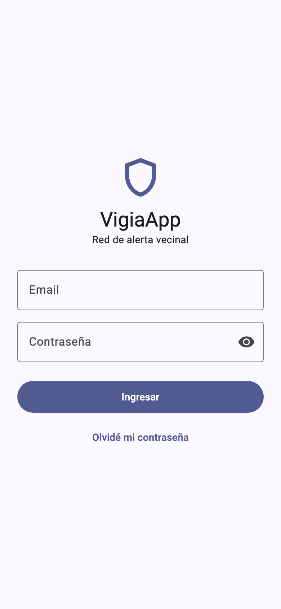
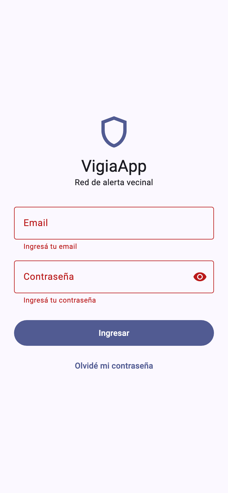
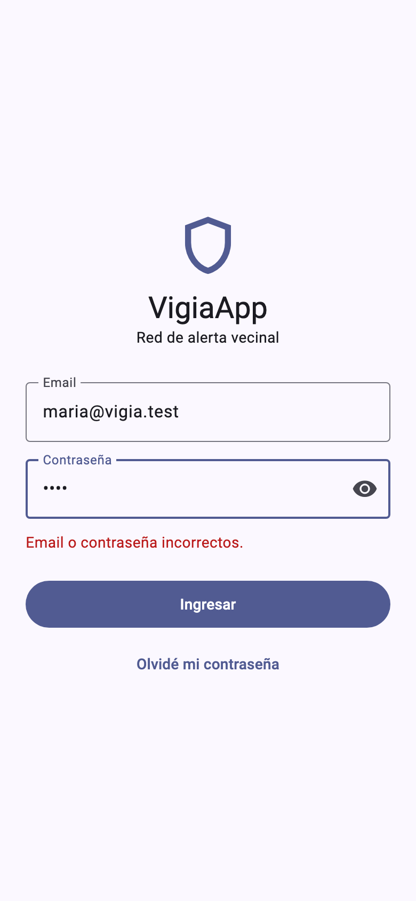
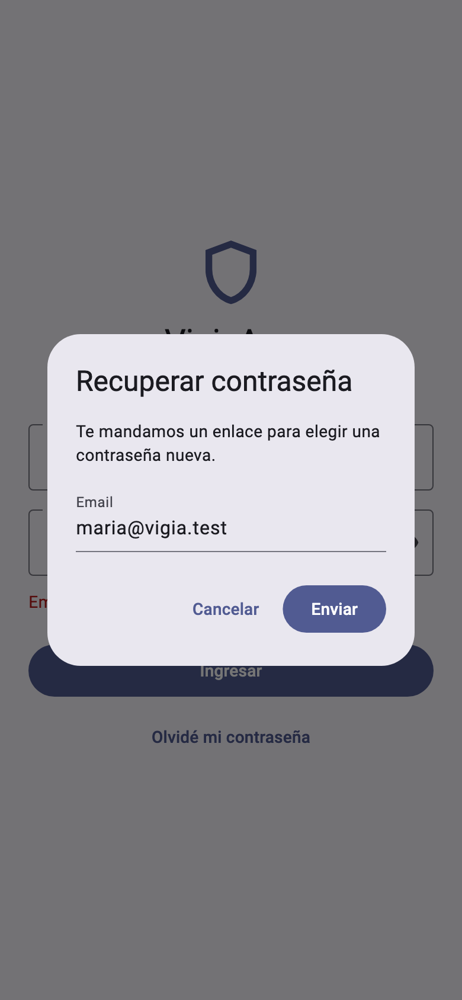
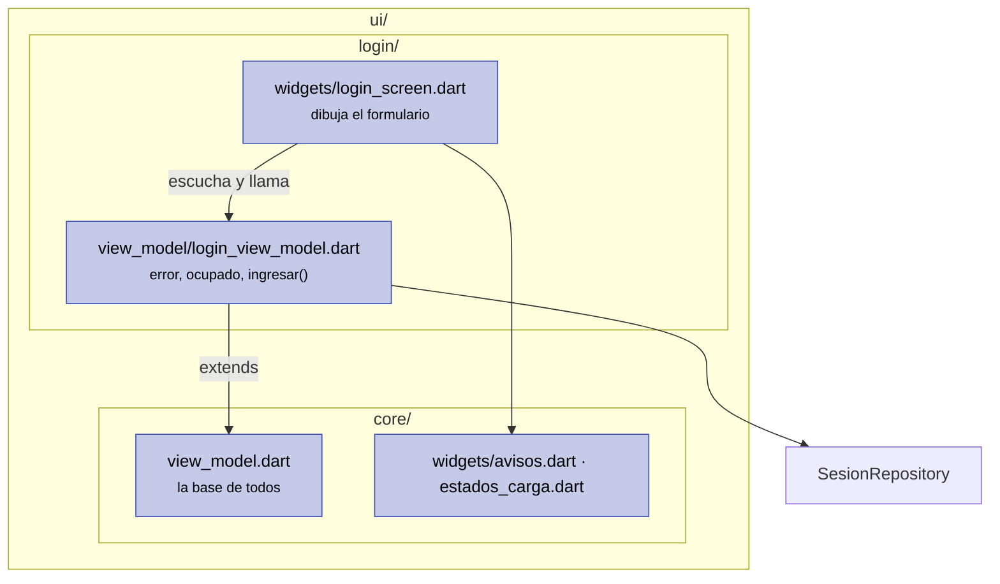
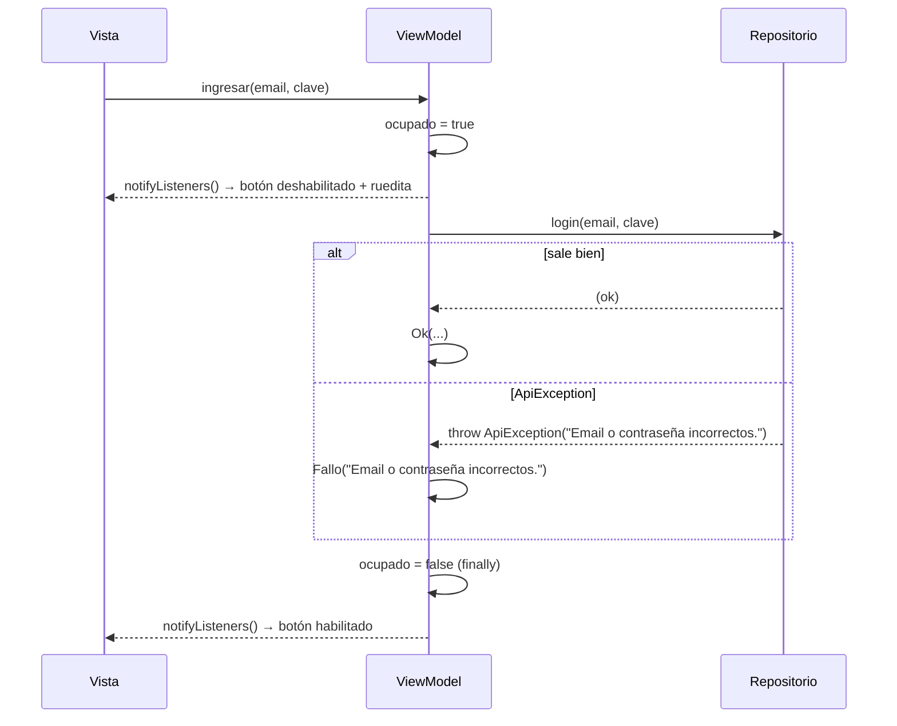
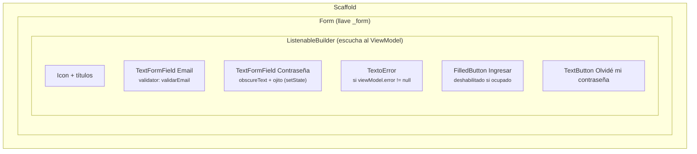

# 6. ViewModel base y Login

!!! abstract "Objetivo"
    Reemplazar la pantalla provisoria de "sin sesión" por un **Login de verdad**: formulario con email y contraseña, validación, el botón que se deshabilita mientras espera, el error del servidor en rojo y "Olvidé mi contraseña". Y hacerlo **con MVVM**: la primera pantalla con su ViewModel.

<div class="capturas" markdown>
<figure markdown="span">
  { .captura }
  <figcaption>El Login</figcaption>
</figure>
<figure markdown="span">
  { .captura }
  <figcaption>Validación local</figcaption>
</figure>
<figure markdown="span">
  { .captura }
  <figcaption>Error del servidor</figcaption>
</figure>
<figure markdown="span">
  { .captura }
  <figcaption>Recuperar contraseña</figcaption>
</figure>
</div>

## Dónde estamos

Aparece la capa de **UI** con sus dos mitades: la **vista** (el widget que dibuja) y el **ViewModel** (el estado y las acciones de la pantalla). El ViewModel usa el repositorio; la vista solo habla con el ViewModel.



## Por qué un ViewModel

En el capítulo anterior, el botón llamaba a `_sesion.login(...)` directo desde la vista. Funcionó, pero pensá en lo que le falta a un login real:

- mostrar que está esperando (y no dejar tocar dos veces el botón);
- atrapar el error si la contraseña está mal, y mostrarlo;
- borrar el error anterior cuando se vuelve a intentar;
- no intentar actualizar la pantalla si el vecino se fue mientras esperaba.

Si todo eso va en el widget, el widget se llena de lógica mezclada con el dibujo y **no se puede probar sin dibujar**. El ViewModel separa las dos cosas:

| La vista (`LoginScreen`) | El ViewModel (`LoginViewModel`) |
|---|---|
| Dibuja el formulario | Guarda el error y si está ocupado |
| Valida el formato (email vacío, mal escrito) | Habla con el repositorio |
| Cuando tocan "Ingresar", llama a `viewModel.ingresar(...)` | Convierte el error de la API en un mensaje |
| Se redibuja cuando el ViewModel avisa | Avisa (`notifyListeners`) cuando cambia algo |
| **No** conoce el repositorio | **No** conoce los widgets ni el `BuildContext` |

Este reparto está explicado a fondo en [MVVM y las capas](../4-arquitectura/2-mvvm-y-capas.md). Acá lo vamos a ver funcionando.

## Paso 1: la base de todos los ViewModels

Todos los ViewModels de la app hacen lo mismo cuando hablan con el servidor: marcarse "ocupados", esperar, atrapar el error, desmarcarse. Lo escribimos **una vez** en una clase base. Creá `lib/ui/core/view_model.dart`:

<!-- archivo: lib/ui/core/view_model.dart cap=c06 notas="import 'dart:collection'|abstract class ViewModel extends ChangeNotifier|bool _descartado = false|bool get ocupado|@protected|Future<Resultado<T>> ejecutar<T>|bool marcarOcupado = true|_cambiarOcupado\(true\);|return Ok\(await accion\(\)\);|on VigiaException catch \(e\)|finally \{|void notifyListeners\(\) \{|if \(!_descartado\)|_descartado = true;|extension SoloLectura|UnmodifiableListView\(this\)" -->
```dart title="lib/ui/core/view_model.dart" linenums="1"
// lib/ui/core/view_model.dart
//
// Base de los ViewModels (MVVM). Cada pantalla tiene el suyo: guarda el
// estado en campos privados, lo expone con getters de solo lectura y avisa
// con notifyListeners() cuando cambia (apunte 17). La vista lo escucha con
// ListenableBuilder y nunca le escribe el estado directo.
//
// Quién lo descarta: la pantalla que lo recibe en el constructor lo descarta
// en su dispose(). Los compartidos (RondinViewModel) los descarta MyApp.

import 'dart:collection';  // (1)!

import 'package:flutter/foundation.dart';

import '../../data/services/errores.dart';
import '../../utils/resultado.dart';

abstract class ViewModel extends ChangeNotifier {  // (2)!
  bool _ocupado = false;
  bool _descartado = false;  // (3)!

  /// true mientras se espera al servidor: la vista deshabilita los botones
  /// para que no los toquen dos veces.
  bool get ocupado => _ocupado;  // (4)!

  /// Corre [accion] y convierte el error en un [Fallo] con el mensaje para
  /// mostrar. Con [marcarOcupado], pasa por "ocupado" mientras espera:
  /// notifyListeners() antes y después del await.
  @protected  // (5)!
  Future<Resultado<T>> ejecutar<T>(  // (6)!
    Future<T> Function() accion, {
    bool marcarOcupado = true,  // (7)!
  }) async {
    if (marcarOcupado) _cambiarOcupado(true);  // (8)!
    try {
      return Ok(await accion());  // (9)!
    } on VigiaException catch (e) {  // (10)!
      return Fallo(e.mensaje);
    } finally {  // (11)!
      if (marcarOcupado) _cambiarOcupado(false);
    }
  }

  void _cambiarOcupado(bool ocupado) {
    _ocupado = ocupado;
    notifyListeners();
  }

  // Una respuesta del servidor puede llegar con la pantalla ya cerrada: en
  // ese caso no hay a quién avisarle (es el "if (!mounted) return" de antes).
  @override
  void notifyListeners() {  // (12)!
    if (!_descartado) super.notifyListeners();  // (13)!
  }

  @override
  void dispose() {
    _descartado = true;  // (14)!
    super.dispose();
  }
}

/// Las listas que expone un ViewModel son de solo lectura: la vista no puede
/// hacer `viewModel.turnos.clear()` por atrás del ViewModel. No copia la
/// lista, solo la envuelve.
extension SoloLectura<T> on List<T> {  // (15)!
  List<T> get soloLectura => UnmodifiableListView(this);  // (16)!
}
```
<!-- /archivo -->

1. `dart:collection` trae `UnmodifiableListView`, que usamos al final.
2. `abstract`: nadie hace `ViewModel()`; cada pantalla hace el suyo **extendiendo** este. `extends ChangeNotifier`: igual que la sesión, los ViewModels avisan cuando cambian.
3. Se pone en `true` cuando la pantalla se cierra. Lo usamos en la nota 13.
4. La vista lo usa para deshabilitar botones y mostrar la ruedita.
5. `@protected` (de `package:flutter/foundation.dart`): este método es para las **subclases**, no para la vista. Si una vista lo llama, el analizador avisa.
6. El método central. Es **genérico** (`<T>`): recibe una acción que devuelve un `Future<T>` y devuelve un `Resultado<T>`. Si la acción devuelve un `int`, el resultado es `Resultado<int>`.
7. Por defecto marca "ocupado". Algunas acciones no deben bloquear la pantalla (por ejemplo, borrar deslizando): esas pasan `marcarOcupado: false`.
8. Avisa **antes** de esperar: así la pantalla muestra la ruedita enseguida.
9. Si la acción sale bien, envuelve el valor en `Ok`.
10. Si falla con cualquiera de **nuestros** errores (API, GPS, fotos), lo convierte en `Fallo` con su mensaje. Los errores que no son nuestros (un bug) no se atrapan: queremos verlos.
11. `finally` se ejecuta **siempre**, haya salido bien o mal. Así nunca queda "ocupado" para siempre.
12. Reemplazamos `notifyListeners` de `ChangeNotifier`…
13. …para que no avise si la pantalla ya se cerró. Si el vecino se va mientras se espera al servidor, la respuesta llega igual, pero ya no hay a quién avisar (y avisar a un `ChangeNotifier` descartado es un error).
14. Al descartar, se marca. Las pantallas llaman a `dispose()` del ViewModel cuando se cierran.
15. Una **extensión**: le agrega a **todas** las listas un getter nuevo, `soloLectura`. Ver [Herencia y clases abstractas](../2-dart/6-herencia-y-abstraccion.md#extensiones).
16. Envuelve la lista (sin copiarla) en una vista que no se puede modificar. Los ViewModels exponen sus listas así: la vista puede leerlas, pero si intenta `viewModel.actividad.clear()`, falla.

La secuencia de `ejecutar`, con lo que ve la vista en cada momento:



## Paso 2: avisos y estados de carga

Dos archivos de widgets chiquitos que vamos a reusar en todas las pantallas. Creá `lib/ui/core/widgets/avisos.dart`:

<!-- archivo: lib/ui/core/widgets/avisos.dart cap=c06 notas="void mostrarAviso|ScaffoldMessenger.of\(context\)|bool avisarSiFallo|if \(resultado case Fallo\(:final mensaje\)\)|if \(context.mounted\)|Future<bool> confirmar\(|showDialog<bool>|Navigator.pop\(context, false\)|return respuesta == true" -->
```dart title="lib/ui/core/widgets/avisos.dart" linenums="1"
// lib/ui/core/widgets/avisos.dart
//
// Avisos que se repetían en todas las pantallas: el SnackBar con el error y
// el diálogo de "¿Seguro?".

import 'package:flutter/material.dart';

import '../../../utils/resultado.dart';

void mostrarAviso(BuildContext context, String texto) {  // (1)!
  ScaffoldMessenger.of(context).showSnackBar(SnackBar(content: Text(texto)));  // (2)!
}

/// Si la acción falló, muestra el motivo. Devuelve true si salió bien.
bool avisarSiFallo(BuildContext context, Resultado<Object?> resultado) {  // (3)!
  if (resultado case Fallo(:final mensaje)) {  // (4)!
    if (context.mounted) mostrarAviso(context, mensaje);  // (5)!
    return false;
  }
  return true;
}

/// Pregunta antes de una acción que no se puede deshacer. Devuelve true si
/// el vecino confirmó.
Future<bool> confirmar(  // (6)!
  BuildContext context, {
  required String titulo,
  required String mensaje,
  String confirmar = 'Borrar',
  String cancelar = 'Cancelar',
}) async {
  final respuesta = await showDialog<bool>(  // (7)!
    context: context,
    builder: (context) => AlertDialog(
      title: Text(titulo),
      content: Text(mensaje),
      actions: [
        TextButton(
          onPressed: () => Navigator.pop(context, false),  // (8)!
          child: Text(cancelar),
        ),
        FilledButton(
          onPressed: () => Navigator.pop(context, true),
          child: Text(confirmar),
        ),
      ],
    ),
  );
  return respuesta == true;  // (9)!
}
```
<!-- /archivo -->

1. Muestra un mensaje abajo de la pantalla (un `SnackBar`) que se va solo a los pocos segundos.
2. `ScaffoldMessenger.of(context)` busca hacia arriba en el árbol de widgets al que maneja los SnackBars. Ver [Widgets de Material](../3-flutter/4-material.md#snackbar).
3. Atajo para el caso más común: "si falló, mostrá el motivo".
4. Un `if` con patrón (`if case`): "si `resultado` es un `Fallo`, sacale el `mensaje`". Ver [patrones](../2-dart/7-enums-records-patrones.md#if-case).
5. `context.mounted` es `false` si el widget ya no está en pantalla. Siempre se revisa **después de un `await`**, antes de usar el `context`.
6. El diálogo de "¿Seguro?". Los textos de los botones tienen valores por defecto.
7. `showDialog` abre un diálogo y devuelve un `Future` con lo que el diálogo devuelva al cerrarse.
8. Cada botón cierra el diálogo devolviendo `true` o `false`.
9. Si el vecino cierra el diálogo tocando afuera, la respuesta es `null`: lo contamos como "no".

Y `lib/ui/core/widgets/estados_carga.dart`:

<!-- archivo: lib/ui/core/widgets/estados_carga.dart cap=c06 notas="class Cargando|final VoidCallback\? onReintentar|if \(onReintentar != null\)|class TextoError" -->
```dart title="lib/ui/core/widgets/estados_carga.dart" linenums="1"
// lib/ui/core/widgets/estados_carga.dart
//
// Lo que se muestra mientras carga o si falló una carga.

import 'package:flutter/material.dart';

class Cargando extends StatelessWidget {  // (1)!
  const Cargando({super.key});

  @override
  Widget build(BuildContext context) {
    return const Center(child: CircularProgressIndicator());
  }
}

/// El error con un botón para volver a intentar (o solo el error, sin
/// [onReintentar]).
class ErrorConReintento extends StatelessWidget {
  const ErrorConReintento({
    required this.mensaje,
    this.onReintentar,
    super.key,
  });

  final String mensaje;
  final VoidCallback? onReintentar;  // (2)!

  @override
  Widget build(BuildContext context) {
    return Center(
      child: Column(
        mainAxisSize: MainAxisSize.min,
        children: [
          Text(mensaje),
          if (onReintentar != null)  // (3)!
            TextButton(
              onPressed: onReintentar,
              child: const Text('Reintentar'),
            ),
        ],
      ),
    );
  }
}

/// El mensaje de error de un formulario, en rojo.
class TextoError extends StatelessWidget {  // (4)!
  const TextoError(this.mensaje, {super.key});

  final String mensaje;

  @override
  Widget build(BuildContext context) {
    return Text(
      mensaje,
      style: TextStyle(color: Theme.of(context).colorScheme.error),
    );
  }
}
```
<!-- /archivo -->

1. La ruedita centrada, para cuando una lista está cargando.
2. `VoidCallback` es "una función sin parámetros que no devuelve nada" (como `() {}`). Opcional: sin ella no se muestra el botón.
3. Un `if` **dentro de la lista de hijos** (*collection if*): el botón solo existe si hay a quién avisar.
4. El texto de error en rojo, tomando el color de error del tema.

## Paso 3: el ViewModel del Login

Creá `lib/ui/login/view_model/login_view_model.dart`:

<!-- archivo: lib/ui/login/view_model/login_view_model.dart cap=c06 notas="class LoginViewModel extends ViewModel|LoginViewModel\(this._sesion\) : _error = _sesion.avisoAlIniciar|String\? get error|_error = null;|await ejecutar\(\(\) => _sesion.login|if \(resultado case Fallo|notifyListeners\(\);|marcarOcupado: false" -->
```dart title="lib/ui/login/view_model/login_view_model.dart" linenums="1"
// lib/ui/login/view_model/login_view_model.dart

import '../../../data/repositories/sesion_repository.dart';
import '../../../utils/resultado.dart';
import '../../core/view_model.dart';

class LoginViewModel extends ViewModel {  // (1)!
  /// Si la sesión guardada no se pudo validar (sin conexión), arranca
  /// mostrando el motivo.
  LoginViewModel(this._sesion) : _error = _sesion.avisoAlIniciar;  // (2)!

  final SesionRepository _sesion;

  String? _error;
  String? get error => _error;  // (3)!

  /// Si entra, MyApp cambia solo al Inicio (escucha SesionRepository).
  Future<void> ingresar(String email, String clave) async {
    _error = null;  // (4)!
    final resultado = await ejecutar(() => _sesion.login(email, clave));  // (5)!
    if (resultado case Fallo(:final mensaje)) {  // (6)!
      _error = mensaje;
      notifyListeners();  // (7)!
    }
  }

  /// Manda el correo con el enlace para elegir una contraseña nueva.
  Future<Resultado<void>> recuperarClave(String email) =>
      ejecutar(() => _sesion.recuperarClave(email), marcarOcupado: false);  // (8)!
}
```
<!-- /archivo -->

1. Hereda `ocupado`, `ejecutar` y el `notifyListeners` protegido.
2. Recibe el repositorio por el constructor (no lo crea él). Y arranca con el aviso de la sesión, si lo hubo: por ejemplo, "Sin conexión" si al abrir la app no se pudo validar el token guardado.
3. La vista solo **lee** el error.
4. Al reintentar, primero se borra el error anterior.
5. Toda la lógica de "ocupado / esperar / atrapar" está en `ejecutar`. Acá solo se dice **qué** hacer.
6. Si falló, guarda el mensaje…
7. …y avisa, para que la vista lo muestre.
8. Para recuperar la clave no se bloquea el formulario. Devuelve el `Resultado` a la vista, porque la vista tiene que mostrar un SnackBar distinto si salió bien.

!!! question "¿Y si sale bien? ¿Quién muestra el Inicio?"
    Nadie lo hace a mano. Si el login sale bien, `SesionRepository` pasa a `conSesion` y avisa; `main.dart` escucha a la sesión y cambia de pantalla. El Login no sabe que existe el Inicio. Eso es bueno: cada parte sabe lo mínimo.

## Paso 4: el diálogo de recuperar la contraseña

Creá `lib/ui/login/widgets/recuperar_clave_dialog.dart`:

<!-- archivo: lib/ui/login/widgets/recuperar_clave_dialog.dart cap=c06 notas="final _form = GlobalKey<FormState>\(\)|late final _email = TextEditingController\(text: widget.emailInicial\)|_email.dispose\(\)|_form.currentState!.validate\(\)|Navigator.pop\(context, _email.text.trim\(\)\)|return AlertDialog|validator: validarEmail" -->
```dart title="lib/ui/login/widgets/recuperar_clave_dialog.dart" linenums="1"
// lib/ui/login/widgets/recuperar_clave_dialog.dart

import 'package:flutter/material.dart';

import '../../../utils/validadores.dart';

/// Pide el email para mandar el enlace de recuperación. Devuelve el email
/// (o null si cancela).
class RecuperarClaveDialog extends StatefulWidget {
  const RecuperarClaveDialog({required this.emailInicial, super.key});

  final String emailInicial;

  @override
  State<RecuperarClaveDialog> createState() => _RecuperarClaveDialogState();
}

class _RecuperarClaveDialogState extends State<RecuperarClaveDialog> {
  final _form = GlobalKey<FormState>();  // (1)!
  late final _email = TextEditingController(text: widget.emailInicial);  // (2)!

  @override
  void dispose() {
    _email.dispose();  // (3)!
    super.dispose();
  }

  void _enviar() {
    if (_form.currentState!.validate()) {  // (4)!
      Navigator.pop(context, _email.text.trim());  // (5)!
    }
  }

  @override
  Widget build(BuildContext context) {
    return AlertDialog(  // (6)!
      title: const Text('Recuperar contraseña'),
      content: Form(
        key: _form,
        child: Column(
          mainAxisSize: MainAxisSize.min,
          children: [
            const Text(
              'Te mandamos un enlace para elegir una contraseña nueva.',
            ),
            const SizedBox(height: 16),
            TextFormField(
              controller: _email,
              decoration: const InputDecoration(labelText: 'Email'),
              keyboardType: TextInputType.emailAddress,
              validator: validarEmail,  // (7)!
              onFieldSubmitted: (_) => _enviar(),
            ),
          ],
        ),
      ),
      actions: [
        TextButton(
          onPressed: () => Navigator.pop(context),
          child: const Text('Cancelar'),
        ),
        FilledButton(onPressed: _enviar, child: const Text('Enviar')),
      ],
    );
  }
}
```
<!-- /archivo -->

1. Una **llave** para el formulario: permite pedirle "validá todos los campos" desde afuera. Ver [Formularios](../3-flutter/5-formularios.md).
2. Un `TextEditingController` guarda el texto de un campo. Arranca con el email que ya estaba escrito en el Login. `late` porque usa `widget`, que no existe hasta que el `State` está creado.
3. Los controladores se liberan en `dispose`, siempre.
4. Corre todos los `validator` del formulario; si alguno devuelve un mensaje, lo muestra debajo del campo y da `false`.
5. Cierra el diálogo **devolviendo** el email. Quien abrió el diálogo lo recibe como resultado del `await showDialog(...)`.
6. `AlertDialog` es el diálogo estándar de Material: título, contenido y botones.
7. El validador del capítulo 2.

## Paso 5: la pantalla de Login

Creá `lib/ui/login/widgets/login_screen.dart`. Es el archivo más largo del capítulo, pero la mayor parte es el dibujo del formulario.

<!-- archivo: lib/ui/login/widgets/login_screen.dart cap=c06 notas="required this.viewModel|final LoginViewModel viewModel|bool _verClave = false|late final LoginViewModel _viewModel = widget.viewModel|_viewModel.dispose\(\);|if \(!_form.currentState!.validate\(\)\) return|_viewModel.ingresar\(|await showDialog<String>|if \(email == null \|\| !mounted\) return|if \(!mounted \|\| !avisarSiFallo|child: AutofillGroup|child: ListenableBuilder|final ocupado = _viewModel.ocupado|validator: validarEmail|obscureText: !_verClave|if \(_viewModel.error case final error\?\)|onPressed: ocupado \? null : _ingresar|child: ocupado" -->
```dart title="lib/ui/login/widgets/login_screen.dart" linenums="1"
// lib/ui/login/widgets/login_screen.dart
//
// Ingreso con email y contraseña (RF-09).

import 'package:flutter/material.dart';

import '../../../utils/validadores.dart';
import '../../core/widgets/avisos.dart';
import '../../core/widgets/estados_carga.dart';
import '../view_model/login_view_model.dart';
import 'recuperar_clave_dialog.dart';

class LoginScreen extends StatefulWidget {
  const LoginScreen({required this.viewModel, super.key});  // (1)!

  final LoginViewModel viewModel;  // (2)!

  @override
  State<LoginScreen> createState() => _LoginScreenState();
}

class _LoginScreenState extends State<LoginScreen> {
  final _form = GlobalKey<FormState>();
  final _email = TextEditingController();
  final _password = TextEditingController();
  bool _verClave = false; // estado efímero de la vista: no va al ViewModel (3)

  // Se toma una sola vez: si el padre se redibuja, la pantalla sigue con el
  // mismo ViewModel (el que después descarta en dispose).
  late final LoginViewModel _viewModel = widget.viewModel;  // (4)!

  @override
  void dispose() {
    _email.dispose();
    _password.dispose();
    _viewModel.dispose();  // (5)!
    super.dispose();
  }

  void _ingresar() {
    if (!_form.currentState!.validate()) return;  // (6)!
    _viewModel.ingresar(_email.text.trim(), _password.text);  // (7)!
  }

  Future<void> _recuperar() async {
    final email = await showDialog<String>(  // (8)!
      context: context,
      builder: (context) =>
          RecuperarClaveDialog(emailInicial: _email.text.trim()),
    );
    if (email == null || !mounted) return;  // (9)!

    final resultado = await _viewModel.recuperarClave(email);
    if (!mounted || !avisarSiFallo(context, resultado)) return;  // (10)!
    mostrarAviso(
      context,
      'Si el email está registrado, te llegó un correo con el enlace.',
    );
  }

  @override
  Widget build(BuildContext context) {
    final tema = Theme.of(context);
    return Scaffold(
      body: SafeArea(
        child: Center(
          child: SingleChildScrollView(
            padding: const EdgeInsets.all(24),
            child: Form(
              key: _form,
              child: AutofillGroup(  // (11)!
                child: ListenableBuilder(  // (12)!
                  listenable: _viewModel,
                  builder: (context, _) {
                    final ocupado = _viewModel.ocupado;  // (13)!
                    return Column(
                      crossAxisAlignment: CrossAxisAlignment.stretch,
                      children: [
                        Icon(
                          Icons.shield_outlined,
                          size: 64,
                          color: tema.colorScheme.primary,
                        ),
                        const SizedBox(height: 8),
                        Text(
                          'VigiaApp',
                          textAlign: TextAlign.center,
                          style: tema.textTheme.headlineMedium,
                        ),
                        Text(
                          'Red de alerta vecinal',
                          textAlign: TextAlign.center,
                          style: tema.textTheme.bodyMedium,
                        ),
                        const SizedBox(height: 32),
                        TextFormField(
                          controller: _email,
                          decoration: const InputDecoration(
                            labelText: 'Email',
                            border: OutlineInputBorder(),
                          ),
                          keyboardType: TextInputType.emailAddress,
                          autofillHints: const [AutofillHints.email],
                          textInputAction: TextInputAction.next,
                          validator: validarEmail,  // (14)!
                        ),
                        const SizedBox(height: 16),
                        TextFormField(
                          controller: _password,
                          decoration: InputDecoration(
                            labelText: 'Contraseña',
                            border: const OutlineInputBorder(),
                            suffixIcon: IconButton(
                              icon: Icon(
                                _verClave
                                    ? Icons.visibility_off
                                    : Icons.visibility,
                              ),
                              tooltip: _verClave ? 'Ocultar' : 'Mostrar',
                              onPressed: () =>
                                  setState(() => _verClave = !_verClave),
                            ),
                          ),
                          obscureText: !_verClave,  // (15)!
                          autofillHints: const [AutofillHints.password],
                          textInputAction: TextInputAction.done,
                          onFieldSubmitted: (_) => ocupado ? null : _ingresar(),
                          validator: (valor) => (valor ?? '').isEmpty
                              ? 'Ingresá tu contraseña'
                              : null,
                        ),
                        if (_viewModel.error case final error?) ...[  // (16)!
                          const SizedBox(height: 12),
                          TextoError(error),
                        ],
                        const SizedBox(height: 24),
                        FilledButton(
                          onPressed: ocupado ? null : _ingresar,  // (17)!
                          child: Padding(
                            padding: const EdgeInsets.symmetric(vertical: 12),
                            child: ocupado  // (18)!
                                ? const SizedBox(
                                    width: 20,
                                    height: 20,
                                    child: CircularProgressIndicator(
                                      strokeWidth: 2,
                                    ),
                                  )
                                : const Text('Ingresar'),
                          ),
                        ),
                        const SizedBox(height: 8),
                        TextButton(
                          onPressed: ocupado ? null : _recuperar,
                          child: const Text('Olvidé mi contraseña'),
                        ),
                      ],
                    );
                  },
                ),
              ),
            ),
          ),
        ),
      ),
    );
  }
}
```
<!-- /archivo -->

1. La pantalla **recibe** su ViewModel: no lo crea. Así, en un test se le puede pasar uno armado a mano.
2. El ViewModel queda en un campo del widget…
3. Estado **de la vista** (mostrar u ocultar la contraseña): no le importa a nadie más, así que no va al ViewModel. Esa distinción (estado efímero vs. estado de la pantalla) la explicamos en [Estado compartido](../3-flutter/7-estado-compartido.md).
4. …y el `State` lo toma **una sola vez**. Si el padre se redibuja y crea otro `LoginScreen`, la pantalla sigue con el ViewModel original. `late final` + inicializador: se evalúa la primera vez que se usa.
5. La pantalla es la **dueña** de su ViewModel: lo descarta al cerrarse.
6. Primero la validación local (formato). Si hay errores, ni se llama al servidor.
7. La vista no hace nada más que avisarle al ViewModel. No espera el resultado: cuando cambie algo, el ViewModel va a avisar.
8. Abre el diálogo y **espera** a que se cierre. El `<String>` dice qué tipo devuelve.
9. Si canceló (`null`) o la pantalla se cerró mientras el diálogo estaba abierto, no sigue.
10. Después de cada `await`, antes de usar el `context`: ¿seguimos en pantalla? Y si falló, ya mostró el error y no sigue.
11. `AutofillGroup` deja que el celular ofrezca completar email y contraseña guardados.
12. Todo lo que depende del ViewModel va dentro del `ListenableBuilder`, que se redibuja cuando el ViewModel avisa.
13. Se lee una vez por dibujo y se usa en varios lugares.
14. El campo de email con el validador del capítulo 2.
15. `obscureText` muestra puntitos en vez de letras. El ojito cambia `_verClave` con `setState`.
16. Si hay error, se muestra en rojo. Los `...[ ]` (*spread*) agregan varios widgets a la lista de una vez.
17. `onPressed: null` **deshabilita** el botón (se ve gris y no responde). Mientras espera, no se puede tocar dos veces.
18. Mientras espera, el botón muestra una ruedita chiquita en vez del texto.

Cómo se reparte el trabajo en la pantalla:



## Paso 6: usar el Login en `main.dart`

En `main.dart`, el caso `sinSesion` ahora muestra el Login con un ViewModel nuevo, y se borra la pantalla provisoria de "sin sesión". Esto es lo que cambia:

<!-- diff: lib/main.dart cap=c06 -->
```diff title="Qué cambia en lib/main.dart"
--- lib/main.dart (cap. 5)
+++ lib/main.dart (cap. 6)
@@ -5,7 +5,6 @@
 // de la sesión.
 //
-// OJO: las pantallas de "sin sesión" y "con sesión" de este capítulo son
-// provisorias y llaman al repositorio directo desde la vista. En el
-// capítulo 6 las reemplazamos por el Login con su ViewModel.
+// OJO: la pantalla de "con sesión" sigue siendo provisoria: en el capítulo 8
+// la reemplazamos por el Inicio.
 
 import 'package:flutter/material.dart';
@@ -15,4 +14,6 @@
 import 'data/services/api/vigia_api.dart';
 import 'ui/carga/widgets/pantalla_carga.dart';
+import 'ui/login/view_model/login_view_model.dart';
+import 'ui/login/widgets/login_screen.dart';
 
 void main() {
@@ -50,21 +51,10 @@
         builder: (context, _) => switch (_sesion.estado) {
           EstadoSesion.iniciando => const PantallaCarga(),
-          EstadoSesion.sinSesion => _sinSesionProvisoria(),
+          // Cada vez que se muestra el Login, con un ViewModel nuevo.
+          EstadoSesion.sinSesion => LoginScreen(
+            viewModel: LoginViewModel(_sesion),
+          ),
           EstadoSesion.conSesion => _conSesionProvisoria(),
         },
-      ),
-    );
-  }
-
-  // Provisoria: entra directo con la vecina de ejemplo.
-  Widget _sinSesionProvisoria() {
-    return Scaffold(
-      appBar: AppBar(title: const Text('Sin sesión')),
-      body: Center(
-        child: FilledButton(
-          onPressed: () =>
-              _sesion.login('maria@vigia.test', FakeVigiaApi.clave),
-          child: const Text('Entrar como María'),
-        ),
       ),
     );
```
<!-- /diff -->

Y el archivo completo:

<!-- archivo: lib/main.dart cap=c06 notas="viewModel: LoginViewModel\(_sesion\)" -->
```dart title="lib/main.dart" linenums="1" hl_lines="7-8 16-17 53-56"
// lib/main.dart
//
// Punto de entrada. Crea la API (por ahora siempre la falsa) y el
// repositorio de la sesión, y elige qué pantalla mostrar según el estado
// de la sesión.
//
// OJO: la pantalla de "con sesión" sigue siendo provisoria: en el capítulo 8
// la reemplazamos por el Inicio.

import 'package:flutter/material.dart';

import 'data/repositories/sesion_repository.dart';
import 'data/services/api/fake_vigia_api.dart';
import 'data/services/api/vigia_api.dart';
import 'ui/carga/widgets/pantalla_carga.dart';
import 'ui/login/view_model/login_view_model.dart';
import 'ui/login/widgets/login_screen.dart';

void main() {
  runApp(MyApp());
}

class MyApp extends StatefulWidget {
  MyApp({super.key, VigiaApi? api}) : api = api ?? FakeVigiaApi();

  final VigiaApi api;

  @override
  State<MyApp> createState() => _MyAppState();
}

class _MyAppState extends State<MyApp> {
  // Una sola instancia para toda la app. iniciar() revisa si quedó una
  // sesión guardada de la vez anterior.
  late final _sesion = SesionRepository(widget.api)..iniciar();

  @override
  void dispose() {
    _sesion.dispose();
    super.dispose();
  }

  @override
  Widget build(BuildContext context) {
    return MaterialApp(
      title: 'VigiaApp',
      theme: ThemeData(colorSchemeSeed: Colors.indigo),
      // Se redibuja cada vez que la sesión avisa que cambió.
      home: ListenableBuilder(
        listenable: _sesion,
        builder: (context, _) => switch (_sesion.estado) {
          EstadoSesion.iniciando => const PantallaCarga(),
          // Cada vez que se muestra el Login, con un ViewModel nuevo.
          EstadoSesion.sinSesion => LoginScreen(
            viewModel: LoginViewModel(_sesion),  // (1)!
          ),
          EstadoSesion.conSesion => _conSesionProvisoria(),
        },
      ),
    );
  }

  // Provisoria: saluda y deja cerrar la sesión.
  Widget _conSesionProvisoria() {
    return Scaffold(
      appBar: AppBar(title: const Text('Con sesión')),
      body: Center(
        child: Column(
          mainAxisSize: MainAxisSize.min,
          children: [
            Text('Hola, ${_sesion.vecino!.nombre}'),
            const SizedBox(height: 16),
            OutlinedButton(
              onPressed: _sesion.logout,
              child: const Text('Cerrar sesión'),
            ),
          ],
        ),
      ),
    );
  }
}
```
<!-- /archivo -->

1. Cada vez que la sesión pasa a "sin sesión" se crea un `LoginViewModel` nuevo. El viejo lo descartó el `LoginScreen` anterior al cerrarse. Esto de quién crea y quién descarta cada ViewModel lo ordenamos en [El ViewModel base](../4-arquitectura/6-viewmodel-base.md#quien-crea-y-quien-descarta).

## Probalo

```bash
flutter run
```

1. Tocá **Ingresar** con los campos vacíos: aparecen los errores debajo de cada campo, sin llamar al servidor.
2. Escribí `maria@vigia.test` y una contraseña cualquiera: el botón muestra la ruedita y después aparece **"Email o contraseña incorrectos."** en rojo.
3. Escribí `vigia1234`: entra y aparece "Hola, María Ríos".
4. Cerrá sesión, tocá **Olvidé mi contraseña** y mandá: aparece el SnackBar.

Y el test del ViewModel. Creá `test/login_view_model_test.dart`:

<!-- archivo: test/login_view_model_test.dart cap=c06 notas="setUp\(\(\) async|final viewModel = LoginViewModel\(sesion\);|expect\(viewModel.error, 'Email o contraseña incorrectos.'\)|final pedido = viewModel.ingresar|expect\(viewModel.ocupado, isTrue\)" -->
```dart title="test/login_view_model_test.dart" linenums="1"
// test/login_view_model_test.dart
//
// Pruebas del LoginViewModel (capítulo 6): se prueba la lógica de la
// pantalla sin dibujarla. Solo hace falta el servidor falso.

import 'package:flutter_secure_storage/flutter_secure_storage.dart';
import 'package:flutter_test/flutter_test.dart';

import 'package:vigia_app/data/repositories/sesion_repository.dart';
import 'package:vigia_app/data/services/api/fake_vigia_api.dart';
import 'package:vigia_app/ui/login/view_model/login_view_model.dart';

void main() {
  late SesionRepository sesion;

  setUp(() async {  // (1)!
    FlutterSecureStorage.setMockInitialValues({});
    sesion = SesionRepository(FakeVigiaApi(demora: Duration.zero));
    await sesion.iniciar();
  });

  test('con la clave correcta entra y no queda error', () async {
    final viewModel = LoginViewModel(sesion);  // (2)!
    await viewModel.ingresar('maria@vigia.test', FakeVigiaApi.clave);
    expect(viewModel.error, isNull);
    expect(sesion.estado, EstadoSesion.conSesion);
  });

  test('con la clave mal muestra el mensaje de la API', () async {
    final viewModel = LoginViewModel(sesion);
    await viewModel.ingresar('maria@vigia.test', 'otra');
    expect(viewModel.error, 'Email o contraseña incorrectos.');  // (3)!
    expect(sesion.estado, EstadoSesion.sinSesion);
  });

  test('mientras espera está "ocupado"', () async {
    final viewModel = LoginViewModel(sesion);
    final pedido = viewModel.ingresar('maria@vigia.test', FakeVigiaApi.clave);  // (4)!
    expect(viewModel.ocupado, isTrue); // se marcó antes de esperar (5)
    await pedido;
    expect(viewModel.ocupado, isFalse);
  });
}
```
<!-- /archivo -->

1. Antes de cada test, una sesión nueva sin token.
2. **El ViewModel se prueba solo**, sin pantalla. Esta es la gran ventaja de separarlo.
3. El mensaje que mostraría la pantalla.
4. Guardamos el `Future` **sin esperarlo**…
5. …y comprobamos que, mientras tanto, está ocupado. Después lo esperamos y ya no.

```bash
flutter test
```

```text
00:02 +23: All tests passed!
```

## Así queda el proyecto

<!-- arbol: cap=c06 -->
```text title="Así queda el proyecto"
vigia_app/
    lib/
        config.dart
        data/
            repositories/
                sesion_repository.dart
            services/
                almacen_token.dart
                api/
                    fake_vigia_api.dart
                    vigia_api.dart
                errores.dart
        domain/
            models/
                alerta.dart
                comite.dart
                coordenadas.dart
                mensaje.dart
                noticia.dart
                publicacion.dart
                rondin.dart
                sesion.dart
        main.dart  ← cambia
        ui/
            carga/
                widgets/
                    pantalla_carga.dart
            core/
                view_model.dart  ← nuevo
                widgets/
                    avisos.dart  ← nuevo
                    estados_carga.dart  ← nuevo
            login/
                view_model/
                    login_view_model.dart  ← nuevo
                widgets/
                    login_screen.dart  ← nuevo
                    recuperar_clave_dialog.dart  ← nuevo
        utils/
            fechas.dart
            resultado.dart
            sondeo.dart
            validadores.dart
    pubspec.yaml
    test/
        fake_api_test.dart
        login_view_model_test.dart  ← nuevo
        modelos_test.dart
        sesion_repository_test.dart
        utils_test.dart
```
<!-- /arbol -->

## Errores comunes

??? failure "`A ChangeNotifier was used after being disposed.`"
    Algo llamó a `notifyListeners()` (o `addListener`) en un ViewModel ya descartado. Si es tuyo, revisá que extienda `ViewModel` (que tiene la protección de la nota 13) y no `ChangeNotifier` directo.

??? failure "`Don't use 'BuildContext's across async gaps.`"
    Es un aviso del analizador: usaste `context` después de un `await` sin preguntar antes `if (!mounted) return;`. Mientras se esperaba, la pantalla pudo cerrarse.

??? failure "El botón queda deshabilitado para siempre"
    `ocupado` quedó en `true`. Si escribiste tu propia versión de `ejecutar`, revisá que el `_cambiarOcupado(false)` esté en el `finally`.

??? failure "No aparece el error en rojo"
    El ViewModel guarda `_error` pero no llama a `notifyListeners()`. O la parte que muestra el error está **fuera** del `ListenableBuilder`.

## Lo que aprendiste

- [x] Un **ViewModel** guarda el estado de una pantalla y sus acciones, y avisa cuando cambia. La vista lo escucha y lo llama, nada más.
- [x] La clase base `ViewModel` concentra el "ocupado / esperar / atrapar el error" en `ejecutar`.
- [x] La pantalla **recibe** su ViewModel, lo toma **una vez** (`late final`) y lo **descarta** en `dispose`.
- [x] El estado efímero de la vista (mostrar la contraseña) se queda en la vista, con `setState`.
- [x] Después de un `await`, siempre `if (!mounted) return;` antes de usar el `context`.
- [x] Un ViewModel se prueba **sin dibujar nada**.

[Siguiente: 7. Dependencias, rutas y enlaces :material-arrow-right:](07-dependencias-y-rutas.md){ .md-button .md-button--primary }
