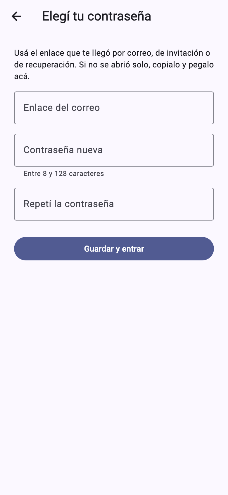
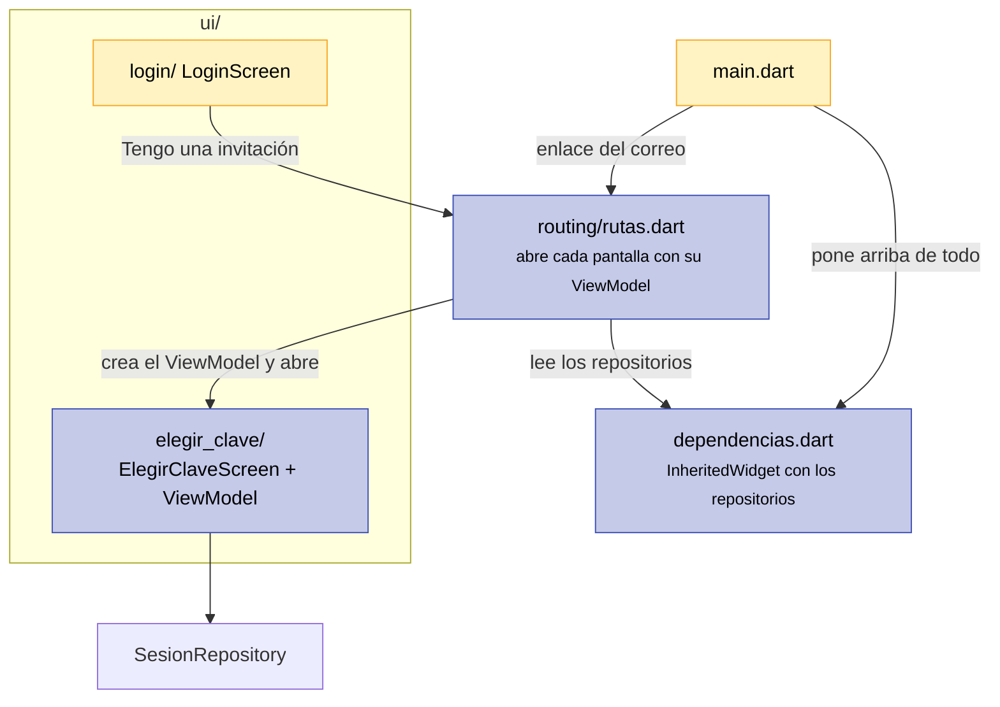
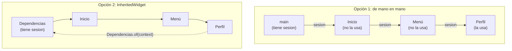
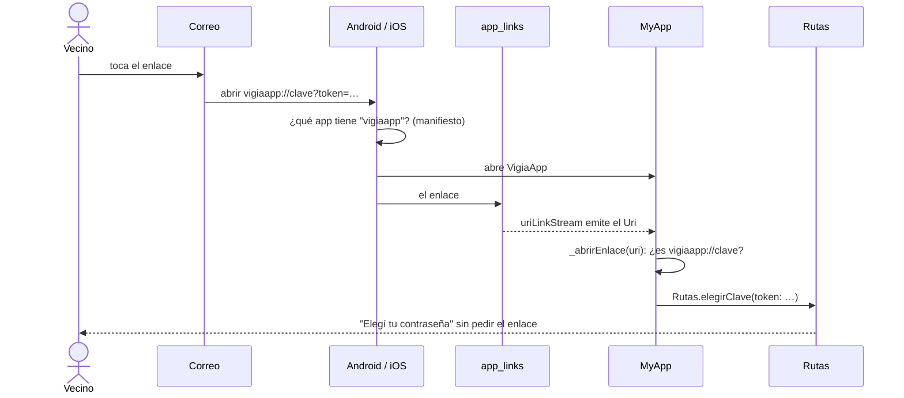

# 7. Dependencias, rutas y enlaces

!!! abstract "Objetivo"
    Tres cosas que van juntas:

    1. **`Dependencias`**: poner los repositorios "arriba" del árbol de widgets para que cualquier pantalla los encuentre, sin pasarlos de mano en mano.
    2. **`Rutas`**: un solo lugar que sabe abrir cada pantalla con su ViewModel.
    3. La primera pantalla que se abre con `Rutas`: **"Elegí tu contraseña"**, a la que se llega desde el Login ("Tengo una invitación") o tocando el **enlace del correo** de invitación (`vigiaapp://clave?token=…`).

<figure markdown="span">
  { .captura }
  <figcaption>Elegí tu contraseña</figcaption>
</figure>

## Dónde estamos



## El problema: ¿cómo llega el repositorio a cada pantalla?

Hasta ahora, `main.dart` creaba el `LoginViewModel` y le pasaba el repositorio. Fácil, porque el Login está justo debajo de `main.dart`. Pero la pantalla "Elegí tu contraseña" se abre **desde** el Login. Para crear su ViewModel hace falta el `SesionRepository`. ¿De dónde lo saca el Login?

**Opción 1: pasarlo de mano en mano** (*prop drilling*). `main` se lo pasa al Login, el Login se lo pasa a la otra pantalla… Con una pantalla funciona; con 20 pantallas y 7 repositorios, cada widget del medio tendría que recibir y pasar cosas que no usa.

**Opción 2: ponerlo arriba de todo** y que lo busque quien lo necesite. Flutter tiene un widget hecho para eso: el **`InheritedWidget`**. Cualquier widget de abajo puede pedir "dame el `Dependencias` más cercano hacia arriba".



Lo explicamos en detalle en [Estado compartido](../3-flutter/7-estado-compartido.md#inheritedwidget) y en [Inyección de dependencias](../4-arquitectura/5-inyeccion-de-dependencias.md).

## Paso 1: `Dependencias`

Creá `lib/dependencias.dart` (en la raíz de `lib/`, al lado de `main.dart`):

<!-- archivo: lib/dependencias.dart cap=c07 notas="class Dependencias extends InheritedWidget|required super.child|final SesionRepository sesion|static Dependencias of\(BuildContext context\)|getInheritedWidgetOfExactType<Dependencias>|assert\(|bool updateShouldNotify" -->
```dart title="lib/dependencias.dart" linenums="1"
// lib/dependencias.dart
//
// Los repositorios y servicios de la app, una sola instancia de cada uno.
// Es un InheritedWidget (el mecanismo de Flutter para compartir datos con
// todo el árbol): MyApp lo pone arriba de todo y las rutas lo leen para
// armar el ViewModel de cada pantalla, sin pasarlo de widget en widget.

import 'package:flutter/widgets.dart';

import 'data/repositories/sesion_repository.dart';

class Dependencias extends InheritedWidget {  // (1)!
  const Dependencias({required this.sesion, required super.child, super.key});  // (2)!

  final SesionRepository sesion;  // (3)!

  /// No registra dependencia: las instancias no cambian nunca, así que
  /// nadie tiene que redibujarse.
  static Dependencias of(BuildContext context) {  // (4)!
    final dependencias = context.getInheritedWidgetOfExactType<Dependencias>();  // (5)!
    assert(dependencias != null, 'Falta Dependencias arriba en el árbol');  // (6)!
    return dependencias!;
  }

  @override
  bool updateShouldNotify(Dependencias oldWidget) => false;  // (7)!
}
```
<!-- /archivo -->

1. Un `InheritedWidget` es un widget que **no dibuja nada**: envuelve a otro (`child`) y guarda datos para todo lo que está debajo.
2. `super.child` pasa el hijo al constructor de `InheritedWidget`.
3. Por ahora, solo la sesión. Cada capítulo que agrega un repositorio lo suma acá.
4. La convención de Flutter: un método estático `of(context)` que busca el widget hacia arriba (como `Theme.of(context)` o `Navigator.of(context)`).
5. Busca el `Dependencias` más cercano **sin suscribirse**. Hay otra versión (`dependOnInheritedWidgetOfExactType`) que además redibuja al widget cuando cambia, pero acá no hace falta: los repositorios son siempre los mismos objetos.
6. `assert` comprueba algo **solo en desarrollo**. Si alguien usa `Dependencias.of` desde un lugar sin `Dependencias` arriba (un test, por ejemplo), el mensaje dice exactamente qué pasa.
7. Flutter pregunta esto cuando el widget se reconstruye: "¿aviso a los que dependen de mí?". Siempre `false`, porque las instancias no cambian.

## Paso 2: el ViewModel de "Elegí tu contraseña"

Creá `lib/ui/elegir_clave/view_model/elegir_clave_view_model.dart`:

<!-- archivo: lib/ui/elegir_clave/view_model/elegir_clave_view_model.dart cap=c07 notas="ElegirClaveViewModel\(this._sesion, \{this.tokenDelCorreo\}\)|final String\? tokenDelCorreo|Future<bool> guardar\(\{required String enlace, required String clave\}\)|tokenDelCorreo \?\? tokenDelEnlace\(enlace\)|_error = 'El enlace no es válido'|await ejecutar\(\(\) => _sesion.elegirClave" -->
```dart title="lib/ui/elegir_clave/view_model/elegir_clave_view_model.dart" linenums="1"
// lib/ui/elegir_clave/view_model/elegir_clave_view_model.dart

import '../../../data/repositories/sesion_repository.dart';
import '../../../utils/resultado.dart';
import '../../../utils/validadores.dart';
import '../../core/view_model.dart';

class ElegirClaveViewModel extends ViewModel {
  ElegirClaveViewModel(this._sesion, {this.tokenDelCorreo});  // (1)!

  final SesionRepository _sesion;

  /// El token del enlace, si la app se abrió desde el correo. Si es null,
  /// el vecino tiene que pegar el enlace.
  final String? tokenDelCorreo;  // (2)!

  String? _error;
  String? get error => _error;

  /// [enlace] es lo que pegó el vecino (se ignora si vino [tokenDelCorreo]).
  /// Devuelve true si eligió la clave y quedó con la sesión iniciada.
  Future<bool> guardar({required String enlace, required String clave}) async {  // (3)!
    final token = tokenDelCorreo ?? tokenDelEnlace(enlace);  // (4)!
    if (token == null) {
      _error = 'El enlace no es válido';  // (5)!
      notifyListeners();
      return false;
    }
    _error = null;
    final resultado = await ejecutar(() => _sesion.elegirClave(token, clave));  // (6)!
    if (resultado case Fallo(:final mensaje)) {
      _error = mensaje;
      notifyListeners();
      return false;
    }
    return true;
  }
}
```
<!-- /archivo -->

1. Recibe la sesión y, opcionalmente, el token, si la app se abrió tocando el enlace del correo.
2. Con token: no hace falta pegar el enlace. Sin token: el vecino lo pega a mano.
3. Devuelve `true` si entró, para que la pantalla se cierre.
4. Si vino el token del correo, se usa ese; si no, se saca del enlace pegado (la función del capítulo 2).
5. Si el enlace pegado no sirve, ni se llama al servidor.
6. Igual que el login: `ejecutar` se encarga de "ocupado" y del error. Si sale bien, la sesión pasa a "con sesión" y `main.dart` muestra el Inicio debajo.

## Paso 3: la pantalla

Creá `lib/ui/elegir_clave/widgets/elegir_clave_screen.dart`:

<!-- archivo: lib/ui/elegir_clave/widgets/elegir_clave_screen.dart cap=c07 notas="final _repetir = TextEditingController\(\)|final entro = await _viewModel.guardar|if \(entro && mounted\) Navigator.pop\(context\)|appBar: AppBar\(title: const Text\('Elegí tu contraseña'\)\)|if \(_viewModel.tokenDelCorreo == null\) \.\.\.\[|validator: validarClaveNueva|valor != _password.text" -->
```dart title="lib/ui/elegir_clave/widgets/elegir_clave_screen.dart" linenums="1"
// lib/ui/elegir_clave/widgets/elegir_clave_screen.dart
//
// Se llega desde el enlace del correo (invitación del comité o
// recuperación de contraseña): vigiaapp://clave?token=<64 hex>.
// Si el enlace no abre la app, el vecino puede pegarlo acá.

import 'package:flutter/material.dart';

import '../../../utils/validadores.dart';
import '../../core/widgets/estados_carga.dart';
import '../view_model/elegir_clave_view_model.dart';

class ElegirClaveScreen extends StatefulWidget {
  const ElegirClaveScreen({required this.viewModel, super.key});

  final ElegirClaveViewModel viewModel;

  @override
  State<ElegirClaveScreen> createState() => _ElegirClaveScreenState();
}

class _ElegirClaveScreenState extends State<ElegirClaveScreen> {
  final _form = GlobalKey<FormState>();
  final _enlace = TextEditingController();
  final _password = TextEditingController();
  final _repetir = TextEditingController();  // (1)!

  // Se toma una sola vez: si el padre se redibuja, la pantalla sigue con el
  // mismo ViewModel (el que después descarta en dispose).
  late final ElegirClaveViewModel _viewModel = widget.viewModel;

  @override
  void dispose() {
    _enlace.dispose();
    _password.dispose();
    _repetir.dispose();
    _viewModel.dispose();
    super.dispose();
  }

  Future<void> _guardar() async {
    if (!_form.currentState!.validate()) return;
    final entro = await _viewModel.guardar(  // (2)!
      enlace: _enlace.text,
      clave: _password.text,
    );
    // Con la sesión iniciada, MyApp ya muestra el Inicio debajo.
    if (entro && mounted) Navigator.pop(context);  // (3)!
  }

  @override
  Widget build(BuildContext context) {
    return Scaffold(
      appBar: AppBar(title: const Text('Elegí tu contraseña')),  // (4)!
      body: SingleChildScrollView(
        padding: const EdgeInsets.all(24),
        child: Form(
          key: _form,
          child: ListenableBuilder(
            listenable: _viewModel,
            builder: (context, _) {
              return Column(
                crossAxisAlignment: CrossAxisAlignment.stretch,
                children: [
                  const Text(
                    'Usá el enlace que te llegó por correo, de invitación o '
                    'de recuperación. Si no se abrió solo, copialo y pegalo acá.',
                  ),
                  const SizedBox(height: 16),
                  if (_viewModel.tokenDelCorreo == null) ...[  // (5)!
                    TextFormField(
                      controller: _enlace,
                      decoration: const InputDecoration(
                        labelText: 'Enlace del correo',
                        border: OutlineInputBorder(),
                      ),
                      validator: (valor) => tokenDelEnlace(valor ?? '') == null
                          ? 'El enlace no es válido'
                          : null,
                    ),
                    const SizedBox(height: 16),
                  ],
                  TextFormField(
                    controller: _password,
                    decoration: const InputDecoration(
                      labelText: 'Contraseña nueva',
                      helperText: 'Entre 8 y 128 caracteres',
                      border: OutlineInputBorder(),
                    ),
                    obscureText: true,
                    autofillHints: const [AutofillHints.newPassword],
                    validator: validarClaveNueva,  // (6)!
                  ),
                  const SizedBox(height: 16),
                  TextFormField(
                    controller: _repetir,
                    decoration: const InputDecoration(
                      labelText: 'Repetí la contraseña',
                      border: OutlineInputBorder(),
                    ),
                    obscureText: true,
                    validator: (valor) => valor != _password.text  // (7)!
                        ? 'Las contraseñas no coinciden'
                        : null,
                  ),
                  if (_viewModel.error case final error?) ...[
                    const SizedBox(height: 12),
                    TextoError(error),
                  ],
                  const SizedBox(height: 24),
                  FilledButton(
                    onPressed: _viewModel.ocupado ? null : _guardar,
                    child: const Text('Guardar y entrar'),
                  ),
                ],
              );
            },
          ),
        ),
      ),
    );
  }
}
```
<!-- /archivo -->

1. Tres campos, tres controladores, y los tres se liberan en `dispose`.
2. Espera el resultado…
3. …y si entró, cierra esta pantalla. Debajo ya está el Inicio (o, por ahora, la pantalla provisoria), porque `main.dart` cambió solo al cambiar la sesión.
4. Esta pantalla se **abre encima** de otra (con `Navigator.push`), así que tiene `AppBar` con la flecha para volver.
5. El campo del enlace solo aparece si no vino el token del correo.
6. El validador del capítulo 2: entre 8 y 128 caracteres.
7. Un validador escrito ahí mismo, que compara con el otro campo.

## Paso 4: `Rutas`

Las vistas no deberían crear ViewModels ni tocar repositorios. Pero alguien tiene que hacerlo cuando se abre una pantalla. Ese alguien es `Rutas`: una clase con un método por pantalla. Creá `lib/routing/rutas.dart`:

<!-- archivo: lib/routing/rutas.dart cap=c07 notas="abstract final class Rutas|static Future<T\?> _abrir<T>|Navigator.push<T>|MaterialPageRoute\(builder: \(context\) => pantalla\)|static Future<void> elegirClave\(BuildContext context, \{String\? token\}\)|final viewModel = ElegirClaveViewModel\(|Dependencias.of\(context\).sesion|return _abrir\(context, ElegirClaveScreen" -->
```dart title="lib/routing/rutas.dart" linenums="1"
// lib/routing/rutas.dart
//
// Navegación de la app. Cada método arma el ViewModel de la pantalla con los
// repositorios de Dependencias y la abre. Así las vistas solo dicen "abrí
// tal pantalla" y nunca tocan un repositorio.
//
// El ViewModel se crea UNA vez, afuera del builder de la ruta: el builder se
// puede volver a ejecutar, y crearía otro ViewModel distinto.

import 'package:flutter/material.dart';

import '../dependencias.dart';
import '../ui/elegir_clave/view_model/elegir_clave_view_model.dart';
import '../ui/elegir_clave/widgets/elegir_clave_screen.dart';

abstract final class Rutas {  // (1)!
  static Future<T?> _abrir<T>(BuildContext context, Widget pantalla) {  // (2)!
    return Navigator.push<T>(  // (3)!
      context,
      MaterialPageRoute(builder: (context) => pantalla),  // (4)!
    );
  }

  /// Invitación o recuperación de la clave. [token] viene del enlace del
  /// correo, si la app se abrió desde ahí.
  static Future<void> elegirClave(BuildContext context, {String? token}) {  // (5)!
    final viewModel = ElegirClaveViewModel(  // (6)!
      Dependencias.of(context).sesion,  // (7)!
      tokenDelCorreo: token,
    );
    return _abrir(context, ElegirClaveScreen(viewModel: viewModel));  // (8)!
  }
}
```
<!-- /archivo -->

1. `abstract final class`: no se puede instanciar ni extender. Es solo un lugar donde agrupar funciones `static`. Se usa como `Rutas.elegirClave(context)`.
2. Un método **privado y genérico**: `T` es el tipo que devuelve la pantalla al cerrarse (algunas devuelven algo, como un `bool` o la publicación creada).
3. `Navigator.push` pone una pantalla nueva **encima** de la actual y devuelve un `Future` que se completa cuando esa pantalla se cierra. Ver [Navegación](../3-flutter/6-navegacion.md).
4. `MaterialPageRoute` es la transición estándar (en Android, la pantalla sube; en iOS, entra desde la derecha).
5. Un método por pantalla. Recibe lo que la pantalla necesita (acá, el token opcional).
6. **El ViewModel se crea acá, afuera del `builder`**, y se le pasa a la pantalla ya armado. Si se creara dentro del `builder`, cada vez que Flutter reconstruye la ruta habría un ViewModel nuevo y se perdería el estado.
7. Saca el repositorio de `Dependencias`. Este es el único lugar (junto con `main.dart`) que toca repositorios para armar pantallas.
8. Abre la pantalla.

!!! tip "Lo que gana la vista"
    El Login ahora puede abrir "Elegí tu contraseña" con una línea: `Rutas.elegirClave(context)`. No sabe qué ViewModel tiene esa pantalla, ni qué repositorio usa. Si mañana cambia, el Login no se entera.

## Paso 5: el botón "Tengo una invitación"

En el Login se agrega el botón (y el `import` de `Rutas`). Lo que cambia:

<!-- diff: lib/ui/login/widgets/login_screen.dart cap=c07 -->
```diff title="Qué cambia en lib/ui/login/widgets/login_screen.dart"
--- lib/ui/login/widgets/login_screen.dart (cap. 6)
+++ lib/ui/login/widgets/login_screen.dart (cap. 7)
@@ -1,8 +1,10 @@
 // lib/ui/login/widgets/login_screen.dart
 //
-// Ingreso con email y contraseña (RF-09).
+// Ingreso con email y contraseña (RF-09). El alta es por invitación del
+// comité: quien todavía no tiene contraseña entra por "Tengo una invitación".
 
 import 'package:flutter/material.dart';
 
+import '../../../routing/rutas.dart';
 import '../../../utils/validadores.dart';
 import '../../core/widgets/avisos.dart';
@@ -155,4 +157,10 @@
                           child: const Text('Olvidé mi contraseña'),
                         ),
+                        TextButton(
+                          onPressed: ocupado
+                              ? null
+                              : () => Rutas.elegirClave(context),
+                          child: const Text('Tengo una invitación'),
+                        ),
                       ],
                     );
```
<!-- /diff -->

??? example "Ver login_screen.dart completo"
    <!-- archivo: lib/ui/login/widgets/login_screen.dart cap=c07 -->
    ```dart title="lib/ui/login/widgets/login_screen.dart" linenums="1" hl_lines="3-4 8 159-164"
    // lib/ui/login/widgets/login_screen.dart
    //
    // Ingreso con email y contraseña (RF-09). El alta es por invitación del
    // comité: quien todavía no tiene contraseña entra por "Tengo una invitación".

    import 'package:flutter/material.dart';

    import '../../../routing/rutas.dart';
    import '../../../utils/validadores.dart';
    import '../../core/widgets/avisos.dart';
    import '../../core/widgets/estados_carga.dart';
    import '../view_model/login_view_model.dart';
    import 'recuperar_clave_dialog.dart';

    class LoginScreen extends StatefulWidget {
      const LoginScreen({required this.viewModel, super.key});

      final LoginViewModel viewModel;

      @override
      State<LoginScreen> createState() => _LoginScreenState();
    }

    class _LoginScreenState extends State<LoginScreen> {
      final _form = GlobalKey<FormState>();
      final _email = TextEditingController();
      final _password = TextEditingController();
      bool _verClave = false; // estado efímero de la vista: no va al ViewModel

      // Se toma una sola vez: si el padre se redibuja, la pantalla sigue con el
      // mismo ViewModel (el que después descarta en dispose).
      late final LoginViewModel _viewModel = widget.viewModel;

      @override
      void dispose() {
        _email.dispose();
        _password.dispose();
        _viewModel.dispose();
        super.dispose();
      }

      void _ingresar() {
        if (!_form.currentState!.validate()) return;
        _viewModel.ingresar(_email.text.trim(), _password.text);
      }

      Future<void> _recuperar() async {
        final email = await showDialog<String>(
          context: context,
          builder: (context) =>
              RecuperarClaveDialog(emailInicial: _email.text.trim()),
        );
        if (email == null || !mounted) return;

        final resultado = await _viewModel.recuperarClave(email);
        if (!mounted || !avisarSiFallo(context, resultado)) return;
        mostrarAviso(
          context,
          'Si el email está registrado, te llegó un correo con el enlace.',
        );
      }

      @override
      Widget build(BuildContext context) {
        final tema = Theme.of(context);
        return Scaffold(
          body: SafeArea(
            child: Center(
              child: SingleChildScrollView(
                padding: const EdgeInsets.all(24),
                child: Form(
                  key: _form,
                  child: AutofillGroup(
                    child: ListenableBuilder(
                      listenable: _viewModel,
                      builder: (context, _) {
                        final ocupado = _viewModel.ocupado;
                        return Column(
                          crossAxisAlignment: CrossAxisAlignment.stretch,
                          children: [
                            Icon(
                              Icons.shield_outlined,
                              size: 64,
                              color: tema.colorScheme.primary,
                            ),
                            const SizedBox(height: 8),
                            Text(
                              'VigiaApp',
                              textAlign: TextAlign.center,
                              style: tema.textTheme.headlineMedium,
                            ),
                            Text(
                              'Red de alerta vecinal',
                              textAlign: TextAlign.center,
                              style: tema.textTheme.bodyMedium,
                            ),
                            const SizedBox(height: 32),
                            TextFormField(
                              controller: _email,
                              decoration: const InputDecoration(
                                labelText: 'Email',
                                border: OutlineInputBorder(),
                              ),
                              keyboardType: TextInputType.emailAddress,
                              autofillHints: const [AutofillHints.email],
                              textInputAction: TextInputAction.next,
                              validator: validarEmail,
                            ),
                            const SizedBox(height: 16),
                            TextFormField(
                              controller: _password,
                              decoration: InputDecoration(
                                labelText: 'Contraseña',
                                border: const OutlineInputBorder(),
                                suffixIcon: IconButton(
                                  icon: Icon(
                                    _verClave
                                        ? Icons.visibility_off
                                        : Icons.visibility,
                                  ),
                                  tooltip: _verClave ? 'Ocultar' : 'Mostrar',
                                  onPressed: () =>
                                      setState(() => _verClave = !_verClave),
                                ),
                              ),
                              obscureText: !_verClave,
                              autofillHints: const [AutofillHints.password],
                              textInputAction: TextInputAction.done,
                              onFieldSubmitted: (_) => ocupado ? null : _ingresar(),
                              validator: (valor) => (valor ?? '').isEmpty
                                  ? 'Ingresá tu contraseña'
                                  : null,
                            ),
                            if (_viewModel.error case final error?) ...[
                              const SizedBox(height: 12),
                              TextoError(error),
                            ],
                            const SizedBox(height: 24),
                            FilledButton(
                              onPressed: ocupado ? null : _ingresar,
                              child: Padding(
                                padding: const EdgeInsets.symmetric(vertical: 12),
                                child: ocupado
                                    ? const SizedBox(
                                        width: 20,
                                        height: 20,
                                        child: CircularProgressIndicator(
                                          strokeWidth: 2,
                                        ),
                                      )
                                    : const Text('Ingresar'),
                              ),
                            ),
                            const SizedBox(height: 8),
                            TextButton(
                              onPressed: ocupado ? null : _recuperar,
                              child: const Text('Olvidé mi contraseña'),
                            ),
                            TextButton(
                              onPressed: ocupado
                                  ? null
                                  : () => Rutas.elegirClave(context),
                              child: const Text('Tengo una invitación'),
                            ),
                          ],
                        );
                      },
                    ),
                  ),
                ),
              ),
            ),
          ),
        );
      }
    }
    ```
    <!-- /archivo -->

## Paso 6: los enlaces del correo (deep links)

Cuando el comité invita a un vecino, el servidor le manda un correo con un enlace así:

```text
vigiaapp://clave?token=9f86d081884c7d659a2feaa0c55ad015a3bf4f1b2b0b822cd15d6c15b0f00a08
```

`vigiaapp://` no es `https://`: es un **esquema propio**. Si el celular sabe que ese esquema es de nuestra app, al tocar el enlace **abre la app** y le pasa el enlace. Eso se llama *deep link*. Para que funcione hacen falta tres cosas:



### 6.1: el paquete `app_links`

```bash
flutter pub add app_links
```

<!-- archivo: pubspec.yaml cap=c07 -->
```yaml title="pubspec.yaml" linenums="1" hl_lines="13"
name: vigia_app
description: "VigiaApp: red de alerta vecinal (versión de la wiki, solo Material)."
publish_to: 'none'
version: 1.0.0+1

environment:
  sdk: ^3.12.2

dependencies:
  flutter:
    sdk: flutter
  flutter_secure_storage: ^11.2.0
  app_links: ^7.2.1

dev_dependencies:
  flutter_test:
    sdk: flutter
  flutter_lints: ^6.0.0

flutter:
  uses-material-design: true
```
<!-- /archivo -->

### 6.2: avisarle a Android y a iOS

=== "Android"

    En `android/app/src/main/AndroidManifest.xml`, **dentro** de `<activity android:name=".MainActivity" …>` (al lado del `<intent-filter>` que ya tiene `MAIN` y `LAUNCHER`), agregá:

    ```xml title="android/app/src/main/AndroidManifest.xml (fragmento)"
    <!-- Que Flutter no maneje los enlaces por su cuenta: los maneja app_links. -->
    <meta-data android:name="flutter_deeplinking_enabled" android:value="false" />
    <!-- Enlace de los correos: vigiaapp://clave?token=… -->
    <intent-filter>
        <action android:name="android.intent.action.VIEW" />
        <category android:name="android.intent.category.DEFAULT" />
        <category android:name="android.intent.category.BROWSABLE" />
        <data android:scheme="vigiaapp" android:host="clave" />
    </intent-filter>
    ```

    - `VIEW` + `BROWSABLE`: el enlace se puede abrir desde otra app (el correo, el navegador).
    - `<data>`: solo los enlaces `vigiaapp://clave…` abren VigiaApp.

=== "iOS"

    En `ios/Runner/Info.plist`, dentro del `<dict>` principal, agregá:

    ```xml title="ios/Runner/Info.plist (fragmento)"
    <key>FlutterDeepLinkingEnabled</key>
    <false/>
    <key>CFBundleURLTypes</key>
    <array>
        <dict>
            <key>CFBundleURLName</key>
            <string>com.ejemplo.vigia_app</string>
            <key>CFBundleURLSchemes</key>
            <array>
                <string>vigiaapp</string>
            </array>
        </dict>
    </array>
    ```

### 6.3: `main.dart` escucha los enlaces

`main.dart` cambia bastante. Esto es lo nuevo:

<!-- diff: lib/main.dart cap=c07 -->
```diff title="Qué cambia en lib/main.dart"
--- lib/main.dart (cap. 6)
+++ lib/main.dart (cap. 7)
@@ -1,11 +1,14 @@
 // lib/main.dart
 //
-// Punto de entrada. Crea la API (por ahora siempre la falsa) y el
-// repositorio de la sesión, y elige qué pantalla mostrar según el estado
-// de la sesión.
+// Punto de entrada y raíz de composición: acá se crea una sola instancia de
+// cada servicio y repositorio, y se pone todo en Dependencias, arriba del
+// árbol de widgets.
 //
 // OJO: la pantalla de "con sesión" sigue siendo provisoria: en el capítulo 8
 // la reemplazamos por el Inicio.
 
+import 'dart:async';
+
+import 'package:app_links/app_links.dart';
 import 'package:flutter/material.dart';
 
@@ -13,16 +16,27 @@
 import 'data/services/api/fake_vigia_api.dart';
 import 'data/services/api/vigia_api.dart';
+import 'dependencias.dart';
+import 'routing/rutas.dart';
 import 'ui/carga/widgets/pantalla_carga.dart';
 import 'ui/login/view_model/login_view_model.dart';
 import 'ui/login/widgets/login_screen.dart';
+import 'utils/validadores.dart';
 
 void main() {
-  runApp(MyApp());
+  // AppLinks habla con la plataforma: Flutter tiene que estar inicializado
+  // antes de usarlo.
+  WidgetsFlutterBinding.ensureInitialized();
+  // uriLinkStream también trae el enlace con el que se abrió la app
+  // (vigiaapp://clave?token=… desde el correo de invitación).
+  runApp(MyApp(enlaces: AppLinks().uriLinkStream));
 }
 
 class MyApp extends StatefulWidget {
-  MyApp({super.key, VigiaApi? api}) : api = api ?? FakeVigiaApi();
+  MyApp({super.key, VigiaApi? api, this.enlaces}) : api = api ?? FakeVigiaApi();
 
   final VigiaApi api;
+
+  /// Deep links entrantes. En los tests no se pasa (no hay plataforma).
+  final Stream<Uri>? enlaces;
 
   @override
@@ -31,30 +45,63 @@
 
 class _MyAppState extends State<MyApp> {
-  // Una sola instancia para toda la app. iniciar() revisa si quedó una
-  // sesión guardada de la vez anterior.
+  // La llave del Navigator: deja navegar desde afuera de las pantallas
+  // (cuando llega un enlace).
+  final _navegador = GlobalKey<NavigatorState>();
+
   late final _sesion = SesionRepository(widget.api)..iniciar();
+
+  StreamSubscription<Uri>? _enlaces;
+  EstadoSesion _estadoAnterior = EstadoSesion.iniciando;
+
+  @override
+  void initState() {
+    super.initState();
+    _enlaces = widget.enlaces?.listen(_abrirEnlace);
+    _sesion.addListener(_alCambiarSesion);
+  }
 
   @override
   void dispose() {
+    _enlaces?.cancel();
+    _sesion.removeListener(_alCambiarSesion);
     _sesion.dispose();
     super.dispose();
   }
 
+  // Si la sesión se cierra (logout o 401) con pantallas abiertas encima,
+  // se cierran todas: debajo ya está el Login.
+  void _alCambiarSesion() {
+    if (_estadoAnterior == EstadoSesion.conSesion &&
+        _sesion.estado == EstadoSesion.sinSesion) {
+      _navegador.currentState?.popUntil((ruta) => ruta.isFirst);
+    }
+    _estadoAnterior = _sesion.estado;
+  }
+
+  void _abrirEnlace(Uri enlace) {
+    final contexto = _navegador.currentContext;
+    if (enlace.scheme != 'vigiaapp' || enlace.host != 'clave') return;
+    if (contexto == null) return;
+    Rutas.elegirClave(contexto, token: tokenDelEnlace(enlace.toString()));
+  }
+
   @override
   Widget build(BuildContext context) {
-    return MaterialApp(
-      title: 'VigiaApp',
-      theme: ThemeData(colorSchemeSeed: Colors.indigo),
-      // Se redibuja cada vez que la sesión avisa que cambió.
-      home: ListenableBuilder(
-        listenable: _sesion,
-        builder: (context, _) => switch (_sesion.estado) {
-          EstadoSesion.iniciando => const PantallaCarga(),
-          // Cada vez que se muestra el Login, con un ViewModel nuevo.
-          EstadoSesion.sinSesion => LoginScreen(
-            viewModel: LoginViewModel(_sesion),
-          ),
-          EstadoSesion.conSesion => _conSesionProvisoria(),
-        },
+    return Dependencias(
+      sesion: _sesion,
+      child: MaterialApp(
+        title: 'VigiaApp',
+        navigatorKey: _navegador,
+        theme: ThemeData(colorSchemeSeed: Colors.indigo),
+        home: ListenableBuilder(
+          listenable: _sesion,
+          builder: (context, _) => switch (_sesion.estado) {
+            EstadoSesion.iniciando => const PantallaCarga(),
+            EstadoSesion.sinSesion => LoginScreen(
+              viewModel: LoginViewModel(_sesion),
+            ),
+            EstadoSesion.conSesion => _conSesionProvisoria(),
+          },
+        ),
       ),
     );
```
<!-- /diff -->

Y completo, con las explicaciones:

<!-- archivo: lib/main.dart cap=c07 notas="WidgetsFlutterBinding.ensureInitialized\(\)|runApp\(MyApp\(enlaces: AppLinks\(\).uriLinkStream\)\)|final Stream<Uri>\? enlaces|final _navegador = GlobalKey<NavigatorState>\(\)|StreamSubscription<Uri>\? _enlaces|_enlaces = widget.enlaces\?.listen\(_abrirEnlace\)|_sesion.addListener\(_alCambiarSesion\)|_enlaces\?.cancel\(\)|void _alCambiarSesion|popUntil\(\(ruta\) => ruta.isFirst\)|void _abrirEnlace|enlace.scheme != 'vigiaapp'|return Dependencias\(|navigatorKey: _navegador" -->
```dart title="lib/main.dart" linenums="1" hl_lines="3-5 10-12 18-19 23 26-31 35 38-40 47-50 52-61 65-66 71-87 90-105"
// lib/main.dart
//
// Punto de entrada y raíz de composición: acá se crea una sola instancia de
// cada servicio y repositorio, y se pone todo en Dependencias, arriba del
// árbol de widgets.
//
// OJO: la pantalla de "con sesión" sigue siendo provisoria: en el capítulo 8
// la reemplazamos por el Inicio.

import 'dart:async';

import 'package:app_links/app_links.dart';
import 'package:flutter/material.dart';

import 'data/repositories/sesion_repository.dart';
import 'data/services/api/fake_vigia_api.dart';
import 'data/services/api/vigia_api.dart';
import 'dependencias.dart';
import 'routing/rutas.dart';
import 'ui/carga/widgets/pantalla_carga.dart';
import 'ui/login/view_model/login_view_model.dart';
import 'ui/login/widgets/login_screen.dart';
import 'utils/validadores.dart';

void main() {
  // AppLinks habla con la plataforma: Flutter tiene que estar inicializado
  // antes de usarlo.
  WidgetsFlutterBinding.ensureInitialized();  // (1)!
  // uriLinkStream también trae el enlace con el que se abrió la app
  // (vigiaapp://clave?token=… desde el correo de invitación).
  runApp(MyApp(enlaces: AppLinks().uriLinkStream));  // (2)!
}

class MyApp extends StatefulWidget {
  MyApp({super.key, VigiaApi? api, this.enlaces}) : api = api ?? FakeVigiaApi();

  final VigiaApi api;

  /// Deep links entrantes. En los tests no se pasa (no hay plataforma).
  final Stream<Uri>? enlaces;  // (3)!

  @override
  State<MyApp> createState() => _MyAppState();
}

class _MyAppState extends State<MyApp> {
  // La llave del Navigator: deja navegar desde afuera de las pantallas
  // (cuando llega un enlace).
  final _navegador = GlobalKey<NavigatorState>();  // (4)!

  late final _sesion = SesionRepository(widget.api)..iniciar();

  StreamSubscription<Uri>? _enlaces;  // (5)!
  EstadoSesion _estadoAnterior = EstadoSesion.iniciando;

  @override
  void initState() {
    super.initState();
    _enlaces = widget.enlaces?.listen(_abrirEnlace);  // (6)!
    _sesion.addListener(_alCambiarSesion);  // (7)!
  }

  @override
  void dispose() {
    _enlaces?.cancel();  // (8)!
    _sesion.removeListener(_alCambiarSesion);
    _sesion.dispose();
    super.dispose();
  }

  // Si la sesión se cierra (logout o 401) con pantallas abiertas encima,
  // se cierran todas: debajo ya está el Login.
  void _alCambiarSesion() {  // (9)!
    if (_estadoAnterior == EstadoSesion.conSesion &&
        _sesion.estado == EstadoSesion.sinSesion) {
      _navegador.currentState?.popUntil((ruta) => ruta.isFirst);  // (10)!
    }
    _estadoAnterior = _sesion.estado;
  }

  void _abrirEnlace(Uri enlace) {  // (11)!
    final contexto = _navegador.currentContext;
    if (enlace.scheme != 'vigiaapp' || enlace.host != 'clave') return;  // (12)!
    if (contexto == null) return;
    Rutas.elegirClave(contexto, token: tokenDelEnlace(enlace.toString()));
  }

  @override
  Widget build(BuildContext context) {
    return Dependencias(  // (13)!
      sesion: _sesion,
      child: MaterialApp(
        title: 'VigiaApp',
        navigatorKey: _navegador,  // (14)!
        theme: ThemeData(colorSchemeSeed: Colors.indigo),
        home: ListenableBuilder(
          listenable: _sesion,
          builder: (context, _) => switch (_sesion.estado) {
            EstadoSesion.iniciando => const PantallaCarga(),
            EstadoSesion.sinSesion => LoginScreen(
              viewModel: LoginViewModel(_sesion),
            ),
            EstadoSesion.conSesion => _conSesionProvisoria(),
          },
        ),
      ),
    );
  }

  // Provisoria: saluda y deja cerrar la sesión.
  Widget _conSesionProvisoria() {
    return Scaffold(
      appBar: AppBar(title: const Text('Con sesión')),
      body: Center(
        child: Column(
          mainAxisSize: MainAxisSize.min,
          children: [
            Text('Hola, ${_sesion.vecino!.nombre}'),
            const SizedBox(height: 16),
            OutlinedButton(
              onPressed: _sesion.logout,
              child: const Text('Cerrar sesión'),
            ),
          ],
        ),
      ),
    );
  }
}
```
<!-- /archivo -->

1. `AppLinks` habla con el sistema operativo (por un "canal de plataforma"), y eso necesita que Flutter esté inicializado. Normalmente lo hace `runApp`, pero acá usamos `AppLinks` **antes**.
2. `uriLinkStream` es un `Stream`: una secuencia de valores que van llegando con el tiempo. Cada enlace que toque el vecino llega por ahí (incluido el que abrió la app). Ver [Stream y Timer](../2-dart/9-streams-y-timers.md).
3. Opcional: en los tests no hay sistema operativo, así que no se pasa.
4. Una **llave global** para el `Navigator`. Los enlaces llegan desde afuera de cualquier pantalla, así que no tenemos un `context` a mano: con esta llave se puede navegar igual.
5. La **suscripción** al stream. Hay que guardarla para poder cancelarla.
6. `listen` se suscribe: cada enlace que llegue va a `_abrirEnlace`. Con `?.`, si no hay stream (tests), no hace nada.
7. Otra suscripción: a la sesión, para enterarse cuando se cierra.
8. Todo lo que se abre, se cierra: la suscripción a los enlaces…
9. Si la sesión pasa de "con sesión" a "sin sesión" (logout o token vencido)…
10. …se cierran todas las pantallas que estaban encima, hasta la primera. Si no, el vecino podría quedar en una pantalla interna con la sesión cerrada.
11. Lo que pasa cuando llega un enlace.
12. Solo nos interesan los `vigiaapp://clave`. Si es otro, se ignora.
13. `Dependencias` envuelve a **toda** la app: así cualquier pantalla lo encuentra.
14. La llave se le da al `MaterialApp`, que crea el `Navigator`.

## Probalo

```bash
flutter run
```

1. En el Login tocá **Tengo una invitación**. Pegá un enlace inventado (`hola`): "El enlace no es válido".
2. Pegá 64 letras `a` (el servidor falso acepta cualquier token de 64 caracteres hexadecimales como la invitación de Sofía Paz) y una contraseña de 8 o más caracteres dos veces. Tocá **Guardar y entrar**: aparece "Hola, Sofía Paz".

Para probar el enlace de verdad en un emulador de Android, con la app abierta:

```bash
adb shell am start -a android.intent.action.VIEW \
  -d "vigiaapp://clave?token=aaaaaaaaaaaaaaaaaaaaaaaaaaaaaaaaaaaaaaaaaaaaaaaaaaaaaaaaaaaaaaaa"
```

Se abre "Elegí tu contraseña" **sin** el campo del enlace.

Y el test. Creá `test/elegir_clave_view_model_test.dart`:

<!-- archivo: test/elegir_clave_view_model_test.dart cap=c07 notas="guardar\(enlace: 'hola'|tokenDelCorreo: 'a' \* 64|expect\(sesion.vecino!.nombre, 'Sofía Paz'\)" -->
```dart title="test/elegir_clave_view_model_test.dart" linenums="1"
// test/elegir_clave_view_model_test.dart
//
// Pruebas de "Elegí tu contraseña" (capítulo 7).

import 'package:flutter_secure_storage/flutter_secure_storage.dart';
import 'package:flutter_test/flutter_test.dart';

import 'package:vigia_app/data/repositories/sesion_repository.dart';
import 'package:vigia_app/data/services/api/fake_vigia_api.dart';
import 'package:vigia_app/ui/elegir_clave/view_model/elegir_clave_view_model.dart';

void main() {
  late SesionRepository sesion;

  setUp(() async {
    FlutterSecureStorage.setMockInitialValues({});
    sesion = SesionRepository(FakeVigiaApi(demora: Duration.zero));
    await sesion.iniciar();
  });

  test('un enlace pegado que no es válido no llega al servidor', () async {
    final viewModel = ElegirClaveViewModel(sesion);
    final entro = await viewModel.guardar(enlace: 'hola', clave: 'clave1234');  // (1)!
    expect(entro, isFalse);
    expect(viewModel.error, 'El enlace no es válido');
  });

  test('con el token del correo, elige la clave y entra', () async {
    final viewModel = ElegirClaveViewModel(sesion, tokenDelCorreo: 'a' * 64);  // (2)!
    final entro = await viewModel.guardar(enlace: '', clave: 'clave1234');
    expect(entro, isTrue);
    expect(sesion.vecino!.nombre, 'Sofía Paz');  // (3)!
  });
}
```
<!-- /archivo -->

1. Un enlace inválido: el ViewModel responde sin ir al servidor.
2. `'a' * 64` repite el texto 64 veces. Es un token válido para el servidor falso.
3. Entró como la vecina con la invitación pendiente.

## Así queda el proyecto

<!-- arbol: cap=c07 -->
```text title="Así queda el proyecto"
vigia_app/
    lib/
        config.dart
        data/
            repositories/
                sesion_repository.dart
            services/
                almacen_token.dart
                api/
                    fake_vigia_api.dart
                    vigia_api.dart
                errores.dart
        dependencias.dart  ← nuevo
        domain/
            models/
                alerta.dart
                comite.dart
                coordenadas.dart
                mensaje.dart
                noticia.dart
                publicacion.dart
                rondin.dart
                sesion.dart
        main.dart  ← cambia
        routing/
            rutas.dart  ← nuevo
        ui/
            carga/
                widgets/
                    pantalla_carga.dart
            core/
                view_model.dart
                widgets/
                    avisos.dart
                    estados_carga.dart
            elegir_clave/
                view_model/
                    elegir_clave_view_model.dart  ← nuevo
                widgets/
                    elegir_clave_screen.dart  ← nuevo
            login/
                view_model/
                    login_view_model.dart
                widgets/
                    login_screen.dart  ← cambia
                    recuperar_clave_dialog.dart
        utils/
            fechas.dart
            resultado.dart
            sondeo.dart
            validadores.dart
    pubspec.yaml  ← cambia
    test/
        elegir_clave_view_model_test.dart  ← nuevo
        fake_api_test.dart
        login_view_model_test.dart
        modelos_test.dart
        sesion_repository_test.dart
        utils_test.dart
```
<!-- /arbol -->

## Errores comunes

??? failure "`Falta Dependencias arriba en el árbol`"
    Es nuestro `assert`. Llamaste a `Rutas.algo(context)` (o a `Dependencias.of`) desde un widget que no está debajo de `Dependencias`. En la app pasa si `Dependencias` no envuelve al `MaterialApp`. En un test pasa si probás una pantalla suelta: envolvela en `Dependencias(...)` o pasale el ViewModel directo.

??? failure "El enlace abre el navegador o no hace nada"
    El `intent-filter` no está **dentro** del `<activity>` correcto, o el esquema no coincide letra por letra (`vigiaapp`, todo en minúsculas). Después de cambiar el manifiesto hay que reinstalar la app (`flutter run` de nuevo, no *hot reload*).

??? failure "`Binding has not yet been initialized`"
    Falta `WidgetsFlutterBinding.ensureInitialized();` antes de `AppLinks()` en `main()`.

## Lo que aprendiste

- [x] Un **`InheritedWidget`** comparte datos con todo el árbol de abajo, sin pasarlos de mano en mano.
- [x] **`Rutas`** concentra cómo se abre cada pantalla: crea su ViewModel con los repositorios de `Dependencias`, **afuera del `builder`**.
- [x] `Navigator.push` devuelve un `Future` que se completa al cerrar la pantalla, con lo que esta devuelva.
- [x] Un **deep link** con esquema propio abre la app desde un enlace; `app_links` lo entrega como un `Stream<Uri>`.
- [x] Las suscripciones (`listen`, `addListener`) se cancelan en `dispose`.

[Siguiente: 8. Inicio I: la actividad :material-arrow-right:](08-inicio.md){ .md-button .md-button--primary }
