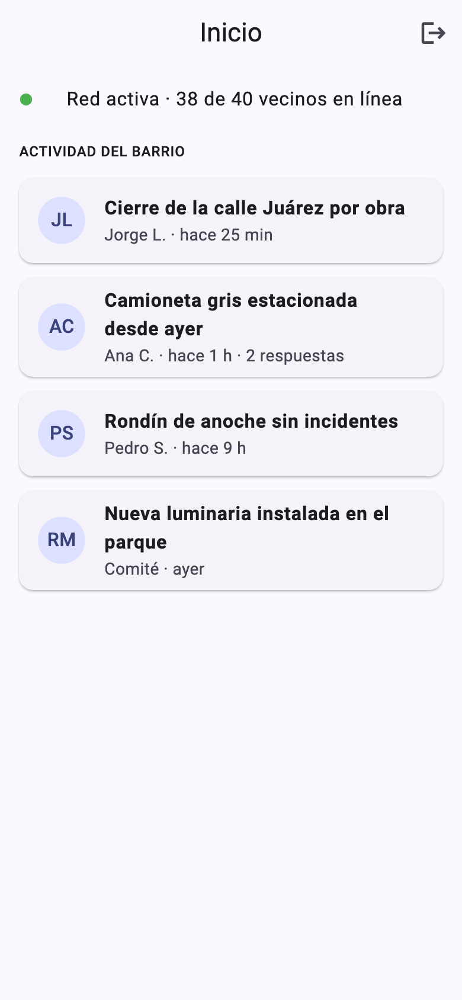
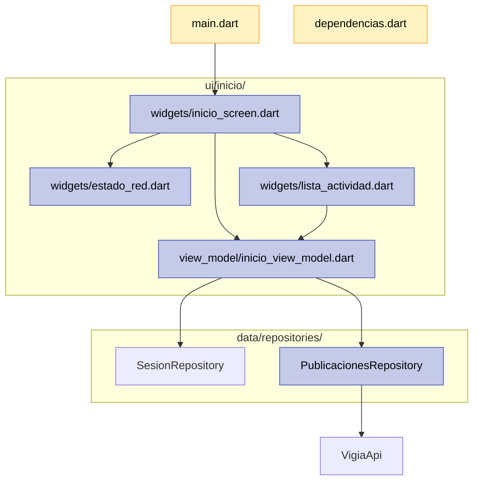
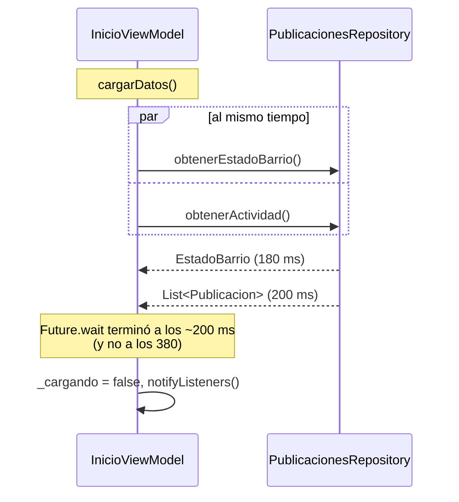
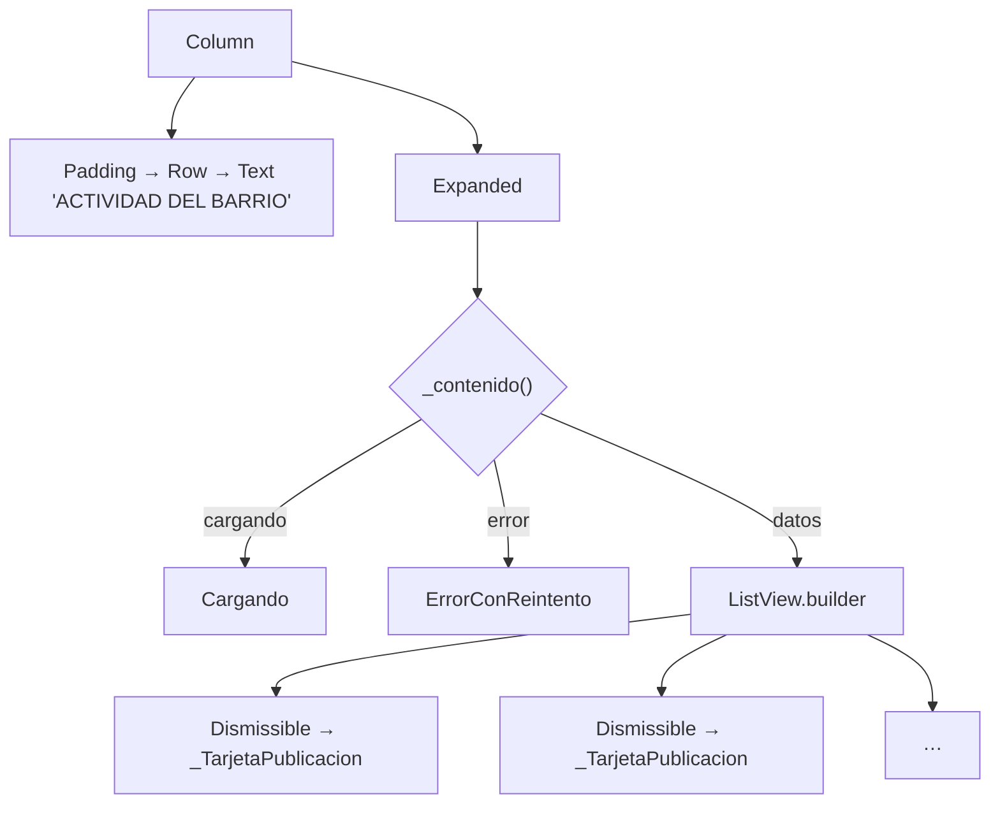

# 8. Inicio I: la actividad

!!! abstract "Objetivo"
    Reemplazar la pantalla provisoria de "con sesión" por el **Inicio**: arriba, cuántos vecinos están en línea; abajo, la **actividad del barrio** (las publicaciones de los vecinos). Se puede **deslizar** una publicación para sacarla: si es tuya se borra (previa confirmación); si es de otro, solo se oculta.

<figure markdown="span">
  { .captura }
  <figcaption>El Inicio al final del capítulo</figcaption>
</figure>

## Dónde estamos

Esta es la primera pantalla "completa" con todas las capas: vista, ViewModel, repositorio, servicio y modelos.



## Paso 1: el repositorio de publicaciones

Creá `lib/data/repositories/publicaciones_repository.dart`:

<!-- archivo: lib/data/repositories/publicaciones_repository.dart cap=c08 notas="PublicacionesRepository\(this._api\)|Future<EstadoBarrio> obtenerEstadoBarrio\(\) => _api|Future<Publicacion> publicar\(\{|Future<void> borrar\(int id\)" -->
```dart title="lib/data/repositories/publicaciones_repository.dart" linenums="1"
// lib/data/repositories/publicaciones_repository.dart
//
// Publicaciones del barrio (RF-12): la actividad del Inicio, las noticias
// del comité y las respuestas de cada publicación.

import '../../domain/models/noticia.dart';
import '../../domain/models/publicacion.dart';
import '../services/api/vigia_api.dart';

class PublicacionesRepository {
  PublicacionesRepository(this._api);  // (1)!

  final VigiaApi _api;

  Future<EstadoBarrio> obtenerEstadoBarrio() => _api.obtenerEstadoBarrio();  // (2)!

  Future<List<Publicacion>> obtenerActividad() => _api.obtenerActividad();

  Future<List<Noticia>> obtenerNoticias({String? etiqueta}) =>
      _api.obtenerNoticias(etiqueta: etiqueta);

  /// Cualquier vecino publica actividad; las noticias (con etiqueta) y la
  /// firma son solo del comité.
  Future<Publicacion> publicar({  // (3)!
    required String tipo,
    required String titulo,
    String? cuerpo,
    String? etiqueta,
    String? firma,
    int? fotoId,
  }) => _api.publicar(
    tipo: tipo,
    titulo: titulo,
    cuerpo: cuerpo,
    etiqueta: etiqueta,
    firma: firma,
    fotoId: fotoId,
  );

  Future<Publicacion> obtener(int id) => _api.obtenerPublicacion(id);

  Future<void> borrar(int id) => _api.borrarPublicacion(id);  // (4)!

  Future<List<RespuestaPublicacion>> obtenerRespuestas(int publicacionId) =>
      _api.obtenerRespuestas(publicacionId);

  Future<RespuestaPublicacion> responder(int publicacionId, String texto) =>
      _api.responder(publicacionId, texto);
}
```
<!-- /archivo -->

1. Recibe la API por el constructor. No sabe si es la real o la falsa.
2. Una función **flecha** (`=>`): es lo mismo que `{ return _api.obtenerEstadoBarrio(); }`, en una línea.
3. Lo vamos a usar en el capítulo 10, pero ya queda escrito.
4. Los nombres del repositorio son **de la app** (`borrar`), no del servidor (`borrarPublicacion`).

!!! question "Si solo reenvía a la API, ¿para qué sirve?"
    Hoy casi no hace nada, y está bien. Es **el lugar** donde va a ir la lógica de datos cuando haga falta: guardar en caché, combinar dos pedidos, adaptar un formato. El `FotosRepository` (capítulo 10) guarda las fotos ya bajadas; el `AlertasRepository` (capítulo 14) filtra las alertas propias. Si las pantallas hablaran directo con la API, esa lógica terminaría repetida en cada pantalla. Lo explicamos en [MVVM y las capas](../4-arquitectura/2-mvvm-y-capas.md#repositorios).

## Paso 2: el ViewModel del Inicio

Creá `lib/ui/inicio/view_model/inicio_view_model.dart`:

<!-- archivo: lib/ui/inicio/view_model/inicio_view_model.dart cap=c08 notas="InicioViewModel\(\{required this._sesion, required this._publicaciones\}\)|bool _cargando = true|VecinoSesion get vecino => _sesion.vecino!|List<Publicacion> get actividad => _actividad.soloLectura|void iniciar\(\)|_cargando = true;|final barrio = _publicaciones.obtenerEstadoBarrio\(\);|await Future.wait\(\[barrio, actividad\]\)|_barrio = await barrio;|on ApiException \{|bool puedeBorrar|marcarOcupado: false,|_actividad = \[|Future<void> cerrarSesion" -->
```dart title="lib/ui/inicio/view_model/inicio_view_model.dart" linenums="1"
// lib/ui/inicio/view_model/inicio_view_model.dart
//
// Pantalla de Inicio: el estado de la red y la actividad del barrio.

import '../../../data/repositories/publicaciones_repository.dart';
import '../../../data/repositories/sesion_repository.dart';
import '../../../data/services/errores.dart';
import '../../../domain/models/publicacion.dart';
import '../../../domain/models/sesion.dart';
import '../../../utils/resultado.dart';
import '../../core/view_model.dart';

class InicioViewModel extends ViewModel {
  InicioViewModel({required this._sesion, required this._publicaciones});  // (1)!

  final SesionRepository _sesion;
  final PublicacionesRepository _publicaciones;

  EstadoBarrio? _barrio;
  List<Publicacion> _actividad = [];
  bool _cargando = true;  // (2)!
  String? _error;

  /// El Inicio solo existe con la sesión iniciada.
  VecinoSesion get vecino => _sesion.vecino!;  // (3)!

  /// null mientras se conecta.
  EstadoBarrio? get barrio => _barrio;
  List<Publicacion> get actividad => _actividad.soloLectura;  // (4)!
  bool get cargando => _cargando;
  String? get error => _error;

  void iniciar() {  // (5)!
    cargarDatos();
  }

  Future<void> cargarDatos() async {
    _cargando = true;  // (6)!
    _error = null;
    notifyListeners();
    try {
      // Los dos pedidos salen a la vez (Future.wait), no uno detrás del otro.
      final barrio = _publicaciones.obtenerEstadoBarrio();  // (7)!
      final actividad = _publicaciones.obtenerActividad();
      await Future.wait([barrio, actividad]);  // (8)!
      _barrio = await barrio;  // (9)!
      _actividad = await actividad;
    } on ApiException {  // (10)!
      _error = 'Sin conexión con la red del barrio';
    }
    _cargando = false;
    notifyListeners();
  }

  /// Una publicación propia (o cualquiera, si es del comité) se borra del
  /// servidor; una ajena solo se oculta de la lista.
  bool puedeBorrar(Publicacion publicacion) =>  // (11)!
      vecino.puedeBorrar(autorId: publicacion.autorId);

  Future<Resultado<void>> borrar(Publicacion publicacion) => ejecutar(
    () => _publicaciones.borrar(publicacion.id),
    marcarOcupado: false,  // (12)!
  );

  /// Saca la publicación de la lista (al deslizarla).
  void quitar(Publicacion publicacion) {
    _actividad = [  // (13)!
      for (final p in _actividad)
        if (p.id != publicacion.id) p,
    ];
    notifyListeners();
  }

  /// MyApp vuelve solo al Login (escucha SesionRepository).
  Future<void> cerrarSesion() => _sesion.logout();  // (14)!
}
```
<!-- /archivo -->

1. **Parámetros privados con nombre** (`required this._sesion`): desde afuera se pasan como `sesion:` y `publicaciones:` (sin el guion bajo), pero adentro quedan en campos privados. Es una novedad de Dart 3.12. Ver [Clases](../2-dart/5-clases.md#parametros-privados-con-nombre).
2. Arranca cargando: la primera vez que se dibuja, todavía no llegó nada.
3. El Inicio solo existe con sesión, así que el `!` es seguro: "ya sé que no es null".
4. La lista se expone de solo lectura (la extensión del capítulo 6).
5. Lo llama la pantalla al aparecer. Por ahora solo carga los datos; en los próximos capítulos va a arrancar más cosas.
6. Marca "cargando", borra el error anterior y avisa: la vista muestra la ruedita.
7. Ojo: **sin `await`**. Se piden las dos cosas y se guardan los `Future` (las "promesas" de respuesta)…
8. …y `Future.wait` espera a que lleguen **las dos**. Como salieron a la vez, tarda lo que tarda la más lenta, no la suma de las dos.
9. Ya llegaron, así que este `await` es instantáneo: solo saca el valor del `Future`.
10. Si alguna falló, un mensaje para mostrar con el botón de reintentar. (Acá no usamos `ejecutar` porque el estado de carga es de la lista, no de un botón.)
11. La regla del modelo (capítulo 3): el autor o el comité.
12. Borrar no bloquea la pantalla: la tarjeta ya desapareció con la animación de deslizar.
13. Arma una lista **nueva** sin esa publicación (con un *collection for* con `if`). No modificamos la lista vieja: reemplazamos la referencia y avisamos.
14. Cerrar sesión desde el Inicio. La sesión avisa y `main.dart` vuelve al Login solo.



## Paso 3: el estado de la red

Un widget chico y sin estado. Creá `lib/ui/inicio/widgets/estado_red.dart`:

<!-- archivo: lib/ui/inicio/widgets/estado_red.dart cap=c08 notas="final EstadoBarrio\? barrio;|final barrio = this.barrio;|color: barrio == null \? Colors.grey : Colors.green" -->
```dart title="lib/ui/inicio/widgets/estado_red.dart" linenums="1"
// lib/ui/inicio/widgets/estado_red.dart

import 'package:flutter/material.dart';

import '../../../domain/models/publicacion.dart';

/// "Red activa · 12 de 40 vecinos en línea" (o "Conectando…").
class EstadoRed extends StatelessWidget {
  const EstadoRed({required this.barrio, super.key});

  /// null mientras se conecta.
  final EstadoBarrio? barrio;  // (1)!

  @override
  Widget build(BuildContext context) {
    final barrio = this.barrio;  // (2)!
    return ListTile(
      leading: Icon(
        Icons.circle,
        size: 12,
        color: barrio == null ? Colors.grey : Colors.green,  // (3)!
      ),
      title: Text(
        barrio == null
            ? 'Conectando con la red…'
            : 'Red activa · ${barrio.vecinosEnLinea} de '
                  '${barrio.vecinosTotal} vecinos en línea',
      ),
    );
  }
}
```
<!-- /archivo -->

1. Recibe **datos**, no el ViewModel: así es reutilizable y no sabe de dónde salen.
2. Copia el campo a una variable local. ¿Para qué? Dart no puede asegurar que un campo no cambie entre el `if` y el uso, pero sí una variable local. Así, después de `barrio == null`, sabe que `barrio` no es null. Se llama **promoción de tipos**. Ver [Variables y null safety](../2-dart/1-variables-y-tipos.md#promocion).
3. Un puntito verde si hay red, gris mientras se conecta.

## Paso 4: la lista de actividad

Creá `lib/ui/inicio/widgets/lista_actividad.dart`:

<!-- archivo: lib/ui/inicio/widgets/lista_actividad.dart cap=c08 notas="final Future<bool> Function\(Publicacion\) confirmarDeslizar|Expanded\(child: _contenido\(\)\)|if \(viewModel.cargando\) return const Cargando\(\)|if \(viewModel.error case final error\?\)|onReintentar: viewModel.cargarDatos|return ListView.builder|itemBuilder: \(context, index\)|return Dismissible\(|key: ValueKey\(publicacion.id\)|confirmDismiss:|onDismissed:|class _TarjetaPublicacion|return switch \(publicacion.respuestas\)|final n =>" -->
```dart title="lib/ui/inicio/widgets/lista_actividad.dart" linenums="1"
// lib/ui/inicio/widgets/lista_actividad.dart
//
// Pestaña "Actividad" del Inicio: el feed del barrio.

import 'package:flutter/material.dart';

import '../../../domain/models/publicacion.dart';
import '../../../utils/fechas.dart';
import '../../core/widgets/estados_carga.dart';
import '../view_model/inicio_view_model.dart';

class ListaActividad extends StatelessWidget {
  const ListaActividad({
    required this.viewModel,
    required this.confirmarDeslizar,
    super.key,
  });

  final InicioViewModel viewModel;

  /// Si devuelve false, la publicación vuelve a su lugar.
  final Future<bool> Function(Publicacion) confirmarDeslizar;  // (1)!

  @override
  Widget build(BuildContext context) {
    return Column(
      children: [
        Padding(
          padding: const EdgeInsets.fromLTRB(16, 8, 8, 8),
          child: Row(
            children: [
              Text(
                'ACTIVIDAD DEL BARRIO',
                style: Theme.of(context).textTheme.labelMedium,
              ),
            ],
          ),
        ),
        Expanded(child: _contenido()),  // (2)!
      ],
    );
  }

  Widget _contenido() {
    if (viewModel.cargando) return const Cargando();  // (3)!
    if (viewModel.error case final error?) {  // (4)!
      return ErrorConReintento(
        mensaje: error,
        onReintentar: viewModel.cargarDatos,  // (5)!
      );
    }
    final actividad = viewModel.actividad;
    return ListView.builder(  // (6)!
      padding: const EdgeInsets.symmetric(horizontal: 8),
      itemCount: actividad.length,
      itemBuilder: (context, index) {  // (7)!
        final publicacion = actividad[index];
        return Dismissible(  // (8)!
          key: ValueKey(publicacion.id),  // (9)!
          direction: DismissDirection.horizontal,
          background: const _FondoBorrar(),
          confirmDismiss: (_) => confirmarDeslizar(publicacion),  // (10)!
          onDismissed: (_) => viewModel.quitar(publicacion),  // (11)!
          child: _TarjetaPublicacion(publicacion: publicacion),
        );
      },
    );
  }
}

class _TarjetaPublicacion extends StatelessWidget {  // (12)!
  const _TarjetaPublicacion({required this.publicacion});

  final Publicacion publicacion;

  @override
  Widget build(BuildContext context) {
    return Card(
      margin: const EdgeInsets.symmetric(horizontal: 8, vertical: 6),
      child: ListTile(
        leading: CircleAvatar(child: Text(publicacion.iniciales)),
        title: Text(
          publicacion.titulo,
          style: const TextStyle(fontWeight: FontWeight.w600),
        ),
        subtitle: Text(_subtitulo()),
      ),
    );
  }

  // "Ana C. · hace 1 h · 6 respuestas"
  String _subtitulo() {
    final texto = '${publicacion.autor} · ${haceCuanto(publicacion.creadoEn)}';
    return switch (publicacion.respuestas) {  // (13)!
      0 => texto,
      1 => '$texto · 1 respuesta',
      final n => '$texto · $n respuestas',  // (14)!
    };
  }
}

/// Lo que aparece debajo de la tarjeta al deslizarla.
class _FondoBorrar extends StatelessWidget {
  const _FondoBorrar();

  @override
  Widget build(BuildContext context) {
    final colorScheme = Theme.of(context).colorScheme;
    return Container(
      alignment: Alignment.centerRight,
      padding: const EdgeInsets.symmetric(horizontal: 24),
      margin: const EdgeInsets.symmetric(horizontal: 8, vertical: 6),
      decoration: BoxDecoration(
        color: colorScheme.errorContainer,
        borderRadius: BorderRadius.circular(16),
      ),
      child: Icon(Icons.delete_outline, color: colorScheme.onErrorContainer),
    );
  }
}
```
<!-- /archivo -->

1. Una función que recibe la publicación y devuelve un `Future<bool>`: "¿la dejo ir?". La decide la pantalla (que tiene el `context` para mostrar el diálogo).
2. `Expanded` hace que el contenido ocupe todo el alto que sobra debajo del título. Ver [Layout](../3-flutter/3-layout.md#expanded).
3. Tres estados posibles de la lista: cargando…
4. …con error…
5. …(el botón "Reintentar" llama directo al método del ViewModel: le pasamos la **función**, sin paréntesis)…
6. …o con datos.
7. `ListView.builder` arma solo las filas que se ven en pantalla. Con 4 publicaciones da igual, pero con 400 es la diferencia entre fluido y trabado.
8. Se llama una vez por fila visible, con el índice.
9. `Dismissible` hace que la fila se pueda deslizar para descartarla.
10. La `key` identifica la fila. Sin ella, al sacar una, Flutter podría confundir cuál es cuál. Ver [Estado compartido](../3-flutter/7-estado-compartido.md#keys).
11. Antes de irse, pregunta. Si devuelve `false`, la tarjeta vuelve a su lugar.
12. Si se fue, la saca de la lista del ViewModel.
13. Un widget **privado** (con `_`): solo se usa en este archivo.
14. Un `switch` como expresión sobre un número.
15. `final n` es un patrón que acepta **cualquier** valor y lo guarda en `n`. Va último, porque lo agarra todo.

El árbol de la lista:



## Paso 5: la pantalla de Inicio

Creá `lib/ui/inicio/widgets/inicio_screen.dart`:

<!-- archivo: lib/ui/inicio/widgets/inicio_screen.dart cap=c08 notas="late final InicioViewModel _viewModel = widget.viewModel|_viewModel.iniciar\(\);|Future<bool> _confirmarDeslizar|if \(!_viewModel.puedeBorrar\(publicacion\)\) return true|final borrar = await confirmar\(|if \(!borrar\) return false|if \(!mounted\) return resultado is Ok|return avisarSiFallo|onPressed: _viewModel.cerrarSesion" -->
```dart title="lib/ui/inicio/widgets/inicio_screen.dart" linenums="1"
// lib/ui/inicio/widgets/inicio_screen.dart
//
// Pantalla de Inicio. Arriba el estado de la red; debajo, la actividad del
// barrio.

import 'package:flutter/material.dart';

import '../../../domain/models/publicacion.dart';
import '../../../utils/resultado.dart';
import '../../core/widgets/avisos.dart';
import '../view_model/inicio_view_model.dart';
import 'estado_red.dart';
import 'lista_actividad.dart';

class InicioScreen extends StatefulWidget {
  const InicioScreen({required this.viewModel, super.key});

  final InicioViewModel viewModel;

  @override
  State<InicioScreen> createState() => _InicioScreenState();
}

class _InicioScreenState extends State<InicioScreen> {
  // Se toma una sola vez: si el padre se redibuja, la pantalla sigue con el
  // mismo ViewModel (el que después descarta en dispose).
  late final InicioViewModel _viewModel = widget.viewModel;  // (1)!

  @override
  void initState() {
    super.initState();
    _viewModel.iniciar();  // (2)!
  }

  @override
  void dispose() {
    _viewModel.dispose();
    super.dispose();
  }

  // Deslizar una publicación propia (o cualquiera, si es del comité) la borra
  // en el servidor, previa confirmación; una ajena solo se oculta de la lista.
  Future<bool> _confirmarDeslizar(Publicacion publicacion) async {  // (3)!
    if (!_viewModel.puedeBorrar(publicacion)) return true;  // (4)!
    final borrar = await confirmar(  // (5)!
      context,
      titulo: '¿Borrar la publicación?',
      mensaje: 'Se borra para todo el barrio, con sus respuestas.',
    );
    if (!borrar) return false;  // (6)!
    final resultado = await _viewModel.borrar(publicacion);
    if (!mounted) return resultado is Ok;  // (7)!
    return avisarSiFallo(context, resultado);  // (8)!
  }

  @override
  Widget build(BuildContext context) {
    return ListenableBuilder(
      listenable: _viewModel,
      builder: (context, _) {
        return Scaffold(
          appBar: AppBar(
            title: const Text('Inicio'),
            centerTitle: true,
            actions: [
              // Provisorio: en el capítulo 9 pasa al menú lateral.
              IconButton(
                icon: const Icon(Icons.logout),
                tooltip: 'Cerrar sesión',
                onPressed: _viewModel.cerrarSesion,  // (9)!
              ),
            ],
          ),
          body: Column(
            children: [
              EstadoRed(barrio: _viewModel.barrio),
              Expanded(
                child: ListaActividad(
                  viewModel: _viewModel,
                  confirmarDeslizar: _confirmarDeslizar,
                ),
              ),
            ],
          ),
        );
      },
    );
  }
}
```
<!-- /archivo -->

1. Igual que el Login: recibe el ViewModel, lo toma una vez y lo descarta en `dispose`.
2. `initState` se ejecuta **una vez**, cuando la pantalla aparece. Es el lugar para arrancar la carga. Ver [Stateless y Stateful](../3-flutter/2-stateless-y-stateful.md#ciclo-de-vida).
3. La decisión de deslizar, en la vista porque necesita el `context` para el diálogo.
4. Si es ajena: se va sin preguntar (solo se oculta).
5. Si es propia: "¿Seguro?".
6. Si dijo que no, vuelve a su lugar.
7. Si la pantalla se cerró mientras se borraba, no se puede mostrar nada: se deja ir si salió bien. `is` pregunta por el tipo.
8. Si falló, muestra el motivo y la tarjeta vuelve (`false`); si salió bien, se va (`true`).
9. **Provisorio:** el botón de salir. En el capítulo 9 pasa al menú lateral.

## Paso 6: `Dependencias` y `main.dart`

`Dependencias` suma el repositorio nuevo:

<!-- diff: lib/dependencias.dart cap=c08 -->
```diff title="Qué cambia en lib/dependencias.dart"
--- lib/dependencias.dart (cap. 7)
+++ lib/dependencias.dart (cap. 8)
@@ -8,10 +8,17 @@
 import 'package:flutter/widgets.dart';
 
+import 'data/repositories/publicaciones_repository.dart';
 import 'data/repositories/sesion_repository.dart';
 
 class Dependencias extends InheritedWidget {
-  const Dependencias({required this.sesion, required super.child, super.key});
+  const Dependencias({
+    required this.sesion,
+    required this.publicaciones,
+    required super.child,
+    super.key,
+  });
 
   final SesionRepository sesion;
+  final PublicacionesRepository publicaciones;
 
   /// No registra dependencia: las instancias no cambian nunca, así que
```
<!-- /diff -->

<!-- archivo: lib/dependencias.dart cap=c08 -->
```dart title="lib/dependencias.dart" linenums="1" hl_lines="10 14-19 22"
// lib/dependencias.dart
//
// Los repositorios y servicios de la app, una sola instancia de cada uno.
// Es un InheritedWidget (el mecanismo de Flutter para compartir datos con
// todo el árbol): MyApp lo pone arriba de todo y las rutas lo leen para
// armar el ViewModel de cada pantalla, sin pasarlo de widget en widget.

import 'package:flutter/widgets.dart';

import 'data/repositories/publicaciones_repository.dart';
import 'data/repositories/sesion_repository.dart';

class Dependencias extends InheritedWidget {
  const Dependencias({
    required this.sesion,
    required this.publicaciones,
    required super.child,
    super.key,
  });

  final SesionRepository sesion;
  final PublicacionesRepository publicaciones;

  /// No registra dependencia: las instancias no cambian nunca, así que
  /// nadie tiene que redibujarse.
  static Dependencias of(BuildContext context) {
    final dependencias = context.getInheritedWidgetOfExactType<Dependencias>();
    assert(dependencias != null, 'Falta Dependencias arriba en el árbol');
    return dependencias!;
  }

  @override
  bool updateShouldNotify(Dependencias oldWidget) => false;
}
```
<!-- /archivo -->

Y en `main.dart` la pantalla provisoria se va, y entra el Inicio:

<!-- diff: lib/main.dart cap=c08 -->
```diff title="Qué cambia en lib/main.dart"
--- lib/main.dart (cap. 7)
+++ lib/main.dart (cap. 8)
@@ -2,9 +2,13 @@
 //
 // Punto de entrada y raíz de composición: acá se crea una sola instancia de
-// cada servicio y repositorio, y se pone todo en Dependencias, arriba del
-// árbol de widgets.
+// cada servicio, repositorio y ViewModel compartido, y se pone todo en
+// Dependencias, arriba del árbol de widgets.
 //
-// OJO: la pantalla de "con sesión" sigue siendo provisoria: en el capítulo 8
-// la reemplazamos por el Inicio.
+// Capas (MVVM, guía de arquitectura de Flutter):
+//   ui/<pantalla>/widgets     Vistas: dibujan y le avisan al ViewModel.
+//   ui/<pantalla>/view_model  ViewModels: estado de la pantalla y acciones.
+//   data/repositories         Fuente de verdad de cada área (sesión, alertas…).
+//   data/services             API, GPS, cámara, almacenamiento seguro.
+//   domain/models             Los datos de la app, en Dart puro.
 
 import 'dart:async';
@@ -13,4 +17,5 @@
 import 'package:flutter/material.dart';
 
+import 'data/repositories/publicaciones_repository.dart';
 import 'data/repositories/sesion_repository.dart';
 import 'data/services/api/fake_vigia_api.dart';
@@ -19,4 +24,6 @@
 import 'routing/rutas.dart';
 import 'ui/carga/widgets/pantalla_carga.dart';
+import 'ui/inicio/view_model/inicio_view_model.dart';
+import 'ui/inicio/widgets/inicio_screen.dart';
 import 'ui/login/view_model/login_view_model.dart';
 import 'ui/login/widgets/login_screen.dart';
@@ -49,5 +56,7 @@
   final _navegador = GlobalKey<NavigatorState>();
 
+  // Una sola instancia de cada repositorio para toda la app.
   late final _sesion = SesionRepository(widget.api)..iniciar();
+  late final _publicaciones = PublicacionesRepository(widget.api);
 
   StreamSubscription<Uri>? _enlaces;
@@ -69,6 +78,6 @@
   }
 
-  // Si la sesión se cierra (logout o 401) con pantallas abiertas encima,
-  // se cierran todas: debajo ya está el Login.
+  // Si la sesión se cierra (logout o 401) con pantallas abiertas encima del
+  // Inicio, se cierran todas: debajo ya está el Login.
   void _alCambiarSesion() {
     if (_estadoAnterior == EstadoSesion.conSesion &&
@@ -86,12 +95,19 @@
   }
 
+  InicioViewModel _crearInicio() {
+    return InicioViewModel(sesion: _sesion, publicaciones: _publicaciones);
+  }
+
   @override
   Widget build(BuildContext context) {
     return Dependencias(
       sesion: _sesion,
+      publicaciones: _publicaciones,
       child: MaterialApp(
         title: 'VigiaApp',
         navigatorKey: _navegador,
         theme: ThemeData(colorSchemeSeed: Colors.indigo),
+        // Solo se redibuja cuando cambia la sesión: cada pantalla raíz
+        // recibe un ViewModel nuevo.
         home: ListenableBuilder(
           listenable: _sesion,
@@ -101,5 +117,9 @@
               viewModel: LoginViewModel(_sesion),
             ),
-            EstadoSesion.conSesion => _conSesionProvisoria(),
+            // La key: si entra otro vecino, el Inicio arranca de cero.
+            EstadoSesion.conSesion => InicioScreen(
+              key: ValueKey(_sesion.vecino!.id),
+              viewModel: _crearInicio(),
+            ),
           },
         ),
@@ -107,23 +127,3 @@
     );
   }
-
-  // Provisoria: saluda y deja cerrar la sesión.
-  Widget _conSesionProvisoria() {
-    return Scaffold(
-      appBar: AppBar(title: const Text('Con sesión')),
-      body: Center(
-        child: Column(
-          mainAxisSize: MainAxisSize.min,
-          children: [
-            Text('Hola, ${_sesion.vecino!.nombre}'),
-            const SizedBox(height: 16),
-            OutlinedButton(
-              onPressed: _sesion.logout,
-              child: const Text('Cerrar sesión'),
-            ),
-          ],
-        ),
-      ),
-    );
-  }
 }
```
<!-- /diff -->

<!-- archivo: lib/main.dart cap=c08 notas="late final _publicaciones = PublicacionesRepository\(widget.api\)|InicioViewModel _crearInicio\(\)|publicaciones: _publicaciones,$|key: ValueKey\(_sesion.vecino!.id\)|viewModel: _crearInicio\(\)" -->
```dart title="lib/main.dart" linenums="1" hl_lines="4-5 7-12 19 26-27 58 60 80-81 97-100 105 110-111 119-123"
// lib/main.dart
//
// Punto de entrada y raíz de composición: acá se crea una sola instancia de
// cada servicio, repositorio y ViewModel compartido, y se pone todo en
// Dependencias, arriba del árbol de widgets.
//
// Capas (MVVM, guía de arquitectura de Flutter):
//   ui/<pantalla>/widgets     Vistas: dibujan y le avisan al ViewModel.
//   ui/<pantalla>/view_model  ViewModels: estado de la pantalla y acciones.
//   data/repositories         Fuente de verdad de cada área (sesión, alertas…).
//   data/services             API, GPS, cámara, almacenamiento seguro.
//   domain/models             Los datos de la app, en Dart puro.

import 'dart:async';

import 'package:app_links/app_links.dart';
import 'package:flutter/material.dart';

import 'data/repositories/publicaciones_repository.dart';
import 'data/repositories/sesion_repository.dart';
import 'data/services/api/fake_vigia_api.dart';
import 'data/services/api/vigia_api.dart';
import 'dependencias.dart';
import 'routing/rutas.dart';
import 'ui/carga/widgets/pantalla_carga.dart';
import 'ui/inicio/view_model/inicio_view_model.dart';
import 'ui/inicio/widgets/inicio_screen.dart';
import 'ui/login/view_model/login_view_model.dart';
import 'ui/login/widgets/login_screen.dart';
import 'utils/validadores.dart';

void main() {
  // AppLinks habla con la plataforma: Flutter tiene que estar inicializado
  // antes de usarlo.
  WidgetsFlutterBinding.ensureInitialized();
  // uriLinkStream también trae el enlace con el que se abrió la app
  // (vigiaapp://clave?token=… desde el correo de invitación).
  runApp(MyApp(enlaces: AppLinks().uriLinkStream));
}

class MyApp extends StatefulWidget {
  MyApp({super.key, VigiaApi? api, this.enlaces}) : api = api ?? FakeVigiaApi();

  final VigiaApi api;

  /// Deep links entrantes. En los tests no se pasa (no hay plataforma).
  final Stream<Uri>? enlaces;

  @override
  State<MyApp> createState() => _MyAppState();
}

class _MyAppState extends State<MyApp> {
  // La llave del Navigator: deja navegar desde afuera de las pantallas
  // (cuando llega un enlace).
  final _navegador = GlobalKey<NavigatorState>();

  // Una sola instancia de cada repositorio para toda la app.
  late final _sesion = SesionRepository(widget.api)..iniciar();
  late final _publicaciones = PublicacionesRepository(widget.api);  // (1)!

  StreamSubscription<Uri>? _enlaces;
  EstadoSesion _estadoAnterior = EstadoSesion.iniciando;

  @override
  void initState() {
    super.initState();
    _enlaces = widget.enlaces?.listen(_abrirEnlace);
    _sesion.addListener(_alCambiarSesion);
  }

  @override
  void dispose() {
    _enlaces?.cancel();
    _sesion.removeListener(_alCambiarSesion);
    _sesion.dispose();
    super.dispose();
  }

  // Si la sesión se cierra (logout o 401) con pantallas abiertas encima del
  // Inicio, se cierran todas: debajo ya está el Login.
  void _alCambiarSesion() {
    if (_estadoAnterior == EstadoSesion.conSesion &&
        _sesion.estado == EstadoSesion.sinSesion) {
      _navegador.currentState?.popUntil((ruta) => ruta.isFirst);
    }
    _estadoAnterior = _sesion.estado;
  }

  void _abrirEnlace(Uri enlace) {
    final contexto = _navegador.currentContext;
    if (enlace.scheme != 'vigiaapp' || enlace.host != 'clave') return;
    if (contexto == null) return;
    Rutas.elegirClave(contexto, token: tokenDelEnlace(enlace.toString()));
  }

  InicioViewModel _crearInicio() {  // (2)!
    return InicioViewModel(sesion: _sesion, publicaciones: _publicaciones);
  }

  @override
  Widget build(BuildContext context) {
    return Dependencias(
      sesion: _sesion,
      publicaciones: _publicaciones,  // (3)!
      child: MaterialApp(
        title: 'VigiaApp',
        navigatorKey: _navegador,
        theme: ThemeData(colorSchemeSeed: Colors.indigo),
        // Solo se redibuja cuando cambia la sesión: cada pantalla raíz
        // recibe un ViewModel nuevo.
        home: ListenableBuilder(
          listenable: _sesion,
          builder: (context, _) => switch (_sesion.estado) {
            EstadoSesion.iniciando => const PantallaCarga(),
            EstadoSesion.sinSesion => LoginScreen(
              viewModel: LoginViewModel(_sesion),
            ),
            // La key: si entra otro vecino, el Inicio arranca de cero.
            EstadoSesion.conSesion => InicioScreen(
              key: ValueKey(_sesion.vecino!.id),  // (4)!
              viewModel: _crearInicio(),  // (5)!
            ),
          },
        ),
      ),
    );
  }
}
```
<!-- /archivo -->

1. Una sola instancia del repositorio para toda la app.
2. Arma el ViewModel del Inicio con los repositorios que necesita. Va a ir creciendo.
3. El repositorio también va a `Dependencias`, para las pantallas que se abran desde el Inicio.
4. Una **key** con el id del vecino. Si sale María y entra Laura, la key cambia y Flutter descarta el Inicio viejo (y su `State`) y crea uno nuevo desde cero. Sin la key, Flutter **reusaría** el `State` de María, que tiene tomado el ViewModel de María.
5. Cada vez que se muestra el Inicio, un ViewModel nuevo.

!!! info "El patrón de `main.dart`"
    `main.dart` es la **raíz de composición** (*composition root*): el único lugar donde se crean los servicios y los repositorios, y desde donde se reparten. Lo explicamos en [Inyección de dependencias](../4-arquitectura/5-inyeccion-de-dependencias.md#la-raiz-de-composicion).

## Probalo

```bash
flutter run
```

1. Entrá con `maria@vigia.test` / `vigia1234`. Aparece la ruedita un momento y después las publicaciones.
2. Deslizá **"Cierre de la calle Juárez por obra"** (es de Jorge): desaparece sin preguntar.
3. Para probar el borrado con confirmación, cerrá sesión y entrá con `laura@vigia.test` (comité): al deslizar cualquier publicación pregunta "¿Borrar la publicación?".
4. Para ver el error: en `main.dart`, cambiá `FakeVigiaApi()` por `FakeVigiaApi(simularError: true)`. Después de entrar aparece "Sin conexión con la red del barrio" con **Reintentar**. Volvé a dejarlo como estaba.

Creá `test/inicio_view_model_test.dart`:

<!-- archivo: test/inicio_view_model_test.dart cap=c08 notas="setMockInitialValues\(\{'token': 'fake-1'\}\)|viewModel = InicioViewModel\(|api.simularError = true|throwsUnsupportedError" -->
```dart title="test/inicio_view_model_test.dart" linenums="1"
// test/inicio_view_model_test.dart
//
// Pruebas del Inicio (capítulo 8). Cada vez que el constructor del
// InicioViewModel pide algo nuevo, este test se actualiza.

import 'package:flutter_secure_storage/flutter_secure_storage.dart';
import 'package:flutter_test/flutter_test.dart';

import 'package:vigia_app/data/repositories/publicaciones_repository.dart';
import 'package:vigia_app/data/repositories/sesion_repository.dart';
import 'package:vigia_app/data/services/api/fake_vigia_api.dart';
import 'package:vigia_app/ui/inicio/view_model/inicio_view_model.dart';

void main() {
  late FakeVigiaApi api;
  late InicioViewModel viewModel;

  setUp(() async {
    FlutterSecureStorage.setMockInitialValues({'token': 'fake-1'}); // María (1)
    api = FakeVigiaApi(demora: Duration.zero);
    final sesion = SesionRepository(api);
    await sesion.iniciar();
    viewModel = InicioViewModel(  // (2)!
      sesion: sesion,
      publicaciones: PublicacionesRepository(api),
    );
  });

  test('cargarDatos trae el barrio y la actividad', () async {
    expect(viewModel.cargando, isTrue);
    await viewModel.cargarDatos();
    expect(viewModel.cargando, isFalse);
    expect(viewModel.barrio, isNotNull);
    expect(viewModel.actividad, isNotEmpty);
  });

  test('sin conexión queda el mensaje de error', () async {
    api.simularError = true;  // (3)!
    await viewModel.cargarDatos();
    expect(viewModel.error, 'Sin conexión con la red del barrio');
  });

  test('quitar saca la publicación solo de la lista', () async {
    await viewModel.cargarDatos();
    final primera = viewModel.actividad.first;
    viewModel.quitar(primera);
    expect(viewModel.actividad, isNot(contains(primera)));
  });

  test('la lista que ve la vista es de solo lectura', () async {
    await viewModel.cargarDatos();
    expect(() => viewModel.actividad.clear(), throwsUnsupportedError);  // (4)!
  });
}
```
<!-- /archivo -->

1. María ya tenía sesión guardada.
2. Este constructor va a ir creciendo, y este test se va a actualizar con él.
3. Simula que no hay red.
4. Intentar modificar la lista de solo lectura tira `UnsupportedError`.

```bash
flutter test
```

```text
00:02 +29: All tests passed!
```

## Así queda el proyecto

<!-- arbol: cap=c08 -->
```text title="Así queda el proyecto"
vigia_app/
    lib/
        config.dart
        data/
            repositories/
                publicaciones_repository.dart  ← nuevo
                sesion_repository.dart
            services/
                almacen_token.dart
                api/
                    fake_vigia_api.dart
                    vigia_api.dart
                errores.dart
        dependencias.dart  ← cambia
        domain/
            models/
                alerta.dart
                comite.dart
                coordenadas.dart
                mensaje.dart
                noticia.dart
                publicacion.dart
                rondin.dart
                sesion.dart
        main.dart  ← cambia
        routing/
            rutas.dart  ← cambia
        ui/
            carga/
                widgets/
                    pantalla_carga.dart
            core/
                view_model.dart
                widgets/
                    avisos.dart
                    estados_carga.dart
            elegir_clave/
                view_model/
                    elegir_clave_view_model.dart
                widgets/
                    elegir_clave_screen.dart
            inicio/
                view_model/
                    inicio_view_model.dart  ← nuevo
                widgets/
                    estado_red.dart  ← nuevo
                    inicio_screen.dart  ← nuevo
                    lista_actividad.dart  ← nuevo
            login/
                view_model/
                    login_view_model.dart
                widgets/
                    login_screen.dart
                    recuperar_clave_dialog.dart
        utils/
            fechas.dart
            resultado.dart
            sondeo.dart
            validadores.dart
    pubspec.yaml
    test/
        elegir_clave_view_model_test.dart
        fake_api_test.dart
        inicio_view_model_test.dart  ← nuevo
        login_view_model_test.dart
        modelos_test.dart
        sesion_repository_test.dart
        utils_test.dart
```
<!-- /arbol -->

## Errores comunes

??? failure "`Null check operator used on a null value` en `_sesion.vecino!`"
    Se está creando el Inicio sin sesión. Revisá que en `main.dart` el Inicio esté solo en el caso `EstadoSesion.conSesion`.

??? failure "`A dismissed Dismissible widget is still part of the tree.`"
    Deslizaste una fila pero no la sacaste de la lista. `onDismissed` tiene que llamar a `viewModel.quitar(publicacion)`, y `quitar` tiene que llamar a `notifyListeners()`.

??? failure "`Vertical viewport was given unbounded height.`"
    Un `ListView` adentro de una `Column` sin `Expanded`. La lista no sabe cuánto alto tiene. Ver [Layout](../3-flutter/3-layout.md#el-error-mas-famoso).

## Lo que aprendiste

- [x] El **repositorio** es el lugar de la lógica de datos, aunque hoy solo reenvíe.
- [x] Con **`Future.wait`** se hacen varios pedidos a la vez.
- [x] Una lista tiene tres estados: **cargando**, **error** (con reintentar) y **datos**.
- [x] `ListView.builder` arma solo lo visible; `Dismissible` permite deslizar, con **`key`** obligatoria.
- [x] `initState` arranca la carga; `dispose` libera el ViewModel.
- [x] La **`ValueKey` del vecino** en `main.dart` hace que un cambio de usuario empiece de cero.

[Siguiente: 9. Inicio II: menú y perfil :material-arrow-right:](09-menu-y-perfil.md){ .md-button .md-button--primary }
