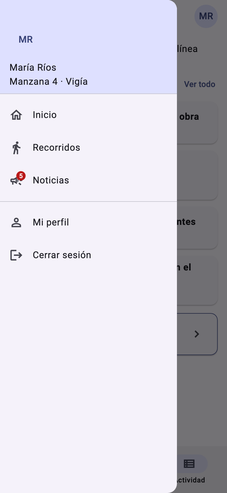
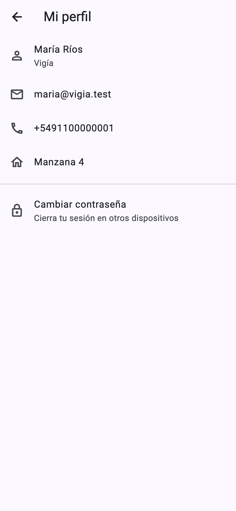
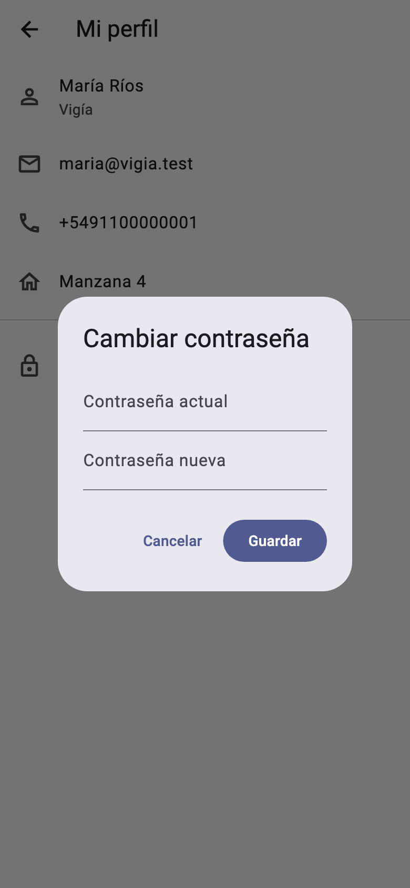
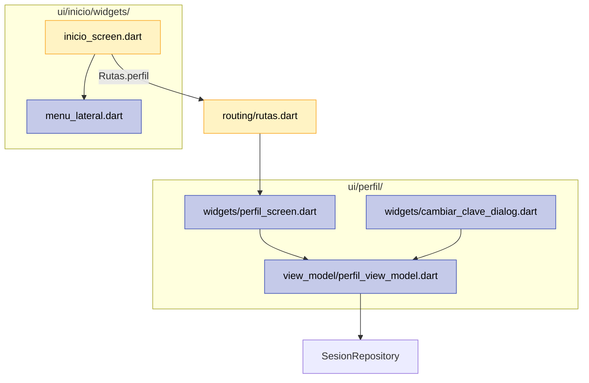
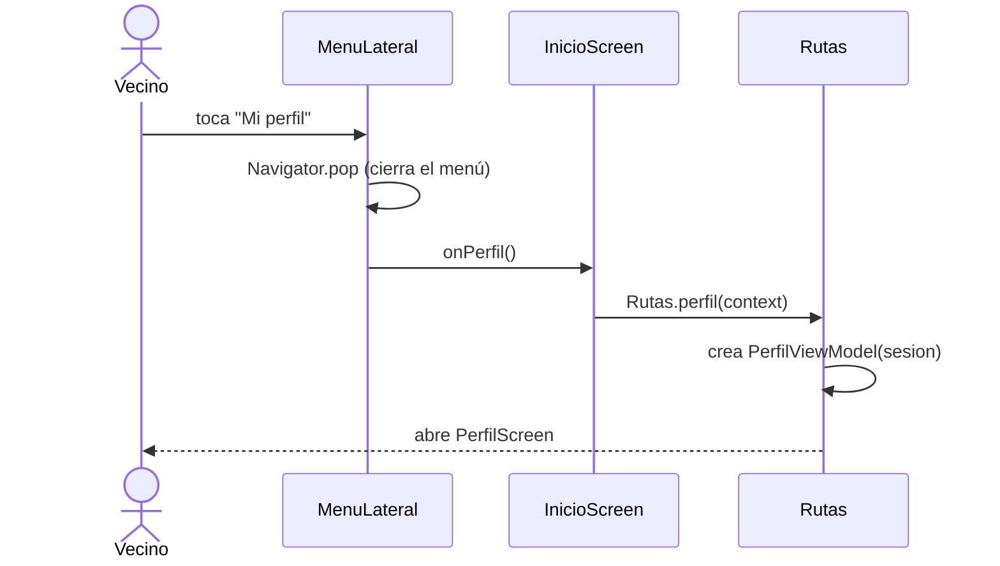

# 9. Inicio II: menú y perfil

!!! abstract "Objetivo"
    Agregar el **menú lateral** (el que se abre con :material-menu:) con "Mi perfil" y "Cerrar sesión", el **avatar** con las iniciales arriba a la derecha y la pantalla **Mi perfil**, que muestra los datos del vecino y deja **cambiar la contraseña**.

<div class="capturas" markdown>
<figure markdown="span">
  { .captura }
  <figcaption>El menú (versión final, con todas las opciones)</figcaption>
</figure>
<figure markdown="span">
  { .captura }
  <figcaption>Mi perfil</figcaption>
</figure>
<figure markdown="span">
  { .captura }
  <figcaption>Cambiar contraseña</figcaption>
</figure>
</div>

!!! note "La captura del menú es de la app terminada"
    Al final de este capítulo el menú tiene solo **Inicio**, **Mi perfil** y **Cerrar sesión**. Recorridos, Noticias y la sección del comité se suman en los capítulos 11, 13 y 16.

## Dónde estamos



## Paso 1: el ViewModel del perfil

Creá `lib/ui/perfil/view_model/perfil_view_model.dart`:

<!-- archivo: lib/ui/perfil/view_model/perfil_view_model.dart cap=c09 notas="Perfil\? _perfil;|bool _fallo = false;|_sesion.obtenerPerfil,|switch \(resultado\) \{|case Ok\(:final valor\):|Future<Resultado<void>> cambiarClave" -->
```dart title="lib/ui/perfil/view_model/perfil_view_model.dart" linenums="1"
// lib/ui/perfil/view_model/perfil_view_model.dart

import '../../../data/repositories/sesion_repository.dart';
import '../../../domain/models/sesion.dart';
import '../../../utils/resultado.dart';
import '../../core/view_model.dart';

class PerfilViewModel extends ViewModel {
  PerfilViewModel(this._sesion);

  final SesionRepository _sesion;

  Perfil? _perfil;  // (1)!
  bool _fallo = false;  // (2)!

  /// null mientras carga.
  Perfil? get perfil => _perfil;
  bool get fallo => _fallo;

  Future<void> cargar() async {
    _fallo = false;
    notifyListeners();
    final resultado = await ejecutar(
      _sesion.obtenerPerfil,  // (3)!
      marcarOcupado: false,
    );
    switch (resultado) {  // (4)!
      case Ok(:final valor):  // (5)!
        _perfil = valor;
      case Fallo():
        _fallo = true;
    }
    notifyListeners();
  }

  /// Cierra la sesión en los otros dispositivos.
  Future<Resultado<void>> cambiarClave(String actual, String nueva) =>  // (6)!
      ejecutar(() => _sesion.cambiarClave(actual, nueva));
}
```
<!-- /archivo -->

1. `null` mientras carga: así la vista sabe si mostrar la ruedita.
2. Un `bool` para el error: acá alcanza con saber *que* falló, el mensaje lo pone la vista.
3. Pasamos el método **sin llamarlo** (sin paréntesis): `ejecutar` lo llama cuando corresponde. Es lo mismo que `() => _sesion.obtenerPerfil()`.
4. Un `switch` como **sentencia** (no como expresión): cada caso hace algo en vez de devolver un valor.
5. Si salió bien, `:final valor` saca el perfil del `Ok`.
6. Devuelve el `Resultado` para que el diálogo decida qué hacer: cerrarse o mostrar el error.

## Paso 2: el diálogo de cambiar la contraseña

Este diálogo comparte el ViewModel del perfil (no tiene uno propio): lo recibe del perfil. Creá `lib/ui/perfil/widgets/cambiar_clave_dialog.dart`:

<!-- archivo: lib/ui/perfil/widgets/cambiar_clave_dialog.dart cap=c09 notas="required this.viewModel|String\? _error;|setState\(\(\) => _error = null\)|final resultado = await widget.viewModel.cambiarClave|Navigator.pop\(context, true\)|setState\(\(\) => _error = mensaje\)|ListenableBuilder\(" -->
```dart title="lib/ui/perfil/widgets/cambiar_clave_dialog.dart" linenums="1"
// lib/ui/perfil/widgets/cambiar_clave_dialog.dart

import 'package:flutter/material.dart';

import '../../../utils/resultado.dart';
import '../../../utils/validadores.dart';
import '../../core/widgets/estados_carga.dart';
import '../view_model/perfil_view_model.dart';

/// Devuelve true si cambió la contraseña.
class CambiarClaveDialog extends StatefulWidget {
  const CambiarClaveDialog({required this.viewModel, super.key});  // (1)!

  final PerfilViewModel viewModel;

  @override
  State<CambiarClaveDialog> createState() => _CambiarClaveDialogState();
}

class _CambiarClaveDialogState extends State<CambiarClaveDialog> {
  final _form = GlobalKey<FormState>();
  final _actual = TextEditingController();
  final _nueva = TextEditingController();
  String? _error;  // (2)!

  @override
  void dispose() {
    _actual.dispose();
    _nueva.dispose();
    super.dispose();
  }

  Future<void> _guardar() async {
    if (!_form.currentState!.validate()) return;
    setState(() => _error = null);  // (3)!
    final resultado = await widget.viewModel.cambiarClave(  // (4)!
      _actual.text,
      _nueva.text,
    );
    if (!mounted) return;
    switch (resultado) {
      case Ok():
        Navigator.pop(context, true);  // (5)!
      case Fallo(:final mensaje):
        setState(() => _error = mensaje);  // (6)!
    }
  }

  @override
  Widget build(BuildContext context) {
    return AlertDialog(
      title: const Text('Cambiar contraseña'),
      content: Form(
        key: _form,
        child: Column(
          mainAxisSize: MainAxisSize.min,
          children: [
            TextFormField(
              controller: _actual,
              decoration: const InputDecoration(labelText: 'Contraseña actual'),
              obscureText: true,
              validator: (valor) =>
                  (valor ?? '').isEmpty ? 'Ingresá tu contraseña actual' : null,
            ),
            TextFormField(
              controller: _nueva,
              decoration: const InputDecoration(labelText: 'Contraseña nueva'),
              obscureText: true,
              validator: validarClaveNueva,
            ),
            if (_error case final error?) ...[
              const SizedBox(height: 12),
              TextoError(error),
            ],
          ],
        ),
      ),
      actions: [
        TextButton(
          onPressed: () => Navigator.pop(context, false),
          child: const Text('Cancelar'),
        ),
        ListenableBuilder(  // (7)!
          listenable: widget.viewModel,
          builder: (context, _) => FilledButton(
            onPressed: widget.viewModel.ocupado ? null : _guardar,
            child: const Text('Guardar'),
          ),
        ),
      ],
    );
  }
}
```
<!-- /archivo -->

1. Recibe el ViewModel de la pantalla de perfil. No lo descarta: no es suyo.
2. El error del diálogo es estado **del diálogo**: vive en su `State`, con `setState`.
3. Al reintentar, se borra el error anterior.
4. `widget.viewModel`: desde el `State`, el widget se alcanza con `widget`.
5. Si salió bien, se cierra devolviendo `true`.
6. Si falló, el mensaje del servidor ("La contraseña actual no es correcta.") se muestra en el diálogo.
7. Solo el botón escucha al ViewModel (para deshabilitarse mientras espera). No hace falta redibujar todo el diálogo.

## Paso 3: la pantalla de perfil

Creá `lib/ui/perfil/widgets/perfil_screen.dart`:

<!-- archivo: lib/ui/perfil/widgets/perfil_screen.dart cap=c09 notas="_viewModel.cargar\(\);|final cambio = await showDialog<bool>|CambiarClaveDialog\(viewModel: _viewModel\)|if \(cambio == true && mounted\)|if \(_viewModel.fallo\)|if \(perfil == null\) return const Cargando\(\)|return ListView\(|perfil.telefono \?\? 'Sin teléfono cargado'" -->
```dart title="lib/ui/perfil/widgets/perfil_screen.dart" linenums="1"
// lib/ui/perfil/widgets/perfil_screen.dart
//
// Datos del vecino (GET /yo) y cambio de contraseña (POST /yo/clave).

import 'package:flutter/material.dart';

import '../../../domain/models/sesion.dart';
import '../../core/widgets/avisos.dart';
import '../../core/widgets/estados_carga.dart';
import '../view_model/perfil_view_model.dart';
import 'cambiar_clave_dialog.dart';

class PerfilScreen extends StatefulWidget {
  const PerfilScreen({required this.viewModel, super.key});

  final PerfilViewModel viewModel;

  @override
  State<PerfilScreen> createState() => _PerfilScreenState();
}

class _PerfilScreenState extends State<PerfilScreen> {
  // Se toma una sola vez: si el padre se redibuja, la pantalla sigue con el
  // mismo ViewModel (el que después descarta en dispose).
  late final PerfilViewModel _viewModel = widget.viewModel;

  @override
  void initState() {
    super.initState();
    _viewModel.cargar();  // (1)!
  }

  @override
  void dispose() {
    _viewModel.dispose();
    super.dispose();
  }

  Future<void> _cambiarClave() async {
    final cambio = await showDialog<bool>(  // (2)!
      context: context,
      builder: (context) => CambiarClaveDialog(viewModel: _viewModel),  // (3)!
    );
    if (cambio == true && mounted) {  // (4)!
      mostrarAviso(context, 'Contraseña actualizada');
    }
  }

  @override
  Widget build(BuildContext context) {
    return Scaffold(
      appBar: AppBar(title: const Text('Mi perfil')),
      body: ListenableBuilder(
        listenable: _viewModel,
        builder: (context, _) {
          if (_viewModel.fallo) {  // (5)!
            return ErrorConReintento(
              mensaje: 'No se pudo cargar tu perfil',
              onReintentar: _viewModel.cargar,
            );
          }
          final perfil = _viewModel.perfil;
          if (perfil == null) return const Cargando();  // (6)!
          return ListView(  // (7)!
            children: [
              ListTile(
                leading: const Icon(Icons.person_outline),
                title: Text(perfil.nombreCompleto),
                subtitle: Text(roles[perfil.rol] ?? perfil.rol),
              ),
              ListTile(
                leading: const Icon(Icons.email_outlined),
                title: Text(perfil.email),
              ),
              ListTile(
                leading: const Icon(Icons.phone_outlined),
                title: Text(perfil.telefono ?? 'Sin teléfono cargado'),  // (8)!
              ),
              ListTile(
                leading: const Icon(Icons.home_outlined),
                title: Text(perfil.manzana),
              ),
              const Divider(),
              ListTile(
                leading: const Icon(Icons.lock_outline),
                title: const Text('Cambiar contraseña'),
                subtitle: const Text('Cierra tu sesión en otros dispositivos'),
                onTap: _cambiarClave,
              ),
            ],
          );
        },
      ),
    );
  }
}
```
<!-- /archivo -->

1. Al aparecer, pide el perfil al servidor.
2. Abre el diálogo y espera la respuesta (`true` si cambió la contraseña).
3. Le pasa **su** ViewModel al diálogo.
4. `cambio` puede ser `null` (cerró tocando afuera): `== true` cubre los dos casos de "no".
5. Error con reintento.
6. Todavía cargando.
7. `ListView` con hijos fijos (sin `.builder`): para pocas filas que se conocen de antemano.
8. Si no hay teléfono, un texto en vez de un espacio vacío.

## Paso 4: el menú lateral

El menú **no navega por su cuenta**: recibe funciones (*callbacks*) y las llama. Quien lo usa (el Inicio) decide qué hacer. Así el menú no conoce `Rutas` ni los repositorios. Creá `lib/ui/inicio/widgets/menu_lateral.dart`:

<!-- archivo: lib/ui/inicio/widgets/menu_lateral.dart cap=c09 notas="required this.onPerfil|return Drawer\(|DrawerHeader\(|Text\(vecino.descripcion\)|onTap: \(\) => Navigator.pop\(context\)|onTap: onCerrarSesion|class _Opcion|Navigator.pop\(context\);$|onTap\(\);" -->
```dart title="lib/ui/inicio/widgets/menu_lateral.dart" linenums="1"
// lib/ui/inicio/widgets/menu_lateral.dart

import 'package:flutter/material.dart';

import '../../../domain/models/sesion.dart';

/// Menú lateral (pantalla 9 del Manual). No navega por su cuenta: avisa al
/// padre con callbacks y el padre decide (patrón callback, apunte 8).
class MenuLateral extends StatelessWidget {
  const MenuLateral({
    required this.vecino,
    required this.onPerfil,  // (1)!
    required this.onCerrarSesion,
    super.key,
  });

  final VecinoSesion vecino;
  final VoidCallback onPerfil;
  final VoidCallback onCerrarSesion;

  @override
  Widget build(BuildContext context) {
    return Drawer(  // (2)!
      child: ListView(
        padding: EdgeInsets.zero,
        children: [
          DrawerHeader(  // (3)!
            decoration: BoxDecoration(
              color: Theme.of(context).colorScheme.primaryContainer,
            ),
            child: Column(
              crossAxisAlignment: CrossAxisAlignment.start,
              mainAxisAlignment: MainAxisAlignment.end,
              children: [
                CircleAvatar(radius: 28, child: Text(vecino.iniciales)),
                const SizedBox(height: 8),
                Text(vecino.nombre),
                Text(vecino.descripcion),  // (4)!
              ],
            ),
          ),
          ListTile(
            leading: const Icon(Icons.home_outlined),
            title: const Text('Inicio'),
            onTap: () => Navigator.pop(context), // ya estamos en Inicio (5)
          ),
          const Divider(),
          _Opcion(
            icono: const Icon(Icons.person_outline),
            texto: 'Mi perfil',
            onTap: onPerfil,
          ),
          _Opcion(
            icono: const Icon(Icons.logout),
            texto: 'Cerrar sesión',
            onTap: onCerrarSesion, // MyApp vuelve solo al Login (6)
          ),
        ],
      ),
    );
  }
}

/// Una opción del menú: 1) cierra el menú, 2) avisa al padre.
class _Opcion extends StatelessWidget {  // (7)!
  const _Opcion({
    required this.icono,
    required this.texto,
    required this.onTap,
  });

  final Widget icono;
  final String texto;
  final VoidCallback onTap;

  @override
  Widget build(BuildContext context) {
    return ListTile(
      leading: icono,
      title: Text(texto),
      onTap: () {
        Navigator.pop(context);  // (8)!
        onTap();  // (9)!
      },
    );
  }
}
```
<!-- /archivo -->

1. Las acciones llegan como funciones. Ver [patrón callback](../3-flutter/2-stateless-y-stateful.md#avisarle-al-padre-callbacks).
2. `Drawer` es el panel lateral de Material.
3. La cabecera con los datos del vecino.
4. El getter del modelo: "Manzana 4 · Vigía".
5. "Inicio" solo cierra el menú: ya estamos ahí.
6. Cerrar sesión: avisa al padre. El padre llama al ViewModel, la sesión cambia, y `main.dart` muestra el Login.
7. Un widget privado para no repetir lo mismo en cada opción:
8. primero cierra el menú (el menú es una ruta más en el `Navigator`, y `pop` lo saca)…
9. …y después avisa al padre.



## Paso 5: la ruta al perfil

`Rutas` suma un método:

<!-- diff: lib/routing/rutas.dart cap=c09 -->
```diff title="Qué cambia en lib/routing/rutas.dart"
--- lib/routing/rutas.dart (cap. 8)
+++ lib/routing/rutas.dart (cap. 9)
@@ -13,4 +13,6 @@
 import '../ui/elegir_clave/view_model/elegir_clave_view_model.dart';
 import '../ui/elegir_clave/widgets/elegir_clave_screen.dart';
+import '../ui/perfil/view_model/perfil_view_model.dart';
+import '../ui/perfil/widgets/perfil_screen.dart';
 
 abstract final class Rutas {
@@ -31,3 +33,8 @@
     return _abrir(context, ElegirClaveScreen(viewModel: viewModel));
   }
+
+  static Future<void> perfil(BuildContext context) {
+    final viewModel = PerfilViewModel(Dependencias.of(context).sesion);
+    return _abrir(context, PerfilScreen(viewModel: viewModel));
+  }
 }
```
<!-- /diff -->

<!-- archivo: lib/routing/rutas.dart cap=c09 -->
```dart title="lib/routing/rutas.dart" linenums="1" hl_lines="15-16 35-39"
// lib/routing/rutas.dart
//
// Navegación de la app. Cada método arma el ViewModel de la pantalla con los
// repositorios de Dependencias y la abre. Así las vistas solo dicen "abrí el
// perfil" y nunca tocan un repositorio.
//
// El ViewModel se crea UNA vez, afuera del builder de la ruta: el builder se
// puede volver a ejecutar, y crearía otro ViewModel distinto.

import 'package:flutter/material.dart';

import '../dependencias.dart';
import '../ui/elegir_clave/view_model/elegir_clave_view_model.dart';
import '../ui/elegir_clave/widgets/elegir_clave_screen.dart';
import '../ui/perfil/view_model/perfil_view_model.dart';
import '../ui/perfil/widgets/perfil_screen.dart';

abstract final class Rutas {
  static Future<T?> _abrir<T>(BuildContext context, Widget pantalla) {
    return Navigator.push<T>(
      context,
      MaterialPageRoute(builder: (context) => pantalla),
    );
  }

  /// Invitación o recuperación de la clave. [token] viene del enlace del
  /// correo, si la app se abrió desde ahí.
  static Future<void> elegirClave(BuildContext context, {String? token}) {
    final viewModel = ElegirClaveViewModel(
      Dependencias.of(context).sesion,
      tokenDelCorreo: token,
    );
    return _abrir(context, ElegirClaveScreen(viewModel: viewModel));
  }

  static Future<void> perfil(BuildContext context) {
    final viewModel = PerfilViewModel(Dependencias.of(context).sesion);
    return _abrir(context, PerfilScreen(viewModel: viewModel));
  }
}
```
<!-- /archivo -->

## Paso 6: el Inicio con menú y avatar

En el Inicio, el botón provisorio de salir se va, y entran el menú (`drawer`) y el avatar:

<!-- diff: lib/ui/inicio/widgets/inicio_screen.dart cap=c09 -->
```diff title="Qué cambia en lib/ui/inicio/widgets/inicio_screen.dart"
--- lib/ui/inicio/widgets/inicio_screen.dart (cap. 8)
+++ lib/ui/inicio/widgets/inicio_screen.dart (cap. 9)
@@ -7,4 +7,5 @@
 
 import '../../../domain/models/publicacion.dart';
+import '../../../routing/rutas.dart';
 import '../../../utils/resultado.dart';
 import '../../core/widgets/avisos.dart';
@@ -12,4 +13,5 @@
 import 'estado_red.dart';
 import 'lista_actividad.dart';
+import 'menu_lateral.dart';
 
 class InicioScreen extends StatefulWidget {
@@ -59,16 +61,29 @@
       listenable: _viewModel,
       builder: (context, _) {
+        final vecino = _viewModel.vecino;
         return Scaffold(
           appBar: AppBar(
+            leading: Builder(
+              builder: (context) => IconButton(
+                icon: const Icon(Icons.menu),
+                onPressed: () => Scaffold.of(context).openDrawer(),
+              ),
+            ),
             title: const Text('Inicio'),
             centerTitle: true,
             actions: [
-              // Provisorio: en el capítulo 9 pasa al menú lateral.
-              IconButton(
-                icon: const Icon(Icons.logout),
-                tooltip: 'Cerrar sesión',
-                onPressed: _viewModel.cerrarSesion,
+              Padding(
+                padding: const EdgeInsets.only(right: 16),
+                child: GestureDetector(
+                  onTap: () => Rutas.perfil(context),
+                  child: CircleAvatar(child: Text(vecino.iniciales)),
+                ),
               ),
             ],
+          ),
+          drawer: MenuLateral(
+            vecino: vecino,
+            onPerfil: () => Rutas.perfil(context),
+            onCerrarSesion: _viewModel.cerrarSesion,
           ),
           body: Column(
```
<!-- /diff -->

<!-- archivo: lib/ui/inicio/widgets/inicio_screen.dart cap=c09 notas="final vecino = _viewModel.vecino;|leading: Builder\(|Scaffold.of\(context\).openDrawer\(\)|GestureDetector\(|CircleAvatar\(child: Text\(vecino.iniciales\)\)|drawer: MenuLateral\(|onCerrarSesion: _viewModel.cerrarSesion" -->
```dart title="lib/ui/inicio/widgets/inicio_screen.dart" linenums="1" hl_lines="9 15 63 66-71 75-80 83-87"
// lib/ui/inicio/widgets/inicio_screen.dart
//
// Pantalla de Inicio. Arriba el estado de la red; debajo, la actividad del
// barrio.

import 'package:flutter/material.dart';

import '../../../domain/models/publicacion.dart';
import '../../../routing/rutas.dart';
import '../../../utils/resultado.dart';
import '../../core/widgets/avisos.dart';
import '../view_model/inicio_view_model.dart';
import 'estado_red.dart';
import 'lista_actividad.dart';
import 'menu_lateral.dart';

class InicioScreen extends StatefulWidget {
  const InicioScreen({required this.viewModel, super.key});

  final InicioViewModel viewModel;

  @override
  State<InicioScreen> createState() => _InicioScreenState();
}

class _InicioScreenState extends State<InicioScreen> {
  // Se toma una sola vez: si el padre se redibuja, la pantalla sigue con el
  // mismo ViewModel (el que después descarta en dispose).
  late final InicioViewModel _viewModel = widget.viewModel;

  @override
  void initState() {
    super.initState();
    _viewModel.iniciar();
  }

  @override
  void dispose() {
    _viewModel.dispose();
    super.dispose();
  }

  // Deslizar una publicación propia (o cualquiera, si es del comité) la borra
  // en el servidor, previa confirmación; una ajena solo se oculta de la lista.
  Future<bool> _confirmarDeslizar(Publicacion publicacion) async {
    if (!_viewModel.puedeBorrar(publicacion)) return true;
    final borrar = await confirmar(
      context,
      titulo: '¿Borrar la publicación?',
      mensaje: 'Se borra para todo el barrio, con sus respuestas.',
    );
    if (!borrar) return false;
    final resultado = await _viewModel.borrar(publicacion);
    if (!mounted) return resultado is Ok;
    return avisarSiFallo(context, resultado);
  }

  @override
  Widget build(BuildContext context) {
    return ListenableBuilder(
      listenable: _viewModel,
      builder: (context, _) {
        final vecino = _viewModel.vecino;  // (1)!
        return Scaffold(
          appBar: AppBar(
            leading: Builder(  // (2)!
              builder: (context) => IconButton(
                icon: const Icon(Icons.menu),
                onPressed: () => Scaffold.of(context).openDrawer(),  // (3)!
              ),
            ),
            title: const Text('Inicio'),
            centerTitle: true,
            actions: [
              Padding(
                padding: const EdgeInsets.only(right: 16),
                child: GestureDetector(  // (4)!
                  onTap: () => Rutas.perfil(context),
                  child: CircleAvatar(child: Text(vecino.iniciales)),  // (5)!
                ),
              ),
            ],
          ),
          drawer: MenuLateral(  // (6)!
            vecino: vecino,
            onPerfil: () => Rutas.perfil(context),
            onCerrarSesion: _viewModel.cerrarSesion,  // (7)!
          ),
          body: Column(
            children: [
              EstadoRed(barrio: _viewModel.barrio),
              Expanded(
                child: ListaActividad(
                  viewModel: _viewModel,
                  confirmarDeslizar: _confirmarDeslizar,
                ),
              ),
            ],
          ),
        );
      },
    );
  }
}
```
<!-- /archivo -->

1. Se lee una vez, se usa en el avatar y en el menú.
2. `Builder` crea un `context` nuevo **debajo** del `Scaffold`. Hace falta porque `Scaffold.of(context)` busca el `Scaffold` hacia arriba, y el `context` del `build` está **arriba** del `Scaffold` (es el que lo crea).
3. Abre el menú lateral. (Si no ponemos `leading`, el `AppBar` agrega solo el botón del menú; lo escribimos para que se vea cómo funciona.)
4. `GestureDetector` vuelve "tocable" a cualquier widget.
5. Un círculo con las iniciales (el getter del capítulo 3).
6. `drawer:` le da el menú al `Scaffold`.
7. Pasamos el **método** del ViewModel como callback.

## Probalo

1. Entrá como María. Tocá :material-menu: → **Mi perfil**. Después de cargar, ves el email, el teléfono y la manzana.
2. Tocá **Cambiar contraseña**. Probá con una actual equivocada: "La contraseña actual no es correcta." Con `vigia1234` y una nueva de 8 o más: se cierra y aparece "Contraseña actualizada".
3. Tocá el avatar **MR**: también abre el perfil.
4. Menú → **Cerrar sesión**: volvés al Login.

```bash
flutter analyze && flutter test
```

## Así queda el proyecto

<!-- arbol: cap=c09 -->
```text title="Así queda el proyecto"
vigia_app/
    lib/
        config.dart
        data/
            repositories/
                publicaciones_repository.dart
                sesion_repository.dart
            services/
                almacen_token.dart
                api/
                    fake_vigia_api.dart
                    vigia_api.dart
                errores.dart
        dependencias.dart
        domain/
            models/
                alerta.dart
                comite.dart
                coordenadas.dart
                mensaje.dart
                noticia.dart
                publicacion.dart
                rondin.dart
                sesion.dart
        main.dart
        routing/
            rutas.dart  ← cambia
        ui/
            carga/
                widgets/
                    pantalla_carga.dart
            core/
                view_model.dart
                widgets/
                    avisos.dart
                    estados_carga.dart
            elegir_clave/
                view_model/
                    elegir_clave_view_model.dart
                widgets/
                    elegir_clave_screen.dart
            inicio/
                view_model/
                    inicio_view_model.dart
                widgets/
                    estado_red.dart
                    inicio_screen.dart  ← cambia
                    lista_actividad.dart
                    menu_lateral.dart  ← nuevo
            login/
                view_model/
                    login_view_model.dart
                widgets/
                    login_screen.dart
                    recuperar_clave_dialog.dart
            perfil/
                view_model/
                    perfil_view_model.dart  ← nuevo
                widgets/
                    cambiar_clave_dialog.dart  ← nuevo
                    perfil_screen.dart  ← nuevo
        utils/
            fechas.dart
            resultado.dart
            sondeo.dart
            validadores.dart
    pubspec.yaml
    test/
        elegir_clave_view_model_test.dart
        fake_api_test.dart
        inicio_view_model_test.dart
        login_view_model_test.dart
        modelos_test.dart
        sesion_repository_test.dart
        utils_test.dart
```
<!-- /arbol -->

## Errores comunes

??? failure "`Scaffold.of() called with a context that does not contain a Scaffold.`"
    Usaste el `context` del `build` (que está arriba del `Scaffold`). Envolvé el botón en un `Builder`, como en la nota 2.

??? failure "Al tocar una opción, el menú queda abierto encima de la pantalla nueva"
    Falta el `Navigator.pop(context)` **antes** de llamar al callback.

??? failure "`Looking up a deactivated widget's ancestor is unsafe.`"
    Se usó un `context` de un widget que ya no está (por ejemplo, el del menú, después de cerrarlo). Por eso el menú no navega: avisa al Inicio, que sigue en pantalla.

## Lo que aprendiste

- [x] El menú lateral es un `Drawer` en el `Scaffold`, y se abre con `Scaffold.of(context).openDrawer()`.
- [x] Un widget que **avisa con callbacks** no necesita saber qué pasa después: lo decide el padre.
- [x] Un diálogo puede **compartir** el ViewModel de la pantalla que lo abre, sin descartarlo.
- [x] `Builder` da un `context` más abajo en el árbol, cuando hace falta.

[Siguiente: 10. Publicaciones y fotos :material-arrow-right:](10-publicaciones-y-fotos.md){ .md-button .md-button--primary }
