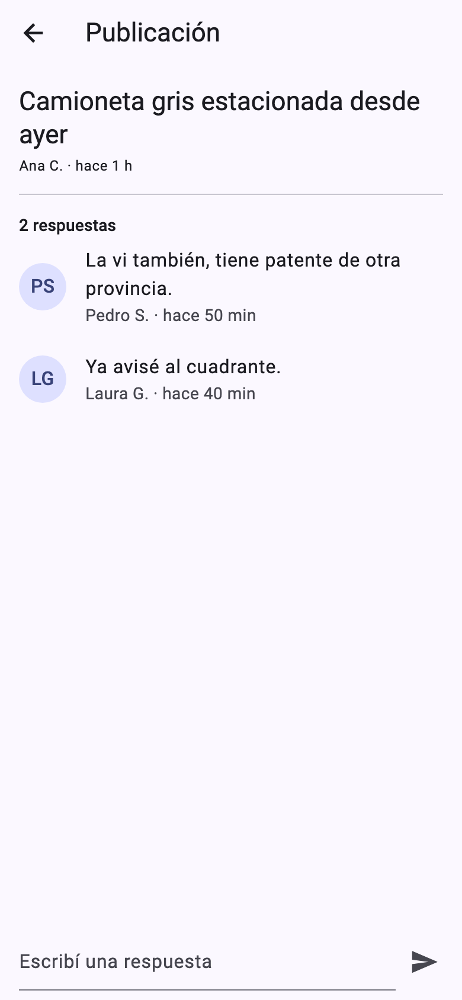
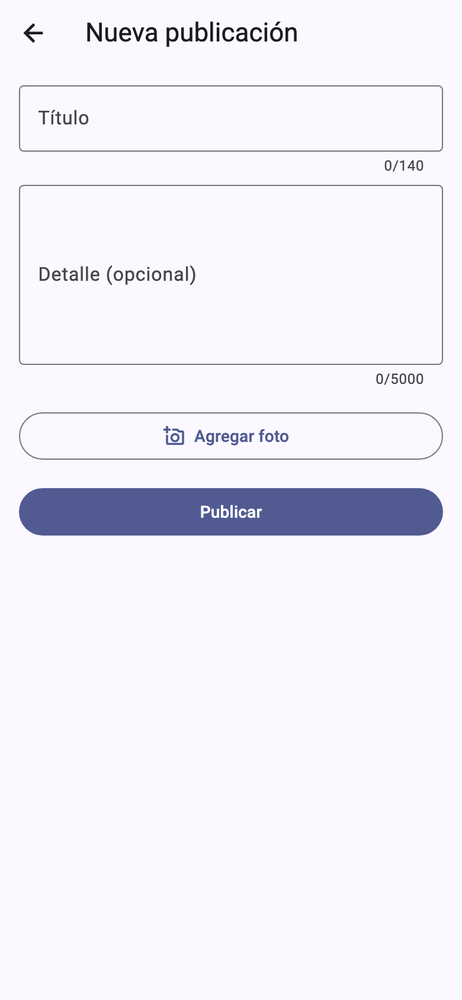
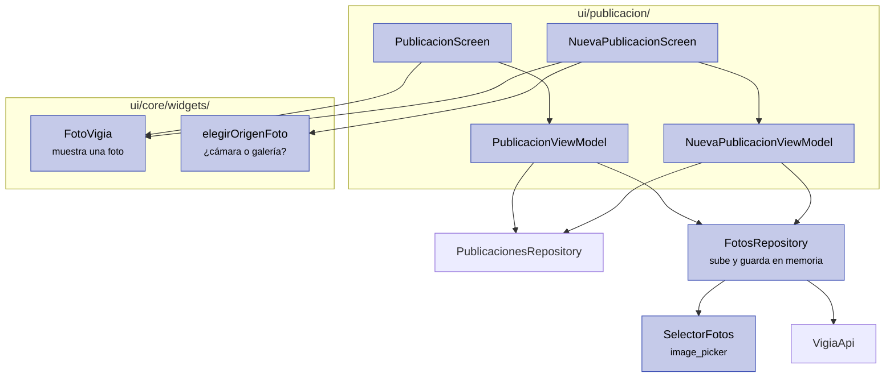
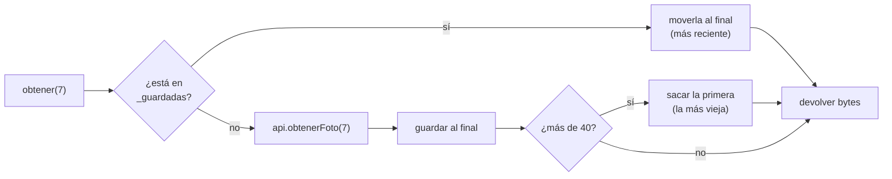
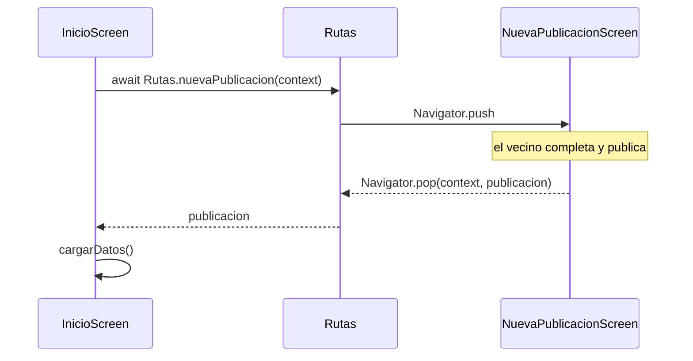

# 10. Publicaciones y fotos

!!! abstract "Objetivo"
    Tocar una publicación del Inicio y ver el **detalle**: el texto completo, la foto (si tiene) y las **respuestas** de los vecinos, con una barra para responder. Y el botón :material-pencil-outline: para **publicar** algo nuevo, con foto de la cámara o de la galería.

<div class="capturas" markdown>
<figure markdown="span">
  { .captura }
  <figcaption>El detalle con respuestas</figcaption>
</figure>
<figure markdown="span">
  { .captura }
  <figcaption>Publicar</figcaption>
</figure>
</div>

## Dónde estamos

Aparecen dos pantallas nuevas y un tema transversal: las **fotos**, que también van a usar el chat y las alertas. Por eso las piezas de fotos van en lugares compartidos (`data/` y `ui/core/`), no dentro de `publicacion/`.



## Paso 1: el paquete `image_picker`

```bash
flutter pub add image_picker
```

<!-- archivo: pubspec.yaml cap=c10 -->
```yaml title="pubspec.yaml" linenums="1" hl_lines="14"
name: vigia_app
description: "VigiaApp: red de alerta vecinal (versión de la wiki, solo Material)."
publish_to: 'none'
version: 1.0.0+1

environment:
  sdk: ^3.12.2

dependencies:
  flutter:
    sdk: flutter
  flutter_secure_storage: ^11.2.0
  app_links: ^7.2.1
  image_picker: ^1.2.4

dev_dependencies:
  flutter_test:
    sdk: flutter
  flutter_lints: ^6.0.0

flutter:
  uses-material-design: true
```
<!-- /archivo -->

=== "Android"

    No hace falta configurar nada: `image_picker` usa la cámara y la galería del sistema.

=== "iOS"

    iOS exige explicar **para qué** se usa la cámara y la galería. Sin estos textos, la app se cierra al abrirlas. En `ios/Runner/Info.plist`, dentro del `<dict>` principal:

    ```xml title="ios/Runner/Info.plist (fragmento)"
    <key>NSCameraUsageDescription</key>
    <string>Para sacar fotos y compartirlas con el barrio.</string>
    <key>NSPhotoLibraryUsageDescription</key>
    <string>Para elegir fotos y compartirlas con el barrio.</string>
    ```

## Paso 2: `SelectorFotos`, el servicio de la cámara

Creá `lib/data/services/selector_fotos.dart`:

<!-- archivo: lib/data/services/selector_fotos.dart cap=c10 notas="enum OrigenFoto|typedef FotoElegida = \(\{Uint8List bytes, String mime\}\)|Future<FotoElegida\?> elegir|maxWidth: 1280|imageQuality: 70|if \(archivo == null\) return null|return \($|on PlatformException|throw const FotoException" -->
```dart title="lib/data/services/selector_fotos.dart" linenums="1"
// lib/data/services/selector_fotos.dart
//
// Saca una foto con la cámara o la elige de la galería (paquete image_picker,
// apunte 13). La achica antes de devolverla para que pese poco al subirla.

import 'package:flutter/services.dart';
import 'package:image_picker/image_picker.dart';

import 'errores.dart';

enum OrigenFoto { camara, galeria }  // (1)!

/// Los bytes de la foto elegida y su tipo ('image/jpeg').
typedef FotoElegida = ({Uint8List bytes, String mime});  // (2)!

class SelectorFotos {
  const SelectorFotos();

  /// Devuelve null si el vecino cerró la cámara o la galería sin elegir.
  Future<FotoElegida?> elegir(OrigenFoto origen) async {  // (3)!
    try {
      final archivo = await ImagePicker().pickImage(
        source: origen == OrigenFoto.camara
            ? ImageSource.camera
            : ImageSource.gallery,
        maxWidth: 1280,  // (4)!
        imageQuality: 70,  // (5)!
      );
      if (archivo == null) return null;  // (6)!
      return (  // (7)!
        bytes: await archivo.readAsBytes(),
        mime: archivo.mimeType ?? 'image/jpeg',
      );
    } on PlatformException {  // (8)!
      // Sin cámara o sin permiso.
      throw const FotoException('No se pudo abrir la cámara o la galería.');  // (9)!
    }
  }
}
```
<!-- /archivo -->

1. De dónde sale la foto. Un enum de dos valores.
2. `typedef` le pone un nombre a un tipo. Este tipo es un **record**: un grupo de valores con nombre, sin tener que escribir una clase. Ver [Records](../2-dart/7-enums-records-patrones.md#records).
3. `null` si el vecino abrió la cámara y se arrepintió.
4. Achica la foto a 1280 px de ancho como máximo…
5. …y la comprime. Una foto del celular pesa 4 MB; así, unos 200 KB. Se sube más rápido y gasta menos datos.
6. Se arrepintió.
7. Un record se crea con paréntesis y nombres: `(bytes: …, mime: …)`. Se lee como `foto.bytes`, `foto.mime`.
8. Los plugins avisan sus errores con `PlatformException` (por ejemplo, sin permiso para la cámara)…
9. …y lo traducimos a nuestro error, con un mensaje para el vecino. Así el ViewModel lo atrapa con el mismo `on VigiaException` de siempre.

## Paso 3: `FotosRepository`, subir y bajar con memoria

Creá `lib/data/repositories/fotos_repository.dart`:

<!-- archivo: lib/data/repositories/fotos_repository.dart cap=c10 notas="this._selector = const SelectorFotos\(\)|final Map<int, Uint8List> _guardadas = \{\}|Future<int\?> elegirYSubir|return _api.subirFoto|final guardada = _guardadas.remove\(fotoId\)|_guardadas\[fotoId\] = guardada;|_guardadas.remove\(_guardadas.keys.first\)" -->
```dart title="lib/data/repositories/fotos_repository.dart" linenums="1"
// lib/data/repositories/fotos_repository.dart
//
// Fotos de publicaciones, del chat y de las alertas: subirlas y bajarlas.
// Las bajadas se guardan en memoria para no pedirlas de nuevo.

import 'dart:typed_data';

import '../services/api/vigia_api.dart';
import '../services/selector_fotos.dart';

class FotosRepository {
  FotosRepository(this._api, {this._selector = const SelectorFotos()});  // (1)!

  final VigiaApi _api;
  final SelectorFotos _selector;

  // Las últimas fotos bajadas: al deslizar el chat, una burbuja que vuelve a
  // aparecer no la pide de nuevo. Un Map recuerda el orden en que se
  // agregaron, así se descarta la más vieja. Se guardan hasta 40.
  final Map<int, Uint8List> _guardadas = {};  // (2)!
  static const _maxGuardadas = 40;

  /// Saca o elige la foto y la sube. Devuelve su id, o null si el vecino se
  /// arrepintió. Si falla lanza FotoException o ApiException.
  Future<int?> elegirYSubir(OrigenFoto origen) async {  // (3)!
    final foto = await _selector.elegir(origen);
    if (foto == null) return null;
    return _api.subirFoto(foto.bytes, foto.mime);  // (4)!
  }

  /// Los bytes de la foto (de memoria si ya se bajó).
  Future<Uint8List> obtener(int fotoId) async {
    final guardada = _guardadas.remove(fotoId);  // (5)!
    if (guardada != null) {
      _guardadas[fotoId] = guardada; // pasa a ser la más reciente (6)
      return guardada;
    }
    final bytes = await _api.obtenerFoto(fotoId);
    _guardadas[fotoId] = bytes;
    if (_guardadas.length > _maxGuardadas) {
      _guardadas.remove(_guardadas.keys.first);  // (7)!
    }
    return bytes;
  }
}
```
<!-- /archivo -->

1. Un parámetro privado con nombre **con valor por defecto**: en la app no se pasa; en un test se podría pasar un selector de mentira.
2. Las fotos ya bajadas, por id. Una foto del chat se pide una vez y se reusa.
3. Elegir y subir son un solo paso para el ViewModel: devuelve el id de la foto subida.
4. La foto se sube **antes** de publicar: al publicar solo se manda el id.
5. Si ya estaba guardada, la saca…
6. …y la vuelve a poner. ¿Para qué? Un `Map` de Dart recuerda el **orden en que se agregaron** las claves. Al ponerla de nuevo, queda como la más reciente.
7. Si hay más de 40, se descarta la primera (la que hace más tiempo que no se usa). Esta estrategia se llama **LRU** (*least recently used*): se tira lo que hace más tiempo que no se usa.



## Paso 4: los widgets de fotos

Dos widgets que se usan en varias pantallas. Creá `lib/ui/core/widgets/elegir_origen_foto.dart`:

<!-- archivo: lib/ui/core/widgets/elegir_origen_foto.dart cap=c10 notas="Future<OrigenFoto\?> elegirOrigenFoto|showModalBottomSheet<OrigenFoto>|Navigator.pop\(context, OrigenFoto.camara\)" -->
```dart title="lib/ui/core/widgets/elegir_origen_foto.dart" linenums="1"
// lib/ui/core/widgets/elegir_origen_foto.dart

import 'package:flutter/material.dart';

import '../../../data/services/selector_fotos.dart';

/// Pregunta si la foto sale de la cámara o de la galería. Devuelve null si
/// el vecino cerró la hoja sin elegir.
Future<OrigenFoto?> elegirOrigenFoto(BuildContext context) {  // (1)!
  return showModalBottomSheet<OrigenFoto>(  // (2)!
    context: context,
    builder: (context) => SafeArea(
      child: Column(
        mainAxisSize: MainAxisSize.min,
        children: [
          ListTile(
            leading: const Icon(Icons.photo_camera_outlined),
            title: const Text('Sacar una foto'),
            onTap: () => Navigator.pop(context, OrigenFoto.camara),  // (3)!
          ),
          ListTile(
            leading: const Icon(Icons.photo_library_outlined),
            title: const Text('Elegir de la galería'),
            onTap: () => Navigator.pop(context, OrigenFoto.galeria),
          ),
        ],
      ),
    ),
  );
}
```
<!-- /archivo -->

1. No es un widget: es una **función** que muestra algo y devuelve la elección.
2. Una hoja que sube desde abajo (*bottom sheet*). Ver [Widgets de Material](../3-flutter/4-material.md#bottomsheet).
3. Cada opción cierra la hoja devolviendo su valor.

Y `lib/ui/core/widgets/foto_vigia.dart`, que muestra una foto ya subida:

<!-- archivo: lib/ui/core/widgets/foto_vigia.dart cap=c10 notas="typedef CargarFoto|final CargarFoto cargar|Uint8List\? _bytes|_cargar\(\);|if \(mounted\) setState\(\(\) => _bytes = bytes\)|final miniatura = ClipRRect|if \(bytes == null\) return miniatura|fullscreenDialog: true|return LayoutBuilder|cacheWidth: lugar.maxWidth.isFinite|errorBuilder:|class FotoCompleta|InteractiveViewer\(" -->
```dart title="lib/ui/core/widgets/foto_vigia.dart" linenums="1"
// lib/ui/core/widgets/foto_vigia.dart
//
// Fotos de publicaciones, del chat y de las alertas. FotoVigia muestra una
// foto ya subida: la pide una sola vez (initState) con la función que le pasa
// el ViewModel y la dibuja con Image.memory, decodificada al tamaño en
// pantalla (rendimiento). Tocarla la abre a pantalla completa.

import 'package:flutter/material.dart';
import 'package:flutter/services.dart';

/// Cómo conseguir los bytes de una foto (FotosRepository.obtener).
typedef CargarFoto = Future<Uint8List> Function(int fotoId);  // (1)!

class FotoVigia extends StatefulWidget {
  const FotoVigia({
    required this.fotoId,
    required this.cargar,
    this.alto = 200,
    super.key,
  });

  final int fotoId;
  final CargarFoto cargar;  // (2)!
  final double alto;

  @override
  State<FotoVigia> createState() => _FotoVigiaState();
}

class _FotoVigiaState extends State<FotoVigia> {
  Uint8List? _bytes;  // (3)!
  bool _error = false;

  @override
  void initState() {
    super.initState();
    _cargar();  // (4)!
  }

  Future<void> _cargar() async {
    try {
      final bytes = await widget.cargar(widget.fotoId);
      if (mounted) setState(() => _bytes = bytes);  // (5)!
    } on Exception {
      if (mounted) setState(() => _error = true);
    }
  }

  @override
  Widget build(BuildContext context) {
    final bytes = _bytes;
    final miniatura = ClipRRect(  // (6)!
      borderRadius: BorderRadius.circular(8),
      child: SizedBox(
        width: double.infinity,
        height: widget.alto,
        child: _contenido(bytes),
      ),
    );
    if (bytes == null) return miniatura;  // (7)!
    // Tocarla la abre a pantalla completa (apunte 11: GestureDetector).
    return Semantics(
      button: true,
      label: 'Ver foto',
      child: GestureDetector(
        onTap: () => Navigator.push(
          context,
          MaterialPageRoute(
            fullscreenDialog: true,  // (8)!
            builder: (context) => FotoCompleta(bytes: bytes),
          ),
        ),
        child: miniatura,
      ),
    );
  }

  Widget _contenido(Uint8List? bytes) {
    if (_error) return const _FotoRota();
    if (bytes == null) return const Center(child: CircularProgressIndicator());
    return LayoutBuilder(  // (9)!
      // cacheWidth: se decodifica al ancho real en pantalla (p. ej. 600 px)
      // y no a los 1280 px de la foto: menos memoria y menos trabajo.
      builder: (context, lugar) => Image.memory(
        bytes,
        fit: BoxFit.cover,
        cacheWidth: lugar.maxWidth.isFinite  // (10)!
            ? (lugar.maxWidth * MediaQuery.devicePixelRatioOf(context)).round()
            : null,
        // Si los bytes no son una imagen válida, un ícono en vez del error.
        errorBuilder: (context, error, stackTrace) => const _FotoRota(),  // (11)!
      ),
    );
  }
}

class _FotoRota extends StatelessWidget {
  const _FotoRota();

  @override
  Widget build(BuildContext context) {
    return const Center(child: Icon(Icons.broken_image_outlined));
  }
}

/// Una foto a pantalla completa, sobre negro y en su resolución original: se
/// amplía con dos dedos y se mueve (InteractiveViewer). Se cierra con la X o
/// con el gesto de volver.
class FotoCompleta extends StatelessWidget {  // (12)!
  const FotoCompleta({required this.bytes, super.key});

  final Uint8List bytes;

  @override
  Widget build(BuildContext context) {
    return AnnotatedRegion<SystemUiOverlayStyle>(
      value: SystemUiOverlayStyle.light,
      child: Scaffold(
        backgroundColor: Colors.black,
        // SizedBox.expand: sin esto el Stack toma el tamaño del botón de
        // cerrar y la foto queda chiquita en una esquina.
        body: SizedBox.expand(
          child: Stack(
            children: [
              Positioned.fill(
                child: InteractiveViewer(  // (13)!
                  maxScale: 5,
                  child: Center(
                    child: Image.memory(bytes, fit: BoxFit.contain),
                  ),
                ),
              ),
              SafeArea(
                child: Padding(
                  padding: const EdgeInsets.all(8),
                  child: IconButton.filled(
                    tooltip: 'Cerrar',
                    style: IconButton.styleFrom(
                      backgroundColor: Colors.black54,
                      foregroundColor: Colors.white,
                    ),
                    onPressed: () => Navigator.pop(context),
                    icon: const Icon(Icons.close),
                  ),
                ),
              ),
            ],
          ),
        ),
      ),
    );
  }
}
```
<!-- /archivo -->

1. El tipo de la función que consigue los bytes de una foto. Le ponemos nombre porque se repite en muchos lugares.
2. El widget **no conoce el repositorio**: recibe una función. Cada pantalla le pasa la de su ViewModel.
3. Estado propio: los bytes cuando llegan, o el error.
4. Pide la foto **una sola vez**, al aparecer. Si la pidiera en `build`, la pediría cada vez que se redibuja.
5. Después del `await`, `mounted`: el vecino pudo haber deslizado la lista y la burbuja ya no está.
6. `ClipRRect` recorta el contenido con bordes redondeados.
7. Mientras carga no se puede tocar.
8. `fullscreenDialog` hace que la pantalla entre desde abajo y tenga una X en vez de una flecha.
9. `LayoutBuilder` da el tamaño disponible…
10. …para decodificar la imagen al tamaño en que se ve, no a su tamaño real. Una foto de 1280 px en un cuadro de 300 px ocupa mucha menos memoria así.
11. Si los bytes no son una imagen válida, un ícono de "foto rota" en vez de un error.
12. La foto a pantalla completa…
13. …dentro de un `InteractiveViewer`, que permite ampliarla con dos dedos y moverla.

## Paso 5: el detalle de una publicación

Creá `lib/ui/publicacion/view_model/publicacion_view_model.dart`:

<!-- archivo: lib/ui/publicacion/view_model/publicacion_view_model.dart cap=c10 notas="this.vecino,|bool get puedeBorrar =>|final publicacion = await _publicaciones.obtener|_error = e.mensaje|if \(limpio.isEmpty\) return const Ok\(null\)|if \(resultado case Ok\(valor: final respuesta\)\)|_respuestas = \[\.\.\._respuestas, respuesta\]|Future<Uint8List> cargarFoto" -->
```dart title="lib/ui/publicacion/view_model/publicacion_view_model.dart" linenums="1"
// lib/ui/publicacion/view_model/publicacion_view_model.dart

import 'dart:typed_data';

import '../../../data/repositories/fotos_repository.dart';
import '../../../data/repositories/publicaciones_repository.dart';
import '../../../data/services/errores.dart';
import '../../../domain/models/publicacion.dart';
import '../../../domain/models/sesion.dart';
import '../../../utils/resultado.dart';
import '../../core/view_model.dart';

class PublicacionViewModel extends ViewModel {
  PublicacionViewModel({
    required this.publicacionId,
    required this._publicaciones,
    required this._fotos,
    this.vecino,  // (1)!
  });

  final int publicacionId;
  final PublicacionesRepository _publicaciones;
  final FotosRepository _fotos;

  /// Quién mira: define si aparece "Borrar". null = solo lectura.
  final VecinoSesion? vecino;

  Publicacion? _publicacion;
  List<RespuestaPublicacion> _respuestas = [];
  String? _error;

  /// null mientras carga.
  Publicacion? get publicacion => _publicacion;
  List<RespuestaPublicacion> get respuestas => _respuestas.soloLectura;
  String? get error => _error;

  bool get puedeBorrar =>  // (2)!
      vecino?.puedeBorrar(autorId: _publicacion?.autorId) ?? false;

  Future<void> cargar() async {
    try {
      final publicacion = await _publicaciones.obtener(publicacionId);  // (3)!
      final respuestas = await _publicaciones.obtenerRespuestas(publicacionId);
      _publicacion = publicacion;
      _respuestas = respuestas;
      _error = null;
    } on ApiException catch (e) {
      _error = e.mensaje;  // (4)!
    }
    notifyListeners();
  }

  /// Devuelve Ok si respondió (o si no había nada que mandar).
  Future<Resultado<void>> responder(String texto) async {
    final limpio = texto.trim();
    if (limpio.isEmpty) return const Ok(null);  // (5)!
    final resultado = await ejecutar(
      () => _publicaciones.responder(publicacionId, limpio),
    );
    if (resultado case Ok(valor: final respuesta)) {  // (6)!
      _respuestas = [..._respuestas, respuesta];  // (7)!
      notifyListeners();
    }
    return resultado;
  }

  Future<Resultado<void>> borrar() =>
      ejecutar(() => _publicaciones.borrar(publicacionId));

  Future<Uint8List> cargarFoto(int fotoId) => _fotos.obtener(fotoId);  // (8)!
}
```
<!-- /archivo -->

1. Quién mira la publicación. Opcional: sin vecino es solo lectura.
2. `vecino?.puedeBorrar(…) ?? false`: si no hay vecino, no puede borrar.
3. Primero la publicación y después las respuestas.
4. Si falla, el mensaje del servidor (por ejemplo, "La publicación no existe." si alguien la borró mientras tanto).
5. Responder vacío no es un error: no se manda nada y "sale bien".
6. Si el servidor devolvió la respuesta creada…
7. …se agrega al final con *spread* (`...`): una lista nueva con todo lo anterior más la nueva. Así no hace falta volver a pedir todas.
8. La función que va a usar `FotoVigia`.

Creá `lib/ui/publicacion/widgets/publicacion_screen.dart`:

<!-- archivo: lib/ui/publicacion/widgets/publicacion_screen.dart cap=c10 notas="final resultado = await _viewModel.responder\(_texto.text\)|if \(mounted && avisarSiFallo\(context, resultado\)\) _texto.clear\(\)|if \(_viewModel.puedeBorrar\)|body: switch \(\(_viewModel.error, publicacion\)\)|\(final String error, _\) =>|\(_, null\) => const Cargando\(\)|Expanded\(child: _detalle\(publicacion\)\)|FotoVigia\(fotoId: fotoId|for \(final respuesta in respuestas\)" -->
```dart title="lib/ui/publicacion/widgets/publicacion_screen.dart" linenums="1"
// lib/ui/publicacion/widgets/publicacion_screen.dart
//
// Detalle de una publicación (RF-12): cuerpo, respuestas de los vecinos y
// un campo para responder. El autor o el comité pueden borrarla.

import 'package:flutter/material.dart';

import '../../../domain/models/publicacion.dart';
import '../../../utils/fechas.dart';
import '../../core/widgets/avisos.dart';
import '../../core/widgets/estados_carga.dart';
import '../../core/widgets/foto_vigia.dart';
import '../view_model/publicacion_view_model.dart';

class PublicacionScreen extends StatefulWidget {
  const PublicacionScreen({required this.viewModel, super.key});

  final PublicacionViewModel viewModel;

  @override
  State<PublicacionScreen> createState() => _PublicacionScreenState();
}

class _PublicacionScreenState extends State<PublicacionScreen> {
  final _texto = TextEditingController();

  // Se toma una sola vez: si el padre se redibuja, la pantalla sigue con el
  // mismo ViewModel (el que después descarta en dispose).
  late final PublicacionViewModel _viewModel = widget.viewModel;

  @override
  void initState() {
    super.initState();
    _viewModel.cargar();
  }

  @override
  void dispose() {
    _texto.dispose();
    _viewModel.dispose();
    super.dispose();
  }

  Future<void> _responder() async {
    final resultado = await _viewModel.responder(_texto.text);  // (1)!
    if (mounted && avisarSiFallo(context, resultado)) _texto.clear();  // (2)!
  }

  Future<void> _borrar() async {
    final borrar = await confirmar(
      context,
      titulo: '¿Borrar la publicación?',
      mensaje: 'También se borran sus respuestas.',
    );
    if (!borrar) return;
    final resultado = await _viewModel.borrar();
    if (mounted && avisarSiFallo(context, resultado)) Navigator.pop(context);
  }

  @override
  Widget build(BuildContext context) {
    return ListenableBuilder(
      listenable: _viewModel,
      builder: (context, _) {
        final publicacion = _viewModel.publicacion;
        return Scaffold(
          appBar: AppBar(
            title: const Text('Publicación'),
            actions: [
              if (_viewModel.puedeBorrar)  // (3)!
                IconButton(
                  icon: const Icon(Icons.delete_outline),
                  tooltip: 'Borrar',
                  onPressed: _borrar,
                ),
            ],
          ),
          body: switch ((_viewModel.error, publicacion)) {  // (4)!
            (final String error, _) => ErrorConReintento(mensaje: error),  // (5)!
            (_, null) => const Cargando(),  // (6)!
            (_, final Publicacion publicacion) => Column(
              children: [
                Expanded(child: _detalle(publicacion)),  // (7)!
                _barraRespuesta(),
              ],
            ),
          },
        );
      },
    );
  }

  Widget _detalle(Publicacion publicacion) {
    final textTheme = Theme.of(context).textTheme;
    final respuestas = _viewModel.respuestas;
    return ListView(
      padding: const EdgeInsets.all(16),
      children: [
        Text(publicacion.titulo, style: textTheme.titleLarge),
        const SizedBox(height: 4),
        Text(
          '${publicacion.autor} · ${haceCuanto(publicacion.creadoEn)}',
          style: textTheme.bodySmall,
        ),
        if (publicacion.cuerpo case final cuerpo?) ...[
          const SizedBox(height: 16),
          Text(cuerpo),
        ],
        if (publicacion.fotoId case final fotoId?) ...[
          const SizedBox(height: 16),
          FotoVigia(fotoId: fotoId, cargar: _viewModel.cargarFoto, alto: 240),  // (8)!
        ],
        const Divider(height: 32),
        Text(switch (respuestas.length) {
          0 => 'Todavía no hay respuestas',
          1 => '1 respuesta',
          final n => '$n respuestas',
        }, style: textTheme.labelLarge),
        for (final respuesta in respuestas)  // (9)!
          ListTile(
            contentPadding: EdgeInsets.zero,
            leading: CircleAvatar(child: Text(respuesta.iniciales)),
            title: Text(respuesta.texto),
            subtitle: Text(
              '${respuesta.autor} · ${haceCuanto(respuesta.creadoEn)}',
            ),
          ),
      ],
    );
  }

  Widget _barraRespuesta() {
    return SafeArea(
      top: false,
      child: Padding(
        padding: const EdgeInsets.fromLTRB(16, 8, 8, 8),
        child: Row(
          children: [
            Expanded(
              child: TextField(
                controller: _texto,
                maxLength: 500,
                decoration: const InputDecoration(
                  hintText: 'Escribí una respuesta',
                  counterText: '',
                ),
                textInputAction: TextInputAction.send,
                onSubmitted: (_) => _responder(),
              ),
            ),
            IconButton(
              icon: const Icon(Icons.send),
              tooltip: 'Responder',
              onPressed: _viewModel.ocupado ? null : _responder,
            ),
          ],
        ),
      ),
    );
  }
}
```
<!-- /archivo -->

1. Manda la respuesta…
2. …y si salió bien, vacía el campo.
3. El botón de borrar solo aparece si se puede.
4. Un `switch` sobre un **record de dos valores** (el error y la publicación): se pregunta por las dos cosas a la vez.
5. Si hay error (sea cual sea la publicación: `_`), el error.
6. Si no hay error y la publicación es `null`, cargando.
7. Si hay publicación, el detalle (que ocupa todo lo que sobra) y la barra de respuesta abajo.
8. La foto, si tiene.
9. Un `for` dentro de la lista de hijos: una fila por respuesta.

## Paso 6: publicar

Creá `lib/ui/publicacion/view_model/nueva_publicacion_view_model.dart`:

<!-- archivo: lib/ui/publicacion/view_model/nueva_publicacion_view_model.dart cap=c10 notas="this._tipo = TipoPublicacion.actividad|String _tipo;|int\? _fotoId;|bool get puedeElegirTipo => vecino.esComite|if \(resultado case Ok\(valor: final fotoId\?\)\)|Future<Resultado<Publicacion>> publicar|cuerpo: textoOpcional\(cuerpo\)|etiqueta: esNoticia \? _etiqueta : null" -->
```dart title="lib/ui/publicacion/view_model/nueva_publicacion_view_model.dart" linenums="1"
// lib/ui/publicacion/view_model/nueva_publicacion_view_model.dart

import 'dart:typed_data';

import '../../../data/repositories/fotos_repository.dart';
import '../../../data/repositories/publicaciones_repository.dart';
import '../../../data/services/selector_fotos.dart';
import '../../../domain/models/publicacion.dart';
import '../../../domain/models/sesion.dart';
import '../../../utils/resultado.dart';
import '../../../utils/validadores.dart';
import '../../core/view_model.dart';

class NuevaPublicacionViewModel extends ViewModel {
  NuevaPublicacionViewModel({
    required this._publicaciones,
    required this._fotos,
    required this.vecino,
    this._tipo = TipoPublicacion.actividad,  // (1)!
  });

  final PublicacionesRepository _publicaciones;
  final FotosRepository _fotos;
  final VecinoSesion vecino;

  String _tipo;  // (2)!
  String? _etiqueta;
  int? _fotoId; // ya subida: al publicar solo se manda el id (3)

  String get tipo => _tipo;
  String? get etiqueta => _etiqueta;
  int? get fotoId => _fotoId;
  bool get esNoticia => _tipo == TipoPublicacion.noticia;

  /// Solo el comité elige entre actividad y noticia.
  bool get puedeElegirTipo => vecino.esComite;  // (4)!

  void elegirTipo(String tipo) {
    _tipo = tipo;
    notifyListeners();
  }

  void elegirEtiqueta(String? etiqueta) {
    _etiqueta = etiqueta;
    notifyListeners();
  }

  Future<Resultado<void>> agregarFoto(OrigenFoto origen) async {
    final resultado = await ejecutar(() => _fotos.elegirYSubir(origen));
    if (resultado case Ok(valor: final fotoId?)) {  // (5)!
      _fotoId = fotoId;
      notifyListeners();
    }
    return resultado;
  }

  void quitarFoto() {
    _fotoId = null;
    notifyListeners();
  }

  /// Devuelve la publicación creada.
  Future<Resultado<Publicacion>> publicar({  // (6)!
    required String titulo,
    required String cuerpo,
    required String firma,
  }) {
    return ejecutar(
      () => _publicaciones.publicar(
        tipo: _tipo,
        titulo: titulo.trim(),
        cuerpo: textoOpcional(cuerpo),  // (7)!
        etiqueta: esNoticia ? _etiqueta : null,  // (8)!
        firma: esNoticia ? textoOpcional(firma) : null,
        fotoId: _fotoId,
      ),
    );
  }

  Future<Uint8List> cargarFoto(int fotoId) => _fotos.obtener(fotoId);
}
```
<!-- /archivo -->

1. Por defecto se publica actividad. Las noticias (capítulo 11) abren esta misma pantalla con `noticia`.
2. Sin `final`: el comité puede cambiar el tipo.
3. La foto ya subida. Al publicar solo se manda el id.
4. Solo el comité ve el selector "Actividad / Noticia".
5. `final fotoId?` (con `?` al final) es un patrón que solo coincide si el valor **no es null**. Si el vecino se arrepintió (`Ok(null)`), no hace nada.
6. Devuelve la publicación creada, para que el Inicio sepa que tiene que recargar.
7. Los campos vacíos se mandan como `null`.
8. La etiqueta solo para noticias.

Creá `lib/ui/publicacion/widgets/nueva_publicacion_screen.dart`:

<!-- archivo: lib/ui/publicacion/widgets/nueva_publicacion_screen.dart cap=c10 notas="final origen = await elegirOrigenFoto\(context\)|case Ok\(valor: final publicacion\):|Navigator.pop\(context, publicacion\)|if \(_viewModel.puedeElegirTipo\) \.\.\.\[|SegmentedButton<String>\(|onSelectionChanged: \(valor\) =>|if \(esNoticia\) \.\.\.\[|DropdownButtonFormField<String>\(|if \(_viewModel.fotoId case final fotoId\?\) \.\.\.\[" -->
```dart title="lib/ui/publicacion/widgets/nueva_publicacion_screen.dart" linenums="1"
// lib/ui/publicacion/widgets/nueva_publicacion_screen.dart
//
// Publicar en el barrio (RF-12). Cualquier vecino publica actividad; el
// comité también publica noticias, con etiqueta obligatoria y una firma
// ("Comité", "Municipio"). Cualquiera puede sumar una foto. Devuelve la
// publicación creada.

import 'package:flutter/material.dart';

import '../../../domain/models/noticia.dart';
import '../../../domain/models/publicacion.dart';
import '../../../utils/resultado.dart';
import '../../core/widgets/avisos.dart';
import '../../core/widgets/elegir_origen_foto.dart';
import '../../core/widgets/foto_vigia.dart';
import '../view_model/nueva_publicacion_view_model.dart';

class NuevaPublicacionScreen extends StatefulWidget {
  const NuevaPublicacionScreen({required this.viewModel, super.key});

  final NuevaPublicacionViewModel viewModel;

  @override
  State<NuevaPublicacionScreen> createState() => _NuevaPublicacionScreenState();
}

class _NuevaPublicacionScreenState extends State<NuevaPublicacionScreen> {
  final _form = GlobalKey<FormState>();
  final _titulo = TextEditingController();
  final _cuerpo = TextEditingController();
  final _firma = TextEditingController(text: 'Comité');

  // Se toma una sola vez: si el padre se redibuja, la pantalla sigue con el
  // mismo ViewModel (el que después descarta en dispose).
  late final NuevaPublicacionViewModel _viewModel = widget.viewModel;

  @override
  void dispose() {
    _titulo.dispose();
    _cuerpo.dispose();
    _firma.dispose();
    _viewModel.dispose();
    super.dispose();
  }

  Future<void> _agregarFoto() async {
    final origen = await elegirOrigenFoto(context);  // (1)!
    if (origen == null) return;
    final resultado = await _viewModel.agregarFoto(origen);
    if (mounted) avisarSiFallo(context, resultado);
  }

  Future<void> _publicar() async {
    if (!_form.currentState!.validate()) return;
    final resultado = await _viewModel.publicar(
      titulo: _titulo.text,
      cuerpo: _cuerpo.text,
      firma: _firma.text,
    );
    if (!mounted) return;
    switch (resultado) {
      case Ok(valor: final publicacion):  // (2)!
        Navigator.pop(context, publicacion);  // (3)!
      case Fallo(:final mensaje):
        mostrarAviso(context, mensaje);
    }
  }

  @override
  Widget build(BuildContext context) {
    return ListenableBuilder(
      listenable: _viewModel,
      builder: (context, _) {
        final esNoticia = _viewModel.esNoticia;
        final ocupado = _viewModel.ocupado;
        return Scaffold(
          appBar: AppBar(
            title: Text(esNoticia ? 'Nueva noticia' : 'Nueva publicación'),
          ),
          body: Form(
            key: _form,
            child: ListView(
              padding: const EdgeInsets.all(16),
              children: [
                if (_viewModel.puedeElegirTipo) ...[  // (4)!
                  SegmentedButton<String>(  // (5)!
                    segments: const [
                      ButtonSegment(
                        value: TipoPublicacion.actividad,
                        label: Text('Actividad'),
                      ),
                      ButtonSegment(
                        value: TipoPublicacion.noticia,
                        label: Text('Noticia'),
                      ),
                    ],
                    selected: {_viewModel.tipo},
                    onSelectionChanged: (valor) =>  // (6)!
                        _viewModel.elegirTipo(valor.first),
                  ),
                  const SizedBox(height: 16),
                ],
                TextFormField(
                  controller: _titulo,
                  decoration: const InputDecoration(
                    labelText: 'Título',
                    border: OutlineInputBorder(),
                  ),
                  maxLength: 140,
                  validator: (valor) =>
                      (valor ?? '').trim().isEmpty ? 'Escribí un título' : null,
                ),
                const SizedBox(height: 8),
                TextFormField(
                  controller: _cuerpo,
                  decoration: const InputDecoration(
                    labelText: 'Detalle (opcional)',
                    border: OutlineInputBorder(),
                  ),
                  maxLines: 5,
                  maxLength: 5000,
                ),
                if (esNoticia) ...[  // (7)!
                  const SizedBox(height: 8),
                  DropdownButtonFormField<String>(  // (8)!
                    initialValue: _viewModel.etiqueta,
                    decoration: const InputDecoration(
                      labelText: 'Etiqueta',
                      border: OutlineInputBorder(),
                    ),
                    items: [
                      for (final MapEntry(:key, :value) in etiquetas.entries)
                        DropdownMenuItem(value: key, child: Text(value)),
                    ],
                    onChanged: _viewModel.elegirEtiqueta,
                    validator: (valor) =>
                        valor == null ? 'Las noticias llevan etiqueta' : null,
                  ),
                  const SizedBox(height: 16),
                  TextFormField(
                    controller: _firma,
                    decoration: const InputDecoration(
                      labelText: 'Firma',
                      helperText:
                          'Cómo aparece el autor: "Comité", "Municipio"…',
                      border: OutlineInputBorder(),
                    ),
                    maxLength: 40,
                  ),
                ],
                const SizedBox(height: 16),
                if (_viewModel.fotoId case final fotoId?) ...[  // (9)!
                  FotoVigia(
                    key: ValueKey(fotoId),
                    fotoId: fotoId,
                    cargar: _viewModel.cargarFoto,
                    alto: 160,
                  ),
                  TextButton.icon(
                    onPressed: _viewModel.quitarFoto,
                    icon: const Icon(Icons.close),
                    label: const Text('Quitar foto'),
                  ),
                ] else
                  OutlinedButton.icon(
                    onPressed: ocupado ? null : _agregarFoto,
                    icon: const Icon(Icons.add_a_photo_outlined),
                    label: const Text('Agregar foto'),
                  ),
                const SizedBox(height: 16),
                FilledButton(
                  onPressed: ocupado ? null : _publicar,
                  child: const Text('Publicar'),
                ),
              ],
            ),
          ),
        );
      },
    );
  }
}
```
<!-- /archivo -->

1. Primero pregunta de dónde sale la foto…
2. Si publicó, `valor: final publicacion` saca el valor del `Ok` con otro nombre…
3. …cierra la pantalla **devolviendo** la publicación. Quien abrió la pantalla la recibe.
4. Solo el comité ve el selector.
5. `SegmentedButton`: botones pegados de los que se elige uno. Ver [Widgets de Material](../3-flutter/4-material.md#segmentedbutton).
6. Devuelve un `Set` con lo elegido; como es de selección única, se toma `.first`.
7. Si es noticia, aparecen la etiqueta y la firma.
8. Un desplegable para elegir la etiqueta, que se valida como un campo más del formulario.
9. Si ya hay una foto subida, se muestra con un botón para quitarla.

## Paso 7: conectar todo

`FotosRepository` va a `Dependencias` y a `main.dart`:

<!-- diff: lib/dependencias.dart cap=c10 -->
```diff title="Qué cambia en lib/dependencias.dart"
--- lib/dependencias.dart (cap. 9)
+++ lib/dependencias.dart (cap. 10)
@@ -8,4 +8,5 @@
 import 'package:flutter/widgets.dart';
 
+import 'data/repositories/fotos_repository.dart';
 import 'data/repositories/publicaciones_repository.dart';
 import 'data/repositories/sesion_repository.dart';
@@ -15,4 +16,5 @@
     required this.sesion,
     required this.publicaciones,
+    required this.fotos,
     required super.child,
     super.key,
@@ -21,4 +23,5 @@
   final SesionRepository sesion;
   final PublicacionesRepository publicaciones;
+  final FotosRepository fotos;
 
   /// No registra dependencia: las instancias no cambian nunca, así que
```
<!-- /diff -->

<!-- archivo: lib/dependencias.dart cap=c10 -->
```dart title="lib/dependencias.dart" linenums="1" hl_lines="10 18 25"
// lib/dependencias.dart
//
// Los repositorios y servicios de la app, una sola instancia de cada uno.
// Es un InheritedWidget (el mecanismo de Flutter para compartir datos con
// todo el árbol): MyApp lo pone arriba de todo y las rutas lo leen para
// armar el ViewModel de cada pantalla, sin pasarlo de widget en widget.

import 'package:flutter/widgets.dart';

import 'data/repositories/fotos_repository.dart';
import 'data/repositories/publicaciones_repository.dart';
import 'data/repositories/sesion_repository.dart';

class Dependencias extends InheritedWidget {
  const Dependencias({
    required this.sesion,
    required this.publicaciones,
    required this.fotos,
    required super.child,
    super.key,
  });

  final SesionRepository sesion;
  final PublicacionesRepository publicaciones;
  final FotosRepository fotos;

  /// No registra dependencia: las instancias no cambian nunca, así que
  /// nadie tiene que redibujarse.
  static Dependencias of(BuildContext context) {
    final dependencias = context.getInheritedWidgetOfExactType<Dependencias>();
    assert(dependencias != null, 'Falta Dependencias arriba en el árbol');
    return dependencias!;
  }

  @override
  bool updateShouldNotify(Dependencias oldWidget) => false;
}
```
<!-- /archivo -->

<!-- diff: lib/main.dart cap=c10 -->
```diff title="Qué cambia en lib/main.dart"
--- lib/main.dart (cap. 9)
+++ lib/main.dart (cap. 10)
@@ -17,4 +17,5 @@
 import 'package:flutter/material.dart';
 
+import 'data/repositories/fotos_repository.dart';
 import 'data/repositories/publicaciones_repository.dart';
 import 'data/repositories/sesion_repository.dart';
@@ -59,4 +60,5 @@
   late final _sesion = SesionRepository(widget.api)..iniciar();
   late final _publicaciones = PublicacionesRepository(widget.api);
+  late final _fotos = FotosRepository(widget.api);
 
   StreamSubscription<Uri>? _enlaces;
@@ -104,4 +106,5 @@
       sesion: _sesion,
       publicaciones: _publicaciones,
+      fotos: _fotos,
       child: MaterialApp(
         title: 'VigiaApp',
```
<!-- /diff -->

<!-- archivo: lib/main.dart cap=c10 -->
```dart title="lib/main.dart" linenums="1" hl_lines="19 62 108"
// lib/main.dart
//
// Punto de entrada y raíz de composición: acá se crea una sola instancia de
// cada servicio, repositorio y ViewModel compartido, y se pone todo en
// Dependencias, arriba del árbol de widgets.
//
// Capas (MVVM, guía de arquitectura de Flutter):
//   ui/<pantalla>/widgets     Vistas: dibujan y le avisan al ViewModel.
//   ui/<pantalla>/view_model  ViewModels: estado de la pantalla y acciones.
//   data/repositories         Fuente de verdad de cada área (sesión, alertas…).
//   data/services             API, GPS, cámara, almacenamiento seguro.
//   domain/models             Los datos de la app, en Dart puro.

import 'dart:async';

import 'package:app_links/app_links.dart';
import 'package:flutter/material.dart';

import 'data/repositories/fotos_repository.dart';
import 'data/repositories/publicaciones_repository.dart';
import 'data/repositories/sesion_repository.dart';
import 'data/services/api/fake_vigia_api.dart';
import 'data/services/api/vigia_api.dart';
import 'dependencias.dart';
import 'routing/rutas.dart';
import 'ui/carga/widgets/pantalla_carga.dart';
import 'ui/inicio/view_model/inicio_view_model.dart';
import 'ui/inicio/widgets/inicio_screen.dart';
import 'ui/login/view_model/login_view_model.dart';
import 'ui/login/widgets/login_screen.dart';
import 'utils/validadores.dart';

void main() {
  // AppLinks habla con la plataforma: Flutter tiene que estar inicializado
  // antes de usarlo.
  WidgetsFlutterBinding.ensureInitialized();
  // uriLinkStream también trae el enlace con el que se abrió la app
  // (vigiaapp://clave?token=… desde el correo de invitación).
  runApp(MyApp(enlaces: AppLinks().uriLinkStream));
}

class MyApp extends StatefulWidget {
  MyApp({super.key, VigiaApi? api, this.enlaces}) : api = api ?? FakeVigiaApi();

  final VigiaApi api;

  /// Deep links entrantes. En los tests no se pasa (no hay plataforma).
  final Stream<Uri>? enlaces;

  @override
  State<MyApp> createState() => _MyAppState();
}

class _MyAppState extends State<MyApp> {
  // La llave del Navigator: deja navegar desde afuera de las pantallas
  // (cuando llega un enlace).
  final _navegador = GlobalKey<NavigatorState>();

  // Una sola instancia de cada repositorio para toda la app.
  late final _sesion = SesionRepository(widget.api)..iniciar();
  late final _publicaciones = PublicacionesRepository(widget.api);
  late final _fotos = FotosRepository(widget.api);

  StreamSubscription<Uri>? _enlaces;
  EstadoSesion _estadoAnterior = EstadoSesion.iniciando;

  @override
  void initState() {
    super.initState();
    _enlaces = widget.enlaces?.listen(_abrirEnlace);
    _sesion.addListener(_alCambiarSesion);
  }

  @override
  void dispose() {
    _enlaces?.cancel();
    _sesion.removeListener(_alCambiarSesion);
    _sesion.dispose();
    super.dispose();
  }

  // Si la sesión se cierra (logout o 401) con pantallas abiertas encima del
  // Inicio, se cierran todas: debajo ya está el Login.
  void _alCambiarSesion() {
    if (_estadoAnterior == EstadoSesion.conSesion &&
        _sesion.estado == EstadoSesion.sinSesion) {
      _navegador.currentState?.popUntil((ruta) => ruta.isFirst);
    }
    _estadoAnterior = _sesion.estado;
  }

  void _abrirEnlace(Uri enlace) {
    final contexto = _navegador.currentContext;
    if (enlace.scheme != 'vigiaapp' || enlace.host != 'clave') return;
    if (contexto == null) return;
    Rutas.elegirClave(contexto, token: tokenDelEnlace(enlace.toString()));
  }

  InicioViewModel _crearInicio() {
    return InicioViewModel(sesion: _sesion, publicaciones: _publicaciones);
  }

  @override
  Widget build(BuildContext context) {
    return Dependencias(
      sesion: _sesion,
      publicaciones: _publicaciones,
      fotos: _fotos,
      child: MaterialApp(
        title: 'VigiaApp',
        navigatorKey: _navegador,
        theme: ThemeData(colorSchemeSeed: Colors.indigo),
        // Solo se redibuja cuando cambia la sesión: cada pantalla raíz
        // recibe un ViewModel nuevo.
        home: ListenableBuilder(
          listenable: _sesion,
          builder: (context, _) => switch (_sesion.estado) {
            EstadoSesion.iniciando => const PantallaCarga(),
            EstadoSesion.sinSesion => LoginScreen(
              viewModel: LoginViewModel(_sesion),
            ),
            // La key: si entra otro vecino, el Inicio arranca de cero.
            EstadoSesion.conSesion => InicioScreen(
              key: ValueKey(_sesion.vecino!.id),
              viewModel: _crearInicio(),
            ),
          },
        ),
      ),
    );
  }
}
```
<!-- /archivo -->

`Rutas` suma las dos pantallas:

<!-- archivo: lib/routing/rutas.dart cap=c10 notas="static Future<void> publicacion\(BuildContext context, int publicacionId\)|vecino: d.sesion.vecino,|static Future<Publicacion\?> nuevaPublicacion\(|String tipo = TipoPublicacion.actividad|return _abrir\(context, NuevaPublicacionScreen" -->
```dart title="lib/routing/rutas.dart" linenums="1" hl_lines="13 18-21 45-70"
// lib/routing/rutas.dart
//
// Navegación de la app. Cada método arma el ViewModel de la pantalla con los
// repositorios de Dependencias y la abre. Así las vistas solo dicen "abrí el
// perfil" y nunca tocan un repositorio.
//
// El ViewModel se crea UNA vez, afuera del builder de la ruta: el builder se
// puede volver a ejecutar, y crearía otro ViewModel distinto.

import 'package:flutter/material.dart';

import '../dependencias.dart';
import '../domain/models/publicacion.dart';
import '../ui/elegir_clave/view_model/elegir_clave_view_model.dart';
import '../ui/elegir_clave/widgets/elegir_clave_screen.dart';
import '../ui/perfil/view_model/perfil_view_model.dart';
import '../ui/perfil/widgets/perfil_screen.dart';
import '../ui/publicacion/view_model/nueva_publicacion_view_model.dart';
import '../ui/publicacion/view_model/publicacion_view_model.dart';
import '../ui/publicacion/widgets/nueva_publicacion_screen.dart';
import '../ui/publicacion/widgets/publicacion_screen.dart';

abstract final class Rutas {
  static Future<T?> _abrir<T>(BuildContext context, Widget pantalla) {
    return Navigator.push<T>(
      context,
      MaterialPageRoute(builder: (context) => pantalla),
    );
  }

  /// Invitación o recuperación de la clave. [token] viene del enlace del
  /// correo, si la app se abrió desde ahí.
  static Future<void> elegirClave(BuildContext context, {String? token}) {
    final viewModel = ElegirClaveViewModel(
      Dependencias.of(context).sesion,
      tokenDelCorreo: token,
    );
    return _abrir(context, ElegirClaveScreen(viewModel: viewModel));
  }

  static Future<void> perfil(BuildContext context) {
    final viewModel = PerfilViewModel(Dependencias.of(context).sesion);
    return _abrir(context, PerfilScreen(viewModel: viewModel));
  }

  static Future<void> publicacion(BuildContext context, int publicacionId) {  // (1)!
    final d = Dependencias.of(context);
    final viewModel = PublicacionViewModel(
      publicacionId: publicacionId,
      publicaciones: d.publicaciones,
      fotos: d.fotos,
      vecino: d.sesion.vecino,  // (2)!
    );
    return _abrir(context, PublicacionScreen(viewModel: viewModel));
  }

  /// Devuelve la publicación creada (null si no publicó).
  static Future<Publicacion?> nuevaPublicacion(  // (3)!
    BuildContext context, {
    String tipo = TipoPublicacion.actividad,  // (4)!
  }) {
    final d = Dependencias.of(context);
    final viewModel = NuevaPublicacionViewModel(
      publicaciones: d.publicaciones,
      fotos: d.fotos,
      vecino: d.sesion.vecino!,
      tipo: tipo,
    );
    return _abrir(context, NuevaPublicacionScreen(viewModel: viewModel));  // (5)!
  }
}
```
<!-- /archivo -->

1. Recibe solo el id: la pantalla pide la publicación completa.
2. `d` es un nombre corto para `Dependencias.of(context)`, que se usa varias veces.
3. Devuelve `Publicacion?`: la creada, o `null` si el vecino volvió sin publicar.
4. Parámetro opcional con valor por defecto: el Inicio no lo pasa; las Noticias pasan `noticia`.
5. `_abrir` es genérico: acá `T` se deduce como `Publicacion`.

En la lista de actividad aparecen el botón :material-pencil-outline: y el toque en cada publicación:

<!-- diff: lib/ui/inicio/widgets/lista_actividad.dart cap=c10 -->
```diff title="Qué cambia en lib/ui/inicio/widgets/lista_actividad.dart"
--- lib/ui/inicio/widgets/lista_actividad.dart (cap. 9)
+++ lib/ui/inicio/widgets/lista_actividad.dart (cap. 10)
@@ -13,4 +13,6 @@
   const ListaActividad({
     required this.viewModel,
+    required this.onPublicar,
+    required this.onAbrir,
     required this.confirmarDeslizar,
     super.key,
@@ -18,4 +20,6 @@
 
   final InicioViewModel viewModel;
+  final VoidCallback onPublicar;
+  final ValueChanged<Publicacion> onAbrir;
 
   /// Si devuelve false, la publicación vuelve a su lugar.
@@ -27,5 +31,5 @@
       children: [
         Padding(
-          padding: const EdgeInsets.fromLTRB(16, 8, 8, 8),
+          padding: const EdgeInsets.fromLTRB(16, 8, 8, 0),
           child: Row(
             children: [
@@ -33,4 +37,10 @@
                 'ACTIVIDAD DEL BARRIO',
                 style: Theme.of(context).textTheme.labelMedium,
+              ),
+              const Spacer(),
+              IconButton(
+                icon: const Icon(Icons.edit_outlined),
+                tooltip: 'Publicar',
+                onPressed: onPublicar,
               ),
             ],
@@ -62,5 +72,8 @@
           confirmDismiss: (_) => confirmarDeslizar(publicacion),
           onDismissed: (_) => viewModel.quitar(publicacion),
-          child: _TarjetaPublicacion(publicacion: publicacion),
+          child: _TarjetaPublicacion(
+            publicacion: publicacion,
+            onTap: () => onAbrir(publicacion),
+          ),
         );
       },
@@ -70,7 +83,8 @@
 
 class _TarjetaPublicacion extends StatelessWidget {
-  const _TarjetaPublicacion({required this.publicacion});
+  const _TarjetaPublicacion({required this.publicacion, required this.onTap});
 
   final Publicacion publicacion;
+  final VoidCallback onTap;
 
   @override
@@ -85,4 +99,8 @@
         ),
         subtitle: Text(_subtitulo()),
+        trailing: publicacion.fotoId == null
+            ? null
+            : const Icon(Icons.photo_outlined),
+        onTap: onTap,
       ),
     );
```
<!-- /diff -->

<!-- archivo: lib/ui/inicio/widgets/lista_actividad.dart cap=c10 -->
```dart title="lib/ui/inicio/widgets/lista_actividad.dart" linenums="1" hl_lines="15-16 22-23 33 39-44 74-77 85 88 101-104"
// lib/ui/inicio/widgets/lista_actividad.dart
//
// Pestaña "Actividad" del Inicio: el feed del barrio.

import 'package:flutter/material.dart';

import '../../../domain/models/publicacion.dart';
import '../../../utils/fechas.dart';
import '../../core/widgets/estados_carga.dart';
import '../view_model/inicio_view_model.dart';

class ListaActividad extends StatelessWidget {
  const ListaActividad({
    required this.viewModel,
    required this.onPublicar,
    required this.onAbrir,
    required this.confirmarDeslizar,
    super.key,
  });

  final InicioViewModel viewModel;
  final VoidCallback onPublicar;
  final ValueChanged<Publicacion> onAbrir;

  /// Si devuelve false, la publicación vuelve a su lugar.
  final Future<bool> Function(Publicacion) confirmarDeslizar;

  @override
  Widget build(BuildContext context) {
    return Column(
      children: [
        Padding(
          padding: const EdgeInsets.fromLTRB(16, 8, 8, 0),
          child: Row(
            children: [
              Text(
                'ACTIVIDAD DEL BARRIO',
                style: Theme.of(context).textTheme.labelMedium,
              ),
              const Spacer(),
              IconButton(
                icon: const Icon(Icons.edit_outlined),
                tooltip: 'Publicar',
                onPressed: onPublicar,
              ),
            ],
          ),
        ),
        Expanded(child: _contenido()),
      ],
    );
  }

  Widget _contenido() {
    if (viewModel.cargando) return const Cargando();
    if (viewModel.error case final error?) {
      return ErrorConReintento(
        mensaje: error,
        onReintentar: viewModel.cargarDatos,
      );
    }
    final actividad = viewModel.actividad;
    return ListView.builder(
      padding: const EdgeInsets.symmetric(horizontal: 8),
      itemCount: actividad.length,
      itemBuilder: (context, index) {
        final publicacion = actividad[index];
        return Dismissible(
          key: ValueKey(publicacion.id),
          direction: DismissDirection.horizontal,
          background: const _FondoBorrar(),
          confirmDismiss: (_) => confirmarDeslizar(publicacion),
          onDismissed: (_) => viewModel.quitar(publicacion),
          child: _TarjetaPublicacion(
            publicacion: publicacion,
            onTap: () => onAbrir(publicacion),
          ),
        );
      },
    );
  }
}

class _TarjetaPublicacion extends StatelessWidget {
  const _TarjetaPublicacion({required this.publicacion, required this.onTap});

  final Publicacion publicacion;
  final VoidCallback onTap;

  @override
  Widget build(BuildContext context) {
    return Card(
      margin: const EdgeInsets.symmetric(horizontal: 8, vertical: 6),
      child: ListTile(
        leading: CircleAvatar(child: Text(publicacion.iniciales)),
        title: Text(
          publicacion.titulo,
          style: const TextStyle(fontWeight: FontWeight.w600),
        ),
        subtitle: Text(_subtitulo()),
        trailing: publicacion.fotoId == null
            ? null
            : const Icon(Icons.photo_outlined),
        onTap: onTap,
      ),
    );
  }

  // "Ana C. · hace 1 h · 6 respuestas"
  String _subtitulo() {
    final texto = '${publicacion.autor} · ${haceCuanto(publicacion.creadoEn)}';
    return switch (publicacion.respuestas) {
      0 => texto,
      1 => '$texto · 1 respuesta',
      final n => '$texto · $n respuestas',
    };
  }
}

/// Lo que aparece debajo de la tarjeta al deslizarla.
class _FondoBorrar extends StatelessWidget {
  const _FondoBorrar();

  @override
  Widget build(BuildContext context) {
    final colorScheme = Theme.of(context).colorScheme;
    return Container(
      alignment: Alignment.centerRight,
      padding: const EdgeInsets.symmetric(horizontal: 24),
      margin: const EdgeInsets.symmetric(horizontal: 8, vertical: 6),
      decoration: BoxDecoration(
        color: colorScheme.errorContainer,
        borderRadius: BorderRadius.circular(16),
      ),
      child: Icon(Icons.delete_outline, color: colorScheme.onErrorContainer),
    );
  }
}
```
<!-- /archivo -->

Y el Inicio decide qué hacer en cada caso:

<!-- diff: lib/ui/inicio/widgets/inicio_screen.dart cap=c10 -->
```diff title="Qué cambia en lib/ui/inicio/widgets/inicio_screen.dart"
--- lib/ui/inicio/widgets/inicio_screen.dart (cap. 9)
+++ lib/ui/inicio/widgets/inicio_screen.dart (cap. 10)
@@ -39,4 +39,14 @@
     _viewModel.dispose();
     super.dispose();
+  }
+
+  Future<void> _abrirPublicacion(Publicacion publicacion) async {
+    await Rutas.publicacion(context, publicacion.id);
+    _viewModel.cargarDatos(); // pudo responder o borrarla
+  }
+
+  Future<void> _publicar() async {
+    final publicacion = await Rutas.nuevaPublicacion(context);
+    if (publicacion != null) _viewModel.cargarDatos();
   }
 
@@ -93,4 +103,6 @@
                 child: ListaActividad(
                   viewModel: _viewModel,
+                  onPublicar: _publicar,
+                  onAbrir: _abrirPublicacion,
                   confirmarDeslizar: _confirmarDeslizar,
                 ),
```
<!-- /diff -->

<!-- archivo: lib/ui/inicio/widgets/inicio_screen.dart cap=c10 notas="await Rutas.publicacion\(context, publicacion.id\);|_viewModel.cargarDatos\(\); // pudo|final publicacion = await Rutas.nuevaPublicacion\(context\)|if \(publicacion != null\) _viewModel.cargarDatos\(\)" -->
```dart title="lib/ui/inicio/widgets/inicio_screen.dart" linenums="1" hl_lines="41-50 105-106"
// lib/ui/inicio/widgets/inicio_screen.dart
//
// Pantalla de Inicio. Arriba el estado de la red; debajo, la actividad del
// barrio.

import 'package:flutter/material.dart';

import '../../../domain/models/publicacion.dart';
import '../../../routing/rutas.dart';
import '../../../utils/resultado.dart';
import '../../core/widgets/avisos.dart';
import '../view_model/inicio_view_model.dart';
import 'estado_red.dart';
import 'lista_actividad.dart';
import 'menu_lateral.dart';

class InicioScreen extends StatefulWidget {
  const InicioScreen({required this.viewModel, super.key});

  final InicioViewModel viewModel;

  @override
  State<InicioScreen> createState() => _InicioScreenState();
}

class _InicioScreenState extends State<InicioScreen> {
  // Se toma una sola vez: si el padre se redibuja, la pantalla sigue con el
  // mismo ViewModel (el que después descarta en dispose).
  late final InicioViewModel _viewModel = widget.viewModel;

  @override
  void initState() {
    super.initState();
    _viewModel.iniciar();
  }

  @override
  void dispose() {
    _viewModel.dispose();
    super.dispose();
  }

  Future<void> _abrirPublicacion(Publicacion publicacion) async {
    await Rutas.publicacion(context, publicacion.id);  // (1)!
    _viewModel.cargarDatos(); // pudo responder o borrarla (2)
  }

  Future<void> _publicar() async {
    final publicacion = await Rutas.nuevaPublicacion(context);  // (3)!
    if (publicacion != null) _viewModel.cargarDatos();  // (4)!
  }

  // Deslizar una publicación propia (o cualquiera, si es del comité) la borra
  // en el servidor, previa confirmación; una ajena solo se oculta de la lista.
  Future<bool> _confirmarDeslizar(Publicacion publicacion) async {
    if (!_viewModel.puedeBorrar(publicacion)) return true;
    final borrar = await confirmar(
      context,
      titulo: '¿Borrar la publicación?',
      mensaje: 'Se borra para todo el barrio, con sus respuestas.',
    );
    if (!borrar) return false;
    final resultado = await _viewModel.borrar(publicacion);
    if (!mounted) return resultado is Ok;
    return avisarSiFallo(context, resultado);
  }

  @override
  Widget build(BuildContext context) {
    return ListenableBuilder(
      listenable: _viewModel,
      builder: (context, _) {
        final vecino = _viewModel.vecino;
        return Scaffold(
          appBar: AppBar(
            leading: Builder(
              builder: (context) => IconButton(
                icon: const Icon(Icons.menu),
                onPressed: () => Scaffold.of(context).openDrawer(),
              ),
            ),
            title: const Text('Inicio'),
            centerTitle: true,
            actions: [
              Padding(
                padding: const EdgeInsets.only(right: 16),
                child: GestureDetector(
                  onTap: () => Rutas.perfil(context),
                  child: CircleAvatar(child: Text(vecino.iniciales)),
                ),
              ),
            ],
          ),
          drawer: MenuLateral(
            vecino: vecino,
            onPerfil: () => Rutas.perfil(context),
            onCerrarSesion: _viewModel.cerrarSesion,
          ),
          body: Column(
            children: [
              EstadoRed(barrio: _viewModel.barrio),
              Expanded(
                child: ListaActividad(
                  viewModel: _viewModel,
                  onPublicar: _publicar,
                  onAbrir: _abrirPublicacion,
                  confirmarDeslizar: _confirmarDeslizar,
                ),
              ),
            ],
          ),
        );
      },
    );
  }
}
```
<!-- /archivo -->

1. Abre el detalle y **espera a que se cierre**…
2. …y al volver recarga, porque el vecino pudo responder (cambia el contador) o borrarla.
3. Abre el formulario y espera la publicación creada.
4. Solo recarga si de verdad publicó.



## Probalo

1. En el Inicio, tocá **"Camioneta gris estacionada desde ayer"**: ves el cuerpo y dos respuestas. Respondé algo.
2. Volvé: el contador de respuestas subió (el Inicio recargó al volver).
3. Tocá :material-pencil-outline:, escribí un título y publicá. Aparece arriba de todo en el Inicio.
4. Probá **Agregar foto** en un celular o emulador con cámara. En el emulador de Android, la cámara muestra una escena virtual.
5. Entrá como `laura@vigia.test`: en el formulario aparece el selector **Actividad / Noticia**.

```bash
flutter test
```

<!-- archivo: test/publicacion_view_model_test.dart cap=c10 -->
```dart title="test/publicacion_view_model_test.dart" linenums="1"
// test/publicacion_view_model_test.dart
//
// Pruebas de una publicación con sus respuestas (capítulo 10).

import 'package:flutter_test/flutter_test.dart';

import 'package:vigia_app/data/repositories/fotos_repository.dart';
import 'package:vigia_app/data/repositories/publicaciones_repository.dart';
import 'package:vigia_app/data/services/api/fake_vigia_api.dart';
import 'package:vigia_app/domain/models/sesion.dart';
import 'package:vigia_app/ui/publicacion/view_model/publicacion_view_model.dart';
import 'package:vigia_app/utils/resultado.dart';

void main() {
  final maria = VecinoSesion(
    id: 1,
    nombre: 'María Ríos',
    manzana: 'Manzana 4',
    rol: 'vigia',
  );

  test('carga la publicación, responde y suma la respuesta', () async {
    final api = FakeVigiaApi(demora: Duration.zero)..token = 'fake-1';
    final primera = (await api.obtenerActividad()).first;
    final viewModel = PublicacionViewModel(
      publicacionId: primera.id,
      publicaciones: PublicacionesRepository(api),
      fotos: FotosRepository(api),
      vecino: maria,
    );

    await viewModel.cargar();
    expect(viewModel.publicacion!.titulo, primera.titulo);
    final antes = viewModel.respuestas.length;

    final resultado = await viewModel.responder('Yo también lo vi');
    expect(resultado, isA<Ok<void>>());
    expect(viewModel.respuestas.length, antes + 1);
  });
}
```
<!-- /archivo -->

## Así queda el proyecto

<!-- arbol: cap=c10 -->
```text title="Así queda el proyecto"
vigia_app/
    lib/
        config.dart
        data/
            repositories/
                fotos_repository.dart  ← nuevo
                publicaciones_repository.dart
                sesion_repository.dart
            services/
                almacen_token.dart
                api/
                    fake_vigia_api.dart
                    vigia_api.dart
                errores.dart
                selector_fotos.dart  ← nuevo
        dependencias.dart  ← cambia
        domain/
            models/
                alerta.dart
                comite.dart
                coordenadas.dart
                mensaje.dart
                noticia.dart
                publicacion.dart
                rondin.dart
                sesion.dart
        main.dart  ← cambia
        routing/
            rutas.dart  ← cambia
        ui/
            carga/
                widgets/
                    pantalla_carga.dart
            core/
                view_model.dart
                widgets/
                    avisos.dart
                    elegir_origen_foto.dart  ← nuevo
                    estados_carga.dart
                    foto_vigia.dart  ← nuevo
            elegir_clave/
                view_model/
                    elegir_clave_view_model.dart
                widgets/
                    elegir_clave_screen.dart
            inicio/
                view_model/
                    inicio_view_model.dart
                widgets/
                    estado_red.dart
                    inicio_screen.dart  ← cambia
                    lista_actividad.dart  ← cambia
                    menu_lateral.dart
            login/
                view_model/
                    login_view_model.dart
                widgets/
                    login_screen.dart
                    recuperar_clave_dialog.dart
            perfil/
                view_model/
                    perfil_view_model.dart
                widgets/
                    cambiar_clave_dialog.dart
                    perfil_screen.dart
            publicacion/
                view_model/
                    nueva_publicacion_view_model.dart  ← nuevo
                    publicacion_view_model.dart  ← nuevo
                widgets/
                    nueva_publicacion_screen.dart  ← nuevo
                    publicacion_screen.dart  ← nuevo
        utils/
            fechas.dart
            resultado.dart
            sondeo.dart
            validadores.dart
    pubspec.yaml  ← cambia
    test/
        elegir_clave_view_model_test.dart
        fake_api_test.dart
        inicio_view_model_test.dart
        login_view_model_test.dart
        modelos_test.dart
        publicacion_view_model_test.dart  ← nuevo
        sesion_repository_test.dart
        utils_test.dart
```
<!-- /arbol -->

## Errores comunes

??? failure "La app se cierra al abrir la cámara en iPhone"
    Faltan los textos `NSCameraUsageDescription` / `NSPhotoLibraryUsageDescription` en el `Info.plist`.

??? failure "`MissingPluginException` al abrir la galería"
    Agregaste `image_picker` con la app abierta. Pará y volvé a correr `flutter run`.

??? failure "La foto se pide una y otra vez al deslizar"
    La estás pidiendo en `build` en vez de en `initState`, o estás creando un `FotosRepository` nuevo en cada pantalla en vez de usar el de `Dependencias`.

## Lo que aprendiste

- [x] Un **plugin** como `image_picker` se envuelve en un servicio propio que traduce sus errores (`PlatformException` → `FotoException`).
- [x] Un **record** agrupa valores con nombre sin escribir una clase.
- [x] Un repositorio puede **recordar** datos (caché LRU con un `Map`).
- [x] Un widget reutilizable recibe **funciones**, no repositorios.
- [x] `Navigator.pop(context, valor)` devuelve un valor a quien hizo `await Navigator.push(...)`.
- [x] Un `switch` sobre un **record** pregunta por varias cosas a la vez.

[Siguiente: 11. Noticias :material-arrow-right:](11-noticias.md){ .md-button .md-button--primary }
