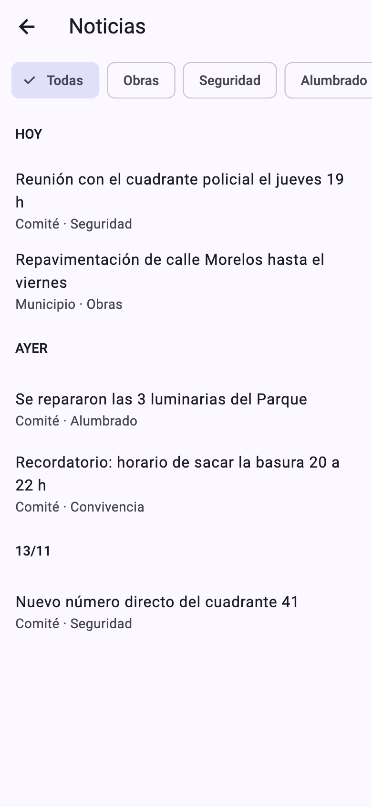
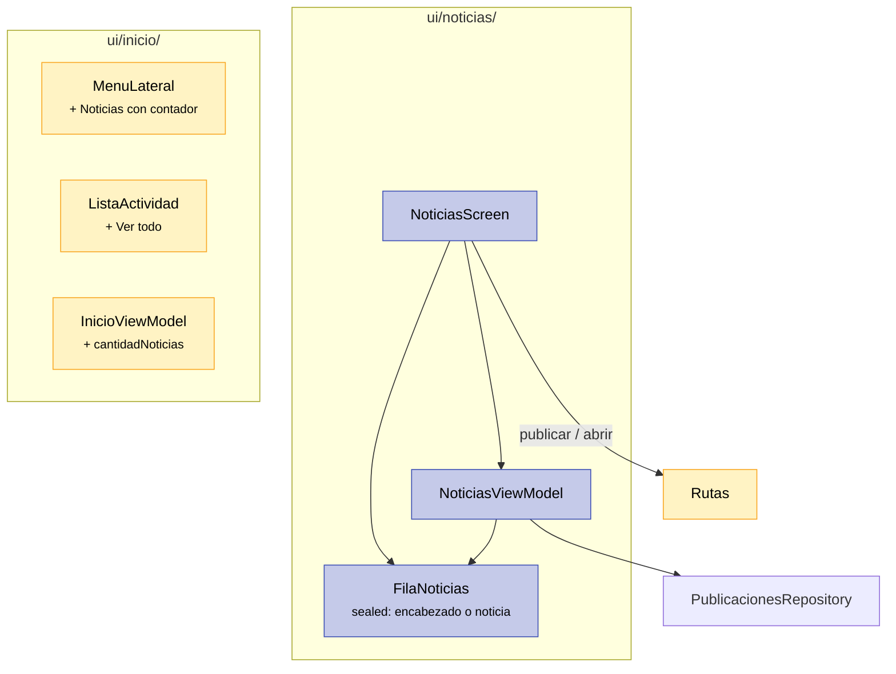
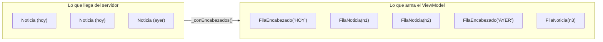

# 11. Noticias

!!! abstract "Objetivo"
    El **muro de noticias del comité**: una lista agrupada por día ("HOY", "AYER", "03/11"), con **filtros por etiqueta** (Obras, Seguridad, Alumbrado, Convivencia) y, si sos del comité, un botón para **publicar una noticia**. Se abre desde el menú (con un globito que dice cuántas hay) y desde "Ver todo" en el Inicio.

<figure markdown="span">
  { .captura }
  <figcaption>Noticias</figcaption>
</figure>

## Dónde estamos



## El problema: una lista con filas de distinto tipo

La lista mezcla dos clases de filas: **encabezados** de día y **noticias**. Se podría hacer con una lista de `Object` y preguntar `if (fila is String)`, pero el compilador no te ayudaría: si mañana agregás otro tipo de fila, nada te avisa que falta dibujarla.

La solución es la misma que `Resultado`: una **clase sellada** con una subclase por tipo de fila. El ViewModel arma la lista de filas; la vista hace un `switch` y dibuja cada una. Si falta un caso, no compila.



## Paso 1: los tipos de fila

Creá `lib/ui/noticias/view_model/filas_noticias.dart`:

<!-- archivo: lib/ui/noticias/view_model/filas_noticias.dart cap=c11 notas="sealed class FilaNoticias|final class FilaEncabezado extends FilaNoticias|final class FilaNoticia extends FilaNoticias" -->
```dart title="lib/ui/noticias/view_model/filas_noticias.dart" linenums="1"
// lib/ui/noticias/view_model/filas_noticias.dart
//
// Lista con distintos tipos de ítems (apunte 20, sección 4): una clase base
// y una subclase por cada tipo de fila. La pantalla de Noticias intercala
// encabezados de día (HOY, AYER) con las noticias del comité.
//
// Son solo datos: cómo se dibuja cada fila lo decide la vista con un switch.
// Como la clase es sellada (sealed), el compilador avisa si falta un caso.

import '../../../domain/models/noticia.dart';

sealed class FilaNoticias {  // (1)!
  const FilaNoticias();
}

/// Encabezado de sección: "HOY", "AYER", "15/09".
final class FilaEncabezado extends FilaNoticias {  // (2)!
  const FilaEncabezado(this.texto);

  final String texto;
}

final class FilaNoticia extends FilaNoticias {  // (3)!
  const FilaNoticia(this.noticia);

  final Noticia noticia;
}
```
<!-- /archivo -->

1. La madre, sellada: sus únicas hijas son las de este archivo.
2. `final class`: nadie puede extender `FilaEncabezado`. Es una fila de texto.
3. Una fila con una noticia.

!!! info "¿Por qué está en `view_model/` y no en `domain/`?"
    Porque no es un dato del barrio: es **cómo se organiza la lista para mostrarla**. El servidor no sabe nada de "encabezados". Es estado de la pantalla, así que va con su ViewModel.

## Paso 2: el ViewModel

Creá `lib/ui/noticias/view_model/noticias_view_model.dart`:

<!-- archivo: lib/ui/noticias/view_model/noticias_view_model.dart cap=c11 notas="String\? _etiqueta; // null = todas|bool get puedePublicar|etiqueta: _etiqueta,|_filas = _conEncabezados\(noticias\)|Future<void> filtrar\(String\? etiqueta\)|final filas = <FilaNoticias>\[\];|String\? diaAnterior;|if \(dia != diaAnterior\)" -->
```dart title="lib/ui/noticias/view_model/noticias_view_model.dart" linenums="1"
// lib/ui/noticias/view_model/noticias_view_model.dart

import '../../../data/repositories/publicaciones_repository.dart';
import '../../../data/services/errores.dart';
import '../../../domain/models/noticia.dart';
import '../../../domain/models/sesion.dart';
import '../../../utils/fechas.dart';
import '../../core/view_model.dart';
import 'filas_noticias.dart';

class NoticiasViewModel extends ViewModel {
  NoticiasViewModel(this._publicaciones, {this.vecino});

  final PublicacionesRepository _publicaciones;

  /// Quién mira: si es del comité, puede publicar noticias.
  final VecinoSesion? vecino;

  String? _etiqueta; // null = todas (1)
  List<FilaNoticias> _filas = [];
  bool _cargando = true;
  String? _error;

  String? get etiqueta => _etiqueta;
  List<FilaNoticias> get filas => _filas.soloLectura;
  bool get cargando => _cargando;
  String? get error => _error;
  bool get puedePublicar => vecino?.esComite ?? false;  // (2)!

  Future<void> cargar() async {
    _cargando = true;
    _error = null;
    notifyListeners();
    try {
      final noticias = await _publicaciones.obtenerNoticias(
        etiqueta: _etiqueta,  // (3)!
      );
      _filas = _conEncabezados(noticias);  // (4)!
    } on ApiException {
      _error = 'No se pudieron cargar las noticias';
    }
    _cargando = false;
    notifyListeners();
  }

  /// [etiqueta] null = todas.
  Future<void> filtrar(String? etiqueta) {  // (5)!
    _etiqueta = etiqueta;
    return cargar();
  }

  // Intercala un encabezado ("HOY", "AYER") cada vez que cambia el día.
  List<FilaNoticias> _conEncabezados(List<Noticia> noticias) {
    final filas = <FilaNoticias>[];  // (6)!
    String? diaAnterior;  // (7)!
    for (final noticia in noticias) {
      final dia = encabezadoDelDia(noticia.creadoEn);
      if (dia != diaAnterior) {  // (8)!
        filas.add(FilaEncabezado(dia));
        diaAnterior = dia;
      }
      filas.add(FilaNoticia(noticia));
    }
    return filas;
  }
}
```
<!-- /archivo -->

1. El filtro elegido. `null` = sin filtro.
2. Solo el comité ve el botón de publicar.
3. El filtro se manda al servidor: la API filtra (`GET /publicaciones?tipo=noticia&etiqueta=obras`).
4. Transforma la lista de noticias en la lista de filas.
5. Cambiar el filtro es: guardarlo y volver a cargar.
6. Una lista vacía **de tipo** `FilaNoticias`: el `<FilaNoticias>` antes de los corchetes dice el tipo de los elementos.
7. El día de la noticia anterior (al principio, ninguno).
8. Cada vez que el día cambia respecto de la noticia anterior, se agrega un encabezado. Las noticias llegan ordenadas de la más nueva a la más vieja.

## Paso 3: la pantalla

Creá `lib/ui/noticias/widgets/noticias_screen.dart`:

<!-- archivo: lib/ui/noticias/widgets/noticias_screen.dart cap=c11 notas="tipo: TipoPublicacion.noticia,|floatingActionButton: _viewModel.puedePublicar|scrollDirection: Axis.horizontal|for \(final MapEntry\(:key, :value\) in etiquetas.entries\)|FilterChip\(|selected: _viewModel.etiqueta == etiqueta|itemBuilder: \(context, index\) => switch \(filas\[index\]\)|FilaEncabezado\(:final texto\) =>|FilaNoticia\(:final noticia\) =>" -->
```dart title="lib/ui/noticias/widgets/noticias_screen.dart" linenums="1"
// lib/ui/noticias/widgets/noticias_screen.dart
//
// Pantalla 6 del Manual: "Noticias Comunitarias". Muro de comunicados del
// comité con filtros por etiqueta y encabezados por día.

import 'package:flutter/material.dart';

import '../../../domain/models/noticia.dart';
import '../../../domain/models/publicacion.dart';
import '../../../routing/rutas.dart';
import '../../core/widgets/estados_carga.dart';
import '../view_model/filas_noticias.dart';
import '../view_model/noticias_view_model.dart';

class NoticiasScreen extends StatefulWidget {
  const NoticiasScreen({required this.viewModel, super.key});

  final NoticiasViewModel viewModel;

  @override
  State<NoticiasScreen> createState() => _NoticiasScreenState();
}

class _NoticiasScreenState extends State<NoticiasScreen> {
  // Se toma una sola vez: si el padre se redibuja, la pantalla sigue con el
  // mismo ViewModel (el que después descarta en dispose).
  late final NoticiasViewModel _viewModel = widget.viewModel;

  @override
  void initState() {
    super.initState();
    _viewModel.cargar();
  }

  @override
  void dispose() {
    _viewModel.dispose();
    super.dispose();
  }

  Future<void> _publicarNoticia() async {
    final publicacion = await Rutas.nuevaPublicacion(
      context,
      tipo: TipoPublicacion.noticia,  // (1)!
    );
    if (publicacion != null) _viewModel.cargar();
  }

  Future<void> _abrir(Noticia noticia) async {
    await Rutas.publicacion(context, noticia.id);
    _viewModel.cargar(); // pudo borrarla
  }

  @override
  Widget build(BuildContext context) {
    return ListenableBuilder(
      listenable: _viewModel,
      builder: (context, _) => Scaffold(
        appBar: AppBar(title: const Text('Noticias')),
        floatingActionButton: _viewModel.puedePublicar  // (2)!
            ? FloatingActionButton.extended(
                onPressed: _publicarNoticia,
                icon: const Icon(Icons.campaign_outlined),
                label: const Text('Publicar noticia'),
              )
            : null,
        body: Column(
          children: [
            // Lista horizontal de filtros (apunte 20, sección 2).
            SizedBox(
              height: 56,
              child: ListView(
                scrollDirection: Axis.horizontal,  // (3)!
                padding: const EdgeInsets.symmetric(
                  horizontal: 12,
                  vertical: 8,
                ),
                children: [
                  _filtro('Todas', null),
                  for (final MapEntry(:key, :value) in etiquetas.entries)  // (4)!
                    _filtro(value, key),
                ],
              ),
            ),
            Expanded(child: _lista()),
          ],
        ),
      ),
    );
  }

  Widget _filtro(String texto, String? etiqueta) {
    return Padding(
      padding: const EdgeInsets.only(right: 8),
      child: FilterChip(  // (5)!
        label: Text(texto),
        selected: _viewModel.etiqueta == etiqueta,  // (6)!
        onSelected: (_) => _viewModel.filtrar(etiqueta),
      ),
    );
  }

  Widget _lista() {
    if (_viewModel.cargando) return const Cargando();
    if (_viewModel.error case final error?) {
      return ErrorConReintento(mensaje: error, onReintentar: _viewModel.cargar);
    }
    final filas = _viewModel.filas;
    if (filas.isEmpty) {
      return const Center(child: Text('No hay noticias con esta etiqueta'));
    }
    return ListView.builder(
      itemCount: filas.length,
      itemBuilder: (context, index) => switch (filas[index]) {  // (7)!
        FilaEncabezado(:final texto) => ListTile(  // (8)!
          title: Text(texto, style: Theme.of(context).textTheme.labelLarge),
        ),
        FilaNoticia(:final noticia) => ListTile(  // (9)!
          title: Text(noticia.titulo),
          subtitle: Text('${noticia.autor} · ${noticia.nombreEtiqueta}'),
          onTap: () => _abrir(noticia),
        ),
      },
    );
  }
}
```
<!-- /archivo -->

1. Reusa la pantalla de publicar del capítulo 10, en modo noticia.
2. El botón flotante solo para el comité; para el resto, `null` (sin botón).
3. Una lista **horizontal** para los filtros.
4. Recorre el mapa de etiquetas del capítulo 3. `MapEntry(:key, :value)` es un patrón que saca la clave y el valor de cada entrada.
5. `FilterChip`: una pastilla que se marca y se desmarca. Ver [Widgets de Material](../3-flutter/4-material.md#chips).
6. Está marcada si es el filtro actual.
7. Un `switch` como expresión sobre cada fila…
8. …el encabezado se dibuja como un título…
9. …y la noticia, como una fila que se puede tocar. No hay `default`: como `FilaNoticias` es sellada, estos dos casos cubren todo.

## Paso 4: la ruta y el Inicio

`Rutas` suma `noticias`:

<!-- diff: lib/routing/rutas.dart cap=c11 -->
```diff title="Qué cambia en lib/routing/rutas.dart"
--- lib/routing/rutas.dart (cap. 10)
+++ lib/routing/rutas.dart (cap. 11)
@@ -14,4 +14,6 @@
 import '../ui/elegir_clave/view_model/elegir_clave_view_model.dart';
 import '../ui/elegir_clave/widgets/elegir_clave_screen.dart';
+import '../ui/noticias/view_model/noticias_view_model.dart';
+import '../ui/noticias/widgets/noticias_screen.dart';
 import '../ui/perfil/view_model/perfil_view_model.dart';
 import '../ui/perfil/widgets/perfil_screen.dart';
@@ -44,4 +46,13 @@
   }
 
+  static Future<void> noticias(BuildContext context) {
+    final d = Dependencias.of(context);
+    final viewModel = NoticiasViewModel(
+      d.publicaciones,
+      vecino: d.sesion.vecino,
+    );
+    return _abrir(context, NoticiasScreen(viewModel: viewModel));
+  }
+
   static Future<void> publicacion(BuildContext context, int publicacionId) {
     final d = Dependencias.of(context);
```
<!-- /diff -->

<!-- archivo: lib/routing/rutas.dart cap=c11 -->
```dart title="lib/routing/rutas.dart" linenums="1" hl_lines="16-17 48-56"
// lib/routing/rutas.dart
//
// Navegación de la app. Cada método arma el ViewModel de la pantalla con los
// repositorios de Dependencias y la abre. Así las vistas solo dicen "abrí el
// perfil" y nunca tocan un repositorio.
//
// El ViewModel se crea UNA vez, afuera del builder de la ruta: el builder se
// puede volver a ejecutar, y crearía otro ViewModel distinto.

import 'package:flutter/material.dart';

import '../dependencias.dart';
import '../domain/models/publicacion.dart';
import '../ui/elegir_clave/view_model/elegir_clave_view_model.dart';
import '../ui/elegir_clave/widgets/elegir_clave_screen.dart';
import '../ui/noticias/view_model/noticias_view_model.dart';
import '../ui/noticias/widgets/noticias_screen.dart';
import '../ui/perfil/view_model/perfil_view_model.dart';
import '../ui/perfil/widgets/perfil_screen.dart';
import '../ui/publicacion/view_model/nueva_publicacion_view_model.dart';
import '../ui/publicacion/view_model/publicacion_view_model.dart';
import '../ui/publicacion/widgets/nueva_publicacion_screen.dart';
import '../ui/publicacion/widgets/publicacion_screen.dart';

abstract final class Rutas {
  static Future<T?> _abrir<T>(BuildContext context, Widget pantalla) {
    return Navigator.push<T>(
      context,
      MaterialPageRoute(builder: (context) => pantalla),
    );
  }

  /// Invitación o recuperación de la clave. [token] viene del enlace del
  /// correo, si la app se abrió desde ahí.
  static Future<void> elegirClave(BuildContext context, {String? token}) {
    final viewModel = ElegirClaveViewModel(
      Dependencias.of(context).sesion,
      tokenDelCorreo: token,
    );
    return _abrir(context, ElegirClaveScreen(viewModel: viewModel));
  }

  static Future<void> perfil(BuildContext context) {
    final viewModel = PerfilViewModel(Dependencias.of(context).sesion);
    return _abrir(context, PerfilScreen(viewModel: viewModel));
  }

  static Future<void> noticias(BuildContext context) {
    final d = Dependencias.of(context);
    final viewModel = NoticiasViewModel(
      d.publicaciones,
      vecino: d.sesion.vecino,
    );
    return _abrir(context, NoticiasScreen(viewModel: viewModel));
  }

  static Future<void> publicacion(BuildContext context, int publicacionId) {
    final d = Dependencias.of(context);
    final viewModel = PublicacionViewModel(
      publicacionId: publicacionId,
      publicaciones: d.publicaciones,
      fotos: d.fotos,
      vecino: d.sesion.vecino,
    );
    return _abrir(context, PublicacionScreen(viewModel: viewModel));
  }

  /// Devuelve la publicación creada (null si no publicó).
  static Future<Publicacion?> nuevaPublicacion(
    BuildContext context, {
    String tipo = TipoPublicacion.actividad,
  }) {
    final d = Dependencias.of(context);
    final viewModel = NuevaPublicacionViewModel(
      publicaciones: d.publicaciones,
      fotos: d.fotos,
      vecino: d.sesion.vecino!,
      tipo: tipo,
    );
    return _abrir(context, NuevaPublicacionScreen(viewModel: viewModel));
  }
}
```
<!-- /archivo -->

El `InicioViewModel` ahora también pide las noticias, para mostrar cuántas hay:

<!-- diff: lib/ui/inicio/view_model/inicio_view_model.dart cap=c11 -->
```diff title="Qué cambia en lib/ui/inicio/view_model/inicio_view_model.dart"
--- lib/ui/inicio/view_model/inicio_view_model.dart (cap. 10)
+++ lib/ui/inicio/view_model/inicio_view_model.dart (cap. 11)
@@ -19,4 +19,5 @@
   EstadoBarrio? _barrio;
   List<Publicacion> _actividad = [];
+  int _cantidadNoticias = 0;
   bool _cargando = true;
   String? _error;
@@ -28,4 +29,5 @@
   EstadoBarrio? get barrio => _barrio;
   List<Publicacion> get actividad => _actividad.soloLectura;
+  int get cantidadNoticias => _cantidadNoticias;
   bool get cargando => _cargando;
   String? get error => _error;
@@ -40,10 +42,13 @@
     notifyListeners();
     try {
-      // Los dos pedidos salen a la vez (Future.wait), no uno detrás del otro.
+      // Los tres pedidos salen a la vez (Future.wait): unos 180 ms en total
+      // en vez de unos 550 ms uno detrás del otro.
       final barrio = _publicaciones.obtenerEstadoBarrio();
       final actividad = _publicaciones.obtenerActividad();
-      await Future.wait([barrio, actividad]);
+      final noticias = _publicaciones.obtenerNoticias();
+      await Future.wait([barrio, actividad, noticias]);
       _barrio = await barrio;
       _actividad = await actividad;
+      _cantidadNoticias = (await noticias).length;
     } on ApiException {
       _error = 'Sin conexión con la red del barrio';
```
<!-- /diff -->

<!-- archivo: lib/ui/inicio/view_model/inicio_view_model.dart cap=c11 -->
```dart title="lib/ui/inicio/view_model/inicio_view_model.dart" linenums="1" hl_lines="21 31 44-45 48-49 52"
// lib/ui/inicio/view_model/inicio_view_model.dart
//
// Pantalla de Inicio: el estado de la red y la actividad del barrio.

import '../../../data/repositories/publicaciones_repository.dart';
import '../../../data/repositories/sesion_repository.dart';
import '../../../data/services/errores.dart';
import '../../../domain/models/publicacion.dart';
import '../../../domain/models/sesion.dart';
import '../../../utils/resultado.dart';
import '../../core/view_model.dart';

class InicioViewModel extends ViewModel {
  InicioViewModel({required this._sesion, required this._publicaciones});

  final SesionRepository _sesion;
  final PublicacionesRepository _publicaciones;

  EstadoBarrio? _barrio;
  List<Publicacion> _actividad = [];
  int _cantidadNoticias = 0;
  bool _cargando = true;
  String? _error;

  /// El Inicio solo existe con la sesión iniciada.
  VecinoSesion get vecino => _sesion.vecino!;

  /// null mientras se conecta.
  EstadoBarrio? get barrio => _barrio;
  List<Publicacion> get actividad => _actividad.soloLectura;
  int get cantidadNoticias => _cantidadNoticias;
  bool get cargando => _cargando;
  String? get error => _error;

  void iniciar() {
    cargarDatos();
  }

  Future<void> cargarDatos() async {
    _cargando = true;
    _error = null;
    notifyListeners();
    try {
      // Los tres pedidos salen a la vez (Future.wait): unos 180 ms en total
      // en vez de unos 550 ms uno detrás del otro.
      final barrio = _publicaciones.obtenerEstadoBarrio();
      final actividad = _publicaciones.obtenerActividad();
      final noticias = _publicaciones.obtenerNoticias();
      await Future.wait([barrio, actividad, noticias]);
      _barrio = await barrio;
      _actividad = await actividad;
      _cantidadNoticias = (await noticias).length;
    } on ApiException {
      _error = 'Sin conexión con la red del barrio';
    }
    _cargando = false;
    notifyListeners();
  }

  /// Una publicación propia (o cualquiera, si es del comité) se borra del
  /// servidor; una ajena solo se oculta de la lista.
  bool puedeBorrar(Publicacion publicacion) =>
      vecino.puedeBorrar(autorId: publicacion.autorId);

  Future<Resultado<void>> borrar(Publicacion publicacion) => ejecutar(
    () => _publicaciones.borrar(publicacion.id),
    marcarOcupado: false,
  );

  /// Saca la publicación de la lista (al deslizarla).
  void quitar(Publicacion publicacion) {
    _actividad = [
      for (final p in _actividad)
        if (p.id != publicacion.id) p,
    ];
    notifyListeners();
  }

  /// MyApp vuelve solo al Login (escucha SesionRepository).
  Future<void> cerrarSesion() => _sesion.logout();
}
```
<!-- /archivo -->

El menú suma "Noticias" con un globito (`Badge`):

<!-- diff: lib/ui/inicio/widgets/menu_lateral.dart cap=c11 -->
```diff title="Qué cambia en lib/ui/inicio/widgets/menu_lateral.dart"
--- lib/ui/inicio/widgets/menu_lateral.dart (cap. 10)
+++ lib/ui/inicio/widgets/menu_lateral.dart (cap. 11)
@@ -10,4 +10,6 @@
   const MenuLateral({
     required this.vecino,
+    required this.cantidadNoticias,
+    required this.onNoticias,
     required this.onPerfil,
     required this.onCerrarSesion,
@@ -16,4 +18,6 @@
 
   final VecinoSesion vecino;
+  final int cantidadNoticias;
+  final VoidCallback onNoticias;
   final VoidCallback onPerfil;
   final VoidCallback onCerrarSesion;
@@ -44,4 +48,13 @@
             title: const Text('Inicio'),
             onTap: () => Navigator.pop(context), // ya estamos en Inicio
+          ),
+          _Opcion(
+            icono: Badge(
+              isLabelVisible: cantidadNoticias > 0,
+              label: Text('$cantidadNoticias'),
+              child: const Icon(Icons.campaign_outlined),
+            ),
+            texto: 'Noticias',
+            onTap: onNoticias,
           ),
           const Divider(),
```
<!-- /diff -->

<!-- archivo: lib/ui/inicio/widgets/menu_lateral.dart cap=c11 notas="icono: Badge\(|isLabelVisible: cantidadNoticias > 0" -->
```dart title="lib/ui/inicio/widgets/menu_lateral.dart" linenums="1" hl_lines="12-13 20-21 50-58"
// lib/ui/inicio/widgets/menu_lateral.dart

import 'package:flutter/material.dart';

import '../../../domain/models/sesion.dart';

/// Menú lateral (pantalla 9 del Manual). No navega por su cuenta: avisa al
/// padre con callbacks y el padre decide (patrón callback, apunte 8).
class MenuLateral extends StatelessWidget {
  const MenuLateral({
    required this.vecino,
    required this.cantidadNoticias,
    required this.onNoticias,
    required this.onPerfil,
    required this.onCerrarSesion,
    super.key,
  });

  final VecinoSesion vecino;
  final int cantidadNoticias;
  final VoidCallback onNoticias;
  final VoidCallback onPerfil;
  final VoidCallback onCerrarSesion;

  @override
  Widget build(BuildContext context) {
    return Drawer(
      child: ListView(
        padding: EdgeInsets.zero,
        children: [
          DrawerHeader(
            decoration: BoxDecoration(
              color: Theme.of(context).colorScheme.primaryContainer,
            ),
            child: Column(
              crossAxisAlignment: CrossAxisAlignment.start,
              mainAxisAlignment: MainAxisAlignment.end,
              children: [
                CircleAvatar(radius: 28, child: Text(vecino.iniciales)),
                const SizedBox(height: 8),
                Text(vecino.nombre),
                Text(vecino.descripcion),
              ],
            ),
          ),
          ListTile(
            leading: const Icon(Icons.home_outlined),
            title: const Text('Inicio'),
            onTap: () => Navigator.pop(context), // ya estamos en Inicio
          ),
          _Opcion(
            icono: Badge(  // (1)!
              isLabelVisible: cantidadNoticias > 0,  // (2)!
              label: Text('$cantidadNoticias'),
              child: const Icon(Icons.campaign_outlined),
            ),
            texto: 'Noticias',
            onTap: onNoticias,
          ),
          const Divider(),
          _Opcion(
            icono: const Icon(Icons.person_outline),
            texto: 'Mi perfil',
            onTap: onPerfil,
          ),
          _Opcion(
            icono: const Icon(Icons.logout),
            texto: 'Cerrar sesión',
            onTap: onCerrarSesion, // MyApp vuelve solo al Login
          ),
        ],
      ),
    );
  }
}

/// Una opción del menú: 1) cierra el menú, 2) avisa al padre.
class _Opcion extends StatelessWidget {
  const _Opcion({
    required this.icono,
    required this.texto,
    required this.onTap,
  });

  final Widget icono;
  final String texto;
  final VoidCallback onTap;

  @override
  Widget build(BuildContext context) {
    return ListTile(
      leading: icono,
      title: Text(texto),
      onTap: () {
        Navigator.pop(context);
        onTap();
      },
    );
  }
}
```
<!-- /archivo -->

1. `Badge` pone un globito con un número sobre otro widget (el ícono).
2. Si no hay noticias, el globito no se muestra.

La lista de actividad suma "Ver todo":

<!-- diff: lib/ui/inicio/widgets/lista_actividad.dart cap=c11 -->
```diff title="Qué cambia en lib/ui/inicio/widgets/lista_actividad.dart"
--- lib/ui/inicio/widgets/lista_actividad.dart (cap. 10)
+++ lib/ui/inicio/widgets/lista_actividad.dart (cap. 11)
@@ -14,4 +14,5 @@
     required this.viewModel,
     required this.onPublicar,
+    required this.onVerTodo,
     required this.onAbrir,
     required this.confirmarDeslizar,
@@ -21,4 +22,5 @@
   final InicioViewModel viewModel;
   final VoidCallback onPublicar;
+  final VoidCallback onVerTodo;
   final ValueChanged<Publicacion> onAbrir;
 
@@ -44,4 +46,5 @@
                 onPressed: onPublicar,
               ),
+              TextButton(onPressed: onVerTodo, child: const Text('Ver todo')),
             ],
           ),
```
<!-- /diff -->

<!-- archivo: lib/ui/inicio/widgets/lista_actividad.dart cap=c11 -->
```dart title="lib/ui/inicio/widgets/lista_actividad.dart" linenums="1" hl_lines="16 24 48"
// lib/ui/inicio/widgets/lista_actividad.dart
//
// Pestaña "Actividad" del Inicio: el feed del barrio.

import 'package:flutter/material.dart';

import '../../../domain/models/publicacion.dart';
import '../../../utils/fechas.dart';
import '../../core/widgets/estados_carga.dart';
import '../view_model/inicio_view_model.dart';

class ListaActividad extends StatelessWidget {
  const ListaActividad({
    required this.viewModel,
    required this.onPublicar,
    required this.onVerTodo,
    required this.onAbrir,
    required this.confirmarDeslizar,
    super.key,
  });

  final InicioViewModel viewModel;
  final VoidCallback onPublicar;
  final VoidCallback onVerTodo;
  final ValueChanged<Publicacion> onAbrir;

  /// Si devuelve false, la publicación vuelve a su lugar.
  final Future<bool> Function(Publicacion) confirmarDeslizar;

  @override
  Widget build(BuildContext context) {
    return Column(
      children: [
        Padding(
          padding: const EdgeInsets.fromLTRB(16, 8, 8, 0),
          child: Row(
            children: [
              Text(
                'ACTIVIDAD DEL BARRIO',
                style: Theme.of(context).textTheme.labelMedium,
              ),
              const Spacer(),
              IconButton(
                icon: const Icon(Icons.edit_outlined),
                tooltip: 'Publicar',
                onPressed: onPublicar,
              ),
              TextButton(onPressed: onVerTodo, child: const Text('Ver todo')),
            ],
          ),
        ),
        Expanded(child: _contenido()),
      ],
    );
  }

  Widget _contenido() {
    if (viewModel.cargando) return const Cargando();
    if (viewModel.error case final error?) {
      return ErrorConReintento(
        mensaje: error,
        onReintentar: viewModel.cargarDatos,
      );
    }
    final actividad = viewModel.actividad;
    return ListView.builder(
      padding: const EdgeInsets.symmetric(horizontal: 8),
      itemCount: actividad.length,
      itemBuilder: (context, index) {
        final publicacion = actividad[index];
        return Dismissible(
          key: ValueKey(publicacion.id),
          direction: DismissDirection.horizontal,
          background: const _FondoBorrar(),
          confirmDismiss: (_) => confirmarDeslizar(publicacion),
          onDismissed: (_) => viewModel.quitar(publicacion),
          child: _TarjetaPublicacion(
            publicacion: publicacion,
            onTap: () => onAbrir(publicacion),
          ),
        );
      },
    );
  }
}

class _TarjetaPublicacion extends StatelessWidget {
  const _TarjetaPublicacion({required this.publicacion, required this.onTap});

  final Publicacion publicacion;
  final VoidCallback onTap;

  @override
  Widget build(BuildContext context) {
    return Card(
      margin: const EdgeInsets.symmetric(horizontal: 8, vertical: 6),
      child: ListTile(
        leading: CircleAvatar(child: Text(publicacion.iniciales)),
        title: Text(
          publicacion.titulo,
          style: const TextStyle(fontWeight: FontWeight.w600),
        ),
        subtitle: Text(_subtitulo()),
        trailing: publicacion.fotoId == null
            ? null
            : const Icon(Icons.photo_outlined),
        onTap: onTap,
      ),
    );
  }

  // "Ana C. · hace 1 h · 6 respuestas"
  String _subtitulo() {
    final texto = '${publicacion.autor} · ${haceCuanto(publicacion.creadoEn)}';
    return switch (publicacion.respuestas) {
      0 => texto,
      1 => '$texto · 1 respuesta',
      final n => '$texto · $n respuestas',
    };
  }
}

/// Lo que aparece debajo de la tarjeta al deslizarla.
class _FondoBorrar extends StatelessWidget {
  const _FondoBorrar();

  @override
  Widget build(BuildContext context) {
    final colorScheme = Theme.of(context).colorScheme;
    return Container(
      alignment: Alignment.centerRight,
      padding: const EdgeInsets.symmetric(horizontal: 24),
      margin: const EdgeInsets.symmetric(horizontal: 8, vertical: 6),
      decoration: BoxDecoration(
        color: colorScheme.errorContainer,
        borderRadius: BorderRadius.circular(16),
      ),
      child: Icon(Icons.delete_outline, color: colorScheme.onErrorContainer),
    );
  }
}
```
<!-- /archivo -->

Y el Inicio conecta todo:

<!-- diff: lib/ui/inicio/widgets/inicio_screen.dart cap=c11 -->
```diff title="Qué cambia en lib/ui/inicio/widgets/inicio_screen.dart"
--- lib/ui/inicio/widgets/inicio_screen.dart (cap. 10)
+++ lib/ui/inicio/widgets/inicio_screen.dart (cap. 11)
@@ -94,4 +94,6 @@
           drawer: MenuLateral(
             vecino: vecino,
+            cantidadNoticias: _viewModel.cantidadNoticias,
+            onNoticias: () => Rutas.noticias(context),
             onPerfil: () => Rutas.perfil(context),
             onCerrarSesion: _viewModel.cerrarSesion,
@@ -104,4 +106,5 @@
                   viewModel: _viewModel,
                   onPublicar: _publicar,
+                  onVerTodo: () => Rutas.noticias(context),
                   onAbrir: _abrirPublicacion,
                   confirmarDeslizar: _confirmarDeslizar,
```
<!-- /diff -->

<!-- archivo: lib/ui/inicio/widgets/inicio_screen.dart cap=c11 -->
```dart title="lib/ui/inicio/widgets/inicio_screen.dart" linenums="1" hl_lines="96-97 108"
// lib/ui/inicio/widgets/inicio_screen.dart
//
// Pantalla de Inicio. Arriba el estado de la red; debajo, la actividad del
// barrio.

import 'package:flutter/material.dart';

import '../../../domain/models/publicacion.dart';
import '../../../routing/rutas.dart';
import '../../../utils/resultado.dart';
import '../../core/widgets/avisos.dart';
import '../view_model/inicio_view_model.dart';
import 'estado_red.dart';
import 'lista_actividad.dart';
import 'menu_lateral.dart';

class InicioScreen extends StatefulWidget {
  const InicioScreen({required this.viewModel, super.key});

  final InicioViewModel viewModel;

  @override
  State<InicioScreen> createState() => _InicioScreenState();
}

class _InicioScreenState extends State<InicioScreen> {
  // Se toma una sola vez: si el padre se redibuja, la pantalla sigue con el
  // mismo ViewModel (el que después descarta en dispose).
  late final InicioViewModel _viewModel = widget.viewModel;

  @override
  void initState() {
    super.initState();
    _viewModel.iniciar();
  }

  @override
  void dispose() {
    _viewModel.dispose();
    super.dispose();
  }

  Future<void> _abrirPublicacion(Publicacion publicacion) async {
    await Rutas.publicacion(context, publicacion.id);
    _viewModel.cargarDatos(); // pudo responder o borrarla
  }

  Future<void> _publicar() async {
    final publicacion = await Rutas.nuevaPublicacion(context);
    if (publicacion != null) _viewModel.cargarDatos();
  }

  // Deslizar una publicación propia (o cualquiera, si es del comité) la borra
  // en el servidor, previa confirmación; una ajena solo se oculta de la lista.
  Future<bool> _confirmarDeslizar(Publicacion publicacion) async {
    if (!_viewModel.puedeBorrar(publicacion)) return true;
    final borrar = await confirmar(
      context,
      titulo: '¿Borrar la publicación?',
      mensaje: 'Se borra para todo el barrio, con sus respuestas.',
    );
    if (!borrar) return false;
    final resultado = await _viewModel.borrar(publicacion);
    if (!mounted) return resultado is Ok;
    return avisarSiFallo(context, resultado);
  }

  @override
  Widget build(BuildContext context) {
    return ListenableBuilder(
      listenable: _viewModel,
      builder: (context, _) {
        final vecino = _viewModel.vecino;
        return Scaffold(
          appBar: AppBar(
            leading: Builder(
              builder: (context) => IconButton(
                icon: const Icon(Icons.menu),
                onPressed: () => Scaffold.of(context).openDrawer(),
              ),
            ),
            title: const Text('Inicio'),
            centerTitle: true,
            actions: [
              Padding(
                padding: const EdgeInsets.only(right: 16),
                child: GestureDetector(
                  onTap: () => Rutas.perfil(context),
                  child: CircleAvatar(child: Text(vecino.iniciales)),
                ),
              ),
            ],
          ),
          drawer: MenuLateral(
            vecino: vecino,
            cantidadNoticias: _viewModel.cantidadNoticias,
            onNoticias: () => Rutas.noticias(context),
            onPerfil: () => Rutas.perfil(context),
            onCerrarSesion: _viewModel.cerrarSesion,
          ),
          body: Column(
            children: [
              EstadoRed(barrio: _viewModel.barrio),
              Expanded(
                child: ListaActividad(
                  viewModel: _viewModel,
                  onPublicar: _publicar,
                  onVerTodo: () => Rutas.noticias(context),
                  onAbrir: _abrirPublicacion,
                  confirmarDeslizar: _confirmarDeslizar,
                ),
              ),
            ],
          ),
        );
      },
    );
  }
}
```
<!-- /archivo -->

## Probalo

1. Menú → **Noticias** (con el globito). Tocá **Obras**: quedan solo las de obras. **Todas** vuelve a mostrarlas todas.
2. Desde el Inicio, **Ver todo** abre la misma pantalla.
3. Entrá como `laura@vigia.test`: aparece **Publicar noticia**. Publicá una con la etiqueta "Seguridad": aparece bajo **HOY**.

Creá `test/noticias_view_model_test.dart`:

<!-- archivo: test/noticias_view_model_test.dart cap=c11 notas="expect\(viewModel.filas.first, isA<FilaEncabezado>\(\)\)|whereType<FilaNoticia>\(\)" -->
```dart title="test/noticias_view_model_test.dart" linenums="1"
// test/noticias_view_model_test.dart
//
// Pruebas del muro de noticias (capítulo 11).

import 'package:flutter_test/flutter_test.dart';

import 'package:vigia_app/data/repositories/publicaciones_repository.dart';
import 'package:vigia_app/data/services/api/fake_vigia_api.dart';
import 'package:vigia_app/ui/noticias/view_model/filas_noticias.dart';
import 'package:vigia_app/ui/noticias/view_model/noticias_view_model.dart';

void main() {
  test('las filas alternan encabezados de día y noticias', () async {
    final api = FakeVigiaApi(demora: Duration.zero)..token = 'fake-1';
    final viewModel = NoticiasViewModel(PublicacionesRepository(api));

    await viewModel.cargar();
    expect(viewModel.filas.first, isA<FilaEncabezado>());  // (1)!
    expect(viewModel.filas.whereType<FilaNoticia>(), isNotEmpty);  // (2)!
    expect(viewModel.puedePublicar, isFalse); // sin vecino del comité
  });

  test('filtrar por etiqueta deja solo esas noticias', () async {
    final api = FakeVigiaApi(demora: Duration.zero)..token = 'fake-1';
    final viewModel = NoticiasViewModel(PublicacionesRepository(api));

    await viewModel.filtrar('obras');
    expect(viewModel.etiqueta, 'obras');
    for (final fila in viewModel.filas.whereType<FilaNoticia>()) {
      expect(fila.noticia.etiqueta, 'obras');
    }
  });
}
```
<!-- /archivo -->

1. La primera fila siempre es un encabezado.
2. `whereType` se queda solo con los elementos de ese tipo.

## Así queda el proyecto

<!-- arbol: cap=c11 -->
```text title="Así queda el proyecto"
vigia_app/
    lib/
        config.dart
        data/
            repositories/
                fotos_repository.dart
                publicaciones_repository.dart
                sesion_repository.dart
            services/
                almacen_token.dart
                api/
                    fake_vigia_api.dart
                    vigia_api.dart
                errores.dart
                selector_fotos.dart
        dependencias.dart
        domain/
            models/
                alerta.dart
                comite.dart
                coordenadas.dart
                mensaje.dart
                noticia.dart
                publicacion.dart
                rondin.dart
                sesion.dart
        main.dart
        routing/
            rutas.dart  ← cambia
        ui/
            carga/
                widgets/
                    pantalla_carga.dart
            core/
                view_model.dart
                widgets/
                    avisos.dart
                    elegir_origen_foto.dart
                    estados_carga.dart
                    foto_vigia.dart
            elegir_clave/
                view_model/
                    elegir_clave_view_model.dart
                widgets/
                    elegir_clave_screen.dart
            inicio/
                view_model/
                    inicio_view_model.dart  ← cambia
                widgets/
                    estado_red.dart
                    inicio_screen.dart  ← cambia
                    lista_actividad.dart  ← cambia
                    menu_lateral.dart  ← cambia
            login/
                view_model/
                    login_view_model.dart
                widgets/
                    login_screen.dart
                    recuperar_clave_dialog.dart
            noticias/
                view_model/
                    filas_noticias.dart  ← nuevo
                    noticias_view_model.dart  ← nuevo
                widgets/
                    noticias_screen.dart  ← nuevo
            perfil/
                view_model/
                    perfil_view_model.dart
                widgets/
                    cambiar_clave_dialog.dart
                    perfil_screen.dart
            publicacion/
                view_model/
                    nueva_publicacion_view_model.dart
                    publicacion_view_model.dart
                widgets/
                    nueva_publicacion_screen.dart
                    publicacion_screen.dart
        utils/
            fechas.dart
            resultado.dart
            sondeo.dart
            validadores.dart
    pubspec.yaml
    test/
        elegir_clave_view_model_test.dart
        fake_api_test.dart
        inicio_view_model_test.dart
        login_view_model_test.dart
        modelos_test.dart
        noticias_view_model_test.dart  ← nuevo
        publicacion_view_model_test.dart
        sesion_repository_test.dart
        utils_test.dart
```
<!-- /arbol -->

## Errores comunes

??? failure "`The type 'FilaNoticias' is not exhaustively matched by the switch cases`"
    Agregaste un tipo de fila nuevo y no lo dibujaste. Es exactamente lo que queríamos: el compilador te avisa. Agregá el caso en el `switch` de la vista.

??? failure "`Horizontal viewport was given unbounded height.`"
    La lista horizontal no tiene alto. Envolvela en un `SizedBox(height: 56, …)`, como en la pantalla.

## Lo que aprendiste

- [x] Una lista con **filas de distinto tipo** se modela con una **clase sellada**, y la vista las dibuja con un `switch` exhaustivo.
- [x] El ViewModel **transforma** los datos del servidor en lo que la vista necesita (las noticias en filas con encabezados).
- [x] Una pantalla puede **reusar** otra (publicar una noticia es la pantalla de publicar, en modo noticia).
- [x] `FilterChip`, `Badge`, `FloatingActionButton.extended` y una lista horizontal.

[Siguiente: 12. Chat del barrio :material-arrow-right:](12-chat.md){ .md-button .md-button--primary }
