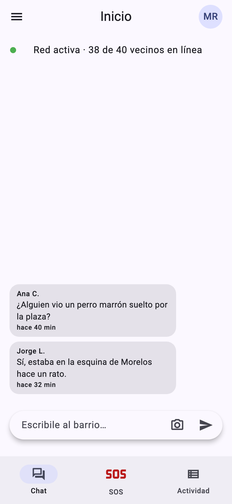
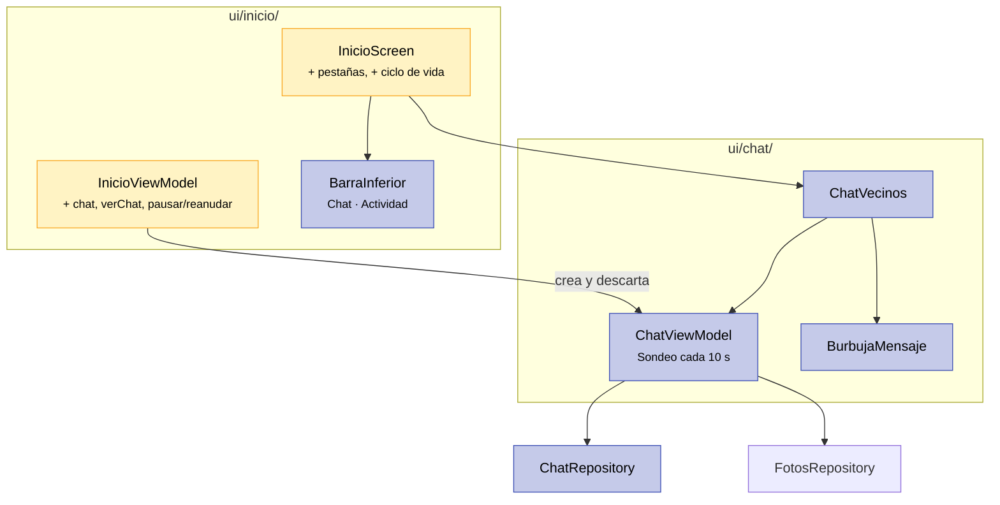
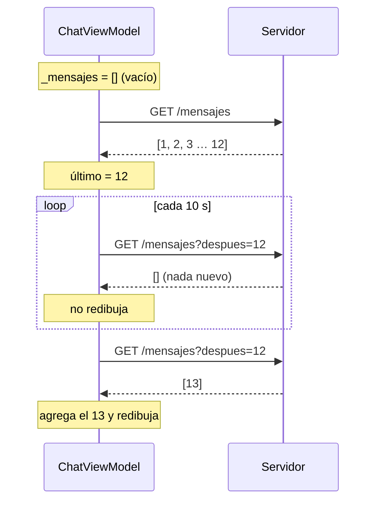
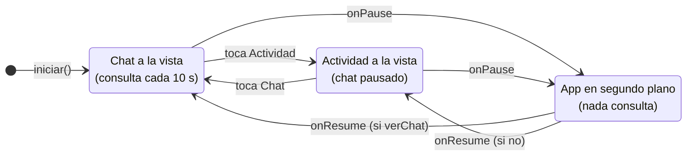

# 12. Chat del barrio

!!! abstract "Objetivo"
    Un **chat general del barrio** dentro del Inicio, con dos pestañas abajo: **Chat** y **Actividad**. Los mensajes propios a la derecha y los de los vecinos a la izquierda; se puede mandar texto y fotos. Como no hay notificaciones en tiempo real, el chat **consulta cada 10 segundos** si llegaron mensajes nuevos, y deja de consultar cuando no lo estás mirando.

<figure markdown="span">
  { .captura }
  <figcaption>El chat (en la captura ya está el SOS del capítulo 14)</figcaption>
</figure>

## Dónde estamos

El chat no es una pantalla aparte: es una **pestaña del Inicio**. Su ViewModel lo crea y lo descarta el `InicioViewModel`: el chat vive mientras vive el Inicio.



## Cómo se trae solo lo nuevo

Si cada 10 segundos pidiéramos **todos** los mensajes, gastaríamos datos y batería sin sentido. La API acepta `?despues=<id>`: devuelve solo los mensajes con id mayor. El ViewModel recuerda el id del último que tiene.



## Paso 1: el repositorio

Creá `lib/data/repositories/chat_repository.dart`:

<!-- archivo: lib/data/repositories/chat_repository.dart cap=c12 -->
```dart title="lib/data/repositories/chat_repository.dart" linenums="1"
// lib/data/repositories/chat_repository.dart
//
// Chat general del barrio.

import '../../domain/models/mensaje.dart';
import '../services/api/vigia_api.dart';

class ChatRepository {
  ChatRepository(this._api);

  final VigiaApi _api;

  /// Sin [despues]: los últimos 50. Con [despues]: solo los que llegaron
  /// después de ese id (para el polling).
  Future<List<Mensaje>> obtenerMensajes({int? despues}) =>
      _api.obtenerMensajes(despues: despues);

  /// Texto, foto o las dos.
  Future<Mensaje> enviar({String? texto, int? fotoId}) =>
      _api.enviarMensaje(texto: texto, fotoId: fotoId);
}
```
<!-- /archivo -->

## Paso 2: el ViewModel del chat

Creá `lib/ui/chat/view_model/chat_view_model.dart`:

<!-- archivo: lib/ui/chat/view_model/chat_view_model.dart cap=c12 notas="required this._vecino,|late final _sondeo = Sondeo|final List<Mensaje> _mensajes = \[\];|UnmodifiableListView<Mensaje> get mensajes|bool esMio|void iniciar\(\) => _sondeo.iniciar\(\)|void pausar\(\) => _sondeo.detener\(\)|despues: _mensajes.isEmpty \? null : _mensajes.last.id|if \(nuevos.isEmpty && _error == null && !_cargando\) return|void _agregar|if \(mensaje.id > ultimo\) mensaje|_agregar\(\[mensaje\]\)|return switch \(subida\)|Ok\(valor: final fotoId\?\) =>|Ok\(\) => const Ok\(null\)|_sondeo.detener\(\); // si no" -->
```dart title="lib/ui/chat/view_model/chat_view_model.dart" linenums="1"
// lib/ui/chat/view_model/chat_view_model.dart
//
// Chat general del barrio, en la pantalla de Inicio. Sin WebSockets en el
// hosting: cada 10 s pide los mensajes nuevos (polling, igual que las
// alertas del Inicio) con ?despues=<id del último que tenemos>. Un mensaje
// puede llevar una foto (cámara o galería).
//
// Lo crea y lo descarta InicioViewModel: el chat vive mientras viva el
// Inicio, y solo consulta mientras la pestaña está a la vista.

import 'dart:collection';
import 'dart:typed_data';

import '../../../data/repositories/chat_repository.dart';
import '../../../data/repositories/fotos_repository.dart';
import '../../../data/services/errores.dart';
import '../../../data/services/selector_fotos.dart';
import '../../../domain/models/mensaje.dart';
import '../../../domain/models/sesion.dart';
import '../../../utils/resultado.dart';
import '../../../utils/sondeo.dart';
import '../../core/view_model.dart';

class ChatViewModel extends ViewModel {
  ChatViewModel({
    required this._chat,
    required this._fotos,
    required this._vecino,  // (1)!
  });

  final ChatRepository _chat;
  final FotosRepository _fotos;
  final VecinoSesion _vecino; // para poner a la derecha los mensajes propios

  late final _sondeo = Sondeo(const Duration(seconds: 10), cargarNuevos);  // (2)!
  final List<Mensaje> _mensajes = []; // del más viejo al más nuevo (3)
  bool _cargando = true;
  String? _error;

  UnmodifiableListView<Mensaje> get mensajes => UnmodifiableListView(_mensajes);  // (4)!
  bool get cargando => _cargando;
  String? get error => _error;

  bool esMio(Mensaje mensaje) => mensaje.autorId == _vecino.id;  // (5)!

  /// Empieza (o retoma) las consultas cada 10 s.
  void iniciar() => _sondeo.iniciar();  // (6)!

  /// Deja de consultar: pestaña oculta o app en segundo plano.
  void pausar() => _sondeo.detener();  // (7)!

  /// Pide los mensajes que llegaron después del último que tenemos (el
  /// polling lo llama cada 10 s).
  Future<void> cargarNuevos() async {
    try {
      // 1) pedimos solo lo nuevo, 2) lo sumamos a la lista
      final nuevos = await _chat.obtenerMensajes(
        despues: _mensajes.isEmpty ? null : _mensajes.last.id,  // (8)!
      );
      // Casi siempre no llegó nada: entonces no se redibuja el chat.
      if (nuevos.isEmpty && _error == null && !_cargando) return;  // (9)!
      _agregar(nuevos);
      _error = null;
    } on ApiException {
      // Sin conexión: se reintenta en 10 s.
      _error = 'No se pudo cargar el chat';
    }
    _cargando = false;
    notifyListeners();
  }

  // Agrega solo los que todavía no tenemos: si dos pedidos se cruzan (el
  // polling y el de enviar), el mismo mensaje no aparece dos veces.
  void _agregar(List<Mensaje> nuevos) {  // (10)!
    final ultimo = _mensajes.isEmpty ? 0 : _mensajes.last.id;
    _mensajes.addAll([
      for (final mensaje in nuevos)
        if (mensaje.id > ultimo) mensaje,  // (11)!
    ]);
  }

  /// Manda [texto], la foto [fotoId] o las dos. Sin nada que mandar no
  /// hace nada.
  Future<Resultado<void>> enviar({String texto = '', int? fotoId}) async {
    final limpio = texto.trim();
    if (limpio.isEmpty && fotoId == null) return const Ok(null);
    final resultado = await ejecutar(
      () => _chat.enviar(texto: limpio.isEmpty ? null : limpio, fotoId: fotoId),
    );
    if (resultado case Ok(valor: final mensaje)) {
      _agregar([mensaje]);  // (12)!
      notifyListeners();
    }
    return resultado;
  }

  /// Saca o elige una foto, la sube y la manda junto con [texto], si el
  /// vecino escribió algo.
  Future<Resultado<void>> mandarFoto(
    OrigenFoto origen, {
    String texto = '',
  }) async {
    final subida = await ejecutar(() => _fotos.elegirYSubir(origen));
    return switch (subida) {  // (13)!
      Ok(valor: final fotoId?) => enviar(texto: texto, fotoId: fotoId),  // (14)!
      Ok() => const Ok(null), // se arrepintió (15)
      Fallo(:final mensaje) => Fallo(mensaje),
    };
  }

  Future<Uint8List> cargarFoto(int fotoId) => _fotos.obtener(fotoId);

  @override
  void dispose() {
    _sondeo.detener(); // si no, sigue consultando con el chat cerrado (16)
    super.dispose();
  }
}
```
<!-- /archivo -->

1. El vecino de la sesión: para saber cuáles mensajes son propios.
2. El sondeo del capítulo 2, cada 10 segundos. `late` porque usa `cargarNuevos`, un método de este mismo objeto, que no existe hasta que el objeto está creado.
3. Esta lista sí es `final` y se **modifica** (se le agregan mensajes). Ordenada del más viejo al más nuevo.
4. Se expone envuelta para que la vista no la pueda modificar.
5. ¿Lo escribí yo? Va a la derecha.
6. Arranca a consultar (y consulta ya).
7. Deja de consultar.
8. La primera vez (lista vacía) pide los últimos; después, solo los posteriores al último.
9. Si no llegó nada y no había nada que cambiar, ni siquiera avisa: así **no se redibuja** el chat cada 10 segundos para nada.
10. Agrega sin repetir…
11. …solo los que tienen un id mayor que el último. ¿Cuándo podría repetirse? Si mandás un mensaje justo cuando sale una consulta, el mensaje podría llegar por los dos caminos.
12. El mensaje recién mandado se agrega enseguida, sin esperar a la próxima consulta.
13. Mandar una foto son **dos** pasos: subirla y mandar el mensaje. Un `switch` como expresión decide según cómo salió el primero.
14. Si se subió (hay id), manda el mensaje con la foto.
15. `Ok()` sin nada más: salió bien pero el valor era `null` (se arrepintió). No es un error.
16. **Lo más importante del archivo.** Si no se detiene el sondeo, el chat sigue consultando después de cerrar sesión.

## Paso 3: los widgets del chat

Creá `lib/ui/chat/widgets/burbuja_mensaje.dart`:

<!-- archivo: lib/ui/chat/widgets/burbuja_mensaje.dart cap=c12 notas="alignment: esMio \? Alignment.centerRight : Alignment.centerLeft|constraints: const BoxConstraints\(maxWidth: 280\)|color: esMio|if \(!esMio\)|if \(mensaje.fotoId case final fotoId\?\) \.\.\.\[|if \(mensaje.texto case final texto\?\)" -->
```dart title="lib/ui/chat/widgets/burbuja_mensaje.dart" linenums="1"
// lib/ui/chat/widgets/burbuja_mensaje.dart

import 'package:flutter/material.dart';

import '../../../domain/models/mensaje.dart';
import '../../../utils/fechas.dart';
import '../../core/widgets/foto_vigia.dart';

/// Un mensaje: los propios a la derecha, los de los vecinos a la izquierda.
class BurbujaMensaje extends StatelessWidget {
  const BurbujaMensaje({
    required this.mensaje,
    required this.esMio,
    required this.cargarFoto,
    super.key,
  });

  final Mensaje mensaje;
  final bool esMio;
  final CargarFoto cargarFoto;

  @override
  Widget build(BuildContext context) {
    final colorScheme = Theme.of(context).colorScheme;
    final textTheme = Theme.of(context).textTheme;
    return Align(
      alignment: esMio ? Alignment.centerRight : Alignment.centerLeft,  // (1)!
      child: Container(
        constraints: const BoxConstraints(maxWidth: 280),  // (2)!
        margin: const EdgeInsets.symmetric(vertical: 4),
        padding: const EdgeInsets.symmetric(horizontal: 12, vertical: 8),
        decoration: BoxDecoration(
          // Las propias con el color principal; las de los vecinos, grises.
          color: esMio  // (3)!
              ? colorScheme.primaryContainer
              : colorScheme.surfaceContainerHighest,
          borderRadius: BorderRadius.circular(16),
        ),
        child: Column(
          crossAxisAlignment: CrossAxisAlignment.start,
          children: [
            if (!esMio) Text(mensaje.autor, style: textTheme.labelMedium),  // (4)!
            if (mensaje.fotoId case final fotoId?) ...[  // (5)!
              const SizedBox(height: 4),
              FotoVigia(fotoId: fotoId, cargar: cargarFoto, alto: 180),
            ],
            if (mensaje.texto case final texto?) Text(texto),  // (6)!
            Text(haceCuanto(mensaje.creadoEn), style: textTheme.labelSmall),
          ],
        ),
      ),
    );
  }
}
```
<!-- /archivo -->

1. `Align` empuja la burbuja a la derecha o a la izquierda.
2. Un ancho máximo: un mensaje largo no ocupa toda la pantalla.
3. Color distinto para los propios.
4. El nombre del autor solo en los ajenos.
5. La foto, si tiene (con el `FotoVigia` del capítulo 10).
6. El texto, si tiene.

Creá `lib/ui/chat/widgets/chat_vecinos.dart`:

<!-- archivo: lib/ui/chat/widgets/chat_vecinos.dart cap=c12 notas="final _texto = TextEditingController\(\)|late final ChatViewModel _viewModel = widget.viewModel;|_texto.dispose\(\);|builder: \(context, _\) => Stack\(|Positioned.fill\(child: _lista\(\)\)|shape: const StadiumBorder\(\)|maxLength: 500|reverse: true,|final mensaje = mensajes\[mensajes.length - 1 - index\]" -->
```dart title="lib/ui/chat/widgets/chat_vecinos.dart" linenums="1"
// lib/ui/chat/widgets/chat_vecinos.dart
//
// Vista del chat del barrio: la lista de mensajes y la barra para escribir.
// El estado (mensajes, polling) está en ChatViewModel.

import 'package:flutter/material.dart';

import '../../core/widgets/avisos.dart';
import '../../core/widgets/elegir_origen_foto.dart';
import '../../core/widgets/estados_carga.dart';
import '../view_model/chat_view_model.dart';
import 'burbuja_mensaje.dart';

class ChatVecinos extends StatefulWidget {
  const ChatVecinos({required this.viewModel, super.key});

  final ChatViewModel viewModel;

  @override
  State<ChatVecinos> createState() => _ChatVecinosState();
}

class _ChatVecinosState extends State<ChatVecinos> {
  final _texto = TextEditingController();  // (1)!

  // Se toma una sola vez: si el padre se redibuja, la pantalla sigue con el
  // mismo ViewModel (el que después descarta en dispose).
  late final ChatViewModel _viewModel = widget.viewModel;  // (2)!

  @override
  void dispose() {
    _texto.dispose();  // (3)!
    super.dispose();
  }

  Future<void> _enviar() async {
    final resultado = await _viewModel.enviar(texto: _texto.text);
    if (mounted && avisarSiFallo(context, resultado)) _texto.clear();
  }

  // La foto sale junto con lo que haya escrito, si escribió algo.
  Future<void> _mandarFoto() async {
    final origen = await elegirOrigenFoto(context);
    if (origen == null) return;
    final resultado = await _viewModel.mandarFoto(origen, texto: _texto.text);
    if (mounted && avisarSiFallo(context, resultado)) _texto.clear();
  }

  @override
  Widget build(BuildContext context) {
    // Stack: la barra para escribir flota sobre la lista, y los mensajes
    // pasan por debajo (se ven al deslizar).
    return ListenableBuilder(
      listenable: _viewModel,
      builder: (context, _) => Stack(  // (4)!
        children: [
          Positioned.fill(child: _lista()),  // (5)!
          // La barra flota abajo, un poco separada del borde.
          Positioned(left: 16, right: 16, bottom: 16, child: _barra()),
        ],
      ),
    );
  }

  /// Barra en forma de píldora, con sombra: así se distingue de la lista.
  Widget _barra() {
    final ocupado = _viewModel.ocupado;
    return Material(
      elevation: 4,
      shape: const StadiumBorder(),  // (6)!
      color: Theme.of(context).colorScheme.surface,
      child: Padding(
        padding: const EdgeInsets.only(left: 20, right: 4),
        child: Row(
          children: [
            Expanded(
              child: TextField(
                controller: _texto,
                maxLength: 500,  // (7)!
                decoration: const InputDecoration(
                  hintText: 'Escribile al barrio…',
                  border: InputBorder.none,
                  counterText: '',
                ),
                textInputAction: TextInputAction.send,
                onSubmitted: (_) => _enviar(),
              ),
            ),
            IconButton(
              icon: const Icon(Icons.photo_camera_outlined),
              tooltip: 'Mandar foto',
              onPressed: ocupado ? null : _mandarFoto,
            ),
            IconButton(
              icon: const Icon(Icons.send),
              tooltip: 'Enviar',
              onPressed: ocupado ? null : _enviar,
            ),
          ],
        ),
      ),
    );
  }

  Widget _lista() {
    if (_viewModel.cargando) return const Cargando();
    final mensajes = _viewModel.mensajes;
    if (mensajes.isEmpty) {
      return Center(
        child: Text(
          _viewModel.error ?? 'Todavía no hay mensajes. ¡Saludá al barrio!',
        ),
      );
    }
    // reverse: la lista arranca desde abajo, donde están los más nuevos, y
    // queda ahí cuando llega uno nuevo.
    return ListView.builder(
      reverse: true,  // (8)!
      // Abajo queda lugar para la barra flotante: el último mensaje no queda
      // tapado.
      padding: const EdgeInsets.fromLTRB(16, 8, 16, 100),
      itemCount: mensajes.length,
      itemBuilder: (context, index) {
        final mensaje = mensajes[mensajes.length - 1 - index];  // (9)!
        return BurbujaMensaje(
          mensaje: mensaje,
          esMio: _viewModel.esMio(mensaje),
          cargarFoto: _viewModel.cargarFoto,
        );
      },
    );
  }
}
```
<!-- /archivo -->

1. El texto que se está escribiendo.
2. Toma el ViewModel una vez, pero **no** lo descarta en `dispose`: no es suyo, es del `InicioViewModel`. Cuando cambiás a la pestaña Actividad, este widget desaparece, pero el chat (y sus mensajes) siguen vivos.
3. Lo que sí es suyo, el controlador del texto, lo libera.
4. Un `Stack` apila widgets uno encima del otro: la lista abajo, la barra para escribir flotando encima. Ver [Layout](../3-flutter/3-layout.md#stack).
5. `Positioned.fill`: la lista ocupa todo el `Stack`.
6. La barra con forma de píldora.
7. Un límite de 500 caracteres (el mismo que valida el servidor).
8. `reverse: true` da vuelta la lista: el primer elemento queda **abajo**. Así el chat arranca mostrando lo más nuevo, y queda abajo cuando llega un mensaje.
9. Como la lista está dada vuelta, el índice 0 tiene que ser el último mensaje.

## Paso 4: la barra de pestañas

Creá `lib/ui/inicio/widgets/barra_inferior.dart`:

<!-- archivo: lib/ui/inicio/widgets/barra_inferior.dart cap=c12 notas="return NavigationBar\(|selectedIndex: enChat \? 0 : 1|onDestinationSelected:" -->
```dart title="lib/ui/inicio/widgets/barra_inferior.dart" linenums="1"
// lib/ui/inicio/widgets/barra_inferior.dart

import 'package:flutter/material.dart';

/// Barra de abajo con las dos pestañas del Inicio: Chat y Actividad.
/// (En el capítulo 14 se suma el SOS en el medio.)
class BarraInferior extends StatelessWidget {
  const BarraInferior({
    required this.enChat,
    required this.onChat,
    required this.onActividad,
    super.key,
  });

  final bool enChat;
  final VoidCallback onChat;
  final VoidCallback onActividad;

  @override
  Widget build(BuildContext context) {
    return NavigationBar(  // (1)!
      selectedIndex: enChat ? 0 : 1,  // (2)!
      onDestinationSelected: (indice) => indice == 0 ? onChat() : onActividad(),  // (3)!
      destinations: const [
        NavigationDestination(icon: Icon(Icons.forum_outlined), label: 'Chat'),
        NavigationDestination(
          icon: Icon(Icons.view_list_outlined),
          label: 'Actividad',
        ),
      ],
    );
  }
}
```
<!-- /archivo -->

1. `NavigationBar`: la barra de pestañas de Material 3. Ver [Widgets de Material](../3-flutter/4-material.md#navigationbar).
2. Cuál está elegida.
3. Al tocar una, avisa al padre.

## Paso 5: el Inicio con chat

El `InicioViewModel` crece: tiene el chat, sabe qué pestaña se ve, y puede **pausar** y **reanudar** (cuando la app pasa a segundo plano).

<!-- diff: lib/ui/inicio/view_model/inicio_view_model.dart cap=c12 -->
```diff title="Qué cambia en lib/ui/inicio/view_model/inicio_view_model.dart"
--- lib/ui/inicio/view_model/inicio_view_model.dart (cap. 11)
+++ lib/ui/inicio/view_model/inicio_view_model.dart (cap. 12)
@@ -1,5 +1,6 @@
 // lib/ui/inicio/view_model/inicio_view_model.dart
 //
-// Pantalla de Inicio: el estado de la red y la actividad del barrio.
+// Pantalla de Inicio: el estado de la red, la actividad del barrio, las
+// alertas SOS de otros vecinos y el chat.
 
 import '../../../data/repositories/publicaciones_repository.dart';
@@ -9,11 +10,19 @@
 import '../../../domain/models/sesion.dart';
 import '../../../utils/resultado.dart';
+import '../../chat/view_model/chat_view_model.dart';
 import '../../core/view_model.dart';
 
 class InicioViewModel extends ViewModel {
-  InicioViewModel({required this._sesion, required this._publicaciones});
+  InicioViewModel({
+    required this._sesion,
+    required this._publicaciones,
+    required this.chat,
+  });
 
   final SesionRepository _sesion;
   final PublicacionesRepository _publicaciones;
+
+  /// Propio: se descarta junto con el Inicio.
+  final ChatViewModel chat;
 
   EstadoBarrio? _barrio;
@@ -22,4 +31,5 @@
   bool _cargando = true;
   String? _error;
+  bool _verChat = true; // el Inicio abre en el chat; "Actividad" es el feed
 
   /// El Inicio solo existe con la sesión iniciada.
@@ -32,7 +42,26 @@
   bool get cargando => _cargando;
   String? get error => _error;
+  bool get verChat => _verChat;
 
   void iniciar() {
     cargarDatos();
+    chat.iniciar();
+  }
+
+  // En segundo plano no se consulta (batería y datos); al volver, se
+  // consulta enseguida y se retoma cada 10 s.
+  void pausar() {
+    chat.pausar();
+  }
+
+  void reanudar() {
+    if (_verChat) chat.iniciar();
+  }
+
+  /// Cambia entre la pestaña del chat y la de actividad.
+  void mostrarChat(bool verChat) {
+    _verChat = verChat;
+    verChat ? chat.iniciar() : chat.pausar();
+    notifyListeners();
   }
 
@@ -79,3 +108,9 @@
   /// MyApp vuelve solo al Login (escucha SesionRepository).
   Future<void> cerrarSesion() => _sesion.logout();
+
+  @override
+  void dispose() {
+    chat.dispose();
+    super.dispose();
+  }
 }
```
<!-- /diff -->

<!-- archivo: lib/ui/inicio/view_model/inicio_view_model.dart cap=c12 notas="required this.chat,|final ChatViewModel chat;|bool _verChat = true;|chat.iniciar\(\);$|void pausar\(\)|if \(_verChat\) chat.iniciar\(\)|verChat \? chat.iniciar\(\) : chat.pausar\(\)|chat.dispose\(\);" -->
```dart title="lib/ui/inicio/view_model/inicio_view_model.dart" linenums="1" hl_lines="3-4 12 16-20 24-26 33 44 48-65 110-115"
// lib/ui/inicio/view_model/inicio_view_model.dart
//
// Pantalla de Inicio: el estado de la red, la actividad del barrio, las
// alertas SOS de otros vecinos y el chat.

import '../../../data/repositories/publicaciones_repository.dart';
import '../../../data/repositories/sesion_repository.dart';
import '../../../data/services/errores.dart';
import '../../../domain/models/publicacion.dart';
import '../../../domain/models/sesion.dart';
import '../../../utils/resultado.dart';
import '../../chat/view_model/chat_view_model.dart';
import '../../core/view_model.dart';

class InicioViewModel extends ViewModel {
  InicioViewModel({
    required this._sesion,
    required this._publicaciones,
    required this.chat,  // (1)!
  });

  final SesionRepository _sesion;
  final PublicacionesRepository _publicaciones;

  /// Propio: se descarta junto con el Inicio.
  final ChatViewModel chat;  // (2)!

  EstadoBarrio? _barrio;
  List<Publicacion> _actividad = [];
  int _cantidadNoticias = 0;
  bool _cargando = true;
  String? _error;
  bool _verChat = true; // el Inicio abre en el chat; "Actividad" es el feed (3)

  /// El Inicio solo existe con la sesión iniciada.
  VecinoSesion get vecino => _sesion.vecino!;

  /// null mientras se conecta.
  EstadoBarrio? get barrio => _barrio;
  List<Publicacion> get actividad => _actividad.soloLectura;
  int get cantidadNoticias => _cantidadNoticias;
  bool get cargando => _cargando;
  String? get error => _error;
  bool get verChat => _verChat;

  void iniciar() {
    cargarDatos();
    chat.iniciar();  // (4)!
  }

  // En segundo plano no se consulta (batería y datos); al volver, se
  // consulta enseguida y se retoma cada 10 s.
  void pausar() {  // (5)!
    chat.pausar();
  }

  void reanudar() {
    if (_verChat) chat.iniciar();  // (6)!
  }

  /// Cambia entre la pestaña del chat y la de actividad.
  void mostrarChat(bool verChat) {
    _verChat = verChat;
    verChat ? chat.iniciar() : chat.pausar();  // (7)!
    notifyListeners();
  }

  Future<void> cargarDatos() async {
    _cargando = true;
    _error = null;
    notifyListeners();
    try {
      // Los tres pedidos salen a la vez (Future.wait): unos 180 ms en total
      // en vez de unos 550 ms uno detrás del otro.
      final barrio = _publicaciones.obtenerEstadoBarrio();
      final actividad = _publicaciones.obtenerActividad();
      final noticias = _publicaciones.obtenerNoticias();
      await Future.wait([barrio, actividad, noticias]);
      _barrio = await barrio;
      _actividad = await actividad;
      _cantidadNoticias = (await noticias).length;
    } on ApiException {
      _error = 'Sin conexión con la red del barrio';
    }
    _cargando = false;
    notifyListeners();
  }

  /// Una publicación propia (o cualquiera, si es del comité) se borra del
  /// servidor; una ajena solo se oculta de la lista.
  bool puedeBorrar(Publicacion publicacion) =>
      vecino.puedeBorrar(autorId: publicacion.autorId);

  Future<Resultado<void>> borrar(Publicacion publicacion) => ejecutar(
    () => _publicaciones.borrar(publicacion.id),
    marcarOcupado: false,
  );

  /// Saca la publicación de la lista (al deslizarla).
  void quitar(Publicacion publicacion) {
    _actividad = [
      for (final p in _actividad)
        if (p.id != publicacion.id) p,
    ];
    notifyListeners();
  }

  /// MyApp vuelve solo al Login (escucha SesionRepository).
  Future<void> cerrarSesion() => _sesion.logout();

  @override
  void dispose() {
    chat.dispose();  // (8)!
    super.dispose();
  }
}
```
<!-- /archivo -->

1. El chat llega armado desde afuera (lo arma `main.dart`)…
2. …pero el dueño es el Inicio: es **público** (sin `_`) para que la vista se lo pase a `ChatVecinos`.
3. El Inicio arranca en el chat.
4. Al iniciar, el chat empieza a consultar.
5. Cuando la app pasa a segundo plano (el vecino bloqueó el celular), deja de consultar.
6. Al volver, retoma, pero solo si se está viendo el chat.
7. Cambiar de pestaña: si se ve el chat, consulta; si no, no.
8. El Inicio se descarta y descarta su chat.

El Inicio usa un `AppLifecycleListener` para enterarse de cuándo la app pasa a segundo plano:

<!-- diff: lib/ui/inicio/widgets/inicio_screen.dart cap=c12 -->
```diff title="Qué cambia en lib/ui/inicio/widgets/inicio_screen.dart"
--- lib/ui/inicio/widgets/inicio_screen.dart (cap. 11)
+++ lib/ui/inicio/widgets/inicio_screen.dart (cap. 12)
@@ -1,6 +1,7 @@
 // lib/ui/inicio/widgets/inicio_screen.dart
 //
-// Pantalla de Inicio. Arriba el estado de la red; debajo, la actividad del
-// barrio.
+// Pantalla de Inicio. Arriba el estado de la red y los avisos de SOS de
+// otros vecinos; en el medio el chat o la actividad del barrio; abajo la
+// barra con el botón SOS.
 
 import 'package:flutter/material.dart';
@@ -9,6 +10,8 @@
 import '../../../routing/rutas.dart';
 import '../../../utils/resultado.dart';
+import '../../chat/widgets/chat_vecinos.dart';
 import '../../core/widgets/avisos.dart';
 import '../view_model/inicio_view_model.dart';
+import 'barra_inferior.dart';
 import 'estado_red.dart';
 import 'lista_actividad.dart';
@@ -25,4 +28,8 @@
 
 class _InicioScreenState extends State<InicioScreen> {
+  // Avisa cuando la app pasa a segundo plano, para no seguir consultando al
+  // servidor con el celular guardado.
+  late final AppLifecycleListener _cicloDeVida;
+
   // Se toma una sola vez: si el padre se redibuja, la pantalla sigue con el
   // mismo ViewModel (el que después descarta en dispose).
@@ -33,8 +40,13 @@
     super.initState();
     _viewModel.iniciar();
+    _cicloDeVida = AppLifecycleListener(
+      onPause: _viewModel.pausar,
+      onResume: _viewModel.reanudar,
+    );
   }
 
   @override
   void dispose() {
+    _cicloDeVida.dispose();
     _viewModel.dispose();
     super.dispose();
@@ -99,18 +111,32 @@
             onCerrarSesion: _viewModel.cerrarSesion,
           ),
-          body: Column(
-            children: [
-              EstadoRed(barrio: _viewModel.barrio),
-              Expanded(
-                child: ListaActividad(
-                  viewModel: _viewModel,
-                  onPublicar: _publicar,
-                  onVerTodo: () => Rutas.noticias(context),
-                  onAbrir: _abrirPublicacion,
-                  confirmarDeslizar: _confirmarDeslizar,
+          body: SafeArea(
+            bottom: false, // abajo está la barra con el SOS
+            child: Column(
+              children: [
+                EstadoRed(barrio: _viewModel.barrio),
+                Expanded(
+                  child: _viewModel.verChat
+                      ? ChatVecinos(viewModel: _viewModel.chat)
+                      : ListaActividad(
+                          viewModel: _viewModel,
+                          onPublicar: _publicar,
+                          onVerTodo: () => Rutas.noticias(context),
+                          onAbrir: _abrirPublicacion,
+                          confirmarDeslizar: _confirmarDeslizar,
+                        ),
                 ),
-              ),
-            ],
+              ],
+            ),
           ),
+          // Con el teclado abierto (escribiendo en el chat) no entra todo: la
+          // barra con el SOS vuelve apenas se cierra el teclado.
+          bottomNavigationBar: MediaQuery.viewInsetsOf(context).bottom == 0
+              ? BarraInferior(
+                  enChat: _viewModel.verChat,
+                  onChat: () => _viewModel.mostrarChat(true),
+                  onActividad: () => _viewModel.mostrarChat(false),
+                )
+              : null,
         );
       },
```
<!-- /diff -->

<!-- archivo: lib/ui/inicio/widgets/inicio_screen.dart cap=c12 notas="late final AppLifecycleListener _cicloDeVida;|_cicloDeVida = AppLifecycleListener\(|onPause: _viewModel.pausar|_cicloDeVida.dispose\(\);|child: _viewModel.verChat|\? ChatVecinos\(viewModel: _viewModel.chat\)|bottomNavigationBar: MediaQuery.viewInsetsOf\(context\).bottom == 0" -->
```dart title="lib/ui/inicio/widgets/inicio_screen.dart" linenums="1" hl_lines="3-5 12 15 30-33 42-45 50 113-127 129-130 132-140"
// lib/ui/inicio/widgets/inicio_screen.dart
//
// Pantalla de Inicio. Arriba el estado de la red y los avisos de SOS de
// otros vecinos; en el medio el chat o la actividad del barrio; abajo la
// barra con el botón SOS.

import 'package:flutter/material.dart';

import '../../../domain/models/publicacion.dart';
import '../../../routing/rutas.dart';
import '../../../utils/resultado.dart';
import '../../chat/widgets/chat_vecinos.dart';
import '../../core/widgets/avisos.dart';
import '../view_model/inicio_view_model.dart';
import 'barra_inferior.dart';
import 'estado_red.dart';
import 'lista_actividad.dart';
import 'menu_lateral.dart';

class InicioScreen extends StatefulWidget {
  const InicioScreen({required this.viewModel, super.key});

  final InicioViewModel viewModel;

  @override
  State<InicioScreen> createState() => _InicioScreenState();
}

class _InicioScreenState extends State<InicioScreen> {
  // Avisa cuando la app pasa a segundo plano, para no seguir consultando al
  // servidor con el celular guardado.
  late final AppLifecycleListener _cicloDeVida;  // (1)!

  // Se toma una sola vez: si el padre se redibuja, la pantalla sigue con el
  // mismo ViewModel (el que después descarta en dispose).
  late final InicioViewModel _viewModel = widget.viewModel;

  @override
  void initState() {
    super.initState();
    _viewModel.iniciar();
    _cicloDeVida = AppLifecycleListener(  // (2)!
      onPause: _viewModel.pausar,  // (3)!
      onResume: _viewModel.reanudar,
    );
  }

  @override
  void dispose() {
    _cicloDeVida.dispose();  // (4)!
    _viewModel.dispose();
    super.dispose();
  }

  Future<void> _abrirPublicacion(Publicacion publicacion) async {
    await Rutas.publicacion(context, publicacion.id);
    _viewModel.cargarDatos(); // pudo responder o borrarla
  }

  Future<void> _publicar() async {
    final publicacion = await Rutas.nuevaPublicacion(context);
    if (publicacion != null) _viewModel.cargarDatos();
  }

  // Deslizar una publicación propia (o cualquiera, si es del comité) la borra
  // en el servidor, previa confirmación; una ajena solo se oculta de la lista.
  Future<bool> _confirmarDeslizar(Publicacion publicacion) async {
    if (!_viewModel.puedeBorrar(publicacion)) return true;
    final borrar = await confirmar(
      context,
      titulo: '¿Borrar la publicación?',
      mensaje: 'Se borra para todo el barrio, con sus respuestas.',
    );
    if (!borrar) return false;
    final resultado = await _viewModel.borrar(publicacion);
    if (!mounted) return resultado is Ok;
    return avisarSiFallo(context, resultado);
  }

  @override
  Widget build(BuildContext context) {
    return ListenableBuilder(
      listenable: _viewModel,
      builder: (context, _) {
        final vecino = _viewModel.vecino;
        return Scaffold(
          appBar: AppBar(
            leading: Builder(
              builder: (context) => IconButton(
                icon: const Icon(Icons.menu),
                onPressed: () => Scaffold.of(context).openDrawer(),
              ),
            ),
            title: const Text('Inicio'),
            centerTitle: true,
            actions: [
              Padding(
                padding: const EdgeInsets.only(right: 16),
                child: GestureDetector(
                  onTap: () => Rutas.perfil(context),
                  child: CircleAvatar(child: Text(vecino.iniciales)),
                ),
              ),
            ],
          ),
          drawer: MenuLateral(
            vecino: vecino,
            cantidadNoticias: _viewModel.cantidadNoticias,
            onNoticias: () => Rutas.noticias(context),
            onPerfil: () => Rutas.perfil(context),
            onCerrarSesion: _viewModel.cerrarSesion,
          ),
          body: SafeArea(
            bottom: false, // abajo está la barra con el SOS
            child: Column(
              children: [
                EstadoRed(barrio: _viewModel.barrio),
                Expanded(
                  child: _viewModel.verChat  // (5)!
                      ? ChatVecinos(viewModel: _viewModel.chat)  // (6)!
                      : ListaActividad(
                          viewModel: _viewModel,
                          onPublicar: _publicar,
                          onVerTodo: () => Rutas.noticias(context),
                          onAbrir: _abrirPublicacion,
                          confirmarDeslizar: _confirmarDeslizar,
                        ),
                ),
              ],
            ),
          ),
          // Con el teclado abierto (escribiendo en el chat) no entra todo: la
          // barra con el SOS vuelve apenas se cierra el teclado.
          bottomNavigationBar: MediaQuery.viewInsetsOf(context).bottom == 0  // (7)!
              ? BarraInferior(
                  enChat: _viewModel.verChat,
                  onChat: () => _viewModel.mostrarChat(true),
                  onActividad: () => _viewModel.mostrarChat(false),
                )
              : null,
        );
      },
    );
  }
}
```
<!-- /archivo -->

1. Un objeto que avisa los cambios del ciclo de vida de la app.
2. Se crea en `initState`…
3. …y recibe qué hacer al pausar y al volver. Le pasamos los métodos del ViewModel.
4. …y se libera en `dispose`.
5. En el medio, el chat o la actividad, según la pestaña.
6. El chat recibe el ViewModel que es del Inicio.
7. `viewInsetsOf(context).bottom` es el alto del teclado. Con el teclado abierto (escribiendo en el chat) no hay lugar para la barra de pestañas: se oculta.



## Paso 6: `main.dart` arma el chat

`ChatRepository` va a `Dependencias` y `main.dart` arma el `ChatViewModel` dentro de `_crearInicio`:

<!-- diff: lib/dependencias.dart cap=c12 -->
```diff title="Qué cambia en lib/dependencias.dart"
--- lib/dependencias.dart (cap. 11)
+++ lib/dependencias.dart (cap. 12)
@@ -8,4 +8,5 @@
 import 'package:flutter/widgets.dart';
 
+import 'data/repositories/chat_repository.dart';
 import 'data/repositories/fotos_repository.dart';
 import 'data/repositories/publicaciones_repository.dart';
@@ -16,4 +17,5 @@
     required this.sesion,
     required this.publicaciones,
+    required this.chat,
     required this.fotos,
     required super.child,
@@ -23,4 +25,5 @@
   final SesionRepository sesion;
   final PublicacionesRepository publicaciones;
+  final ChatRepository chat;
   final FotosRepository fotos;
 
```
<!-- /diff -->

<!-- archivo: lib/dependencias.dart cap=c12 -->
```dart title="lib/dependencias.dart" linenums="1" hl_lines="10 19 27"
// lib/dependencias.dart
//
// Los repositorios y servicios de la app, una sola instancia de cada uno.
// Es un InheritedWidget (el mecanismo de Flutter para compartir datos con
// todo el árbol): MyApp lo pone arriba de todo y las rutas lo leen para
// armar el ViewModel de cada pantalla, sin pasarlo de widget en widget.

import 'package:flutter/widgets.dart';

import 'data/repositories/chat_repository.dart';
import 'data/repositories/fotos_repository.dart';
import 'data/repositories/publicaciones_repository.dart';
import 'data/repositories/sesion_repository.dart';

class Dependencias extends InheritedWidget {
  const Dependencias({
    required this.sesion,
    required this.publicaciones,
    required this.chat,
    required this.fotos,
    required super.child,
    super.key,
  });

  final SesionRepository sesion;
  final PublicacionesRepository publicaciones;
  final ChatRepository chat;
  final FotosRepository fotos;

  /// No registra dependencia: las instancias no cambian nunca, así que
  /// nadie tiene que redibujarse.
  static Dependencias of(BuildContext context) {
    final dependencias = context.getInheritedWidgetOfExactType<Dependencias>();
    assert(dependencias != null, 'Falta Dependencias arriba en el árbol');
    return dependencias!;
  }

  @override
  bool updateShouldNotify(Dependencias oldWidget) => false;
}
```
<!-- /archivo -->

<!-- diff: lib/main.dart cap=c12 -->
```diff title="Qué cambia en lib/main.dart"
--- lib/main.dart (cap. 11)
+++ lib/main.dart (cap. 12)
@@ -17,4 +17,5 @@
 import 'package:flutter/material.dart';
 
+import 'data/repositories/chat_repository.dart';
 import 'data/repositories/fotos_repository.dart';
 import 'data/repositories/publicaciones_repository.dart';
@@ -25,4 +26,5 @@
 import 'routing/rutas.dart';
 import 'ui/carga/widgets/pantalla_carga.dart';
+import 'ui/chat/view_model/chat_view_model.dart';
 import 'ui/inicio/view_model/inicio_view_model.dart';
 import 'ui/inicio/widgets/inicio_screen.dart';
@@ -60,4 +62,5 @@
   late final _sesion = SesionRepository(widget.api)..iniciar();
   late final _publicaciones = PublicacionesRepository(widget.api);
+  late final _chat = ChatRepository(widget.api);
   late final _fotos = FotosRepository(widget.api);
 
@@ -98,5 +101,9 @@
 
   InicioViewModel _crearInicio() {
-    return InicioViewModel(sesion: _sesion, publicaciones: _publicaciones);
+    return InicioViewModel(
+      sesion: _sesion,
+      publicaciones: _publicaciones,
+      chat: ChatViewModel(chat: _chat, fotos: _fotos, vecino: _sesion.vecino!),
+    );
   }
 
@@ -106,4 +113,5 @@
       sesion: _sesion,
       publicaciones: _publicaciones,
+      chat: _chat,
       fotos: _fotos,
       child: MaterialApp(
```
<!-- /diff -->

<!-- archivo: lib/main.dart cap=c12 notas="chat: ChatViewModel\(chat: _chat, fotos: _fotos, vecino: _sesion.vecino!\)" -->
```dart title="lib/main.dart" linenums="1" hl_lines="19 28 64 103-107 115"
// lib/main.dart
//
// Punto de entrada y raíz de composición: acá se crea una sola instancia de
// cada servicio, repositorio y ViewModel compartido, y se pone todo en
// Dependencias, arriba del árbol de widgets.
//
// Capas (MVVM, guía de arquitectura de Flutter):
//   ui/<pantalla>/widgets     Vistas: dibujan y le avisan al ViewModel.
//   ui/<pantalla>/view_model  ViewModels: estado de la pantalla y acciones.
//   data/repositories         Fuente de verdad de cada área (sesión, alertas…).
//   data/services             API, GPS, cámara, almacenamiento seguro.
//   domain/models             Los datos de la app, en Dart puro.

import 'dart:async';

import 'package:app_links/app_links.dart';
import 'package:flutter/material.dart';

import 'data/repositories/chat_repository.dart';
import 'data/repositories/fotos_repository.dart';
import 'data/repositories/publicaciones_repository.dart';
import 'data/repositories/sesion_repository.dart';
import 'data/services/api/fake_vigia_api.dart';
import 'data/services/api/vigia_api.dart';
import 'dependencias.dart';
import 'routing/rutas.dart';
import 'ui/carga/widgets/pantalla_carga.dart';
import 'ui/chat/view_model/chat_view_model.dart';
import 'ui/inicio/view_model/inicio_view_model.dart';
import 'ui/inicio/widgets/inicio_screen.dart';
import 'ui/login/view_model/login_view_model.dart';
import 'ui/login/widgets/login_screen.dart';
import 'utils/validadores.dart';

void main() {
  // AppLinks habla con la plataforma: Flutter tiene que estar inicializado
  // antes de usarlo.
  WidgetsFlutterBinding.ensureInitialized();
  // uriLinkStream también trae el enlace con el que se abrió la app
  // (vigiaapp://clave?token=… desde el correo de invitación).
  runApp(MyApp(enlaces: AppLinks().uriLinkStream));
}

class MyApp extends StatefulWidget {
  MyApp({super.key, VigiaApi? api, this.enlaces}) : api = api ?? FakeVigiaApi();

  final VigiaApi api;

  /// Deep links entrantes. En los tests no se pasa (no hay plataforma).
  final Stream<Uri>? enlaces;

  @override
  State<MyApp> createState() => _MyAppState();
}

class _MyAppState extends State<MyApp> {
  // La llave del Navigator: deja navegar desde afuera de las pantallas
  // (cuando llega un enlace).
  final _navegador = GlobalKey<NavigatorState>();

  // Una sola instancia de cada repositorio para toda la app.
  late final _sesion = SesionRepository(widget.api)..iniciar();
  late final _publicaciones = PublicacionesRepository(widget.api);
  late final _chat = ChatRepository(widget.api);
  late final _fotos = FotosRepository(widget.api);

  StreamSubscription<Uri>? _enlaces;
  EstadoSesion _estadoAnterior = EstadoSesion.iniciando;

  @override
  void initState() {
    super.initState();
    _enlaces = widget.enlaces?.listen(_abrirEnlace);
    _sesion.addListener(_alCambiarSesion);
  }

  @override
  void dispose() {
    _enlaces?.cancel();
    _sesion.removeListener(_alCambiarSesion);
    _sesion.dispose();
    super.dispose();
  }

  // Si la sesión se cierra (logout o 401) con pantallas abiertas encima del
  // Inicio, se cierran todas: debajo ya está el Login.
  void _alCambiarSesion() {
    if (_estadoAnterior == EstadoSesion.conSesion &&
        _sesion.estado == EstadoSesion.sinSesion) {
      _navegador.currentState?.popUntil((ruta) => ruta.isFirst);
    }
    _estadoAnterior = _sesion.estado;
  }

  void _abrirEnlace(Uri enlace) {
    final contexto = _navegador.currentContext;
    if (enlace.scheme != 'vigiaapp' || enlace.host != 'clave') return;
    if (contexto == null) return;
    Rutas.elegirClave(contexto, token: tokenDelEnlace(enlace.toString()));
  }

  InicioViewModel _crearInicio() {
    return InicioViewModel(
      sesion: _sesion,
      publicaciones: _publicaciones,
      chat: ChatViewModel(chat: _chat, fotos: _fotos, vecino: _sesion.vecino!),  // (1)!
    );
  }

  @override
  Widget build(BuildContext context) {
    return Dependencias(
      sesion: _sesion,
      publicaciones: _publicaciones,
      chat: _chat,
      fotos: _fotos,
      child: MaterialApp(
        title: 'VigiaApp',
        navigatorKey: _navegador,
        theme: ThemeData(colorSchemeSeed: Colors.indigo),
        // Solo se redibuja cuando cambia la sesión: cada pantalla raíz
        // recibe un ViewModel nuevo.
        home: ListenableBuilder(
          listenable: _sesion,
          builder: (context, _) => switch (_sesion.estado) {
            EstadoSesion.iniciando => const PantallaCarga(),
            EstadoSesion.sinSesion => LoginScreen(
              viewModel: LoginViewModel(_sesion),
            ),
            // La key: si entra otro vecino, el Inicio arranca de cero.
            EstadoSesion.conSesion => InicioScreen(
              key: ValueKey(_sesion.vecino!.id),
              viewModel: _crearInicio(),
            ),
          },
        ),
      ),
    );
  }
}
```
<!-- /archivo -->

1. Un chat nuevo para cada Inicio nuevo. Se lo damos armado al `InicioViewModel`, que pasa a ser su dueño.

## Paso 7: el test del Inicio se rompe (y lo arreglamos)

Corré `flutter analyze`:

```text
error • The named parameter 'chat' is required, but there's no corresponding argument
       • test/inicio_view_model_test.dart:22:17 • missing_required_argument
```

¡Bien! El compilador nos avisa que el test arma un `InicioViewModel` sin chat. Es lo que pasa en un proyecto real cada vez que cambia un constructor. El test actualizado:

<!-- diff: test/inicio_view_model_test.dart cap=c12 -->
```diff title="Qué cambia en test/inicio_view_model_test.dart"
--- test/inicio_view_model_test.dart (cap. 11)
+++ test/inicio_view_model_test.dart (cap. 12)
@@ -7,7 +7,10 @@
 import 'package:flutter_test/flutter_test.dart';
 
+import 'package:vigia_app/data/repositories/chat_repository.dart';
+import 'package:vigia_app/data/repositories/fotos_repository.dart';
 import 'package:vigia_app/data/repositories/publicaciones_repository.dart';
 import 'package:vigia_app/data/repositories/sesion_repository.dart';
 import 'package:vigia_app/data/services/api/fake_vigia_api.dart';
+import 'package:vigia_app/ui/chat/view_model/chat_view_model.dart';
 import 'package:vigia_app/ui/inicio/view_model/inicio_view_model.dart';
 
@@ -24,4 +27,9 @@
       sesion: sesion,
       publicaciones: PublicacionesRepository(api),
+      chat: ChatViewModel(
+        chat: ChatRepository(api),
+        fotos: FotosRepository(api),
+        vecino: sesion.vecino!,
+      ),
     );
   });
```
<!-- /diff -->

<!-- archivo: test/inicio_view_model_test.dart cap=c12 -->
```dart title="test/inicio_view_model_test.dart" linenums="1" hl_lines="9-10 14 29-33"
// test/inicio_view_model_test.dart
//
// Pruebas del Inicio (capítulo 8). Cada vez que el constructor del
// InicioViewModel pide algo nuevo, este test se actualiza.

import 'package:flutter_secure_storage/flutter_secure_storage.dart';
import 'package:flutter_test/flutter_test.dart';

import 'package:vigia_app/data/repositories/chat_repository.dart';
import 'package:vigia_app/data/repositories/fotos_repository.dart';
import 'package:vigia_app/data/repositories/publicaciones_repository.dart';
import 'package:vigia_app/data/repositories/sesion_repository.dart';
import 'package:vigia_app/data/services/api/fake_vigia_api.dart';
import 'package:vigia_app/ui/chat/view_model/chat_view_model.dart';
import 'package:vigia_app/ui/inicio/view_model/inicio_view_model.dart';

void main() {
  late FakeVigiaApi api;
  late InicioViewModel viewModel;

  setUp(() async {
    FlutterSecureStorage.setMockInitialValues({'token': 'fake-1'}); // María
    api = FakeVigiaApi(demora: Duration.zero);
    final sesion = SesionRepository(api);
    await sesion.iniciar();
    viewModel = InicioViewModel(
      sesion: sesion,
      publicaciones: PublicacionesRepository(api),
      chat: ChatViewModel(
        chat: ChatRepository(api),
        fotos: FotosRepository(api),
        vecino: sesion.vecino!,
      ),
    );
  });

  test('cargarDatos trae el barrio y la actividad', () async {
    expect(viewModel.cargando, isTrue);
    await viewModel.cargarDatos();
    expect(viewModel.cargando, isFalse);
    expect(viewModel.barrio, isNotNull);
    expect(viewModel.actividad, isNotEmpty);
  });

  test('sin conexión queda el mensaje de error', () async {
    api.simularError = true;
    await viewModel.cargarDatos();
    expect(viewModel.error, 'Sin conexión con la red del barrio');
  });

  test('quitar saca la publicación solo de la lista', () async {
    await viewModel.cargarDatos();
    final primera = viewModel.actividad.first;
    viewModel.quitar(primera);
    expect(viewModel.actividad, isNot(contains(primera)));
  });

  test('la lista que ve la vista es de solo lectura', () async {
    await viewModel.cargarDatos();
    expect(() => viewModel.actividad.clear(), throwsUnsupportedError);
  });
}
```
<!-- /archivo -->

Y uno nuevo para el chat, `test/chat_view_model_test.dart`:

<!-- archivo: test/chat_view_model_test.dart cap=c12 notas="await viewModel.cargarNuevos\(\);|expect\(viewModel.mensajes.last.texto, 'Hola, barrio'\)|viewModel.dispose\(\);" -->
```dart title="test/chat_view_model_test.dart" linenums="1"
// test/chat_view_model_test.dart
//
// Pruebas del chat del barrio (capítulo 12).

import 'package:flutter_test/flutter_test.dart';

import 'package:vigia_app/data/repositories/chat_repository.dart';
import 'package:vigia_app/data/repositories/fotos_repository.dart';
import 'package:vigia_app/data/services/api/fake_vigia_api.dart';
import 'package:vigia_app/domain/models/sesion.dart';
import 'package:vigia_app/ui/chat/view_model/chat_view_model.dart';
import 'package:vigia_app/utils/resultado.dart';

void main() {
  test('trae los mensajes y suma el que mando', () async {
    final api = FakeVigiaApi(demora: Duration.zero)..token = 'fake-1';
    final viewModel = ChatViewModel(
      chat: ChatRepository(api),
      fotos: FotosRepository(api),
      vecino: VecinoSesion(
        id: 1,
        nombre: 'María Ríos',
        manzana: 'Manzana 4',
        rol: 'vigia',
      ),
    );

    await viewModel.cargarNuevos();  // (1)!
    final antes = viewModel.mensajes.length;
    expect(antes, greaterThan(0));

    expect(await viewModel.enviar(texto: 'Hola, barrio'), isA<Ok<void>>());
    expect(viewModel.mensajes.length, antes + 1);
    expect(viewModel.mensajes.last.texto, 'Hola, barrio');  // (2)!
    viewModel.dispose();  // (3)!
  });
}
```
<!-- /archivo -->

1. Llamamos a la consulta a mano (no usamos `iniciar`, que pondría un timer).
2. El mensaje mandado ya está en la lista, sin esperar a la próxima consulta.
3. Prolijidad: lo que se crea, se descarta.

## Probalo

1. Entrá como María: el Inicio abre en el **Chat**. Escribí y mandá: aparece a la derecha.
2. Tocá **Actividad** y volvé a **Chat**: los mensajes siguen ahí (el chat no se descartó).
3. Para ver el sondeo funcionando, abrí la app en dos emuladores con el **servidor real** (Parte 6): lo que escribís en uno aparece en el otro en hasta 10 segundos. Con el servidor falso cada app tiene sus propios datos.

## Así queda el proyecto

<!-- arbol: cap=c12 -->
```text title="Así queda el proyecto"
vigia_app/
    lib/
        config.dart
        data/
            repositories/
                chat_repository.dart  ← nuevo
                fotos_repository.dart
                publicaciones_repository.dart
                sesion_repository.dart
            services/
                almacen_token.dart
                api/
                    fake_vigia_api.dart
                    vigia_api.dart
                errores.dart
                selector_fotos.dart
        dependencias.dart  ← cambia
        domain/
            models/
                alerta.dart
                comite.dart
                coordenadas.dart
                mensaje.dart
                noticia.dart
                publicacion.dart
                rondin.dart
                sesion.dart
        main.dart  ← cambia
        routing/
            rutas.dart
        ui/
            carga/
                widgets/
                    pantalla_carga.dart
            chat/
                view_model/
                    chat_view_model.dart  ← nuevo
                widgets/
                    burbuja_mensaje.dart  ← nuevo
                    chat_vecinos.dart  ← nuevo
            core/
                view_model.dart
                widgets/
                    avisos.dart
                    elegir_origen_foto.dart
                    estados_carga.dart
                    foto_vigia.dart
            elegir_clave/
                view_model/
                    elegir_clave_view_model.dart
                widgets/
                    elegir_clave_screen.dart
            inicio/
                view_model/
                    inicio_view_model.dart  ← cambia
                widgets/
                    barra_inferior.dart  ← nuevo
                    estado_red.dart
                    inicio_screen.dart  ← cambia
                    lista_actividad.dart
                    menu_lateral.dart
            login/
                view_model/
                    login_view_model.dart
                widgets/
                    login_screen.dart
                    recuperar_clave_dialog.dart
            noticias/
                view_model/
                    filas_noticias.dart
                    noticias_view_model.dart
                widgets/
                    noticias_screen.dart
            perfil/
                view_model/
                    perfil_view_model.dart
                widgets/
                    cambiar_clave_dialog.dart
                    perfil_screen.dart
            publicacion/
                view_model/
                    nueva_publicacion_view_model.dart
                    publicacion_view_model.dart
                widgets/
                    nueva_publicacion_screen.dart
                    publicacion_screen.dart
        utils/
            fechas.dart
            resultado.dart
            sondeo.dart
            validadores.dart
    pubspec.yaml
    test/
        chat_view_model_test.dart  ← nuevo
        elegir_clave_view_model_test.dart
        fake_api_test.dart
        inicio_view_model_test.dart  ← cambia
        login_view_model_test.dart
        modelos_test.dart
        noticias_view_model_test.dart
        publicacion_view_model_test.dart
        sesion_repository_test.dart
        utils_test.dart
```
<!-- /arbol -->

## Errores comunes

??? failure "El chat sigue consultando después de cerrar sesión"
    Falta `chat.dispose()` en el `dispose` del `InicioViewModel`, o falta `_sondeo.detener()` en el `dispose` del `ChatViewModel`.

??? failure "`A ChangeNotifier was used after being disposed` al volver a la pestaña Chat"
    `ChatVecinos` está descartando un ViewModel que no es suyo. Sacá el `_viewModel.dispose()` de su `dispose`.

??? failure "Los mensajes aparecen duplicados"
    `_agregar` no filtra por id. Revisá el `if (mensaje.id > ultimo)`.

## Lo que aprendiste

- [x] **Polling incremental**: pedir solo lo nuevo con `?despues=<id>`, y no redibujar si no cambió nada.
- [x] Un ViewModel puede ser **dueño de otro** (el Inicio del chat): lo crea quien lo arma, y lo descarta su dueño.
- [x] Un widget que **no es dueño** del ViewModel no lo descarta.
- [x] `AppLifecycleListener` avisa cuando la app pasa a segundo plano: ahí se pausa todo lo que consulta.
- [x] `reverse: true` en un `ListView` para chats; `Stack` + `Positioned` para elementos flotantes.
- [x] Cuando cambia un constructor, **el compilador te muestra todos los lugares** que hay que actualizar, incluidos los tests.

[Siguiente: 13. Rondines :material-arrow-right:](13-rondines.md){ .md-button .md-button--primary }
