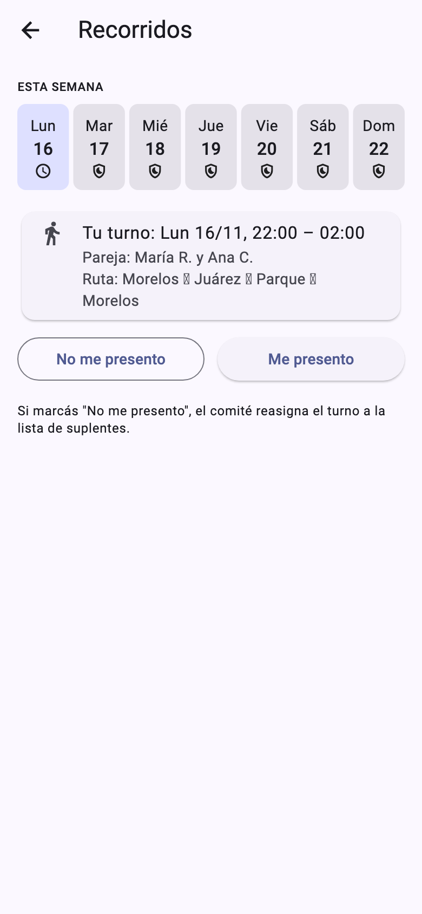
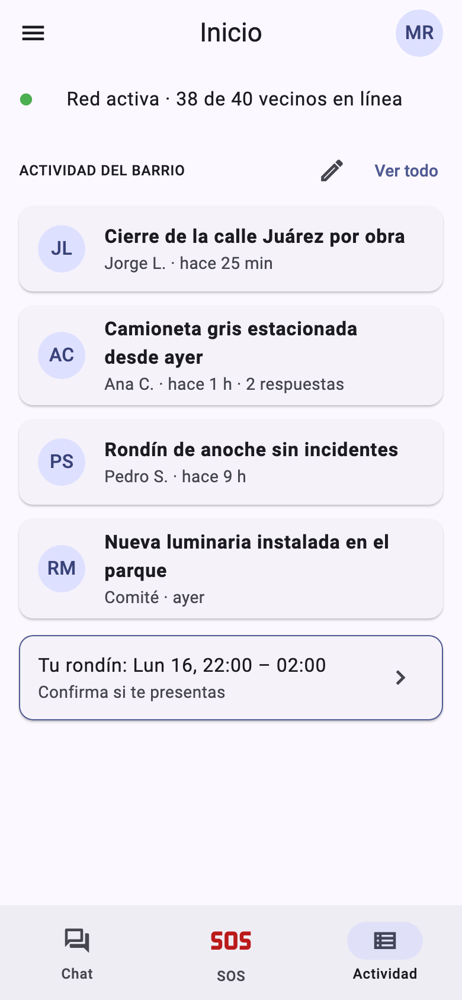
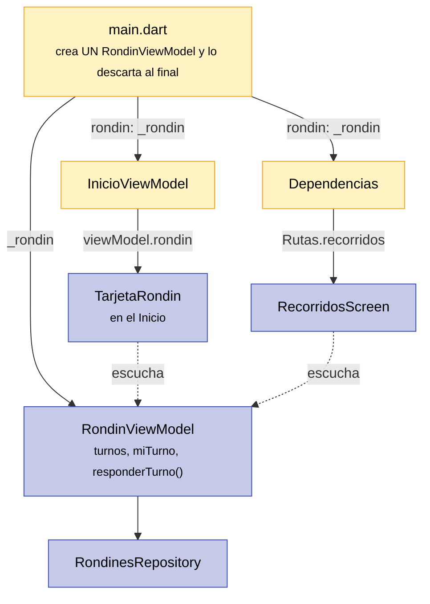
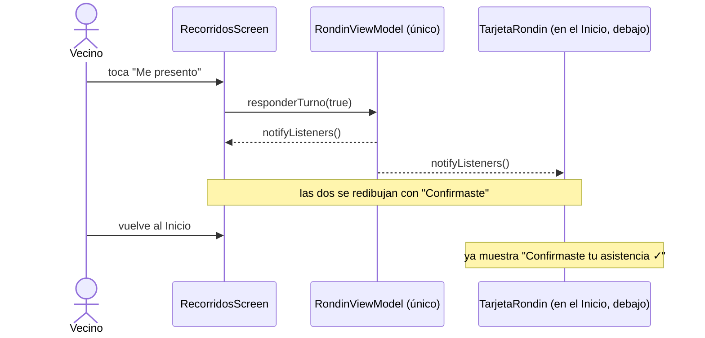

# 13. Rondines

!!! abstract "Objetivo"
    Los **rondines** son los recorridos nocturnos (de 22:00 a 02:00) que hacen los vecinos de a dos. Vas a hacer:

    - la pantalla **Recorridos**, con la grilla de la semana y los botones **Me presento** / **No me presento** para tu turno;
    - una **tarjeta** al final de la actividad del Inicio que dice cuándo es tu rondín.

    Las dos muestran **lo mismo** y se actualizan juntas: si confirmás en Recorridos, la tarjeta del Inicio cambia sola.

<div class="capturas" markdown>
<figure markdown="span">
  { .captura }
  <figcaption>Recorridos</figcaption>
</figure>
<figure markdown="span">
  { .captura }
  <figcaption>La tarjeta en el Inicio</figcaption>
</figure>
</div>

## Dónde estamos: un ViewModel compartido

Hasta ahora, cada pantalla tenía **su** ViewModel. Acá hay dos vistas (la tarjeta y Recorridos) que tienen que mostrar el mismo estado. Si cada una tuviera su ViewModel, al confirmar en una habría que avisarle a la otra "a mano".

La solución: **un solo `RondinViewModel` para toda la app**, creado en `main.dart`. Las dos vistas lo escuchan. Cuando cambia, las dos se redibujan.





## Paso 1: el repositorio

Creá `lib/data/repositories/rondines_repository.dart`. Incluye también los métodos del comité (capítulo 16):

<!-- archivo: lib/data/repositories/rondines_repository.dart cap=c13 notas="Future<List<TurnoRondin>> obtenerSemana\(\{DateTime\? desde\}\)|required bool presente,|Future<TurnoRondin> crearTurno" -->
```dart title="lib/data/repositories/rondines_repository.dart" linenums="1"
// lib/data/repositories/rondines_repository.dart
//
// Turnos de rondín: los del vecino (Recorridos) y la administración del
// comité (RF-14).

import '../../domain/models/comite.dart';
import '../../domain/models/rondin.dart';
import '../services/api/vigia_api.dart';

class RondinesRepository {
  RondinesRepository(this._api);

  final VigiaApi _api;

  /// Los turnos de la semana que empieza en [desde] (sin [desde]: la actual).
  Future<List<TurnoRondin>> obtenerSemana({DateTime? desde}) =>  // (1)!
      _api.obtenerSemanaRondin(desde: desde);

  /// "Me presento" (presente = true) o "No me presento".
  Future<TurnoRondin> responderAsistencia(
    int turnoId, {
    required bool presente,  // (2)!
  }) => _api.responderAsistencia(turnoId, presente);

  Future<TurnoRondin> crearTurno({  // (3)!
    required DateTime fecha,
    required String ruta,
    List<int> vecinoIds = const [],
  }) => _api.crearTurno(fecha: fecha, ruta: ruta, vecinoIds: vecinoIds);

  Future<List<Asignacion>> obtenerAsignaciones(int turnoId) =>
      _api.obtenerAsignaciones(turnoId);

  Future<List<Asignacion>> reasignar(int turnoId, List<int> vecinoIds) =>
      _api.reasignarTurno(turnoId, vecinoIds);

  Future<void> borrarTurno(int turnoId) => _api.borrarTurno(turnoId);
}
```
<!-- /archivo -->

1. Sin `desde`, la semana actual. Con `desde`, otra semana (el comité navega entre semanas).
2. En la API es `responderAsistencia(id, true)`; en el repositorio lo hacemos con nombre (`presente: true`), que se lee mejor.
3. De acá para abajo, los métodos que usa el comité.

## Paso 2: el ViewModel compartido

Creá `lib/ui/rondines/view_model/rondin_view_model.dart`:

<!-- archivo: lib/ui/rondines/view_model/rondin_view_model.dart cap=c13 notas="List<TurnoRondin> _turnos = \[\]|TurnoRondin\? get miTurno \{|final resultado = await ejecutar\(_rondines.obtenerSemana\)|final turno = miTurno;|if \(turno == null\) return;|_turnos = \[$|for \(final t in _turnos\) t.id == actualizado.id \? actualizado : t" -->
```dart title="lib/ui/rondines/view_model/rondin_view_model.dart" linenums="1"
// lib/ui/rondines/view_model/rondin_view_model.dart
//
// ViewModel de los rondines (turnos de recorrido nocturno 22:00 – 02:00).
// Sigue el mismo esquema que el CartModel del apunte 17: estado privado,
// getters de solo lectura y notifyListeners() antes y después del await
// (eso lo hace ejecutar(), en la clase base).
//
// Una sola instancia vive en MyApp y la escuchan dos vistas: la tarjeta de
// rondín del Inicio y la pantalla de Recorridos. Así no hace falta pasar el
// estado "a mano" de widget en widget (prop drilling, apunte 15).

import '../../../data/repositories/rondines_repository.dart';
import '../../../domain/models/rondin.dart';
import '../../../utils/resultado.dart';
import '../../core/view_model.dart';

class RondinViewModel extends ViewModel {
  RondinViewModel(this._rondines);

  final RondinesRepository _rondines;

  List<TurnoRondin> _turnos = []; // los 7 turnos de la semana (1)
  String? _error; // mensaje de error, o null si no hay error

  // Getters: la UI solo puede LEER el estado, nunca escribirlo directo.
  List<TurnoRondin> get turnos => _turnos.soloLectura;
  String? get error => _error;

  /// El turno que me toca esta semana (o null si no tengo).
  TurnoRondin? get miTurno {  // (2)!
    for (final turno in _turnos) {
      if (turno.esMio) return turno;
    }
    return null;
  }

  Future<void> cargarSemana() async {
    final resultado = await ejecutar(_rondines.obtenerSemana);  // (3)!
    switch (resultado) {
      case Ok(:final valor):
        _turnos = valor;
        _error = null;
      case Fallo():
        _error = 'No se pudieron cargar los rondines';
    }
    notifyListeners();
  }

  /// "Me presento" (presente = true) o "No me presento" (presente = false).
  Future<void> responderTurno(bool presente) async {
    final turno = miTurno;  // (4)!
    if (turno == null) return;  // (5)!

    final resultado = await ejecutar(
      () => _rondines.responderAsistencia(turno.id, presente: presente),
    );
    switch (resultado) {
      case Ok(valor: final actualizado):
        // reemplazamos solo el turno que cambió
        _turnos = [  // (6)!
          for (final t in _turnos) t.id == actualizado.id ? actualizado : t,  // (7)!
        ];
        _error = null;
      case Fallo():
        _error = 'No se pudo enviar tu respuesta';
    }
    notifyListeners();
  }
}
```
<!-- /archivo -->

1. Los 7 turnos de la semana.
2. Un getter que **busca** mi turno cada vez que se lee. Así no hay que mantener dos cosas sincronizadas: `miTurno` siempre sale de `_turnos`.
3. `ejecutar` con `marcarOcupado` (por defecto): mientras carga, `ocupado` es `true` y las vistas lo muestran.
4. Se guarda en una variable local (para la promoción de tipos)…
5. …y si no tengo turno, no hay nada que responder.
6. Una lista nueva…
7. …igual a la anterior, pero con **el turno que cambió** reemplazado por la versión que devolvió el servidor. Es un `for` con un `? :` adentro.

## Paso 3: la tarjeta del Inicio

Creá `lib/ui/inicio/widgets/tarjeta_rondin.dart`:

<!-- archivo: lib/ui/inicio/widgets/tarjeta_rondin.dart cap=c13 notas="final RondinViewModel viewModel;|child: ListenableBuilder\(|if \(turno == null\) \{|String _textoEstado" -->
```dart title="lib/ui/inicio/widgets/tarjeta_rondin.dart" linenums="1"
// lib/ui/inicio/widgets/tarjeta_rondin.dart

import 'package:flutter/material.dart';

import '../../../domain/models/rondin.dart';
import '../../../utils/fechas.dart';
import '../../rondines/view_model/rondin_view_model.dart';

/// Tarjeta "Tu rondín es hoy". Escucha el RondinViewModel compartido: si el
/// vecino confirma en la pantalla de Recorridos, esta tarjeta se actualiza
/// sola, sin pasar datos de vuelta (apuntes 15 y 17).
class TarjetaRondin extends StatelessWidget {
  const TarjetaRondin({
    required this.viewModel,
    required this.onTap,
    super.key,
  });

  final RondinViewModel viewModel;  // (1)!
  final VoidCallback onTap;

  @override
  Widget build(BuildContext context) {
    return Card(
      margin: const EdgeInsets.symmetric(horizontal: 8, vertical: 8),
      shape: RoundedRectangleBorder(
        borderRadius: BorderRadius.circular(12),
        side: BorderSide(color: Theme.of(context).colorScheme.primary),
      ),
      child: ListenableBuilder(  // (2)!
        listenable: viewModel,
        builder: (context, _) {
          final turno = viewModel.miTurno;
          if (turno == null) {  // (3)!
            return ListTile(
              title: Text(
                viewModel.ocupado
                    ? 'Cargando tu rondín…'
                    : 'No tenés rondín esta semana',
              ),
              trailing: const Icon(Icons.chevron_right),
              onTap: onTap,
            );
          }
          return ListTile(
            title: Text(
              'Tu rondín: ${diaDeLaSemana(turno.fecha)} ${turno.fecha.day}, '
              '${turno.horario}',
            ),
            subtitle: Text(_textoEstado(turno.miEstado)),
            trailing: const Icon(Icons.chevron_right),
            onTap: onTap,
          );
        },
      ),
    );
  }

  String _textoEstado(String? estado) => switch (estado) {  // (4)!
    EstadoAsistencia.confirmado => 'Confirmaste tu asistencia ✓',
    EstadoAsistencia.ausente => 'Avisaste que no te presentás',
    _ => 'Confirma si te presentas',
  };
}
```
<!-- /archivo -->

1. Recibe el ViewModel compartido.
2. Escucha **solo** dentro de la tarjeta: cuando el rondín cambia, se redibuja la tarjeta, no todo el Inicio.
3. Sin turno: puede ser que todavía cargue o que no tenga turno esta semana.
4. Un `switch` como expresión sobre el estado de asistencia. El `_` del final cubre `pendiente` y cualquier otro.

## Paso 4: la pantalla de Recorridos

Creá `lib/ui/rondines/widgets/recorridos_screen.dart`:

<!-- archivo: lib/ui/rondines/widgets/recorridos_screen.dart cap=c13 notas="class RecorridosScreen extends StatelessWidget|listenable: viewModel, // se reconstruye solo esto|if \(viewModel.ocupado\) \{|onPressed: viewModel.cargarSemana,|return const SizedBox.shrink\(\);|_GrillaSemana\(turnos: viewModel.turnos\)|if \(miTurno != null\) \.\.\.\[|return GridView.count\(|crossAxisCount: 7,|shrinkWrap: true,|physics: const NeverScrollableScrollPhysics\(\)|_ => Icons.shield_moon_outlined|Expanded\(" -->
```dart title="lib/ui/rondines/widgets/recorridos_screen.dart" linenums="1"
// lib/ui/rondines/widgets/recorridos_screen.dart
//
// Pantalla 5 del Manual: "Recorridos / Rondín".
// Calendario semanal de turnos + mi turno + botones "Me presento" /
// "No me presento". Escucha el mismo RondinViewModel que la tarjeta del
// Inicio; como es compartido, esta pantalla no lo descarta.

import 'package:flutter/material.dart';

import '../../../domain/models/rondin.dart';
import '../../../utils/fechas.dart';
import '../view_model/rondin_view_model.dart';

class RecorridosScreen extends StatelessWidget {  // (1)!
  const RecorridosScreen({required this.viewModel, super.key});

  final RondinViewModel viewModel;

  @override
  Widget build(BuildContext context) {
    return Scaffold(
      appBar: AppBar(
        title: const Text('Recorridos'),
        actions: [
          ListenableBuilder(
            listenable: viewModel, // se reconstruye solo esto (2)
            builder: (context, _) {
              if (viewModel.ocupado) {  // (3)!
                // estado "cargando"
                return const Padding(
                  padding: EdgeInsets.all(16),
                  child: SizedBox(
                    width: 20,
                    height: 20,
                    child: CircularProgressIndicator(strokeWidth: 2),
                  ),
                );
              }
              if (viewModel.error != null) {
                // estado "error": tocando el ícono se reintenta
                return IconButton(
                  icon: const Icon(Icons.error_outline),
                  color: Theme.of(context).colorScheme.error,
                  tooltip: 'Reintentar',
                  onPressed: viewModel.cargarSemana,  // (4)!
                );
              }
              // estado "éxito"
              return const SizedBox.shrink();  // (5)!
            },
          ),
        ],
      ),
      body: ListenableBuilder(
        listenable: viewModel,
        builder: (context, _) {
          final miTurno = viewModel.miTurno;
          if (viewModel.turnos.isEmpty) {
            return Center(
              child: viewModel.ocupado
                  ? const CircularProgressIndicator()
                  : const Text('No hay turnos cargados esta semana'),
            );
          }
          // Cada sección es su propio widget (apunte 19): así el build
          // queda corto y se entiende de un vistazo.
          return SingleChildScrollView(
            padding: const EdgeInsets.all(16),
            child: Column(
              crossAxisAlignment: CrossAxisAlignment.start,
              children: [
                Text(
                  'ESTA SEMANA',
                  style: Theme.of(context).textTheme.labelSmall,
                ),
                const SizedBox(height: 8),
                _GrillaSemana(turnos: viewModel.turnos),  // (6)!
                const SizedBox(height: 16),
                if (miTurno != null) ...[  // (7)!
                  _TarjetaTurno(turno: miTurno),
                  const SizedBox(height: 8),
                  _BotonesAsistencia(viewModel: viewModel),
                ],
                if (viewModel.error != null)
                  Padding(
                    padding: const EdgeInsets.only(top: 8),
                    child: Text(
                      viewModel.error!,
                      style: TextStyle(
                        color: Theme.of(context).colorScheme.error,
                      ),
                    ),
                  ),
                const SizedBox(height: 16),
                Text(
                  'Si marcás "No me presento", el comité reasigna el turno '
                  'a la lista de suplentes.',
                  style: Theme.of(context).textTheme.bodySmall,
                ),
              ],
            ),
          );
        },
      ),
    );
  }
}

/// Grilla de 7 columnas (una por día). Apunte 20: GridView.count.
class _GrillaSemana extends StatelessWidget {
  const _GrillaSemana({required this.turnos});

  final List<TurnoRondin> turnos;

  @override
  Widget build(BuildContext context) {
    final colorScheme = Theme.of(context).colorScheme;
    return GridView.count(  // (8)!
      crossAxisCount: 7,  // (9)!
      crossAxisSpacing: 4,
      childAspectRatio: 0.6,
      // La grilla está dentro de un SingleChildScrollView: shrinkWrap hace
      // que ocupe solo su alto y que no scrollee por su cuenta (apunte 21).
      shrinkWrap: true,  // (10)!
      physics: const NeverScrollableScrollPhysics(),  // (11)!
      children: [
        for (final turno in turnos)
          Container(
            decoration: BoxDecoration(
              color: turno.esMio
                  ? colorScheme.primaryContainer
                  : colorScheme.surfaceContainerHighest,
              borderRadius: BorderRadius.circular(8),
            ),
            child: Column(
              mainAxisAlignment: MainAxisAlignment.center,
              children: [
                Text(diaDeLaSemana(turno.fecha)),
                Text(
                  '${turno.fecha.day}',
                  style: Theme.of(context).textTheme.titleMedium,
                ),
                Icon(_iconoEstado(turno.miEstado), size: 16),
              ],
            ),
          ),
      ],
    );
  }

  IconData _iconoEstado(String? estado) {
    return switch (estado) {
      EstadoAsistencia.confirmado => Icons.check_circle,
      EstadoAsistencia.ausente => Icons.cancel_outlined,
      EstadoAsistencia.pendiente => Icons.schedule,
      _ => Icons.shield_moon_outlined, // turno de otros vecinos (12)
    };
  }
}

/// Tarjeta con los datos de mi turno.
class _TarjetaTurno extends StatelessWidget {
  const _TarjetaTurno({required this.turno});

  final TurnoRondin turno;

  @override
  Widget build(BuildContext context) {
    return Card(
      child: ListTile(
        leading: const Icon(Icons.directions_walk),
        title: Text('Tu turno: ${diaCorto(turno.fecha)}, ${turno.horario}'),
        subtitle: Text(
          'Pareja: ${turno.pareja.join(' y ')}\nRuta: ${turno.ruta}',
        ),
        isThreeLine: true,
      ),
    );
  }
}

/// "No me presento" / "Me presento", repartidos con Expanded (apunte 18).
class _BotonesAsistencia extends StatelessWidget {
  const _BotonesAsistencia({required this.viewModel});

  final RondinViewModel viewModel;

  @override
  Widget build(BuildContext context) {
    // Mientras carga, deshabilitamos los botones (onPressed: null) para
    // evitar que los toquen varias veces, igual que en el apunte 17.
    final cargando = viewModel.ocupado;
    return Row(
      children: [
        Expanded(  // (13)!
          child: OutlinedButton(
            onPressed: cargando ? null : () => viewModel.responderTurno(false),
            child: const Text('No me presento'),
          ),
        ),
        const SizedBox(width: 12),
        Expanded(
          child: ElevatedButton(
            onPressed: cargando ? null : () => viewModel.responderTurno(true),
            child: const Text('Me presento'),
          ),
        ),
      ],
    );
  }
}
```
<!-- /archivo -->

1. **`StatelessWidget`**: esta pantalla no es dueña del ViewModel (es compartido), así que no tiene que descartarlo, y no necesita `State`.
2. Un `ListenableBuilder` chiquito solo para el ícono de la barra de arriba.
3. Tres estados en el ícono: cargando (ruedita)…
4. …error (tocar reintenta)…
5. …o nada. `SizedBox.shrink()` es un widget de tamaño cero: "no mostrar nada".
6. Cada parte de la pantalla es su propio widget privado: así el `build` queda corto.
7. Mis datos y los botones, solo si tengo turno.
8. Una **grilla**…
9. …de 7 columnas (una por día).
10. Esta grilla está dentro de un `SingleChildScrollView`. Por defecto, una grilla quiere ocupar todo el alto disponible (infinito, adentro de algo que se desliza) y falla. `shrinkWrap` la hace medir solo lo que ocupan sus celdas…
11. …y sin su propio desplazamiento: se desliza la pantalla entera, no la grilla.
12. El `_` del final: el turno no es mío (`miEstado` es `null`).
13. `Expanded` en una `Row` reparte el ancho: cada botón ocupa la mitad. Ver [Layout](../3-flutter/3-layout.md#expanded).

## Paso 5: conectar

El `RondinViewModel` se crea en `main.dart`, va a `Dependencias` (para `Rutas`) y al `InicioViewModel` (para la tarjeta):

<!-- diff: lib/main.dart cap=c13 -->
```diff title="Qué cambia en lib/main.dart"
--- lib/main.dart (cap. 12)
+++ lib/main.dart (cap. 13)
@@ -20,4 +20,5 @@
 import 'data/repositories/fotos_repository.dart';
 import 'data/repositories/publicaciones_repository.dart';
+import 'data/repositories/rondines_repository.dart';
 import 'data/repositories/sesion_repository.dart';
 import 'data/services/api/fake_vigia_api.dart';
@@ -31,4 +32,5 @@
 import 'ui/login/view_model/login_view_model.dart';
 import 'ui/login/widgets/login_screen.dart';
+import 'ui/rondines/view_model/rondin_view_model.dart';
 import 'utils/validadores.dart';
 
@@ -63,5 +65,9 @@
   late final _publicaciones = PublicacionesRepository(widget.api);
   late final _chat = ChatRepository(widget.api);
+  late final _rondines = RondinesRepository(widget.api);
   late final _fotos = FotosRepository(widget.api);
+
+  // Compartido por la tarjeta del Inicio y la pantalla de Recorridos.
+  late final _rondin = RondinViewModel(_rondines);
 
   StreamSubscription<Uri>? _enlaces;
@@ -80,4 +86,5 @@
     _sesion.removeListener(_alCambiarSesion);
     _sesion.dispose();
+    _rondin.dispose();
     super.dispose();
   }
@@ -104,4 +111,5 @@
       sesion: _sesion,
       publicaciones: _publicaciones,
+      rondin: _rondin,
       chat: ChatViewModel(chat: _chat, fotos: _fotos, vecino: _sesion.vecino!),
     );
@@ -114,5 +122,7 @@
       publicaciones: _publicaciones,
       chat: _chat,
+      rondines: _rondines,
       fotos: _fotos,
+      rondin: _rondin,
       child: MaterialApp(
         title: 'VigiaApp',
```
<!-- /diff -->

<!-- archivo: lib/main.dart cap=c13 notas="late final _rondin = RondinViewModel\(_rondines\)|_rondin.dispose\(\);|rondin: _rondin,$" -->
```dart title="lib/main.dart" linenums="1" hl_lines="22 34 67 69-71 88 113 124 126"
// lib/main.dart
//
// Punto de entrada y raíz de composición: acá se crea una sola instancia de
// cada servicio, repositorio y ViewModel compartido, y se pone todo en
// Dependencias, arriba del árbol de widgets.
//
// Capas (MVVM, guía de arquitectura de Flutter):
//   ui/<pantalla>/widgets     Vistas: dibujan y le avisan al ViewModel.
//   ui/<pantalla>/view_model  ViewModels: estado de la pantalla y acciones.
//   data/repositories         Fuente de verdad de cada área (sesión, alertas…).
//   data/services             API, GPS, cámara, almacenamiento seguro.
//   domain/models             Los datos de la app, en Dart puro.

import 'dart:async';

import 'package:app_links/app_links.dart';
import 'package:flutter/material.dart';

import 'data/repositories/chat_repository.dart';
import 'data/repositories/fotos_repository.dart';
import 'data/repositories/publicaciones_repository.dart';
import 'data/repositories/rondines_repository.dart';
import 'data/repositories/sesion_repository.dart';
import 'data/services/api/fake_vigia_api.dart';
import 'data/services/api/vigia_api.dart';
import 'dependencias.dart';
import 'routing/rutas.dart';
import 'ui/carga/widgets/pantalla_carga.dart';
import 'ui/chat/view_model/chat_view_model.dart';
import 'ui/inicio/view_model/inicio_view_model.dart';
import 'ui/inicio/widgets/inicio_screen.dart';
import 'ui/login/view_model/login_view_model.dart';
import 'ui/login/widgets/login_screen.dart';
import 'ui/rondines/view_model/rondin_view_model.dart';
import 'utils/validadores.dart';

void main() {
  // AppLinks habla con la plataforma: Flutter tiene que estar inicializado
  // antes de usarlo.
  WidgetsFlutterBinding.ensureInitialized();
  // uriLinkStream también trae el enlace con el que se abrió la app
  // (vigiaapp://clave?token=… desde el correo de invitación).
  runApp(MyApp(enlaces: AppLinks().uriLinkStream));
}

class MyApp extends StatefulWidget {
  MyApp({super.key, VigiaApi? api, this.enlaces}) : api = api ?? FakeVigiaApi();

  final VigiaApi api;

  /// Deep links entrantes. En los tests no se pasa (no hay plataforma).
  final Stream<Uri>? enlaces;

  @override
  State<MyApp> createState() => _MyAppState();
}

class _MyAppState extends State<MyApp> {
  // La llave del Navigator: deja navegar desde afuera de las pantallas
  // (cuando llega un enlace).
  final _navegador = GlobalKey<NavigatorState>();

  // Una sola instancia de cada repositorio para toda la app.
  late final _sesion = SesionRepository(widget.api)..iniciar();
  late final _publicaciones = PublicacionesRepository(widget.api);
  late final _chat = ChatRepository(widget.api);
  late final _rondines = RondinesRepository(widget.api);
  late final _fotos = FotosRepository(widget.api);

  // Compartido por la tarjeta del Inicio y la pantalla de Recorridos.
  late final _rondin = RondinViewModel(_rondines);  // (1)!

  StreamSubscription<Uri>? _enlaces;
  EstadoSesion _estadoAnterior = EstadoSesion.iniciando;

  @override
  void initState() {
    super.initState();
    _enlaces = widget.enlaces?.listen(_abrirEnlace);
    _sesion.addListener(_alCambiarSesion);
  }

  @override
  void dispose() {
    _enlaces?.cancel();
    _sesion.removeListener(_alCambiarSesion);
    _sesion.dispose();
    _rondin.dispose();  // (2)!
    super.dispose();
  }

  // Si la sesión se cierra (logout o 401) con pantallas abiertas encima del
  // Inicio, se cierran todas: debajo ya está el Login.
  void _alCambiarSesion() {
    if (_estadoAnterior == EstadoSesion.conSesion &&
        _sesion.estado == EstadoSesion.sinSesion) {
      _navegador.currentState?.popUntil((ruta) => ruta.isFirst);
    }
    _estadoAnterior = _sesion.estado;
  }

  void _abrirEnlace(Uri enlace) {
    final contexto = _navegador.currentContext;
    if (enlace.scheme != 'vigiaapp' || enlace.host != 'clave') return;
    if (contexto == null) return;
    Rutas.elegirClave(contexto, token: tokenDelEnlace(enlace.toString()));
  }

  InicioViewModel _crearInicio() {
    return InicioViewModel(
      sesion: _sesion,
      publicaciones: _publicaciones,
      rondin: _rondin,  // (3)!
      chat: ChatViewModel(chat: _chat, fotos: _fotos, vecino: _sesion.vecino!),
    );
  }

  @override
  Widget build(BuildContext context) {
    return Dependencias(
      sesion: _sesion,
      publicaciones: _publicaciones,
      chat: _chat,
      rondines: _rondines,
      fotos: _fotos,
      rondin: _rondin,
      child: MaterialApp(
        title: 'VigiaApp',
        navigatorKey: _navegador,
        theme: ThemeData(colorSchemeSeed: Colors.indigo),
        // Solo se redibuja cuando cambia la sesión: cada pantalla raíz
        // recibe un ViewModel nuevo.
        home: ListenableBuilder(
          listenable: _sesion,
          builder: (context, _) => switch (_sesion.estado) {
            EstadoSesion.iniciando => const PantallaCarga(),
            EstadoSesion.sinSesion => LoginScreen(
              viewModel: LoginViewModel(_sesion),
            ),
            // La key: si entra otro vecino, el Inicio arranca de cero.
            EstadoSesion.conSesion => InicioScreen(
              key: ValueKey(_sesion.vecino!.id),
              viewModel: _crearInicio(),
            ),
          },
        ),
      ),
    );
  }
}
```
<!-- /archivo -->

1. **Una sola instancia**, que vive lo que vive la app.
2. Como `main.dart` lo creó, `main.dart` lo descarta.
3. El mismo objeto va al Inicio y a `Dependencias`.

<!-- diff: lib/dependencias.dart cap=c13 -->
```diff title="Qué cambia en lib/dependencias.dart"
--- lib/dependencias.dart (cap. 12)
+++ lib/dependencias.dart (cap. 13)
@@ -11,5 +11,7 @@
 import 'data/repositories/fotos_repository.dart';
 import 'data/repositories/publicaciones_repository.dart';
+import 'data/repositories/rondines_repository.dart';
 import 'data/repositories/sesion_repository.dart';
+import 'ui/rondines/view_model/rondin_view_model.dart';
 
 class Dependencias extends InheritedWidget {
@@ -18,5 +20,7 @@
     required this.publicaciones,
     required this.chat,
+    required this.rondines,
     required this.fotos,
+    required this.rondin,
     required super.child,
     super.key,
@@ -26,5 +30,10 @@
   final PublicacionesRepository publicaciones;
   final ChatRepository chat;
+  final RondinesRepository rondines;
   final FotosRepository fotos;
+
+  /// El rondín del vecino: lo escuchan la tarjeta del Inicio y la pantalla
+  /// de Recorridos, así las dos muestran lo mismo.
+  final RondinViewModel rondin;
 
   /// No registra dependencia: las instancias no cambian nunca, así que
```
<!-- /diff -->

<!-- archivo: lib/dependencias.dart cap=c13 -->
```dart title="lib/dependencias.dart" linenums="1" hl_lines="13 15 22 24 32 34-37"
// lib/dependencias.dart
//
// Los repositorios y servicios de la app, una sola instancia de cada uno.
// Es un InheritedWidget (el mecanismo de Flutter para compartir datos con
// todo el árbol): MyApp lo pone arriba de todo y las rutas lo leen para
// armar el ViewModel de cada pantalla, sin pasarlo de widget en widget.

import 'package:flutter/widgets.dart';

import 'data/repositories/chat_repository.dart';
import 'data/repositories/fotos_repository.dart';
import 'data/repositories/publicaciones_repository.dart';
import 'data/repositories/rondines_repository.dart';
import 'data/repositories/sesion_repository.dart';
import 'ui/rondines/view_model/rondin_view_model.dart';

class Dependencias extends InheritedWidget {
  const Dependencias({
    required this.sesion,
    required this.publicaciones,
    required this.chat,
    required this.rondines,
    required this.fotos,
    required this.rondin,
    required super.child,
    super.key,
  });

  final SesionRepository sesion;
  final PublicacionesRepository publicaciones;
  final ChatRepository chat;
  final RondinesRepository rondines;
  final FotosRepository fotos;

  /// El rondín del vecino: lo escuchan la tarjeta del Inicio y la pantalla
  /// de Recorridos, así las dos muestran lo mismo.
  final RondinViewModel rondin;

  /// No registra dependencia: las instancias no cambian nunca, así que
  /// nadie tiene que redibujarse.
  static Dependencias of(BuildContext context) {
    final dependencias = context.getInheritedWidgetOfExactType<Dependencias>();
    assert(dependencias != null, 'Falta Dependencias arriba en el árbol');
    return dependencias!;
  }

  @override
  bool updateShouldNotify(Dependencias oldWidget) => false;
}
```
<!-- /archivo -->

`Rutas` **no crea** un ViewModel para Recorridos: usa el compartido.

<!-- archivo: lib/routing/rutas.dart cap=c13 notas="final viewModel = Dependencias.of\(context\).rondin;" -->
```dart title="lib/routing/rutas.dart" linenums="1" hl_lines="24 47-52"
// lib/routing/rutas.dart
//
// Navegación de la app. Cada método arma el ViewModel de la pantalla con los
// repositorios de Dependencias y la abre. Así las vistas solo dicen "abrí el
// perfil" y nunca tocan un repositorio.
//
// El ViewModel se crea UNA vez, afuera del builder de la ruta: el builder se
// puede volver a ejecutar, y crearía otro ViewModel distinto.

import 'package:flutter/material.dart';

import '../dependencias.dart';
import '../domain/models/publicacion.dart';
import '../ui/elegir_clave/view_model/elegir_clave_view_model.dart';
import '../ui/elegir_clave/widgets/elegir_clave_screen.dart';
import '../ui/noticias/view_model/noticias_view_model.dart';
import '../ui/noticias/widgets/noticias_screen.dart';
import '../ui/perfil/view_model/perfil_view_model.dart';
import '../ui/perfil/widgets/perfil_screen.dart';
import '../ui/publicacion/view_model/nueva_publicacion_view_model.dart';
import '../ui/publicacion/view_model/publicacion_view_model.dart';
import '../ui/publicacion/widgets/nueva_publicacion_screen.dart';
import '../ui/publicacion/widgets/publicacion_screen.dart';
import '../ui/rondines/widgets/recorridos_screen.dart';

abstract final class Rutas {
  static Future<T?> _abrir<T>(BuildContext context, Widget pantalla) {
    return Navigator.push<T>(
      context,
      MaterialPageRoute(builder: (context) => pantalla),
    );
  }

  /// Invitación o recuperación de la clave. [token] viene del enlace del
  /// correo, si la app se abrió desde ahí.
  static Future<void> elegirClave(BuildContext context, {String? token}) {
    final viewModel = ElegirClaveViewModel(
      Dependencias.of(context).sesion,
      tokenDelCorreo: token,
    );
    return _abrir(context, ElegirClaveScreen(viewModel: viewModel));
  }

  static Future<void> perfil(BuildContext context) {
    final viewModel = PerfilViewModel(Dependencias.of(context).sesion);
    return _abrir(context, PerfilScreen(viewModel: viewModel));
  }

  /// El RondinViewModel es compartido con el Inicio: no se crea uno nuevo.
  static Future<void> recorridos(BuildContext context) {
    final viewModel = Dependencias.of(context).rondin;  // (1)!
    return _abrir(context, RecorridosScreen(viewModel: viewModel));
  }

  static Future<void> noticias(BuildContext context) {
    final d = Dependencias.of(context);
    final viewModel = NoticiasViewModel(
      d.publicaciones,
      vecino: d.sesion.vecino,
    );
    return _abrir(context, NoticiasScreen(viewModel: viewModel));
  }

  static Future<void> publicacion(BuildContext context, int publicacionId) {
    final d = Dependencias.of(context);
    final viewModel = PublicacionViewModel(
      publicacionId: publicacionId,
      publicaciones: d.publicaciones,
      fotos: d.fotos,
      vecino: d.sesion.vecino,
    );
    return _abrir(context, PublicacionScreen(viewModel: viewModel));
  }

  /// Devuelve la publicación creada (null si no publicó).
  static Future<Publicacion?> nuevaPublicacion(
    BuildContext context, {
    String tipo = TipoPublicacion.actividad,
  }) {
    final d = Dependencias.of(context);
    final viewModel = NuevaPublicacionViewModel(
      publicaciones: d.publicaciones,
      fotos: d.fotos,
      vecino: d.sesion.vecino!,
      tipo: tipo,
    );
    return _abrir(context, NuevaPublicacionScreen(viewModel: viewModel));
  }
}
```
<!-- /archivo -->

1. El mismo `RondinViewModel` de siempre. Es la única ruta que no crea uno nuevo.

El `InicioViewModel` recibe el rondín y lo carga al iniciar:

<!-- diff: lib/ui/inicio/view_model/inicio_view_model.dart cap=c13 -->
```diff title="Qué cambia en lib/ui/inicio/view_model/inicio_view_model.dart"
--- lib/ui/inicio/view_model/inicio_view_model.dart (cap. 12)
+++ lib/ui/inicio/view_model/inicio_view_model.dart (cap. 13)
@@ -12,4 +12,5 @@
 import '../../chat/view_model/chat_view_model.dart';
 import '../../core/view_model.dart';
+import '../../rondines/view_model/rondin_view_model.dart';
 
 class InicioViewModel extends ViewModel {
@@ -17,4 +18,5 @@
     required this._sesion,
     required this._publicaciones,
+    required this.rondin,
     required this.chat,
   });
@@ -22,4 +24,7 @@
   final SesionRepository _sesion;
   final PublicacionesRepository _publicaciones;
+
+  /// Compartido con Recorridos: lo descarta MyApp, no este ViewModel.
+  final RondinViewModel rondin;
 
   /// Propio: se descarta junto con el Inicio.
@@ -46,4 +51,5 @@
   void iniciar() {
     cargarDatos();
+    rondin.cargarSemana();
     chat.iniciar();
   }
```
<!-- /diff -->

<!-- archivo: lib/ui/inicio/view_model/inicio_view_model.dart cap=c13 notas="final RondinViewModel rondin;|rondin.cargarSemana\(\);" -->
```dart title="lib/ui/inicio/view_model/inicio_view_model.dart" linenums="1" hl_lines="14 20 26-28 53"
// lib/ui/inicio/view_model/inicio_view_model.dart
//
// Pantalla de Inicio: el estado de la red, la actividad del barrio, las
// alertas SOS de otros vecinos y el chat.

import '../../../data/repositories/publicaciones_repository.dart';
import '../../../data/repositories/sesion_repository.dart';
import '../../../data/services/errores.dart';
import '../../../domain/models/publicacion.dart';
import '../../../domain/models/sesion.dart';
import '../../../utils/resultado.dart';
import '../../chat/view_model/chat_view_model.dart';
import '../../core/view_model.dart';
import '../../rondines/view_model/rondin_view_model.dart';

class InicioViewModel extends ViewModel {
  InicioViewModel({
    required this._sesion,
    required this._publicaciones,
    required this.rondin,
    required this.chat,
  });

  final SesionRepository _sesion;
  final PublicacionesRepository _publicaciones;

  /// Compartido con Recorridos: lo descarta MyApp, no este ViewModel.
  final RondinViewModel rondin;  // (1)!

  /// Propio: se descarta junto con el Inicio.
  final ChatViewModel chat;

  EstadoBarrio? _barrio;
  List<Publicacion> _actividad = [];
  int _cantidadNoticias = 0;
  bool _cargando = true;
  String? _error;
  bool _verChat = true; // el Inicio abre en el chat; "Actividad" es el feed

  /// El Inicio solo existe con la sesión iniciada.
  VecinoSesion get vecino => _sesion.vecino!;

  /// null mientras se conecta.
  EstadoBarrio? get barrio => _barrio;
  List<Publicacion> get actividad => _actividad.soloLectura;
  int get cantidadNoticias => _cantidadNoticias;
  bool get cargando => _cargando;
  String? get error => _error;
  bool get verChat => _verChat;

  void iniciar() {
    cargarDatos();
    rondin.cargarSemana();  // (2)!
    chat.iniciar();
  }

  // En segundo plano no se consulta (batería y datos); al volver, se
  // consulta enseguida y se retoma cada 10 s.
  void pausar() {
    chat.pausar();
  }

  void reanudar() {
    if (_verChat) chat.iniciar();
  }

  /// Cambia entre la pestaña del chat y la de actividad.
  void mostrarChat(bool verChat) {
    _verChat = verChat;
    verChat ? chat.iniciar() : chat.pausar();
    notifyListeners();
  }

  Future<void> cargarDatos() async {
    _cargando = true;
    _error = null;
    notifyListeners();
    try {
      // Los tres pedidos salen a la vez (Future.wait): unos 180 ms en total
      // en vez de unos 550 ms uno detrás del otro.
      final barrio = _publicaciones.obtenerEstadoBarrio();
      final actividad = _publicaciones.obtenerActividad();
      final noticias = _publicaciones.obtenerNoticias();
      await Future.wait([barrio, actividad, noticias]);
      _barrio = await barrio;
      _actividad = await actividad;
      _cantidadNoticias = (await noticias).length;
    } on ApiException {
      _error = 'Sin conexión con la red del barrio';
    }
    _cargando = false;
    notifyListeners();
  }

  /// Una publicación propia (o cualquiera, si es del comité) se borra del
  /// servidor; una ajena solo se oculta de la lista.
  bool puedeBorrar(Publicacion publicacion) =>
      vecino.puedeBorrar(autorId: publicacion.autorId);

  Future<Resultado<void>> borrar(Publicacion publicacion) => ejecutar(
    () => _publicaciones.borrar(publicacion.id),
    marcarOcupado: false,
  );

  /// Saca la publicación de la lista (al deslizarla).
  void quitar(Publicacion publicacion) {
    _actividad = [
      for (final p in _actividad)
        if (p.id != publicacion.id) p,
    ];
    notifyListeners();
  }

  /// MyApp vuelve solo al Login (escucha SesionRepository).
  Future<void> cerrarSesion() => _sesion.logout();

  @override
  void dispose() {
    chat.dispose();
    super.dispose();
  }
}
```
<!-- /archivo -->

1. Lo **usa**, pero no es su dueño: en el `dispose` del Inicio no se descarta (lo descarta `main.dart`).
2. Al abrir el Inicio, se carga la semana.

La lista de actividad muestra la tarjeta al final:

<!-- diff: lib/ui/inicio/widgets/lista_actividad.dart cap=c13 -->
```diff title="Qué cambia en lib/ui/inicio/widgets/lista_actividad.dart"
--- lib/ui/inicio/widgets/lista_actividad.dart (cap. 12)
+++ lib/ui/inicio/widgets/lista_actividad.dart (cap. 13)
@@ -1,5 +1,6 @@
 // lib/ui/inicio/widgets/lista_actividad.dart
 //
-// Pestaña "Actividad" del Inicio: el feed del barrio.
+// Pestaña "Actividad" del Inicio: el feed del barrio y, al final, la
+// tarjeta del rondín.
 
 import 'package:flutter/material.dart';
@@ -9,4 +10,5 @@
 import '../../core/widgets/estados_carga.dart';
 import '../view_model/inicio_view_model.dart';
+import 'tarjeta_rondin.dart';
 
 class ListaActividad extends StatelessWidget {
@@ -16,4 +18,5 @@
     required this.onVerTodo,
     required this.onAbrir,
+    required this.onAbrirRondin,
     required this.confirmarDeslizar,
     super.key,
@@ -24,4 +27,5 @@
   final VoidCallback onVerTodo;
   final ValueChanged<Publicacion> onAbrir;
+  final VoidCallback onAbrirRondin;
 
   /// Si devuelve false, la publicación vuelve a su lugar.
@@ -66,6 +70,12 @@
     return ListView.builder(
       padding: const EdgeInsets.symmetric(horizontal: 8),
-      itemCount: actividad.length,
+      itemCount: actividad.length + 1,
       itemBuilder: (context, index) {
+        if (index == actividad.length) {
+          return TarjetaRondin(
+            viewModel: viewModel.rondin,
+            onTap: onAbrirRondin,
+          );
+        }
         final publicacion = actividad[index];
         return Dismissible(
```
<!-- /diff -->

<!-- archivo: lib/ui/inicio/widgets/lista_actividad.dart cap=c13 notas="itemCount: actividad.length \+ 1|if \(index == actividad.length\) \{" -->
```dart title="lib/ui/inicio/widgets/lista_actividad.dart" linenums="1" hl_lines="3-4 12 20 29 72 74-79"
// lib/ui/inicio/widgets/lista_actividad.dart
//
// Pestaña "Actividad" del Inicio: el feed del barrio y, al final, la
// tarjeta del rondín.

import 'package:flutter/material.dart';

import '../../../domain/models/publicacion.dart';
import '../../../utils/fechas.dart';
import '../../core/widgets/estados_carga.dart';
import '../view_model/inicio_view_model.dart';
import 'tarjeta_rondin.dart';

class ListaActividad extends StatelessWidget {
  const ListaActividad({
    required this.viewModel,
    required this.onPublicar,
    required this.onVerTodo,
    required this.onAbrir,
    required this.onAbrirRondin,
    required this.confirmarDeslizar,
    super.key,
  });

  final InicioViewModel viewModel;
  final VoidCallback onPublicar;
  final VoidCallback onVerTodo;
  final ValueChanged<Publicacion> onAbrir;
  final VoidCallback onAbrirRondin;

  /// Si devuelve false, la publicación vuelve a su lugar.
  final Future<bool> Function(Publicacion) confirmarDeslizar;

  @override
  Widget build(BuildContext context) {
    return Column(
      children: [
        Padding(
          padding: const EdgeInsets.fromLTRB(16, 8, 8, 0),
          child: Row(
            children: [
              Text(
                'ACTIVIDAD DEL BARRIO',
                style: Theme.of(context).textTheme.labelMedium,
              ),
              const Spacer(),
              IconButton(
                icon: const Icon(Icons.edit_outlined),
                tooltip: 'Publicar',
                onPressed: onPublicar,
              ),
              TextButton(onPressed: onVerTodo, child: const Text('Ver todo')),
            ],
          ),
        ),
        Expanded(child: _contenido()),
      ],
    );
  }

  Widget _contenido() {
    if (viewModel.cargando) return const Cargando();
    if (viewModel.error case final error?) {
      return ErrorConReintento(
        mensaje: error,
        onReintentar: viewModel.cargarDatos,
      );
    }
    final actividad = viewModel.actividad;
    return ListView.builder(
      padding: const EdgeInsets.symmetric(horizontal: 8),
      itemCount: actividad.length + 1,  // (1)!
      itemBuilder: (context, index) {
        if (index == actividad.length) {  // (2)!
          return TarjetaRondin(
            viewModel: viewModel.rondin,
            onTap: onAbrirRondin,
          );
        }
        final publicacion = actividad[index];
        return Dismissible(
          key: ValueKey(publicacion.id),
          direction: DismissDirection.horizontal,
          background: const _FondoBorrar(),
          confirmDismiss: (_) => confirmarDeslizar(publicacion),
          onDismissed: (_) => viewModel.quitar(publicacion),
          child: _TarjetaPublicacion(
            publicacion: publicacion,
            onTap: () => onAbrir(publicacion),
          ),
        );
      },
    );
  }
}

class _TarjetaPublicacion extends StatelessWidget {
  const _TarjetaPublicacion({required this.publicacion, required this.onTap});

  final Publicacion publicacion;
  final VoidCallback onTap;

  @override
  Widget build(BuildContext context) {
    return Card(
      margin: const EdgeInsets.symmetric(horizontal: 8, vertical: 6),
      child: ListTile(
        leading: CircleAvatar(child: Text(publicacion.iniciales)),
        title: Text(
          publicacion.titulo,
          style: const TextStyle(fontWeight: FontWeight.w600),
        ),
        subtitle: Text(_subtitulo()),
        trailing: publicacion.fotoId == null
            ? null
            : const Icon(Icons.photo_outlined),
        onTap: onTap,
      ),
    );
  }

  // "Ana C. · hace 1 h · 6 respuestas"
  String _subtitulo() {
    final texto = '${publicacion.autor} · ${haceCuanto(publicacion.creadoEn)}';
    return switch (publicacion.respuestas) {
      0 => texto,
      1 => '$texto · 1 respuesta',
      final n => '$texto · $n respuestas',
    };
  }
}

/// Lo que aparece debajo de la tarjeta al deslizarla.
class _FondoBorrar extends StatelessWidget {
  const _FondoBorrar();

  @override
  Widget build(BuildContext context) {
    final colorScheme = Theme.of(context).colorScheme;
    return Container(
      alignment: Alignment.centerRight,
      padding: const EdgeInsets.symmetric(horizontal: 24),
      margin: const EdgeInsets.symmetric(horizontal: 8, vertical: 6),
      decoration: BoxDecoration(
        color: colorScheme.errorContainer,
        borderRadius: BorderRadius.circular(16),
      ),
      child: Icon(Icons.delete_outline, color: colorScheme.onErrorContainer),
    );
  }
}
```
<!-- /archivo -->

1. Una fila más que las publicaciones…
2. …y esa fila de más (la última) es la tarjeta.

Y el menú suma "Recorridos":

<!-- diff: lib/ui/inicio/widgets/menu_lateral.dart cap=c13 -->
```diff title="Qué cambia en lib/ui/inicio/widgets/menu_lateral.dart"
--- lib/ui/inicio/widgets/menu_lateral.dart (cap. 12)
+++ lib/ui/inicio/widgets/menu_lateral.dart (cap. 13)
@@ -11,4 +11,5 @@
     required this.vecino,
     required this.cantidadNoticias,
+    required this.onRecorridos,
     required this.onNoticias,
     required this.onPerfil,
@@ -19,4 +20,5 @@
   final VecinoSesion vecino;
   final int cantidadNoticias;
+  final VoidCallback onRecorridos;
   final VoidCallback onNoticias;
   final VoidCallback onPerfil;
@@ -48,4 +50,9 @@
             title: const Text('Inicio'),
             onTap: () => Navigator.pop(context), // ya estamos en Inicio
+          ),
+          _Opcion(
+            icono: const Icon(Icons.directions_walk),
+            texto: 'Recorridos',
+            onTap: onRecorridos,
           ),
           _Opcion(
```
<!-- /diff -->

<!-- archivo: lib/ui/inicio/widgets/menu_lateral.dart cap=c13 -->
```dart title="lib/ui/inicio/widgets/menu_lateral.dart" linenums="1" hl_lines="13 22 52-56"
// lib/ui/inicio/widgets/menu_lateral.dart

import 'package:flutter/material.dart';

import '../../../domain/models/sesion.dart';

/// Menú lateral (pantalla 9 del Manual). No navega por su cuenta: avisa al
/// padre con callbacks y el padre decide (patrón callback, apunte 8).
class MenuLateral extends StatelessWidget {
  const MenuLateral({
    required this.vecino,
    required this.cantidadNoticias,
    required this.onRecorridos,
    required this.onNoticias,
    required this.onPerfil,
    required this.onCerrarSesion,
    super.key,
  });

  final VecinoSesion vecino;
  final int cantidadNoticias;
  final VoidCallback onRecorridos;
  final VoidCallback onNoticias;
  final VoidCallback onPerfil;
  final VoidCallback onCerrarSesion;

  @override
  Widget build(BuildContext context) {
    return Drawer(
      child: ListView(
        padding: EdgeInsets.zero,
        children: [
          DrawerHeader(
            decoration: BoxDecoration(
              color: Theme.of(context).colorScheme.primaryContainer,
            ),
            child: Column(
              crossAxisAlignment: CrossAxisAlignment.start,
              mainAxisAlignment: MainAxisAlignment.end,
              children: [
                CircleAvatar(radius: 28, child: Text(vecino.iniciales)),
                const SizedBox(height: 8),
                Text(vecino.nombre),
                Text(vecino.descripcion),
              ],
            ),
          ),
          ListTile(
            leading: const Icon(Icons.home_outlined),
            title: const Text('Inicio'),
            onTap: () => Navigator.pop(context), // ya estamos en Inicio
          ),
          _Opcion(
            icono: const Icon(Icons.directions_walk),
            texto: 'Recorridos',
            onTap: onRecorridos,
          ),
          _Opcion(
            icono: Badge(
              isLabelVisible: cantidadNoticias > 0,
              label: Text('$cantidadNoticias'),
              child: const Icon(Icons.campaign_outlined),
            ),
            texto: 'Noticias',
            onTap: onNoticias,
          ),
          const Divider(),
          _Opcion(
            icono: const Icon(Icons.person_outline),
            texto: 'Mi perfil',
            onTap: onPerfil,
          ),
          _Opcion(
            icono: const Icon(Icons.logout),
            texto: 'Cerrar sesión',
            onTap: onCerrarSesion, // MyApp vuelve solo al Login
          ),
        ],
      ),
    );
  }
}

/// Una opción del menú: 1) cierra el menú, 2) avisa al padre.
class _Opcion extends StatelessWidget {
  const _Opcion({
    required this.icono,
    required this.texto,
    required this.onTap,
  });

  final Widget icono;
  final String texto;
  final VoidCallback onTap;

  @override
  Widget build(BuildContext context) {
    return ListTile(
      leading: icono,
      title: Text(texto),
      onTap: () {
        Navigator.pop(context);
        onTap();
      },
    );
  }
}
```
<!-- /archivo -->

<!-- diff: lib/ui/inicio/widgets/inicio_screen.dart cap=c13 -->
```diff title="Qué cambia en lib/ui/inicio/widgets/inicio_screen.dart"
--- lib/ui/inicio/widgets/inicio_screen.dart (cap. 12)
+++ lib/ui/inicio/widgets/inicio_screen.dart (cap. 13)
@@ -107,4 +107,5 @@
             vecino: vecino,
             cantidadNoticias: _viewModel.cantidadNoticias,
+            onRecorridos: () => Rutas.recorridos(context),
             onNoticias: () => Rutas.noticias(context),
             onPerfil: () => Rutas.perfil(context),
@@ -124,4 +125,5 @@
                           onVerTodo: () => Rutas.noticias(context),
                           onAbrir: _abrirPublicacion,
+                          onAbrirRondin: () => Rutas.recorridos(context),
                           confirmarDeslizar: _confirmarDeslizar,
                         ),
```
<!-- /diff -->

<!-- archivo: lib/ui/inicio/widgets/inicio_screen.dart cap=c13 -->
```dart title="lib/ui/inicio/widgets/inicio_screen.dart" linenums="1" hl_lines="109 127"
// lib/ui/inicio/widgets/inicio_screen.dart
//
// Pantalla de Inicio. Arriba el estado de la red y los avisos de SOS de
// otros vecinos; en el medio el chat o la actividad del barrio; abajo la
// barra con el botón SOS.

import 'package:flutter/material.dart';

import '../../../domain/models/publicacion.dart';
import '../../../routing/rutas.dart';
import '../../../utils/resultado.dart';
import '../../chat/widgets/chat_vecinos.dart';
import '../../core/widgets/avisos.dart';
import '../view_model/inicio_view_model.dart';
import 'barra_inferior.dart';
import 'estado_red.dart';
import 'lista_actividad.dart';
import 'menu_lateral.dart';

class InicioScreen extends StatefulWidget {
  const InicioScreen({required this.viewModel, super.key});

  final InicioViewModel viewModel;

  @override
  State<InicioScreen> createState() => _InicioScreenState();
}

class _InicioScreenState extends State<InicioScreen> {
  // Avisa cuando la app pasa a segundo plano, para no seguir consultando al
  // servidor con el celular guardado.
  late final AppLifecycleListener _cicloDeVida;

  // Se toma una sola vez: si el padre se redibuja, la pantalla sigue con el
  // mismo ViewModel (el que después descarta en dispose).
  late final InicioViewModel _viewModel = widget.viewModel;

  @override
  void initState() {
    super.initState();
    _viewModel.iniciar();
    _cicloDeVida = AppLifecycleListener(
      onPause: _viewModel.pausar,
      onResume: _viewModel.reanudar,
    );
  }

  @override
  void dispose() {
    _cicloDeVida.dispose();
    _viewModel.dispose();
    super.dispose();
  }

  Future<void> _abrirPublicacion(Publicacion publicacion) async {
    await Rutas.publicacion(context, publicacion.id);
    _viewModel.cargarDatos(); // pudo responder o borrarla
  }

  Future<void> _publicar() async {
    final publicacion = await Rutas.nuevaPublicacion(context);
    if (publicacion != null) _viewModel.cargarDatos();
  }

  // Deslizar una publicación propia (o cualquiera, si es del comité) la borra
  // en el servidor, previa confirmación; una ajena solo se oculta de la lista.
  Future<bool> _confirmarDeslizar(Publicacion publicacion) async {
    if (!_viewModel.puedeBorrar(publicacion)) return true;
    final borrar = await confirmar(
      context,
      titulo: '¿Borrar la publicación?',
      mensaje: 'Se borra para todo el barrio, con sus respuestas.',
    );
    if (!borrar) return false;
    final resultado = await _viewModel.borrar(publicacion);
    if (!mounted) return resultado is Ok;
    return avisarSiFallo(context, resultado);
  }

  @override
  Widget build(BuildContext context) {
    return ListenableBuilder(
      listenable: _viewModel,
      builder: (context, _) {
        final vecino = _viewModel.vecino;
        return Scaffold(
          appBar: AppBar(
            leading: Builder(
              builder: (context) => IconButton(
                icon: const Icon(Icons.menu),
                onPressed: () => Scaffold.of(context).openDrawer(),
              ),
            ),
            title: const Text('Inicio'),
            centerTitle: true,
            actions: [
              Padding(
                padding: const EdgeInsets.only(right: 16),
                child: GestureDetector(
                  onTap: () => Rutas.perfil(context),
                  child: CircleAvatar(child: Text(vecino.iniciales)),
                ),
              ),
            ],
          ),
          drawer: MenuLateral(
            vecino: vecino,
            cantidadNoticias: _viewModel.cantidadNoticias,
            onRecorridos: () => Rutas.recorridos(context),
            onNoticias: () => Rutas.noticias(context),
            onPerfil: () => Rutas.perfil(context),
            onCerrarSesion: _viewModel.cerrarSesion,
          ),
          body: SafeArea(
            bottom: false, // abajo está la barra con el SOS
            child: Column(
              children: [
                EstadoRed(barrio: _viewModel.barrio),
                Expanded(
                  child: _viewModel.verChat
                      ? ChatVecinos(viewModel: _viewModel.chat)
                      : ListaActividad(
                          viewModel: _viewModel,
                          onPublicar: _publicar,
                          onVerTodo: () => Rutas.noticias(context),
                          onAbrir: _abrirPublicacion,
                          onAbrirRondin: () => Rutas.recorridos(context),
                          confirmarDeslizar: _confirmarDeslizar,
                        ),
                ),
              ],
            ),
          ),
          // Con el teclado abierto (escribiendo en el chat) no entra todo: la
          // barra con el SOS vuelve apenas se cierra el teclado.
          bottomNavigationBar: MediaQuery.viewInsetsOf(context).bottom == 0
              ? BarraInferior(
                  enChat: _viewModel.verChat,
                  onChat: () => _viewModel.mostrarChat(true),
                  onActividad: () => _viewModel.mostrarChat(false),
                )
              : null,
        );
      },
    );
  }
}
```
<!-- /archivo -->

El test del Inicio vuelve a necesitar un cambio (el constructor pide `rondin`):

<!-- diff: test/inicio_view_model_test.dart cap=c13 -->
```diff title="Qué cambia en test/inicio_view_model_test.dart"
--- test/inicio_view_model_test.dart (cap. 12)
+++ test/inicio_view_model_test.dart (cap. 13)
@@ -10,8 +10,10 @@
 import 'package:vigia_app/data/repositories/fotos_repository.dart';
 import 'package:vigia_app/data/repositories/publicaciones_repository.dart';
+import 'package:vigia_app/data/repositories/rondines_repository.dart';
 import 'package:vigia_app/data/repositories/sesion_repository.dart';
 import 'package:vigia_app/data/services/api/fake_vigia_api.dart';
 import 'package:vigia_app/ui/chat/view_model/chat_view_model.dart';
 import 'package:vigia_app/ui/inicio/view_model/inicio_view_model.dart';
+import 'package:vigia_app/ui/rondines/view_model/rondin_view_model.dart';
 
 void main() {
@@ -27,4 +29,5 @@
       sesion: sesion,
       publicaciones: PublicacionesRepository(api),
+      rondin: RondinViewModel(RondinesRepository(api)),
       chat: ChatViewModel(
         chat: ChatRepository(api),
```
<!-- /diff -->

<!-- archivo: test/inicio_view_model_test.dart cap=c13 -->
```dart title="test/inicio_view_model_test.dart" linenums="1" hl_lines="12 17 31"
// test/inicio_view_model_test.dart
//
// Pruebas del Inicio (capítulo 8). Cada vez que el constructor del
// InicioViewModel pide algo nuevo, este test se actualiza.

import 'package:flutter_secure_storage/flutter_secure_storage.dart';
import 'package:flutter_test/flutter_test.dart';

import 'package:vigia_app/data/repositories/chat_repository.dart';
import 'package:vigia_app/data/repositories/fotos_repository.dart';
import 'package:vigia_app/data/repositories/publicaciones_repository.dart';
import 'package:vigia_app/data/repositories/rondines_repository.dart';
import 'package:vigia_app/data/repositories/sesion_repository.dart';
import 'package:vigia_app/data/services/api/fake_vigia_api.dart';
import 'package:vigia_app/ui/chat/view_model/chat_view_model.dart';
import 'package:vigia_app/ui/inicio/view_model/inicio_view_model.dart';
import 'package:vigia_app/ui/rondines/view_model/rondin_view_model.dart';

void main() {
  late FakeVigiaApi api;
  late InicioViewModel viewModel;

  setUp(() async {
    FlutterSecureStorage.setMockInitialValues({'token': 'fake-1'}); // María
    api = FakeVigiaApi(demora: Duration.zero);
    final sesion = SesionRepository(api);
    await sesion.iniciar();
    viewModel = InicioViewModel(
      sesion: sesion,
      publicaciones: PublicacionesRepository(api),
      rondin: RondinViewModel(RondinesRepository(api)),
      chat: ChatViewModel(
        chat: ChatRepository(api),
        fotos: FotosRepository(api),
        vecino: sesion.vecino!,
      ),
    );
  });

  test('cargarDatos trae el barrio y la actividad', () async {
    expect(viewModel.cargando, isTrue);
    await viewModel.cargarDatos();
    expect(viewModel.cargando, isFalse);
    expect(viewModel.barrio, isNotNull);
    expect(viewModel.actividad, isNotEmpty);
  });

  test('sin conexión queda el mensaje de error', () async {
    api.simularError = true;
    await viewModel.cargarDatos();
    expect(viewModel.error, 'Sin conexión con la red del barrio');
  });

  test('quitar saca la publicación solo de la lista', () async {
    await viewModel.cargarDatos();
    final primera = viewModel.actividad.first;
    viewModel.quitar(primera);
    expect(viewModel.actividad, isNot(contains(primera)));
  });

  test('la lista que ve la vista es de solo lectura', () async {
    await viewModel.cargarDatos();
    expect(() => viewModel.actividad.clear(), throwsUnsupportedError);
  });
}
```
<!-- /archivo -->

Y el nuevo, `test/rondin_view_model_test.dart`:

<!-- archivo: test/rondin_view_model_test.dart cap=c13 -->
```dart title="test/rondin_view_model_test.dart" linenums="1"
// test/rondin_view_model_test.dart
//
// Pruebas del rondín (capítulo 13).

import 'package:flutter_test/flutter_test.dart';

import 'package:vigia_app/data/repositories/rondines_repository.dart';
import 'package:vigia_app/data/services/api/fake_vigia_api.dart';
import 'package:vigia_app/domain/models/rondin.dart';
import 'package:vigia_app/ui/rondines/view_model/rondin_view_model.dart';

void main() {
  test('carga la semana y confirma mi turno', () async {
    // token fake-1 = María, que tiene turno hoy.
    final api = FakeVigiaApi(demora: Duration.zero)..token = 'fake-1';
    final viewModel = RondinViewModel(RondinesRepository(api));

    await viewModel.cargarSemana();
    expect(viewModel.turnos, hasLength(7));
    expect(viewModel.miTurno!.miEstado, EstadoAsistencia.pendiente);

    await viewModel.responderTurno(true);
    expect(viewModel.miTurno!.miEstado, EstadoAsistencia.confirmado);
  });
}
```
<!-- /archivo -->

## Probalo

1. Entrá como María (tiene turno hoy). En **Actividad**, bajá hasta el final: la tarjeta dice "Tu rondín: …, Confirma si te presentas".
2. Tocala: se abre **Recorridos**. Tocá **Me presento**.
3. Volvé al Inicio **sin recargar nada**: la tarjeta ya dice "Confirmaste tu asistencia ✓".

## Así queda el proyecto

<!-- arbol: cap=c13 -->
```text title="Así queda el proyecto"
vigia_app/
    lib/
        config.dart
        data/
            repositories/
                chat_repository.dart
                fotos_repository.dart
                publicaciones_repository.dart
                rondines_repository.dart  ← nuevo
                sesion_repository.dart
            services/
                almacen_token.dart
                api/
                    fake_vigia_api.dart
                    vigia_api.dart
                errores.dart
                selector_fotos.dart
        dependencias.dart  ← cambia
        domain/
            models/
                alerta.dart
                comite.dart
                coordenadas.dart
                mensaje.dart
                noticia.dart
                publicacion.dart
                rondin.dart
                sesion.dart
        main.dart  ← cambia
        routing/
            rutas.dart  ← cambia
        ui/
            carga/
                widgets/
                    pantalla_carga.dart
            chat/
                view_model/
                    chat_view_model.dart
                widgets/
                    burbuja_mensaje.dart
                    chat_vecinos.dart
            core/
                view_model.dart
                widgets/
                    avisos.dart
                    elegir_origen_foto.dart
                    estados_carga.dart
                    foto_vigia.dart
            elegir_clave/
                view_model/
                    elegir_clave_view_model.dart
                widgets/
                    elegir_clave_screen.dart
            inicio/
                view_model/
                    inicio_view_model.dart  ← cambia
                widgets/
                    barra_inferior.dart
                    estado_red.dart
                    inicio_screen.dart  ← cambia
                    lista_actividad.dart  ← cambia
                    menu_lateral.dart  ← cambia
                    tarjeta_rondin.dart  ← nuevo
            login/
                view_model/
                    login_view_model.dart
                widgets/
                    login_screen.dart
                    recuperar_clave_dialog.dart
            noticias/
                view_model/
                    filas_noticias.dart
                    noticias_view_model.dart
                widgets/
                    noticias_screen.dart
            perfil/
                view_model/
                    perfil_view_model.dart
                widgets/
                    cambiar_clave_dialog.dart
                    perfil_screen.dart
            publicacion/
                view_model/
                    nueva_publicacion_view_model.dart
                    publicacion_view_model.dart
                widgets/
                    nueva_publicacion_screen.dart
                    publicacion_screen.dart
            rondines/
                view_model/
                    rondin_view_model.dart  ← nuevo
                widgets/
                    recorridos_screen.dart  ← nuevo
        utils/
            fechas.dart
            resultado.dart
            sondeo.dart
            validadores.dart
    pubspec.yaml
    test/
        chat_view_model_test.dart
        elegir_clave_view_model_test.dart
        fake_api_test.dart
        inicio_view_model_test.dart  ← cambia
        login_view_model_test.dart
        modelos_test.dart
        noticias_view_model_test.dart
        publicacion_view_model_test.dart
        rondin_view_model_test.dart  ← nuevo
        sesion_repository_test.dart
        utils_test.dart
```
<!-- /arbol -->

## Errores comunes

??? failure "`A RondinViewModel was used after being disposed.`"
    Alguna pantalla está descartando el ViewModel compartido. Recorridos es `StatelessWidget` justamente para no tener `dispose`. Solo `main.dart` lo descarta.

??? failure "La tarjeta no se actualiza al volver de Recorridos"
    Recorridos está usando **otro** `RondinViewModel` (por ejemplo, uno creado en `Rutas`). Tiene que ser `Dependencias.of(context).rondin`, el mismo objeto que tiene el Inicio.

??? failure "`Vertical viewport was given unbounded height` en la grilla"
    Falta `shrinkWrap: true` en el `GridView`.

## Lo que aprendiste

- [x] Un **ViewModel compartido** se crea arriba (en `main.dart`), lo escuchan varias vistas y lo descarta quien lo creó.
- [x] Una vista que **no es dueña** del ViewModel puede ser `StatelessWidget`.
- [x] Un `ListenableBuilder` **chico** redibuja solo la parte que depende del ViewModel.
- [x] `GridView.count` arma una grilla; dentro de algo que se desliza necesita `shrinkWrap` y `NeverScrollableScrollPhysics`.
- [x] Reemplazar un elemento de una lista **inmutable**: armar otra con un `for` y un `? :`.

[Siguiente: 14. SOS y alerta propia :material-arrow-right:](14-sos-y-alerta.md){ .md-button .md-button--primary }
