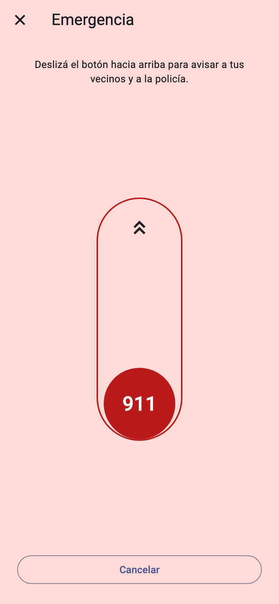
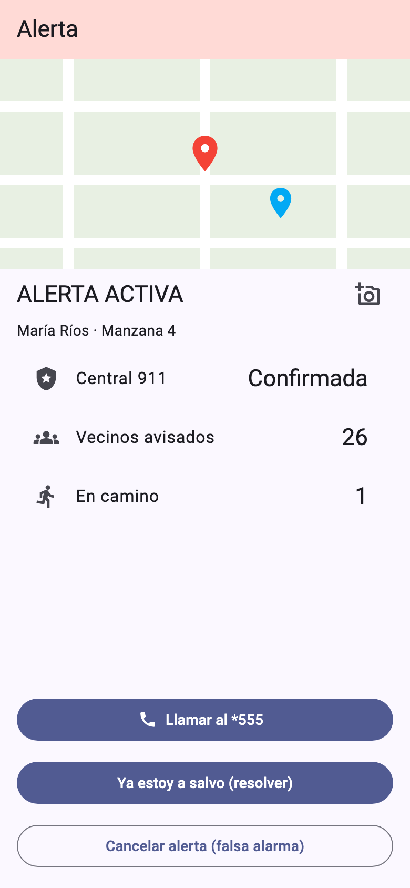
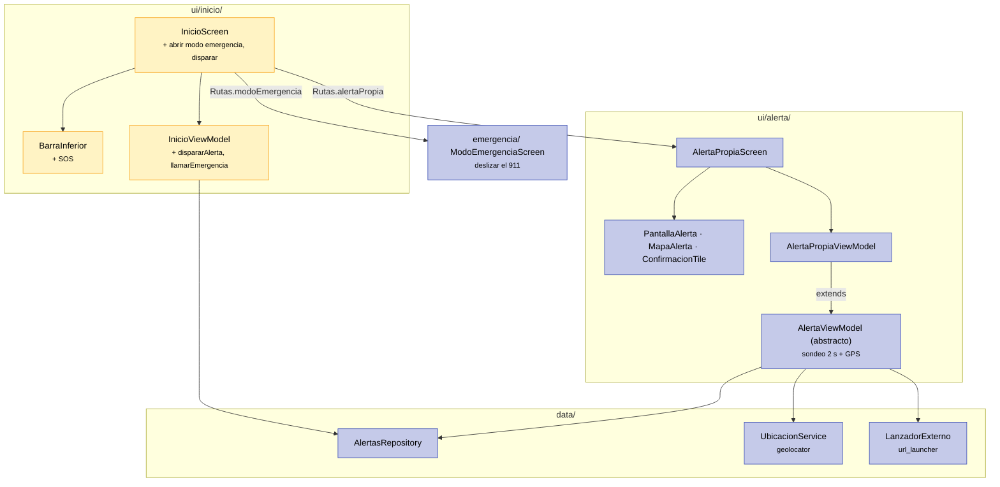
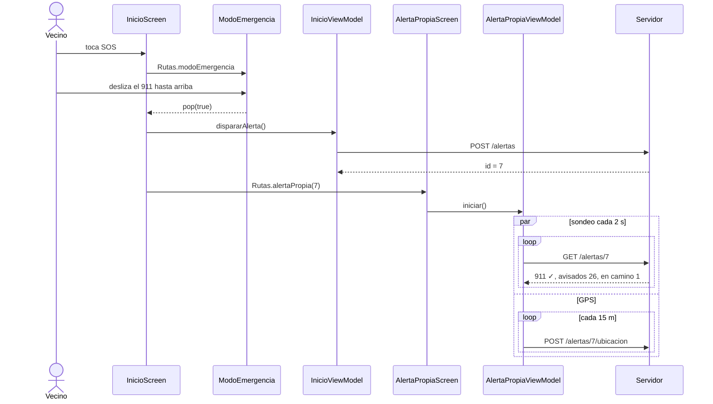
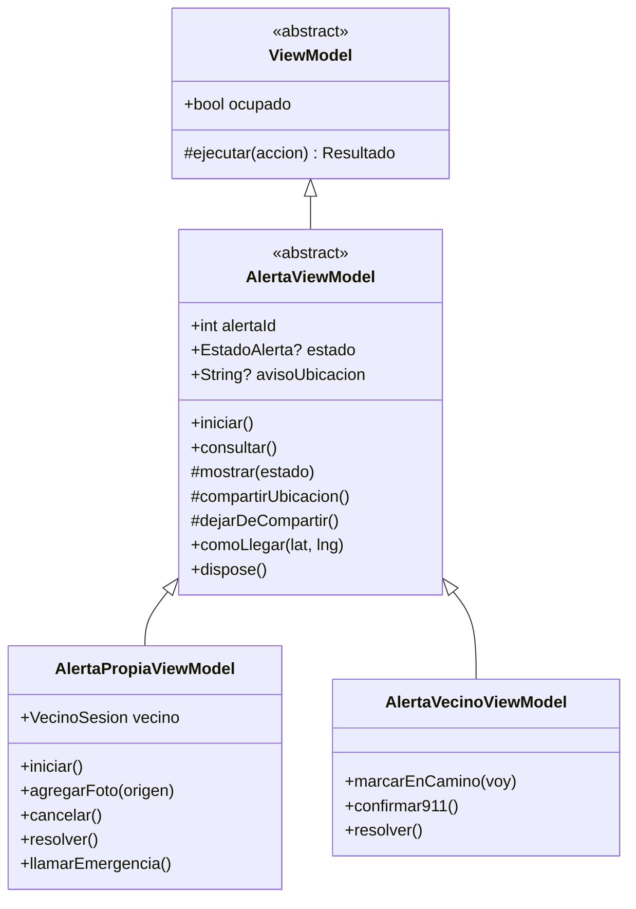
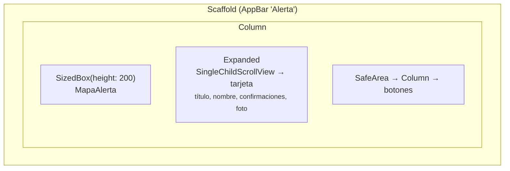

# 14. SOS y alerta propia

!!! abstract "Objetivo"
    La función más importante de VigiaApp:

    1. El botón **SOS** de la barra abre el **modo emergencia**.
    2. Ahí, deslizar el botón **911** hasta arriba **dispara la alerta**.
    3. Se abre la pantalla de **Alerta activa**, que:
        - muestra un **mapa** con tu ubicación en vivo (GPS) y la **triple confirmación** (central 911, vecinos avisados, vecinos en camino), consultada cada 2 segundos;
        - tiene los botones **Llamar**, **Ya estoy a salvo** y **Cancelar (falsa alarma)**;
        - deja sumar una foto.

<div class="capturas" markdown>
<figure markdown="span">
  { .captura }
  <figcaption>Modo emergencia</figcaption>
</figure>
<figure markdown="span">
  { .captura }
  <figcaption>Alerta activa</figcaption>
</figure>
</div>

!!! note "El mapa de la captura es de mentira"
    En los tests no hay Google Maps de verdad, así que la captura muestra un dibujo en su lugar. En el celular, con la clave configurada (paso 1), se ve el mapa real.

## Dónde estamos

Es el capítulo con más piezas nuevas: tres paquetes y dos servicios nuevos, un repositorio, dos ViewModels (uno abstracto) y cinco widgets.



El recorrido completo, desde que el vecino toca SOS:



## Paso 1: tres paquetes y la configuración nativa

```bash
flutter pub add url_launcher geolocator google_maps_flutter
```

<!-- archivo: pubspec.yaml cap=c14 -->
```yaml title="pubspec.yaml" linenums="1" hl_lines="15-17"
name: vigia_app
description: "VigiaApp: red de alerta vecinal (versión de la wiki, solo Material)."
publish_to: 'none'
version: 1.0.0+1

environment:
  sdk: ^3.12.2

dependencies:
  flutter:
    sdk: flutter
  flutter_secure_storage: ^11.2.0
  app_links: ^7.2.1
  image_picker: ^1.2.4
  url_launcher: ^6.3.3
  geolocator: ^14.1.2
  google_maps_flutter: ^2.18.1

dev_dependencies:
  flutter_test:
    sdk: flutter
  flutter_lints: ^6.0.0

flutter:
  uses-material-design: true
```
<!-- /archivo -->

| Paquete | Para qué |
|---|---|
| `url_launcher` | Abrir otras apps: el marcador del teléfono (`tel:*555`) y Google Maps (cómo llegar). |
| `geolocator` | Leer la ubicación del GPS y pedir el permiso. |
| `google_maps_flutter` | Mostrar un mapa de Google con marcadores. |

Los tres son *plugins* (tienen código nativo), así que hay que configurar Android e iOS.

=== "Android"

    **1. Permisos.** En `android/app/src/main/AndroidManifest.xml`, **antes** de `<application`:

    ```xml title="android/app/src/main/AndroidManifest.xml (fragmento)"
    <uses-permission android:name="android.permission.INTERNET" />
    <!-- Ubicación en vivo durante una alerta, solo con la app abierta. -->
    <uses-permission android:name="android.permission.ACCESS_FINE_LOCATION" />
    <uses-permission android:name="android.permission.ACCESS_COARSE_LOCATION" />
    ```

    **2. Poder abrir el marcador.** Desde Android 11, una app tiene que declarar qué otras apps quiere abrir. Dentro de `<queries>` (al final del manifiesto, ya existe uno), agregá:

    ```xml title="android/app/src/main/AndroidManifest.xml (fragmento)"
    <intent>
        <action android:name="android.intent.action.VIEW" />
        <data android:scheme="tel" />
    </intent>
    ```

    **3. La clave de Google Maps.** Google Maps necesita una clave (gratis para este uso) que se saca en la [consola de Google Cloud](https://console.cloud.google.com/google/maps-apis): creás un proyecto, activás **Maps SDK for Android** y creás una clave de API.

    La clave **no se sube al repositorio**. Va en `android/local.properties` (que Git ya ignora):

    ```properties title="android/local.properties (agregar al final)"
    MAPS_API_KEY=tu-clave-de-google-maps
    ```

    En `android/app/build.gradle.kts` se lee ese archivo y se pasa al manifiesto. Arriba de todo:

    ```kotlin title="android/app/build.gradle.kts (fragmento, arriba de todo)"
    import java.util.Properties

    // android/local.properties no se sube al repo: ahí va la clave de Google Maps.
    val propiedadesLocales = Properties().apply {
        val archivo = rootProject.file("local.properties")
        if (archivo.exists()) archivo.inputStream().use { load(it) }
    }
    ```

    Y dentro de `defaultConfig { … }`:

    ```kotlin title="android/app/build.gradle.kts (fragmento, en defaultConfig)"
    manifestPlaceholders["mapsApiKey"] =
        propiedadesLocales.getProperty("MAPS_API_KEY")
            ?: System.getenv("MAPS_API_KEY")
            ?: ""
    ```

    Por último, en el manifiesto, dentro de `<application …>`:

    ```xml title="android/app/src/main/AndroidManifest.xml (fragmento)"
    <!-- Clave de Google Maps (de android/local.properties). Sin clave compila
         igual, pero el mapa sale gris. -->
    <meta-data
        android:name="com.google.android.geo.API_KEY"
        android:value="${mapsApiKey}" />
    ```

=== "iOS"

    **1. Para qué se usa la ubicación.** En `ios/Runner/Info.plist`:

    ```xml title="ios/Runner/Info.plist (fragmento)"
    <key>NSLocationWhenInUseUsageDescription</key>
    <string>Para que tus vecinos sepan dónde estás durante una alerta.</string>
    <key>LSApplicationQueriesSchemes</key>
    <array>
        <string>tel</string>
    </array>
    ```

    **2. La clave de Google Maps** (activá **Maps SDK for iOS** en la consola). En `ios/Runner/AppDelegate.swift`:

    ```swift title="ios/Runner/AppDelegate.swift (fragmento)"
    import GoogleMaps  // arriba, junto a los otros import

    // dentro de application(_:didFinishLaunchingWithOptions:), antes del return:
    GMSServices.provideAPIKey("tu-clave-de-google-maps")
    ```

!!! tip "Sin clave también funciona"
    Sin la clave la app compila y anda igual: el mapa sale gris con el logo de Google y los marcadores. Para aprender alcanza.

## Paso 2: los servicios

`LanzadorExterno` abre otras apps. Creá `lib/data/services/lanzador_externo.dart`:

<!-- archivo: lib/data/services/lanzador_externo.dart cap=c14 notas="launchUrl\(Uri\(scheme: 'tel', path: numeroEmergencia\)\)|Uri.https\('www.google.com'|mode: LaunchMode.externalApplication" -->
```dart title="lib/data/services/lanzador_externo.dart" linenums="1"
// lib/data/services/lanzador_externo.dart
//
// Abre otras apps del celular (paquete url_launcher): el marcador del
// teléfono y Google Maps.

import 'package:url_launcher/url_launcher.dart';

import '../../config.dart';

class LanzadorExterno {
  const LanzadorExterno();

  /// Abre el marcador con [numeroEmergencia] ya cargado. No llama solo: el
  /// vecino toca "llamar", así no hace falta el permiso CALL_PHONE.
  /// Devuelve false si el dispositivo no puede llamar.
  Future<bool> llamarEmergencia() =>
      launchUrl(Uri(scheme: 'tel', path: numeroEmergencia));  // (1)!

  /// Abre Google Maps con la ruta hasta ese punto.
  Future<bool> comoLlegar(double lat, double lng) => launchUrl(
    Uri.https('www.google.com', '/maps/dir/', {  // (2)!
      'api': '1',
      'destination': '$lat,$lng',
    }),
    mode: LaunchMode.externalApplication,  // (3)!
  );
}
```
<!-- /archivo -->

1. Un `Uri` con esquema `tel` abre el marcador **con el número cargado**, pero no llama: el vecino toca "llamar". Así no hace falta el permiso para hacer llamadas. El número sale de `config.dart` (`*555` en la demo).
2. Arma la dirección de "cómo llegar" de Google Maps con los parámetros escapados correctamente.
3. Que se abra en la app de Google Maps, no dentro de la nuestra.

`UbicacionService` es el GPS. Creá `lib/data/services/ubicacion_service.dart`:

<!-- archivo: lib/data/services/ubicacion_service.dart cap=c14 notas="Stream<Coordenadas> seguir\(\) async\* \{|await _revisarPermisos\(\);|yield\* Geolocator.getPositionStream|distanceFilter: 15,|\.map\(\(posicion\) => Coordenadas|if \(!await Geolocator.isLocationServiceEnabled\(\)\)|permiso = await Geolocator.requestPermission\(\)|on MissingPluginException" -->
```dart title="lib/data/services/ubicacion_service.dart" linenums="1"
// lib/data/services/ubicacion_service.dart
//
// Ubicación en vivo para las alertas (paquete geolocator). Solo con la app
// abierta: el ViewModel de la alerta se suscribe al Stream y cancela la
// suscripción en dispose, igual que los Timer.

import 'package:flutter/services.dart';
import 'package:geolocator/geolocator.dart';

import '../../domain/models/coordenadas.dart';
import 'errores.dart';

class UbicacionService {
  const UbicacionService();

  /// 1) revisa que el GPS esté prendido, 2) pide el permiso, 3) emite la
  /// posición al empezar y después cada vez que la persona se mueve 15 m.
  /// Si algo falla, el Stream termina con una [UbicacionException].
  Stream<Coordenadas> seguir() async* {  // (1)!
    await _revisarPermisos();  // (2)!
    yield* Geolocator.getPositionStream(  // (3)!
      locationSettings: const LocationSettings(
        accuracy: LocationAccuracy.high,
        distanceFilter: 15,  // (4)!
      ),
    ).map((posicion) => Coordenadas(posicion.latitude, posicion.longitude));  // (5)!
  }

  Future<void> _revisarPermisos() async {
    try {
      if (!await Geolocator.isLocationServiceEnabled()) {  // (6)!
        throw const UbicacionException(
          'Prendé la ubicación del celular para compartir dónde estás.',
        );
      }
      var permiso = await Geolocator.checkPermission();
      if (permiso == LocationPermission.denied) {
        permiso = await Geolocator.requestPermission();  // (7)!
      }
      if (permiso == LocationPermission.denied ||
          permiso == LocationPermission.deniedForever) {
        throw const UbicacionException(
          'Sin permiso de ubicación: no se comparte dónde estás.',
        );
      }
    } on MissingPluginException {  // (8)!
      // En los tests (y en la versión de escritorio) no hay GPS.
      throw const UbicacionException('Este dispositivo no tiene ubicación.');
    }
  }
}
```
<!-- /archivo -->

1. `async*` (con asterisco) hace una **función generadora asíncrona**: en vez de devolver un valor, va **emitiendo** valores con el tiempo, como un `Stream`. Ver [Stream y Timer](../2-dart/9-streams-y-timers.md#async-y-yield).
2. Primero revisa los permisos. Si algo falla, lanza un error y el `Stream` termina con ese error.
3. `yield*` emite **todos** los valores de otro `Stream`: el del GPS.
4. Solo avisa si la persona se movió al menos 15 metros: menos batería y menos pedidos al servidor.
5. Convierte cada `Position` del paquete en nuestras `Coordenadas` (capítulo 3). El resto de la app nunca ve el tipo del paquete.
6. ¿El GPS está prendido?
7. Si todavía no dio permiso, se lo pide. Aparece el cartel del sistema.
8. En los tests no hay GPS: el plugin no está, y lo traducimos a nuestro error.

## Paso 3: el repositorio de alertas

Creá `lib/data/repositories/alertas_repository.dart`:

<!-- archivo: lib/data/repositories/alertas_repository.dart cap=c14 notas="Future<int> crear\(\) => _api.crearAlerta\(\)|Future<List<EstadoAlerta>> activasDeOtros|if \(alerta.vecinoId != vecinoId\) alerta|Future<void> enviarUbicacion\(int alertaId, Coordenadas punto\)" -->
```dart title="lib/data/repositories/alertas_repository.dart" linenums="1"
// lib/data/repositories/alertas_repository.dart
//
// Alertas SOS (RF-10, RF-11): la propia y las de los vecinos.

import '../../domain/models/alerta.dart';
import '../../domain/models/coordenadas.dart';
import '../services/api/vigia_api.dart';

class AlertasRepository {
  AlertasRepository(this._api);

  final VigiaApi _api;

  /// Dispara una alerta y devuelve su id.
  Future<int> crear() => _api.crearAlerta();  // (1)!

  Future<EstadoAlerta> obtener(int alertaId) => _api.obtenerAlerta(alertaId);

  /// Las alertas activas que dispararon otros vecinos (no [vecinoId]).
  Future<List<EstadoAlerta>> activasDeOtros(int? vecinoId) async {  // (2)!
    final alertas = await _api.obtenerAlertas();
    return [
      for (final alerta in alertas)
        if (alerta.vecinoId != vecinoId) alerta,  // (3)!
    ];
  }

  /// Falsa alarma: avisa a los vecinos y a la central.
  Future<void> cancelar(int alertaId) => _api.cancelarAlerta(alertaId);

  /// La emergencia terminó (quien la disparó o el comité).
  Future<void> resolver(int alertaId) => _api.resolverAlerta(alertaId);

  /// "Voy en camino" (o "ya no voy").
  Future<EstadoAlerta> marcarEnCamino(int alertaId, {required bool voy}) =>
      _api.marcarEnCamino(alertaId, enCamino: voy);

  /// La central tomó el aviso (comité).
  Future<EstadoAlerta> confirmar911(int alertaId) =>
      _api.confirmar911(alertaId);

  Future<void> enviarUbicacion(int alertaId, Coordenadas punto) =>  // (4)!
      _api.enviarUbicacion(alertaId, punto.lat, punto.lng);

  Future<EstadoAlerta> adjuntarFoto(int alertaId, int fotoId) =>
      _api.adjuntarFotoAlerta(alertaId, fotoId);
}
```
<!-- /archivo -->

1. Dispara la alerta. Devuelve el id.
2. Lógica de datos que no va en la pantalla: de todas las alertas activas, las que **no** son mías (las usa el capítulo 15)…
3. …filtrando con un `if` dentro de la lista.
4. Recibe nuestras `Coordenadas` y las desarma para la API.

## Paso 4: el modo emergencia

No tiene ViewModel: su único estado es dónde está el botón mientras el dedo lo arrastra. Es estado **efímero** de la vista, con `setState`. Creá `lib/ui/emergencia/widgets/modo_emergencia_screen.dart`:

<!-- archivo: lib/ui/emergencia/widgets/modo_emergencia_screen.dart cap=c14 notas="static const _recorrido = _altoRiel - _boton|double _progreso = 0;|setState\(\(\) \{|\.clamp\(0, 1\)|if \(_progreso >= 0.9\)|Navigator.pop\(context, true\)|setState\(\(\) => _progreso = 0\)|onPressed: \(\) => Navigator.pop\(context, false\),$|bottom: _progreso \* _recorrido|onVerticalDragUpdate: _arrastrar" -->
```dart title="lib/ui/emergencia/widgets/modo_emergencia_screen.dart" linenums="1"
// lib/ui/emergencia/widgets/modo_emergencia_screen.dart
//
// Modo emergencia: se abre con el SOS de la barra del Inicio. Hay que llevar
// el botón 911 hasta arriba con el dedo para disparar la alerta: es un gesto
// deliberado, que no se hace sin querer. Devuelve true si se completó.
// No tiene ViewModel: su único estado es dónde está el botón.

import 'package:flutter/material.dart';

class ModoEmergenciaScreen extends StatefulWidget {
  const ModoEmergenciaScreen({super.key});

  @override
  State<ModoEmergenciaScreen> createState() => _ModoEmergenciaScreenState();
}

class _ModoEmergenciaScreenState extends State<ModoEmergenciaScreen> {
  static const _altoRiel = 340.0;
  static const _boton = 100.0;
  static const _recorrido = _altoRiel - _boton;  // (1)!

  // Dónde está el botón: 0 = abajo, 1 = arriba.
  double _progreso = 0;  // (2)!

  // El dedo sube: delta.dy es negativo, así que se resta.
  void _arrastrar(DragUpdateDetails detalles) {
    setState(() {  // (3)!
      _progreso = (_progreso - detalles.delta.dy / _recorrido).clamp(0, 1);  // (4)!
    });
  }

  // Si lo soltó casi arriba, se dispara; si no, el botón vuelve abajo.
  void _soltar(DragEndDetails detalles) {
    if (_progreso >= 0.9) {  // (5)!
      Navigator.pop(context, true);  // (6)!
    } else {
      setState(() => _progreso = 0);  // (7)!
    }
  }

  @override
  Widget build(BuildContext context) {
    final colorScheme = Theme.of(context).colorScheme;
    return Scaffold(
      backgroundColor: colorScheme.errorContainer,
      appBar: AppBar(
        title: const Text('Emergencia'),
        backgroundColor: colorScheme.errorContainer,
        leading: IconButton(
          tooltip: 'Cerrar',
          icon: const Icon(Icons.close),
          onPressed: () => Navigator.pop(context, false),  // (8)!
        ),
      ),
      body: Padding(
        padding: const EdgeInsets.all(24),
        child: Column(
          crossAxisAlignment: CrossAxisAlignment.stretch,
          children: [
            const Text(
              'Deslizá el botón hacia arriba para avisar a tus vecinos y '
              'a la policía.',
              textAlign: TextAlign.center,
            ),
            Expanded(child: Center(child: _riel(colorScheme))),
            OutlinedButton(
              onPressed: () => Navigator.pop(context, false),
              child: const Text('Cancelar'),
            ),
          ],
        ),
      ),
    );
  }

  /// El riel con el botón 911: se lleva hasta arriba con el dedo.
  Widget _riel(ColorScheme colorScheme) {
    return Container(
      width: 120,
      height: _altoRiel,
      decoration: BoxDecoration(
        border: Border.all(color: colorScheme.error, width: 2),
        borderRadius: BorderRadius.circular(60),
      ),
      child: Stack(
        alignment: Alignment.topCenter,
        children: [
          const Positioned(
            top: 24,
            child: Icon(Icons.keyboard_double_arrow_up, size: 32),
          ),
          Positioned(
            bottom: _progreso * _recorrido,  // (9)!
            child: GestureDetector(
              onVerticalDragUpdate: _arrastrar,  // (10)!
              onVerticalDragEnd: _soltar,
              child: CircleAvatar(
                radius: _boton / 2,
                backgroundColor: colorScheme.error,
                foregroundColor: colorScheme.onError,
                child: const Text('911', style: TextStyle(fontSize: 28)),
              ),
            ),
          ),
        ],
      ),
    );
  }
}
```
<!-- /archivo -->

1. Cuántos píxeles puede subir el botón: el alto del riel menos el del botón.
2. Dónde está el botón: de 0 (abajo) a 1 (arriba).
3. Cada movimiento del dedo cambia el estado con `setState`, y la pantalla se redibuja con el botón en su nuevo lugar.
4. `delta.dy` es cuánto se movió el dedo en vertical desde el último aviso (negativo si sube); lo pasamos a "fracción del recorrido". `clamp(0, 1)` lo mantiene entre 0 y 1: el botón no se sale del riel.
5. Al soltar: si llegó casi arriba (90 %)…
6. …se cierra la pantalla devolviendo `true`: "dispará".
7. Si no, vuelve abajo. No dispara nada.
8. Cerrar devuelve `false`.
9. `Positioned` dentro de un `Stack`: el botón se ubica a una distancia del borde de abajo que depende del progreso.
10. `GestureDetector` avisa cada movimiento vertical del dedo.

!!! question "¿Por qué deslizar y no un botón común?"
    Un botón se toca sin querer (en el bolsillo, al guardar el celular). Deslizar 240 píxeles hacia arriba es un gesto **deliberado**. Y es más rápido que "mantener apretado 3 segundos". En una emergencia, cada segundo cuenta, pero una falsa alarma moviliza a todo el barrio.

## Paso 5: el ViewModel de la alerta

Las dos pantallas de alerta (la propia y la de un vecino, capítulo 15) hacen lo mismo en el fondo: consultar el estado cada 2 segundos y compartir la ubicación. Eso va en una clase **abstracta** que las dos extienden. Creá `lib/ui/alerta/view_model/alerta_view_model.dart`:

<!-- archivo: lib/ui/alerta/view_model/alerta_view_model.dart cap=c14 notas="abstract class AlertaViewModel extends ViewModel|EstadoAlerta\? estadoInicial,|\}\) : _estado = estadoInicial;|@protected$|late final _sondeo = Sondeo\(const Duration\(seconds: 2\), consultar\)|StreamSubscription<Coordenadas>\? _envioUbicacion|mostrar\(await alertas.obtener\(alertaId\)\)|void mostrar\(EstadoAlerta estado\)|if \(!estado.activa\) \{|if \(_envioUbicacion != null\) return;|_envioUbicacion = ubicacion.seguir\(\).listen\(|onError: _sinUbicacion,|_envioUbicacion\?.cancel\(\);|error is UbicacionException|_sondeo.detener\(\);$" -->
```dart title="lib/ui/alerta/view_model/alerta_view_model.dart" linenums="1"
// lib/ui/alerta/view_model/alerta_view_model.dart
//
// Lo común a las dos pantallas de alerta (la propia y la de un vecino):
// consultar el estado cada 2 segundos (polling: el hosting compartido no
// permite WebSockets) y compartir la ubicación en vivo mientras haga falta.

import 'dart:async';

import 'package:flutter/foundation.dart';

import '../../../data/repositories/alertas_repository.dart';
import '../../../data/repositories/fotos_repository.dart';
import '../../../data/services/errores.dart';
import '../../../data/services/lanzador_externo.dart';
import '../../../data/services/ubicacion_service.dart';
import '../../../domain/models/alerta.dart';
import '../../../domain/models/coordenadas.dart';
import '../../../utils/sondeo.dart';
import '../../core/view_model.dart';

abstract class AlertaViewModel extends ViewModel {  // (1)!
  AlertaViewModel({
    required this.alertaId,
    required this.alertas,
    required this.fotos,
    required this.ubicacion,
    required this.lanzador,
    EstadoAlerta? estadoInicial,  // (2)!
  }) : _estado = estadoInicial;  // (3)!

  final int alertaId;

  @protected  // (4)!
  final AlertasRepository alertas;
  @protected
  final FotosRepository fotos;
  @protected
  final UbicacionService ubicacion;
  @protected
  final LanzadorExterno lanzador;

  late final _sondeo = Sondeo(const Duration(seconds: 2), consultar);  // (5)!
  StreamSubscription<Coordenadas>? _envioUbicacion;  // (6)!
  EstadoAlerta? _estado;
  String? _avisoUbicacion;

  /// null mientras llega la primera consulta.
  EstadoAlerta? get estado => _estado;

  /// Por qué no se está compartiendo la ubicación (sin permiso, GPS apagado).
  String? get avisoUbicacion => _avisoUbicacion;

  bool get compartiendoUbicacion => _envioUbicacion != null;

  void iniciar() => _sondeo.iniciar();

  Future<void> consultar() async {
    try {
      mostrar(await alertas.obtener(alertaId));  // (7)!
    } on ApiException {
      // Si falla una consulta no cortamos la alerta: reintenta en 2 s.
    }
  }

  /// Guarda el estado nuevo y avisa. Si la alerta se cerró (p. ej. el
  /// comité la resolvió), deja de consultar.
  @protected
  void mostrar(EstadoAlerta estado) {  // (8)!
    _estado = estado;
    if (!estado.activa) {  // (9)!
      _sondeo.detener();
      dejarDeCompartir();
    }
    notifyListeners();
  }

  /// Empieza a mandar mi ubicación cada vez que me muevo (~15 m); los
  /// vecinos la ven en su próxima consulta.
  @protected
  void compartirUbicacion() {
    if (_envioUbicacion != null) return;  // (10)!
    _envioUbicacion = ubicacion.seguir().listen(  // (11)!
      _enviarUbicacion,
      onError: _sinUbicacion,  // (12)!
    );
  }

  @protected
  void dejarDeCompartir() {
    _envioUbicacion?.cancel();  // (13)!
    _envioUbicacion = null;
  }

  Future<void> _enviarUbicacion(Coordenadas punto) async {
    try {
      await alertas.enviarUbicacion(alertaId, punto);
    } on ApiException {
      // Sin conexión: se manda de nuevo con el próximo movimiento.
    }
  }

  void _sinUbicacion(Object error) {
    _avisoUbicacion = error is UbicacionException  // (14)!
        ? error.mensaje
        : 'No se pudo obtener la ubicación.';
    notifyListeners();
  }

  Future<Uint8List> cargarFoto(int fotoId) => fotos.obtener(fotoId);

  /// Abre Google Maps con la ruta hasta quien disparó la alerta.
  Future<bool> comoLlegar(double lat, double lng) =>
      lanzador.comoLlegar(lat, lng);

  @override
  void dispose() {
    // Si no cancelamos el polling y el GPS, siguen corriendo con la pantalla
    // cerrada (memory leak, apunte 12).
    _sondeo.detener();  // (15)!
    dejarDeCompartir();
    super.dispose();
  }
}
```
<!-- /archivo -->

1. `abstract`: nadie crea un `AlertaViewModel` a secas; se crean sus hijas.
2. La de un vecino ya tiene el estado (viene del Inicio); la propia, no.
3. La lista de inicialización arranca `_estado` con eso (o `null`).
4. Campos **protegidos**: los usan las hijas, pero no la vista.
5. Cada 2 segundos, `consultar`.
6. La suscripción al GPS. `null` = no se está compartiendo.
7. Pide el estado y lo muestra. Si falla, no hace nada: reintenta en 2 segundos.
8. Las hijas también lo usan cuando una acción devuelve un estado nuevo.
9. Si la alerta se cerró (la resolvió el comité, la cancelé desde otro lado), deja de consultar y de mandar la ubicación.
10. Si ya estaba compartiendo, no se suscribe dos veces.
11. Se suscribe al `Stream` del GPS: cada posición nueva va a `_enviarUbicacion`.
12. Si el `Stream` termina con error (sin permiso, GPS apagado), `_sinUbicacion` guarda el aviso para mostrarlo. La alerta sigue igual, sin ubicación.
13. Cancelar la suscripción apaga el GPS para esta pantalla.
14. `is` pregunta el tipo: si es nuestro error, su mensaje; si no, uno genérico.
15. **Lo más importante:** al cerrar la pantalla, se detiene el sondeo y el GPS. Si no, seguirían andando con la pantalla cerrada.



`AlertaVecinoViewModel` llega en el capítulo 15. La propia, `lib/ui/alerta/view_model/alerta_propia_view_model.dart`:

<!-- archivo: lib/ui/alerta/view_model/alerta_propia_view_model.dart cap=c14 notas="required super.alertaId,|@override|super.iniciar\(\);|compartirUbicacion\(\);|ejecutar\(\(\) async \{|if \(fotoId == null\) return;|mostrar\(await alertas.adjuntarFoto|Future<Resultado<void>> cancelar\(\)" -->
```dart title="lib/ui/alerta/view_model/alerta_propia_view_model.dart" linenums="1"
// lib/ui/alerta/view_model/alerta_propia_view_model.dart
//
// La alerta que disparé yo: mientras está abierta comparto la ubicación en
// vivo, puedo sumar una foto, llamar a emergencias, resolverla o cancelarla.

import '../../../data/services/selector_fotos.dart';
import '../../../domain/models/sesion.dart';
import '../../../utils/resultado.dart';
import 'alerta_view_model.dart';

class AlertaPropiaViewModel extends AlertaViewModel {
  AlertaPropiaViewModel({
    required super.alertaId,  // (1)!
    required this.vecino,
    required super.alertas,
    required super.fotos,
    required super.ubicacion,
    required super.lanzador,
  });

  /// Quien disparó la alerta (el de la sesión).
  final VecinoSesion vecino;

  @override  // (2)!
  void iniciar() {
    super.iniciar();  // (3)!
    compartirUbicacion();  // (4)!
  }

  /// Una foto de lo que está pasando: la ven los vecinos en su pantalla.
  Future<Resultado<void>> agregarFoto(OrigenFoto origen) => ejecutar(() async {  // (5)!
    final fotoId = await fotos.elegirYSubir(origen);
    if (fotoId == null) return; // se arrepintió (6)
    mostrar(await alertas.adjuntarFoto(alertaId, fotoId));  // (7)!
  }, marcarOcupado: false);

  /// Falsa alarma: avisa a los vecinos y a la central.
  Future<Resultado<void>> cancelar() =>  // (8)!
      ejecutar(() => alertas.cancelar(alertaId));

  /// La emergencia terminó: no avisa "falsa alarma".
  Future<Resultado<void>> resolver() =>
      ejecutar(() => alertas.resolver(alertaId));

  /// Devuelve false si el dispositivo no puede llamar.
  Future<bool> llamarEmergencia() => lanzador.llamarEmergencia();
}
```
<!-- /archivo -->

1. **Parámetros `super`**: se pasan directo al constructor de la madre, sin repetir campos.
2. Reemplaza el `iniciar` de la madre…
3. …pero primero llama al de la madre (que arranca el sondeo)…
4. …y además comparte la ubicación: quien disparó la alerta siempre la comparte.
5. `ejecutar` con una función **asíncrona escrita ahí mismo** (dos pasos: subir y adjuntar).
6. Se arrepintió: no hace nada.
7. El servidor devuelve la alerta con la foto, y se muestra.
8. Las acciones devuelven `Resultado` para que la pantalla decida.

## Paso 6: los widgets de la alerta

`ConfirmacionTile`, una fila de la triple confirmación. Creá `lib/ui/alerta/widgets/confirmacion_tile.dart`:

<!-- archivo: lib/ui/alerta/widgets/confirmacion_tile.dart cap=c14 notas="String textoCentral911\(bool\? confirmada\)|String textoCierre" -->
```dart title="lib/ui/alerta/widgets/confirmacion_tile.dart" linenums="1"
// lib/ui/alerta/widgets/confirmacion_tile.dart
//
// Una fila de la triple confirmación de una alerta (Central 911 · vecinos
// avisados · en camino). La usan la Alerta Activa y la alerta de un vecino.

import 'package:flutter/material.dart';

import '../../../domain/models/alerta.dart';

class ConfirmacionTile extends StatelessWidget {
  const ConfirmacionTile({
    required this.icono,
    required this.titulo,
    required this.valor,
    super.key,
  });

  final IconData icono;
  final String titulo;
  final String valor;

  @override
  Widget build(BuildContext context) {
    return ListTile(
      leading: Icon(icono),
      title: Text(titulo),
      trailing: Text(valor, style: Theme.of(context).textTheme.titleLarge),
    );
  }
}

/// "Enviando…", "Confirmada" o "Esperando…" para la fila de la Central 911.
String textoCentral911(bool? confirmada) => confirmada == null  // (1)!
    ? 'Enviando…'
    : confirmada
    ? 'Confirmada'
    : 'Esperando…';

/// Texto para una alerta que ya no está activa.
String textoCierre(EstadoAlerta alerta) => alerta.cancelada  // (2)!
    ? 'Falsa alarma: la alerta se canceló'
    : 'La alerta se resolvió';
```
<!-- /archivo -->

1. Una función al lado del widget, con un `? :` dentro de otro: `null` → "Enviando…", `true` → "Confirmada", `false` → "Esperando…".
2. El texto que se muestra cuando la alerta se cerró.

`MapaAlerta`, el mapa. Creá `lib/ui/alerta/widgets/mapa_alerta.dart`:

<!-- archivo: lib/ui/alerta/widgets/mapa_alerta.dart cap=c14 notas="if \(lat == null \|\| lng == null\) \{|final hayMapa =|return GoogleMap\(|initialCameraPosition: CameraPosition\(|markers: marcadoresDe\(estado\)|Set<Marker> marcadoresDe|if \(lat != null && lng != null\)$|for \(final u in estado.enCaminoUbicaciones\)" -->
```dart title="lib/ui/alerta/widgets/mapa_alerta.dart" linenums="1"
// lib/ui/alerta/widgets/mapa_alerta.dart
//
// Mapa de la alerta (Google Maps): un pin rojo donde está quien la disparó
// y uno celeste por cada vecino en camino. Los datos los trae el ViewModel
// con cada consulta del estado (cada 2 s): este widget solo los dibuja.

import 'package:flutter/foundation.dart';
import 'package:flutter/material.dart';
import 'package:google_maps_flutter/google_maps_flutter.dart';

import '../../../domain/models/alerta.dart';

class MapaAlerta extends StatelessWidget {
  const MapaAlerta({
    required this.estado,
    required this.onComoLlegar,
    super.key,
  });

  final EstadoAlerta estado;

  /// Abre la ruta hasta ese punto en Google Maps.
  final void Function(double lat, double lng) onComoLlegar;

  @override
  Widget build(BuildContext context) {
    final lat = estado.lat;
    final lng = estado.lng;
    if (lat == null || lng == null) {  // (1)!
      return const Center(child: Text('Esperando la ubicación…'));
    }
    // Google Maps solo tiene versión para Android e iOS (y web): en otra
    // plataforma se muestran las coordenadas y un botón para abrirlas.
    final hayMapa =  // (2)!
        !kIsWeb &&
        (defaultTargetPlatform == TargetPlatform.android ||
            defaultTargetPlatform == TargetPlatform.iOS);
    if (!hayMapa) {
      return Center(
        child: Column(
          mainAxisSize: MainAxisSize.min,
          children: [
            const Icon(Icons.map_outlined, size: 48),
            Text('${lat.toStringAsFixed(5)}, ${lng.toStringAsFixed(5)}'),
            TextButton.icon(
              onPressed: () => onComoLlegar(lat, lng),
              icon: const Icon(Icons.open_in_new),
              label: const Text('Cómo llegar (Google Maps)'),
            ),
          ],
        ),
      );
    }
    return GoogleMap(  // (3)!
      // Solo se usa la primera vez: después el mapa queda donde lo deje el
      // vecino, y lo que cambia son los marcadores.
      initialCameraPosition: CameraPosition(target: LatLng(lat, lng), zoom: 16),  // (4)!
      markers: marcadoresDe(estado),  // (5)!
      myLocationButtonEnabled: false,
    );
  }
}

/// Un pin rojo para quien disparó la alerta y uno celeste por cada vecino en
/// camino. Está aparte del widget para poder probarlo sin dibujar el mapa.
Set<Marker> marcadoresDe(EstadoAlerta estado) {  // (6)!
  final lat = estado.lat;
  final lng = estado.lng;
  return {
    if (lat != null && lng != null)  // (7)!
      Marker(
        markerId: const MarkerId('victima'),
        position: LatLng(lat, lng),
        infoWindow: InfoWindow(
          title: 'SOS · ${estado.vecinoNombre ?? 'Vecino'}',
        ),
        icon: BitmapDescriptor.defaultMarkerWithHue(BitmapDescriptor.hueRed),
        zIndexInt: 1, // arriba de los vecinos
      ),
    for (final u in estado.enCaminoUbicaciones)  // (8)!
      Marker(
        markerId: MarkerId('vecino-${u.vecinoId}'),
        position: LatLng(u.lat, u.lng),
        infoWindow: InfoWindow(title: u.nombre, snippet: 'Va en camino'),
        icon: BitmapDescriptor.defaultMarkerWithHue(BitmapDescriptor.hueAzure),
      ),
  };
}
```
<!-- /archivo -->

1. Todavía no llegó la ubicación (o no hay permiso): un texto.
2. Google Maps solo existe en Android, iOS y web. En otra plataforma (la compu, para probar) muestra las coordenadas.
3. El mapa de Google.
4. Dónde arranca la cámara: centrada en quien disparó la alerta, con zoom de calle. Solo se usa la primera vez.
5. Los marcadores, que se recalculan en cada consulta.
6. Una función **aparte** que arma los marcadores. Así se puede probar en un test sin dibujar el mapa.
7. Un `Set` armado con un `if`…
8. …y un `for`: un marcador celeste por vecino en camino.

`PantallaAlerta`, el esqueleto común de las dos pantallas de alerta. Creá `lib/ui/alerta/widgets/pantalla_alerta.dart`:

<!-- archivo: lib/ui/alerta/widgets/pantalla_alerta.dart cap=c14 notas="required this.tarjeta,|final List<Widget> botones;|height: 200,|child: SingleChildScrollView\(|children: botones,|List<Widget> confirmaciones\(EstadoAlerta\? estado\)|Widget fotoDeAlerta" -->
```dart title="lib/ui/alerta/widgets/pantalla_alerta.dart" linenums="1"
// lib/ui/alerta/widgets/pantalla_alerta.dart
//
// Esqueleto común de las dos pantallas de alerta (la propia y la de un
// vecino): el mapa arriba, la información en el medio y los botones abajo.
// Cada pantalla solo dice qué va en la información y qué botones muestra.

import 'package:flutter/material.dart';

import '../../../domain/models/alerta.dart';
import '../../core/widgets/foto_vigia.dart';
import 'confirmacion_tile.dart';
import 'mapa_alerta.dart';

class PantallaAlerta extends StatelessWidget {
  const PantallaAlerta({
    required this.estado,
    required this.tarjeta,  // (1)!
    required this.botones,
    required this.onComoLlegar,
    super.key,
  });

  /// null mientras llega la primera consulta (todavía no hay mapa).
  final EstadoAlerta? estado;
  final List<Widget> tarjeta;
  final List<Widget> botones;  // (2)!
  final void Function(double lat, double lng) onComoLlegar;

  @override
  Widget build(BuildContext context) {
    final estado = this.estado;
    return Scaffold(
      appBar: AppBar(
        title: const Text('Alerta'),
        backgroundColor: Theme.of(context).colorScheme.errorContainer,
      ),
      body: Column(
        crossAxisAlignment: CrossAxisAlignment.stretch,
        children: [
          // 1) El mapa, con alto fijo.
          SizedBox(
            height: 200,  // (3)!
            child: estado == null
                ? const Center(child: CircularProgressIndicator())
                : MapaAlerta(estado: estado, onComoLlegar: onComoLlegar),
          ),
          // 2) La información: ocupa lo que sobra y se desliza si no entra.
          Expanded(
            child: SingleChildScrollView(  // (4)!
              padding: const EdgeInsets.symmetric(horizontal: 16),
              child: Column(
                crossAxisAlignment: CrossAxisAlignment.start,
                children: tarjeta,
              ),
            ),
          ),
          // 3) Los botones, siempre a la vista abajo.
          SafeArea(
            child: Padding(
              padding: const EdgeInsets.all(16),
              child: Column(
                mainAxisSize: MainAxisSize.min,
                crossAxisAlignment: CrossAxisAlignment.stretch,
                children: botones,  // (5)!
              ),
            ),
          ),
        ],
      ),
    );
  }
}

/// La triple confirmación: Central 911, vecinos avisados y en camino.
List<Widget> confirmaciones(EstadoAlerta? estado) => [  // (6)!
  ConfirmacionTile(
    icono: Icons.local_police,
    titulo: 'Central 911',
    valor: textoCentral911(estado?.central911Confirmada),
  ),
  ConfirmacionTile(
    icono: Icons.groups,
    titulo: 'Vecinos avisados',
    valor: '${estado?.vecinosAvisados ?? 0}',
  ),
  ConfirmacionTile(
    icono: Icons.directions_run,
    titulo: 'En camino',
    valor: '${estado?.enCamino ?? 0}',
  ),
];

/// Por qué no se está compartiendo la ubicación (sin permiso, GPS apagado).
Widget avisoUbicacion(String mensaje) =>
    Padding(padding: const EdgeInsets.only(top: 4), child: Text(mensaje));

/// La foto que agregó quien disparó la alerta. Con otra key, si cambia la
/// foto la pide de nuevo.
Widget fotoDeAlerta(int fotoId, CargarFoto cargar) => Padding(  // (7)!
  padding: const EdgeInsets.only(top: 8),
  child: FotoVigia(
    key: ValueKey(fotoId),
    fotoId: fotoId,
    cargar: cargar,
    alto: 120,
  ),
);
```
<!-- /archivo -->

1. Cada pantalla le pasa **qué va** en la parte de información…
2. …y qué botones mostrar. Esta clase solo sabe **dónde** va cada cosa.
3. El mapa con alto fijo arriba.
4. La información en el medio: ocupa lo que sobra y se desliza si no entra.
5. Los botones abajo, siempre a la vista.
6. La triple confirmación, como una función que devuelve una lista de widgets. Las dos pantallas la usan.
7. La foto de la alerta, con una `ValueKey` del id: si cambia la foto, el `FotoVigia` se crea de nuevo y la pide.



## Paso 7: la pantalla de la alerta propia

Creá `lib/ui/alerta/widgets/alerta_propia_screen.dart`:

<!-- archivo: lib/ui/alerta/widgets/alerta_propia_screen.dart cap=c14 notas="_viewModel.iniciar\(\);|_viewModel.dispose\(\); // corta|final cancelar = await confirmar\(|confirmar: 'Sí, cancelar',|if \(!mounted\) return; // el usuario|if \(mounted && avisarSiFallo\(context, resultado\)\) Navigator.pop\(context\)|final pudo = await _viewModel.llamarEmergencia\(\)|final activa = estado == null \|\| estado.activa;|\.\.\.confirmaciones\(estado\),|if \(_viewModel.avisoUbicacion case final aviso\?\)|botones: activa|label: const Text\('Llamar al \$numeroEmergencia'\)|onPressed: _viewModel.ocupado \? null : _cancelar" -->
```dart title="lib/ui/alerta/widgets/alerta_propia_screen.dart" linenums="1"
// lib/ui/alerta/widgets/alerta_propia_screen.dart
//
// Pantalla 3 del Manual: "Alerta Activa". Se abre cuando se desliza el botón
// 911. Muestra la triple confirmación (Central 911 · vecinos avisados · en
// camino), que el ViewModel consulta cada 2 segundos. Desde acá también se
// puede llamar a emergencias directamente.

import 'package:flutter/material.dart';

import '../../../config.dart';
import '../../../utils/resultado.dart';
import '../../core/widgets/avisos.dart';
import '../../core/widgets/elegir_origen_foto.dart';
import '../view_model/alerta_propia_view_model.dart';
import 'confirmacion_tile.dart';
import 'pantalla_alerta.dart';

class AlertaPropiaScreen extends StatefulWidget {
  const AlertaPropiaScreen({required this.viewModel, super.key});

  final AlertaPropiaViewModel viewModel;

  @override
  State<AlertaPropiaScreen> createState() => _AlertaPropiaScreenState();
}

class _AlertaPropiaScreenState extends State<AlertaPropiaScreen> {
  // Se toma una sola vez: si el padre se redibuja, la pantalla sigue con el
  // mismo ViewModel (el que después descarta en dispose).
  late final AlertaPropiaViewModel _viewModel = widget.viewModel;

  @override
  void initState() {
    super.initState(); // siempre primero
    _viewModel.iniciar();  // (1)!
  }

  @override
  void dispose() {
    _viewModel.dispose(); // corta el polling y el GPS (2)
    super.dispose(); // siempre al final
  }

  Future<void> _cancelar() async {
    final cancelar = await confirmar(  // (3)!
      context,
      titulo: '¿Cancelar la alerta?',
      mensaje:
          'Se avisará a los vecinos y a la central que fue una falsa alarma.',
      confirmar: 'Sí, cancelar',  // (4)!
      cancelar: 'Seguir con la alerta',
    );
    if (!cancelar) return;
    final resultado = await _viewModel.cancelar();
    if (!mounted) return; // el usuario pudo haberse ido mientras esperaba (5)
    switch (resultado) {
      case Ok():
        Navigator.pop(context);
      case Fallo():
        mostrarAviso(context, 'No se pudo cancelar. Probá de nuevo.');
    }
  }

  Future<void> _resolver() async {
    final resultado = await _viewModel.resolver();
    if (mounted && avisarSiFallo(context, resultado)) Navigator.pop(context);  // (6)!
  }

  Future<void> _llamar() async {
    final pudo = await _viewModel.llamarEmergencia();  // (7)!
    if (pudo || !mounted) return;
    mostrarAviso(context, 'Este dispositivo no puede hacer llamadas.');
  }

  Future<void> _agregarFoto() async {
    final origen = await elegirOrigenFoto(context);
    if (origen == null) return;
    final resultado = await _viewModel.agregarFoto(origen);
    if (mounted) avisarSiFallo(context, resultado);
  }

  @override
  Widget build(BuildContext context) {
    return ListenableBuilder(
      listenable: _viewModel,
      builder: (context, _) {
        final estado = _viewModel.estado;
        final activa = estado == null || estado.activa;  // (8)!
        final vecino = _viewModel.vecino;
        return PantallaAlerta(
          estado: estado,
          onComoLlegar: _viewModel.comoLlegar,
          tarjeta: [
            Row(
              children: [
                Expanded(
                  child: Text(
                    'ALERTA ${(estado?.estado ?? 'activa').toUpperCase()}',
                    style: Theme.of(context).textTheme.titleLarge,
                  ),
                ),
                if (activa)
                  IconButton(
                    icon: const Icon(Icons.add_a_photo_outlined),
                    tooltip: 'Agregar foto',
                    onPressed: _agregarFoto,
                  ),
              ],
            ),
            Text('${vecino.nombre} · ${vecino.manzana}'),
            const SizedBox(height: 8),
            ...confirmaciones(estado),  // (9)!
            if (_viewModel.avisoUbicacion case final aviso?)  // (10)!
              avisoUbicacion(aviso),
            if (estado?.fotoId case final fotoId?)
              fotoDeAlerta(fotoId, _viewModel.cargarFoto),
          ],
          botones: activa  // (11)!
              ? [
                  FilledButton.icon(
                    onPressed: _llamar,
                    icon: const Icon(Icons.phone),
                    label: const Text('Llamar al $numeroEmergencia'),  // (12)!
                  ),
                  const SizedBox(height: 12),
                  FilledButton(
                    onPressed: _viewModel.ocupado ? null : _resolver,
                    child: const Text('Ya estoy a salvo (resolver)'),
                  ),
                  const SizedBox(height: 12),
                  OutlinedButton(
                    onPressed: _viewModel.ocupado ? null : _cancelar,  // (13)!
                    child: const Text('Cancelar alerta (falsa alarma)'),
                  ),
                ]
              : [
                  Text(textoCierre(estado), textAlign: TextAlign.center),
                  const SizedBox(height: 12),
                  OutlinedButton(
                    onPressed: () => Navigator.pop(context),
                    child: const Text('Volver al inicio'),
                  ),
                ],
        );
      },
    );
  }
}
```
<!-- /archivo -->

1. Al aparecer: sondeo y GPS.
2. Al cerrarse: los corta.
3. Cancelar una alerta **siempre** pregunta.
4. Los textos de los botones del diálogo, más claros que "Borrar" y "Cancelar".
5. Después de cada `await`, `mounted`.
6. Resolver: si salió bien, se cierra la pantalla.
7. Si el dispositivo no puede llamar (una tablet sin chip), lo avisa.
8. Mientras llega la primera consulta (`estado == null`) se considera activa.
9. Los tres `ConfirmacionTile` de la triple confirmación, "desparramados" con `...` dentro de la lista.
10. Si no se puede compartir la ubicación, el motivo.
11. Los botones cambian según si la alerta sigue activa o ya se cerró.
12. El número sale de `config.dart`: en la demo, "Llamar al *555".
13. Deshabilitado mientras espera, como siempre.

## Paso 8: conectar

La barra de abajo suma el **SOS** en el medio. Un toque en el SOS no cambia de pestaña: avisa al padre.

<!-- diff: lib/ui/inicio/widgets/barra_inferior.dart cap=c14 -->
```diff title="Qué cambia en lib/ui/inicio/widgets/barra_inferior.dart"
--- lib/ui/inicio/widgets/barra_inferior.dart (cap. 13)
+++ lib/ui/inicio/widgets/barra_inferior.dart (cap. 14)
@@ -3,6 +3,6 @@
 import 'package:flutter/material.dart';
 
-/// Barra de abajo con las dos pestañas del Inicio: Chat y Actividad.
-/// (En el capítulo 14 se suma el SOS en el medio.)
+/// Barra de abajo: Chat · SOS · Actividad. Chat y Actividad son pestañas;
+/// el SOS del medio no es una pestaña: abre el modo emergencia.
 class BarraInferior extends StatelessWidget {
   const BarraInferior({
@@ -10,4 +10,5 @@
     required this.onChat,
     required this.onActividad,
+    required this.onSos,
     super.key,
   });
@@ -16,13 +17,29 @@
   final VoidCallback onChat;
   final VoidCallback onActividad;
+  final VoidCallback onSos;
 
   @override
   Widget build(BuildContext context) {
     return NavigationBar(
-      selectedIndex: enChat ? 0 : 1,
-      onDestinationSelected: (indice) => indice == 0 ? onChat() : onActividad(),
-      destinations: const [
-        NavigationDestination(icon: Icon(Icons.forum_outlined), label: 'Chat'),
+      selectedIndex: enChat ? 0 : 2,
+      onDestinationSelected: (indice) => switch (indice) {
+        0 => onChat(),
+        1 => onSos(),
+        _ => onActividad(),
+      },
+      destinations: [
+        const NavigationDestination(
+          icon: Icon(Icons.forum_outlined),
+          label: 'Chat',
+        ),
         NavigationDestination(
+          icon: Icon(
+            Icons.sos,
+            color: Theme.of(context).colorScheme.error,
+            size: 36,
+          ),
+          label: 'SOS',
+        ),
+        const NavigationDestination(
           icon: Icon(Icons.view_list_outlined),
           label: 'Actividad',
```
<!-- /diff -->

<!-- archivo: lib/ui/inicio/widgets/barra_inferior.dart cap=c14 notas="selectedIndex: enChat \? 0 : 2|1 => onSos\(\),|Icons.sos," -->
```dart title="lib/ui/inicio/widgets/barra_inferior.dart" linenums="1" hl_lines="5-6 12 19 24-34 36-43"
// lib/ui/inicio/widgets/barra_inferior.dart

import 'package:flutter/material.dart';

/// Barra de abajo: Chat · SOS · Actividad. Chat y Actividad son pestañas;
/// el SOS del medio no es una pestaña: abre el modo emergencia.
class BarraInferior extends StatelessWidget {
  const BarraInferior({
    required this.enChat,
    required this.onChat,
    required this.onActividad,
    required this.onSos,
    super.key,
  });

  final bool enChat;
  final VoidCallback onChat;
  final VoidCallback onActividad;
  final VoidCallback onSos;

  @override
  Widget build(BuildContext context) {
    return NavigationBar(
      selectedIndex: enChat ? 0 : 2,  // (1)!
      onDestinationSelected: (indice) => switch (indice) {
        0 => onChat(),
        1 => onSos(),  // (2)!
        _ => onActividad(),
      },
      destinations: [
        const NavigationDestination(
          icon: Icon(Icons.forum_outlined),
          label: 'Chat',
        ),
        NavigationDestination(
          icon: Icon(
            Icons.sos,  // (3)!
            color: Theme.of(context).colorScheme.error,
            size: 36,
          ),
          label: 'SOS',
        ),
        const NavigationDestination(
          icon: Icon(Icons.view_list_outlined),
          label: 'Actividad',
        ),
      ],
    );
  }
}
```
<!-- /archivo -->

1. Ahora son tres destinos: Chat (0), SOS (1), Actividad (2).
2. Tocar el del medio no cambia la pestaña elegida: llama a `onSos`.
3. El ícono de SOS, grande y con el color de error del tema.

El `InicioViewModel` suma disparar y llamar:

<!-- diff: lib/ui/inicio/view_model/inicio_view_model.dart cap=c14 -->
```diff title="Qué cambia en lib/ui/inicio/view_model/inicio_view_model.dart"
--- lib/ui/inicio/view_model/inicio_view_model.dart (cap. 13)
+++ lib/ui/inicio/view_model/inicio_view_model.dart (cap. 14)
@@ -4,7 +4,9 @@
 // alertas SOS de otros vecinos y el chat.
 
+import '../../../data/repositories/alertas_repository.dart';
 import '../../../data/repositories/publicaciones_repository.dart';
 import '../../../data/repositories/sesion_repository.dart';
 import '../../../data/services/errores.dart';
+import '../../../data/services/lanzador_externo.dart';
 import '../../../domain/models/publicacion.dart';
 import '../../../domain/models/sesion.dart';
@@ -18,4 +20,6 @@
     required this._sesion,
     required this._publicaciones,
+    required this._alertas,
+    required this._lanzador,
     required this.rondin,
     required this.chat,
@@ -24,4 +28,6 @@
   final SesionRepository _sesion;
   final PublicacionesRepository _publicaciones;
+  final AlertasRepository _alertas;
+  final LanzadorExterno _lanzador;
 
   /// Compartido con Recorridos: lo descarta MyApp, no este ViewModel.
@@ -112,4 +118,10 @@
   }
 
+  /// POST /alertas. Devuelve el id de la alerta creada.
+  Future<Resultado<int>> dispararAlerta() =>
+      ejecutar(_alertas.crear, marcarOcupado: false);
+
+  Future<void> llamarEmergencia() => _lanzador.llamarEmergencia();
+
   /// MyApp vuelve solo al Login (escucha SesionRepository).
   Future<void> cerrarSesion() => _sesion.logout();
```
<!-- /diff -->

<!-- archivo: lib/ui/inicio/view_model/inicio_view_model.dart cap=c14 notas="Future<Resultado<int>> dispararAlerta\(\)|ejecutar\(_alertas.crear, marcarOcupado: false\)" -->
```dart title="lib/ui/inicio/view_model/inicio_view_model.dart" linenums="1" hl_lines="6 10 22-23 30-31 120-125"
// lib/ui/inicio/view_model/inicio_view_model.dart
//
// Pantalla de Inicio: el estado de la red, la actividad del barrio, las
// alertas SOS de otros vecinos y el chat.

import '../../../data/repositories/alertas_repository.dart';
import '../../../data/repositories/publicaciones_repository.dart';
import '../../../data/repositories/sesion_repository.dart';
import '../../../data/services/errores.dart';
import '../../../data/services/lanzador_externo.dart';
import '../../../domain/models/publicacion.dart';
import '../../../domain/models/sesion.dart';
import '../../../utils/resultado.dart';
import '../../chat/view_model/chat_view_model.dart';
import '../../core/view_model.dart';
import '../../rondines/view_model/rondin_view_model.dart';

class InicioViewModel extends ViewModel {
  InicioViewModel({
    required this._sesion,
    required this._publicaciones,
    required this._alertas,
    required this._lanzador,
    required this.rondin,
    required this.chat,
  });

  final SesionRepository _sesion;
  final PublicacionesRepository _publicaciones;
  final AlertasRepository _alertas;
  final LanzadorExterno _lanzador;

  /// Compartido con Recorridos: lo descarta MyApp, no este ViewModel.
  final RondinViewModel rondin;

  /// Propio: se descarta junto con el Inicio.
  final ChatViewModel chat;

  EstadoBarrio? _barrio;
  List<Publicacion> _actividad = [];
  int _cantidadNoticias = 0;
  bool _cargando = true;
  String? _error;
  bool _verChat = true; // el Inicio abre en el chat; "Actividad" es el feed

  /// El Inicio solo existe con la sesión iniciada.
  VecinoSesion get vecino => _sesion.vecino!;

  /// null mientras se conecta.
  EstadoBarrio? get barrio => _barrio;
  List<Publicacion> get actividad => _actividad.soloLectura;
  int get cantidadNoticias => _cantidadNoticias;
  bool get cargando => _cargando;
  String? get error => _error;
  bool get verChat => _verChat;

  void iniciar() {
    cargarDatos();
    rondin.cargarSemana();
    chat.iniciar();
  }

  // En segundo plano no se consulta (batería y datos); al volver, se
  // consulta enseguida y se retoma cada 10 s.
  void pausar() {
    chat.pausar();
  }

  void reanudar() {
    if (_verChat) chat.iniciar();
  }

  /// Cambia entre la pestaña del chat y la de actividad.
  void mostrarChat(bool verChat) {
    _verChat = verChat;
    verChat ? chat.iniciar() : chat.pausar();
    notifyListeners();
  }

  Future<void> cargarDatos() async {
    _cargando = true;
    _error = null;
    notifyListeners();
    try {
      // Los tres pedidos salen a la vez (Future.wait): unos 180 ms en total
      // en vez de unos 550 ms uno detrás del otro.
      final barrio = _publicaciones.obtenerEstadoBarrio();
      final actividad = _publicaciones.obtenerActividad();
      final noticias = _publicaciones.obtenerNoticias();
      await Future.wait([barrio, actividad, noticias]);
      _barrio = await barrio;
      _actividad = await actividad;
      _cantidadNoticias = (await noticias).length;
    } on ApiException {
      _error = 'Sin conexión con la red del barrio';
    }
    _cargando = false;
    notifyListeners();
  }

  /// Una publicación propia (o cualquiera, si es del comité) se borra del
  /// servidor; una ajena solo se oculta de la lista.
  bool puedeBorrar(Publicacion publicacion) =>
      vecino.puedeBorrar(autorId: publicacion.autorId);

  Future<Resultado<void>> borrar(Publicacion publicacion) => ejecutar(
    () => _publicaciones.borrar(publicacion.id),
    marcarOcupado: false,
  );

  /// Saca la publicación de la lista (al deslizarla).
  void quitar(Publicacion publicacion) {
    _actividad = [
      for (final p in _actividad)
        if (p.id != publicacion.id) p,
    ];
    notifyListeners();
  }

  /// POST /alertas. Devuelve el id de la alerta creada.
  Future<Resultado<int>> dispararAlerta() =>  // (1)!
      ejecutar(_alertas.crear, marcarOcupado: false);  // (2)!

  Future<void> llamarEmergencia() => _lanzador.llamarEmergencia();

  /// MyApp vuelve solo al Login (escucha SesionRepository).
  Future<void> cerrarSesion() => _sesion.logout();

  @override
  void dispose() {
    chat.dispose();
    super.dispose();
  }
}
```
<!-- /archivo -->

1. Devuelve un `Resultado<int>`: con el id de la alerta si salió bien.
2. No bloquea el Inicio: la pantalla de la alerta se abre enseguida.

El Inicio abre el modo emergencia y, si vuelve con `true`, dispara:

<!-- diff: lib/ui/inicio/widgets/inicio_screen.dart cap=c14 -->
```diff title="Qué cambia en lib/ui/inicio/widgets/inicio_screen.dart"
--- lib/ui/inicio/widgets/inicio_screen.dart (cap. 13)
+++ lib/ui/inicio/widgets/inicio_screen.dart (cap. 14)
@@ -78,4 +78,31 @@
   }
 
+  // El SOS de la barra abre el modo emergencia; si ahí se desliza el botón
+  // 911 hasta arriba, vuelve con true y se dispara la alerta.
+  Future<void> _abrirModoEmergencia() async {
+    final activar = await Rutas.modoEmergencia(context);
+    if (activar == true) _dispararAlerta();
+  }
+
+  Future<void> _dispararAlerta() async {
+    final resultado = await _viewModel.dispararAlerta(); // POST /alertas
+    if (!mounted) return;
+    switch (resultado) {
+      case Ok(valor: final alertaId):
+        Rutas.alertaPropia(context, alertaId);
+      case Fallo():
+        ScaffoldMessenger.of(context).showSnackBar(
+          SnackBar(
+            content: const Text('No se pudo enviar la alerta. Llamá al 911.'),
+            duration: const Duration(seconds: 10),
+            action: SnackBarAction(
+              label: 'Llamar',
+              onPressed: _viewModel.llamarEmergencia,
+            ),
+          ),
+        );
+    }
+  }
+
   @override
   Widget build(BuildContext context) {
@@ -139,4 +166,5 @@
                   onChat: () => _viewModel.mostrarChat(true),
                   onActividad: () => _viewModel.mostrarChat(false),
+                  onSos: _abrirModoEmergencia,
                 )
               : null,
```
<!-- /diff -->

<!-- archivo: lib/ui/inicio/widgets/inicio_screen.dart cap=c14 notas="final activar = await Rutas.modoEmergencia\(context\)|if \(activar == true\) _dispararAlerta\(\)|case Ok\(valor: final alertaId\):|duration: const Duration\(seconds: 10\)|action: SnackBarAction\(" -->
```dart title="lib/ui/inicio/widgets/inicio_screen.dart" linenums="1" hl_lines="80-106 168"
// lib/ui/inicio/widgets/inicio_screen.dart
//
// Pantalla de Inicio. Arriba el estado de la red y los avisos de SOS de
// otros vecinos; en el medio el chat o la actividad del barrio; abajo la
// barra con el botón SOS.

import 'package:flutter/material.dart';

import '../../../domain/models/publicacion.dart';
import '../../../routing/rutas.dart';
import '../../../utils/resultado.dart';
import '../../chat/widgets/chat_vecinos.dart';
import '../../core/widgets/avisos.dart';
import '../view_model/inicio_view_model.dart';
import 'barra_inferior.dart';
import 'estado_red.dart';
import 'lista_actividad.dart';
import 'menu_lateral.dart';

class InicioScreen extends StatefulWidget {
  const InicioScreen({required this.viewModel, super.key});

  final InicioViewModel viewModel;

  @override
  State<InicioScreen> createState() => _InicioScreenState();
}

class _InicioScreenState extends State<InicioScreen> {
  // Avisa cuando la app pasa a segundo plano, para no seguir consultando al
  // servidor con el celular guardado.
  late final AppLifecycleListener _cicloDeVida;

  // Se toma una sola vez: si el padre se redibuja, la pantalla sigue con el
  // mismo ViewModel (el que después descarta en dispose).
  late final InicioViewModel _viewModel = widget.viewModel;

  @override
  void initState() {
    super.initState();
    _viewModel.iniciar();
    _cicloDeVida = AppLifecycleListener(
      onPause: _viewModel.pausar,
      onResume: _viewModel.reanudar,
    );
  }

  @override
  void dispose() {
    _cicloDeVida.dispose();
    _viewModel.dispose();
    super.dispose();
  }

  Future<void> _abrirPublicacion(Publicacion publicacion) async {
    await Rutas.publicacion(context, publicacion.id);
    _viewModel.cargarDatos(); // pudo responder o borrarla
  }

  Future<void> _publicar() async {
    final publicacion = await Rutas.nuevaPublicacion(context);
    if (publicacion != null) _viewModel.cargarDatos();
  }

  // Deslizar una publicación propia (o cualquiera, si es del comité) la borra
  // en el servidor, previa confirmación; una ajena solo se oculta de la lista.
  Future<bool> _confirmarDeslizar(Publicacion publicacion) async {
    if (!_viewModel.puedeBorrar(publicacion)) return true;
    final borrar = await confirmar(
      context,
      titulo: '¿Borrar la publicación?',
      mensaje: 'Se borra para todo el barrio, con sus respuestas.',
    );
    if (!borrar) return false;
    final resultado = await _viewModel.borrar(publicacion);
    if (!mounted) return resultado is Ok;
    return avisarSiFallo(context, resultado);
  }

  // El SOS de la barra abre el modo emergencia; si ahí se desliza el botón
  // 911 hasta arriba, vuelve con true y se dispara la alerta.
  Future<void> _abrirModoEmergencia() async {
    final activar = await Rutas.modoEmergencia(context);  // (1)!
    if (activar == true) _dispararAlerta();  // (2)!
  }

  Future<void> _dispararAlerta() async {
    final resultado = await _viewModel.dispararAlerta(); // POST /alertas
    if (!mounted) return;
    switch (resultado) {
      case Ok(valor: final alertaId):  // (3)!
        Rutas.alertaPropia(context, alertaId);
      case Fallo():
        ScaffoldMessenger.of(context).showSnackBar(
          SnackBar(
            content: const Text('No se pudo enviar la alerta. Llamá al 911.'),
            duration: const Duration(seconds: 10),  // (4)!
            action: SnackBarAction(  // (5)!
              label: 'Llamar',
              onPressed: _viewModel.llamarEmergencia,
            ),
          ),
        );
    }
  }

  @override
  Widget build(BuildContext context) {
    return ListenableBuilder(
      listenable: _viewModel,
      builder: (context, _) {
        final vecino = _viewModel.vecino;
        return Scaffold(
          appBar: AppBar(
            leading: Builder(
              builder: (context) => IconButton(
                icon: const Icon(Icons.menu),
                onPressed: () => Scaffold.of(context).openDrawer(),
              ),
            ),
            title: const Text('Inicio'),
            centerTitle: true,
            actions: [
              Padding(
                padding: const EdgeInsets.only(right: 16),
                child: GestureDetector(
                  onTap: () => Rutas.perfil(context),
                  child: CircleAvatar(child: Text(vecino.iniciales)),
                ),
              ),
            ],
          ),
          drawer: MenuLateral(
            vecino: vecino,
            cantidadNoticias: _viewModel.cantidadNoticias,
            onRecorridos: () => Rutas.recorridos(context),
            onNoticias: () => Rutas.noticias(context),
            onPerfil: () => Rutas.perfil(context),
            onCerrarSesion: _viewModel.cerrarSesion,
          ),
          body: SafeArea(
            bottom: false, // abajo está la barra con el SOS
            child: Column(
              children: [
                EstadoRed(barrio: _viewModel.barrio),
                Expanded(
                  child: _viewModel.verChat
                      ? ChatVecinos(viewModel: _viewModel.chat)
                      : ListaActividad(
                          viewModel: _viewModel,
                          onPublicar: _publicar,
                          onVerTodo: () => Rutas.noticias(context),
                          onAbrir: _abrirPublicacion,
                          onAbrirRondin: () => Rutas.recorridos(context),
                          confirmarDeslizar: _confirmarDeslizar,
                        ),
                ),
              ],
            ),
          ),
          // Con el teclado abierto (escribiendo en el chat) no entra todo: la
          // barra con el SOS vuelve apenas se cierra el teclado.
          bottomNavigationBar: MediaQuery.viewInsetsOf(context).bottom == 0
              ? BarraInferior(
                  enChat: _viewModel.verChat,
                  onChat: () => _viewModel.mostrarChat(true),
                  onActividad: () => _viewModel.mostrarChat(false),
                  onSos: _abrirModoEmergencia,
                )
              : null,
        );
      },
    );
  }
}
```
<!-- /archivo -->

1. Abre el modo emergencia y espera: `true` si deslizó, `false` o `null` si salió.
2. Solo con `true` exacto.
3. Si salió bien, abre la alerta con su id.
4. Si falló (sin conexión), el aviso queda 10 segundos…
5. …con un botón **Llamar**. En una emergencia sin red, lo único útil es llamar directamente.

`Rutas` suma las dos pantallas:

<!-- archivo: lib/routing/rutas.dart cap=c14 notas="static Future<bool\?> modoEmergencia|_abrir\(context, const ModoEmergenciaScreen\(\)\)|ubicacion: d.ubicacion,|lanzador: d.lanzador," -->
```dart title="lib/routing/rutas.dart" linenums="1" hl_lines="14-15 18 92-108"
// lib/routing/rutas.dart
//
// Navegación de la app. Cada método arma el ViewModel de la pantalla con los
// repositorios de Dependencias y la abre. Así las vistas solo dicen "abrí el
// perfil" y nunca tocan un repositorio.
//
// El ViewModel se crea UNA vez, afuera del builder de la ruta: el builder se
// puede volver a ejecutar, y crearía otro ViewModel distinto.

import 'package:flutter/material.dart';

import '../dependencias.dart';
import '../domain/models/publicacion.dart';
import '../ui/alerta/view_model/alerta_propia_view_model.dart';
import '../ui/alerta/widgets/alerta_propia_screen.dart';
import '../ui/elegir_clave/view_model/elegir_clave_view_model.dart';
import '../ui/elegir_clave/widgets/elegir_clave_screen.dart';
import '../ui/emergencia/widgets/modo_emergencia_screen.dart';
import '../ui/noticias/view_model/noticias_view_model.dart';
import '../ui/noticias/widgets/noticias_screen.dart';
import '../ui/perfil/view_model/perfil_view_model.dart';
import '../ui/perfil/widgets/perfil_screen.dart';
import '../ui/publicacion/view_model/nueva_publicacion_view_model.dart';
import '../ui/publicacion/view_model/publicacion_view_model.dart';
import '../ui/publicacion/widgets/nueva_publicacion_screen.dart';
import '../ui/publicacion/widgets/publicacion_screen.dart';
import '../ui/rondines/widgets/recorridos_screen.dart';

abstract final class Rutas {
  static Future<T?> _abrir<T>(BuildContext context, Widget pantalla) {
    return Navigator.push<T>(
      context,
      MaterialPageRoute(builder: (context) => pantalla),
    );
  }

  /// Invitación o recuperación de la clave. [token] viene del enlace del
  /// correo, si la app se abrió desde ahí.
  static Future<void> elegirClave(BuildContext context, {String? token}) {
    final viewModel = ElegirClaveViewModel(
      Dependencias.of(context).sesion,
      tokenDelCorreo: token,
    );
    return _abrir(context, ElegirClaveScreen(viewModel: viewModel));
  }

  static Future<void> perfil(BuildContext context) {
    final viewModel = PerfilViewModel(Dependencias.of(context).sesion);
    return _abrir(context, PerfilScreen(viewModel: viewModel));
  }

  /// El RondinViewModel es compartido con el Inicio: no se crea uno nuevo.
  static Future<void> recorridos(BuildContext context) {
    final viewModel = Dependencias.of(context).rondin;
    return _abrir(context, RecorridosScreen(viewModel: viewModel));
  }

  static Future<void> noticias(BuildContext context) {
    final d = Dependencias.of(context);
    final viewModel = NoticiasViewModel(
      d.publicaciones,
      vecino: d.sesion.vecino,
    );
    return _abrir(context, NoticiasScreen(viewModel: viewModel));
  }

  static Future<void> publicacion(BuildContext context, int publicacionId) {
    final d = Dependencias.of(context);
    final viewModel = PublicacionViewModel(
      publicacionId: publicacionId,
      publicaciones: d.publicaciones,
      fotos: d.fotos,
      vecino: d.sesion.vecino,
    );
    return _abrir(context, PublicacionScreen(viewModel: viewModel));
  }

  /// Devuelve la publicación creada (null si no publicó).
  static Future<Publicacion?> nuevaPublicacion(
    BuildContext context, {
    String tipo = TipoPublicacion.actividad,
  }) {
    final d = Dependencias.of(context);
    final viewModel = NuevaPublicacionViewModel(
      publicaciones: d.publicaciones,
      fotos: d.fotos,
      vecino: d.sesion.vecino!,
      tipo: tipo,
    );
    return _abrir(context, NuevaPublicacionScreen(viewModel: viewModel));
  }

  /// Devuelve true si el vecino deslizó el 911 hasta arriba.
  static Future<bool?> modoEmergencia(BuildContext context) =>  // (1)!
      _abrir(context, const ModoEmergenciaScreen());  // (2)!

  static Future<void> alertaPropia(BuildContext context, int alertaId) {
    final d = Dependencias.of(context);
    final viewModel = AlertaPropiaViewModel(
      alertaId: alertaId,
      vecino: d.sesion.vecino!,
      alertas: d.alertas,
      fotos: d.fotos,
      ubicacion: d.ubicacion,  // (3)!
      lanzador: d.lanzador,  // (4)!
    );
    return _abrir(context, AlertaPropiaScreen(viewModel: viewModel));
  }
}
```
<!-- /archivo -->

1. Devuelve `bool?`.
2. Sin ViewModel: la pantalla se abre tal cual.
3. Los servicios también salen de `Dependencias`…
4. …así, en un test, se puede armar la pantalla con un GPS de mentira.

`Dependencias` suma el repositorio y los dos servicios (con valor por defecto):

<!-- diff: lib/dependencias.dart cap=c14 -->
```diff title="Qué cambia en lib/dependencias.dart"
--- lib/dependencias.dart (cap. 13)
+++ lib/dependencias.dart (cap. 14)
@@ -8,4 +8,5 @@
 import 'package:flutter/widgets.dart';
 
+import 'data/repositories/alertas_repository.dart';
 import 'data/repositories/chat_repository.dart';
 import 'data/repositories/fotos_repository.dart';
@@ -13,4 +14,6 @@
 import 'data/repositories/rondines_repository.dart';
 import 'data/repositories/sesion_repository.dart';
+import 'data/services/lanzador_externo.dart';
+import 'data/services/ubicacion_service.dart';
 import 'ui/rondines/view_model/rondin_view_model.dart';
 
@@ -20,6 +23,9 @@
     required this.publicaciones,
     required this.chat,
+    required this.alertas,
     required this.rondines,
     required this.fotos,
+    this.ubicacion = const UbicacionService(),
+    this.lanzador = const LanzadorExterno(),
     required this.rondin,
     required super.child,
@@ -30,6 +36,9 @@
   final PublicacionesRepository publicaciones;
   final ChatRepository chat;
+  final AlertasRepository alertas;
   final RondinesRepository rondines;
   final FotosRepository fotos;
+  final UbicacionService ubicacion;
+  final LanzadorExterno lanzador;
 
   /// El rondín del vecino: lo escuchan la tarjeta del Inicio y la pantalla
```
<!-- /diff -->

<!-- archivo: lib/dependencias.dart cap=c14 notas="this.ubicacion = const UbicacionService\(\)" -->
```dart title="lib/dependencias.dart" linenums="1" hl_lines="10 16-17 25 28-29 38 41-42"
// lib/dependencias.dart
//
// Los repositorios y servicios de la app, una sola instancia de cada uno.
// Es un InheritedWidget (el mecanismo de Flutter para compartir datos con
// todo el árbol): MyApp lo pone arriba de todo y las rutas lo leen para
// armar el ViewModel de cada pantalla, sin pasarlo de widget en widget.

import 'package:flutter/widgets.dart';

import 'data/repositories/alertas_repository.dart';
import 'data/repositories/chat_repository.dart';
import 'data/repositories/fotos_repository.dart';
import 'data/repositories/publicaciones_repository.dart';
import 'data/repositories/rondines_repository.dart';
import 'data/repositories/sesion_repository.dart';
import 'data/services/lanzador_externo.dart';
import 'data/services/ubicacion_service.dart';
import 'ui/rondines/view_model/rondin_view_model.dart';

class Dependencias extends InheritedWidget {
  const Dependencias({
    required this.sesion,
    required this.publicaciones,
    required this.chat,
    required this.alertas,
    required this.rondines,
    required this.fotos,
    this.ubicacion = const UbicacionService(),  // (1)!
    this.lanzador = const LanzadorExterno(),
    required this.rondin,
    required super.child,
    super.key,
  });

  final SesionRepository sesion;
  final PublicacionesRepository publicaciones;
  final ChatRepository chat;
  final AlertasRepository alertas;
  final RondinesRepository rondines;
  final FotosRepository fotos;
  final UbicacionService ubicacion;
  final LanzadorExterno lanzador;

  /// El rondín del vecino: lo escuchan la tarjeta del Inicio y la pantalla
  /// de Recorridos, así las dos muestran lo mismo.
  final RondinViewModel rondin;

  /// No registra dependencia: las instancias no cambian nunca, así que
  /// nadie tiene que redibujarse.
  static Dependencias of(BuildContext context) {
    final dependencias = context.getInheritedWidgetOfExactType<Dependencias>();
    assert(dependencias != null, 'Falta Dependencias arriba en el árbol');
    return dependencias!;
  }

  @override
  bool updateShouldNotify(Dependencias oldWidget) => false;
}
```
<!-- /archivo -->

1. Los servicios no tienen estado, así que tienen constructor `const` y van con valor por defecto. Un test puede pasar otros.

<!-- diff: lib/main.dart cap=c14 -->
```diff title="Qué cambia en lib/main.dart"
--- lib/main.dart (cap. 13)
+++ lib/main.dart (cap. 14)
@@ -17,4 +17,5 @@
 import 'package:flutter/material.dart';
 
+import 'data/repositories/alertas_repository.dart';
 import 'data/repositories/chat_repository.dart';
 import 'data/repositories/fotos_repository.dart';
@@ -24,4 +25,5 @@
 import 'data/services/api/fake_vigia_api.dart';
 import 'data/services/api/vigia_api.dart';
+import 'data/services/lanzador_externo.dart';
 import 'dependencias.dart';
 import 'routing/rutas.dart';
@@ -65,4 +67,5 @@
   late final _publicaciones = PublicacionesRepository(widget.api);
   late final _chat = ChatRepository(widget.api);
+  late final _alertas = AlertasRepository(widget.api);
   late final _rondines = RondinesRepository(widget.api);
   late final _fotos = FotosRepository(widget.api);
@@ -111,4 +114,6 @@
       sesion: _sesion,
       publicaciones: _publicaciones,
+      alertas: _alertas,
+      lanzador: const LanzadorExterno(),
       rondin: _rondin,
       chat: ChatViewModel(chat: _chat, fotos: _fotos, vecino: _sesion.vecino!),
@@ -122,4 +127,5 @@
       publicaciones: _publicaciones,
       chat: _chat,
+      alertas: _alertas,
       rondines: _rondines,
       fotos: _fotos,
```
<!-- /diff -->

<!-- archivo: lib/main.dart cap=c14 -->
```dart title="lib/main.dart" linenums="1" hl_lines="19 27 69 116-117 129"
// lib/main.dart
//
// Punto de entrada y raíz de composición: acá se crea una sola instancia de
// cada servicio, repositorio y ViewModel compartido, y se pone todo en
// Dependencias, arriba del árbol de widgets.
//
// Capas (MVVM, guía de arquitectura de Flutter):
//   ui/<pantalla>/widgets     Vistas: dibujan y le avisan al ViewModel.
//   ui/<pantalla>/view_model  ViewModels: estado de la pantalla y acciones.
//   data/repositories         Fuente de verdad de cada área (sesión, alertas…).
//   data/services             API, GPS, cámara, almacenamiento seguro.
//   domain/models             Los datos de la app, en Dart puro.

import 'dart:async';

import 'package:app_links/app_links.dart';
import 'package:flutter/material.dart';

import 'data/repositories/alertas_repository.dart';
import 'data/repositories/chat_repository.dart';
import 'data/repositories/fotos_repository.dart';
import 'data/repositories/publicaciones_repository.dart';
import 'data/repositories/rondines_repository.dart';
import 'data/repositories/sesion_repository.dart';
import 'data/services/api/fake_vigia_api.dart';
import 'data/services/api/vigia_api.dart';
import 'data/services/lanzador_externo.dart';
import 'dependencias.dart';
import 'routing/rutas.dart';
import 'ui/carga/widgets/pantalla_carga.dart';
import 'ui/chat/view_model/chat_view_model.dart';
import 'ui/inicio/view_model/inicio_view_model.dart';
import 'ui/inicio/widgets/inicio_screen.dart';
import 'ui/login/view_model/login_view_model.dart';
import 'ui/login/widgets/login_screen.dart';
import 'ui/rondines/view_model/rondin_view_model.dart';
import 'utils/validadores.dart';

void main() {
  // AppLinks habla con la plataforma: Flutter tiene que estar inicializado
  // antes de usarlo.
  WidgetsFlutterBinding.ensureInitialized();
  // uriLinkStream también trae el enlace con el que se abrió la app
  // (vigiaapp://clave?token=… desde el correo de invitación).
  runApp(MyApp(enlaces: AppLinks().uriLinkStream));
}

class MyApp extends StatefulWidget {
  MyApp({super.key, VigiaApi? api, this.enlaces}) : api = api ?? FakeVigiaApi();

  final VigiaApi api;

  /// Deep links entrantes. En los tests no se pasa (no hay plataforma).
  final Stream<Uri>? enlaces;

  @override
  State<MyApp> createState() => _MyAppState();
}

class _MyAppState extends State<MyApp> {
  // La llave del Navigator: deja navegar desde afuera de las pantallas
  // (cuando llega un enlace).
  final _navegador = GlobalKey<NavigatorState>();

  // Una sola instancia de cada repositorio para toda la app.
  late final _sesion = SesionRepository(widget.api)..iniciar();
  late final _publicaciones = PublicacionesRepository(widget.api);
  late final _chat = ChatRepository(widget.api);
  late final _alertas = AlertasRepository(widget.api);
  late final _rondines = RondinesRepository(widget.api);
  late final _fotos = FotosRepository(widget.api);

  // Compartido por la tarjeta del Inicio y la pantalla de Recorridos.
  late final _rondin = RondinViewModel(_rondines);

  StreamSubscription<Uri>? _enlaces;
  EstadoSesion _estadoAnterior = EstadoSesion.iniciando;

  @override
  void initState() {
    super.initState();
    _enlaces = widget.enlaces?.listen(_abrirEnlace);
    _sesion.addListener(_alCambiarSesion);
  }

  @override
  void dispose() {
    _enlaces?.cancel();
    _sesion.removeListener(_alCambiarSesion);
    _sesion.dispose();
    _rondin.dispose();
    super.dispose();
  }

  // Si la sesión se cierra (logout o 401) con pantallas abiertas encima del
  // Inicio, se cierran todas: debajo ya está el Login.
  void _alCambiarSesion() {
    if (_estadoAnterior == EstadoSesion.conSesion &&
        _sesion.estado == EstadoSesion.sinSesion) {
      _navegador.currentState?.popUntil((ruta) => ruta.isFirst);
    }
    _estadoAnterior = _sesion.estado;
  }

  void _abrirEnlace(Uri enlace) {
    final contexto = _navegador.currentContext;
    if (enlace.scheme != 'vigiaapp' || enlace.host != 'clave') return;
    if (contexto == null) return;
    Rutas.elegirClave(contexto, token: tokenDelEnlace(enlace.toString()));
  }

  InicioViewModel _crearInicio() {
    return InicioViewModel(
      sesion: _sesion,
      publicaciones: _publicaciones,
      alertas: _alertas,
      lanzador: const LanzadorExterno(),
      rondin: _rondin,
      chat: ChatViewModel(chat: _chat, fotos: _fotos, vecino: _sesion.vecino!),
    );
  }

  @override
  Widget build(BuildContext context) {
    return Dependencias(
      sesion: _sesion,
      publicaciones: _publicaciones,
      chat: _chat,
      alertas: _alertas,
      rondines: _rondines,
      fotos: _fotos,
      rondin: _rondin,
      child: MaterialApp(
        title: 'VigiaApp',
        navigatorKey: _navegador,
        theme: ThemeData(colorSchemeSeed: Colors.indigo),
        // Solo se redibuja cuando cambia la sesión: cada pantalla raíz
        // recibe un ViewModel nuevo.
        home: ListenableBuilder(
          listenable: _sesion,
          builder: (context, _) => switch (_sesion.estado) {
            EstadoSesion.iniciando => const PantallaCarga(),
            EstadoSesion.sinSesion => LoginScreen(
              viewModel: LoginViewModel(_sesion),
            ),
            // La key: si entra otro vecino, el Inicio arranca de cero.
            EstadoSesion.conSesion => InicioScreen(
              key: ValueKey(_sesion.vecino!.id),
              viewModel: _crearInicio(),
            ),
          },
        ),
      ),
    );
  }
}
```
<!-- /archivo -->

Y el test del Inicio, otra vez al día:

<!-- archivo: test/inicio_view_model_test.dart cap=c14 -->
```dart title="test/inicio_view_model_test.dart" linenums="1" hl_lines="9 16 33-34"
// test/inicio_view_model_test.dart
//
// Pruebas del Inicio (capítulo 8). Cada vez que el constructor del
// InicioViewModel pide algo nuevo, este test se actualiza.

import 'package:flutter_secure_storage/flutter_secure_storage.dart';
import 'package:flutter_test/flutter_test.dart';

import 'package:vigia_app/data/repositories/alertas_repository.dart';
import 'package:vigia_app/data/repositories/chat_repository.dart';
import 'package:vigia_app/data/repositories/fotos_repository.dart';
import 'package:vigia_app/data/repositories/publicaciones_repository.dart';
import 'package:vigia_app/data/repositories/rondines_repository.dart';
import 'package:vigia_app/data/repositories/sesion_repository.dart';
import 'package:vigia_app/data/services/api/fake_vigia_api.dart';
import 'package:vigia_app/data/services/lanzador_externo.dart';
import 'package:vigia_app/ui/chat/view_model/chat_view_model.dart';
import 'package:vigia_app/ui/inicio/view_model/inicio_view_model.dart';
import 'package:vigia_app/ui/rondines/view_model/rondin_view_model.dart';

void main() {
  late FakeVigiaApi api;
  late InicioViewModel viewModel;

  setUp(() async {
    FlutterSecureStorage.setMockInitialValues({'token': 'fake-1'}); // María
    api = FakeVigiaApi(demora: Duration.zero);
    final sesion = SesionRepository(api);
    await sesion.iniciar();
    viewModel = InicioViewModel(
      sesion: sesion,
      publicaciones: PublicacionesRepository(api),
      alertas: AlertasRepository(api),
      lanzador: const LanzadorExterno(),
      rondin: RondinViewModel(RondinesRepository(api)),
      chat: ChatViewModel(
        chat: ChatRepository(api),
        fotos: FotosRepository(api),
        vecino: sesion.vecino!,
      ),
    );
  });

  test('cargarDatos trae el barrio y la actividad', () async {
    expect(viewModel.cargando, isTrue);
    await viewModel.cargarDatos();
    expect(viewModel.cargando, isFalse);
    expect(viewModel.barrio, isNotNull);
    expect(viewModel.actividad, isNotEmpty);
  });

  test('sin conexión queda el mensaje de error', () async {
    api.simularError = true;
    await viewModel.cargarDatos();
    expect(viewModel.error, 'Sin conexión con la red del barrio');
  });

  test('quitar saca la publicación solo de la lista', () async {
    await viewModel.cargarDatos();
    final primera = viewModel.actividad.first;
    viewModel.quitar(primera);
    expect(viewModel.actividad, isNot(contains(primera)));
  });

  test('la lista que ve la vista es de solo lectura', () async {
    await viewModel.cargarDatos();
    expect(() => viewModel.actividad.clear(), throwsUnsupportedError);
  });
}
```
<!-- /archivo -->

## Probalo

1. Entrá como María. Tocá **SOS**: aparece el modo emergencia.
2. Arrastrá el **911** hasta la mitad y soltá: vuelve abajo, no pasa nada.
3. Arrastralo hasta arriba: se abre **Alerta activa**. La primera vez, el celular pide permiso de ubicación.
4. Mirá la triple confirmación: en 2 o 4 segundos, "Central 911: Confirmada" y los vecinos avisados suben (el servidor falso simula el despacho).
5. Tocá **Llamar al *555**: se abre el marcador con `*555` cargado (no llama solo).
6. Tocá **Cancelar alerta (falsa alarma)** → **Sí, cancelar**: volvés al Inicio.

!!! tip "Ubicación en el emulador de Android"
    En el emulador, los tres puntitos de la barra lateral → **Location** → elegí un punto en el mapa y tocá **Set location**. Si el GPS está apagado, la pantalla de la alerta muestra "Prendé la ubicación del celular…".

## Así queda el proyecto

<!-- arbol: cap=c14 -->
```text title="Así queda el proyecto"
vigia_app/
    lib/
        config.dart
        data/
            repositories/
                alertas_repository.dart  ← nuevo
                chat_repository.dart
                fotos_repository.dart
                publicaciones_repository.dart
                rondines_repository.dart
                sesion_repository.dart
            services/
                almacen_token.dart
                api/
                    fake_vigia_api.dart
                    vigia_api.dart
                errores.dart
                lanzador_externo.dart  ← nuevo
                selector_fotos.dart
                ubicacion_service.dart  ← nuevo
        dependencias.dart  ← cambia
        domain/
            models/
                alerta.dart
                comite.dart
                coordenadas.dart
                mensaje.dart
                noticia.dart
                publicacion.dart
                rondin.dart
                sesion.dart
        main.dart  ← cambia
        routing/
            rutas.dart  ← cambia
        ui/
            alerta/
                view_model/
                    alerta_propia_view_model.dart  ← nuevo
                    alerta_view_model.dart  ← nuevo
                widgets/
                    alerta_propia_screen.dart  ← nuevo
                    confirmacion_tile.dart  ← nuevo
                    mapa_alerta.dart  ← nuevo
                    pantalla_alerta.dart  ← nuevo
            carga/
                widgets/
                    pantalla_carga.dart
            chat/
                view_model/
                    chat_view_model.dart
                widgets/
                    burbuja_mensaje.dart
                    chat_vecinos.dart
            core/
                view_model.dart
                widgets/
                    avisos.dart
                    elegir_origen_foto.dart
                    estados_carga.dart
                    foto_vigia.dart
            elegir_clave/
                view_model/
                    elegir_clave_view_model.dart
                widgets/
                    elegir_clave_screen.dart
            emergencia/
                widgets/
                    modo_emergencia_screen.dart  ← nuevo
            inicio/
                view_model/
                    inicio_view_model.dart  ← cambia
                widgets/
                    barra_inferior.dart  ← cambia
                    estado_red.dart
                    inicio_screen.dart  ← cambia
                    lista_actividad.dart
                    menu_lateral.dart
                    tarjeta_rondin.dart
            login/
                view_model/
                    login_view_model.dart
                widgets/
                    login_screen.dart
                    recuperar_clave_dialog.dart
            noticias/
                view_model/
                    filas_noticias.dart
                    noticias_view_model.dart
                widgets/
                    noticias_screen.dart
            perfil/
                view_model/
                    perfil_view_model.dart
                widgets/
                    cambiar_clave_dialog.dart
                    perfil_screen.dart
            publicacion/
                view_model/
                    nueva_publicacion_view_model.dart
                    publicacion_view_model.dart
                widgets/
                    nueva_publicacion_screen.dart
                    publicacion_screen.dart
            rondines/
                view_model/
                    rondin_view_model.dart
                widgets/
                    recorridos_screen.dart
        utils/
            fechas.dart
            resultado.dart
            sondeo.dart
            validadores.dart
    pubspec.yaml  ← cambia
    test/
        chat_view_model_test.dart
        elegir_clave_view_model_test.dart
        fake_api_test.dart
        inicio_view_model_test.dart  ← cambia
        login_view_model_test.dart
        modelos_test.dart
        noticias_view_model_test.dart
        publicacion_view_model_test.dart
        rondin_view_model_test.dart
        sesion_repository_test.dart
        utils_test.dart
```
<!-- /arbol -->

## Errores comunes

??? failure "El mapa sale gris"
    Falta la clave de Google Maps, o la clave no tiene activado **Maps SDK for Android** (o iOS). La app funciona igual.

??? failure "`PlatformException(PERMISSION_DENIED …)` o nunca pide el permiso"
    Faltan los `uses-permission` de ubicación en el manifiesto, o el texto `NSLocationWhenInUseUsageDescription` en iOS. Después de agregarlos, desinstalá y volvé a instalar la app.

??? failure "`canLaunchUrl` da false / no abre el marcador en Android 11+"
    Falta el `<intent>` con `tel` en `<queries>`.

??? failure "El sondeo sigue después de cerrar la alerta"
    Falta llamar a `_viewModel.dispose()` en el `dispose` de la pantalla, o el `dispose` del `AlertaViewModel` no llama a `_sondeo.detener()`.

## Lo que aprendiste

- [x] Un **plugin** necesita configuración nativa: permisos en el manifiesto, textos en `Info.plist`, claves de API fuera del repositorio.
- [x] Una función **`async*`** emite un `Stream`; `yield*` reemite otro `Stream`; `map` transforma cada valor.
- [x] Una **clase abstracta** con lo común (sondeo + GPS) y **subclases** con lo particular. `super.iniciar()` llama a la versión de la madre.
- [x] `StreamSubscription`: suscribirse con `listen`, atender errores con `onError`, **cancelar** en `dispose`.
- [x] El estado efímero de un gesto (arrastrar) va en la vista con `setState`.
- [x] `GestureDetector`, `Stack` + `Positioned`, `NavigationBar` con un destino que no es pestaña, `SnackBarAction`.

[Siguiente: 15. Alertas de vecinos :material-arrow-right:](15-alertas-de-vecinos.md){ .md-button .md-button--primary }
