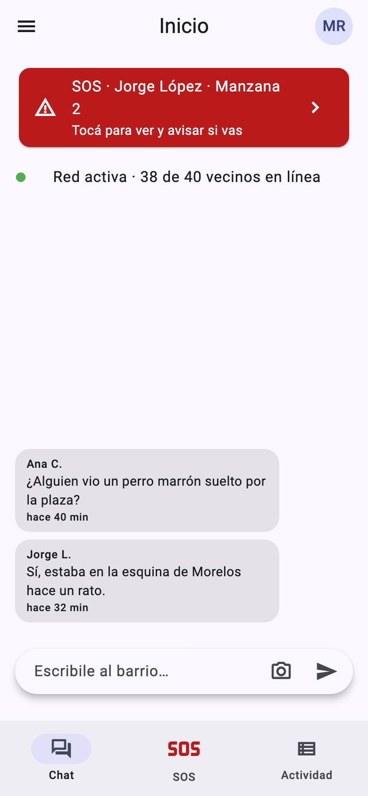
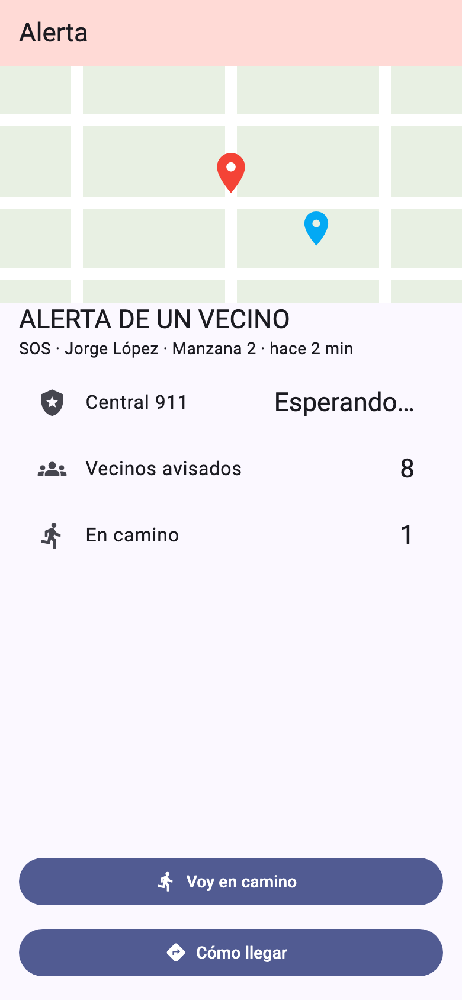
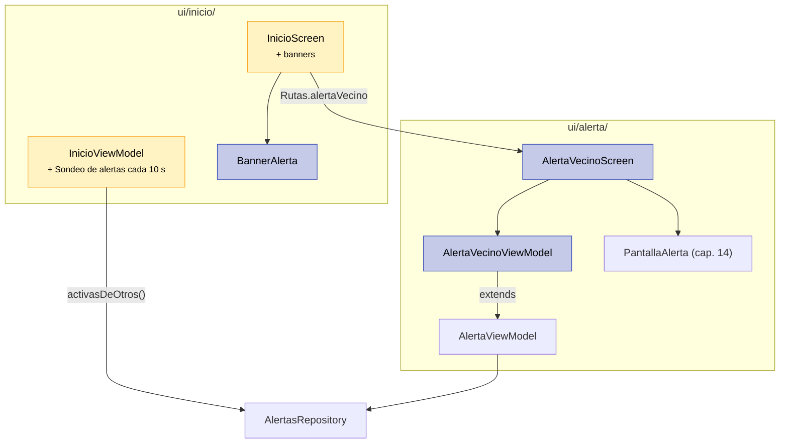
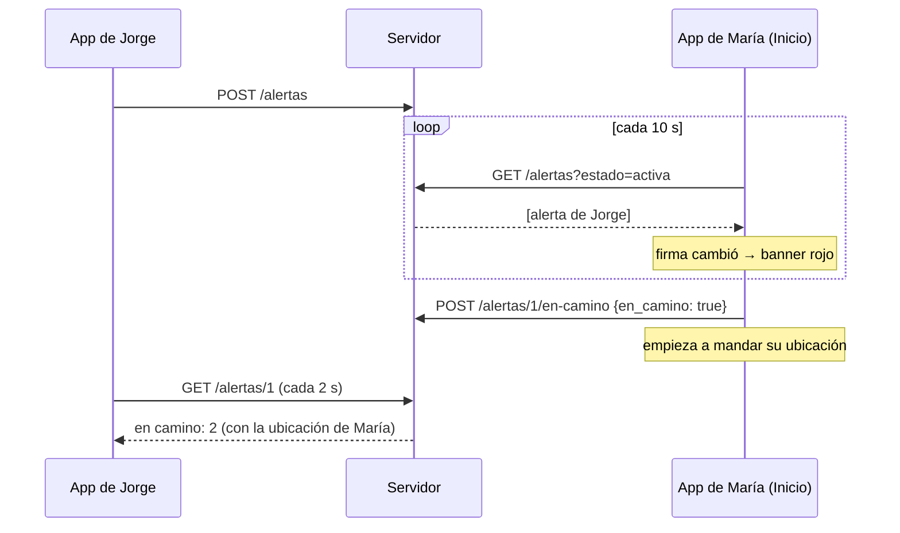

# 15. Alertas de vecinos

!!! abstract "Objetivo"
    Del otro lado del SOS: cuando **otro** vecino dispara una alerta, en tu Inicio aparece un **banner rojo** (el Inicio consulta cada 10 segundos). Al tocarlo se abre la alerta del vecino:

    - el mapa con dónde está quien la disparó y los que van en camino;
    - el botón **Voy en camino**: mientras vas, se comparte tu ubicación;
    - si sos del comité, además **Confirmar 911** y **Resolver**.

<div class="capturas" markdown>
<figure markdown="span">
  { .captura }
  <figcaption>El banner en el Inicio</figcaption>
</figure>
<figure markdown="span">
  { .captura }
  <figcaption>La alerta de un vecino</figcaption>
</figure>
</div>

## Dónde estamos

Reusamos casi todo el capítulo 14: el `AlertaViewModel` abstracto, `PantallaAlerta`, el mapa y la triple confirmación. Lo nuevo es la **otra hija** del ViewModel abstracto, su pantalla, el banner y el sondeo de alertas en el Inicio.



## Cómo se entera el Inicio



## Paso 1: el ViewModel de la alerta de un vecino

Creá `lib/ui/alerta/view_model/alerta_vecino_view_model.dart`:

<!-- archivo: lib/ui/alerta/view_model/alerta_vecino_view_model.dart cap=c15 notas="required EstadoAlerta alerta,|\}\) : super\(alertaId: alerta.id, estadoInicial: alerta\);|@override|EstadoAlerta get estado => super.estado!;|_compartirSiVoy\(\);|super.iniciar\(\);|void mostrar\(EstadoAlerta estado\) \{|super.mostrar\(estado\);|if \(estado.activa && estado.voyEnCamino\) \{|Future<Resultado<void>> marcarEnCamino\(bool voy\) => _accion\(|await consultar\(\);|Future<Resultado<void>> _accion|if \(e.codigo == 409\) await consultar\(\);|rethrow;" -->
```dart title="lib/ui/alerta/view_model/alerta_vecino_view_model.dart" linenums="1"
// lib/ui/alerta/view_model/alerta_vecino_view_model.dart
//
// Alerta SOS de OTRO vecino (RF-10, RF-11): aviso "Voy en camino" y, si soy
// del comité, confirmo el 911 y la resuelvo. Comparto mi ubicación solo
// mientras voy en camino a una alerta activa.

import '../../../data/services/errores.dart';
import '../../../domain/models/alerta.dart';
import '../../../domain/models/sesion.dart';
import '../../../utils/resultado.dart';
import 'alerta_view_model.dart';

class AlertaVecinoViewModel extends AlertaViewModel {
  AlertaVecinoViewModel({
    required EstadoAlerta alerta,  // (1)!
    required this.vecino,
    required super.alertas,
    required super.fotos,
    required super.ubicacion,
    required super.lanzador,
  }) : super(alertaId: alerta.id, estadoInicial: alerta);  // (2)!

  /// Quién está mirando (para los botones del comité).
  final VecinoSesion vecino;

  /// Arranca con la que vino en la lista del Inicio: nunca es null.
  @override  // (3)!
  EstadoAlerta get estado => super.estado!;  // (4)!

  bool get esComite => vecino.esComite;

  @override
  void iniciar() {
    _compartirSiVoy();  // (5)!
    // La del listado no trae dónde están los que van: la pedimos ya.
    super.iniciar();  // (6)!
  }

  @override
  void mostrar(EstadoAlerta estado) {  // (7)!
    super.mostrar(estado);  // (8)!
    _compartirSiVoy();
  }

  // "Ya no voy" o que la cierren cortan la ubicación.
  void _compartirSiVoy() {
    if (estado.activa && estado.voyEnCamino) {  // (9)!
      compartirUbicacion();
    } else {
      dejarDeCompartir();
    }
  }

  Future<Resultado<void>> marcarEnCamino(bool voy) => _accion(  // (10)!
    () async => mostrar(await alertas.marcarEnCamino(alertaId, voy: voy)),
  );

  Future<Resultado<void>> confirmar911() =>
      _accion(() async => mostrar(await alertas.confirmar911(alertaId)));

  Future<Resultado<void>> resolver() => _accion(() async {
    await alertas.resolver(alertaId);
    await consultar();  // (11)!
  });

  // Deshabilita los botones mientras espera. Si la alerta ya se cerró (409),
  // la vuelve a consultar para mostrar cómo terminó.
  Future<Resultado<void>> _accion(Future<void> Function() pedido) {  // (12)!
    return ejecutar(() async {
      try {
        await pedido();
      } on ApiException catch (e) {
        if (e.codigo == 409) await consultar();  // (13)!
        rethrow;  // (14)!
      }
    });
  }
}
```
<!-- /archivo -->

1. Recibe la alerta entera (la que vino en la lista del Inicio)…
2. …y le pasa a la madre el id y el estado inicial. `super(...)` en la lista de inicialización llama al constructor de la madre.
3. `@override` sobre un **getter**: también se pueden reemplazar.
4. En la madre, `estado` es `EstadoAlerta?` (puede ser null mientras llega la primera consulta). Acá **nunca** es null, porque arranca con la del Inicio: el `!` lo asegura una vez y la pantalla no tiene que preguntar. Una hija puede devolver un tipo **más preciso** que la madre.
5. Si al abrir ya iba en camino (lo marcó antes), sigue compartiendo.
6. Y arranca el sondeo de la madre.
7. Reemplaza `mostrar` para agregar algo…
8. …después de hacer lo de la madre.
9. Compartir la ubicación **solo** si la alerta sigue activa y voy en camino. Si dejo de ir o se cierra, se corta.
10. Cada acción pasa por `_accion`. La respuesta del servidor (la alerta actualizada) se muestra enseguida.
11. Resolver no devuelve el estado: se consulta.
12. El envoltorio de todas las acciones:
13. un **409** (conflicto) significa que la alerta ya se cerró (otro la resolvió). Antes de mostrar el error, se consulta para ver cómo terminó…
14. …y `rethrow` vuelve a lanzar el **mismo** error, para que `ejecutar` lo convierta en `Fallo` y la pantalla muestre el mensaje.

## Paso 2: la pantalla

Creá `lib/ui/alerta/widgets/alerta_vecino_screen.dart`:

<!-- archivo: lib/ui/alerta/widgets/alerta_vecino_screen.dart cap=c15 notas="Future<void> _hacer\(Future<Resultado<void>> accion\)|final estado = _viewModel.estado;|\?estado.manzana,|if \(estado.creadaEn case final creadaEn\?\) haceCuanto\(creadaEn\)|botones: !estado.activa|if \(estado.voyEnCamino\)|if \(lat != null && lng != null\) \.\.\.\[|if \(_viewModel.esComite\) \.\.\.\[|if \(!estado.central911Confirmada\) \.\.\.\[" -->
```dart title="lib/ui/alerta/widgets/alerta_vecino_screen.dart" linenums="1"
// lib/ui/alerta/widgets/alerta_vecino_screen.dart
//
// Alerta SOS de OTRO vecino (RF-10, RF-11). Se abre desde el banner del
// Inicio. Deja avisar "Voy en camino"; el comité además confirma el 911 y la
// resuelve. El mapa de fondo muestra dónde está quien la disparó y dónde
// están los que van (mismo diseño que la Alerta Activa: pantalla_alerta.dart).

import 'package:flutter/material.dart';

import '../../../utils/fechas.dart';
import '../../../utils/resultado.dart';
import '../../core/widgets/avisos.dart';
import '../view_model/alerta_vecino_view_model.dart';
import 'confirmacion_tile.dart';
import 'pantalla_alerta.dart';

class AlertaVecinoScreen extends StatefulWidget {
  const AlertaVecinoScreen({required this.viewModel, super.key});

  final AlertaVecinoViewModel viewModel;

  @override
  State<AlertaVecinoScreen> createState() => _AlertaVecinoScreenState();
}

class _AlertaVecinoScreenState extends State<AlertaVecinoScreen> {
  // Se toma una sola vez: si el padre se redibuja, la pantalla sigue con el
  // mismo ViewModel (el que después descarta en dispose).
  late final AlertaVecinoViewModel _viewModel = widget.viewModel;

  @override
  void initState() {
    super.initState();
    _viewModel.iniciar();
  }

  @override
  void dispose() {
    _viewModel.dispose(); // corta el polling y deja de mandar dónde estoy
    super.dispose();
  }

  // Si la acción falla, muestra el mensaje de la API (409 = ya se cerró).
  Future<void> _hacer(Future<Resultado<void>> accion) async {  // (1)!
    final resultado = await accion;
    if (mounted) avisarSiFallo(context, resultado);
  }

  @override
  Widget build(BuildContext context) {
    return ListenableBuilder(
      listenable: _viewModel,
      builder: (context, _) {
        final estado = _viewModel.estado;  // (2)!
        final ocupado = _viewModel.ocupado;
        final lat = estado.lat;
        final lng = estado.lng;
        return PantallaAlerta(
          estado: estado,
          onComoLlegar: _viewModel.comoLlegar,
          tarjeta: [
            Text(
              'ALERTA DE UN VECINO',
              style: Theme.of(context).textTheme.titleLarge,
            ),
            Text(
              [
                'SOS · ${estado.vecinoNombre ?? 'Vecino'}',
                ?estado.manzana,  // (3)!
                if (estado.creadaEn case final creadaEn?) haceCuanto(creadaEn),  // (4)!
              ].join(' · '),
            ),
            const SizedBox(height: 8),
            ...confirmaciones(estado),
            if (_viewModel.avisoUbicacion case final aviso?)
              avisoUbicacion(aviso),
            // La foto que mandó quien disparó la alerta (llega con el
            // polling, apenas la sube).
            if (estado.fotoId case final fotoId?)
              fotoDeAlerta(fotoId, _viewModel.cargarFoto),
          ],
          botones: !estado.activa  // (5)!
              ? [Text(textoCierre(estado), textAlign: TextAlign.center)]
              : [
                  if (estado.voyEnCamino)  // (6)!
                    OutlinedButton(
                      onPressed: ocupado
                          ? null
                          : () => _hacer(_viewModel.marcarEnCamino(false)),
                      child: const Text('Ya no voy'),
                    )
                  else
                    FilledButton.icon(
                      onPressed: ocupado
                          ? null
                          : () => _hacer(_viewModel.marcarEnCamino(true)),
                      icon: const Icon(Icons.directions_run),
                      label: const Text('Voy en camino'),
                    ),
                  if (lat != null && lng != null) ...[  // (7)!
                    const SizedBox(height: 12),
                    FilledButton.icon(
                      onPressed: () => _viewModel.comoLlegar(lat, lng),
                      icon: const Icon(Icons.directions),
                      label: const Text('Cómo llegar'),
                    ),
                  ],
                  if (_viewModel.esComite) ...[  // (8)!
                    if (!estado.central911Confirmada) ...[  // (9)!
                      const SizedBox(height: 12),
                      OutlinedButton.icon(
                        onPressed: ocupado
                            ? null
                            : () => _hacer(_viewModel.confirmar911()),
                        icon: const Icon(Icons.local_police),
                        label: const Text('Confirmar 911'),
                      ),
                    ],
                    TextButton(
                      onPressed: ocupado
                          ? null
                          : () => _hacer(_viewModel.resolver()),
                      child: const Text('Resolver alerta'),
                    ),
                  ],
                ],
        );
      },
    );
  }
}
```
<!-- /archivo -->

1. Un ayudante: recibe el `Future` de cualquier acción, lo espera y, si falló, muestra el motivo.
2. Acá `estado` no es `EstadoAlerta?` sino `EstadoAlerta`: gracias al getter de la hija, no hay que preguntar por null.
3. **Elemento opcional en una lista** (`?valor`): si la manzana es `null`, no se agrega. Es una novedad de Dart 3.8. Ver [Colecciones](../2-dart/4-colecciones.md#elementos-opcionales).
4. Un `if case` dentro de la lista: solo si hay fecha.
5. Si la alerta ya no está activa, solo el texto de cómo terminó.
6. "Voy en camino" o "Ya no voy", según lo que ya marqué.
7. "Cómo llegar" solo si hay ubicación.
8. Lo del comité, solo para el comité.
9. Y "Confirmar 911" solo si todavía no se confirmó.

## Paso 3: el banner

Creá `lib/ui/inicio/widgets/banner_alerta.dart`:

<!-- archivo: lib/ui/inicio/widgets/banner_alerta.dart cap=c15 notas="color: colorScheme.error,|alerta.voyEnCamino" -->
```dart title="lib/ui/inicio/widgets/banner_alerta.dart" linenums="1"
// lib/ui/inicio/widgets/banner_alerta.dart

import 'package:flutter/material.dart';

import '../../../domain/models/alerta.dart';

/// Banner rojo de una alerta SOS de otro vecino.
class BannerAlerta extends StatelessWidget {
  const BannerAlerta({required this.alerta, required this.onTap, super.key});

  final EstadoAlerta alerta;
  final VoidCallback onTap;

  @override
  Widget build(BuildContext context) {
    final colorScheme = Theme.of(context).colorScheme;
    final estiloTexto = TextStyle(color: colorScheme.onError);
    return Padding(
      padding: const EdgeInsets.fromLTRB(16, 12, 16, 0),
      child: Card(
        color: colorScheme.error,  // (1)!
        child: ListTile(
          leading: Icon(Icons.warning_amber, color: colorScheme.onError),
          title: Text(
            'SOS · ${alerta.vecinoNombre ?? 'Vecino'} · ${alerta.manzana ?? ''}',
            style: estiloTexto,
          ),
          subtitle: Text(
            alerta.voyEnCamino  // (2)!
                ? 'Avisaste que vas en camino · ${alerta.enCamino} en camino'
                : 'Tocá para ver y avisar si vas',
            style: estiloTexto,
          ),
          trailing: Icon(Icons.chevron_right, color: colorScheme.onError),
          onTap: onTap,
        ),
      ),
    );
  }
}
```
<!-- /archivo -->

1. Rojo (el color de error del tema): tiene que verse de lejos.
2. El texto cambia si ya avisé que voy.

## Paso 4: el Inicio consulta las alertas

El `InicioViewModel` suma un segundo sondeo, cada 10 segundos, para las alertas de otros vecinos. Ya está **completo**:

<!-- diff: lib/ui/inicio/view_model/inicio_view_model.dart cap=c15 -->
```diff title="Qué cambia en lib/ui/inicio/view_model/inicio_view_model.dart"
--- lib/ui/inicio/view_model/inicio_view_model.dart (cap. 14)
+++ lib/ui/inicio/view_model/inicio_view_model.dart (cap. 15)
@@ -9,7 +9,9 @@
 import '../../../data/services/errores.dart';
 import '../../../data/services/lanzador_externo.dart';
+import '../../../domain/models/alerta.dart';
 import '../../../domain/models/publicacion.dart';
 import '../../../domain/models/sesion.dart';
 import '../../../utils/resultado.dart';
+import '../../../utils/sondeo.dart';
 import '../../chat/view_model/chat_view_model.dart';
 import '../../core/view_model.dart';
@@ -37,4 +39,12 @@
   final ChatViewModel chat;
 
+  // Alertas SOS de otros vecinos. Sin push, se consultan cada 10 s (RF-10).
+  late final _sondeoAlertas = Sondeo(
+    const Duration(seconds: 10),
+    _cargarAlertas,
+  );
+  List<EstadoAlerta> _alertasVecinos = [];
+  String _firmaAlertas = ''; // para avisar solo si algo cambió
+
   EstadoBarrio? _barrio;
   List<Publicacion> _actividad = [];
@@ -46,4 +56,5 @@
   /// El Inicio solo existe con la sesión iniciada.
   VecinoSesion get vecino => _sesion.vecino!;
+  List<EstadoAlerta> get alertasVecinos => _alertasVecinos.soloLectura;
 
   /// null mientras se conecta.
@@ -58,4 +69,5 @@
     cargarDatos();
     rondin.cargarSemana();
+    _sondeoAlertas.iniciar();
     chat.iniciar();
   }
@@ -64,8 +76,10 @@
   // consulta enseguida y se retoma cada 10 s.
   void pausar() {
+    _sondeoAlertas.detener();
     chat.pausar();
   }
 
   void reanudar() {
+    _sondeoAlertas.iniciar();
     if (_verChat) chat.iniciar();
   }
@@ -97,4 +111,25 @@
     _cargando = false;
     notifyListeners();
+  }
+
+  /// Vuelve a consultar ya (p. ej. al volver de una alerta, que pudo
+  /// haberse cerrado).
+  Future<void> recargarAlertas() => _cargarAlertas();
+
+  Future<void> _cargarAlertas() async {
+    try {
+      final deOtros = await _alertas.activasDeOtros(_sesion.vecino?.id);
+      // Casi siempre no cambia nada: así no se redibuja todo el Inicio
+      // cada 10 s.
+      final firma = [
+        for (final a in deOtros) '${a.id}:${a.enCamino}:${a.miRespuesta}',
+      ].join(',');
+      if (firma == _firmaAlertas) return;
+      _firmaAlertas = firma;
+      _alertasVecinos = deOtros;
+      notifyListeners();
+    } on ApiException {
+      // Sin conexión: se reintenta en 10 s.
+    }
   }
 
@@ -129,4 +164,5 @@
   @override
   void dispose() {
+    _sondeoAlertas.detener();
     chat.dispose();
     super.dispose();
```
<!-- /diff -->

<!-- archivo: lib/ui/inicio/view_model/inicio_view_model.dart cap=c15 notas="late final _sondeoAlertas = Sondeo\(|String _firmaAlertas = ''|_sondeoAlertas.iniciar\(\);|_sondeoAlertas.detener\(\);|Future<void> recargarAlertas\(\) => _cargarAlertas\(\)|final deOtros = await _alertas.activasDeOtros|final firma = \[|if \(firma == _firmaAlertas\) return;|_sondeoAlertas.detener\(\);" -->
```dart title="lib/ui/inicio/view_model/inicio_view_model.dart" linenums="1" hl_lines="11 15 41-48 58 71 78 83 113-133 166"
// lib/ui/inicio/view_model/inicio_view_model.dart
//
// Pantalla de Inicio: el estado de la red, la actividad del barrio, las
// alertas SOS de otros vecinos y el chat.

import '../../../data/repositories/alertas_repository.dart';
import '../../../data/repositories/publicaciones_repository.dart';
import '../../../data/repositories/sesion_repository.dart';
import '../../../data/services/errores.dart';
import '../../../data/services/lanzador_externo.dart';
import '../../../domain/models/alerta.dart';
import '../../../domain/models/publicacion.dart';
import '../../../domain/models/sesion.dart';
import '../../../utils/resultado.dart';
import '../../../utils/sondeo.dart';
import '../../chat/view_model/chat_view_model.dart';
import '../../core/view_model.dart';
import '../../rondines/view_model/rondin_view_model.dart';

class InicioViewModel extends ViewModel {
  InicioViewModel({
    required this._sesion,
    required this._publicaciones,
    required this._alertas,
    required this._lanzador,
    required this.rondin,
    required this.chat,
  });

  final SesionRepository _sesion;
  final PublicacionesRepository _publicaciones;
  final AlertasRepository _alertas;
  final LanzadorExterno _lanzador;

  /// Compartido con Recorridos: lo descarta MyApp, no este ViewModel.
  final RondinViewModel rondin;

  /// Propio: se descarta junto con el Inicio.
  final ChatViewModel chat;

  // Alertas SOS de otros vecinos. Sin push, se consultan cada 10 s (RF-10).
  late final _sondeoAlertas = Sondeo(  // (1)!
    const Duration(seconds: 10),
    _cargarAlertas,
  );
  List<EstadoAlerta> _alertasVecinos = [];
  String _firmaAlertas = ''; // para avisar solo si algo cambió (2)

  EstadoBarrio? _barrio;
  List<Publicacion> _actividad = [];
  int _cantidadNoticias = 0;
  bool _cargando = true;
  String? _error;
  bool _verChat = true; // el Inicio abre en el chat; "Actividad" es el feed

  /// El Inicio solo existe con la sesión iniciada.
  VecinoSesion get vecino => _sesion.vecino!;
  List<EstadoAlerta> get alertasVecinos => _alertasVecinos.soloLectura;

  /// null mientras se conecta.
  EstadoBarrio? get barrio => _barrio;
  List<Publicacion> get actividad => _actividad.soloLectura;
  int get cantidadNoticias => _cantidadNoticias;
  bool get cargando => _cargando;
  String? get error => _error;
  bool get verChat => _verChat;

  void iniciar() {
    cargarDatos();
    rondin.cargarSemana();
    _sondeoAlertas.iniciar();  // (3)!
    chat.iniciar();
  }

  // En segundo plano no se consulta (batería y datos); al volver, se
  // consulta enseguida y se retoma cada 10 s.
  void pausar() {
    _sondeoAlertas.detener();  // (4)!
    chat.pausar();
  }

  void reanudar() {
    _sondeoAlertas.iniciar();
    if (_verChat) chat.iniciar();
  }

  /// Cambia entre la pestaña del chat y la de actividad.
  void mostrarChat(bool verChat) {
    _verChat = verChat;
    verChat ? chat.iniciar() : chat.pausar();
    notifyListeners();
  }

  Future<void> cargarDatos() async {
    _cargando = true;
    _error = null;
    notifyListeners();
    try {
      // Los tres pedidos salen a la vez (Future.wait): unos 180 ms en total
      // en vez de unos 550 ms uno detrás del otro.
      final barrio = _publicaciones.obtenerEstadoBarrio();
      final actividad = _publicaciones.obtenerActividad();
      final noticias = _publicaciones.obtenerNoticias();
      await Future.wait([barrio, actividad, noticias]);
      _barrio = await barrio;
      _actividad = await actividad;
      _cantidadNoticias = (await noticias).length;
    } on ApiException {
      _error = 'Sin conexión con la red del barrio';
    }
    _cargando = false;
    notifyListeners();
  }

  /// Vuelve a consultar ya (p. ej. al volver de una alerta, que pudo
  /// haberse cerrado).
  Future<void> recargarAlertas() => _cargarAlertas();  // (5)!

  Future<void> _cargarAlertas() async {
    try {
      final deOtros = await _alertas.activasDeOtros(_sesion.vecino?.id);  // (6)!
      // Casi siempre no cambia nada: así no se redibuja todo el Inicio
      // cada 10 s.
      final firma = [  // (7)!
        for (final a in deOtros) '${a.id}:${a.enCamino}:${a.miRespuesta}',
      ].join(',');
      if (firma == _firmaAlertas) return;  // (8)!
      _firmaAlertas = firma;
      _alertasVecinos = deOtros;
      notifyListeners();
    } on ApiException {
      // Sin conexión: se reintenta en 10 s.
    }
  }

  /// Una publicación propia (o cualquiera, si es del comité) se borra del
  /// servidor; una ajena solo se oculta de la lista.
  bool puedeBorrar(Publicacion publicacion) =>
      vecino.puedeBorrar(autorId: publicacion.autorId);

  Future<Resultado<void>> borrar(Publicacion publicacion) => ejecutar(
    () => _publicaciones.borrar(publicacion.id),
    marcarOcupado: false,
  );

  /// Saca la publicación de la lista (al deslizarla).
  void quitar(Publicacion publicacion) {
    _actividad = [
      for (final p in _actividad)
        if (p.id != publicacion.id) p,
    ];
    notifyListeners();
  }

  /// POST /alertas. Devuelve el id de la alerta creada.
  Future<Resultado<int>> dispararAlerta() =>
      ejecutar(_alertas.crear, marcarOcupado: false);

  Future<void> llamarEmergencia() => _lanzador.llamarEmergencia();

  /// MyApp vuelve solo al Login (escucha SesionRepository).
  Future<void> cerrarSesion() => _sesion.logout();

  @override
  void dispose() {
    _sondeoAlertas.detener();  // (9)!
    chat.dispose();
    super.dispose();
  }
}
```
<!-- /archivo -->

1. El segundo sondeo del Inicio.
2. Una "firma" de las alertas que se vieron por última vez. Para qué sirve, en la nota 8.
3. Al iniciar, empieza a consultar.
4. En segundo plano, se pausa (igual que el chat).
5. Para consultar ya, sin esperar: lo usa la pantalla al volver de una alerta.
6. Las activas que no son mías (la lógica del repositorio, capítulo 14).
7. Un texto con lo que importa de cada alerta: id, cuántos van y mi respuesta. Por ejemplo, `"1:1:notificado"`.
8. Si es igual a la anterior, **no avisa**. Casi siempre no hay alertas, o son las mismas: así el Inicio no se redibuja cada 10 segundos.
9. Al descartar el Inicio, se detiene.

La pantalla muestra un banner por alerta, arriba de todo:

<!-- diff: lib/ui/inicio/widgets/inicio_screen.dart cap=c15 -->
```diff title="Qué cambia en lib/ui/inicio/widgets/inicio_screen.dart"
--- lib/ui/inicio/widgets/inicio_screen.dart (cap. 14)
+++ lib/ui/inicio/widgets/inicio_screen.dart (cap. 15)
@@ -7,4 +7,5 @@
 import 'package:flutter/material.dart';
 
+import '../../../domain/models/alerta.dart';
 import '../../../domain/models/publicacion.dart';
 import '../../../routing/rutas.dart';
@@ -13,4 +14,5 @@
 import '../../core/widgets/avisos.dart';
 import '../view_model/inicio_view_model.dart';
+import 'banner_alerta.dart';
 import 'barra_inferior.dart';
 import 'estado_red.dart';
@@ -51,4 +53,9 @@
     _viewModel.dispose();
     super.dispose();
+  }
+
+  Future<void> _abrirAlertaVecino(EstadoAlerta alerta) async {
+    await Rutas.alertaVecino(context, alerta);
+    _viewModel.recargarAlertas(); // al volver, puede haberse cerrado
   }
 
@@ -143,4 +150,9 @@
             child: Column(
               children: [
+                for (final alerta in _viewModel.alertasVecinos)
+                  BannerAlerta(
+                    alerta: alerta,
+                    onTap: () => _abrirAlertaVecino(alerta),
+                  ),
                 EstadoRed(barrio: _viewModel.barrio),
                 Expanded(
```
<!-- /diff -->

<!-- archivo: lib/ui/inicio/widgets/inicio_screen.dart cap=c15 notas="await Rutas.alertaVecino\(context, alerta\);|_viewModel.recargarAlertas\(\);|for \(final alerta in _viewModel.alertasVecinos\)" -->
```dart title="lib/ui/inicio/widgets/inicio_screen.dart" linenums="1" hl_lines="9 16 55-59 152-156"
// lib/ui/inicio/widgets/inicio_screen.dart
//
// Pantalla de Inicio. Arriba el estado de la red y los avisos de SOS de
// otros vecinos; en el medio el chat o la actividad del barrio; abajo la
// barra con el botón SOS.

import 'package:flutter/material.dart';

import '../../../domain/models/alerta.dart';
import '../../../domain/models/publicacion.dart';
import '../../../routing/rutas.dart';
import '../../../utils/resultado.dart';
import '../../chat/widgets/chat_vecinos.dart';
import '../../core/widgets/avisos.dart';
import '../view_model/inicio_view_model.dart';
import 'banner_alerta.dart';
import 'barra_inferior.dart';
import 'estado_red.dart';
import 'lista_actividad.dart';
import 'menu_lateral.dart';

class InicioScreen extends StatefulWidget {
  const InicioScreen({required this.viewModel, super.key});

  final InicioViewModel viewModel;

  @override
  State<InicioScreen> createState() => _InicioScreenState();
}

class _InicioScreenState extends State<InicioScreen> {
  // Avisa cuando la app pasa a segundo plano, para no seguir consultando al
  // servidor con el celular guardado.
  late final AppLifecycleListener _cicloDeVida;

  // Se toma una sola vez: si el padre se redibuja, la pantalla sigue con el
  // mismo ViewModel (el que después descarta en dispose).
  late final InicioViewModel _viewModel = widget.viewModel;

  @override
  void initState() {
    super.initState();
    _viewModel.iniciar();
    _cicloDeVida = AppLifecycleListener(
      onPause: _viewModel.pausar,
      onResume: _viewModel.reanudar,
    );
  }

  @override
  void dispose() {
    _cicloDeVida.dispose();
    _viewModel.dispose();
    super.dispose();
  }

  Future<void> _abrirAlertaVecino(EstadoAlerta alerta) async {
    await Rutas.alertaVecino(context, alerta);  // (1)!
    _viewModel.recargarAlertas(); // al volver, puede haberse cerrado (2)
  }

  Future<void> _abrirPublicacion(Publicacion publicacion) async {
    await Rutas.publicacion(context, publicacion.id);
    _viewModel.cargarDatos(); // pudo responder o borrarla
  }

  Future<void> _publicar() async {
    final publicacion = await Rutas.nuevaPublicacion(context);
    if (publicacion != null) _viewModel.cargarDatos();
  }

  // Deslizar una publicación propia (o cualquiera, si es del comité) la borra
  // en el servidor, previa confirmación; una ajena solo se oculta de la lista.
  Future<bool> _confirmarDeslizar(Publicacion publicacion) async {
    if (!_viewModel.puedeBorrar(publicacion)) return true;
    final borrar = await confirmar(
      context,
      titulo: '¿Borrar la publicación?',
      mensaje: 'Se borra para todo el barrio, con sus respuestas.',
    );
    if (!borrar) return false;
    final resultado = await _viewModel.borrar(publicacion);
    if (!mounted) return resultado is Ok;
    return avisarSiFallo(context, resultado);
  }

  // El SOS de la barra abre el modo emergencia; si ahí se desliza el botón
  // 911 hasta arriba, vuelve con true y se dispara la alerta.
  Future<void> _abrirModoEmergencia() async {
    final activar = await Rutas.modoEmergencia(context);
    if (activar == true) _dispararAlerta();
  }

  Future<void> _dispararAlerta() async {
    final resultado = await _viewModel.dispararAlerta(); // POST /alertas
    if (!mounted) return;
    switch (resultado) {
      case Ok(valor: final alertaId):
        Rutas.alertaPropia(context, alertaId);
      case Fallo():
        ScaffoldMessenger.of(context).showSnackBar(
          SnackBar(
            content: const Text('No se pudo enviar la alerta. Llamá al 911.'),
            duration: const Duration(seconds: 10),
            action: SnackBarAction(
              label: 'Llamar',
              onPressed: _viewModel.llamarEmergencia,
            ),
          ),
        );
    }
  }

  @override
  Widget build(BuildContext context) {
    return ListenableBuilder(
      listenable: _viewModel,
      builder: (context, _) {
        final vecino = _viewModel.vecino;
        return Scaffold(
          appBar: AppBar(
            leading: Builder(
              builder: (context) => IconButton(
                icon: const Icon(Icons.menu),
                onPressed: () => Scaffold.of(context).openDrawer(),
              ),
            ),
            title: const Text('Inicio'),
            centerTitle: true,
            actions: [
              Padding(
                padding: const EdgeInsets.only(right: 16),
                child: GestureDetector(
                  onTap: () => Rutas.perfil(context),
                  child: CircleAvatar(child: Text(vecino.iniciales)),
                ),
              ),
            ],
          ),
          drawer: MenuLateral(
            vecino: vecino,
            cantidadNoticias: _viewModel.cantidadNoticias,
            onRecorridos: () => Rutas.recorridos(context),
            onNoticias: () => Rutas.noticias(context),
            onPerfil: () => Rutas.perfil(context),
            onCerrarSesion: _viewModel.cerrarSesion,
          ),
          body: SafeArea(
            bottom: false, // abajo está la barra con el SOS
            child: Column(
              children: [
                for (final alerta in _viewModel.alertasVecinos)  // (3)!
                  BannerAlerta(
                    alerta: alerta,
                    onTap: () => _abrirAlertaVecino(alerta),
                  ),
                EstadoRed(barrio: _viewModel.barrio),
                Expanded(
                  child: _viewModel.verChat
                      ? ChatVecinos(viewModel: _viewModel.chat)
                      : ListaActividad(
                          viewModel: _viewModel,
                          onPublicar: _publicar,
                          onVerTodo: () => Rutas.noticias(context),
                          onAbrir: _abrirPublicacion,
                          onAbrirRondin: () => Rutas.recorridos(context),
                          confirmarDeslizar: _confirmarDeslizar,
                        ),
                ),
              ],
            ),
          ),
          // Con el teclado abierto (escribiendo en el chat) no entra todo: la
          // barra con el SOS vuelve apenas se cierra el teclado.
          bottomNavigationBar: MediaQuery.viewInsetsOf(context).bottom == 0
              ? BarraInferior(
                  enChat: _viewModel.verChat,
                  onChat: () => _viewModel.mostrarChat(true),
                  onActividad: () => _viewModel.mostrarChat(false),
                  onSos: _abrirModoEmergencia,
                )
              : null,
        );
      },
    );
  }
}
```
<!-- /archivo -->

1. Abre la alerta y espera a que se cierre…
2. …y al volver consulta enseguida: pudo haberse resuelto.
3. Un banner por cada alerta activa de otros vecinos (casi siempre ninguna).

`Rutas` suma `alertaVecino`:

<!-- diff: lib/routing/rutas.dart cap=c15 -->
```diff title="Qué cambia en lib/routing/rutas.dart"
--- lib/routing/rutas.dart (cap. 14)
+++ lib/routing/rutas.dart (cap. 15)
@@ -11,7 +11,10 @@
 
 import '../dependencias.dart';
+import '../domain/models/alerta.dart';
 import '../domain/models/publicacion.dart';
 import '../ui/alerta/view_model/alerta_propia_view_model.dart';
+import '../ui/alerta/view_model/alerta_vecino_view_model.dart';
 import '../ui/alerta/widgets/alerta_propia_screen.dart';
+import '../ui/alerta/widgets/alerta_vecino_screen.dart';
 import '../ui/elegir_clave/view_model/elegir_clave_view_model.dart';
 import '../ui/elegir_clave/widgets/elegir_clave_screen.dart';
@@ -107,3 +110,16 @@
     return _abrir(context, AlertaPropiaScreen(viewModel: viewModel));
   }
+
+  static Future<void> alertaVecino(BuildContext context, EstadoAlerta alerta) {
+    final d = Dependencias.of(context);
+    final viewModel = AlertaVecinoViewModel(
+      alerta: alerta,
+      vecino: d.sesion.vecino!,
+      alertas: d.alertas,
+      fotos: d.fotos,
+      ubicacion: d.ubicacion,
+      lanzador: d.lanzador,
+    );
+    return _abrir(context, AlertaVecinoScreen(viewModel: viewModel));
+  }
 }
```
<!-- /diff -->

<!-- archivo: lib/routing/rutas.dart cap=c15 -->
```dart title="lib/routing/rutas.dart" linenums="1" hl_lines="13 16 18 112-124"
// lib/routing/rutas.dart
//
// Navegación de la app. Cada método arma el ViewModel de la pantalla con los
// repositorios de Dependencias y la abre. Así las vistas solo dicen "abrí el
// perfil" y nunca tocan un repositorio.
//
// El ViewModel se crea UNA vez, afuera del builder de la ruta: el builder se
// puede volver a ejecutar, y crearía otro ViewModel distinto.

import 'package:flutter/material.dart';

import '../dependencias.dart';
import '../domain/models/alerta.dart';
import '../domain/models/publicacion.dart';
import '../ui/alerta/view_model/alerta_propia_view_model.dart';
import '../ui/alerta/view_model/alerta_vecino_view_model.dart';
import '../ui/alerta/widgets/alerta_propia_screen.dart';
import '../ui/alerta/widgets/alerta_vecino_screen.dart';
import '../ui/elegir_clave/view_model/elegir_clave_view_model.dart';
import '../ui/elegir_clave/widgets/elegir_clave_screen.dart';
import '../ui/emergencia/widgets/modo_emergencia_screen.dart';
import '../ui/noticias/view_model/noticias_view_model.dart';
import '../ui/noticias/widgets/noticias_screen.dart';
import '../ui/perfil/view_model/perfil_view_model.dart';
import '../ui/perfil/widgets/perfil_screen.dart';
import '../ui/publicacion/view_model/nueva_publicacion_view_model.dart';
import '../ui/publicacion/view_model/publicacion_view_model.dart';
import '../ui/publicacion/widgets/nueva_publicacion_screen.dart';
import '../ui/publicacion/widgets/publicacion_screen.dart';
import '../ui/rondines/widgets/recorridos_screen.dart';

abstract final class Rutas {
  static Future<T?> _abrir<T>(BuildContext context, Widget pantalla) {
    return Navigator.push<T>(
      context,
      MaterialPageRoute(builder: (context) => pantalla),
    );
  }

  /// Invitación o recuperación de la clave. [token] viene del enlace del
  /// correo, si la app se abrió desde ahí.
  static Future<void> elegirClave(BuildContext context, {String? token}) {
    final viewModel = ElegirClaveViewModel(
      Dependencias.of(context).sesion,
      tokenDelCorreo: token,
    );
    return _abrir(context, ElegirClaveScreen(viewModel: viewModel));
  }

  static Future<void> perfil(BuildContext context) {
    final viewModel = PerfilViewModel(Dependencias.of(context).sesion);
    return _abrir(context, PerfilScreen(viewModel: viewModel));
  }

  /// El RondinViewModel es compartido con el Inicio: no se crea uno nuevo.
  static Future<void> recorridos(BuildContext context) {
    final viewModel = Dependencias.of(context).rondin;
    return _abrir(context, RecorridosScreen(viewModel: viewModel));
  }

  static Future<void> noticias(BuildContext context) {
    final d = Dependencias.of(context);
    final viewModel = NoticiasViewModel(
      d.publicaciones,
      vecino: d.sesion.vecino,
    );
    return _abrir(context, NoticiasScreen(viewModel: viewModel));
  }

  static Future<void> publicacion(BuildContext context, int publicacionId) {
    final d = Dependencias.of(context);
    final viewModel = PublicacionViewModel(
      publicacionId: publicacionId,
      publicaciones: d.publicaciones,
      fotos: d.fotos,
      vecino: d.sesion.vecino,
    );
    return _abrir(context, PublicacionScreen(viewModel: viewModel));
  }

  /// Devuelve la publicación creada (null si no publicó).
  static Future<Publicacion?> nuevaPublicacion(
    BuildContext context, {
    String tipo = TipoPublicacion.actividad,
  }) {
    final d = Dependencias.of(context);
    final viewModel = NuevaPublicacionViewModel(
      publicaciones: d.publicaciones,
      fotos: d.fotos,
      vecino: d.sesion.vecino!,
      tipo: tipo,
    );
    return _abrir(context, NuevaPublicacionScreen(viewModel: viewModel));
  }

  /// Devuelve true si el vecino deslizó el 911 hasta arriba.
  static Future<bool?> modoEmergencia(BuildContext context) =>
      _abrir(context, const ModoEmergenciaScreen());

  static Future<void> alertaPropia(BuildContext context, int alertaId) {
    final d = Dependencias.of(context);
    final viewModel = AlertaPropiaViewModel(
      alertaId: alertaId,
      vecino: d.sesion.vecino!,
      alertas: d.alertas,
      fotos: d.fotos,
      ubicacion: d.ubicacion,
      lanzador: d.lanzador,
    );
    return _abrir(context, AlertaPropiaScreen(viewModel: viewModel));
  }

  static Future<void> alertaVecino(BuildContext context, EstadoAlerta alerta) {
    final d = Dependencias.of(context);
    final viewModel = AlertaVecinoViewModel(
      alerta: alerta,
      vecino: d.sesion.vecino!,
      alertas: d.alertas,
      fotos: d.fotos,
      ubicacion: d.ubicacion,
      lanzador: d.lanzador,
    );
    return _abrir(context, AlertaVecinoScreen(viewModel: viewModel));
  }
}
```
<!-- /archivo -->

## Probalo

El servidor falso puede arrancar con una alerta de Jorge ya activa. En `main.dart`, cambiá un momento `FakeVigiaApi()` por:

```dart
FakeVigiaApi(conAlertaVecino: true)
```

1. Entrá como María: arriba del Inicio aparece **SOS · Jorge López · Manzana 2**.
2. Tocalo. Tocá **Voy en camino**: el contador "En camino" sube y el banner del Inicio va a decir "Avisaste que vas en camino".
3. Cerrá sesión y entrá como `laura@vigia.test`: en la alerta aparecen **Confirmar 911** y **Resolver alerta**. Resolvela: el banner desaparece del Inicio.

Volvé a dejar `FakeVigiaApi()` como estaba.

## Así queda el proyecto

<!-- arbol: cap=c15 -->
```text title="Así queda el proyecto"
vigia_app/
    lib/
        config.dart
        data/
            repositories/
                alertas_repository.dart
                chat_repository.dart
                fotos_repository.dart
                publicaciones_repository.dart
                rondines_repository.dart
                sesion_repository.dart
            services/
                almacen_token.dart
                api/
                    fake_vigia_api.dart
                    vigia_api.dart
                errores.dart
                lanzador_externo.dart
                selector_fotos.dart
                ubicacion_service.dart
        dependencias.dart
        domain/
            models/
                alerta.dart
                comite.dart
                coordenadas.dart
                mensaje.dart
                noticia.dart
                publicacion.dart
                rondin.dart
                sesion.dart
        main.dart
        routing/
            rutas.dart  ← cambia
        ui/
            alerta/
                view_model/
                    alerta_propia_view_model.dart
                    alerta_vecino_view_model.dart  ← nuevo
                    alerta_view_model.dart
                widgets/
                    alerta_propia_screen.dart
                    alerta_vecino_screen.dart  ← nuevo
                    confirmacion_tile.dart
                    mapa_alerta.dart
                    pantalla_alerta.dart
            carga/
                widgets/
                    pantalla_carga.dart
            chat/
                view_model/
                    chat_view_model.dart
                widgets/
                    burbuja_mensaje.dart
                    chat_vecinos.dart
            core/
                view_model.dart
                widgets/
                    avisos.dart
                    elegir_origen_foto.dart
                    estados_carga.dart
                    foto_vigia.dart
            elegir_clave/
                view_model/
                    elegir_clave_view_model.dart
                widgets/
                    elegir_clave_screen.dart
            emergencia/
                widgets/
                    modo_emergencia_screen.dart
            inicio/
                view_model/
                    inicio_view_model.dart  ← cambia
                widgets/
                    banner_alerta.dart  ← nuevo
                    barra_inferior.dart
                    estado_red.dart
                    inicio_screen.dart  ← cambia
                    lista_actividad.dart
                    menu_lateral.dart
                    tarjeta_rondin.dart
            login/
                view_model/
                    login_view_model.dart
                widgets/
                    login_screen.dart
                    recuperar_clave_dialog.dart
            noticias/
                view_model/
                    filas_noticias.dart
                    noticias_view_model.dart
                widgets/
                    noticias_screen.dart
            perfil/
                view_model/
                    perfil_view_model.dart
                widgets/
                    cambiar_clave_dialog.dart
                    perfil_screen.dart
            publicacion/
                view_model/
                    nueva_publicacion_view_model.dart
                    publicacion_view_model.dart
                widgets/
                    nueva_publicacion_screen.dart
                    publicacion_screen.dart
            rondines/
                view_model/
                    rondin_view_model.dart
                widgets/
                    recorridos_screen.dart
        utils/
            fechas.dart
            resultado.dart
            sondeo.dart
            validadores.dart
    pubspec.yaml
    test/
        chat_view_model_test.dart
        elegir_clave_view_model_test.dart
        fake_api_test.dart
        inicio_view_model_test.dart
        login_view_model_test.dart
        modelos_test.dart
        noticias_view_model_test.dart
        publicacion_view_model_test.dart
        rondin_view_model_test.dart
        sesion_repository_test.dart
        utils_test.dart
```
<!-- /arbol -->

## Errores comunes

??? failure "El banner no desaparece después de resolver"
    Falta el `recargarAlertas()` al volver de la alerta, o la firma no incluye algo que cambió.

??? failure "`Null check operator used on a null value` en `super.estado!`"
    Se armó un `AlertaVecinoViewModel` sin estado inicial. Siempre se crea con la `alerta` que vino del Inicio.

## Lo que aprendiste

- [x] Una **segunda subclase** reusa todo lo de la madre y solo agrega lo suyo (`marcarEnCamino`, `confirmar911`).
- [x] Se pueden **sobrescribir getters** y una hija puede devolver un tipo más preciso (`EstadoAlerta` en vez de `EstadoAlerta?`).
- [x] `super.metodo()` hace lo de la madre, y después se agrega lo propio.
- [x] `rethrow` vuelve a lanzar el mismo error después de hacer algo con él.
- [x] Una **firma** evita redibujar cuando un sondeo trae lo mismo de siempre.
- [x] Elementos opcionales en listas: `[?valor]`.

[Siguiente: 16. Comité :material-arrow-right:](16-comite.md){ .md-button .md-button--primary }
